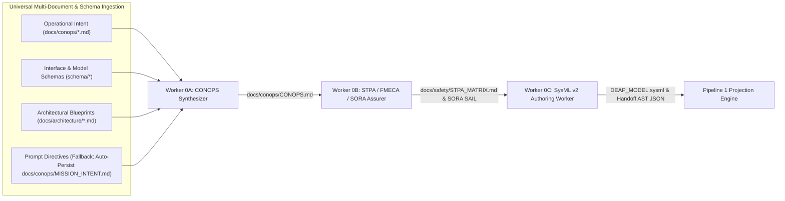
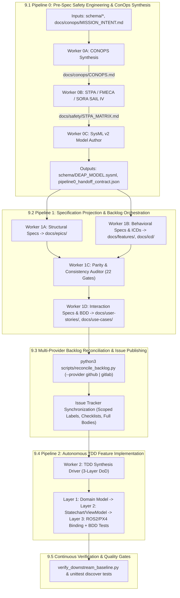

# Digital Engineering Agent Platform (DEAP) — Tactical UAS & Infrastructure Safety Platform

> **Repository Identifier:** `DEAP-uas-infrastructure-safety`  
> **Repository Role:** `DOMAIN_TEMPLATE_CHILD` (Child UAS Infrastructure Safety Specification Template)  
> **Parent Template:** `gintatkinson/DEAP-avionic-flight-safety`  
> **Classification:** `Domain-Specific Safety-Critical Cyber-Physical Platform (Tactical UAS & Infrastructure Inspection)`  
> **Status:** `PRODUCTION-GRADE / ACTIVE`  
> **Primary Commercial Toolchain Integration:** `MATLAB / Simulink / Stateflow / Embedded Coder`  
> **Regulatory Baselines:** `JARUS SORA v2.5 (SAIL IV)` | `ASTM F3269-17 RTA` | `RTCA DO-365B DAA` | `STANAG 4586` | `MIL-STD-882E`  
> **Supported Schema Standards:** `SysML v2 (OMG)` | `OMG IDL` | `AUTOSAR ARXML` | `YANG (Network Topology)` | `OpenAPI v3` | `Protobuf v3`  
> **Multi-Provider Issue Tracking:** `GitHub Issues` | `GitLab Issues` | `Atlassian Jira (Cloud & Data Center)`  

---

## 1. System Overview

The **Digital Engineering Agent Platform (DEAP) — Tactical UAS & Infrastructure Safety Platform (`DEAP-uas-infrastructure-safety`)** is the specialized downstream cyber-physical domain child template (`DOMAIN_TEMPLATE_CHILD`) derived from the canonical parent template `gintatkinson/DEAP-avionic-flight-safety` and upstream compiler `gintatkinson/DEAP01-spec-core`.

The platform provides end-to-end model-based systems engineering (MBSE), formal safety engineering, bidirectional SysML v2 compilation, and automated test-driven feature synthesis for tactical unmanned aerial systems (UAS) operating in critical infrastructure inspection envelopes (e.g. power transmission corridors, hydrocarbon pipeline monitoring, and high-risk civil infrastructure BVLOS flights).

### 1.1 Primary Commercial Toolchain Integration

This platform explicitly declares **MATLAB / Simulink / Stateflow / Embedded Coder** as the Primary Tier-1 Commercial Toolchain Integration Context:
- **Model-Based Design & Flight Dynamics:** Simulink hierarchical subsystem modeling and 6-DOF UAS aero-propulsive equations of motion.
- **Run-Time Assurance & Stateflow Statecharts:** Stateflow discrete event charts implementing ASTM F3269-17 simplex Run-Time Assurance (RTA) monitors, contingency switching, and fail-safe Return-to-Launch (RTL) logic.
- **Formal Invariant Proving:** Simulink Design Verifier (SLDV) property proving for deadlock-free flight state transitions and geofence boundary containment.
- **Qualified Code Synthesis:** Embedded Coder automatic generation of MISRA C / DO-178C compliant C and formal SPARK Ada flight software kernels targeted for Pixhawk/PX4 autopilots and ROS2 real-time companion compute.

### 1.2 Domain Template Architecture & Parent Lineage Boundary

The platform operates as a concrete downstream domain template workspace without the `.pipeline/upstream/` sentinel:
- **Parent Template Derivation (`DEAP-avionic-flight-safety`):** Inherits core aviation governance rules, STPA 8-pillar taxonomies, SORA SAIL I–VI assurance frameworks, and SysML v2 projection capabilities.
- **Child UAS Infrastructure Safety Scope (`DEAP-uas-infrastructure-safety`):** Contains concrete operational mission profiles (`docs/conops/MISSION_INTENT.md`), infrastructure inspection Concept of Operations (`docs/conops/CONOPS.md`), 8-pillar STPA & SORA SAIL IV hazard analyses (`docs/safety/STPA_MATRIX.md`), domain SysML v2 architecture models (`schema/DEAP_MODEL.sysml`), projected agile backlogs (`docs/epics/`, `docs/features/`, `docs/user-stories/`, `docs/use-cases/`, `docs/icd/`), and automated compliance test suites (`tests/`).
- **Regulatory Compliance Stack:**
  - **JARUS SORA v2.5 (SAIL IV):** Ground Risk Class (GRC) and Air Risk Class (ARC) mitigations covering all 24 Operational Safety Objectives (OSO-01 through OSO-24).
  - **ASTM F3269-17:** Simplex Run-Time Assurance (RTA) monitor architecture isolating complex untrusted autonomy with a deterministic, certified safety net backup.
  - **RTCA DO-365B:** Minimum Operational Performance Standards (MOPS) for Detect and Avoid (DAA) and cooperative/non-cooperative traffic alerting.
  - **NATO STANAG 4586:** Standardized Command and Control (C2) interface architecture for UAS Ground Control Station (GCS) interoperability.
  - **MIL-STD-882E:** System safety standard practice for hazard tracking, severity/probability scoring, and residual risk verification.

---

## 2. Supported Schema & Modeling Standards

The `schema/` directory accepts only supported formal schema formats (`.sysml`, `.idl`, `.arxml`/`.xml`, `.proto`, and `.json`/`.yaml`/`.yml`). Ingestion and compilation fail closed with an explicit error on unsupported file extensions or unrecognized payloads, preventing silent format misclassification.

| Standard / Format | Modeling Scope | AST Mapping Primitives | Compiler Ingestion & Validation |
| :--- | :--- | :--- | :--- |
| **SysML v2 (OMG)** | Systems architecture, behavior, requirements | `package`, `part def`, `port def`, `action def`, `state def`, `requirement def` | Bidirectional SSOT synchronization, full-AST compilation, invariant proving via SLDV hooks. |
| **OMG IDL (v4.2)** | Interface definition, RPC contracts, DDS types | `module`, `interface`, `struct`, `union`, `enum`, `@topic` | Automatic projection to port interfaces, data transfer objects, and real-time middleware bindings. |
| **AUTOSAR ARXML** | Automotive E/E architecture, software components | `AR-PACKAGE`, `SW-COMPONENT-TYPE`, `P-PORT-PROTOTYPE`, `RUNNABLE-ENTITY` | Component-to-Feature allocation, runnable sequence mapping, and lifecycle constraint validation. |
| **YANG (Network Topology)** | Network topology, operational state, configuration | `module`, `container`, `list`, `leaf`, `rpc`, `notification` | Multi-layer network model compilation, JSON/RESTCONF serialization, and AST parity gates. |
| **OpenAPI v3** | REST API endpoints, web service schemas | `paths`, `components/schemas`, `parameters`, `responses` | Automatic projection to Feature API boundaries, User Story contract tests, and request/response models. |
| **Protobuf v3** | Serialization schemas, gRPC service methods | `message`, `service`, `rpc`, `enum` | High-throughput binary serialization mapping, RPC sequence diagram generation, and payload validation. |

---

## 3. Multi-Platform Implementation Profiles Overview

DEAP supports decoupled downstream implementation profiles residing under `.pipeline/profiles/`:
- **Logical UI / Mobile (`flutter.md`):** Cross-platform Flutter desktop/mobile with 60 FPS viewport guarantees and decoupled state management.
- **Operator Console / Web (`react.md`):** React/TypeScript web application architecture with REST/WebSocket interfaces.
- **Embedded Real-Time / Robotics (`ros2_cpp.md`):** ROS2 C++ real-time lifecycle nodes with deterministic zero-allocation execution.
- **Flight Autopilot & Safety Nets (`px4_module.md`):** PX4 flight modules with uORB messaging and ASTM F3269-17 run-time assurance monitors.
- **Safety-Critical Firmware (C / SPARK Ada):** MISRA C and formal SPARK Ada kernels synthesized via MATLAB / Simulink Embedded Coder.

---

## 4. Repository Structure & Canonical Specifications

All architecture blueprints, concept papers, SysML v2 models, and specifications for DEAP are hosted centrally in the Single Source of Truth repository: **[DEAP01-spec-core](https://github.com/gintatkinson/DEAP01-spec-core)** and repository blueprints.

### Canonical Specifications & Architecture Blueprints:
- **Deterministic Safety Specification Compiler Blueprint**: [DEAP_DETERMINISTIC_SAFETY_SPECIFICATION_COMPILER_BLUEPRINT.md](docs/architecture/blueprints/DEAP_DETERMINISTIC_SAFETY_SPECIFICATION_COMPILER_BLUEPRINT.md) (`DEAP-BLUEPRINT-SAFETY-004`)
- **SysML v2 Ingestion Engine Blueprint**: [DEAP_SYSML_V2_INGESTION_ENGINE_BLUEPRINT.md](docs/architecture/blueprints/DEAP_SYSML_V2_INGESTION_ENGINE_BLUEPRINT.md) (`DEAP-BLUEPRINT-SYSML-003`)
- **Multi-Toolchain Synthesis Architecture**: [DEAP_MULTI_TOOLCHAIN_SYNTHESIS_ARCHITECTURE.md](docs/architecture/blueprints/DEAP_MULTI_TOOLCHAIN_SYNTHESIS_ARCHITECTURE.md)
- **Bidirectional SysML v2 Synchronization Blueprint**: [SYSML_SSOT_BIDIRECTIONAL_SYNCHRONIZATION_ARCHITECTURE.md](docs/architecture/blueprints/SYSML_SSOT_BIDIRECTIONAL_SYNCHRONIZATION_ARCHITECTURE.md) (`DEAP-BLUEPRINT-SYSML-SSOT-001`)
- **Logical Interface Specification Blueprint**: [DEAP_LOGICAL_INTERFACE_SPECIFICATION_BLUEPRINT.md](docs/architecture/blueprints/DEAP_LOGICAL_INTERFACE_SPECIFICATION_BLUEPRINT.md) (`DEAP-BLUEPRINT-LOGICAL-ICD-001`)
- **Multi-Provider GitLab Infrastructure Blueprint**: [MULTI_PROVIDER_GITLAB_INFRASTRUCTURE_ARCHITECTURE.md](docs/architecture/blueprints/MULTI_PROVIDER_GITLAB_INFRASTRUCTURE_ARCHITECTURE.md) (`DEAP-BLUEPRINT-GITLAB-001`)
- **Persistence Architecture Blueprint**: [PERSISTENCE_ARCHITECTURE.md](docs/architecture/blueprints/PERSISTENCE_ARCHITECTURE.md)
- **Safety-Critical Real-Time UI Framework**: [SAFETY_CRITICAL_REALTIME_UI_FRAMEWORK.md](docs/architecture/blueprints/SAFETY_CRITICAL_REALTIME_UI_FRAMEWORK.md) (`DEAP-BLUEPRINT-SAFETY-UI-001`)
- **Runtime Metadata Engine Blueprint**: [RUNTIME_METADATA_ENGINE.md](docs/architecture/blueprints/RUNTIME_METADATA_ENGINE.md)
- **SpecKit Native Integration Blueprint**: [SPECKIT_NATIVE_INTEGRATION.md](docs/architecture/blueprints/SPECKIT_NATIVE_INTEGRATION.md)
- **Local Air-Gapped DeepSeek Workstation Blueprint**: [DEAP_LOCAL_AIRGAPPED_DEEPSEEK_WORKSTATION_BLUEPRINT.md](docs/architecture/blueprints/DEAP_LOCAL_AIRGAPPED_DEEPSEEK_WORKSTATION_BLUEPRINT.md)
- **DeepSeek Harness Integration Blueprint**: [DEAP_DEEPSEEK_HARNESS_INTEGRATION_BLUEPRINT.md](docs/architecture/blueprints/DEAP_DEEPSEEK_HARNESS_INTEGRATION_BLUEPRINT.md)

### Repository Tree:

```
DEAP-uas-infrastructure-safety/
├── .agents/
│   ├── AGENTS.md                  # Project-scoped agentic governance rules & delegation gates
│   └── skills -> ../skills        # Project skills symlink
├── .pipeline/
│   ├── constitution.md            # Platform-independent functional safety governance tier
│   ├── contracts/                 # Pipeline handoff contracts (e.g. pipeline0_handoff_contract.json)
│   ├── schema.sysml               # Synchronized canonical SysML v2 safety architecture model
│   └── profiles/                  # Platform execution profiles (ros2_cpp.md, px4_module.md, etc.)
├── docs/
│   ├── conops/                    # UAS Tactical Mission Intent & Concept of Operations (CONOPS.md, MISSION_INTENT.md)
│   ├── safety/                    # 8-Pillar STPA Matrix, FMECA Criticality & SORA SAIL IV Assurance (STPA_MATRIX.md)
│   ├── architecture/
│   │   └── blueprints/            # Canonical architecture specifications & safety net blueprints
│   ├── icd/                       # Interface Control Documents, Signal Dictionary & Port Matrices
│   ├── epics/                     # Structural System Capabilities (Mermaid Class Diagrams)
│   ├── features/                  # Behavioral Subsystem Specifications (Statecharts & Flowcharts)
│   ├── user-stories/              # BDD Gherkin Interaction Specifications & Verification Lifelines
│   └── use-cases/                 # Operational Scenario Execution Sequences
├── schema/                        # Domain SysML v2 Models (DEAP_MODEL.sysml) & Interface Schemas
├── scripts/                       # Reconciler, SysML compiler, and baseline verification scripts
├── skills/                        # Multi-agent orchestrator & implementation skills
├── tests/                         # Application tests & UAS domain safety compliance test suite
├── pyproject.toml                 # Pytest & toolchain configuration
└── README.md                      # Tactical UAS & Infrastructure Safety master specification & operator guide
```

---

## 5. Installation & Developer Quick-Start Guide

### 5.1 Prerequisites & Python 3.12 Setup

The platform requires **Python 3.12+**, the configured tracker CLI (or native REST credentials), and git. Python scripts require `PyYAML` and `pytest`.

#### Installing Python 3.12
- **macOS (Homebrew)**:
  ```bash
  brew install python@3.12
  python3.12 -m venv .venv
  source .venv/bin/activate
  pip install -r requirements.txt
  ```
- **Ubuntu / Debian**:
  ```bash
  sudo apt-get update && sudo apt-get install -y python3.12 python3.12-venv
  python3.12 -m venv .venv
  source .venv/bin/activate
  pip install -r requirements.txt
  ```

### 5.2 Onboarding Quick-Start Guide (Turnkey Multi-Provider Installer)

Run the turnkey automated installer script directly from your project root directory targeting your preferred VCS / issue tracker provider:

#### Option 1: GitHub Installation
```bash
# Turnkey install for GitHub-backed repositories
bash scripts/install_pipeline.sh <target_dir> -p github
```

#### Option 2: GitLab Installation (SaaS, Self-Hosted, or Air-Gapped)
```bash
# Turnkey install for GitLab-backed repositories
bash scripts/install_pipeline.sh <target_dir> -p gitlab --gitlab-group <group>

# For custom self-hosted or air-gapped GitLab instances:
bash scripts/install_pipeline.sh <target_dir> -p gitlab --gitlab-url https://gitlab.internal.defense.gov --gitlab-group <group>
```

### 5.3 Direct Copy / Manual Setup

Alternatively, copy the pipeline directories and templates into your project repository manually:

```bash
git clone https://github.com/gintatkinson/DEAP01-spec-core.git ./.tmp-pipeline
rm -rf ./skills ./rules ./.pipeline ./.agents ./scripts ./schema ./tests
cp -RP ./.tmp-pipeline/skills ./
cp -RP ./.tmp-pipeline/rules ./
cp -RP ./.tmp-pipeline/schema ./
cp -RP ./.tmp-pipeline/.pipeline ./
rm -rf ./.pipeline/upstream
cp -RP ./.tmp-pipeline/.agents ./
cp -RP ./.tmp-pipeline/scripts ./
cp -RP ./.tmp-pipeline/tests ./
if [ ! -f ./README.md ]; then
  if [ -f ./.tmp-pipeline/README.md ]; then
    cp ./.tmp-pipeline/README.md ./
  fi
fi
# For GitLab Projects:
if [ -f ./.tmp-pipeline/.pipeline/templates/.gitlab-ci.yml ]; then
  cp ./.tmp-pipeline/.pipeline/templates/.gitlab-ci.yml ./.gitlab-ci.yml
fi
if [ -f ./.gitignore ]; then
  cat ./.tmp-pipeline/.gitignore >> ./.gitignore
else
  cp ./.tmp-pipeline/.gitignore ./
fi
rm -rf ./.tmp-pipeline
find . -name ".DS_Store" -delete 2>/dev/null || true
mkdir -p ./docs/conops ./docs/safety ./docs/architecture/blueprints ./docs/icd ./docs/epics ./docs/features ./docs/user-stories ./docs/use-cases ./.pipeline/contracts ./.pipeline/profiles

# Verify pipeline directories, agent configuration, and skills
test -d ./.pipeline && test -d ./skills && test -d ./.agents/skills && echo "Pipeline directories (.pipeline, skills, .agents/skills) verified successfully."

# Configure for GitLab (if applicable)
python3 -c "
import json, os
p = '.pipeline/codebase_rules.json' if os.path.exists('.pipeline') else 'codebase_rules.json'
try:
  with open(p, 'r') as f: d = json.load(f)
except Exception: d = {}
d.setdefault('tracker_rules', {})['provider'] = 'gitlab'
d['tracker_rules']['labels'] = {'epic':'type::epic','feature':'type::feature','user_story':'type::user-story','use_case':'type::use-case','ready_for_review':'status::ready-for-review','resolved':'status::fixed-resolved'}
with open(p, 'w') as f: json.dump(d, f, indent=2)
"

python3 scripts/setup_git_hooks.py --install
python3 skills/spec-orchestrator/scripts/bootstrap_tracker_labels.py
```

### 5.4 Setup for Google Antigravity / Gemini CLI

After configuring the pipeline, configure Gemini / Antigravity to load the skills and rules:

1. **Point Gemini / Antigravity at the skills directory**:
   ```
   Read the files in ./skills/, ./.agents/skills/, and ./rules/ directories.
   ```
2. **Mandatory Post-Install Agent Initialization Sequence**:
   Immediately following initialization, any AI agent (Antigravity, Claude Code, Gemini CLI, Cursor) initializing in this repository MUST execute the following sequence before accepting user directives or executing task implementations:
   0. **Detect Repository Role & Scope**:
      - Inspect `.agents/AGENTS.md` and repository classification.
      - Classified as `DOMAIN_TEMPLATE_CHILD` (Tactical UAS & Infrastructure Safety Platform) for concrete UAS safety engineering and feature implementation.
   1. **Read Governance Constitution**: Execute `view_file` on `.pipeline/constitution.md` to ingest the platform-independent functional governance layer and zero-mocking persistence mandates.
   2. **Load Project Skills**: Execute `view_file` on `skills/feature-driven-implementation/SKILL.md` (and active skills under `skills/` or `.agents/skills/`) to initialize feature-driven implementation protocols and review gates.
   3. **Load Governance Rules**: Ingest `AGENTS.md` (or `.agents/AGENTS.md`) and `rules/` to enforce project-scoped agentic rules, context-isolated subagent dispatch loops, and role boundary locks.
   4. **Load Platform Profile**: Read the target platform execution profile (`.pipeline/profiles/ros2_cpp.md` for ROS2 C++ Real-Time Nodes or `.pipeline/profiles/px4_module.md` for PX4 Autopilot Flight Modules) to establish platform-specific build, test, and lifecycle constraints.
   5. **Bootstrap Tracker Labels**: Verify that repository issue tracker labels are synchronized and operational by running `python3 skills/spec-orchestrator/scripts/bootstrap_tracker_labels.py --dry-run` or verifying label bootstrapping status.

### 5.5 AGENTS.md Setup

Ensure `.agents/AGENTS.md` exists in your project root to instruct initializing AI agents:

```markdown
# Agent Instructions

## Repository Role & Scope Classification
- **Repository Classification:** `DOMAIN_TEMPLATE_CHILD` (Tactical UAS & Infrastructure Safety Platform)
- **Parent Template:** `gintatkinson/DEAP-avionic-flight-safety`
- **Customer Application Scope:** Tactical UAS infrastructure inspection, SORA SAIL IV mitigations, ASTM F3269-17 RTA safety monitors, DO-365B DAA sensors, ROS2 companion nodes, and PX4 flight modules are developed, tested, and maintained directly within this project workspace.

## Pipeline Skills & Rules
This project uses the Digital Engineering Agent Platform (DEAP).
- Skills: read all SKILL.md files in `skills/` and `.agents/skills/`
- Rules: read all files in `rules/` and `.agents/AGENTS.md`
- Constitution: read `.pipeline/constitution.md` before any task
- Profiles: read the target platform profile in `.pipeline/profiles/` (e.g. `ros2_cpp.md`, `px4_module.md`, etc.) before implementing features
```

### 5.6 Setup for Claude Code

```bash
# Add to CLAUDE.md:
echo "Read all SKILL.md files in skills/ and .agents/skills/ and all rule files in rules/ before starting any task." >> CLAUDE.md
```

### 5.7 Setup for Cursor / Windsurf / Cascade

Create `.cursor/rules/pipeline.mdc` or `.windsurf/rules/pipeline.md` referencing `.agents/skills/`, `skills/`, `.agents/AGENTS.md`, and `.pipeline/`.

### 5.8 Baseline Verification Gate

The verification gate acts as a post-installation and post-implementation compliance check:

```bash
python3 -m unittest discover tests
python3 scripts/verify_downstream_baseline.py
```

### 5.9 Supported Runtimes Table

| Runtime | Subagent Dispatch | Two-Stage Review |
|---|---|---|
| **Claude Code** | `Task("prompt")` — native isolated subagent | Separate reviewer subagents |
| **Gemini CLI / Antigravity** | Subagent tool call with curated context | Separate reviewer subagents |
| **Cascade (Windsurf/Devin)** | Coordinator re-reads files per task to simulate isolation | Explicit self-audit documented in `task.md` |
| **Cursor** | Context-isolated subagent prompt execution | Sequential self-audit checklist |

---

## 6. Multi-Provider VCS & Issue Tracker Operations (GitHub & GitLab)

The DEAP platform features a unified, zero-dependency **Tracker Abstraction Architecture** supporting both GitHub and GitLab (SaaS, Self-Hosted Enterprise, and Air-Gapped / SCIF defense enclaves). The platform decouples Version Control System (VCS) transport from agile issue tracking, backlog reconciliation, and continuous integration.

### 6.1 Multi-Provider Comparison & Authentication Hierarchy

| Architectural Dimension | GitHub.com (SaaS / Enterprise) | GitLab.com SaaS | Self-Hosted GitLab (EE/CE) | Air-Gapped / SCIF GitLab (EE/CE) |
| :--- | :--- | :--- | :--- | :--- |
| **API Version** | GitHub REST API v3 / GraphQL | GitLab REST API v4 | GitLab REST API v4 | GitLab REST API v4 |
| **Primary Tokens** | `GITHUB_TOKEN`, `GH_TOKEN`, PAT | `GITLAB_TOKEN`, `GL_TOKEN`, PAT | `GITLAB_TOKEN`, `CI_JOB_TOKEN` | `GITLAB_TOKEN`, `CI_JOB_TOKEN` |
| **Base URL Config** | `https://api.github.com` | `https://gitlab.com` | `GITLAB_URL` (custom domain) | `GITLAB_URL` (private air-gapped domain) |
| **Client Engine** | `gh` CLI or REST Driver | Zero-Dependency `urllib.request` | Zero-Dependency `urllib.request` | Zero-Dependency `urllib.request` |
| **Scoped Labels** | Emulated via colon strings | Native Scoped (`key::value`) | Native Scoped (`key::value`) | Native Scoped (`key::value`) |
| **CI/CD Pipeline** | GitHub Actions (`.github/`) | GitLab CI (`.gitlab-ci.yml`) | GitLab CI (`.gitlab-ci.yml`) | GitLab CI (`.gitlab-ci.yml`) |
| **Air-Gap Security** | Egress Required | Egress Required | Private Root CA / Internal VPC | Zero External Egress / Private Root CA |

#### Authentication Resolution Hierarchy:
1. **GitLab**: Checks `GITLAB_TOKEN` $\rightarrow$ `GL_TOKEN` $\rightarrow$ `CI_JOB_TOKEN`. If connecting to a self-hosted or private air-gapped instance, specify `GITLAB_URL` (e.g. `export GITLAB_URL="https://gitlab.internal.defense.gov"`).
2. **GitHub**: Checks `GITHUB_TOKEN` $\rightarrow$ `GH_TOKEN` $\rightarrow$ `gh auth token`.
3. **Offline Mode**: Specify `--offline` or run without tokens in air-gapped evaluation environments.

### 6.2 Backlog Reconciliation CLI Usage

The backlog reconciliation engine synchronizes markdown specifications (`docs/epics/`, `docs/features/`, `docs/user-stories/`, `docs/use-cases/`) with remote issue trackers:

```bash
# Reconcile against GitHub Issues (default)
python3 scripts/reconcile_backlog.py --provider github

# Reconcile against GitLab Issues
python3 scripts/reconcile_backlog.py --provider gitlab

# Reconcile against Self-Hosted / Air-Gapped GitLab Instance
python3 scripts/reconcile_backlog.py --provider gitlab --gitlab-url https://gitlab.internal.defense.gov

# Perform Offline Reconciliation (No remote mutation)
python3 scripts/reconcile_backlog.py --provider gitlab --offline
```

### 6.3 GitLab Scoped Label Lifecycle (`key::value`)

GitLab native scoped labels enforce state machine mutual exclusivity and map directly to DO-178C / SORA SAIL verification objectives:

| Scoped Label | Category | Exclusivity | Description / Verification Rule |
| :--- | :--- | :--- | :--- |
| `type::epic` | Metamodel Type | Mutually Exclusive | Top-level system capability container. |
| `type::feature` | Metamodel Type | Mutually Exclusive | High-Level Requirement / Subsystem component specification. |
| `type::user-story` | Metamodel Type | Mutually Exclusive | Behavioral interaction unit with BDD acceptance criteria. |
| `type::use-case` | Metamodel Type | Mutually Exclusive | Operational sequence and scenario execution unit. |
| `status::draft` | Lifecycle Status | Mutually Exclusive | Initial specification authoring and structural AST draft. |
| `status::in-progress` | Lifecycle Status | Mutually Exclusive | Active development, control law synthesis, or test implementation. |
| `status::ready-for-review` | Lifecycle Status | Mutually Exclusive | Implementation complete; queued for multi-stage automated review. |
| `status::fixed-resolved` | Lifecycle Status | Mutually Exclusive | All mechanical verification gates passed; ready for sign-off. |
| `status::closed` | Lifecycle Status | Mutually Exclusive | Final certification authority / Product Owner approval. |

### 6.4 Standardized 3-Stage GitLab CI/CD Pipeline Matrix

The platform provides a standardized 3-stage `.gitlab-ci.yml` pipeline ensuring continuous safety and MBSE parity:

$$
\text{Pipeline} = \text{Stage}_{\text{lint}} \xrightarrow{\text{pass}} \text{Stage}_{\text{test}} \xrightarrow{\text{pass}} \text{Stage}_{\text{verify}}
$$

| Pipeline Stage | Target Job Name | Executed Verification Command | Pass / Fail Criteria |
| :--- | :--- | :--- | :--- |
| **Stage 1: `lint`** | `lint:downstream-baseline` | `python3 scripts/verify_downstream_baseline.py` | Checks 10–19 (zero .DS_Store, KaTeX math integrity, valid entrypoints, Safety Integrity & SORA completeness). |
| **Stage 2: `test`** | `test:unit-and-parity` | `python3 -m unittest discover tests` | Automated unit tests, ROS2 node lifecycle tests, and PX4 safety mode tests pass with 0 failures. |
| **Stage 3: `verify`** | `verify:model-coverage` | `PYTHONPATH=skills/spec-orchestrator/parity_auditor/src python3 -m parity_auditor --workspace .` | All 22 Parity Verification Gates pass with zero specification-model drift. |

---

## 7. Closed-Loop Bidirectional SysML v2 Compilation (Zero Drift)

To eliminate specification-model drift between systems engineering models and agile software backlogs, DEAP implements an automated **Closed-Loop Bidirectional SysML v2 Compilation & Synchronization Engine**. The canonical SysML v2 model (`.pipeline/schema.sysml` or `schema/*.sysml`) serves as the Single Source of Truth (SSOT).

### 7.1 Bidirectional Compilation & Verification Commands

```bash
# 1. Forward AST Ingestion: Compile SysML v2 formal model into agile specification scaffolding
python3 skills/spec-orchestrator/scripts/sysmlv2_ingest.py --schema schema/DEAP_MODEL.sysml

# 2. Reverse AST Closed-Loop Synchronization: Extract markdown spec deltas back into SysML v2 SSOT
python3 scripts/compile_sysml.py --reverse-sync --docs docs/ --schema schema/DEAP_MODEL.sysml --out .pipeline/schema.sysml

# 3. 22-Gate Mechanical Parity Lock: Verify 100% semantic alignment across all artifacts
PYTHONPATH=skills/spec-orchestrator/parity_auditor/src python3 -m parity_auditor --workspace .
```

### 7.2 The 6-Layer MBSE Parity Architecture

The bidirectional compiler maintains mathematical equivalence across 6 distinct architectural layers:

| Parity Layer | SysML v2 Source Concept | Markdown Backlog Representation | Commercial Toolchain Realization |
| :--- | :--- | :--- | :--- |
| **1. Structural** | `package`, `part def`, `item def` | `docs/epics/` & `docs/features/` (Class Diagrams) | Simulink Subsystem Hierarchy & Bus Definitions |
| **2. Behavioral** | `action def`, `state def`, `port` | `docs/features/` (Statecharts & ICDs) | Stateflow Discrete State Transition Charts |
| **3. Operational** | `use case def`, `interaction` | `docs/use-cases/` (Sequence Diagrams) | Operational Test Scenario Scripts & Mission Harness |
| **4. Interface** | `port def`, `flow`, `interface` | `docs/user-stories/` & `docs/icd/` (Lifelines) | ROS2 Topics / MAVLink Messages / DDS Topics |
| **5. Safety / Constraints** | `req`, `constraint def`, `assert` | `docs/safety/STPA_MATRIX.md` (UCAs & SCs) | Simulink Design Verifier (SLDV) Formal Properties |
| **6. Verification** | `verify`, `satisfy`, `test case` | Acceptance Criteria & BDD Scenarios | Embedded Coder DO-178C C / SPARK Ada Test Suite |

---

## 8. Pipeline 0: Pre-Spec Safety Engineering Execution Workflow

Pipeline 0 (**Pre-Spec Safety Engineering Engine**) serves as the front-end systems engineering, hazard identification, and safety modeling pipeline within the DEAP framework. Operating prior to downstream Agile backlog projection (Pipeline 1) and automated code synthesis (Pipeline 2), Pipeline 0 ingests customer intent, mission flight profiles, and airspace constraints to produce normative safety specifications, STPA/FMECA analysis, SORA SAIL IV assurance models, and SysML v2 textual AST artifacts.

### 8.1 Master-Worker Subagent Topology

Pipeline 0 deploys three specialized, context-isolated subagent workers operating in a strict serial execution loop to prevent context bloat and memory leakage:



### 8.2 Subagent Execution Roles

#### 8.2.1 Worker 0A: CONOPS & Mission Scenario Synthesizer
- **Role Description:** Context-isolated front-end synthesizer responsible for executing Universal Multi-Document & Schema Ingestion across operational intent documents, interface schemas, and architectural blueprints to produce a structured Concept of Operations (`CONOPS.md`) and persisting intent in `MISSION_INTENT.md` when operating from prompt fallback.
- **Primary Inputs:**
  - `docs/conops/MISSION_INTENT.md` / `docs/conops/*.md`: Mission operational profiles, inspection corridor definitions, flight altitudes, max speeds, and airspace constraints.
  - `schema/*`: Pre-existing subsystem schemas, port definitions, and telemetry contracts.
  - `docs/architecture/*.md`: Existing architectural frameworks and safety net blueprints.
- **Deliverables & Outputs:**
  - `docs/conops/MISSION_INTENT.md`: Ingested or auto-persisted mission intent contract under git version control.
  - `docs/conops/CONOPS.md`: Structured Concept of Operations detailing mission objectives, flight operational phases (Pre-Flight, Launch, Cruise, Infrastructure Inspection, Approach, Landing, Contingency RTL), system boundaries, environmental envelope constraints, and MATLAB / Simulink / Stateflow control law synthesis hooks.

#### 8.2.2 Worker 0B: STPA Hazard Analysis, FMECA & SORA SAIL Assurer
- **Role Description:** Safety engineering subagent that performs System-Theoretic Process Analysis (STPA), Failure Mode, Effects, and Criticality Analysis (FMECA), and JARUS SORA v2.5 SAIL IV risk assessment on the system boundary defined by Worker 0A to produce the authoritative 8-pillar `docs/safety/STPA_MATRIX.md` safety baseline.
- **Primary Inputs:**
  - `CONOPS.md` generated by Worker 0A.
  - Regulatory safety mandates (JARUS SORA v2.5 SAIL IV, ASTM F3269-17 RTA, RTCA DO-365B DAA, STANAG 4586, MIL-STD-882E).
- **Deliverables & Outputs:**
  - `docs/safety/STPA_MATRIX.md`: Complete 8-pillar STPA & SORA assurance specification adhering to:
    1. **System Losses (L-1..N):** High-level unacceptable losses to stakeholders, people, or equipment.
    2. **System Hazards (H-1..N):** Hazardous system states and containment boundaries.
    3. **Hierarchical Control Structure Topology:** Control loops, controllers, actuators, sensors, and ASTM F3269-17 RTA safety monitors.
    4. **Unsafe Control Actions (UCA-1..N):** Comprehensive identification across all 4 failure modes (Not providing, Providing, Too early/too late/out of order, Stopped too soon/applied too long).
    5. **Loss Scenarios (LS-1..N) & Causal Factors:** Failure and loss causal scenarios.
    6. **Formal Safety Constraints (SC-1..N):** Mandatory safety invariants and envelope protections.
    7. **FMECA Criticality Matrix:** Component failure modes with 15+ rows, Severity (S), Occurrence (O), Detection (D), and Risk Priority Numbers (RPN = S × O × D).
    8. **SORA SAIL Risk Mitigations & OSO Traceability Table:** Final GRC, ARC, SAIL IV classification, and complete coverage of all 24 SORA Operational Safety Objectives (OSO-01 through OSO-24).
    - **ASTM F3269-17 RTA Architecture & Safety Net:** Certified recovery switching logic and advanced control isolation.
    - **MATLAB / Simulink / Stateflow Hooks:** SLDV proof invariants and Stateflow supervisor statecharts for control law synthesis.

#### 8.2.3 Worker 0C: SysML v2 Architectural & Safety Model Author
- **Role Description:** Systems architecture subagent that formalizes the CONOPS, STPA hazard matrices, FMECA ratings, and SORA SAIL requirements into normative SysML v2 textual code blocks and AST handoff contracts.
- **Primary Inputs:**
  - `CONOPS.md` from Worker 0A.
  - `STPA_MATRIX.md` and SORA SAIL risk matrices from Worker 0B.
- **Deliverables & Outputs:**
  - `schema/DEAP_MODEL.sysml`: Standard-compliant SysML v2 model containing `package`, `req` (Safety Requirements), `part` (Subsystems & Safety Controllers), `port` (Real-Time Telemetry/Command Interfaces), `state` (Run-Time Assurance & Contingency Statecharts), and `satisfy` / `verify` traceability links.
  - `.pipeline/contracts/pipeline0_handoff_contract.json`: Serialized AST payload for seamless downstream projection into Pipeline 1 (Agile Epics & Features) and Pipeline 2 (ROS2 C++ & PX4 implementation).

---

## 9. Next Steps — End-to-End Multi-Pipeline Operator Execution Guide

The DEAP framework delivers an autonomous, end-to-end multi-pipeline engineering workflow spanning front-end safety engineering, agile specification projection, multi-provider backlog publishing, autonomous TDD feature implementation, and continuous mechanical verification.



### 9.1 Pipeline 0: Pre-Spec Safety Engineering & ConOps Synthesis

Pipeline 0 transforms raw mission parameters and stakeholder intent into formal safety architectures. Execute the 3 context-isolated subagent workers sequentially:

- **Worker 0A (CONOPS Synthesizer):**
  - **Inputs:** `schema/*`, `docs/conops/MISSION_INTENT.md` (or operator prompt directives).
  - **Action:** Ingests flight envelope constraints, airspace classes, obstacle environments, and mission flight profiles.
  - **Output:** `docs/conops/CONOPS.md` establishing operational boundaries and flight phases.
- **Worker 0B (STPA / FMECA / SORA Assurer):**
  - **Inputs:** `docs/conops/CONOPS.md`, JARUS SORA v2.5, ASTM F3269-17, RTCA DO-365B.
  - **Action:** Generates System Losses, Hazards, Hierarchical Control Structures, Unsafe Control Actions (UCAs), Loss Scenarios, Formal Safety Constraints, 15+ row FMECA matrix, and 24 OSO SORA SAIL IV mitigations.
  - **Output:** `docs/safety/STPA_MATRIX.md`.
- **Worker 0C (SysML v2 Author):**
  - **Inputs:** `docs/conops/CONOPS.md`, `docs/safety/STPA_MATRIX.md`.
  - **Action:** Constructs formal SysML v2 textual models with RTA statecharts and exports serialized AST contracts.
  - **Outputs:** `schema/DEAP_MODEL.sysml` and `.pipeline/contracts/pipeline0_handoff_contract.json`.

### 9.2 Pipeline 1: Specification Projection & Backlog Orchestration

Pipeline 1 projects formal SysML v2 models and safety contracts into complete Agile backlog specifications with 100% mechanical parity across all 22 verification gates:

- **Worker 1A (Structural Specifications):**
  - **Mapping:** Ingests SysML `package` and `part def` hierarchies $\rightarrow$ projects structural Epic specifications into `docs/epics/` containing Mermaid Class Diagrams and constituent feature hierarchies.
- **Worker 1B (Behavioral Specifications & ICDs):**
  - **Mapping:** Ingests SysML `action def`, `state def`, and `port` bindings $\rightarrow$ projects behavioral Feature specifications into `docs/features/` (with Mermaid Statecharts/Flowcharts) and formal Interface Control Documents into `docs/icd/` (Interface Matrices and Signal Dictionaries).
- **Worker 1C (Parity & Consistency Auditor):**
  - **Verification:** Executes the 22-gate Parity Auditor to guarantee 100% model-to-spec parity:
    ```bash
    PYTHONPATH=skills/spec-orchestrator/parity_auditor/src python3 -m parity_auditor --workspace .
    ```
- **Worker 1D (Interaction Specifications & BDD Stories):**
  - **Mapping:** Ingests SysML `use case def` $\rightarrow$ projects BDD User Stories into `docs/user-stories/` (with Gherkin `Given/When/Then` acceptance criteria) and operational Use Cases into `docs/use-cases/` (with Mermaid Sequence Diagrams).

### 9.3 Multi-Provider Backlog Reconciliation & Issue Publishing

The backlog reconciler synchronizes local markdown specifications, KaTeX mathematical equations, Mermaid diagrams, and dependency checklists with remote issue trackers:

```bash
# Publish & reconcile to GitHub Issues
python3 scripts/reconcile_backlog.py --provider github

# Publish & reconcile to GitLab Issues (SaaS)
python3 scripts/reconcile_backlog.py --provider gitlab

# Publish & reconcile to Private / Air-Gapped GitLab Instance
python3 scripts/reconcile_backlog.py --provider gitlab --gitlab-url https://gitlab.internal.defense.gov

# Perform Offline Reconciliation (Local Spec Check & Parity Verification)
python3 scripts/reconcile_backlog.py --provider gitlab --offline
```

#### Key Capabilities & Features:
- **Full Markdown Body Sync:** Uploads full specification bodies without truncation, preserving embedded Mermaid diagrams, KaTeX formulas, and frontmatter metadata tables.
- **GitLab Scoped Labels:** Automatically manages mutually exclusive scoped labels (`type::epic`, `type::feature`, `type::user-story`, `type::use-case`, `status::fixed-resolved`).
- **Interactive Dependency Checklists:** Generates cross-referenced markdown checklists (`- [ ] #101`) that automatically update to `- [x]` when dependent issues are resolved.
- **Unmapped Dependency Gating:** Strictly prevents premature `status::fixed-resolved` labeling if any blocker dependency is open, missing, or unmapped.

### 9.4 Pipeline 2: Autonomous TDD Feature Implementation

Pipeline 2 executes autonomous code generation and test synthesis using context-isolated subagents adhering to Test-Driven Development (RED-GREEN-REFACTOR):

- **Worker 2 (Synthesis Driver):**
  - Adopts `skills/feature-driven-implementation/SKILL.md`.
  - Executes micro-tasks in short, context-isolated cycles (2–5 minutes per task) to eliminate context degradation.
- **3-Layer Definition of Done (DoD):**
  1. **Layer 1 (Domain Model):** Implement pure, zero-dependency immutable domain entities, value objects, and safety invariants.
  2. **Layer 2 (Statechart / ViewModel):** Implement deterministic Stateflow-equivalent state machines and business logic.
  3. **Layer 3 (Interface Binding & BDD Test):** Bind statecharts to platform interfaces (`ros2_cpp` lifecycle nodes or `px4_module` uORB topics) and implement comprehensive BDD unit/integration tests.
- **TDD RED-GREEN Cycle:**
  - **RED:** Author failing unit and BDD tests proving the specification requirement.
  - **GREEN:** Implement minimal functional logic to make all tests pass cleanly.
  - **REFACTOR:** Optimize for deterministic real-time performance and MISRA / DO-178C guidelines.

### 9.5 Continuous Verification & Quality Gates

Run the automated verification suite before every commit and pull/merge request to guarantee zero regressions:

```bash
# Execute full unit and integration test suites
python3 -m unittest discover tests

# Execute downstream baseline conformance gate (Checks 10–19)
python3 scripts/verify_downstream_baseline.py
```

---

## 10. License & Governance

Governed under the **Digital Engineering Agent Platform (DEAP)** specification framework. All safety claims and traceability tags are mechanically validated on commit.
