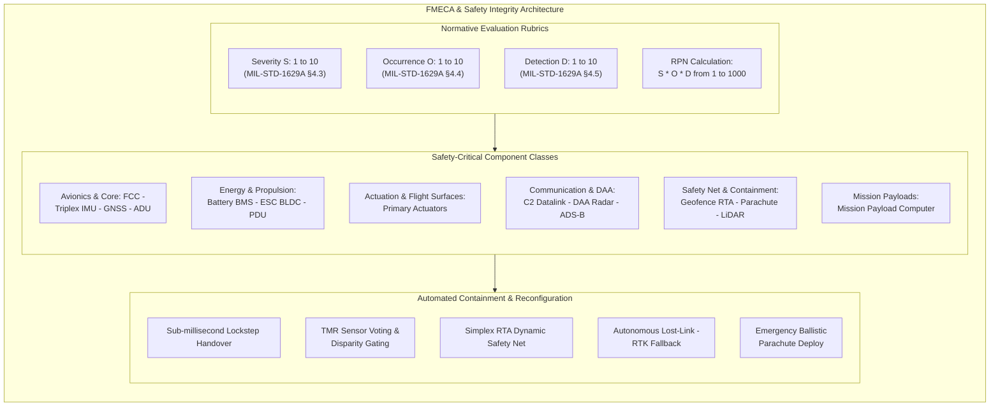
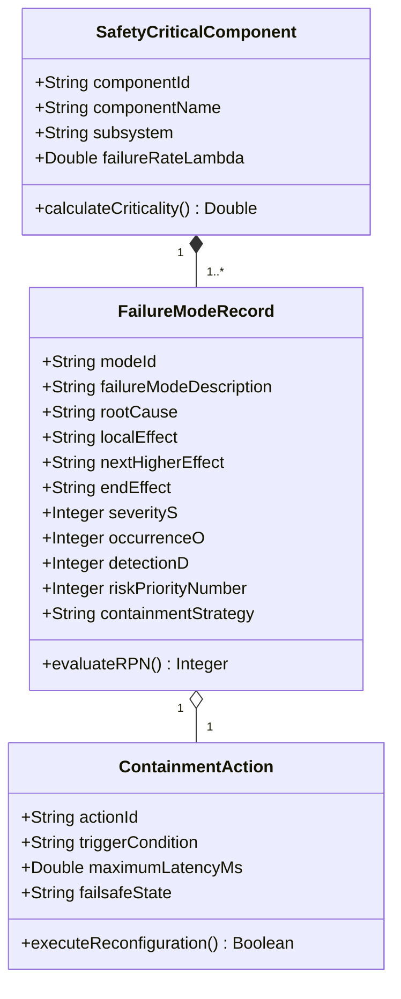
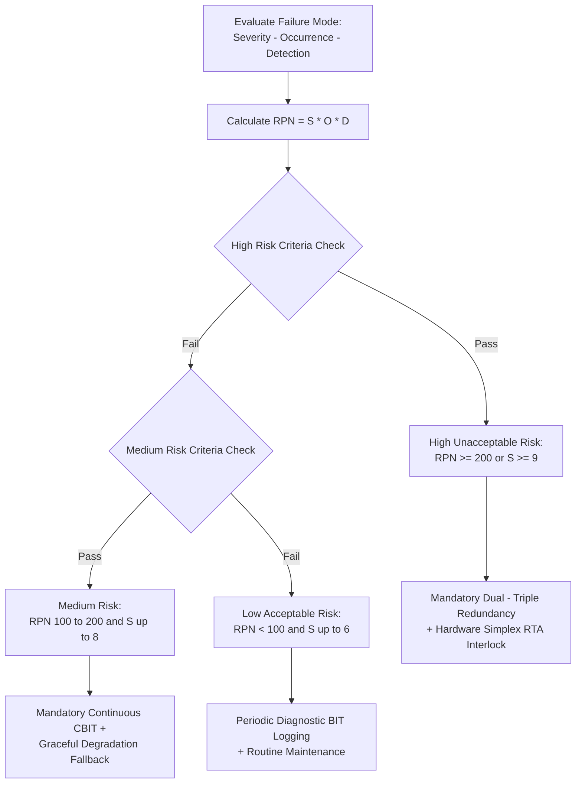
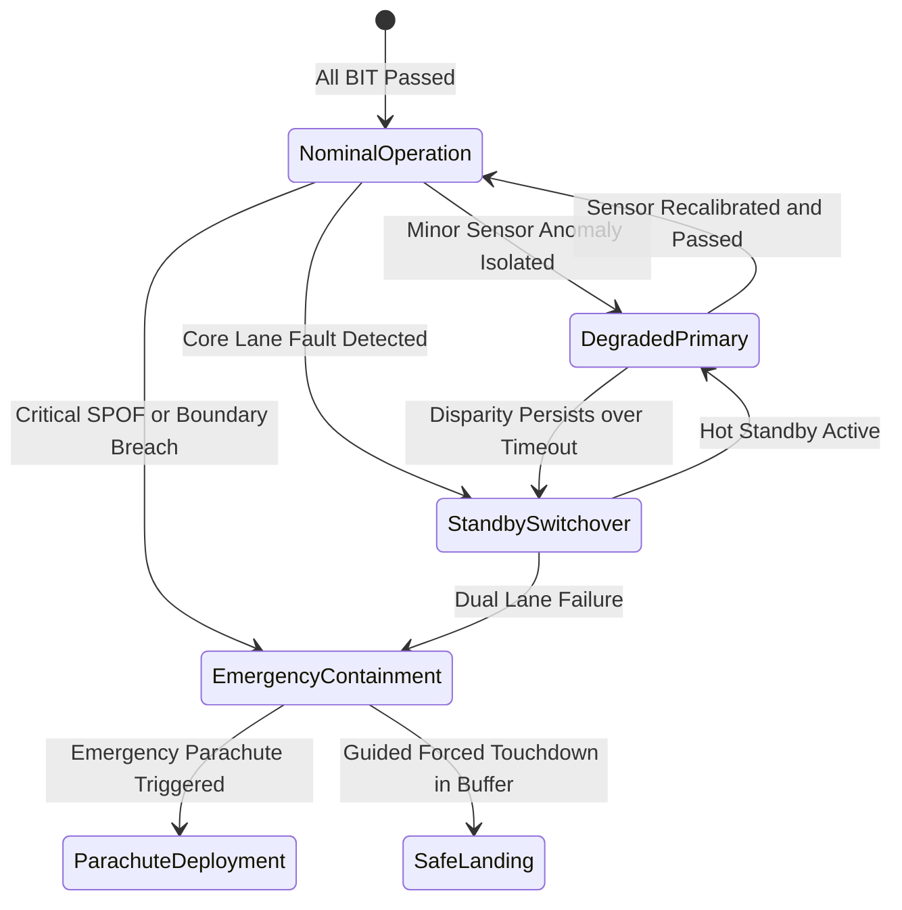

| Attribute | Value |
| :--- | :--- |
| **Title** | FMECA Component-Class Roster & Safety Integrity Catalog |
| **Version** | 1.0.0 |
| **Date** | 2026-09-02 |
| **Epic** | Epic 74: UAS Airworthiness, Safety Integrity & DAA Architectures |
| **Status** | Approved / Baseline |

# FMECA Component-Class Roster & Safety Integrity Catalog

## 1. Executive Summary & Architectural Scope
This catalog establishes the authoritative Failure Mode, Effects, and Criticality Analysis (FMECA) component-class roster, risk assessment rubrics, and automated containment mechanisms for unmanned aircraft systems (UAS) within the **DEAP01-uas-infrastructure-safety** repository.

The FMECA framework provides systematic bottom-up failure mode analysis from piece-part and line replaceable unit (LRU) level up to end-vehicle operational hazard effects, establishing deterministic safety bounds in compliance with:
1. **MIL-STD-1629A:** Procedures for Performing a Failure Mode, Effects and Criticality Analysis (§4.3 Severity, §4.4 Failure Probability, §4.5 Detection, §4.6 Criticality).
2. **SAE ARP4761:** Guidelines and Methods for Conducting the Safety Assessment Process on Civil Airborne Systems and Equipment (§4.3.1 FHA Severity, §4.3.3 FMECA Process, App. L Failure Probability Allocation, App. M Common Cause Analysis).
3. **MIL-STD-882E:** Standard Practice for System Safety (Task 106 Hazard Mitigation, Task 204 Hazard Probability, Task 205 System Hazard Analysis, Task 208 Functional Thread Isolation).
4. **RTCA DO-178C:** Software Considerations in Airborne Systems and Equipment Certification (§6.3.1 Software Fault Detection, §6.3.2 Software Partitioning, §6.4.3 Redundancy Management, §6.4.4 Structural Coverage).

---

## 2. Normative Baseline & Standard Rubrics

### 2.1 Governance & Standards Baseline
The FMECA evaluations and quantitative scoring models in this catalog strictly adhere to formal defense and civil airworthiness standards:
- **MIL-STD-1629A §4.3, §4.4, §4.5, §4.6** (*Severity Classification, Probability Allocation, Failure Detection & Criticality Analysis*)
- **SAE ARP4761 §4.3.1, §4.3.3, App. L, App. M** (*Functional Hazard Assessment, FMECA Process, Failure Probability & Common Cause Analysis*)
- **MIL-STD-882E Task 106 §4.2, Task 204 §4.2, Task 205 §4.2, Task 208 §4.2** (*System Safety Practice & Functional Thread Isolation*)
- **RTCA DO-178C §6.3.1, §6.3.2, §6.4.3, §6.4.4** (*Software Fault Detection, Partitioning & Redundancy Verification*)

/// ObligationAllocation: [OBL-FMECA-MIL1629-01, OBL-FMECA-MIL1629-02, OBL-FMECA-MIL1629-03, OBL-FMECA-MIL1629-04, OBL-FMECA-ARP4761-01, OBL-FMECA-ARP4761-02, OBL-FMECA-ARP4761-03, OBL-FMECA-ARP4761-04, OBL-FMECA-MIL882E-01, OBL-FMECA-MIL882E-02, OBL-FMECA-MIL882E-03, OBL-FMECA-MIL882E-04, OBL-FMECA-DO178C-01, OBL-FMECA-DO178C-02, OBL-FMECA-DO178C-03, OBL-FMECA-DO178C-04]
/// ObligationWitness: [OBL-FMECA-MIL1629-01, OBL-FMECA-MIL1629-02, OBL-FMECA-MIL1629-03, OBL-FMECA-MIL1629-04, OBL-FMECA-ARP4761-01, OBL-FMECA-ARP4761-02, OBL-FMECA-ARP4761-03, OBL-FMECA-ARP4761-04, OBL-FMECA-MIL882E-01, OBL-FMECA-MIL882E-02, OBL-FMECA-MIL882E-03, OBL-FMECA-MIL882E-04, OBL-FMECA-DO178C-01, OBL-FMECA-DO178C-02, OBL-FMECA-DO178C-03, OBL-FMECA-DO178C-04]

### 2.2 Severity Rubric (Rank 1–10)
The Severity Rubric quantifies the worst-case operational consequence of an unmitigated failure mode upon vehicle airworthiness, flight safety, crew, and non-participants on the ground.

| Rank (S) | Severity Classification | Aviation Safety Effect (ARP4761 / MIL-STD-882E) | Quantitative Loss Description & Operational Consequence | Standard Clause Citation |
| :---: | :--- | :--- | :--- | :--- |
| **10** | Catastrophic | Catastrophic (Category I) | Total hull loss, fatal injury, uncommanded ground crash outside buffer, uncontrolled high-energy impact | MIL-STD-1629A §4.3, SAE ARP4761 §4.3.1, MIL-STD-882E Task 205 §4.2 |
| **9** | Hazardous | Hazardous / Severe-Major (Category II) | Complete loss of mission capability, hull loss in uninhabited safe zone, emergency parachute deployment | MIL-STD-1629A §4.3, SAE ARP4761 §4.3.1, MIL-STD-882E Task 205 §4.2 |
| **8** | Major (High) | Major (Category III) | Significant reduction in safety margins, primary control lane failure, high pilot workload, forced diversion | MIL-STD-1629A §4.3, SAE ARP4761 §4.3.1, MIL-STD-882E Task 205 §4.2 |
| **7** | Major (Moderate) | Major (Category III) | Secondary flight control surface failure, automatic hot-standby switchover, degraded handling qualities | MIL-STD-1629A §4.3, SAE ARP4761 §4.3.1, MIL-STD-882E Task 205 §4.2 |
| **6** | Moderate | Minor (Category IV) | Loss of redundant navigation sensor, telemetry degradation, automated dead-reckoning hold engaged | MIL-STD-1629A §4.3, SAE ARP4761 §4.3.1, MIL-STD-882E Task 205 §4.2 |
| **5** | Minor (High) | Minor (Category IV) | Minor reduction in system performance, slight pilot workload increase, non-essential mission sensor loss | MIL-STD-1629A §4.3, SAE ARP4761 §4.3.1, MIL-STD-882E Task 205 §4.2 |
| **4** | Minor (Moderate) | Minor (Category IV) | Advisory warning alert, non-critical sensor drift, manual trim adjustment required by operator | MIL-STD-1629A §4.3, SAE ARP4761 §4.3.1, MIL-STD-882E Task 205 §4.2 |
| **3** | Very Minor | Minor (Category IV) | Diagnostic telemetry warning flag, payload image stream glitch, zero impact on vehicle flight path | MIL-STD-1629A §4.3, SAE ARP4761 §4.3.1, MIL-STD-882E Task 205 §4.2 |
| **2** | Slight | Negligible (Category IV) | Cosmetic GCS display glitch, self-clearing transient bus noise, minor maintenance log entry | MIL-STD-1629A §4.3, SAE ARP4761 §4.3.1, MIL-STD-882E Task 205 §4.2 |
| **1** | None | Negligible (Category IV) | Imperceptible, zero operational or safety consequence, informational background BIT record | MIL-STD-1629A §4.3, SAE ARP4761 §4.3.1, MIL-STD-882E Task 205 §4.2 |

### 2.3 Occurrence / Probability of Failure Rubric (Rank 1–10)
The Occurrence Rubric establishes the expected frequency and failure rate per flight hour for individual failure modes during the vehicle operating lifecycle.

| Rank (O) | Occurrence Classification | Qualitative Failure Likelihood | Quantitative Part Failure Rate Range (hr^-1) | Standard Clause Citation |
| :---: | :--- | :--- | :--- | :--- |
| **10** | Frequent (Very High) | Expected to occur multiple times per flight sortie | >= 10^-2 (1 in 100 flight hours) | MIL-STD-1629A §4.4, SAE ARP4761 App. L |
| **9** | Very High | Likely to occur frequently in normal operational life | 10^-2 > lambda >= 10^-3 | MIL-STD-1629A §4.4, SAE ARP4761 App. L |
| **8** | High | Expected to occur several times across fleet lifecycle | 10^-3 > lambda >= 10^-4 | MIL-STD-1629A §4.4, SAE ARP4761 App. L |
| **7** | Moderately High | Occurs occasionally during vehicle design lifespan | 10^-4 > lambda >= 10^-5 | MIL-STD-1629A §4.4, SAE ARP4761 App. L |
| **6** | Moderate | Probable failure mode over extended fleet operations | 10^-5 > lambda >= 10^-6 | MIL-STD-1629A §4.4, SAE ARP4761 App. L |
| **5** | Low-Moderate | Rare occurrence in individual vehicle lifetime | 10^-6 > lambda >= 10^-7 | MIL-STD-1629A §4.4, SAE ARP4761 App. L |
| **4** | Low / Remote | Unlikely to occur, but possible during fleet life | 10^-7 > lambda >= 10^-8 | MIL-STD-1629A §4.4, SAE ARP4761 App. L |
| **3** | Very Low / Extremely Remote | Extremely unlikely, not expected in individual vehicle | 10^-8 > lambda >= 10^-9 | MIL-STD-1629A §4.4, SAE ARP4761 App. L |
| **2** | Extremely Improbable | Almost impossible, requires multiple independent faults | 10^-9 > lambda >= 10^-10 | MIL-STD-1629A §4.4, SAE ARP4761 App. L |
| **1** | Negligible / Theoretical | Theoretically possible, zero recorded historical occurrences | < 10^-10 (Exceeds DAL-A bounds) | MIL-STD-1629A §4.4, SAE ARP4761 App. L |

### 2.4 Detection & Diagnostic Latency Rubric (Rank 1–10)
The Detection Rubric evaluates the diagnostic capability, sensor coverage, and latency bound of built-in test (BIT) and run-time assurance (RTA) mechanisms to detect and isolate a failure mode before it propagates to an unmitigated hazard.

| Rank (D) | Detection Classification | Diagnostic Mechanism & Detection Latency Bound | Diagnostic Coverage (c) | Standard Clause Citation |
| :---: | :--- | :--- | :--- | :--- |
| **10** | Undetectable / Latent | Unobservable, no sensor or BIT coverage, detected only upon end effect | c < 0.50 | MIL-STD-1629A §4.5, RTCA DO-178C §6.3.1 |
| **9** | Very Low Detection | Detected only during scheduled depot teardown or bench testing (latency > 100 hr) | 0.50 <= c < 0.70 | MIL-STD-1629A §4.5, RTCA DO-178C §6.3.1 |
| **8** | Low Detection | Detected by manual pre-flight visual or physical inspection by ground crew | 0.70 <= c < 0.80 | MIL-STD-1629A §4.5, RTCA DO-178C §6.3.1 |
| **7** | Moderately Low | Detected by automated pre-flight power-up built-in test (PBIT), no in-flight check | 0.80 <= c < 0.90 | MIL-STD-1629A §4.5, RTCA DO-178C §6.3.1 |
| **6** | Moderate Detection | In-flight periodic polling BIT (1.0 s < latency <= 10.0 s) | 0.90 <= c < 0.95 | MIL-STD-1629A §4.5, RTCA DO-178C §6.3.1 |
| **5** | Moderately High | Continuous in-flight background BIT (CBIT) (100 ms < latency <= 1.0 s) | 0.95 <= c < 0.98 | MIL-STD-1629A §4.5, RTCA DO-178C §6.3.1 |
| **4** | High Detection | Continuous CBIT with dual-lane parity cross-check (20 ms < latency <= 100 ms) | 0.98 <= c < 0.99 | MIL-STD-1629A §4.5, RTCA DO-178C §6.3.1 |
| **3** | Very High Detection | Hardware watchdog timer + lockstep CPU comparator (5 ms < latency <= 20 ms) | 0.99 <= c < 0.999 | MIL-STD-1629A §4.5, RTCA DO-178C §6.3.1 |
| **2** | Extremely High Detection | Hardware Simplex / RTA barrier monitor with discrete trip (latency <= 5 ms) | 0.999 <= c < 0.9999 | MIL-STD-1629A §4.5, RTCA DO-178C §6.3.1 |
| **1** | Immediate & Definite | Cycle-accurate lockstep hardware parity / FPGA assertion (latency <= 100 us) | c >= 0.9999 | MIL-STD-1629A §4.5, RTCA DO-178C §6.3.1 |

### 2.5 Mathematical Formulations

#### 1. Risk Priority Number (RPN)
The Risk Priority Number $RPN$ quantifies composite operational risk across the severity, occurrence, and detection dimensions:

$$\begin{aligned}
RPN &= S \times O \times D \in [1, 1000]
\end{aligned}$$

Where:
- $S \in \{1, 2, \dots, 10\}$ is the Severity ranking.
- $O \in \{1, 2, \dots, 10\}$ is the Occurrence ranking.
- $D \in \{1, 2, \dots, 10\}$ is the Detection / Latency ranking.

#### 2. Criticality Index & Mode Criticality Number Formulation
Pursuant to `MIL-STD-1629A §4.6`, the mode criticality number $C_{m,j}$ for failure mode $j$ and the total item criticality number $C_R$ are evaluated as:

$$\begin{aligned}
C_{m,j} &= \alpha_j \cdot \beta_j \cdot \lambda_{p,j} \cdot t \\
C_R &= \sum_{j=1}^{N_m} C_{m,j} = \sum_{j=1}^{N_m} \left( \alpha_j \cdot \beta_j \cdot \lambda_{p,j} \cdot t \right)
\end{aligned}$$

Where:
- $\alpha_j$ is the failure mode ratio ($0 \le \alpha_j \le 1, \sum_{j=1}^{N_m} \alpha_j = 1$), representing the fraction of the total component failure rate attributable to failure mode $j$.
- $\beta_j$ is the conditional failure effect probability ($0 \le \beta_j \le 1$), representing the conditional probability that failure mode $j$ results in the identified criticality severity class.
- $\lambda_{p,j}$ is the component part failure rate per operating hour.
- $t$ is the operating duration or mission flight time window.

---

## 3. Canonical Safety-Critical Component Class FMECA Roster

The master roster evaluates 16 canonical safety-critical component classes across avionics, inertial sensing, GNSS navigation, pitot-static air data, energy storage, propulsion, flight controls, C2 data links, DAA collision avoidance, geofence containment, ballistic recovery, proximity terrain sensing, mission computing, and power regulation.

| Class ID | Component Class Name | Failure Mode & Root Cause | Local Failure Effect | Next Higher Effect | End Vehicle Effect | S | O | D | RPN | Automated Containment & Reconfiguration | Standard Citation |
| :--- | :--- | :--- | :--- | :--- | :--- | :---: | :---: | :---: | :---: | :--- | :--- |
| `COMP-FCC` | Flight Controller / FCC | Dual-lane lockstep desync / CPU core freeze (SEU bit flip, SRAM corruption) | Primary Lane A execution halt, missing PWM outputs | Interruption of flight guidance loop | Loss of flight path control if uncontained | 10 | 2 | 2 | **40** | Hardware voter triggers sub-millisecond switchover to hot-standby Lane B; fallback to Simplex RTA safe-hold controller | MIL-STD-1629A §4.3, RTCA DO-178C §6.3.1 |
| `COMP-IMU` | Triplex IMU | MEMS gyro/accel frozen output or bias drift (beam stiction, ASIC drift) | Erroneous delta-v and delta-theta readings on IMU-1 | EKF attitude/velocity covariance spike | Attitude divergence and loss of control | 9 | 4 | 2 | **72** | Triplex mid-value voter isolates failed IMU-1 within 5 ms; reconfigures EKF to dual-redundant IMU-2/IMU-3 pair | MIL-STD-1629A §4.3, SAE ARP4761 App. L |
| `COMP-GNSS` | Multi-Band GNSS Receiver | Carrier-phase lock loss, RF multipath, spoofing (EW jamming, shadow) | Loss of RTK integer fix, HDOP > 4.0, pseudorange jump | Navigation drift, position variance exceeds HPL | Geofence containment breach or track error | 8 | 5 | 3 | **120** | RAIM fault exclusion triggers dead-reckoning fallback using Optical Flow + ADU + IMU; engages GPS-denied RTH | MIL-STD-1629A §4.3, SAE ARP4761 §4.3.1 |
| `COMP-ADU` | Pitot-Static Air Data Unit | Pitot probe icing or static port clog (icing conditions, moisture, FOD) | Erroneous indicated airspeed (IAS) and pressure altitude | Erroneous stall margin, false throttle trim | Inadvertent aerodynamic stall or overspeed | 9 | 4 | 3 | **108** | Dual pitot disparity detector activates de-icing heater; transitions FCC to synthetic airspeed estimator mode | MIL-STD-1629A §4.3, SAE ARP4761 App. M |
| `COMP-BMS` | Propulsion Battery & BMS | Lithium cell internal short, thermal runaway (dendrite, puncture, surge) | Rapid cell temp rise (>65°C), cell voltage drops <2.8V | Traction bus voltage sag, reduced thrust margin | Total electrical propulsion loss, battery fire | 10 | 3 | 2 | **60** | Active BMS disconnects faulted pack string, enables auxiliary reserve pack, commands maximum power limit & forced descent | MIL-STD-1629A §4.3, MIL-STD-882E Task 205 §4.2 |
| `COMP-ESC` | ESC & BLDC Motor | MOSFET thermal punch-through, phase open-circuit (thermal stress, surge) | Loss of commutation on motor Phase A, rotor stall | Asymmetric thrust moment across vehicle airframe | Vehicle attitude perturbation, loss of hover | 8 | 5 | 2 | **80** | Dynamic mixer gain recalculation rebalances thrust across remaining active motors in hexacopter; commands RTL descent | MIL-STD-1629A §4.3, SAE ARP4761 §4.3.1 |
| `COMP-ACT` | Primary Actuators | Servo gear train jam, resolver loss (mechanical fracture, moisture) | Surface frozen at fixed angle or runaway deflection | Aerodynamic hinge moment imbalance | Loss of pitch/roll/yaw control authority | 9 | 4 | 3 | **108** | Split-surface architecture disengages jammed actuator clutch; uses differential thrust and split elevon pairs | MIL-STD-1629A §4.3, SAE ARP4761 App. L |
| `COMP-C2` | C2 LOS Datalink | RF carrier lock loss, frontend LNA saturation (terrain mask, jamming) | Uplink heartbeat timeout (>1.5 s), telemetry drop | Loss of manual GCS pilot override authority | Lost-link contingency, autonomous vehicle hold | 6 | 6 | 3 | **108** | Automated PACE link switching to 915 MHz mesh / SATCOM; if unestablished within 5 s, executes DO-362A Lost-Link RTH | MIL-STD-1629A §4.3, RTCA DO-178C §6.3.2 |
| `COMP-DAA` | DAA Radar / EO-IR | Radar frontend blind-zone, optical blooming (thermal overload, glare) | Dropped target track for non-cooperative intruder | Failure to generate timely DAA traffic advisories | Mid-air collision risk with uncooperative traffic | 9 | 4 | 4 | **144** | Fusion manager falls back to wide-volume cooperative ADS-B buffer; alerts GCS; alters altitude corridor | MIL-STD-1629A §4.3, SAE ARP4761 §4.3.1 |
| `COMP-GEO` | Geofence Containment Unit | Spatial polytope computation freeze, memory corruption (RAM bit flip) | Distance-to-boundary computation halt | Failure to generate boundary crossing warning | Uncontrolled fly-away outside SORA volume | 10 | 2 | 2 | **40** | Independent Simplex RTA supervisor overrides FCC, executes 180° emergency turn; triggers FTS parachute if breached | MIL-STD-1629A §4.3, RTCA DO-178C §6.4.3 |
| `COMP-FTS` | Parachute / FTS Deployer | Pyrotechnic squib open-circuit, ejection spring jam (bridge wire fault) | Failure to eject parachute upon emergency command | Inability to arrest uncontrolled kinetic energy descent | Ground impact kinetic energy exceeding 80 J | 10 | 3 | 2 | **60** | Dual-channel independent arming circuit with continuous squib resistance check; dual redundant pyrotechnic cutters | MIL-STD-1629A §4.3, MIL-STD-882E Task 205 §4.2 |
| `COMP-LIDAR` | LiDAR Terrain Sensor | Laser diode aging, optical lens condensation (dirt, mist, saturation) | Erroneous ground distance return / zero return | Degraded precision during automated autoland flare | Hard landing, airframe structural damage | 7 | 5 | 3 | **105** | Sensor supervisor rejects out-of-bounds LiDAR readings; falls back to fused barometric/GNSS altimetry with shallow flare | MIL-STD-1629A §4.3, SAE ARP4761 App. L |
| `COMP-MPC` | Mission Payload Computer | GPU kernel panic, high-temp throttling, segfault (compute load, latchup) | Video stream freeze, target track pipeline halt | Mission payload inoperability (zero flight impact) | Mission failure without vehicle safety degradation | 4 | 6 | 3 | **72** | Hardware supervisor power-cycles MPC via PDU; flight control unaffected due to physical Ethernet/CAN bus isolation | MIL-STD-1629A §4.3, MIL-STD-882E Task 208 §4.2 |
| `COMP-PDU` | Power Distribution Unit | Main 28V DC bus regulator short to ground (eFuse breakdown, surge) | Primary power rail voltage dropout on Bus A | Loss of power to avionics Lane A | Total avionics blackout if single point of failure | 10 | 2 | 1 | **20** | Dual-isolated diode OR-ing architecture maintains Bus B power; solid-state electronic breaker isolates short within 50 us | MIL-STD-1629A §4.3, MIL-STD-882E Task 205 §4.2 |
| `COMP-MAG` | Magnetometer / Compass | Magnetic field offset shift, sensor saturation (EMI from motor cables) | Erroneous magnetic heading calculation | Heading drift in AHRS filter | Ground track navigation error, spiral divergence | 7 | 6 | 3 | **126** | AHRS detects heading anomaly (abs(mag - GNSS) > 5°); disables magnetometer updates; relies on dual-GNSS heading + gyro | MIL-STD-1629A §4.3, SAE ARP4761 App. M |
| `COMP-ADSB` | ADS-B In Transponder | Receiver frontend desensitization, CRC error burst (RF intermod, crash) | Intermittent loss of cooperative traffic telemetry | Inability to track cooperative aircraft in volume | Degraded cooperative collision avoidance | 8 | 5 | 4 | **160** | DAA system falls back to primary active radar and EO/IR target tracker; requests ground UTM / TIS-B uplink feeds | MIL-STD-1629A §4.3, RTCA DO-178C §6.3.1 |

---

## 4. Risk Mitigation & Criticality Acceptance Matrix

### 4.1 RPN Risk Acceptance Thresholds
Pursuant to `MIL-STD-882E Task 106 §4.2` and `SAE ARP4761 §4.3.1`, component failure modes are classified into three risk acceptance tiers governing mandatory engineering controls:

| Risk Level | RPN Range / Severity Boundary | Architectural Safety Mandate | Required Verification & Validation |
| :--- | :--- | :--- | :--- |
| **High Risk (Unacceptable)** | RPN >= 200 OR S >= 9 | Dual/triple hardware redundancy, independent Simplex RTA supervisor, deterministic hardware trip mechanisms, and automated ballistic parachute deployment. | DO-178C DAL-A/B formal methods, fault injection testing on HIL bench, and hardware-level failure mode verification. |
| **Medium Risk (Tolerable with Mitigation)** | 100 <= RPN < 200 AND S <= 8 | Continuous background Built-In Test (CBIT), analytical sensor redundancy, automatic sensor exclusion, and graceful performance degradation. | Automated regression test harness, simulated fault injection, and cross-lane comparison validation. |
| **Low Risk (Acceptable)** | RPN < 100 AND S <= 6 | Standard component screening, periodic power-up Built-In Test (PBIT), and flight data logging. | Unit-level verification, standard environmental qualification, and routine pre-flight inspections. |

### 4.2 Automated Reconfiguration State Machine
When an in-flight anomaly is detected by hardware or software BIT, the vehicle executes deterministic reconfiguration:

