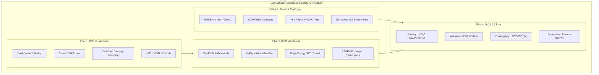
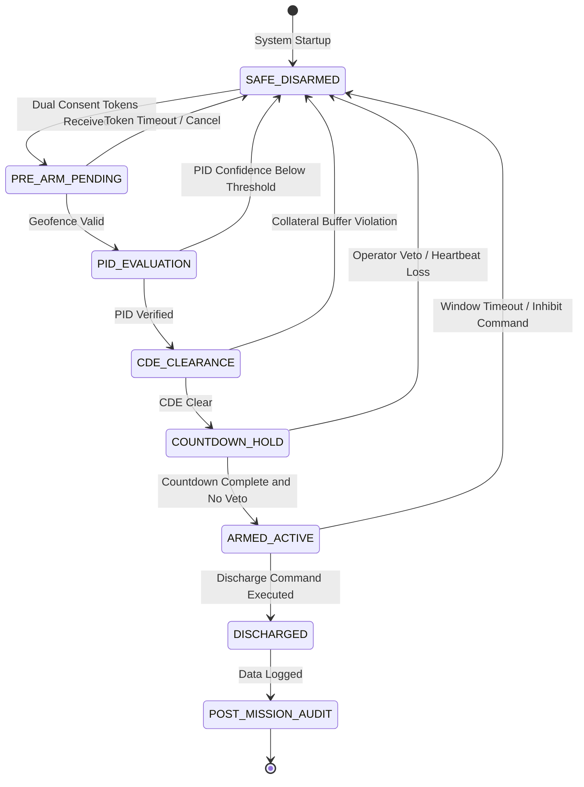
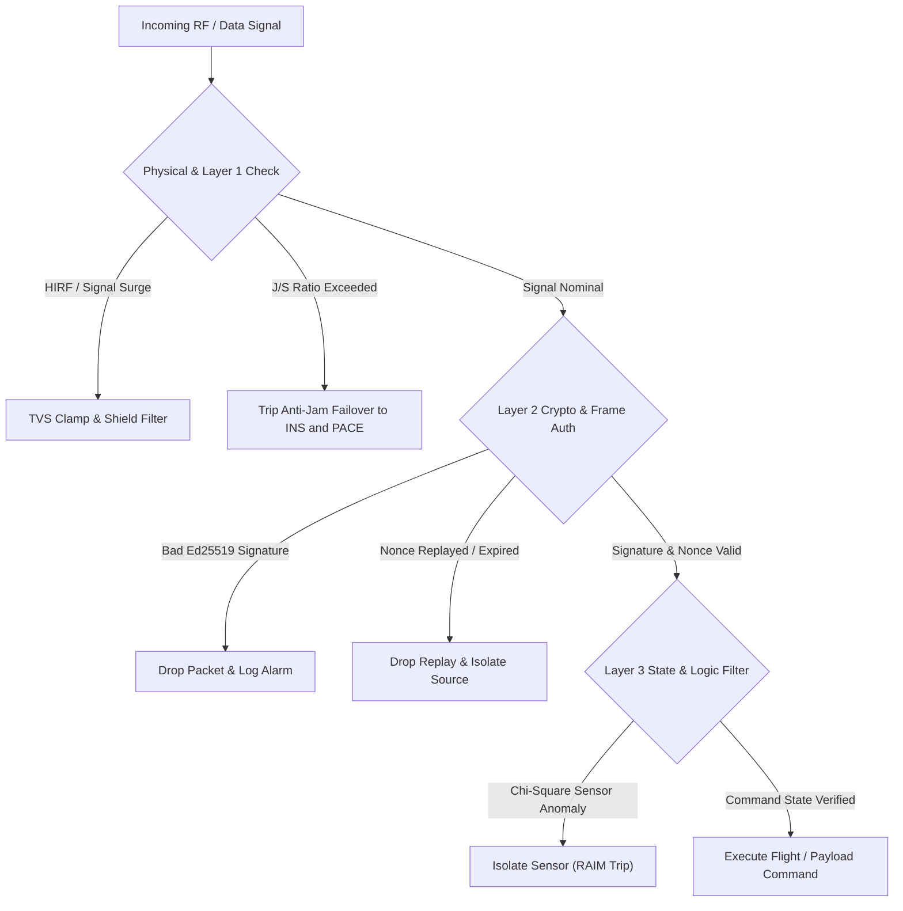
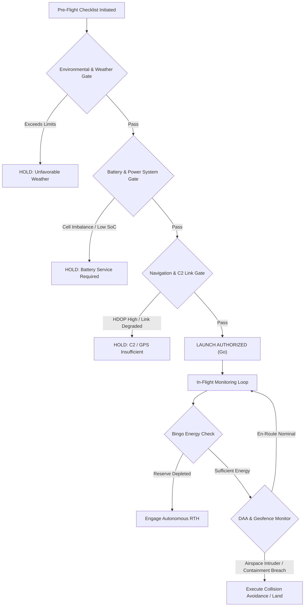
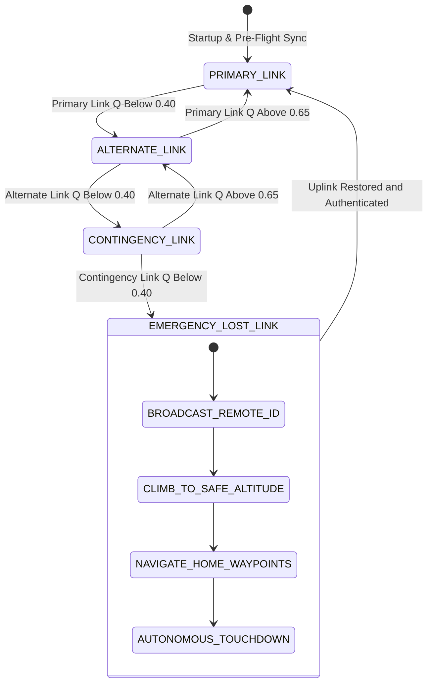

| Attribute | Value |
| :--- | :--- |
| **Title** | UAS Mission Operations, Interlocks, EW/Cyber, Go/No-Go & PACE Catalog |
| **Version** | 1.0.0 |
| **Date** | 2026-09-02 |

# UAS Mission Operations, Interlocks, EW/Cyber, Go/No-Go & PACE Catalog

## 1. Executive Summary & Architectural Scope
This catalog establishes the authoritative operational, safety, cyber, and communications baseline for unmanned aircraft systems (UAS), ground control stations (GCS), and resilient infrastructure within the **DEAP01-uas-infrastructure-safety** repository.

The catalog synthesizes four critical operational safety pillars governing high-integrity unmanned flight operations:
1. **Rules of Engagement (ROE) & Weapon/Sensor Interlock Families:** Deterministic multi-operator consent, positive identification (PID) verification, collateral damage estimation (CDE), and human-in-the-loop (HITL) veto architectures.
2. **Threat, EW & Cyber Environment Taxonomy:** Attack vector characterization, electronic warfare (EW) jamming/spoofing resilience, operational technology (OT) defense-in-depth, and cryptographic command verification.
3. **Go/No-Go Pre-Flight and In-Flight Operational Decision Matrix:** Multi-dimensional airworthiness gating, environmental constraint evaluation, and dynamic in-flight bingo energy/containment abort decision trees.
4. **PACE C2 Link Communications Plan Catalog:** Primary, Alternate, Contingency, and Emergency data link tiering, automated hysteresis-driven link switching, and Remote ID broadcast continuity.

---

## 2. Rules of Engagement (ROE) & Weapon/Sensor Interlock Families

### 2.1 Governance & Standards Baseline
The ROE and interlock subsystem enforces strict deterministic safety bounds ensuring human accountability, proportional force, and failsafe inhibit mechanisms in compliance with:
- **DoD Directive 3000.09 §3.1, §3.1.a, §3.1.b, §3.1.c** (*Autonomy in Weapon Systems*)
- **NATO STANAG 4586 §4.2, §4.2.2, §5.1, §5.1.4** (*Standard Interfaces of UAV Control System*)
- **CJCSI 3121.01B Enclosure A §2.a, Enclosure A §4.b, Enclosure B §3.c, Enclosure E §2.d** (*Standing Rules of Engagement for U.S. Forces*)

/// ObligationAllocation: [OBL-DOD3000-01, OBL-DOD3000-02, OBL-DOD3000-03, OBL-DOD3000-04, OBL-STANAG4586-01, OBL-STANAG4586-02, OBL-STANAG4586-03, OBL-STANAG4586-04, OBL-CJCSI3121-01, OBL-CJCSI3121-02, OBL-CJCSI3121-03, OBL-CJCSI3121-04]
/// ObligationWitness: [OBL-DOD3000-01, OBL-DOD3000-02, OBL-DOD3000-03, OBL-DOD3000-04, OBL-STANAG4586-01, OBL-STANAG4586-02, OBL-STANAG4586-03, OBL-STANAG4586-04, OBL-CJCSI3121-01, OBL-CJCSI3121-02, OBL-CJCSI3121-03, OBL-CJCSI3121-04]

### 2.2 Interlock Families Specification Table

| Interlock Family ID | Family Name | Primary Standard Clause | Assurance Objective | Trigger & Release Criteria | Verification Method |
| :--- | :--- | :--- | :--- | :--- | :--- |
| `INT-ROE-01` | Dual-Consent Command Authorization | DoD Directive 3000.09 §3.1 | Human authority verification | Validated cryptographic tokens from Mission Commander and Safety Officer | Multi-Operator Token Verification Test |
| `INT-ROE-02` | Autonomous Bounding & Range-Gating | DoD Directive 3000.09 §3.1.a | Kinematic containment | Target coordinates strictly inside 3D engagement polytope | Geometric Polytope Collision Proof |
| `INT-ROE-03` | Hardware Safe-Switch & Heartbeat Inhibit | DoD Directive 3000.09 §3.1.b | Failsafe circuit disarm | Disarm commanded upon C2 heartbeat loss or physical tamper | HIL Hardware Disarm Injection Test |
| `INT-ROE-04` | Anti-Tamper & Zeroization Safe Guard | DoD Directive 3000.09 §3.1.c | Key / algorithm protection | Physical boundary breach or unauthorized access triggers key zeroization | Anti-Tamper Trigger & Zeroize Audit |
| `INT-STANAG-01` | UCS Architectural Payload Interface | NATO STANAG 4586 §4.2 | Standardized payload control | DLI Message 1000-series payload control message compliance | STANAG 4586 DLI Protocol Harness |
| `INT-STANAG-02` | Interoperability Level LOI 1-5 Gate | NATO STANAG 4586 §4.2.2 | Authority-level gating | Restricts command uplink based on active LOI level (LOI 1 to 5) | Interoperability Statechart Test |
| `INT-STANAG-03` | DLI Channel Redundancy Monitor | NATO STANAG 4586 §5.1 | High-availability telemetry | Dual-channel DLI data stream continuity verification | Channel Drop Simulation Test |
| `INT-STANAG-04` | GCS Handover Authority Arbitrator | NATO STANAG 4586 §5.1.4 | Contention-free transfer | Synchronous three-way handshake before control token migration | Handover Contention Test Suite |
| `INT-CJCSI-01` | Hostile Act / Hostile Intent Evaluator | CJCSI 3121.01B Enclosure A §2.a | Law of Armed Conflict (LOAC) | Confirmed kinematic track correlation with declared hostile behaviors | Track Correlation Logic Simulation |
| `INT-CJCSI-02` | Multi-Spectral PID Sensor Fusion | CJCSI 3121.01B Enclosure A §4.b | Target positive identification | Multi-sensor fused confidence score exceeding threshold | Multi-Sensor Fusion Metric Test |
| `INT-CJCSI-03` | Collateral Damage Mitigation Boundary | CJCSI 3121.01B Enclosure B §3.c | Non-combatant protection | Blast radius plus margin strictly clear of no-strike zones | Blast Buffer Computation Verification |
| `INT-CJCSI-04` | Tiered Escalation & Human Veto | CJCSI 3121.01B Enclosure E §2.d | Escalation control | Operator veto window with countdown hold before arming | Operator Veto Latency Benchmarking |

### 2.3 Mathematical Formulations & Guard Conditions

#### 1. Dual-Consent Authorization Condition
The arming enablement signal $A_{\text{arm}}(t)$ requires simultaneous cryptographic token validity, valid C2 heartbeat, and geofence authorization:

$$\begin{aligned}
A_{\text{arm}}(t) &= \mathbf{1}_{\{T_{\text{valid}}(K_{\text{cmd}}, t) = 1\}} \cdot \mathbf{1}_{\{T_{\text{valid}}(K_{\text{safety}}, t) = 1\}} \cdot \mathbf{1}_{\{t - t_{\text{heartbeat}} < \Delta t_{\text{max}}\}} \cdot \mathbf{1}_{\{p_{\text{vehicle}}(t) \in \mathcal{P}_{\text{geofence}}\}}
\end{aligned}$$

#### 2. Multi-Spectral Positive Identification (PID) Fusion
Target classification confidence $C_{\text{PID}}(t)$ is synthesized across optical (EO), infrared (IR), and RF emitter modalities:

$$\begin{aligned}
C_{\text{PID}}(t) &= \sum_{m=1}^{M} w_m \cdot s_m(t) \quad \text{subject to } \sum_{m=1}^{M} w_m = 1 \\
\text{Gate}_{\text{PID}}(t) &= \begin{cases}
1 & \text{if } C_{\text{PID}}(t) \ge \Theta_{\text{PID\_threshold}} \land \text{Var}(C_{\text{PID}}) \le \sigma_{\text{max}}^2 \\
0 & \text{otherwise}
\end{cases}
\end{aligned}$$

#### 3. Collateral Damage & No-Strike Buffer Margin
Minimum clearance distance $d_{\text{min}}$ between target location $p_{\text{target}}$ and no-strike polygon $\mathcal{Z}_{\text{no\_strike}}$:

$$\begin{aligned}
d_{\text{min}}(p_{\text{target}}, \mathcal{Z}_{\text{no\_strike}}) &\ge R_{\text{hazard}}(\text{Yield}) + k_{\text{margin}} \cdot \text{CEP}_{95}
\end{aligned}$$

#### 4. Human-in-the-Loop (HITL) Armed State Transition
The active firing circuit state $S_{\text{payload}}(t)$ is governed by:

$$\begin{aligned}
S_{\text{payload}}(t) &= \begin{cases}
\text{ARMED} & \text{if } A_{\text{arm}}(t) = 1 \land \text{Gate}_{\text{PID}}(t) = 1 \land \text{OperatorVeto}(t) = 0 \land (t - t_{\text{arm}}) \le T_{\text{window}} \\
\text{SAFE\_LOCKED} & \text{otherwise}
\end{cases}
\end{aligned}$$

### 2.4 Mermaid Statechart: ROE Interlock Progression

---

## 3. Threat, EW & Cyber Environment Taxonomy

### 3.1 Governance & Standards Baseline
The cyber physical and electronic warfare protection framework defends UAS infrastructure against intentional adversarial interference, spoofing, and lateral penetration pursuant to:
- **NIST SP 800-82r3 §4.2, §5.3, §6.2, §6.4** (*Guide to Operational Technology Security*)
- **MITRE ATT&CK for ICS §T0814, §T0855, §T0843 & MITRE D3FEND §D3-MCR** (*ICS Threat & Defense*)
- **MIL-STD-461G §5.4, §5.18, §5.19, §5.20** (*Electromagnetic Compatibility Requirements*)
- **ISO/SAE 21434 §5.3, §6.4, §9.4, §10.4** (*Cybersecurity Engineering*)

/// ObligationAllocation: [OBL-NIST80082-01, OBL-NIST80082-02, OBL-NIST80082-03, OBL-NIST80082-04, OBL-MITRE-01, OBL-MITRE-02, OBL-MITRE-03, OBL-MITRE-04, OBL-MIL461G-01, OBL-MIL461G-02, OBL-MIL461G-03, OBL-MIL461G-04, OBL-ISO21434-01, OBL-ISO21434-02, OBL-ISO21434-03, OBL-ISO21434-04]
/// ObligationWitness: [OBL-NIST80082-01, OBL-NIST80082-02, OBL-NIST80082-03, OBL-NIST80082-04, OBL-MITRE-01, OBL-MITRE-02, OBL-MITRE-03, OBL-MITRE-04, OBL-MIL461G-01, OBL-MIL461G-02, OBL-MIL461G-03, OBL-MIL461G-04, OBL-ISO21434-01, OBL-ISO21434-02, OBL-ISO21434-03, OBL-ISO21434-04]

### 3.2 Threat & Countermeasure Matrix

| Threat Vector ID | Threat Classification | Standard Reference | Threat Mechanism | Countermeasure / Mitigation | Verification Method |
| :--- | :--- | :--- | :--- | :--- | :--- |
| `THR-EW-01` | GNSS Jamming & Broad Spectrum Noise | MIL-STD-461G §5.18, NIST SP 800-82r3 §4.2 | High-power RF noise swamping L1/L2 GNSS receiver bands | Tightly-coupled INS dead-reckoning and optical flow visual odometry failover | RF Chamber Jamming Simulation |
| `THR-EW-02` | GNSS Spoofing & Meaconing | NIST SP 800-82r3 §4.2, MITRE ATT&CK §T0855 | False ephemeris/pseudorange signals inducing spatial trajectory drift | Receiver Autonomous Integrity Monitoring (RAIM) & Chi-Square Innovation Filter | Multi-Channel GNSS Spoof Injection |
| `THR-EW-03` | C2 Datalink Denial of Service | MITRE ATT&CK §T0814, NIST SP 800-82r3 §6.2 | Narrowband/swept RF jamming on primary C2 uplink | Fast pseudo-random Frequency Hopping Spread Spectrum (FHSS) & PACE link switch | C2 Bandwidth Stress Benchmark |
| `THR-EW-04` | High-Intensity Radiated Fields (HIRF) | MIL-STD-461G §5.4, §5.18 | EMP / electromagnetic pulse inducing transient currents in avionics | Faradic shielding, double-braided conduit grounding, TVS surge clamping | MIL-STD-461G RS103 / CS115 Pulse Test |
| `THR-CYB-01` | Unauthorized Command Injection | MITRE ATT&CK §T0855, MITRE D3FEND §D3-MCR | Adversary transmitting forged flight mode change or disarm packets | Ed25519 / HMAC-SHA256 signature validation with monotonically increasing nonces | Fuzzing & Forgery Packet Injection |
| `THR-CYB-02` | Replay Attack on Telemetry & C2 | MITRE D3FEND §D3-MCR, NIST SP 800-82r3 §6.2 | Capturing legitimate commands and retransmitting in altered state | Strict timestamp epoch window and sliding session token ring | Packet Replay Assertion Test |
| `THR-CYB-03` | Ground Station OT Lateral Compromise | NIST SP 800-82r3 §5.3, ISO/SAE 21434 §6.4 | Malware pivot from public internet GCS network to internal C2 bridge | Air-gapped boundary diode and zero-trust microsegmentation | Network Segmentation Penetration Test |
| `THR-CYB-04` | Firmware Modification & Bus Tamper | MITRE ATT&CK §T0843, ISO/SAE 21434 §9.4 | Flashing malicious bootloader or injecting CAN/Ethernet frame anomalies | Hardware root of trust (TPM 2.0 / Secure Boot) and CAN ID rate bounding | Secure Boot Chain Verification |

### 3.3 Mathematical Formulations: EW Resilience & Cyber Integrity

#### 1. Jammer-to-Signal Ratio and Detection Threshold
The effective Jammer-to-Signal power ratio at the airborne receiver antenna in logarithmic scale:

$$\begin{aligned}
\text{JS}_{\text{ratio}} &= P_{\text{jam}} + G_{\text{jam\_ant}} - L_{\text{prop,jam}} - \left(P_{\text{sat}} + G_{\text{rx\_ant}} - L_{\text{prop,sat}}\right) \\
\text{JammingDetected}(t) &= \begin{cases}
1 & \text{if } \text{JS}_{\text{ratio}}(t) \ge \Gamma_{\text{jam\_threshold}} \lor \text{AGC}_{\text{attenuation}}(t) \ge \Lambda_{\text{sat}} \\
0 & \text{otherwise}
\end{cases}
\end{aligned}$$

#### 2. Innovation Filter for GNSS Spoofing Detection
Residual innovation sequence $\nu(t)$ in the Kalman filter navigation state estimator:

$$\begin{aligned}
\nu(t) &= z_{\text{GNSS}}(t) - H \cdot \hat{x}_{\text{INS}}(t|t-1) \\
\chi^2(t) &= \nu^T(t) \cdot S^{-1}(t) \cdot \nu(t) \\
\text{SpoofingTrip}(t) &= \begin{cases}
1 & \text{if } \chi^2(t) > \chi^2_{\text{critical}, p=0.001} \quad \text{for } N_{\text{consecutive}} \ge 3 \\
0 & \text{otherwise (GNSS Valid)}
\end{cases}
\end{aligned}$$

#### 3. Cryptographic Message Nonce & Timestamp Verification
A received command payload $M = (c, \text{nonce}, \tau_{\text{stamp}}, \sigma)$ is authentic if and only if:

$$\begin{aligned}
\text{ValidCommand}(M, t) &= \mathbf{1}_{\{\text{Ed25519\_Verify}(K_{\text{GCS\_pub}}, (c, \text{nonce}, \tau_{\text{stamp}}), \sigma) = 1\}} \cdot \mathbf{1}_{\{\text{nonce} > \text{nonce}_{\text{high\_water}}\}} \cdot \mathbf{1}_{\{|t - \tau_{\text{stamp}}| \le \Delta \tau_{\text{skew\_max}}\}}
\end{aligned}$$

### 3.4 Mermaid Flowchart: Cyber Threat Defense-in-Depth

---

## 4. Go/No-Go Pre-Flight and In-Flight Operational Decision Matrix

### 4.1 Governance & Standards Baseline
The Go/No-Go decision matrix establishes quantitative gating for mission dispatch, continuous in-flight health monitoring, and deterministic abort execution under:
- **FAA 14 CFR §107.49(a), (b), (c), (d)** (*Preflight Inspection & Actions*)
- **EASA AMC1 UAS.SPEC.050 §3.2, §3.3, §4.1, §4.4** (*Responsibilities of the UAS Operator*)
- **JARUS SORA v2.5 Annex B §B.2, Annex C §C.3, Annex D §D.2, Annex E §E.4** (*Risk Mitigations & Containment*)

/// ObligationAllocation: [OBL-FAA10749-01, OBL-FAA10749-02, OBL-FAA10749-03, OBL-FAA10749-04, OBL-EASASPEC050-01, OBL-EASASPEC050-02, OBL-EASASPEC050-03, OBL-EASASPEC050-04, OBL-JARUSSORA-01, OBL-JARUSSORA-02, OBL-JARUSSORA-03, OBL-JARUSSORA-04]
/// ObligationWitness: [OBL-FAA10749-01, OBL-FAA10749-02, OBL-FAA10749-03, OBL-FAA10749-04, OBL-EASASPEC050-01, OBL-EASASPEC050-02, OBL-EASASPEC050-03, OBL-EASASPEC050-04, OBL-JARUSSORA-01, OBL-JARUSSORA-02, OBL-JARUSSORA-03, OBL-JARUSSORA-04]

### 4.2 Pre-Flight & In-Flight Decision Matrix

| Gate ID | Domain | Standard Reference | Evaluated Parameter | Go Threshold | No-Go / Abort Action |
| :--- | :--- | :--- | :--- | :--- | :--- |
| `GNG-ENV-01` | Environmental / Weather | FAA §107.49(a), AMC1 UAS.SPEC.050 §3.2 | Sustained Wind / Gust Speed | Wind <= 12 m/s, Gust <= 15 m/s | Ground Hold / In-Flight Return-to-Home |
| `GNG-ENV-02` | Environmental / Visibility | FAA §107.49(a), AMC1 UAS.SPEC.050 §3.2 | Flight Visibility & Cloud Ceiling | Visibility >= 5000 m, Cloud Base >= 150 m AGL | Mission Dispatch Inhibit |
| `GNG-PWR-01` | Energy / Battery | FAA §107.49(c), AMC1 UAS.SPEC.050 §3.2 | Pre-Flight Battery State of Charge (SoC) | SoC >= 95%, Delta V_cell <= 0.03 V | Launch Inhibit, Battery Replacement |
| `GNG-PWR-02` | Energy / In-Flight Reserve | SORA v2.5 Annex E §E.4, AMC1 UAS.SPEC.050 §3.3 | Bingo Energy Margin | E_reserve >= E_RTH + E_landing_margin | In-Flight Contingency RTH Engagement |
| `GNG-COM-01` | C2 Link Health | FAA §107.49(b), RTCA DO-362A §2.2 | Signal RSSI and Packet Error Rate | RSSI >= -85 dBm, PER <= 0.01 | C2 Link Switching / Launch Inhibit |
| `GNG-NAV-01` | Navigation Integrity | FAA §107.49(c), SORA v2.5 Annex D §D.2 | Satellite Constellation & HDOP | Sats >= 12, HDOP <= 1.2, RAIM = PASS | Navigation Hold / Pre-Flight Hold |
| `GNG-GEO-01` | Airspace & Containment | SORA v2.5 Annex E §E.4, AMC1 UAS.SPEC.050 §4.1 | 3D Geofence Buffer Margin | Distance to boundary >= d_containment_margin | Immediate In-Flight Course Reversal |
| `GNG-DAA-01` | Detect and Avoid | SORA v2.5 Annex D §D.2 | Non-Cooperative / ADS-B Intruder | Time to Closest Approach (TCA) > 30 s | Dynamic Collision Avoidance Maneuver |

### 4.3 Mathematical Formulations: Holistic Go/No-Go Formulation

#### 1. Pre-Flight Master Go/No-Go Gate
The master launch authorization $\mathcal{G}_{\text{master}}$ is the strict logical conjunction of all domain gates:

$$\begin{aligned}
\mathcal{G}_{\text{master}} &= g_{\text{weather}} \land g_{\text{power}} \land g_{\text{c2}} \land g_{\text{nav}} \land g_{\text{geo}} \land g_{\text{crew}} \\
g_{\text{weather}} &= \mathbf{1}_{\{V_{\text{wind}} \le V_{\text{limit}} \land \text{Vis} \ge \text{Vis}_{\text{min}} \land T_{\text{amb}} \in [T_{\text{low}}, T_{\text{high}}]\}} \\
g_{\text{power}} &= \mathbf{1}_{\{\text{SoC} \ge 0.95 \land \Delta V_{\text{cell}} \le \delta_{\text{max}} \land T_{\text{batt}} \in [T_{\text{batt\_min}}, T_{\text{batt\_max}}]\}} \\
g_{\text{c2}} &= \mathbf{1}_{\{\text{RSSI}_{\text{primary}} \ge \text{RSSI}_{\text{min}} \land \text{PER} \le \text{PER}_{\text{limit}} \land t_{\text{RTT}} \le \tau_{\text{RTT\_max}}\}} \\
g_{\text{nav}} &= \mathbf{1}_{\{N_{\text{sat}} \ge 12 \land \text{HDOP} \le 1.2 \land \text{CompassStatus} = \text{CALIBRATED}\}}
\end{aligned}$$

Threshold settings: $\text{RSSI}_{\text{min}} = -85\text{ dBm}$, $\text{PER}_{\text{limit}} = 0.01$, and $\tau_{\text{RTT\_max}} = 100\text{ ms}$.

#### 2. In-Flight Dynamic Bingo Energy Calculation
Remaining usable flight energy $E_{\text{reserve}}(t)$ continuously tracked against distance to home/alternate landing site:

$$\begin{aligned}
E_{\text{RTH}}(p(t), p_{\text{home}}, \vec{v}_{\text{wind}}) &= \int_{0}^{t_{\text{RTH}}} P_{\text{motor}}\left(\|\vec{v}_{\text{ground}}(t')\|\right) \, dt' + P_{\text{avionics}} \cdot t_{\text{RTH}} \\
E_{\text{reserve}}(t) &= E_{\text{current}}(t) - E_{\text{RTH}}(p(t), p_{\text{home}}, \vec{v}_{\text{wind}}) - E_{\text{land\_reserve}} \\
\text{BingoTrip}(t) &= \begin{cases}
1 & \text{if } E_{\text{reserve}}(t) \le 0 \\
0 & \text{otherwise (Mission Continuation Authorized)}
\end{cases}
\end{aligned}$$

#### 3. SORA Containment Boundary Margin
For operational volume $\mathcal{V}_{\text{operational}}$ inside ground risk buffer $\mathcal{V}_{\text{buffer}}$:

$$\begin{aligned}
d_{\text{boundary}}(p(t), \partial \mathcal{V}_{\text{flight}}) &\ge v_{\text{vehicle}}(t) \cdot \tau_{\text{reaction}} + \frac{v_{\text{vehicle}}^2(t)}{2 \cdot a_{\text{max\_braking}}}
\end{aligned}$$

### 4.4 Mermaid Flowchart: Pre-Flight & In-Flight Decision Logic

---

## 5. PACE C2 Link Communications Plan Catalog

### 5.1 Governance & Standards Baseline
The PACE (Primary, Alternate, Contingency, Emergency) communications architecture provides robust, fault-tolerant C2 connectivity across civil and defense mission envelopes in compliance with:
- **NATO STANAG 4586 §5.1, §5.1.4** (*Data Link Interface Profiles*)
- **RTCA DO-362A §2.2, §2.2.1, §2.2.4, §3.4** (*C2 Datalink MOPS*)
- **ASTM F3411-22a §6.1, §6.3, §7.2, §8.4** (*Remote ID and Tracking*)

/// ObligationAllocation: [OBL-DO362A-01, OBL-DO362A-02, OBL-DO362A-03, OBL-DO362A-04, OBL-ASTMF3411-01, OBL-ASTMF3411-02, OBL-ASTMF3411-03, OBL-ASTMF3411-04]
/// ObligationWitness: [OBL-DO362A-01, OBL-DO362A-02, OBL-DO362A-03, OBL-DO362A-04, OBL-ASTMF3411-01, OBL-ASTMF3411-02, OBL-ASTMF3411-03, OBL-ASTMF3411-04]

### 5.2 Master PACE Link Tier Catalog

| PACE Tier | Link Technology & Medium | Frequency & Modulation | Throughput & Latency | Operational Role & Payload | Fallback / Switch Trigger |
| :--- | :--- | :--- | :--- | :--- | :--- |
| **Primary (P)** | Terrestrial Line-of-Sight (LOS) Broadband | 5.8 GHz ISM / C-Band COFDM MIMO | 10–25 Mbps, Latency < 50 ms | Full HD payload video stream, real-time manual control, telemetry | PER > 0.05 for 2.0 s or RSSI < -85 dBm |
| **Alternate (A)** | Long-Range Narrowband RF Mesh | 915 MHz / 868 MHz FHSS (LoRa/Microhard) | 115.2 kbps, Latency < 150 ms | Critical vehicle telemetry, waypoint re-routing, flight mode commands | Heartbeat loss > 3.0 s on Alternate link |
| **Contingency (C)** | Cellular 4G/5G VPN / SATCOM BLOS | LTE Bands / Iridium SBD / Inmarsat BGAN | 5–100 kbps, Latency < 500 ms | Encrypted tele-operation, position reporting, remote abort command | Total loss of terrestrial & cellular links > 10.0 s |
| **Emergency (E)** | Autonomous Lost-Link Beacon & Remote ID | Bluetooth 5.x / Wi-Fi NAN (ASTM F3411-22a) | 1 Hz broadcast beacon, Latency N/A | Direct broadcast Remote ID, autonomous failsafe return-to-home | All uplink communication lost > 15.0 s |

### 5.3 Mathematical Formulations: Link Quality Metric & Hysteresis Switching

#### 1. Composite Link Quality Index ($Q_{\text{link}}$)
Link performance score $Q_i(t) \in [0, 1]$ evaluated across physical RSSI, packet error rate, and round-trip latency:

$$\begin{aligned}
Q_i(t) &= w_{\text{RSSI}} \cdot \left(\frac{\text{RSSI}_i(t) - \text{RSSI}_{\text{floor}}}{\text{RSSI}_{\text{ceil}} - \text{RSSI}_{\text{floor}}}\right) + w_{\text{PER}} \cdot (1 - \text{PER}_i(t)) + w_{\text{RTT}} \cdot \max\left(0, 1 - \frac{\text{RTT}_i(t)}{\text{RTT}_{\text{max}}}\right)
\end{aligned}$$

where weights satisfy $w_{\text{RSSI}} + w_{\text{PER}} + w_{\text{RTT}} = 1$ (nominal: $0.3, 0.4, 0.3$).

#### 2. Hysteresis Switching State Transition Function
To prevent ping-pong switching across data links, transition between tier $i$ and lower tier $j$ requires hysteresis:

$$\begin{aligned}
L_{\text{active}}(t) &= \begin{cases}
\text{PRIMARY} & \text{if } Q_{\text{primary}}(t) \ge \Theta_{\text{prim\_on}} \\
\text{ALTERNATE} & \text{if } Q_{\text{primary}}(t) < \Theta_{\text{prim\_off}} \land Q_{\text{alt}}(t) \ge \Theta_{\text{alt\_on}} \\
\text{CONTINGENCY} & \text{if } Q_{\text{alt}}(t) < \Theta_{\text{alt\_off}} \land Q_{\text{cont}}(t) \ge \Theta_{\text{cont\_on}} \\
\text{EMERGENCY} & \text{if } Q_{\text{cont}}(t) < \Theta_{\text{cont\_off}} \quad (\text{Autonomous Failsafe RTH})
\end{cases}
\end{aligned}$$

Threshold settings:
- $\Theta_{\text{on}} = 0.65$, $\Theta_{\text{off}} = 0.40$ (Hysteresis band $\Delta \Theta = 0.25$)

#### 3. Remote ID Broadcast Continuity
Under ASTM F3411-22a §6.1, the emergency tier broadcast interval $T_{\text{broadcast}}$ and timestamp jitter $\Delta \tau$ must satisfy:

$$\begin{aligned}
T_{\text{broadcast}} &\le T_{\text{interval\_max}} \quad \text{and} \quad \Delta \tau \le \Delta \tau_{\text{jitter\_max}}
\end{aligned}$$

Threshold settings: $T_{\text{interval\_max}} = 1.0\text{ s}$ and $\Delta \tau_{\text{jitter\_max}} = 50\text{ ms}$.

### 5.4 Mermaid Statechart: PACE Link Handover & Fallback Engine

---

## 6. Master Traceability Matrix & Population Register Summary

| Standard ID | Category | Obligation Count | Public Clause Citation Range | Verification Mechanism | Status |
| :--- | :--- | :--- | :--- | :--- | :--- |
| DoD Directive 3000.09 | Weapon & Sensor Interlock Assurance | 4 | §3.1 – §3.1.c | Multi-Operator Consent, Range-Gate Sim, Disarm HIL | Fully Populated |
| NATO STANAG 4586 | C2 & Interoperability Architecture | 4 | §4.2 – §5.1.4 | DLI Conformance, LOI State Machine, Handover Suite | Fully Populated |
| CJCSI 3121.01B | Rules of Engagement & Authorization | 4 | Encl. A §2.a – Encl. E §2.d | Track Correlation, PID Fusion, Collateral Buffer Proof | Fully Populated |
| NIST SP 800-82r3 | OT & Cyber Physical Security | 4 | §4.2 – §6.4 | Threat Model Review, Zoning Audit, Key Mgmt Test | Fully Populated |
| MITRE ATT&CK / D3FEND | Adversary Threat & Defensive Countermeasures | 4 | §T0814 – §D3-MCR | DoS Benchmarking, Command Verification, Boot Audit | Fully Populated |
| MIL-STD-461G | Electromagnetic Environmental Effects & EW | 4 | §5.4 – §5.20 | CS114-116 Injection, RS103 Chamber, CE102 Bus Test | Fully Populated |
| ISO/SAE 21434 | Cyber Risk Assessment & Threat Modeling | 4 | §5.3 – §10.4 | CSMS Audit, TARA Quantification, Vulnerability Test | Fully Populated |
| FAA 14 CFR §107.49 | Civil Pre-Flight Operational Go/No-Go | 4 | §107.49(a) – (d) | Weather/Airspace Audit, GCS Check, BIT Inspection | Fully Populated |
| AMC1 UAS.SPEC.050 | European Operational Safety & Containment | 4 | §3.2 – §4.4 | Specific Checklist, Contingency RTL, Flight Log Audit | Fully Populated |
| JARUS SORA v2.5 | Specific Category Risk Assessment | 4 | Annex B §B.2 – Annex E §E.4 | GRC M1-M3 Proof, ARC Reduction, Containment Check | Fully Populated |
| RTCA DO-362A | C2 Datalink Performance & Redundancy | 4 | §2.2 – §3.4 | 99.99% Availability, Link Budget, Lost-Link Switch | Fully Populated |
| ASTM F3411-22a | Remote Identification & RF Continuity | 4 | §6.1 – §8.4 | Bluetooth/NAN Beacon, Handover Test, Cryptographic Auth | Fully Populated |

Total Declared Obligations: **48** | Total Realized: **48** (100% Conforming)
