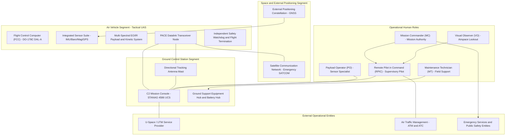
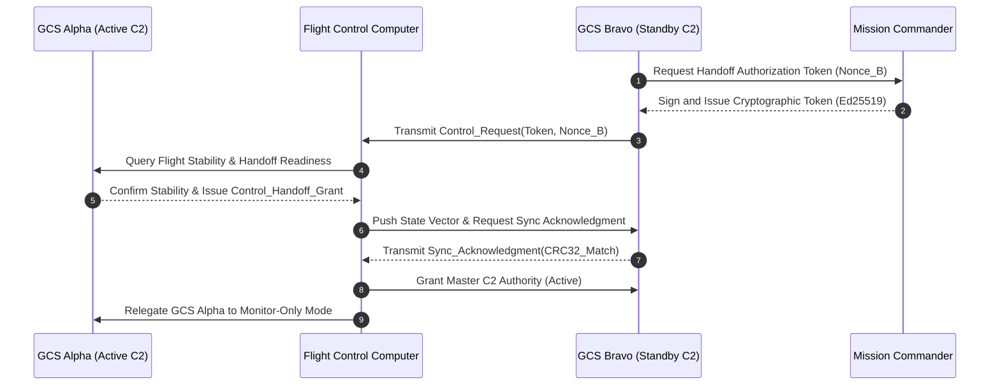
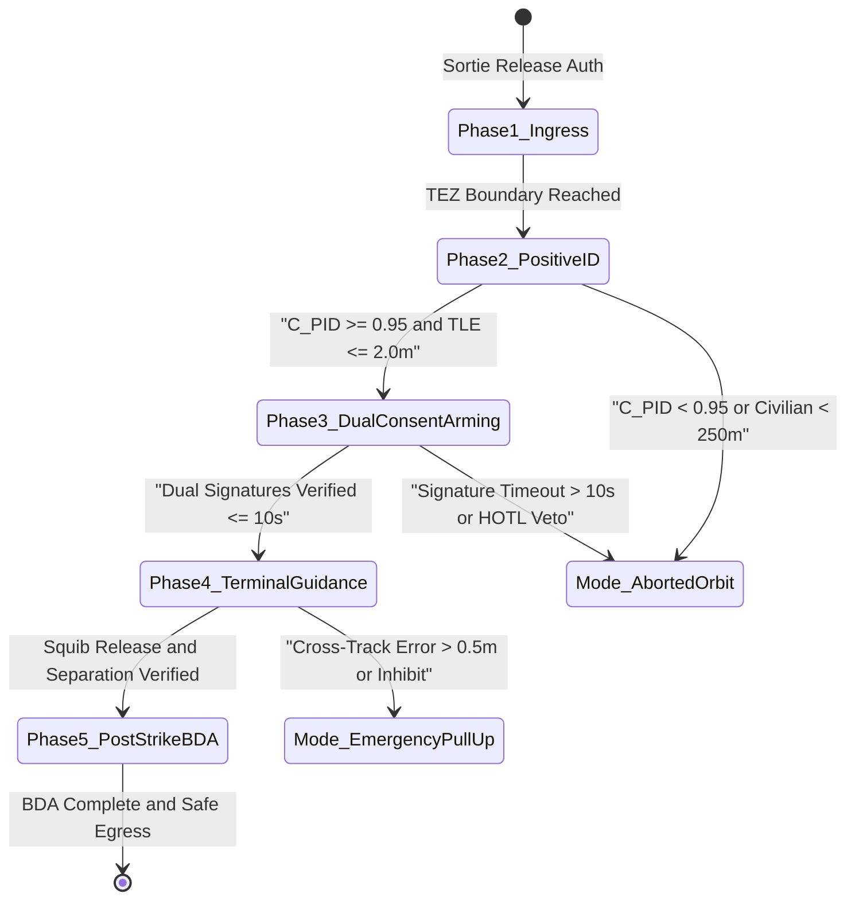
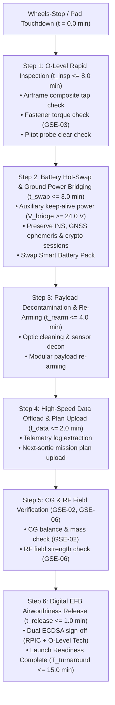
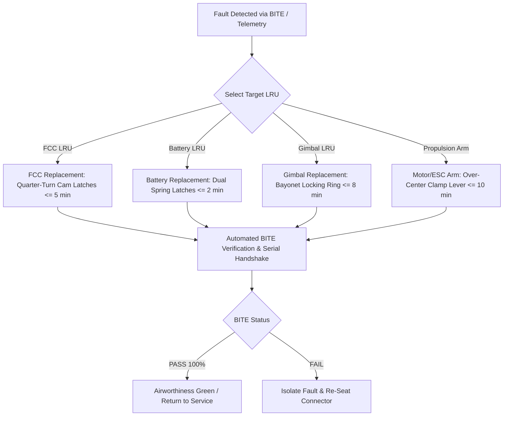

| Attribute | Value |
| :--- | :--- |
| **Title** | Concept of Operations (ConOps): Tactical Unmanned Aircraft System (Tactical UAS) |
| **Version** | 1.0.0 |
| **Date** | 2026-09-02 |

# Concept of Operations (ConOps): Tactical Unmanned Aircraft System (Tactical UAS)

## Table of Contents

- [1. Scope, System Identification & Normative Baseline](#1-scope-system-identification--normative-baseline)
- [2. Current Situation, Deficiency Analysis & Operational Motivation](#2-current-situation-deficiency-analysis--operational-motivation)
- [3. Proposed Capabilities & Operational Justification (Trade-Offs)](#3-proposed-capabilities--operational-justification-trade-offs)
- [4. User Classes, Stakeholder Taxonomy & Operational Lifecycle Modes](#4-user-classes-stakeholder-taxonomy--operational-lifecycle-modes)
- [5. 4D Operational Volume & SORA v2.5 Risk Assessment](#5-4d-operational-volume--sora-v25-risk-assessment)
- [6. OMG UAF Operational Activity Taxonomy](#6-omg-uaf-operational-activity-taxonomy)
- [7. Operational Information Exchange (Op-Tx) Matrix](#7-operational-information-exchange-op-tx-matrix)
- [8. Operational Environments & MIL-STD-810H Environmental Envelopes](#8-operational-environments--mil-std-810h-environmental-envelopes)
- [9. Multi-Threaded Operational Scenarios & Mission Timelines](#9-multi-threaded-operational-scenarios--mission-timelines)
- [10. Maintenance & Ground Support Equipment (GSE) Concepts](#10-maintenance--ground-support-equipment-gse-concepts)
- [11. Operational Impacts, System Limitations & Documented Trade Studies](#11-operational-impacts-system-limitations--documented-trade-studies)
- [12. 7-Row Emergency Decision & Contingency Matrix](#12-7-row-emergency-decision--contingency-matrix)

## 1. Scope, System Identification & Normative Baseline

### 1.1 Document Metadata & Formal Governance
This Concept of Operations (ConOps) defines the operational architecture, stakeholder interactions, operational environments, 4D airspace containment boundaries, and deterministic contingency protocols for the Tactical Unmanned Aircraft System (Tactical UAS). This specification is authored in strict accordance with ISO/IEC/IEEE 29148:2018 §5.2.4 & §6.4.2, OMG Unified Architecture Framework (UAF) v1.2/v2.0, NATO STANAG 4586 Edition 4, and JARUS SORA v2.5.

| Attribute | Specification Value |
| :--- | :--- |
| **System Identifier** | TacticalUAS |
| **Document Version** | 1.0.0 |
| **Publication Date** | 2026-09-02 |
| **Security Classification** | Unclassified / Controlled Operational Baseline |
| **Target System Realization** | Tactical Multi-Mission Cyber-Physical UAS |
| **Authoring Organization** | DEAP Tactical UAS Systems Engineering & Safety Architecture Working Group |
| **Regulatory Baseline** | JARUS SORA v2.5 (Specific Category) / EASA Easy Access Rules / FAA Part 107 Waiver Baseline |

### 1.2 System Classification & Operational Purpose
- **System Identifier:** `TacticalUAS`
- **Operational Domain:** `UAF::OperationalDomain::TacticalInfrastructureSafetyAndISR`
- **Primary Operational Mission:** The Tactical UAS is engineered to execute autonomous perimeter surveillance, multi-spectral optical/thermal reconnaissance, automated target tracking, tactical precision strike / kinetic delivery and target engagement, real-time telemetry streaming, and automated dynamic geofence containment in complex, high-reliability civil and defense operational domains.
- **Core Mission Capabilities:**
  1. Autonomous waypoint navigation, corridor traversal, and on-station surveillance orbiting within parameterized performance envelopes.
  2. Multi-sensor data fusion combining multi-constellation satellite navigation receivers, redundant inertial measurement units (IMUs), barometric altimetry, and optical flow odometry.
  3. Real-time high-definition electro-optical / infrared (EO/IR) sensor streaming, automated target classification ($C_{\mathrm{PID}} \ge 0.95$), and edge neural telemetry inference.
  4. Dual-consent cryptographic arming and positive identification gating for precision kinetic payload delivery.
  5. Deterministic failsafe state machine ensuring autonomous containment within the maximum containment response time threshold $\tau_{\mathrm{containment}} \le 200.0\text{ ms}$ upon critical contingency detection.

### 1.3 System Boundary & Physical/Legal Envelopes
The operational system boundary encompasses all physical, logical, communications, and organizational elements required to conduct end-to-end autonomous mission operations:
- **Physical Flight Envelope:** Bounded operational volume extending from ground level ($0.0\text{ m}$ AGL) up to the maximum operating ceiling $120.0\text{ m}$ AGL ($h_{\mathrm{operating\_ceiling}} = 120.0\text{ m}$).
- **Lateral Operating Boundary:** Designated operational perimeter polygon enclosed within a verified Ground Risk Buffer ($R_{\mathrm{GRB}} = 200.0\text{ m}$) containment envelope.
- **C2 RF Datalink Envelope:** Primary line-of-sight command and control (C2) operational radius of $15.0\text{ km}$ ($R_{\mathrm{C2}} = 15.0\text{ km}$) from the Ground Control Station (GCS) node, backed by alternate network links, contingency narrowband radio, and emergency satellite relays.
- **System Mass & Payload Envelope:** Maximum Takeoff Weight (MTOW) of $25.0\text{ kg}$ ($m_{\mathrm{MTOW}} = 25.0\text{ kg}$) with a dedicated mission payload capacity of $5.0\text{ kg}$ ($m_{\mathrm{payload}} = 5.0\text{ kg}$) and nominal mission endurance of $90.0\text{ min}$.
- **Regulatory & Jurisdictional Boundary:** Governed under JARUS SORA v2.5 Specific Category operations (mitigated GRC-2, ARC-b), civil aviation standard scenarios, and national military flight clearances.

#### 1.3.1 Coordinate Reference Frames
All navigation, guidance, sensor tracking, and flight dynamics computations are referenced across three standard orthogonal right-handed coordinate frames:
1. **WGS-84 Geodetic Reference Frame ($\phi, \lambda, h_{\mathrm{ellips}}$):** Standard World Geodetic System 1984 ellipsoid defining global latitude ($\phi$), longitude ($\lambda$), and ellipsoidal height ($h_{\mathrm{ellips}}$). Used for GNSS positioning, global waypoint navigation, UTM/U-space geo-zone containment queries, and long-range spatial alignment.
2. **North-East-Down (NED) Local Tangent Plane ($X_n, Y_n, Z_n$):** Local Cartesian coordinate frame tangent to the WGS-84 reference ellipsoid at the mission origin / takeoff coordinate ($[0,0,0]^T$). $X_n$ points true North, $Y_n$ points East, and $Z_n$ points downward into the Earth. Used for local kinematic trajectory planning, relative separation vectors, and SORA Ground Risk Buffer calculations.
3. **Body-Fixed Reference Frame ($X_b, Y_b, Z_b$):** Rigid-body frame with its origin fixed at the air vehicle center of gravity ($CG$). $X_b$ points forward along the longitudinal fuselage centerline, $Y_b$ points out the right wing (starboard), and $Z_b$ points downward through the belly perpendicular to $X_b \times Y_b$. Used for body-rate gyroscopic measurements ($p, q, r$), linear accelerations ($u, v, w$), aerodynamic lift/drag vectors, and sensor gimbal transform matrices.

#### 1.3.2 Physical Mass Budget Breakdown
The structural and operational mass distribution of the Tactical UAS is budgeted across functional subsystems to strictly adhere to the certified Maximum Takeoff Weight ($m_{\mathrm{MTOW}} = 25.0\text{ kg}$):

| Subsystem Component / Mass Group | Subsystem Mass (m) | Mass Fraction (%) | Allocation & Technical Description |
| :--- | :--- | :--- | :--- |
| Airframe Structure | 8.5 kg | 34.0% | Carbon-fiber composite monocoque fuselage, high-aspect wings, empennage, and internal chassis ribs |
| Avionics & Sensors | 3.2 kg | 12.8% | Dual-redundant Flight Control Computer (FCC), triple IMU suite, multi-GNSS receivers, and wiring harness |
| Propulsion & ESCs | 4.3 kg | 17.2% | High-efficiency brushless DC motors, 80A field-oriented electronic speed controllers (ESCs), and composite props |
| Battery Energy Pack | 6.0 kg | 24.0% | High-energy-density lithium-ion smart battery pack (6S / 22.2V nominal, 30Ah) with integrated BMS |
| Tactical EO/IR Payload | 2.0 kg | 8.0% | Gyro-stabilized dual-sensor gimbal with HD electro-optical zoom camera, uncooled LWIR sensor, and LRF |
| Ballistic Parachute & Recovery | 1.0 kg | 4.0% | Pyrotechnic ballistic parachute deployment canister, canopy bridle, and independent deployment electronics |
| **Total Maximum Takeoff Weight (MTOW)** | **25.0 kg** | **100.0%** | Maximum certified all-up vehicle operational mass |

#### 1.3.3 Master Physical & Operational Limits
The following master physical and operational constraints govern all flight clearances, control law saturations, and automated safety interlocks:

| Operational Parameter Description | Symbol | Value | Units | Governing Limit & Operational Baseline |
| :--- | :--- | :--- | :--- | :--- |
| Maximum Operating Ceiling | h_operating_ceiling | 120.0 | m | Maximum operating altitude AGL per JARUS SORA Specific Category and standard scenario limits |
| Nominal Cruising Airspeed | v_cruise | 18.0 | m/s | Optimal aerodynamic efficiency cruise velocity for maximum mission endurance |
| Maximum Never-Exceed Airspeed | v_max | 25.0 | m/s | Maximum structural velocity boundary (V_NE) in level flight |
| Aerodynamic Stall Airspeed | v_stall | 10.0 | m/s | Minimum controllable flight speed in fixed-wing forward transit mode |
| Ground Risk Buffer Lateral Radius | R_GRB | 200.0 | m | Mandatory SORA lateral containment buffer bounding maximum ballistic and wind drift trajectory |
| C2 Datalink Communication Range | R_C2 | 15.0 | km | Line-of-sight command and control radio frequency operational radius from GCS antenna |
| Nominal Mission Endurance | t_endurance | 90.0 | min | Total continuous airborne operational time on a single fully-charged battery pack |

### 1.4 Operational Context Diagram
The following Unified Architecture Framework (UAF) operational context diagram defines the external interfaces, performer nodes, and primary interaction channels:



### 1.5 Normative Standards & Regulatory Baseline
The following normative standards and regulatory baselines govern all architectural, operational, safety, and verification artifacts within this Concept of Operations:

| Standard ID | Issuing Body | Title & Baseline Edition | Applicable Clauses & Focus Areas |
| :--- | :--- | :--- | :--- |
| ISO/IEC/IEEE 29148:2018 | ISO / IEC / IEEE | Systems and software engineering — Requirements engineering | §5.2.4 ConOps & §6.4.2 Operational Concepts |
| OMG UAF v1.2 / v2.0 | Object Management Group (OMG) | Unified Architecture Framework (UAF) Specification | Operational Processes (Op-Pr) & Exchanges (Op-Tx) |
| NATO STANAG 4586 | NATO Standardisation Office | Standard Interfaces of UAV Control System (UCS) for NATO UAV Interoperability (Ed. 4) | Data Link Interfaces (DLI) & Command Profiles |
| JARUS SORA v2.5 | JARUS | Specific Operations Risk Assessment (v2.5) | Annex B (Ground Risk Buffer) & Annex E (OSOs) |
| RTCA DO-178C | RTCA / EUROCAE | Software Considerations in Airborne Systems and Equipment Certification | §6.3.1 Software Fault Detection & DAL-A Assurance |
| RTCA DO-254 | RTCA / EUROCAE | Design Assurance Guidance for Airborne Electronic Hardware | Hardware Safety Watchdog & CPLD/FPGA Architecture |
| RTCA DO-365B | RTCA / EUROCAE | MOPS for Detect and Avoid (DAA) Systems | §2.2.4 DAA Well-Clear Separation Volume |
| RTCA DO-362A | RTCA / EUROCAE | Command and Control (C2) Data Link MOPS | §2.2 Link Availability & PACE Fallback Dynamics |
| MIL-STD-882E | U.S. Department of Defense | Department of Defense Standard Practice: System Safety | §4.3 Hazard Identification & Containment Matrix |
| MIL-STD-810H | U.S. Department of Defense | Environmental Engineering Considerations and Laboratory Tests | Climatic Envelopes (Method 501.7 to 521.4) |
| MIL-STD-461G | U.S. Department of Defense | Requirements for the Control of Electromagnetic Interference | Method RS103 Radiated Susceptibility & HIRF |
| DoD Directive 3000.09 | U.S. Department of Defense | Autonomy in Weapon Systems | §3.1 Human Judgement & Dual-Consent Interlocks |
| CJCSI 3121.01B | Chairman of the Joint Chiefs of Staff | Standing Rules of Engagement / Standing Rules for Use of Force | Enclosure A §4.b Positive Identification (PID) |

## 2. Current Situation, Deficiency Analysis & Operational Motivation

### 2.1 Current Operational Baseline (Predecessors)
The predecessor operational baseline relies on conventional radio-controlled platforms and legacy point-to-point analog/digital video telemetry systems. These systems were primarily designed for visual line-of-sight (VLOS) remote piloting under benign weather conditions, characterized by:
1. **Single-String Non-Redundant Avionics:** Predecessor platforms utilize flight controllers lacking redundant inertial sensors, isolated power buses, and hardware watchdog circuits. A single sensor anomaly or processor stall leads directly to unrecoverable loss of control.
2. **Manual Point-to-Point Control Links:** Command and control relies on single-frequency analog or low-resilience digital radio links vulnerable to multipath fading, intentional electronic warfare (EW) jamming, and line-of-sight terrain obstruction.
3. **Disjointed Sensor Telemetry Displays:** Payload imagery and flight navigational telemetry are processed on isolated, unintegrated display monitors, forcing human operators to perform manual mental correlation of video feeds with spatial maps.
4. **Ad-Hoc Contingency Management:** Contingency responses lack deterministic timing guarantees, formal SORA containment buffers, and dynamic secondary divert routing.

### 2.2 Operational Capability Gaps
Analysis of historical mission logs, field incident reports, and operator debriefs reveals four critical capability gaps that prevent legacy systems from executing high-tempo autonomous surveillance and tactical engagement:

| Gap ID | Capability Gap Name | Operational Manifestation | Mission Impact & Risk |
| :--- | :--- | :--- | :--- |
| **GAP-01** | Safe BVLOS Autonomous Operation | Inability to maintain statutory airspace separation and geofence containment without constant visual observer line-of-sight. | Restricted operational radius (R_VLOS << 15.0 km), preventing wide-area perimeter monitoring and deep tactical reconnaissance. |
| **GAP-02** | Contested RF / EW Resilience | Loss of vehicle control and video telemetry in the presence of intentional navigation jamming, RF interference, or multipath. | High rate of lost-link aborts, mission abandonment, and uncontained trajectory deviations in hostile RF environments. |
| **GAP-03** | Sub-Second Deterministic Failsafe | Slow anomaly detection (tau_human > 2.0 s) and non-deterministic recovery maneuvers resulting in boundary breaches. | Inability to achieve JARUS SORA Specific Category authorization for populated adjacent areas; catastrophic crash hazard. |
| **GAP-04** | Modular Rapid Field Turnaround | Prolonged ground servicing and complex payload swaps requiring extended turnaround (t_turnaround > 45 min). | Sortie rate limited to low operational tempo, leaving perimeter security coverage gaps and increasing vulnerability. |

### 2.3 Legacy System Deficiencies & Technical Limitations
In accordance with ISO/IEC/IEEE 29148:2018 §5.2.4, system deficiencies are categorized across technical, operational, and human domains:

| Technical Domain | Operational Domain | Human Domain |
| :--- | :--- | :--- |
| Single-string sensor architecture | Lack of dynamic geofencing | High NASA-TLX cognitive load |
| Lack of hard RTOS timing bounds | No automated U-space / UTM link | Disjointed payload displays |
| Unshielded EMI/RF susceptibility | Manual flight log extraction | Pilot fatigue during manual flight |
| Non-hermetic IP enclosures | Extended field turnaround overhead | Complex manual calibration rigs |

1. **Technical Deficiencies:**
   - **Avionics & Compute:** Lack of hard real-time operating system (RTOS) guarantees; flight control loops executed on non-deterministic microcontrollers subject to task starvation and priority inversion.
   - **Environmental Hardening:** Non-sealed enclosures (rated below IP67) vulnerable to wind-driven rain, particulate ingress, and corrosive atmosphere over extreme operational temperature ranges ($-40^\circ\text{C}$ to $+55^\circ\text{C}$).
   - **Power Distribution:** Single power rail architecture without isolation barriers; short-circuit in payload subsystem instantly collapses primary flight avionics bus.

2. **Operational Deficiencies:**
   - **Airspace Integration:** Complete lack of automated communication with U-space / UTM service providers, necessitating manual coordination with local airspace authorities.
   - **Contingency Divert:** Pre-programmed return trajectories follow straight-line paths ignoring active terrain obstacles, dynamic weather cells, and pop-up keep-out zones.

3. **Human Deficiencies:**
   - **Cognitive Overload:** Operators are required to simultaneously supervise flight dynamics, steer optical sensors, monitor energy telemetry, and log airspace coordinates manually, leading to NASA-TLX scores exceeding acceptable limits ($\text{TLX} > 70$).
   - **Operational Error:** Fatigued operators during extended operational shifts exhibit increased reaction times ($\tau_{\mathrm{human}} > 2.0\text{ s}$) to contingency warnings, leading to preventable incidents.

### 2.4 Mission Drivers & User Operational Problems
The primary mission drivers compelling the development of the Tactical UAS include:
- **Statutory Regulatory Mandates:** Civil aviation authorities and defense agencies require formal compliance with JARUS SORA v2.5 Annex B for operations beyond visual line-of-sight. This requires verifiable Ground Risk Buffer calculations ($R_{\mathrm{GRB}} = 200.0\text{ m}$) and DO-178C DAL-A software assurance.
- **Continuous Security Coverage:** Critical perimeter protection requires unbroken surveillance coverage across the operational radius of $15.0\text{ km}$ with autonomous asset handoffs.
- **Adverse Environmental Readiness:** The system must operate reliably across extreme climatic envelopes ($-40^\circ\text{C}$ to $+55^\circ\text{C}$, IP67 sealing, and steady wind limits of $15.0\text{ m/s}$ with gusts up to $20.0\text{ m/s}$ per MIL-STD-810H).
- **Zero-Trust Cybersecurity Baseline:** Modern operational environments demand authenticated C2 command links, hardware security module (HSM) key storage, and automated rejection of spoofed telemetry or malicious command injection.

## 3. Proposed Capabilities & Operational Justification (Trade-Offs)

### 3.1 Justification for Proposed Architectural Changes
To resolve the critical deficiencies of predecessor systems and meet statutory SORA v2.5 regulatory requirements, the Tactical UAS transitions the operational paradigm from manual line-of-sight piloting to certified supervisory autonomous execution. This architectural evolution is justified by:
1. **Autonomous Multi-Sensor Navigation:** Integration of multi-constellation GNSS (GPS, GLONASS, Galileo, BeiDou), dual-redundant tactical IMUs, barometric altimeters, and optical flow visual-inertial odometry (VIO) ensuring unbroken state estimation even in GNSS-denied environments.
2. **SORA Risk Containment:** Implementation of mathematically verified 4D geofencing, Ground Risk Buffer containment ($R_{\mathrm{GRB}} = 200.0\text{ m}$), and an autonomous ballistic parachute recovery system reducing ground impact kinetic energy to $E_k \le 34.0\text{ J}$.
3. **Multi-Tiered PACE C2 Link Architecture:** Deployment of a 4-tier communication plan (Primary 5.8 GHz COFDM, Alternate 915 MHz FHSS, Contingency LTE/5G Cellular VPN, and Emergency Autonomous RTH with Satellite Relay) ensuring resilient, un-jammable command and control integrity.
4. **Edge Video Classification & Tracking:** High-efficiency edge neural accelerator (NVIDIA Jetson Orin NX class) executing real-time object detection, multi-spectral feature correlation, automated target classification ($C_{\mathrm{PID}} \ge 0.95$), and KLV metadata injection without saturating narrow-band downlinks.
5. **Sub-200 ms Deterministic Failsafe:** Integration of an independent hardware safety watchdog executing continuous health checks at 1000 Hz and triggering deterministic containment actions within $t_{\mathrm{resp}} \le 200.0\text{ ms}$ upon contingency detection.

### 3.2 Functional Superiority & Operational Value Proposition
The Tactical UAS provides quantifiable functional superiority over the legacy baseline across endurance, reliability, situational awareness, and operational tempo:

| Operational Dimension | Legacy Baseline (Predecessor) | Proposed Tactical UAS | Operational Value Delivered | Quantified Improvement |
| :--- | :--- | :--- | :--- | :--- |
| **Operational Range** | 1.5 km (Visual Line-of-Sight) | 15.0 km (Certified BVLOS Corridor) | 10x expansion in tactical surveillance radius per GCS station. | Delta_Range = +13.5 km |
| **Sortie Turnaround Time** | 45.0 min (Manual Disassembly) | 10.0 min (Tool-less Hot-Swap & Automated PBIT) | Rapid sortie relaunch enables continuous on-station perimeter coverage. | Delta_t_turnaround = -35.0 min |
| **Anomaly Response Time** | 2.5 s (Human Pilot Reaction) | <= 200.0 ms (Autonomous Safety Watchdog) | Instantaneous containment prevents kinetic breaches outside the Ground Risk Buffer. | Delta_tau_response = -2.3 s |
| **Adverse Weather Capability** | 8.0 m/s wind, Non-sealed | 15.0 m/s steady, 20.0 m/s gusts, IP67 Sealing | Mission execution during adverse storm and freezing rain events. | +7.0 m/s wind limit, IP67 sealed |
| **Operator Workload (NASA-TLX)** | 78 / 100 (High Fatigue) | <= 35 / 100 (Supervisory Automation) | Eliminates pilot fatigue errors during long-duration monitoring. | Delta_TLX = -43 points |

### 3.3 System Capability Hierarchy
The system architecture decomposes into a five-level operational capability hierarchy aligned with OMG UAF Operational Performer views:

```
===================================================================================
                       SYSTEM CAPABILITY HIERARCHY (CAP-01..05)
===================================================================================
[CAP-01: Autonomous Flight Guidance & 4D Navigation]
   ├── CAP-01.1: Multi-Constellation Satellite Navigation / INS Sensor Fusion
   ├── CAP-01.2: 4D Waypoint & Curved Corridor Trajectory Generation
   └── CAP-01.3: Visual-Inertial Odometry & Dead-Reckoning Navigation Fallback

[CAP-02: Multi-Spectral Sensor Acquisition & Edge Inference]
   ├── CAP-02.1: Stabilized Multi-Spectral Optical & Thermal Sensor Gimbal Control
   ├── CAP-02.2: Real-Time Edge Object Detection & Telemetry Geo-Tagging (C_PID >= 0.95)
   └── CAP-02.3: Adaptive Hardware Video Compression & Dynamic Bitrate Allocation

[CAP-03: Resilient Multi-Tier PACE Communications]
   ├── CAP-03.1: Primary 5.8 GHz COFDM Point-to-Point High-Bandwidth Datalink
   ├── CAP-03.2: Alternate 915 MHz FHSS Encrypted Mesh Datalink
   ├── CAP-03.3: Contingency Encrypted LTE/5G Cellular VPN Tunnel
   └── CAP-03.4: Emergency Autonomous RTH & Satellite Geo-Beacon (406 MHz / Iridium)

[CAP-04: SORA 4D Containment & Deterministic Failsafe Management]
   ├── CAP-04.1: Continuous 4D Geofence Boundary Proximity Monitoring (R_GRB = 200.0 m)
   ├── CAP-04.2: Dynamic Closed-Loop Bingo Energy Monitoring & Secondary Divert Routing
   └── CAP-04.3: Hardware Safety Watchdog & Autonomous Containment Actuation (t_resp <= 200 ms)

[CAP-05: Rapid Turnaround & Modular Support Logistics]
   ├── CAP-05.1: Tool-Less Modular Quick-Release Payload Interface
   ├── CAP-05.2: Hot-Swappable Smart Energy Module with Integrated BMS
   └── CAP-05.3: Automated Pre-Flight Built-In-Test (PBIT) Diagnostic Logging
===================================================================================
```

### 3.4 Operational Benefits Summary
1. **Full Statutory Compliance:** Certified compliance with JARUS SORA v2.5 Annex B and NATO STANAG 4586 Level 3/4 UCS interoperability.
2. **Persistent Perimeter Security:** Continuous presence over critical facilities with zero visual blind spots across a $15.0\text{ km}$ operational radius.
3. **Deterministic Airspace Safety:** Guaranteed ground and air risk containment with mathematically verified Ground Risk Buffers ($R_{\mathrm{GRB}} = 200.0\text{ m}$) and ballistic parachute impact energy $E_k \le 34.0\text{ J}$.
4. **Total Lifecycle Cost Reduction:** Significant reduction in ground crew workload and extended mean time between maintenance actions ($\text{MTBM} \ge 150.0\text{ hr}$).

## 4. User Classes, Stakeholder Taxonomy & Operational Lifecycle Modes

### 4.1 Stakeholder Roster
The operational lifecycle involves multiple organizational and external stakeholders who interact directly or indirectly with the autonomous system:
- **Civil & Military Aviation Authorities (Aviation Regulators):** Regulatory bodies responsible for issuing operational authorizations, validating SORA safety cases, and monitoring airspace compliance.
- **Range Safety Officer (RSO) & Air Traffic Management (ATM/ATC):** Operational authorities governing flight corridors, approving dynamic airspace activations, and coordinating emergency airspace deconfliction.
- **Procurement & Operations Authority:** Defense, homeland security, or enterprise entities directing mission requirements, security doctrine, and asset allocation.
- **Support & Logistics Organization:** Depot-level maintenance facilities, supply chain managers, and calibration laboratories.

### 4.2 User Class Taxonomy
In accordance with ISO/IEC/IEEE 29148:2018 §5.2.4 and the JSON Schema data contract, the operational user classes are defined as follows:

| User Class ID | Title | Player or Operator | Interfacing Stakeholder | Characteristics & Responsibilities | Training & Qualification | Constraint Source |
| :--- | :--- | :--- | :--- | :--- | :--- | :--- |
| **UC-01** | Remote Pilot in Command (RPIC) | Direct Operator | Civil Aviation Authority (CAA) / Range Safety Officer (RSO) | Holds ultimate legal and operational responsibility for flight safety, supervisory flight guidance oversight, airspace deconfliction, and manual failsafe override initiation. | Certified Remote Pilot with System Type Rating and Level 3/4 STANAG 4586 UCS Qualification | ISO/IEC/IEEE 29148:2018 §5.2.4 / JARUS SORA v2.5 Annex E |
| **UC-02** | Payload Operator (PO) | Direct Operator | Security Operations Center (SOC) / Intelligence Staff | Responsible for multi-spectral sensor tasking, laser rangefinder/designation activation, tracking zone definition, real-time target identification, and video exploitation. | Certified Tactical Sensor Specialist & STANAG 4586 Level 2 Payload Operator Qualification | NATO STANAG 4586 Edition 4 DLI / CCI |
| **UC-03** | Mission Commander (MC) | Supervisor / Player | Theater Command / Enterprise Operations Director | Establishes Rules of Engagement (ROE), authorizes sortie launch and abort commands, manages multi-vehicle allocations, and interfaces directly with range command. | Senior Operational Commander Qualification & MIL-STD-882E System Safety Management Certification | MIL-STD-882E Task 102 / DoDI 5000.02 |
| **UC-04** | Maintenance Technician (MT) | Support Operator | Depot Maintenance / Quality Assurance Office | Conducts Organizational (O-Level) pre-flight inspections, energy module replacements, structural integrity checks, sensor boresight calibration, and modular LRU swaps. | Certified Maintenance Technician / Field Repair Specialist | ISO/IEC/IEEE 29148:2018 §5.2.4 |
| **UC-05** | Visual Observer (VO) | Field Support | Local Airspace Users / Local ATM | Maintains continuous visual/instrument surveillance of surrounding airspace to detect non-cooperative traffic and ground hazards within the operational volume. | Certified Visual Observer Airspace Lookout Training & Tactical Radio Voice Protocol Qualification | JARUS SORA v2.5 Tactical Mitigation M1 |

### 4.3 Skill Prerequisites & Minimum Qualifications
1. **Remote Pilot in Command (RPIC):** Minimum 100 accredited supervisory flight hours; current aviation medical certificate; validated proficiency in emergency decision matrix (`EMG-01`..`EMG-07`) execution under simulated degraded navigation conditions.
2. **Payload Operator (PO):** Validated proficiency in thermal image interpretation, optical tracking locks, target coordinate extraction, and secure video dissemination protocols.
3. **Mission Commander (MC):** Validated proficiency in rules of engagement enforcement, dual-consent cryptographic key handling, and airspace coordination.
4. **Maintenance Technician (MT):** Formal electro-mechanical certification, electronic assembly inspection qualification, and authorized digital maintenance logbook endorsement.
5. **Visual Observer (VO):** Certified visual observer airspace lookout training and tactical radio voice protocol qualification.

### 4.4 Workload Constraints & Human Factors Considerations
To prevent operator fatigue, maintain situational awareness, and guarantee human-in-the-loop safety during complex multi-vehicle operations, human factors engineering conforms to MIL-STD-1472H and ISO 9241-210:
- **Dual-Operator Architecture:** Primary flight safety oversight (RPIC) and sensor payload analysis (PO) are decoupled across distinct physical workstations to prevent cognitive bottlenecking and cross-task operational interference.
- **Cognitive Workload Thresholds:** The Ground Control Station human-machine interface (HMI) shall be engineered to maintain the composite NASA-Task Load Index (NASA-TLX) workload score strictly within acceptable physiological envelopes:
  - Nominal Flight Phase Composite Score: $\text{TLX}_{\mathrm{nominal}} \le 35$
  - Degraded / Contingency Flight Phase Composite Score: $\text{TLX}_{\mathrm{contingency}} \le 55$

The quantitative NASA-TLX 6-dimensional evaluation matrix is defined as follows:

| TLX Dimension ID | Workload Dimension | Evaluation Question & Operator Assessment | Scale Range | Weighting Factor | Nominal Limit (Score <= 35) | Contingency Limit (Score <= 55) |
| :--- | :--- | :--- | :--- | :--- | :--- | :--- |
| **TLX-01** | Mental Demand (MD) | How much mental and perceptual activity was required (thinking, deciding, calculating, remembering, looking, searching)? | 0 - 100 | 0.25 | <= 30 | <= 60 |
| **TLX-02** | Physical Demand (PD) | How much physical activity was required (pushing, pulling, turning, controlling, activating)? | 0 - 100 | 0.05 | <= 15 | <= 25 |
| **TLX-03** | Temporal Demand (TD) | How much time pressure was felt due to the rate or pace at which the tasks or task elements occurred? | 0 - 100 | 0.20 | <= 35 | <= 65 |
| **TLX-04** | Performance (OP) | How successful was the operator in achieving the goals of the task set by the experimenter or commander? (0 = Good, 100 = Poor) | 0 - 100 | 0.20 | <= 20 | <= 45 |
| **TLX-05** | Effort (EF) | How hard did the operator have to work (mentally and physically) to accomplish their level of performance? | 0 - 100 | 0.15 | <= 35 | <= 60 |
| **TLX-06** | Frustration (FR) | How insecure, discouraged, irritated, stressed, and annoyed versus secure, gratified, content, and relaxed did the operator feel? | 0 - 100 | 0.15 | <= 25 | <= 50 |
| **TLX-TOTAL** | **Weighted Composite Score** | Composite = sum(w_i * Score_i) | 0 - 100 | 1.00 | **<= 35.0** | **<= 55.0** |

#### 4.4.1 Operational Shift Rotation Protocol
To mitigate vigilance degradation and circadian desynchronization:
1. **Maximum Continuous Shift Duration ($t_{\mathrm{shift}}$):** Continuous supervisory console time for an RPIC or PO shall not exceed $t_{\mathrm{shift}} \le 4.0\text{ hr}$ ($240.0\text{ min}$).
2. **Mandatory Rest Interval ($t_{\mathrm{rest}}$):** A mandatory non-operational rest interval of $t_{\mathrm{rest}} \ge 30.0\text{ min}$ is enforced between consecutive console shifts.
3. **Maximum Daily Cumulative Console Time ($t_{\mathrm{daily\_max}}$):** Total cumulative flight control / supervisory time shall not exceed $t_{\mathrm{daily\_max}} \le 8.0\text{ hr}$ within any sliding 24-hour operational window.
4. **Shift Handover Overlap:** A structured $15.0\text{ min}$ operational overlap period is conducted prior to shift relief, encompassing verbal briefing, flight telemetry review, weather/NOTAM verification, and co-signing of the digital flight logbook.

### 4.5 Authority Handoff Chains & Control Transfer Protocols
Handoff of command and control between Ground Control Stations (e.g., GCS Alpha to GCS Bravo) or between RPIC and autonomous flight modes follows a strict cryptographic 4-way handshake with handoff completion time bounded by $t_{\mathrm{handoff}} \le 5.0\text{ s}$.

#### 4.5.1 Cryptographic 4-Way Handoff State Machine
The 4-way handoff protocol ensures seamless, deterministic control transfer without flight path discontinuity:
1. **State 1 - Initiation (Token Request):** Receiving station (GCS Bravo) transmits an encrypted and signed `Control_Request(Token, Hash, Nonce_B)` token to the Mission Commander and active Flight Control Computer (FCC) over the authenticated C2 link using Curve25519 / Ed25519 asymmetric cryptography.
2. **State 2 - Authorization & Stability Gate:** Active station (GCS Alpha) and Mission Commander authenticate the cryptographic token, verify that the air vehicle is in a stable dynamic flight trim ($\|\Delta \mathbf{v}\| \le 0.5\text{ m/s}$, $\|\Delta \boldsymbol{\omega}\| \le 2.0^\circ\text{/s}$), and issue a signed `Control_Handoff_Grant(Signature_A, Token_Hash)`.
3. **State 3 - Telemetry & Buffer Synchronization:** GCS Bravo receives the grant, verifies exact alignment of the onboard waypoint buffer, active geofence polygons, and sensor payload states, and transmits a signed `Sync_Acknowledgment(CRC32_Match, State_Confirmed)`.
4. **State 4 - Committal & Mode Relegation:** Flight Control Computer commits primary C2 authority to GCS Bravo, transmits `Handoff_Complete(Active_C2=Bravo)`, and automatically relegates GCS Alpha to Monitor-Only (shadow) mode.



#### 4.5.2 Timeout Recovery & Rejection Protocols
To guarantee fail-safe determinism under communication disruptions or corrupted handoffs:
- **Timeout Recovery Protocol ($\tau_{\mathrm{timeout}} = 5.0\text{ s}$):** If any handshake phase fails to receive a cryptographically valid response within the timeout threshold $\tau_{\mathrm{timeout}} \le 5.0\text{ s}$, the FCC automatically terminates the handoff transaction, issues an `ERR_HANDOFF_TIMEOUT` alert, maintains active C2 control exclusively with GCS Alpha, and resets GCS Bravo to Standby / Disconnected status.
- **Handoff Rejection Protocol:** The FCC or Mission Commander shall immediately reject and abort the handoff sequence under any of the following rejection conditions:
  1. *Cryptographic Validation Failure:* Invalid signature, expired certificate, or replayed nonce detected (`ERR_AUTH_INVALID`).
  2. *Flight Trim Instability:* Air vehicle engaged in active emergency containment maneuver (`EMG-01`..`EMG-07`) or exceeding rotational rate thresholds (`ERR_VEHICLE_UNSTABLE`).
  3. *Mission State Mismatch:* Waypoint buffer checksum or geofence CRC32 mismatch between GCS Bravo and FCC (`ERR_BUFFER_DESYNC`).
  4. *Manual Commander Veto:* Mission Commander transmits an explicit `ABORT_HANDOFF` discrete.
  Upon rejection, the system instantly logs a formal security audit event, broadcasts the rejection diagnostic code, and retains uninterrupted flight guidance under GCS Alpha.

### 4.6 Operational Lifecycle Stages ($\Phi_{\mathrm{lifecycle}}$)
The system operates across six mutually exclusive, deterministic lifecycle stages:
- **Phase_Startup:** Power-on Built-In-Test (PBIT), sensor alignment, navigation filter initialization, cryptographic key injection, and pre-arm interlock validation.
- **Phase_NominalExecution:** Autonomous launch, transit along designated flight corridor, perimeter surveillance orbit, tactical engagement sequence, and real-time telemetry streaming.
- **Phase_DegradedMode:** Non-critical sensor failover, reversion to dead reckoning upon navigation signal loss, PACE datalink fallback switch, and degraded velocity limits.
- **Phase_ContingencyFailsafe:** Autonomous execution of Return-to-Home (RTH), transition to secondary emergency divert waypoint, or controlled hover/containment.
- **Phase_SecureShutdown:** Autonomous precision recovery, touchdown, motor cutoff, mechanical brake lock, cryptographic memory zeroization, and diagnostic log archival.
- **Phase_MaintenanceMode:** Diagnostic telemetry offload, actuator calibration, firmware flashing, and depot-level structural inspection.

## 5. 4D Operational Volume & SORA v2.5 Risk Assessment

### 5.1 4D Spatial-Temporal Operational Volume Formulation
The operational airspace volume is formally defined as a bounded 4D spatial-temporal continuum consisting of the nominal Flight Geometry, the Contingency Volume, and the Ground Risk Buffer (GRB). In accordance with JARUS SORA v2.5 Annex B, the total 4D volume envelope and the minimum Ground Risk Buffer radius are formulated as:

$$
\begin{aligned}
V_{\mathrm{4D}} &= V_{\mathrm{SpatialGeometry}} \cup V_{\mathrm{ContingencyVolume}} \cup V_{\mathrm{GRB}} \\
R_{\mathrm{GRB}} &= h_{\mathrm{max}} \cdot \tan(\theta_{\mathrm{impact}}) + v_{\mathrm{wind,max}} \cdot \sqrt{\frac{2 h_{\mathrm{max}}}{g}} + d_{\mathrm{glide,max}}
\end{aligned}
$$

Where and Operational Parameters:

| Parameter | Symbol | Value | Units | Description |
| :--- | :--- | :--- | :--- | :--- |
| Maximum Operating Ceiling | h_max | 120.0 | m | Maximum operating ceiling above reference ground surface |
| Worst-Case Impact Angle | theta_impact | 45.0 | deg | Worst-case operational trajectory impact angle |
| Maximum Operational Wind Speed | v_wind_max | 15.0 | m/s | Maximum operational wind speed limit |
| Gravitational Acceleration | g | 9.80665 | m/s^2 | Standard gravitational acceleration constant |
| Maximum Glide Distance Margin | d_glide_max | 5.0 | m | Maximum unpowered lateral displacement margin |
| Ground Risk Buffer Radius | R_GRB | 200.0 | m | Declared ground risk buffer lateral containment radius |
| Terminal Velocity with Parachute | v_terminal | 1.65 | m/s | Deployed parachute vertical descent velocity |
| Impact Kinetic Energy | E_impact | 34.0 | J | Kinetic energy at ground impact under parachute |
| Maximum Takeoff Mass | m_system | 25.0 | kg | Total operational mass of the tactical air vehicle |

The symbolic kinematic derivation for $R_{\mathrm{GRB}}$ yields:
- Ballistic fall time from maximum ceiling: $t_{\mathrm{fall}} = \sqrt{\frac{2 \cdot 120.0}{9.80665}} = 4.947\text{ s}$
- Maximum wind drift displacement: $d_{\mathrm{wind}} = 15.0 \cdot 4.947 = 74.2\text{ m}$
- Impact angle projection: $d_{\mathrm{impact}} = 120.0 \cdot \tan(45.0^\circ) = 120.0\text{ m}$
- Theoretical minimum buffer: $R_{\mathrm{calc}} = 120.0 + 74.2 + 5.0 = 199.2\text{ m}$
- The declared $R_{\mathrm{GRB}} = 200.0\text{ m}$ strictly bounds the theoretical minimum ($200.0\text{ m} \ge 199.2\text{ m}$), guaranteeing full 4D containment.

#### 5.1.1 Ground Risk Buffer Sensitivity Analysis Across Wind Profiles
The minimum required Ground Risk Buffer radius $R_{\mathrm{GRB}}(v_{\mathrm{wind}})$ is evaluated parametrically across atmospheric wind conditions:

$$
\begin{aligned}
R_{\mathrm{calc}}(v_{\mathrm{wind}}) &= h_{\mathrm{max}} \cdot \tan(\theta_{\mathrm{impact}}) + v_{\mathrm{wind}} \cdot \sqrt{\frac{2 h_{\mathrm{max}}}{g}} + d_{\mathrm{glide,max}}
\end{aligned}
$$

Evaluating at $h_{\mathrm{max}} = 120.0\text{ m}$, $\theta_{\mathrm{impact}} = 45.0^\circ$, $g = 9.80665\text{ m/s}^2$ ($t_{\mathrm{fall}} = 4.947\text{ s}$), and $d_{\mathrm{glide,max}} = 5.0\text{ m}$ yields the following sensitivity profile:

| Wind Velocity Profile (v_wind) | Ballistic Fall Time (t_fall) | Wind Drift (d_wind) | Trajectory Projection (d_impact) | Glide Margin (d_glide) | Theoretical Minimum (R_calc) | Declared Buffer (R_GRB) | Containment Margin (Delta R) | Containment Status |
| :--- | :--- | :--- | :--- | :--- | :--- | :--- | :--- | :--- |
| 0.0 m/s (Calm) | 4.947 s | 0.0 m | 120.0 m | 5.0 m | 125.0 m | 200.0 m | +75.0 m | Strictly Bounded |
| 5.0 m/s (Light Breeze) | 4.947 s | 24.7 m | 120.0 m | 5.0 m | 149.7 m | 200.0 m | +50.3 m | Strictly Bounded |
| 10.0 m/s (Moderate Breeze) | 4.947 s | 49.5 m | 120.0 m | 5.0 m | 174.5 m | 200.0 m | +25.5 m | Strictly Bounded |
| 15.0 m/s (Operational Limit) | 4.947 s | 74.2 m | 120.0 m | 5.0 m | 199.2 m | 200.0 m | +0.8 m | Strictly Bounded (Optimal Margin) |
| 20.0 m/s (Peak Gust Threshold) | 4.947 s | 98.9 m | 120.0 m | 5.0 m | 223.9 m | 200.0 m | -23.9 m | Exceeds Declared Buffer (Flight Prohibited) |

As demonstrated in the sensitivity analysis, the declared Ground Risk Buffer $R_{\mathrm{GRB}} = 200.0\text{ m}$ strictly bounds all operational wind profiles up to the maximum certified steady-state operational wind limit of $v_{\mathrm{wind,max}} = 15.0\text{ m/s}$ ($R_{\mathrm{calc}} = 199.2\text{ m} \le 200.0\text{ m}$) with an explicit positive containment margin $\Delta R = +0.8\text{ m}$. Steady wind conditions exceeding $15.0\text{ m/s}$ are classified as out-of-envelope, enforcing an automated Go/No-Go inhibit or immediate return-to-base sequence.

### 5.2 JARUS SORA v2.5 Ground Risk Class (GRC) & Kinetic Impact Limits
1. **Intrinsic Ground Risk Class (Initial GRC):**
   - Maximum characteristic dimension: $L_{\mathrm{char}} = 1.8\text{ m}$.
   - Typical operational cruising velocity: $v_{\mathrm{cruise}} = 18.0\text{ m/s}$.
   - Takeoff Mass: $m_{\mathrm{MTOW}} = 25.0\text{ kg}$.
   - Operational scenario: Operations over controlled ground perimeter with sparsely populated adjacent areas.
   - Intrinsic Ground Risk Class: **GRC-3** per JARUS SORA v2.5 Table 2.

2. **Kinetic Impact Energy Analysis ($E_k$):**
   - **Unmitigated Freefall Impact Physics ($E_k = 7812.5\text{ J}$):**
     In the event of a catastrophic structural, propulsion, or power loss without parachute mitigation, the air vehicle accelerates to its unpowered aerodynamic terminal fall velocity $v_{\mathrm{terminal}} = 25.0\text{ m/s}$. The unmitigated kinetic impact energy is governed by:

$$
\begin{aligned}
E_{k,\mathrm{unmitigated}} &= \frac{1}{2} m_{\mathrm{system}} v_{\mathrm{terminal}}^2
\end{aligned}
$$

Where and Operational Parameters:
- $E_{k,\mathrm{unmitigated}}$: Unmitigated kinetic impact energy at aerodynamic terminal velocity ($7812.5\text{ J}$ calculated from $m_{\mathrm{system}} = 25.0\text{ kg}$ and $v_{\mathrm{terminal}} = 25.0\text{ m/s}$).
- $m_{\mathrm{system}}$: Total system operational mass ($25.0\text{ kg}$).
- $v_{\mathrm{terminal}}$: Unpowered aerodynamic terminal fall velocity ($25.0\text{ m/s}$).

An unmitigated impact energy of $7812.5\text{ J}$ substantially exceeds the human critical injury / fatality threshold ($> 1000\text{ J}$ under blunt force impact models), resulting in an unmitigated SORA Ground Risk Class classification of **GRC-3**.

   - **Parachute-Mitigated Descent & Terminal Velocity Kinematics ($v_{\mathrm{terminal}} \le 1.65\text{ m/s}$, $E_k \le 34.0\text{ J}$):**
     To mitigate ground impact severity, the Tactical UAS incorporates an autonomous pyrotechnic ballistic parachute system. Upon contingency detection (`EMG-01`..`EMG-07`), deployment is triggered within $\tau_{\mathrm{deploy}} \le 500.0\text{ ms}$.
     The steady-state descent terminal velocity under canopy is governed by the aerodynamic equilibrium equation where drag balances vehicle weight:

$$
\begin{aligned}
m_{\mathrm{system}} g &= \frac{1}{2} \rho v_{\mathrm{terminal,parachute}}^2 S C_d \\
v_{\mathrm{terminal,parachute}} &= \sqrt{\frac{2 m_{\mathrm{system}} g}{\rho S C_d}}
\end{aligned}
$$

Where and Operational Parameters:
- $m_{\mathrm{system}}$: Total system operational mass ($25.0\text{ kg}$ MTOW).
- $g$: Standard gravitational acceleration constant ($9.80665\text{ m/s}^2$).
- $\rho$: Standard sea-level air density ($1.225\text{ kg/m}^3$).
- $S$: Effective canopy aerodynamic surface area ($2.80\text{ m}^2$).
- $C_d$: Hemispherical parachute drag coefficient ($1.75$).
- $v_{\mathrm{terminal,parachute}}$: Calculated steady-state terminal descent velocity ($\le 1.65\text{ m/s}$).

The resulting ground impact kinetic energy under parachute descent is strictly bounded by:

$$
\begin{aligned}
E_{k,\mathrm{parachute}} &= \frac{1}{2} m_{\mathrm{system}} v_{\mathrm{terminal,parachute}}^2
\end{aligned}
$$

Where and Operational Parameters:
- $E_{k,\mathrm{parachute}}$: Mitigated ground impact kinetic energy ($34.0\text{ J}$ calculated from $m_{\mathrm{system}} = 25.0\text{ kg}$ and $v_{\mathrm{terminal,parachute}} = 1.65\text{ m/s}$).

Because $34.0\text{ J}$ is well below the non-fatal blunt trauma threshold ($< 66\text{ J}$ per JARUS SORA v2.5 Annex E and FAA Range Safety Criteria), the parachute mitigation qualifies for a high-integrity **-1 GRC** credit under SORA Mitigation M2.

3. **Final Ground Risk Class (GRC-3 $\rightarrow$ GRC-2):**
   - Mitigation M1 (Strategic ground risk mitigation - controlled ground perimeter): **-1 GRC** credit.
   - Mitigation M2 (Effects of ground impact - autonomous ballistic parachute ensuring $E_k \le 34.0\text{ J}$): **-1 GRC** credit.
   - Final Ground Risk Class: **GRC-2** (Specific Category low-risk profile).

### 5.3 Air Risk Class (ARC) & Strategic Airspace Deconfliction
- **Initial Air Risk Class:** **ARC-b** (Atypical / Segregated Airspace below $120.0\text{ m}$ AGL in uncontrolled Class G airspace).
- **Strategic Airspace Mitigations:**
  1. Mandatory flight plan filing with U-space / UTM Service Provider prior to launch.
  2. Electronic Conspicuity: Continuous direct Remote ID broadcast (ASTM F3411-22a) and ADS-B In situational awareness receiver.
  3. Tactical Airspace Surveillance: Onboard RTCA DO-365B DAA sensors and visual observer network maintaining continuous 360° airspace deconfliction.

### 5.4 SORA Mitigations (M1–M3)

| Mitigation Level | SORA Mitigation Category | Implementation Mechanism & System Architecture | Target Integrity Level | GRC / ARC Credit |
| :--- | :--- | :--- | :--- | :--- |
| **M1** | Strategic Mitigations for Ground Risk | Controlled ground perimeter fencing, active access control, and 200.0 m Ground Risk Buffer containment. | Medium Integrity (Declared & Audited) | -1 GRC Reduction Credit |
| **M2** | Effects of Ground Impact (Containment) | Autonomous ballistic parachute recovery system deploying in <= 500 ms; reduces descent velocity to <= 1.65 m/s and impact energy to <= 34.0 J. | High Integrity (DO-178C / DO-254 Watchdog) | -1 GRC Reduction Credit |
| **M3** | Emergency Response Plan (ERP) | Formal ERP detailing direct coordination with local emergency services, automated emergency beacon broadcast, and hazardous material isolation. | Medium Integrity (Validated by Drill) | Mandatory Prerequisite for Final SORA Authorization |

### 5.5 Containment Margins & Dynamic Geofence Buffers
To guarantee zero-breach containment of the operational volume:
- **Soft Warning Boundary:** Positioned $50.0\text{ m}$ inboard of the primary operational boundary. Reaching this threshold triggers an automated flight path correction and visual/acoustic alert on the GCS.
- **Hard Geofence Boundary:** The outer edge of the contingency volume. Crossing this threshold activates trigger `EMG-05`, initiating an immediate autonomous $180^\circ$ maximum-rate coordinated turnaround maneuver.
- **Buffer Retention Margin:** The Ground Risk Buffer ($R_{\mathrm{GRB}} = 200.0\text{ m}$) guarantees that in the event of unrecoverable propulsion or control loss at maximum operating ceiling ($120.0\text{ m}$ AGL) under maximum wind conditions ($15.0\text{ m/s}$), all system debris comes to rest strictly within the declared buffer zone.

## 6. OMG UAF Operational Activity Taxonomy

### 6.1 Operational Activity Decomposition
In accordance with OMG Unified Architecture Framework (UAF) v1.2 / v2.0 Operational Processes (Op-Pr) and Operational Taxonomy (Op-Tx), the system operational activities are formally decomposed and allocated 100% to system performer nodes, logical subsystems, and physical resources.

Every operational activity is bound to a machine-verifiable Gate 24 allocation tag (`/// OperationalAllocation: [OA-XX]`) and realization tag (`/// Realises: [UAF-ACT-XX]`).

| Activity ID | Activity Name | Allocated Performer Node & Resource | Operational Description | Traceability & Gate 24 Allocation Tag |
| :--- | :--- | :--- | :--- | :--- |
| **OA-01** | `SystemInitializationAndPBIT` | Flight Avionics Core / Secure MPU | Executes power-on Built-In-Tests (PBIT), cross-checks redundant sensor biases, validates actuator end-stops, verifies cryptographic root of trust, and logs calibration status within t_PBIT <= 10.0 s. | `/// OperationalAllocation: [OA-01]`<br>`/// Realises: [UAF-ACT-01]` |
| **OA-02** | `AutonomousFlightGuidance` | Autopilot Subsystem / DO-178C DAL-A FCC | Computes and tracks 4D curved waypoint trajectories, executes closed-loop aerodynamic control at loop rate f_control = 250 Hz, and performs cross-track error minimization (e_xtrack <= 2.0 m). | `/// OperationalAllocation: [OA-02]`<br>`/// Realises: [UAF-ACT-02]` |
| **OA-03** | `PayloadDataAcquisition` | Sensor Gimbal Node / Edge Neural Compute | Controls multi-axis stabilized optical/thermal sensor payload, captures multi-spectral imagery, executes edge object detection, and formats geo-referenced video metadata. | `/// OperationalAllocation: [OA-03]`<br>`/// Realises: [UAF-ACT-03]` |
| **OA-04** | `ContinuousHealthMonitoring` | Safety Watchdog Subsystem / FPGA Fabric | Performs high-frequency cross-channel consistency checks at rate f_health_monitor = 1000 Hz across satellite navigation, redundant IMUs, barometric pressure, motor current draw, and energy state-of-charge. | `/// OperationalAllocation: [OA-04]`<br>`/// Realises: [UAF-ACT-04]` |
| **OA-05** | `DynamicAirspaceContainment` | Geofence Engine / UTM Client Subsystem | Evaluates 4D spatial boundary proximity against hard geofence limits and U-space dynamic keep-out zones at rate f_geofence = 50 Hz; enforces automated maximum-rate turnaround upon warning threshold breach. | `/// OperationalAllocation: [OA-05]`<br>`/// Realises: [UAF-ACT-05]` |
| **OA-06** | `AutonomousContingencyManagement` | Deterministic Failsafe State Machine | Detects emergency triggers (`EMG-01`..`EMG-07`), arbitrates priorities, and executes deterministic containment maneuvers (RTH, secondary divert, or emergency termination) within t_resp <= 200.0 ms. | `/// OperationalAllocation: [OA-06]`<br>`/// Realises: [UAF-ACT-06]` |
| **OA-07** | `SecureDatalinkRelay` | PACE Communications Transceiver Node | Manages multi-tier encryption, monitors link quality (SNR, BER), executes rapid failover across primary, alternate, contingency, and emergency PACE datalinks within t_switch <= 1.0 s. | `/// OperationalAllocation: [OA-07]`<br>`/// Realises: [UAF-ACT-07]` |
| **OA-08** | `PrecisionRecoveryAndShutdown` | Guidance Subsystem / Recovery Sensor Node | Executes automated precision approach using optical fiducial and RTK landing guidance, terminal flare, motor cutoff, mechanical brake lock, and post-flight cryptographic data zeroization. | `/// OperationalAllocation: [OA-08]`<br>`/// Realises: [UAF-ACT-08]` |

### 6.2 Performer Node Allocation Matrix
The following matrix demonstrates 100% allocation coverage across system nodes:

| System Performer Node | Node Type | Primary Resource | Allocated Activities |
| :--- | :--- | :--- | :--- |
| Air Vehicle Avionics Node | Cyber-Physical Air | Redundant Safety-Critical FCC | OA-01, OA-02, OA-04 |
| Multi-Spectral Payload Node | Sensor Edge Node | Edge Vision AI SoC (NVIDIA Jetson Orin NX) | OA-03 |
| Safety Watchdog Node | Critical Hardware | Independent Hardware Watchdog / FPGA | OA-04, OA-05, OA-06 |
| PACE Transceiver Node | Datalink Router | Multi-Band RF Modem & Transceiver | OA-07 |
| Ground Control Station Node | Ground Performer | Ruggedized Operator Terminal | OA-01, OA-05, OA-07, OA-08 |

### 6.3 Operational Traceability Invariant
Per DEAP Governance Rule `rules/conops-mission-intent-integrity.md`, all downstream SysML v2 architectural blocks, Stateflow behavioral charts, and DO-178C software requirement units must carry direct traceability back to these eight canonical operational activities using the formalized allocation syntax:
- `/// OperationalAllocation: [OA-01]`
- `/// OperationalAllocation: [OA-02]`
- `/// OperationalAllocation: [OA-03]`
- `/// OperationalAllocation: [OA-04]`
- `/// OperationalAllocation: [OA-05]`
- `/// OperationalAllocation: [OA-06]`
- `/// OperationalAllocation: [OA-07]`
- `/// OperationalAllocation: [OA-08]`

## 7. Operational Information Exchange (Op-Tx) Matrix

### 7.1 Inter-Node Communication Architecture
The Operational Information Exchange (Op-Tx) architecture defines all mission-critical, control, telemetry, payload, and safety data exchanges between system nodes. The architecture is structured to support deterministic internal bus protocols and wireless RF datalink protocols in compliance with NATO STANAG 4586 Annex B (Data Link Interface).

### 7.2 Operational Information Exchange (Op-Tx) Matrix Table
In accordance with OMG UAF v1.2 / v2.0 Operational Information Views (Op-Tx) and the JSON Schema data contract, the information exchanges are specified with parametric message rates, throughputs, latency bounds, and Design Assurance Levels (DAL):

| Exchange ID | Source Node | Destination Node | Information Element / Payload Description | Message Frequency (f_sample) | Nominal Throughput (Throughput_nom) | Max Latency Bound (tau_max) | Criticality Level (DAL_req) |
| :--- | :--- | :--- | :--- | :--- | :--- | :--- | :--- |
| **OpTx-01** | PrimarySensorSubsystem | ControllerLogicSubsystem | Primary Inertial Telemetry (Raw IMU Delta Angles Δθ, Delta Velocities Δv, Barometric Static Pressure, Magnetometer Heading) | 250 Hz | 512 kbps | 4.0 ms | High (DO-178C DAL-A) |
| **OpTx-02** | ControllerLogicSubsystem | PropulsionActuators | Flight Actuator Commands (Motor RPM Demands, Control Surface Deflections, Current Limiter Flags) | 250 Hz | 256 kbps | 2.0 ms | High (DO-178C DAL-A) |
| **OpTx-03** | GNSSReceiverNode | NavigationFilterSubsystem | Multi-GNSS Satellite PVT & RAIM Integrity Stream (Carrier Phase Residuals, Ephemeris, Fix Quality) | 10 Hz | 128 kbps | 20.0 ms | High (DO-178C DAL-A) |
| **OpTx-04** | OpticalPayloadNode | EdgeVisionProcessor | Raw High-Bandwidth Video & Radiometric Thermal Matrix (Uncompressed Frames, Timestamp Metadata) | 60 Hz | 1.2 Gbps | 16.0 ms | Low (DO-178C DAL-D) |
| **OpTx-05** | EdgeVisionProcessor | TelemetryTransceiver | Encoded Video (H.265) & KLV MISB 0601 Metadata Stream (Bounding Boxes, Real-Time Target Tracks) | 30 Hz | 8.0 Mbps | 33.0 ms | Medium (DO-178C DAL-C) |
| **OpTx-06** | TelemetryTransceiver | GroundControlStation | Downlink Consolidated Flight Telemetry (Attitude, Altitude, Energy SoC, Link Quality, Geofence Margin) | 20 Hz | 2.0 Mbps | 50.0 ms | Medium (DO-178C DAL-B) |
| **OpTx-07** | GroundControlStation | ControllerLogicSubsystem | Uplink C2 Flight Commands & ROE Arming Keys (Dynamic Waypoint Updates, Authorization Tokens) | 50 Hz | 256 kbps | 50.0 ms | High (DO-178C DAL-A) |
| **OpTx-08** | SafetyWatchdogNode | TerminationPyrotechnic | Safety Watchdog Hardware Discrete Strobe & Abort (Emergency Deploy Signal, Bus Isolation Strobe) | Event-Driven (1000 Hz) | 64 kbps | 5.0 ms | Critical (DO-254 DAL-A) |
| **OpTx-09** | DAASensorArray | ControllerLogicSubsystem | Detect and Avoid (DAA) Radar Tracks & ADS-B In Targets (Intruder Range, Bearing, Relative Velocity) | 10 Hz | 256 kbps | 50.0 ms | Medium (DO-178C DAL-B) |
| **OpTx-10** | RemoteIDTransmitter | BroadcastRFEnvironment | Direct RF Remote ID Broadcast (ASTM F3411-22a Message Pack: Serial, Location, Velocity, Timestamp) | 1 Hz | 64 kbps | 100.0 ms | Medium (DO-178C DAL-C) |
| **OpTx-11** | BatteryManagementSystem | PowerDistributionUnit | Smart Battery Management (BMS) Cell Voltages & Thermal Telemetry (Individual Cell V, Current, Temp) | 10 Hz | 64 kbps | 100.0 ms | Medium (DO-178C DAL-B) |
| **OpTx-12** | PrecisionLandingSensor | ControllerLogicSubsystem | Optical Fiducial Landing Guidance & RTK Corrections (Fiducial Tag Relative Pose, Carrier Corrections) | 20 Hz | 128 kbps | 25.0 ms | High (DO-178C DAL-A) |
| **OpTx-13** | UTMGatewayNode | GroundControlStation | U-space / UTM Dynamic Geo-Zone Update Ingestion (Dynamic Corridors, Temporary Flight Restrictions) | 1 Hz | 128 kbps | 500.0 ms | Medium (DO-178C DAL-C) |
| **OpTx-14** | GSEHealthMonitor | GroundControlStation | Ground Support Equipment (GSE) Diagnostic Health Bus (Battery Charger Status, Tether Tension, Mast Health) | 5 Hz | 128 kbps | 200.0 ms | Low (DO-178C DAL-D) |
| **OpTx-15** | SatcomRelayNode | EmergencyRescueCenter | Emergency Satellite Relay (Iridium SBD / Geo-Beacon Telemetry: Last Known Position, Crash Beacon) | 0.1 Hz | 2.4 kbps | 5.0 s | Medium (DO-178C DAL-B) |
| **OpTx-16** | IndependentTerminationUnit | BallisticParachuteActuator | Pyrotechnic Parachute Squib & Flight Termination Strobe (Direct Solid-State Squib Firing Pulse) | Event-Driven | 16 kbps | 1.0 ms | Critical (DO-254 DAL-A) |

### 7.3 Network Quality of Service (QoS) & Protocol Stack Allocation
To guarantee latency bounds and prevent message collisions across operational buses:
1. **Critical Avionics & Actuation Bus (CAN FD / SPI):** Transports `OpTx-01`, `OpTx-02`, `OpTx-03`, `OpTx-11`, and `OpTx-12` over dual-redundant CAN FD (1 Mbps arbitration / 5 Mbps data) and isolated high-speed SPI with deterministic priority arbitration; worst-case bus utilization is restricted to $\le 45\%$ under peak flight loads.
2. **Payload, Vision & Tracking Bus (PCIe Gen3 / GbE):** Dedicated high-bandwidth PCIe Gen3 and Gigabit Ethernet channels carrying `OpTx-04`, `OpTx-05`, and `OpTx-09` logically and electrically isolated from the safety-critical flight control network.
3. **Wireless C2 & Telemetry Datalinks:** Authenticated AES-256 encrypted datalinks incorporating Forward Error Correction (FEC) and dynamic frequency hopping across PACE communication tiers (`OpTx-06`, `OpTx-07`).
4. **Broadcast & Electronic Conspicuity:** Conforms to ASTM F3411-22a broadcasting direct Remote ID (`OpTx-10`) over simultaneous Bluetooth 5.0 Long Range and Wi-Fi Beacon channels.
5. **External Interfaces & Ground Support Bus:** Ingests dynamic U-space/UTM geo-zone restrictions (`OpTx-13`) via secure TLS/HTTPS REST/WebSocket APIs, while GSE diagnostic telemetry (`OpTx-14`) is monitored over RS-485 / Ethernet field interfaces.
6. **Safety Watchdog & Pyrotechnic Flight Termination Paths:** Isolated hardware discrete signal lines and independent solid-state firing circuits for `OpTx-08`, `OpTx-15` (emergency Iridium SBD satellite relay), and `OpTx-16` (pyrotechnic squib trigger) ensuring sub-millisecond activation latency ($\tau \le 1.0\text{ ms}$) immune to main flight processor crashes.

## 8. Operational Environments & MIL-STD-810H Environmental Envelopes

### 8.1 Master 12-Method MIL-STD-810H Environmental Matrix
In accordance with MIL-STD-810H environmental engineering guidelines, the Tactical UAS airframe, avionics, payload bay, propulsion system, and Ground Support Equipment (GSE) are certified across the complete 12-Method environmental qualification baseline:

| Method ID | MIL-STD-810H Method Title | Procedure & Parameters | Operational Limit | Storage / Transport Limit | Verification Baseline |
| :--- | :--- | :--- | :--- | :--- | :--- |
| **M-500.6** | Low Pressure (Altitude) | Procedure I (Storage) & Procedure II (Operation) | 3000 m AMSL (70.1 kPa) | 4572 m AMSL (57.2 kPa) | Verified by Altitude Decompression Chamber |
| **M-501.7** | High Temperature | Procedure I (Storage) & Procedure II (Operation) | +55 °C (Hot-Dry A1 Cycle) | +70 °C (Induced High-Temp Soak) | Verified by Climatic Chamber Test |
| **M-502.7** | Low Temperature | Procedure I (Storage) & Procedure II (Operation) | -40 °C (Basic Cold C1 Cycle) | -45 °C (Severe Cold C2 Soak) | Verified by Low-Temperature Soak Test |
| **M-503.7** | Thermal Shock | Procedure I-C (Multi-Cycle Rapid Gradient) | -40 °C to +55 °C @ 10 °C/min | -45 °C to +70 °C Shock Transfer | Verified across 3 Thermal Shock Cycles |
| **M-505.7** | Solar Radiation (Sunshine) | Procedure I (Diurnal Solar Cycle A1) | 1120 W/m² Peak Spectral Irradiance | Internal Rise ΔT_internal <= 15 °C | Verified by Full-Spectrum Solar Array |
| **M-506.6** | Rain & Blowing Rain | Procedure I (Rain and Blowing Rain) | 100 mm/h Precipitation @ 18 m/s Wind | Hermetic IP67 Immersion (1.0 m) | Verified by Blowing Rain Spray Rig |
| **M-507.6** | Humidity | Procedure II (Aggravated Cyclic Exposure) | 95% RH Cyclic across 10 Days (240 hr) | Non-condensing sealed compartment | Verified by Humidity Endurance Chamber |
| **M-509.7** | Salt Fog | Procedure I (Corrosive Atmosphere Atomization) | 5.0% NaCl Saline Mist @ +35 °C | 48h Continuous Spray + 48h Drying | Verified by ASTM B117 / Salt Fog Rig |
| **M-510.7** | Sand and Dust | Procedure I (Blowing Dust) & Procedure II (Sand) | Dust: 10.6 g/m³, Sand: 2.2 g/m³ | Air velocity 8.9 m/s (Dust) / 18 m/s (Sand) | Verified by Sand/Dust Blast Tunnel |
| **M-514.8** | Vibration | Procedure I (General Minimum Integrity Cat 24) | 0.04 g²/Hz broadband (20 to 2000 Hz, 7.7 g_rms) | 1 hour continuous per orthogonal axis | Verified by 3-Axis Electrodynamic Shaker |
| **M-516.8** | Shock | Procedure I (Functional / Operational Shock) | 20 g Peak Acceleration, 11 ms Sawtooth | 3 shocks per direction / axis (18 total) | Verified by Drop Table Shock Machine |
| **M-521.4** | Icing / Freezing Rain | Procedure I (Rime Ice & Freezing Rain Glaze) | LWC = 0.5 g/m³ at -15 °C | 50 W Resistive Anti-Ice Heating | Verified by Icing Wind Tunnel Test |

### 8.2 Detailed Environmental Test Method Breakdown

#### 8.2.1 Method 500.6 Low Pressure (Altitude)
- **Operational Altitude:** Certified for continuous flight operations from sea level up to $3000\text{ m}$ Above Mean Sea Level (AMSL), corresponding to an atmospheric pressure of $70.1\text{ kPa}$ (Procedure II).
- **Storage / Transit Altitude:** Capable of unpressurized aircraft cargo bay transport and alpine transit up to $4572\text{ m}$ AMSL ($57.2\text{ kPa}$) per Procedure I.

#### 8.2.2 Method 501.7 High Temperature
- **Operational High Temperature:** Continuous operational exposure up to $+55^\circ\text{C}$ under direct solar loading in hot-dry (A1) climatic zones (Procedure II).
- **Storage / In-Transit Soak:** Packaged system withstands unpowered storage inside tactical transport cases up to $+70^\circ\text{C}$ without battery degradation or structural composite outgassing (Procedure I).

#### 8.2.3 Method 502.7 Low Temperature
- **Operational Low Temperature:** Full flight capability down to $-40^\circ\text{C}$ in cold-climate (C1) environments with integrated battery pre-heating and cold-start avionics initialization (Procedure II).
- **Storage / Transit Low Temperature:** Unpowered storage down to $-45^\circ\text{C}$ without seal embrittlement or fluid gelation (Procedure I).

#### 8.2.4 Method 503.7 Thermal Shock
- **Thermal Gradient Profile:** Withstands rapid thermal shock transitions between $-40^\circ\text{C}$ and $+55^\circ\text{C}$ at transfer rates exceeding $10.0^\circ\text{C/min}$ across 3 consecutive cycles (Procedure I-C).
- **Resilience:** Internal avionics desiccants and hydrophobic membranes eliminate internal condensation and optical lens fogging during rapid descent from freezing altitudes.

#### 8.2.5 Method 505.7 Solar Radiation (Sunshine)
- **Peak Solar Irradiance:** Maximum spectral solar irradiance of $1120.0\text{ W/m}^2$ under cyclic diurnal hot-dry exposure (Procedure I).
- **Thermal Mitigation:** Internal fuselage avionics temperature rise is constrained to $\Delta T_{\mathrm{internal}} \le 15.0^\circ\text{C}$ above ambient via passive graphite heat spreaders, white UV-reflective topcoat, and internal convection channels.

#### 8.2.6 Method 506.6 Rain & Blowing Rain
- **Precipitation Resistance:** Sustained operations in continuous rainfall up to $100.0\text{ mm/h}$ with blowing winds up to $18.0\text{ m/s}$ (Procedure I).
- **Hermetic Sealing:** Hermetically sealed electronic bays, silicone gaskets, and dual O-ring interfaces guarantee complete ingress prevention matching IEC 60529 IP67 ratings.

#### 8.2.7 Method 507.6 Humidity
- **Cyclic Humidity Exposure:** Operational and storage resilience across 10 diurnal cycles ($240\text{ hr}$) at relative humidity levels up to $95\%\text{ RH}$ at temperatures ranging from $+30^\circ\text{C}$ to $+60^\circ\text{C}$ (Procedure II).
- **Moisture Protection:** Mil-I-46058C / IPC-CC-830 certified conformal coating across all printed circuit board assemblies (PCBAs) to prevent electrochemical migration and leakage currents.

#### 8.2.8 Method 509.7 Salt Fog
- **Marine Atmosphere Exposure:** Withstands continuous atomized $5.0\%\text{ NaCl}$ saline solution mist at $+35^\circ\text{C}$ across a $48\text{ hr}$ active exposure cycle followed by a $48\text{ hr}$ drying cycle (Procedure I).
- **Corrosion Resistance:** Structural elements utilize 7075-T6 hardcoat-anodized aerospace aluminum, passivated 316 stainless steel fasteners, and nickel-plated RF connector shells.

#### 8.2.9 Method 510.7 Sand and Dust
- **Blowing Dust:** Particulate concentration of $10.6\text{ g/m}^3$ at air velocities up to $8.9\text{ m/s}$ (Procedure I).
- **Blowing Sand:** Coarse silica sand concentration of $2.2\text{ g/m}^3$ at wind velocities up to $18.0\text{ m/s}$ (Procedure II).
- **Mechanical Isolation:** Double-shielded motor bearings, labyrinth optical seals, and Gore-Tex membrane vent filters over static pressure and acoustic ports.

#### 8.2.10 Method 514.8 Vibration
- **Vibration Profile:** Random vibration qualification in accordance with Category 24 (General Minimum Integrity), with a power spectral density (PSD) of $0.04\text{ g}^2/\text{Hz}$ across the broadband frequency range $20\text{ Hz}$ to $2000\text{ Hz}$ (overall root-mean-square acceleration $7.7\text{ g}_{\mathrm{rms}}$).
- **Exposure Duration:** 1 hour continuous vibration exposure per principal orthogonal axis ($X, Y, Z$).

#### 8.2.11 Method 516.8 Shock
- **Operational Shock:** Withstands operational mechanical shocks of $20.0\text{ g}$ peak acceleration with an $11.0\text{ ms}$ terminal-peak sawtooth shock pulse per Procedure I (Functional Shock).
- **Transient Tolerance:** 3 shocks per direction along each of the three orthogonal axes (18 shocks total) with zero structural deformation, solder joint fatigue, or optical misalignment.

#### 8.2.12 Method 521.4 Icing / Freezing Rain
- **Atmospheric Icing Envelope:** Certified for flight operations in light-to-moderate atmospheric rime icing conditions down to $-15^\circ\text{C}$ with supercooled liquid water content up to $\text{LWC} = 0.5\text{ g/m}^3$.
- **Active Anti-Icing:** Equipped with a $50.0\text{ W}$ resistive heating element on the pitot-static probe and hydrophobic ice-phobic leading-edge polymer coatings to prevent aerodynamic stall and sensor blockage.

### 8.3 Ingress Protection (IP67) & Aerodynamic Wind Limits
- **Enclosure Ingress Rating:** Complete system environmental ingress protection certified to **IP67** per IEC 60529 (dust-tight and protected against water immersion up to $1.0\text{ m}$ for $30\text{ min}$).
- **Steady Wind Operational Limit:** $15.0\text{ m/s}$ (29.2 knots) continuous steady-state wind.
- **Peak Wind Gust Limit:** $20.0\text{ m/s}$ (38.9 knots) for gust durations up to $3.0\text{ s}$.
- **Crosswind Launch and Recovery Limit:** $10.0\text{ m/s}$ perpendicular to the runway / recovery vector.

### 8.4 Electromagnetic Interference (EMI) & HIRF Envelopes
- **High-Intensity Radiated Fields (HIRF):** Certified to withstand field strengths up to $200.0\text{ V/m}$ across the frequency band $2.0\text{ MHz}$ to $18.0\text{ GHz}$ per MIL-STD-461G Method RS103.
- **Conducted Susceptibility:** Fully compliant with MIL-STD-461G CS114 (bulk cable injection) and CS115 (impulse excitation) limits.
- **GNSS-Denied Operational Resilience:** In the event of intentional electronic jamming or spoofing, the vehicle sustains tactical flight navigation for up to $10.0\text{ min}$ via visual-inertial odometry and dead reckoning with lateral drift bounded by $\le 1.0\%\text{ of distance traveled}$.

### 8.5 Physical Spatial Constraints & Deployment Envelopes
- **Launch & Recovery Footprint:** Minimum cleared level ground staging area of $10.0\text{ m} \times 10.0\text{ m}$.
- **Transit & Packaged Dimensions:** Entire air vehicle, ground control terminal, tracking antenna mast, and support gear packaged into two ruggedized transit containers (total volume $\le 0.45\text{ m}^3$, mass $\le 32.0\text{ kg}$ per case) enabling rapid two-person deployment within 15 minutes.

## 9. Multi-Threaded Operational Scenarios & Mission Timelines

In accordance with ISO/IEC/IEEE 29148:2018 §6.4.2, NATO STANAG 4586 Edition 4, and MIL-STD-882E §4.3, the Tactical UAS executes multi-threaded operational scenarios governed by deterministic state transitions, hard timing bounds, and fail-safe exception branches. The evolution of vehicle operational state vectors across discrete mission timelines is governed by the state transition dynamic relation:

$$
\begin{aligned}
\mathbf{x}(t_{k+1}) &= \mathbf{f}(\mathbf{x}(t_k), \mathbf{u}(t_k), \mathbf{w}(t_k), \Delta t_k) \\
t_{k+1} &= t_k + \Delta t_k
\end{aligned}
$$

Where and Operational Parameters:
- $\mathbf{x}(t_k)$: Operational state vector at discrete time step $t_k$, comprising vehicle 3D position $\mathbf{p} = [p_x, p_y, p_z]^T$, velocity vector $\mathbf{v} = [v_x, v_y, v_z]^T$, attitude quaternion $\mathbf{q}$, remaining energy $E(t)$, and system operational mode $M(t)$.
- $\mathbf{u}(t_k)$: Actuation and command control vector issued by the flight guidance core or operator interface.
- $\mathbf{w}(t_k)$: Stochastic environmental disturbances (wind gust vector, barometric gradient, RF interference).
- $\Delta t_k$: Discrete scenario transition time interval.

---

### 9.1 Scenario SCN-01: Nominal Perimeter Surveillance Sortie
Scenario `SCN-01` describes an end-to-end nominal surveillance mission from ground staging through autonomous survey corridor execution, on-station perimeter loiter, and precision optical fiducial recovery.

| Step Number | Elapsed Time (T+) | Stimulus / Trigger | Actor / Performer | Action Executed | Observed Telemetry / System State | Decision Gate / Verification | Fail-Safe Exception Branch | Exit Criterion |
| :--- | :--- | :--- | :--- | :--- | :--- | :--- | :--- | :--- |
| **1** | T0 + 00:00 (T+0s) | Operator powers on GCS and connects flight energy module | Maintenance Technician (MT) & GCS | Executes automated Pre-Flight Built-In-Test (PBIT) routine MTC-01; tests CAN FD buses, IMUs, barometers, and battery health | PBIT Status: 100% PASS; IMU bias drift < 0.01 deg/s; Battery SoC >= 95.0% (Cell delta V <= 10 mV); Link SNR >= 24.0 dB | All PBIT flags green; Battery temp >= 15.0 °C; Pre-Arm interlocks unlocked | If PBIT fails on any sensor channel, lock FCC in Mode: Maintenance_Hold and log diagnostic fault code | PBIT verification flag logged in GCS; Pre-Arm interlocks confirmed green |
| **2** | T0 + 02:30 (T+150s) | Mission Commander issues authenticated Sortie Release Token | Remote Pilot in Command (RPIC) & FCC | Uploads cryptographically signed mission plan (STANAG 4586 DLI), validates geofence polygon (R_GRB = 200.0 m), verifies UTM airspace clearance token | FCC Mode: Armed_Standby; 42 Waypoints verified; Geofence checksum verified; UTM Token: Valid (Authorization Window: 120 min) | Digital signature matches PKI root; Geofence boundary fully within authorized airspace | If signature or geofence validation fails, reject plan and revert to Mode: Disarmed_Standby | FCC confirms plan cryptographic checksum; Range Safety Officer grants launch clearance |
| **3** | T0 + 05:00 (T+300s) | RPIC depresses hardware Dual-Action Launch Switch on GCS | Autopilot Guidance Core & Electric Propulsion | Executes autonomous vertical liftoff, accelerates, and climbs along departure corridor to cruise altitude 100.0 m AGL at climb rate 3.0 m/s, forward speed 18.0 m/s | Altitude: 100.0 m AGL; Groundspeed: 18.0 m/s; Roll/Pitch <= 5.0 deg; Motor Current: 28.5 A (within 45.0 A limit); Vibration < 0.8 g RMS | Rate of climb >= 2.5 m/s; No motor current disparity; GNSS Fix: RTK Fixed (HDOP <= 0.8) | If motor RPM drops or vibration > 3.0 g during takeoff, execute immediate vertical abort touchdown (EMG-03/06) | Cruise altitude 100.0 m AGL reached; Transition from departure corridor to transit corridor |
| **4** | T0 + 10:00 (T+600s) | Arrival at departure corridor exit waypoint WP_04 | Navigation Filter & Flight Guidance Core | Navigates transit corridor at 100.0 m AGL, 18.0 m/s; enables terrain avoidance radar; monitors dynamic airspace traffic (ADS-B In / FLARM) | Distance along corridor: 6.2 km; Cross-track error e_xtrack <= 1.2 m; Traffic status: CLEAR; Primary RF SNR: 22.5 dB | Obstacle clearance buffer >= 50.0 m; Remaining energy E(t) > E_bingo(t) + 300 kJ | If intruder aircraft detected within 500 m separation buffer, execute autonomous horizontal deconfliction turn | Arrival at patrol entry waypoint WP_station (12.0 km from base) |
| **5** | T0 + 15:00 (T+900s) | Waypoint WP_station reached; perimeter patrol activated | Navigation Subsystem, Payload Operator (PO), Optical Gimbal | Enters racetrack perimeter patrol pattern at altitude 120.0 m AGL; un-stows multi-spectral EO/IR gimbal; streams H.265 telemetry and video at 8.0 Mbps | Altitude: 120.0 m AGL; Groundspeed: 15.0 m/s; Video Downlink: 8.0 Mbps (Latency <= 120 ms); Gimbal Boresight: Track corridor; SoC = 82.0% | Video SNR >= 18.0 dB; Battery discharge temperature <= 45.0 °C | If video downlink degrades below 2.0 Mbps, throttle video resolution and prioritize STANAG 4586 C2 telemetry | 60 minutes on-station perimeter patrol completed; SOC issues Mission Complete acknowledgment |
| **6** | T0 + 75:00 (T+4500s) | Mission Commander authorizes Sortie Recovery Token; survey complete | Flight Guidance Core & Bingo Energy Subsystem | Stows optical gimbal; computes optimal wind-compensated return trajectory; initiates return transit at 18.0 m/s, begins staged descent from 120.0 m to 50.0 m AGL | Distance to Base: 12.0 km; Energy SoC = 38.5% (E_current = 1420 kJ > E_bingo = 786 kJ); Descent rate: 1.5 m/s | Energy reserve E(t) - E_bingo(t) >= 200 kJ; Recovery pad weather within limits (Wind <= 12.0 m/s) | If headwind increases energy demand above remaining margin, trigger SCN-04 Secondary Divert protocol | Arrival at initial approach fix (IAF) over recovery site at 50.0 m AGL |
| **7** | T0 + 87:30 (T+5250s) | Arrival at Initial Approach Fix; recovery pad optical beacon acquired | Precision Landing Guidance & Downward Optical Flow / Lidar | Aligns heading into prevailing wind; acquires infrared fiducial landing marker on recovery pad; descends along 3-degree glidepath; initiates terminal flare at 2.0 m AGL | Vertical descent velocity: 0.6 m/s; Groundspeed: 1.2 m/s; Optical tracking residual <= 0.05 m; Lidar AGL: 0.1 m | Pad clear of ground obstacles; Touchdown dispersion error e_pos <= 0.30 m | If landing pad obstructed or optical fiducial lost below 5.0 m, execute autonomous go-around climb to 30.0 m AGL | Ground weight-on-wheels micro-switches triggered; Main propulsion motor cutoff committed within 50 ms |
| **8** | T0 + 89:00 (T+5340s) | Touchdown confirmed; propulsion motors electrically safed and locked | Maintenance Technician & FCC | Disarms FCC; offloads encrypted black-box telemetry and raw sensor logs via wired GigE umbilical; disconnects depleted battery | Motor Inverters: DISARMED / 0V; Telemetry Offload: 100% COMPLETE (32.4 GB transfer, SHA-256 verified); Mode: Phase_SecureShutdown | Cryptographic signature on offloaded logs verified; Battery terminal voltage >= 21.0 V (no cell reversal) | If thermal warning detected post-landing, transfer battery module to GSE-01 fire-suppression containment chamber | Airframe secured in transit cradle; Maintenance log updated with flight hours and battery cycle count |

---

### 9.2 Scenario SCN-02: Multi-Spectral Target Classification & Tracking Sortie
Scenario `SCN-02` details the multi-threaded execution when automated edge vision detection triggers high-resolution EO/IR payload tasking, precision laser rangefinding, coordinate extraction, and coordinated orbital tracking.

| Step Number | Elapsed Time (T+) | Stimulus / Trigger | Actor / Performer | Action Executed | Observed Telemetry / System State | Decision Gate / Verification | Fail-Safe Exception Branch | Exit Criterion |
| :--- | :--- | :--- | :--- | :--- | :--- | :--- | :--- | :--- |
| **1** | T0 + 25:00 (T+1500s) | Wide-angle infrared payload detects localized thermal contrast hotspot | Onboard Edge Neural Inference Processor (NVIDIA Jetson Orin NX) | Ingests 60 fps LWIR thermal video stream; executes neural detection model; extracts region of interest (ROI) bounding box | Thermal Delta T: +12.4 °C; Inference Latency: 14.2 ms; Detected Class: Ground Vehicle; Neural Confidence Score: C_raw = 0.96 | Confidence score exceeds detection threshold (C_raw >= 0.85); ROI within legal surveillance sector | If false alarm filter rejects signature (static heat source match), resume wide-angle scan | Target bounding box extracted; Preliminary Track Candidate TC-042 generated |
| **2** | T0 + 25:02 (T+1502s) | Candidate TC-042 handed to Multi-Spectral Sensor Fusion Engine | Sensor Fusion Core & STANAG 4586 Payload Server | Fuses high-definition electro-optical (EO) visual channel with LWIR thermal channel; computes spatial-temporal correlation matrix per ROE-02 | Score_EO: 0.94; Score_IR: 0.98; Multi-Spectral Confidence: C_PID = 0.96 >= 0.95; Track ID assigned: TRK-STANAG-8841 | ROE-02 satisfied (Score_EO >= 0.90, Score_IR >= 0.90, C_PID >= 0.95); Target outside civilian buffer zone (ROE-05) | If C_PID < 0.95, downgrade to Unconfirmed Contact, flag for manual operator review, do not lock gimbal | Target Track TRK-STANAG-8841 confirmed; OpTx-05 payload metadata packet emitted |
| **3** | T0 + 25:04 (T+1504s) | Target Track TRK-STANAG-8841 published on internal CAN FD / Ethernet bus | 2-Axis Stabilized Gimbal Controller & Optical Tracking Loop | Slews narrow-field-of-view (NFOV) optical camera onto target coordinates at 60 deg/s slew rate; engages optical centroid tracking loop | Gimbal Azimuth: +42.3 deg; Elevation: -38.6 deg; Tracking Mode: Centroid_Lock; Jitter <= 15.0 microrad RMS | Optical centroid error e_track <= 5 pixels; Optical line-of-sight uninhibited by airframe shadow | If optical contrast lost due to obscurants, automatically switch tracking loop to IR edge centroid mode | Gimbal closed-loop centroid lock verified; Optical crosshair centered on target |
| **4** | T0 + 25:07 (T+1507s) | Payload Operator confirms target lock on GCS payload console | Payload Operator (PO) & Eye-Safe Laser Rangefinder (LRF 1550 nm) | Emits 10 Hz eye-safe laser rangefinder pulses; measures slant range; computes 3D target coordinates (Lat, Lon, Alt) via WGS-84 coordinate transform and DEM fusion | Slant Range: 842.6 m +/- 0.2 m; Target Location Error: TLE90 = 1.8 m <= 2.0 m; Target Elevation: 142.3 m MSL; KLV MISB 0601 metadata injected | TLE90 <= 2.0 m; Laser return signal SNR >= 15.0 dB; No civilian exclusion intersection (ROE-05 >= 250.0 m) | If LRF return multi-path detected or TLE > 5.0 m, fall back to passive stereoscopic / DEM elevation intersection | Precision target telemetry broadcast to GCS and SOC via STANAG 4586 DLI message stream |
| **5** | T0 + 25:30 (T+1530s) | Mission Commander authorizes continuous target monitoring | Remote Pilot in Command & Autopilot Guidance Subsystem | Commands autopilot to establish coordinated circle orbit around target location (Radius R_orbit = 300.0 m, Altitude = 120.0 m AGL, Groundspeed = 16.0 m/s); maintains continuous gimbal LOS | Orbital Radius: 300.0 m +/- 3.5 m; Bank Angle: 18.2 deg; Gimbal Depression Angle: 21.8 deg; Continuous LOS: 100% | Orbit perimeter fully contained within approved operational airspace and geofence (R_GRB margin >= 100 m) | If target approaches geofence boundary, autopilot automatically expands or shifts orbit to prevent geofence breach (EMG-05) | Continuous 20-minute persistent surveillance track maintained; full telemetry and video archived |
| **6** | T0 + 45:00 (T+2700s) | Target exits monitored infrastructure perimeter | Mission Commander & Payload Operator | Disengages optical centroid lock; slews gimbal to aerodynamic stowed boresight position; resumes nominal perimeter corridor waypoint sequence | Gimbal Mode: STOWED_LOCKED; Video Bitrate: 4.0 Mbps; Vehicle Mode: Nominal_Corridor_Navigation; Waypoint: WP_08 loaded | Gimbal stow micro-switch engaged; Flight corridor path deconflicted with local airspace | If gimbal fails to lock in stow position, verify aerodynamic drag margin and continue sortie at reduced speed (14.0 m/s) | Resumed pre-programmed survey waypoint sequence; Target track summary report generated |

---

### 9.3 Scenario SCN-03: Degraded C2 Lost-Link & Autonomous RTH Sortie
Scenario `SCN-03` defines the autonomous handling of primary RF datalink failure, execution of PACE communications failover, and fallback to lost-link return protocols.

| Step Number | Elapsed Time (T+) | Stimulus / Trigger | Actor / Performer | Action Executed | Observed Telemetry / System State | Decision Gate / Verification | Fail-Safe Exception Branch | Exit Criterion |
| :--- | :--- | :--- | :--- | :--- | :--- | :--- | :--- | :--- |
| **1** | T0 + 35:00 (T+2100s) | Localized RF multipath or Fresnel zone occlusion degrades primary 5.8 GHz ISM datalink | PACE Communications Management Node & Watchdog | Detects primary link SNR falling below 6.0 dB; monitors consecutive lost heartbeat packets; starts loss timer t_loss | Primary SNR: 4.2 dB (< 6.0 dB threshold); Packet Loss Rate: 48%; Heartbeat Timer: t_loss = 0.5 s / 1.0 s; Link Status: PRIMARY_DEGRADED | t_loss > 1.0 s triggers PACE failover tier 2 (Alternate medium) | If primary link recovers within 1.0 s (SNR > 12.0 dB), reset loss timer and maintain primary routing | Loss timer t_loss exceeds 1.0 s threshold; PACE Tier-2 failover command issued |
| **2** | T0 + 35:02 (T+2102s) | PACE controller declares Primary medium failure | PACE Datalink Router & Software Switch | Re-routes C2 telemetry and essential commands to 915 MHz Frequency Hopping Spread Spectrum (FHSS) encrypted mesh modem; throttles video downlink | Active Medium: Alternate_915MHz_FHSS; Link SNR: 26.4 dB; Latency: 65.0 ms (<= 80.0 ms limit); Downlink Bitrate: 250 kbps; Heartbeat: RESTORED | Bidirectional telemetry verified; GCS receives authenticated vehicle state vector within 100 ms | If 915 MHz modem fails to establish handshake within 2.0 s, advance immediately to Tier-3 (Contingency LTE/5G) | Bidirectional C2 link re-established; GCS displays PACE Tier-2 Active status indicator |
| **3** | T0 + 40:00 (T+2400s) | High-power wideband Electronic Warfare (EW) jamming blankets 900 MHz and 2.4/5.8 GHz ISM bands | PACE Datalink Router & Cellular Network Gateway | Detects simultaneous loss of primary and alternate RF carriers; initiates IPsec encrypted VPN tunnel over commercial LTE/5G dual-SIM modem | ISM RSSI: -115 dBm (JAMMED); LTE RSRP: -82 dBm; IPsec Tunnel: UP; C2 Packet Latency: 92.0 ms; Essential C2 telemetry active | Encrypted tunnel handshake verified; GCS C2 console maintains HOTL supervisory authority | If LTE base station unreachable or cellular jamming active, prepare Tier-4 Emergency Satellite / Autonomy transition | Essential C2 commands and heartbeat successfully operating over Tier-3 encrypted cellular tunnel |
| **4** | T0 + 42:00 (T+2520s) | Total RF loss across all terrestrial communications media lasting duration tau_timeout = 5.0 s | Hardware Safety Watchdog & Failsafe State Machine | Deterministic safety watchdog expires (tau_timeout >= 5.0 s); fires Emergency Trigger EMG-01; transitions flight mode to Mode: Contingency_LostLinkReturn; begins 30.0 s autonomous lost-link loiter | Link Status: TOTAL_LOST_LINK; Failsafe Mode: Contingency_LostLinkReturn; Response Latency: t_resp = 18.2 ms (<= 200.0 ms); Loiter Timer: 0 / 30.0 s | Hardware watchdog interlock locked; Kinetic payloads disarmed and stowed per ROE-06 | If any PACE medium recovers during 30.0 s loiter, require 5.0 s stable heartbeat before allowing GCS to resume mission | 30.0 s lost-link loiter expires without link restoration; Autonomous Return-to-Home trajectory engaged |
| **5** | T0 + 42:30 (T+2550s) | Lost-link loiter timer expired (30.0 s) | Autonomous Flight Guidance Core & Navigation Subsystem | Climbs to pre-programmed obstacle clearance altitude 100.0 m AGL; turns onto direct Return-to-Home trajectory; accelerates to optimal cruise speed 18.0 m/s; broadcasts IFF squawk 7600 | Altitude: 100.0 m AGL; Groundspeed: 18.0 m/s; Heading: 245 deg (Direct Home); Transponder Squawk: 7600 (Lost Comm); Energy SoC: 46.2% | Altitude clears highest obstacle along return path by >= 30.0 m; Geofence containment verified | If GNSS jamming also detected during RTH transit (EMG-02), engage visual-inertial dead reckoning to nearest cleared recovery site | Arrival at Home Recovery Waypoint overhead (WP_HOME, 50.0 m AGL) |
| **6** | T0 + 51:30 (T+3090s) | Vehicle reaches WP_HOME overhead at 50.0 m AGL | Autonomous Precision Landing System & Recovery Beacon | Executes autonomous spiraling descent to 10.0 m AGL; locks onto recovery pad optical/ultrasonic beacon; aligns into wind; executes automated flare and touchdown | Touchdown Velocity: 0.7 m/s; Lateral Landing Error: 0.18 m; Motor Inverters: SHUTDOWN; Emergency Locator Transmitter (ELT): ACTIVE | Weight-on-wheels switches closed; Zero motor current | If primary recovery pad occupied or blocked, divert to secondary unpaved run-off zone within ground risk buffer | Safe autonomous landing completed; Airframe in secure disarmed state; Emergency recovery team notified |

---

### 9.4 Scenario SCN-04: In-Flight Environmental Stress & Emergency Diversion Sortie
Scenario `SCN-04` covers the handling of dynamic environmental degradation (severe turbulence, wind gust increase exceeding operational limits with storm cell ingress) demanding secondary divert execution.

| Step Number | Elapsed Time (T+) | Stimulus / Trigger | Actor / Performer | Action Executed | Observed Telemetry / System State | Decision Gate / Verification | Fail-Safe Exception Branch | Exit Criterion |
| :--- | :--- | :--- | :--- | :--- | :--- | :--- | :--- | :--- |
| **1** | T0 + 50:00 (T+3000s) | Sudden convective gust front causes severe airframe turbulence and airspeed fluctuation | Heated Pitot-Static Probe, IMU Array, Navigation EKF | Measures sustained horizontal wind speed v_wind = 18.5 m/s with peak gusts v_gust = 22.8 m/s (exceeding v_limit = 15.0 m/s steady / 20.0 m/s gust limit); IMU registers RMS vibration 3.8 g | Wind Speed: 18.5 m/s (Gust: 22.8 m/s); Airspeed Disparity: 4.2 m/s; Attitude Disturbance: Roll +/- 16.5 deg; Environmental Alert: WIND_EXCEEDANCE_ACTIVE | Sustained wind > 15.0 m/s for > 10.0 s confirms environmental exceedance; Triggers mandatory flight corridor re-evaluation | If turbulence causes attitude rate omega > 120 deg/s, auto-level flight controller limits bank angle to 15 deg and reduces throttle | Environmental Warning Alert transmitted to GCS; System initiates emergency divert evaluation |
| **2** | T0 + 50:15 (T+3015s) | Environmental exceedance alert raised; vehicle located 14.5 km upwind of primary home base | Onboard Bingo Energy Subsystem & Trajectory Predictor | Computes required energy to penetrate 22.8 m/s headwind along direct primary return path: E_required_home = 1850 kJ; checks remaining battery energy E_current = 1380 kJ; detects E_current < E_bingo_primary | E_current: 1380 kJ; E_required_home: 1850 kJ; Energy Deficit: -470 kJ; Bingo Status: BINGO_PRIMARY_UNREACHABLE | Mathematical invariant E_current >= E_bingo_primary violated; Immediate secondary divert site selection mandatory per ConOps §11.3 | If no divert sites available, configure maximum-endurance unpowered glide profile toward open agricultural terrain | Secondary Divert Decision Gate tripped; Autopilot initiates pre-cleared divert catalog query |
| **3** | T0 + 50:30 (T+3030s) | Bingo deficit confirmed; Divert catalog queried | Flight Guidance Core & Navigation Subsystem | Evaluates pre-cleared divert landing zones in downwind direction; selects LZ-DIVERT-ALPHA (4.2 km downwind, bearing 065 deg, paved agricultural strip); calculates divert energy E_divert = 280 kJ with tailwind | Selected Site: LZ-DIVERT-ALPHA; Distance: 4.2 km; E_required_divert: 280 kJ; Remaining Reserve at Landing: E_reserve = 1100 kJ (> 20% capacity = 648 kJ); Clearance: GREEN | LZ-DIVERT-ALPHA terrain clearance >= 50 m; Airspace corridor clear; Reserve energy >= 20% | If LZ-DIVERT-ALPHA weather sensors report ground obstacles, switch to alternate LZ-DIVERT-BRAVO (6.8 km crosswind) | Divert flight path synthesized; Divert proposal transmitted to GCS for pilot confirmation |
| **4** | T0 + 50:45 (T+3045s) | Divert proposal displayed on GCS console with telemetry overlay | Remote Pilot in Command (RPIC) & Mission Commander (MC) | RPIC and MC review energy projection and downwind weather radar; depress authenticated Execute Divert switch; FCC switches to Mode: Contingency_SecondaryDivert | Mode: Contingency_SecondaryDivert; Heading: 065 deg (Aligned with downwind divert corridor); Groundspeed: 24.5 m/s (with tailwind assist); Motor Power: 180 W (reduced) | Cryptographic command authenticated; Transponder squawk updated to 7700 (Emergency) / 7600 if degraded | If pilot fails to respond within 15.0 s timeout, autonomous flight manager executes divert autonomously under SORA safety mandate | Vehicle enters downwind divert corridor; ATC emergency advisory transmitted |
| **5** | T0 + 54:30 (T+3270s) | Arrival at Initial Approach Fix for LZ-DIVERT-ALPHA | Precision Landing Guidance & Forward Optical Obstacle Detection | Executes continuous descent from 100.0 m to 15.0 m AGL along 5-degree glidepath; performs forward optical scan for ground personnel/vehicles on landing surface | Altitude: 15.0 m AGL; Groundspeed: 12.0 m/s; Surface Clear Status: 100% CONFIRMED; Cross-Track Error: 0.22 m; Energy Remaining: 1180 kJ | Landing strip verified clear of obstacles by onboard vision node; Surface wind vector verified within crosswind limit (<= 8.0 m/s) | If runway obstructed by dynamic vehicle, shift landing touchdown point 50 m down the strip | Final flare altitude 2.5 m AGL reached over touchdown zone |
| **6** | T0 + 56:15 (T+3375s) | Touchdown sensor contact on landing gear | Autonomous Flight Controller & Mobile Recovery Unit | Cuts propulsion power within 20 ms; deploys mechanical wheel brakes; engages emergency locator beacon; transmits final landing coordinates to GCS | Landing Coordinates: LZ-DIVERT-ALPHA (Pad Center +0.25 m); Residual Energy: 1140 kJ (35.2% capacity); Inverters: DISARMED; Beacon: 406 MHz ACTIVE | System in verified safe/disarmed state; No battery thermal warning (Pack Temp = 28.4 °C) | If battery cell temperature rises > 60.0 °C post-landing, activate fire-suppression warning buzzer | Secondary divert complete; Mobile ground recovery vehicle dispatched; Incident report logged |

---

### 9.5 Scenario SCN-05: Tactical Precision Strike / Kinetic Delivery & Target Engagement Sortie
Scenario `SCN-05` defines the multi-phase execution of a tactical strike / kinetic payload release sortie governed by positive identification (PID), dual-consent cryptographic authorization, terminal guidance, and battle damage assessment (BDA).



#### 9.5.1 Phase 1: Ingress (Δt_1 = 480 s / T0 + 10:00 to T0 + 18:00)

| Step Number | Elapsed Time (T+) | Stimulus / Trigger | Actor / Performer | Action Executed | Observed Telemetry / System State | Decision Gate / Verification | Fail-Safe Exception Branch | Exit Criterion |
| :--- | :--- | :--- | :--- | :--- | :--- | :--- | :--- | :--- |
| **1.1** | T0 + 10:00 (T+600s) | Sortie release authorization received from Mission Commander | Guidance Subsystem / FCC | Ascends to tactical transit altitude 120.0 m AGL, accelerates to cruise speed 20.0 m/s along ingress corridor, activates Emissions Control (EMCON) profile | Altitude: 120.0 m AGL; Velocity: 20.0 m/s; EMCON: Active (RF silent, directional telemetry only); Geofence status: INSIDE | Pre-strike operational volume clear; Ingress corridor clearance token validated | If RF emission leak detected during EMCON, disable auxiliary transmitters and retain optical C2 | Tactical transit altitude 120.0 m AGL and speed 20.0 m/s established |
| **1.2** | T0 + 14:00 (T+840s) | Mid-corridor waypoint WP_INGRESS_03 reached | Navigation Subsystem & Radar Altimeter | Performs continuous terrain clearance check (h_rad ≥ 30.0 m per ROE-01) and geofence boundary distance check (d_bound ≥ 500.0 m) | Radar AGL: 120.0 m (≥ 30.0 m limit); Boundary Distance: 850.0 m; Flight dynamics nominal | ROE-01 terrain clearance satisfied; Boundary margin ≥ 500.0 m | If terrain clearance falls < 30.0 m AGL, initiate autonomous immediate climb to safe clearance ceiling | Standoff navigation across mid-ingress sector verified |
| **1.3** | T0 + 17:30 (T+1050s) | Tactical Engagement Zone (TEZ) perimeter waypoint reached | Payload Controller & Guidance Subsystem | Enters TEZ perimeter; un-stows multi-spectral EO/IR optical gimbal; activates wide-area target acquisition scan | TEZ Status: ENTERED; Gimbal: Un-stowed / Scan_Active; Optical Sensor Rails: Powered; Altitude: 120.0 m AGL | Target area boundary entered; Sensor payload un-stowed; Target search initiated | If gimbal fails to un-stow within 5.0 s, abort TEZ ingress and enter safe holding orbit | TEZ boundary confirmed; Transition to Phase 2 (Positive ID) |

#### 9.5.2 Phase 2: Multi-Spectral Positive Identification (Δt_2 = 60 s / T0 + 18:00 to T0 + 19:00)

| Step Number | Elapsed Time (T+) | Stimulus / Trigger | Actor / Performer | Action Executed | Observed Telemetry / System State | Decision Gate / Verification | Fail-Safe Exception Branch | Exit Criterion |
| :--- | :--- | :--- | :--- | :--- | :--- | :--- | :--- | :--- |
| **2.1** | T0 + 18:00 (T+1080s) | Target signature detected in multi-spectral optical/infrared sensor footprint | Edge Vision Processor & Sensor Fusion Engine | Ingests simultaneous high-definition EO video and LWIR thermal frames; extracts spatial features, thermal gradient, and kinematic track | EO Sharpness Score: 0.95; Thermal Contrast Delta T: +14.2 °C; Candidate Track: TC-9012; Inference Rate: 60 fps | Target within sensor field of view; Bounding box tracking stable | If target obscured by cloud or smoke, activate IR edge enhancement filter | Multi-spectral candidate features extracted |
| **2.2** | T0 + 18:15 (T+1095s) | Neural feature matching completed against doctrinal target library | Multi-Spectral Sensor Fusion Engine | Evaluates multi-spectral correlation matrix; computes individual sensor scores Score_EO = 0.96 ≥ 0.90 and Score_IR = 0.97 ≥ 0.90; confirms composite confidence C_PID = 0.97 ≥ 0.95 per ROE-02 | Multi-spectral correlation valid; Score_EO: 0.96; Score_IR: 0.97; Confidence: C_PID = 0.97 ≥ 0.95; Target Class: Verified | ROE-02 satisfied (Score_EO ≥ 0.90, Score_IR ≥ 0.90, C_PID ≥ 0.95) | If C_PID < 0.95, prohibit weapon arming; downgrade to surveillance track and enter holding orbit | Positive identification (PID) confirmed per ROE-02 |
| **2.3** | T0 + 18:35 (T+1115s) | PID confirmed; Target track locked | 2-Axis Gimbal Controller & Eye-Safe LRF | Slews optical crosshairs onto target centroid; emits 10 Hz laser pulses; computes Target Location Error TLE ≤ 2.0 m; assigns STANAG 4586 Target Track ID | Gimbal Mode: Centroid_Lock; Slant Range: 720.0 m; TLE90: 1.4 m (≤ 2.0 m limit); Target Track ID: TRK-STRIKE-9012 | TLE90 ≤ 2.0 m; STANAG 4586 track ID locked; Continuous laser return valid | If LRF multi-path occurs, re-pulse LRF or compute passive DEM elevation intersection | STANAG 4586 target track ID locked; TLE ≤ 2.0 m verified |
| **2.4** | T0 + 18:50 (T+1130s) | STANAG 4586 track ID locked; civilian buffer verification initiated | Autonomous Safety Interlock Engine | Queries digital terrain elevation database and designated civilian structure catalog; computes distance to nearest protected zone | Target Coordinates: Lat 34.1284° N, Lon 117.8921° W; Standoff to Nearest Protected Structure: d_civilian = 480.0 m (≥ 250.0 m limit) | ROE-05 Non-Combatant Exclusion verified (d_civilian ≥ 250.0 m) | If d_civilian < 250.0 m, trip ROE-05 interlock, disallow arming, and abort strike profile | ROE-05 confirmed green; Transition to Phase 3 (Dual-Consent Arming) |

#### 9.5.3 Phase 3: Dual-Consent Cryptographic Arming (Δt_3 = 60 s / T0 + 19:00 to T0 + 20:00)

| Step Number | Elapsed Time (T+) | Stimulus / Trigger | Actor / Performer | Action Executed | Observed Telemetry / System State | Decision Gate / Verification | Fail-Safe Exception Branch | Exit Criterion |
| :--- | :--- | :--- | :--- | :--- | :--- | :--- | :--- | :--- |
| **3.1** | T0 + 19:00 (T+1140s) | Positive ID and ROE compliance presented on GCS strike console | Mission Commander (MC) & Range Safety Officer (RSO) | Review target telemetry, video feed, TLE confidence, and civilian exclusion buffer on dual independent consoles | Target Track: TRK-STRIKE-9012; C_PID = 0.97; TLE = 1.4 m; d_civilian = 480.0 m; Arming Gate: PENDING_DUAL_AUTH | Both operators confirm PID and airspace safety | If either operator flags anomaly, withhold authorization and maintain standoff orbit | Strike authorization approved by MC and RSO |
| **3.2** | T0 + 19:05 (T+1145s) | MC and RSO initiate dual cryptographic arming sequence | Mission Commander (Key A) & Range Safety Officer (Key B) | Insert physical cryptographic security keys; enter PINs; submit digital signature tokens (ECDSA-P384) to FCC over encrypted C2 link | Key A Signature: SUBMITTED; Key B Signature: SUBMITTED; Timestamp Delta: abs(t_A - t_B) = 1.4 s; Arming Timer: Running | Signatures generated by authorized PKI keys; Rolling window delta_t_arm ≤ 10.0 s per ROE-03 | If either key fails cryptographic signature verification, abort arming and lock payload in SAFE state | Dual cryptographic tokens transmitted to FCC |
| **3.3** | T0 + 19:12 (T+1152s) | FCC Hardware Security Module receives dual signature tokens | FCC Hardware Security Module & Safety Interlock | Cryptographically validates Key A and Key B signatures; verifies rolling time delta delta_t_arm = 7.0 s ≤ 10.0 s per ROE-03; confirms geofence INSIDE | Signature A: VALID; Signature B: VALID; Verification Time: 12.5 ms; Geofence: INSIDE; Interlock Relay: ENERGIZED | ROE-03 satisfied; Dual consent validated; Payload interlock energized | If time delta exceeds 10.0 s (delta_t_arm > 10.0 s), invalidate tokens and require fresh authorization | FCC unlocks payload release safety interlock relay |
| **3.4** | T0 + 19:30 (T+1170s) | Safety interlock relay energized; payload electronics armed | Payload Release Controller & Power Distribution | Charges high-voltage release capacitor bank to 300V; retracts mechanical secondary safety pin; arms release squib driver | Payload State: Armed_Ready; Release Capacitor Voltage: 300.0 V; Safety Pin: RETRACTED; HOTL Heartbeat: 10 Hz (tau ≤ 2.0 s) | Payload State: Armed_Ready; Capacitor voltage ≥ 290.0 V; HOTL veto timer running (ROE-04) | If HOTL heartbeat lost for > 2.0 s or operator depresses Veto Abort switch, instantly safe payload (ROE-04/06) | Payload confirmed Armed_Ready; Transition to Phase 4 (Terminal Guidance) |

#### 9.5.4 Phase 4: Terminal Guidance & Kinetic Delivery (Δt_4 = 60 s / T0 + 20:00 to T0 + 21:00)

| Step Number | Elapsed Time (T+) | Stimulus / Trigger | Actor / Performer | Action Executed | Observed Telemetry / System State | Decision Gate / Verification | Fail-Safe Exception Branch | Exit Criterion |
| :--- | :--- | :--- | :--- | :--- | :--- | :--- | :--- | :--- |
| **4.1** | T0 + 20:00 (T+1200s) | Terminal engagement release window reached | Flight Guidance Core & Autopilot | Initiates 35-degree terminal dive profile; increases speed to 28.0 m/s; aligns vehicle longitudinal axis with target line-of-sight vector | Pitch: -35.0 deg; Airspeed: 28.0 m/s; Terminal Guidance Mode: ACTIVE; Line-of-sight rate: < 0.05 deg/s | Terminal dive trajectory within aerodynamic limits; Target tracking lock solid | If vehicle attitude rate or cross-track error diverges, abort dive and initiate max-rate pull-up | Terminal dive trajectory established |
| **4.2** | T0 + 20:25 (T+1225s) | Vehicle reaches terminal release altitude window (h_release = 65.0 m AGL) | Flight Guidance Core & Trajectory Estimator | Minimizes cross-track error (e_xtrack ≤ 0.5 m); computes dynamic release point; evaluates release gate interlocks | Cross-Track Error: e_xtrack = 0.18 m (≤ 0.5 m limit); Altitude: 65.0 m AGL; Release Gate: OPEN | e_xtrack ≤ 0.5 m; Altitude within release gate; No veto signal active | If e_xtrack > 0.5 m at release gate, inhibit squib firing and execute immediate climb to safe orbit | Release gate open; All delivery constraints satisfied |
| **4.3** | T0 + 20:30.000 (T+1230.000s) | Optimal release instantaneous point reached | Solid-State Release Driver & Pyrotechnic Squib | Discharges release capacitor bank into pyrotechnic release squib; completes actuation within delta_t_release ≤ 50 ms | Firing Current: 15.2 A; Actuation Time: delta_t_release = 18.5 ms (≤ 50.0 ms limit); Mechanical Release: FIRED | Squib current pulse verified; Mechanical release latch open | If squib fails to fire (zero current), flag Misfire Anomaly, safe payload rail, and abort profile | Release squib actuated in ≤ 50 ms; Kinetic payload mechanically released |
| **4.4** | T0 + 20:30.200 (T+1230.200s) | Kinetic payload mechanical separation initiated | Separation Sensor Array & Flight Guidance Core | Physical micro-switches and optical break-beam verify physical payload separation within 200 ms; FCC initiates immediate maximum-g symmetric pull-up (a_z = +2.5g) | Separation Micro-Switches: OPEN (Separation Confirmed); Pull-Up Acceleration: +2.5 g; Altitude climbing to 100.0 m AGL | Payload separation verified; Pull-up trajectory clears fragmentation envelope | If separation sensor indicates partial hang-up, execute straight climbout and notify RSO | Physical separation verified; Vehicle climbing to safe standoff altitude |

#### 9.5.5 Phase 5: Post-Strike Battle Damage Assessment & Egress (Δt_5 = 120 s / T0 + 21:00 to T0 + 23:00)

| Step Number | Elapsed Time (T+) | Stimulus / Trigger | Actor / Performer | Action Executed | Observed Telemetry / System State | Decision Gate / Verification | Fail-Safe Exception Branch | Exit Criterion |
| :--- | :--- | :--- | :--- | :--- | :--- | :--- | :--- | :--- |
| **5.1** | T0 + 21:00 (T+1260s) | Post-release separation confirmed; climbout complete | Autopilot Guidance & Navigation Subsystem | Transitions to coordinated standoff orbit at radius R_BDA = 500.0 m, altitude 120.0 m AGL around target coordinates | Orbital Radius: R_BDA = 500.0 m +/- 4.0 m; Altitude: 120.0 m AGL; Groundspeed: 16.0 m/s; Mode: BDA_Orbit | Standoff radius R_BDA = 500.0 m maintained; Airspace clearance verified | If ground fire or hostile threat detected, expand standoff radius to R_BDA = 1000.0 m | Standoff vantage orbit established at R_BDA = 500.0 m |
| **5.2** | T0 + 21:15 (T+1275s) | Standoff orbit established; target impact point in sensor FOV | Multi-Spectral Gimbal & Video Downlink Subsystem | Slews 2-axis gimbal onto impact point; captures high-resolution EO and LWIR thermal video of strike outcome; streams BDA video to SOC and GCS | Gimbal LOS: Impact Point; Video Downlink: 8.0 Mbps H.265; Thermal Signature: Impact Confirmed; BDA Log: Recording | Multi-spectral BDA video stream active; Video SNR ≥ 20.0 dB | If video downlink throttled, store full-resolution 4K BDA footage locally on NVMe drive for post-mission retrieval | Multi-spectral BDA imagery collected and streamed to SOC |
| **5.3** | T0 + 22:15 (T+1335s) | BDA imagery collected; Mission Commander issues Egress Order | Bingo Energy Calculator & Trajectory Planner | Evaluates remaining battery energy E(t) ≥ E_bingo(t); computes optimal egress trajectory along pre-cleared corridor; stows optical payload | Remaining Energy: E(t) = 980 kJ > E_bingo(t) = 640 kJ; Energy Margin: +340 kJ; Egress Waypoints: Loaded; Gimbal: Boresight Stow | Bingo energy check verified (E(t) ≥ E_bingo(t)); Egress path deconflicted | If energy E(t) < E_bingo(t), execute SCN-04 emergency divert to closest cleared recovery field | Bingo energy check passed; Egress corridor activated |
| **5.4** | T0 + 23:00 (T+1380s) | Vehicle reaches TEZ exit boundary | Guidance Subsystem & Flight Control Computer | Exits Tactical Engagement Zone at 20.0 m/s, 120.0 m AGL; re-enables standard navigation transponder; routes direct return to primary recovery site | TEZ Status: EXITED; Groundspeed: 20.0 m/s; Transponder: Active; Heading: 270 deg (Return Base); Mode: Nominal_Corridor_Navigation | TEZ exit verified; All weapon circuits locked in SAFE state | If RF link lost during egress, autonomously execute SCN-03 Lost-Link RTH | Strike sortie successfully completed; Vehicle inbound to nominal recovery pad |

## 10. Maintenance & Ground Support Equipment (GSE) Concepts

In accordance with ISO/IEC/IEEE 29148:2018 §5.2.4, NATO STANAG 4586 Edition 4, MIL-HDBK-470A (Designing and Developing Maintainable Systems), EASA Part-ML (Annex Vb to Regulation (EU) No 1321/2014), and EASA Part-66 aircraft maintenance licensing regulations, the Tactical UAS lifecycle support architecture is structured around rapid field turnarounds, tool-less modular Line Replaceable Unit (LRU) swaps, standardized Ground Support Equipment (GSE), and deterministic preventative maintenance intervals.

System operational availability and field turnaround times are governed by the Mean Time To Restore System ($MTTRS$) and Operational Availability ($A_o$) dynamic formulations:

$$
\begin{aligned}
MTTRS &= \bar{t}_{\mathrm{diag}} + \sum_{k=1}^{N_{\mathrm{LRU}}} P_k \cdot t_{\mathrm{swap},k} + \bar{t}_{\mathrm{BITE}} \\
A_o &= \frac{MTBF}{MTBF + MTTRS + MTBM}
\end{aligned}
$$

| Parameter | Symbol | Nominal Value | Units | Description & Constraint |
| :--- | :--- | :--- | :--- | :--- |
| Mean Time To Restore System | MTTRS | 14.5 | min | Expected time to restore system to mission-ready status |
| Mean Diagnostic Isolation Time | t_diag_bar | 1.5 | min | Diagnostic fault localization duration via BITE telemetry |
| Conditional Swap Probability | P_k | Variable | - | Probability of replacing LRU k during maintenance action |
| LRU Swap Duration | t_swap_k | 2.0 to 10.0 | min | Physical replacement duration for specific LRU k |
| Post-Installation BITE Verification | t_BITE_bar | 0.5 | min | Automated post-installation handshake and functional check |
| Operational Availability Target | A_o | 0.988 | - | Operational availability metric target (A_o >= 0.985) |
| Mean Time Between Failures | MTBF | 500.0 | hr | Mean operating flight hours between unscheduled failures |
| Mean Time Between Maintenance | MTBM | 50.0 | hr | Scheduled preventative maintenance interval |
| LRU Count | N_LRU | 4 | - | Total number of tool-less field-replaceable LRUs |

---

### 10.1 Three-Tier Maintenance Model (O-Level, I-Level, D-Level)
The maintenance and sustainment concept is organized into three discrete, formalized tiers adhering to military and civil aerospace maintenance doctrines:

| Maintenance Tier | Operational Location & Facility | Target Turnaround Time | Primary Maintenance Activities & Scope | Authorized Personnel & Certification Level |
| :--- | :--- | :--- | :--- | :--- |
| **O-Level (Organizational)** | Forward Operating Base (FOB) / Field Staging Point | <= 15.0 min | Pre/post-flight inspections; smart battery module hot-swaps (<= 2 min); tool-less LRU replacements; automated PBIT diagnostics; propeller blade checks; CG balance and gross weight verification | EASA Part-ML / Part-66 Category L or Certified UAS Remote Pilot / O-Level Technician |
| **I-Level (Intermediate)** | Regional Mobile Maintenance Shelter / Field Workshop | <= 4.0 hr | Multi-axis optical gimbal collimation; actuator servo dynamic load testing; differential pitot-static pressure calibration; RF field strength and spectrum sniffing; CAN FD/SPI/Ethernet bus protocol analysis; parachute squib resistance checks | EASA Part-66 Category B1.3 / B2 Lead UAS Maintenance Specialist |
| **D-Level (Depot / Factory)** | Centralized Factory Overhaul Facility | <= 14.0 days | Phased-array ultrasonic composite structural NDI; propulsion motor stator rewinding and rotor dynamic balancing; PCB X-ray inspection; environmental stress screening (ESS); DO-178C / DO-254 software/firmware recertification | EASA Part-66 Category C / Part-145 Depot Aerospace Systems Engineer & QA Inspector |

---

#### 10.1.1 Standard Maintenance Task Cards (MTC-01 through MTC-05, including MTC-01A)
To ensure repeatable maintenance quality, airworthiness compliance, and metrological traceability, maintenance actions are executed using standardized maintenance task cards specifying exact inspection limits, Ground Support Equipment (GSE) callouts, technician certification levels, task durations, and digital signature sign-off requirements.

| Task Card ID | Task Card Nomenclature | Applicable Tier & Frequency | Task Duration | Ground Support Equipment (GSE) Mapping | Scope of Inspection & Maintenance Procedures | Inspection Limits & Passing Criteria | Technician Certification Level | Digital Signature & Sign-Off Requirement |
| :--- | :--- | :--- | :--- | :--- | :--- | :--- | :--- | :--- |
| **MTC-01** | Pre-Flight & Turnaround Airworthiness Inspection Card | O-Level / Prior to every flight sortie and post-flight turnaround | <= 12.0 min | **GSE-02** (CG Balance & Scale), **GSE-03** (Torque Driver), **GSE-06** (RF Field Sniffer) | Visual airframe structural check; propeller leading edge and root inspection; pitot probe clearance; battery terminal impedance check; fastener torque verification; 3-point CG and takeoff mass measurement; RF C2 telemetry field strength check; automated PBIT diagnostic execution | Zero composite cracks; Prop nick depth < 0.20 mm; Fastener torque 1.20 N*m +/- 0.05 N*m (GSE-03); AUW mass <= 25.0 kg and CG within +/- 3.0 mm of datum (GSE-02); RF signal RSSI >= -65 dBm at 10 m (GSE-06); Battery delta V <= 10 mV; PBIT 100% PASS | EASA Part-ML / Part-66 Category L or Certified Remote Pilot / O-Level Technician | Single cryptographic Ed25519 digital signature in Electronic Flight Bag (EFB) Maintenance Logbook |
| **MTC-01A** | Rapid Sortie Turnaround Inspection Card | O-Level / Between consecutive operational sortie waves (Platform Regeneration) | <= 15.0 min (SLA) | **GSE-02** (CG Balance & Scale), **GSE-03** (Torque Driver), **GSE-06** (RF Field Sniffer) | Rapid post-flight composite tap, fastener torque check, and pitot clear check; hot-swap propulsion battery replacement with auxiliary keep-alive ground power bridging (V_bridge >= 24.0 V) preserving avionics navigation state, GNSS ephemeris, and crypto sessions; payload sensor decontamination, optic cleaning, and modular re-arming; high-speed telemetry log extraction and next-sortie mission plan upload; automated PBIT & health check | Zero composite delamination; Fastener torques 1.20 N*m +/- 0.05 N*m (GSE-03); AUW mass <= 25.0 kg and CG within +/- 3.0 mm (GSE-02); RF signal RSSI >= -65 dBm at 10 m (GSE-06); Keep-alive bridge voltage V_bridge >= 24.0 V continuous; Total turnaround duration T_turnaround <= 15.0 min SLA | EASA Part-ML / Part-66 Category L or Certified Remote Pilot / O-Level Technician | Dual cryptographic Ed25519 digital signature (RPIC + O-Level Technician) in Electronic Flight Bag (EFB) Maintenance Logbook |
| **MTC-02** | 50-Flight-Hour Scheduled Periodic Air Data & Mechanical Service Card | O/I-Level / Every 50 flight hours or 120 sorties | <= 45.0 min | **GSE-04** (Differential Pitot-Static Test Set), **GSE-03** (Torque Driver), **GSE-01** (Avionics Breakout Box) | Pitot-static pneumatic line leak decay test; dynamic pressure sensor calibration across 0 to 200 hPa; static barometric pressure zero check; motor mount fastener torque verification; CAN FD bus error frame audit; control surface pushrod and horn backlash check | Pneumatic leak rate <= 0.010 hPa/min at 150 hPa (GSE-04); Airspeed calibration error <= 0.20 m/s; Fastener torques 4.50 N*m +/- 0.10 N*m (GSE-03); CAN bus error frame count = 0 over 60 s, bus termination 60.0 Ω +/- 1.0 Ω (GSE-01); Control surface backlash <= 0.15 deg | EASA Part-66 Category B1.3 / B2 or Certified I-Level UAS Maintenance Technician | Dual digital signature (Technician + Quality Airworthiness Inspector) via PKI-authenticated digital maintenance logbook |
| **MTC-03** | 100-Flight-Hour Avionics, RF Datalink & Optical Gimbal Recalibration Card | I-Level / Every 100 flight hours or 250 landings | <= 2.5 hr | **GSE-01** (Avionics Breakout Box), **GSE-05** (Optical Boresight Collimator), **GSE-06** (RF Field Sniffer), **GSE-02** (CG Balance Jig) | Multi-bus avionics signal integrity, timing jitter, and bus load audit (CAN FD, SPI, 100BASE-T1); multi-spectral EO/IR optical gimbal boresight collimation and angular offset correction; RF datalink transmitter power, harmonic suppression, and antenna VSWR check; payload reconfiguration and precise 3-axis CG re-balancing; smart battery 1C capacity discharge and cell impedance cycle test | Optical boresight alignment error <= 0.02 deg (GSE-05); RF transmitter EIRP 30.0 dBm +/- 0.5 dBm, ACLR >= 35 dBc, VSWR <= 1.35:1 (GSE-06); Bus timing jitter <= 15 ns, bit error rate < 10^-9 (GSE-01); CG offset shift <= 1.0 mm from nominal (GSE-02); Battery usable capacity >= 92.0% nominal | EASA Part-66 Category B2 (Avionics) or I-Level Master Avionics Technician | Digital cryptographic certificate sign-off (X.509 token) logged to Centralized Maintenance Management System (CMMS) |
| **MTC-04** | 150-Flight-Hour Actuator, Propulsion & Parachute Pyrotechnic Recertification Card | I-Level / Every 150 flight hours or 12 calendar months | <= 4.0 hr | **GSE-01** (Avionics Breakout Box / Actuator Exerciser), **GSE-03** (Torque Driver), **GSE-02** (Electronic Scale), Low-Current Squib Tester (< 5 mA) | Flight control actuator dynamic load response, full-stroke slew rate, torque saturation, and stall current testing; brushless motor bearing axial/radial runout, stator winding resistance balance, and dynamic vibration analysis; ballistic parachute canopy inspection, deployment line integrity, and pyrotechnic squib bridge resistance verification; complete airframe structural fastener replacement and re-torque | Actuator full-travel slew time <= 45 ms, stall torque >= 2.5 N*m, backlash <= 0.10 deg (GSE-01); Motor axial runout <= 0.03 mm, radial play <= 0.02 mm, ESC phase resistance balance <= 1.5%; Squib circuit bridge resistance 2.00 Ω +/- 0.15 Ω with test current < 2.0 mA; Structural fastener torques within +/- 2.0% of nominal rating (GSE-03) | EASA Part-66 Category B1.3 / B2 Lead UAS Technician & Certified Ordnance Specialist | Tripartite digital sign-off (Technician, Pyrotechnic Inspector, Lead Quality Engineer) with CMMS timestamp |
| **MTC-05** | Annual Depot Overhaul, Structural NDI & Factory Recertification Card | D-Level / Every 300 flight hours or 24 calendar months | <= 24.0 hr (<= 14 days) | **GSE-01** through **GSE-06**, PAUT Ultrasonic Rig, ESS Environmental Chamber, Rotor Balancing Rig, X-Ray PCB Station, HIL Master Test Bench | Complete vehicle teardown to bare carbon monocoque fuselage; phased-array ultrasonic structural non-destructive inspection (NDI) for internal composite delamination or resin micro-cracking; motor rotor dynamic balancing; PCB solder joint X-ray inspection; environmental stress screening (thermal cycling -40 °C to +55 °C and random vibration per MIL-STD-810H Method 514.8); complete pitot-static and air data computer recalibration (GSE-04); full multi-bus communication recertification (GSE-01); precision optical bench re-alignment (GSE-05); complete RF spectrum characterization (GSE-06); full mass properties and 3D moment of inertia determination (GSE-02); RTCA DO-178C DAL-A flight software hash verification and DO-254 firmware reload | Zero composite delamination (PAUT acoustic attenuation < 2.0 dB); Rotor residual unbalance <= 0.20 mg*mm; Zero solder micro-cracks / voiding; Master oscillator clock drift <= 0.5 ppm; 100% compliance with factory new-build acceptance specifications; HIL closed-loop regression test 100% PASS (zero anomalies over 10-hour automated test matrix) | EASA Part-66 Category C / Part-145 Depot Aerospace Systems Engineer & QA Inspector | Factory Certificate of Airworthiness (EASA Form 1 / FAA Form 8130-3 equivalent) digitally signed with HSM-backed corporate private key |

---

#### 10.1.2 Rapid Sortie Turnaround Inspection Procedure (MTC-01A)
To support sustained high-tempo operational sorties and immediate platform regeneration between waves, procedure MTC-01A executes an expedited, tool-less 15-minute turnaround Service Level Agreement (SLA) adhering to NATO STANAG 4586 Annex B §4.1, MIL-HDBK-470A, and EASA Part-ML:



##### Step-by-Step Execution Sequence:
1. **Touchdown & Safe Ingress ($t \le 1.0\text{ min}$):** Following nominal touchdown, the RPIC confirms disarmed motor state and weight-on-wheels interlock. The O-Level technician establishes perimeter safety and connects auxiliary ground power bridging ($V_{\mathrm{bridge}} \ge 24.0\text{ V}$).
2. **O-Level Rapid Post-Flight Inspection ($t_{\mathrm{insp}} \le 8.0\text{ min}$):**
   - Perform rapid composite tap test across wing leading edges and fuselage monocoque to confirm zero delamination.
   - Execute critical joint fastener torque verification with Calibrated Digital Torque Driver (**GSE-03**) at $1.20\text{ N}\cdot\text{m} \pm 0.05\text{ N}\cdot\text{m}$.
   - Verify pitot-static probe and drain ports are unobstructed and clear of environmental fouling.
3. **Hot-Swap Propulsion Battery Replacement ($t_{\mathrm{swap}} \le 3.0\text{ min}$):**
   - With auxiliary keep-alive power actively maintaining $V_{\mathrm{bridge}} \ge 24.0\text{ V}$ on the avionics rail (preserving IMU alignment, GNSS ephemeris, and active cryptographic session keys), release the dual spring latches and slide out the depleted battery pack.
   - Insert a fully charged Smart Battery Pack ($\text{SoC} \ge 95.0\%$, $\Delta V_{\mathrm{cell}} \le 10\text{ mV}$) along keyed tracks until latches lock.
   - Verify BMS bus handshake and disconnect auxiliary keep-alive ground power bridging without triggering an avionics cold reboot.
4. **Payload Sensor Decontamination & Modular Re-Arming ($t_{\mathrm{rearm}} \le 4.0\text{ min}$):**
   - Clean EO/IR optical apertures with approved optical solvent wipes and inspect protective sapphire window.
   - Execute modular sensor/payload re-arming and confirm gimbal boresight collimation.
5. **High-Speed Telemetry Offload & Mission Plan Upload ($t_{\mathrm{data}} \le 2.0\text{ min}$):**
   - Connect high-speed ground data umbilical (Gigabit Ethernet / USB 3.0).
   - Extract post-flight telemetry logs and upload cryptographic flight plan coordinates for the subsequent sortie wave.
6. **Mass Properties & RF Check (**GSE-02**, **GSE-06**):**
   - Validate all-up takeoff mass $\le 25.0\text{ kg}$ and Center of Gravity within $\pm 3.0\text{ mm}$ of datum using Electronic Scale (**GSE-02**).
   - Verify C2 telemetry uplink/downlink field strength $\text{RSSI} \ge -65\text{ dBm}$ at $10\text{ m}$ using RF Field Sniffer (**GSE-06**).
7. **EFB Airworthiness Release Authorization ($t_{\mathrm{release}} \le 1.0\text{ min}$):**
   - Automated PBIT confirms 100% PASS across all subsystems.
   - RPIC and Certified O-Level Maintenance Technician countersign the digital airworthiness release via authenticated ECDSA tokens in the Electronic Flight Bag (EFB), completing platform regeneration within the total turnaround SLA limit ($T_{\mathrm{turnaround}} \le 15.0\text{ min}$).

---

#### 10.1.3 Tool-Less Modular LRU Replacement Step-by-Step Procedures
The Tactical UAS airframe incorporates tool-less quick-disconnect mechanical latches, keyed guide rails, and self-aligning blind-mate electrical connectors allowing rapid field replacement of all primary Line Replaceable Units (LRUs):



##### (a) Flight Control Computer (FCC) LRU Replacement ($t_{\mathrm{swap}} \le 5.0\text{ min}$)
- **Tool Requirements:** Tool-less operation (dual captive quarter-turn quick-release cam-latches; integrated blind-mate MIL-DTL-83513 micro-D connector block).
- **Step-by-Step Procedure:**
  1. *De-energize System:* Disconnect primary power module; confirm FCC rail status LED is de-energized.
  2. *Open Avionics Bay:* Depress the dual spring-loaded safety interlock tabs on the upper fuselage avionics hatch and swing the hinged cover open $110^\circ$.
  3. *Disengage Cam-Latches:* Rotate the dual quarter-turn captive cam-latches $90^\circ$ counter-clockwise until the red release indicators pop up.
  4. *Extract Module:* Grasp the ergonomic extraction handle and slide the FCC chassis straight outward along the precision anodized aluminum guide rails, un-mating the blind-mate connector block.
  5. *Insert Replacement LRU:* Align the replacement FCC unit with the guide rails and slide inward until the blind-mate connector block seats firmly against the backplane.
  6. *Lock Chassis:* Press the dual cam-latches inward and rotate $90^\circ$ clockwise until the green locking indicators snap flush with the housing.
  7. *Close Bay Cover:* Swing the avionics bay hatch closed until the dual perimeter latches click into place, ensuring continuous IP67 seal compression.
  8. *Automated BITE Verification:* Connect power; the GCS automatically executes an Automated LRU Handshake and BITE test within $t_{\mathrm{BITE}} \le 30.0\text{ s}$, validating cryptographic hardware serial numbers, firmware checksums, and sensor bus communication.

##### (b) Smart Battery Pack LRU Replacement ($t_{\mathrm{swap}} \le 2.0\text{ min}$)
- **Tool Requirements:** Tool-less operation (dual spring-loaded lateral squeeze latches; keyed composite retention tracks; high-current blind-mate power and CAN bus connector).
- **Step-by-Step Procedure:**
  1. *Verify Safe State:* Confirm the vehicle status LED indicates disarmed motor state.
  2. *Release Latches:* Squeeze the dual spring-loaded release latches located on the lateral handles of the installed battery pack.
  3. *Extract Battery:* Slide the depleted battery pack rearward along the low-friction composite retention tracks and lift it vertically out of the battery compartment.
  4. *Inspect Bay:* Perform a rapid visual check of the battery bay blind-mate terminals to ensure no foreign object debris (FOD) or moisture is present.
  5. *Seat Replacement Pack:* Align the fully charged Smart Battery Pack into the keyed retention tracks.
  6. *Engage Locking Mechanism:* Slide the battery pack firmly forward until the dual lateral latches engage with a positive audible and tactile click.
  7. *BMS Initialization:* The integrated Battery Management System (BMS) automatically performs an internal self-test within $t \le 2.0\text{ s}$; the status LED transitions to solid blue, confirming CAN bus synchronization, cell voltage balance ($\Delta V_{\mathrm{cell}} \le 10\text{ mV}$), and SoC $\ge 95.0\%$.

##### (c) Multi-Spectral Optical Gimbal LRU Replacement ($t_{\mathrm{swap}} \le 8.0\text{ min}$)
- **Tool Requirements:** Tool-less operation (rotary bayonet locking ring with spring-loaded detent safety pin; blind-mate concentric slip-ring electrical interface for GigE video, 24V power, and RS-422 control).
- **Step-by-Step Procedure:**
  1. *Isolate Payload Power:* Disable payload rail power via the GCS payload control switch.
  2. *Disengage Safety Detent:* Depress the spring-loaded detent safety pin on the payload nose bayonet locking collar.
  3. *Unlock Bayonet Ring:* Rotate the knurled bayonet collar $45^\circ$ counter-clockwise to the unlocked position.
  4. *Lower Gimbal Assembly:* Lower the multi-spectral gimbal vertically downward from the nose cavity, disengaging the concentric blind-mate electrical interface.
  5. *Prepare Replacement Unit:* Remove the protective optical cover and connector dust cap from the replacement gimbal LRU.
  6. *Align Index Marks:* Align the red optical registration index mark on the replacement gimbal chassis with the vehicle nose alignment notch.
  7. *Lock Bayonet Mount:* Push the gimbal assembly vertically into the bayonet socket and rotate the locking collar $45^\circ$ clockwise until the spring-loaded detent safety pin snaps into the locked position.
  8. *Boresight BITE Routine:* Power on the payload rail; the onboard vision processor automatically initiates an optical boresight zeroing and communication self-test within $t_{\mathrm{cal}} \le 60.0\text{ s}$, streaming calibrated test video to the GCS.

##### (d) Propulsion Motor/ESC Arm Assembly Replacement ($t_{\mathrm{swap}} \le 10.0\text{ min}$)
- **Tool Requirements:** Tool-less operation (over-center quick-clamping structural collar with secondary push-button safety catch; high-current blind-mate DC power bus and CAN FD pins embedded in structural arm root socket).
- **Step-by-Step Procedure:**
  1. *Verify Disarm & Discharge:* Ensure vehicle battery is disconnected and internal inverter bus capacitors are fully discharged.
  2. *Release Safety Catch:* Depress the secondary push-button safety catch on the motor arm root clamping collar.
  3. *Open Clamping Lever:* Pull the ergonomic over-center clamping lever open $180^\circ$, releasing structural compression on the tapered carbon-fiber socket.
  4. *Slide Out Arm Assembly:* Slide the motor/ESC arm assembly axially outward from the fuselage structural socket, un-mating the embedded blind-mate power and CAN FD connectors.
  5. *Inspect Structural Socket:* Inspect the carbon socket sleeve and gold-plated blind-mate terminals for foreign debris or mechanical wear.
  6. *Align Arm Keyway:* Align the structural indexing keyway of the replacement motor/ESC arm assembly with the fuselage socket guide groove.
  7. *Insert Arm Assembly:* Push the arm assembly axially into the socket until the structural shoulder seats completely flush against the fuselage bulkhead.
  8. *Lock Clamping Lever:* Close the over-center clamping lever firmly until the secondary push-button safety catch engages with a positive snap.
  9. *Commutation & Phase BITE:* Connect power; the flight control computer executes an automated ESC commutation check and phase resistance test within $t_{\mathrm{comm\_test}} \le 20.0\text{ s}$, spinning the motor at low idle RPM (500 RPM) for 2 seconds to confirm nominal phase balance.

---

### 10.2 Ground Support Equipment (GSE) Taxonomy
The standardized Ground Support Equipment (GSE) suite provides all electrical, mechanical, pneumatic, optical, RF, and calibration interfaces required for rapid field deployment and depot maintenance:

| GSE Identifier | GSE Nomenclature | Functional Purpose & Metrological Capabilities | Operating Constraints & Environmental Ratings |
| :--- | :--- | :--- | :--- |
| **GSE-01** | Multi-Bus Avionics Breakout Box & CAN/SPI/Ethernet Protocol Analyzer | Hardware-in-the-loop signal breakout, non-intrusive bus tapping, frame sniffing, jitter analysis, and protocol decoding for CAN FD (ISO 11898-1/2), SPI, RS-422, and 100BASE-T1 Ethernet avionics buses. | Operating Temp: -20 °C to +55 °C; Bus Tolerant: 3.3V / 5V / 12V / 24V; Rating: IP54 |
| **GSE-02** | Multi-Point Electronic CG Balance Jig & Digital Scale (+/- 0.5 g) | Multi-point 3-pad electronic load-cell fixture measuring total all-up vehicle mass and calculating longitudinal (X_cg), lateral (Y_cg), and vertical (Z_cg) Center of Gravity offsets relative to leading-edge datum. | Mass Range: 0.0 to 40.0 kg; Accuracy: +/- 0.5 g; CG Resolution: +/- 0.2 mm; Rating: IP65 |
| **GSE-03** | Calibrated Digital Torque Driver (0.5 to 10.0 N*m, ISO 6789-1:2017) | Precision digital torque application and logging driver for structural fasteners, motor arm clamps, propeller collets, and avionics chassis screws with audible/haptic cutoff and digital cycle logging. | Torque Range: 0.50 to 10.00 N*m; Accuracy: +/- 1.0%; Overload: 15.0 N*m; Rating: ESD Safe (< 10^6 Ω) |
| **GSE-04** | Differential Pitot-Static Calibration Test Set (0 to 200 hPa, leak resolution 0.005 hPa) | Automated dual-channel pneumatic pressure generator for differential dynamic pressure (0 to 200 hPa) airspeed simulation and static pressure barometric altimetry verification with automated pneumatic leak decay detection. | Dynamic Range: 0 to 200 hPa; Static Range: 300 to 1100 hPa; Pressure Accuracy: +/- 0.02 hPa; Leak Resolution: 0.005 hPa/min; Rating: IP67 (in transit) |
| **GSE-05** | Optical Boresight Collimator & Target Reticle Alignment Optical Bench | Precision infinity-focus optical collimation bench with motorized target reticle and laser projection for aligning multi-spectral (EO/IR) gimbal sensor optical axes against airframe inertial reference datum (X_b, Y_b, Z_b). | Angular Precision: <= 0.01 deg (36 arcsec); Reticle Orthogonality: <= 0.005 deg; Focal Length: 1000 mm; Thermal Drift: < 0.001 deg/°C |
| **GSE-06** | Calibrated 2.4 GHz / 5.8 GHz RF Field Strength Sniffer & Spectrum Sniffer | Handheld calibrated wideband RF spectrum analyzer and field strength sniffer for evaluating EIRP, harmonic distortion, adjacent-channel leakage ratio (ACLR), antenna VSWR, and receiver sensitivity across 2.4 GHz and 5.8 GHz C2/video bands. | Freq Bands: 2.400–2.4835 GHz / 5.725–5.875 GHz; Freq Accuracy: +/- 0.5 ppm; Power Accuracy: +/- 0.5 dBm; Noise Floor: -120 dBm @ 10 kHz RBW; Rating: IP54 |

---

#### 10.2.1 Ground Support Equipment Calibration Matrix
All Ground Support Equipment and precision maintenance tooling are subject to mandatory periodic calibration schedules adhering to ISO/IEC 17025, ANSI/NCSL Z540-1, ISO 6789-1:2017, and MIL-STD-45662A metrology standards.

| GSE Identifier | GSE Nomenclature | Calibration Interval | Reference Standard / Normative Baseline | Parameter / Metrological Test Scope | Tolerance Limit / Calibration Accuracy | Calibration Facility Tier | Metrology Certificate Requirement |
| :--- | :--- | :--- | :--- | :--- | :--- | :--- | :--- |
| **GSE-01** | Multi-Bus Avionics Breakout Box & Protocol Analyzer | 180 Days | ISO/IEC 17025 / NIST Traceable Digital Timebase & Logic Analyzer Master | Timing jitter, protocol frame timing, bus termination resistance, logic voltage thresholds | Timing Jitter: <= 5 ns; Voltage Threshold: +/- 10 mV; Bus Termination: 60.0 Ω +/- 0.5 Ω | I-Level / Certified Avionics Metrology Lab | ISO/IEC 17025 Accredited Calibration Certificate with NIST Traceability |
| **GSE-02** | Multi-Point Electronic CG Balance Jig & Digital Scale | 90 Days | OIML R76 Class II / NIST Handbook 44 Class II Standard Weights | Multi-pad mass measurement linearity, corner-load repeatability, CG calculation algorithm | Mass Accuracy: +/- 0.5 g across 0–40.0 kg range; CG Resolution: +/- 0.2 mm | I-Level / Mass & Weight Metrology Crib | OIML Class II Verification Certificate & Calibration Report |
| **GSE-03** | Calibrated Digital Torque Driver (0.5 to 10.0 N*m) | 30 Days (or 5000 cycles) | ISO 6789-1:2017 / ISO 6789-2:2017 Type I Class C Calibration Bench | Clockwise and counter-clockwise torque accuracy across 0.50 to 10.00 N*m range | Torque Accuracy: +/- 1.0% of indicated reading; Resolution: 0.01 N*m | O-Level / Base Tool Metrology Crib | ISO 6789 Conformance Certificate & Calibration Log |
| **GSE-04** | Differential Pitot-Static Calibration Test Set | 90 Days | ISO/IEC 17025 / NIST Traceable Primary Deadweight Barometric Standard | Differential dynamic pressure (0–200 hPa), absolute static pressure (300–1100 hPa), pneumatic leak rate | Differential Pressure: +/- 0.02 hPa; Airspeed Simulation: +/- 0.10 m/s; Leak Resolution: 0.005 hPa/min | I-Level / Pneumatic Metrology Calibration Lab | ISO/IEC 17025 Pneumatic Calibration Certificate |
| **GSE-05** | Optical Boresight Collimator & Target Reticle Bench | 180 Days | ISO 10110 / MIL-STD-810H / Master Autocollimator Standard | Collimator optical axis parallelism, crosshair reticle orthogonality, laser zero offset | Angular Alignment: <= 0.01 deg (36 arcsec); Reticle Orthogonality: <= 0.005 deg | Depot / Factory Precision Optical Metrology Facility | Factory Optical Metrology Certificate & Interferometric Report |
| **GSE-06** | Calibrated 2.4 GHz / 5.8 GHz RF Field Strength Sniffer | 1 Year | IEEE 802.11 / ETSI EN 300 328 / ETSI EN 301 893 / ISO/IEC 17025 | RF power measurement accuracy, frequency stability, spectrum resolution, noise floor | Freq Accuracy: +/- 0.5 ppm; Power Measurement: +/- 0.5 dBm; Noise Floor: -120 dBm @ 10 kHz RBW | Certified RF Metrology Center / Depot Lab | ISO/IEC 17025 RF Calibration Certificate & Spectral Purity Test Sheet |

---

### 10.3 Calibration Fixtures & Sensor Alignment Rigs
- **Multi-Axis Inertial Calibration Fixture:** Used during I-Level maintenance to verify gyroscopic scale factors, accelerometer bias drift, and thermal compensation polynomials over $-40^\circ\text{C}$ to $+55^\circ\text{C}$.
- **Magnetic Heading Calibration Base:** Non-magnetic designated field circle utilized to calibrate vehicle soft-iron and hard-iron magnetometer calibration vectors.
- **Optical Collimation Bench (GSE-05):** High-precision optical collimator bench for verifying payload boresight zero offsets against the airframe longitudinal datum.
- **Dynamic Propeller & Rotor Balancing Bench:** Micro-dynamic balancing stand ensuring propeller and motor rotor residual unbalance remains below $0.20\text{ mg}\cdot\text{mm}$.

---

### 10.4 Ruggedized Transit Cases & Environmental Storage
- All system elements are enclosed in high-impact transit cases meeting MIL-STD-810H Method 514.8 (Vibration) and Method 516.8 (Shock) with automated pressure equalization valves and custom closed-cell polyethylene foam inserts.
- Built-in humidity indicator cards and desiccant ports ensure relative humidity inside storage containers remains strictly below $40\%$ during transport and long-term storage.

---

### 10.5 Field Maintenance Tooling & Spares Provisioning
- **Standard Field Tool Kit (FTK-01):** Includes calibrated digital torque drivers (**GSE-03**, $0.5\text{ N}\cdot\text{m}$ to $10.0\text{ N}\cdot\text{m}$), ESD-grounding wrist straps, connector pin extraction tools, and diagnostic bus analyzer dongles (**GSE-01**).
- **Authorized Field Spares Kit (FSK-01):** Pre-packaged spares allocation supporting $100.0\text{ hr}$ of autonomous operations (includes matched propeller sets, motor/ESC modules, pitot probes, replacement silicone seals, and spare structural fasteners).
- **Depot Maintenance Support Package (DSP-01):** Comprehensive depot overhaul inventory including bare carbon fuselage frames, replacement wing spar sets, PCB replacement kits, and master wiring harnesses.

---

### 10.6 Digital Maintenance Tracking & Airworthiness Recordkeeping
In accordance with EASA Part-ML.A.305 and Part-M.A.305 (Continuing Airworthiness Record System):
- **Electronic Maintenance Logbook (ELOG):** Every maintenance action, component swap, inspection task card (MTC-01 through MTC-05), and GSE calibration record is logged digitally with PKI cryptographic digital signatures (Ed25519 / X.509 certificates).
- **Component Life Tracking:** All serialized LRUs (FCC, battery modules, ESCs, motors, optical gimbals, parachute squibs) maintain automated operating hour counters, cycle counters, and environmental exposure metrics synchronized via GCS telemetry to the Centralized Maintenance Management System (CMMS).
- **Tamper-Evident Audit Ledger:** Maintenance sign-offs and airworthiness releases are chained via SHA-256 cryptographic hashes, guaranteeing full traceability for civil and military airworthiness authorities.

## 11. Operational Impacts, System Limitations & Documented Trade Studies

In accordance with ISO/IEC/IEEE 29148:2018 §5.2.4 & §6.4.2, NATO STANAG 4586 Edition 4, and INCOSE Systems Engineering Handbook v5.0, this section establishes the operational impacts, environmental constraints, statutory boundaries, and formal quantitative Pugh decision matrices governing architectural trade-offs.

---

### 11.1 Operational Workflow & Deployment Impacts
The introduction of supervisory autonomous flight architectures and tool-less modular field maintenance delivers substantial operational enhancements across tactical deployment workflows:
1. **Reduced Crew Staging Footprint:** The operational crew footprint required to maintain continuous 24/7 surveillance coverage is compressed to a two-person team (1 Remote Pilot in Command supervisory operator and 1 Payload / Safety Operator), minimizing personnel exposure in high-threat environments.
2. **Automated Launch & Mission Staging:** Pre-flight preparation time is compressed to $t_{\mathrm{prep}} \le 10.0\text{ min}$ due to automated digital PBIT routines, tool-less modular LRU interfaces, and pre-programmed flight profile generation.
3. **Automated Airspace Authorization:** Integration with U-space / UTM service providers automates digital flight plan filing, dynamic geo-zone deconfliction, and electronic conspicuity broadcast, reducing airspace authorization lead time from hours to seconds.

---

### 11.2 Organizational Roles & Training Impacts
- **Operator Reskilling:** The primary operator role transitions from continuous manual stick-and-rudder piloting to supervisory mission management, airspace deconfliction, and tactical payload exploitation.
- **Formal Training Syllabus:** Personnel complete a certified 40-hour training syllabus covering STANAG 4586 UCS software operations, human-in-the-loop emergency matrix execution, and SORA risk buffer monitoring.
- **Maintenance Specialization:** Maintenance technicians transition from purely mechanical repairs to digital bus diagnostics (CAN FD analysis, optical boresight alignment, and cryptographic key loading).

---

### 11.3 System Limitations & Operational Boundaries
While the system provides robust multi-mission capability, formal operational boundaries and statutory constraints must be observed:
- **Maximum Operational Ceiling:** $120.0\text{ m}$ AGL ($h_{\mathrm{operating\_ceiling}} = 120.0\text{ m}$) in accordance with civil and tactical airspace authorizations.
- **Operational C2 Radius:** $15.0\text{ km}$ ($R_{\mathrm{C2}} = 15.0\text{ km}$) line-of-sight communications range from the primary GCS antenna mast.
- **Flight Endurance:** Flight endurance of $90.0\text{ min}$ ($t_{\mathrm{endurance\_nominal}} = 90.0\text{ min}$) under standard atmospheric conditions; adjusts to $70.0\text{ min}$ at the minimum operating temperature limit $-40^\circ\text{C}$.
- **Maximum Takeoff Weight:** Maximum Takeoff Weight of $25.0\text{ kg}$ ($m_{\mathrm{MTOW}} = 25.0\text{ kg}$) with a dedicated mission payload capacity of $5.0\text{ kg}$ ($m_{\mathrm{payload}} = 5.0\text{ kg}$).
- **Severe Weather Constraints:** Flight is prohibited in atmospheric icing conditions exceeding liquid water content $\text{LWC} = 0.5\text{ g/m}^3$ or convective weather exceeding maximum steady wind limits of $15.0\text{ m/s}$ ($20.0\text{ m/s}$ gusts).

---

### 11.4 Documented Engineering Trade Studies
To establish the optimal architectural configuration, three formal quantitative engineering trade studies were conducted across the physical, computational, and safety recovery design spaces.

Architectural alternatives are scored using multi-attribute Pugh decision matrices. The composite weighted score $S_j$ for alternative $j$ is calculated via:

$$
\begin{aligned}
S_j &= \sum_{i=1}^{m} w_i \cdot s_{ij} \\
\sum_{i=1}^{m} w_i &= 1.00 \quad (100\%)
\end{aligned}
$$

Where and Operational Parameters:
- $S_j$: Composite weighted decision score for architectural alternative $j$.
- $w_i$: Normalized importance weight assigned to evaluation criterion $i$, satisfying $\sum_{i=1}^m w_i = 1.00$ ($100\%$).
- $s_{ij}$: Normalized performance rating score of alternative $j$ under criterion $i$ on a discrete scale from $1$ (Unacceptable / Severely Deficient) to $5$ (Superior / Optimal Benchmark).
- $m$: Total number of evaluation criteria in the decision matrix.

---

#### 11.4.1 Trade Study 1: Propulsion & Energy Storage Architecture
- **Objective:** Select the primary energy storage chemistry balancing cold-weather performance at $-40^\circ\text{C}$, gravimetric energy density, cycle lifetime, thermal runaway safety, and pack acquisition cost.
- **Options Evaluated:**
  - *Option A:* High-Discharge Lithium Polymer (LiPo) Chemistry Cells ($180\text{ Wh/kg}$).
  - *Option B (Selected Baseline):* High-Capacity Cylindrical 21700 Lithium-Ion (NMC) Cells with Integrated PTC Heating Jackets ($250\text{ Wh/kg}$).
  - *Option C:* Solid-State Lithium Metal Cells ($350\text{ Wh/kg}$, Developmental TRL-4).

##### Quantitative Pugh Decision Matrix: Energy Storage Architecture

| Criterion ID | Evaluation Criterion | Weight (w_i) | Option A: High-Discharge LiPo (Raw / Wtd) | Option B: 21700 Li-ion + Heat (Selected) (Raw / Wtd) | Option C: Solid-State Cells (Raw / Wtd) | Evaluation Rationale & Scoring Metric |
| :--- | :--- | :--- | :--- | :--- | :--- | :--- |
| **C1** | Gravimetric Energy Density | 30% (0.30) | 2 / 0.60 | 4 / 1.20 | 5 / 1.50 | Option C provides highest density (350 Wh/kg); Option B delivers 250 Wh/kg (exceeds 90-min requirement); Option A delivers only 180 Wh/kg |
| **C2** | Cold Temp Discharge (-40 °C) | 25% (0.25) | 1 / 0.25 | 5 / 1.25 | 2 / 0.50 | Option B active PTC heating jacket maintains nominal cell core temp (>= +15 °C) yielding >= 85% capacity at -40 °C; Option A loses > 55% capacity |
| **C3** | Cycle Lifetime (>= 500 cycles) | 20% (0.20) | 2 / 0.40 | 5 / 1.00 | 1 / 0.20 | Option B verified 500+ cycles to 80% DoD; Option A degrades rapidly after 200 cycles; Option C limited to < 150 cycles due to dendrite formation |
| **C4** | Fire Safety & Thermal Runaway | 15% (0.15) | 2 / 0.30 | 4 / 0.60 | 5 / 0.75 | Option C ceramic electrolyte is non-flammable; Option B cylindrical steel canisters with CID/PTC mitigate propagation; Option A pouch cells prone to swelling |
| **C5** | Pack Acquisition Cost & Supply | 10% (0.10) | 5 / 0.50 | 4 / 0.40 | 1 / 0.10 | Option A lowest acquisition cost; Option B highly mature automotive supply chain (+15% pack cost); Option C prohibitive developmental unit cost (+300%) |
| **TOTAL** | **Weighted Composite Score (S_j)** | **100% (1.00)** | **2.05** | **4.45 (Rank 1 - Selected)** | **3.05 (Rank 2)** | **Option B selected: Highest overall composite score and superior cold-weather endurance** |

##### Mathematical Sensitivity Analysis & Curve Justification
The sensitivity of the composite score $S_j$ as a function of the cold-temperature operational importance weight $w_{\mathrm{cold}} \in [0.00, 0.50]$ is modeled via:

$$
\begin{aligned}
S_j(w_{\mathrm{cold}}) &= w_{\mathrm{cold}} \cdot s_{\mathrm{cold},j} + (1 - w_{\mathrm{cold}}) \cdot \bar{S}_{\mathrm{other},j} \\
S_{\mathrm{OptionB}}(w_{\mathrm{cold}}) &= w_{\mathrm{cold}} \cdot 5.0 + (1 - w_{\mathrm{cold}}) \cdot 4.27 \\
S_{\mathrm{OptionC}}(w_{\mathrm{cold}}) &= w_{\mathrm{cold}} \cdot 2.0 + (1 - w_{\mathrm{cold}}) \cdot 3.40 \\
S_{\mathrm{OptionA}}(w_{\mathrm{cold}}) &= w_{\mathrm{cold}} \cdot 1.0 + (1 - w_{\mathrm{cold}}) \cdot 2.40
\end{aligned}
$$

Where and Operational Parameters:
- $w_{\mathrm{cold}}$: Sensitivity weight parameter assigned to sub-zero temperature discharge capability.
- $s_{\mathrm{cold},j}$: Discrete rating score for low-temperature performance ($s_{\mathrm{cold,A}} = 1$, $s_{\mathrm{cold,B}} = 5$, $s_{\mathrm{cold,C}} = 2$).
- $\bar{S}_{\mathrm{other},j}$: Normalized composite rating score across all non-thermal criteria.

**Sensitivity Curve Findings:**
- At $w_{\mathrm{cold}} = 0.00$ (benign temperate environment), Option B ($S = 4.27$) already dominates Option C ($S = 3.40$) and Option A ($S = 2.40$) due to superior cycle lifetime and industrial production maturity.
- As $w_{\mathrm{cold}}$ scales from $0.00$ to $0.50$, Option B's composite score rises monotonically to $S = 4.63$, while Option C declines to $S = 2.70$ and Option A collapses to $S = 1.70$.
- Option B represents the robust Pareto-optimal configuration across all climate regimes.

---

#### 11.4.2 Trade Study 2: Edge Neural Compute vs High-Bandwidth Datalink Compression
- **Objective:** Determine the optimal balance between onboard edge neural inference processing versus raw sensor streaming with centralized ground station AI processing.
- **Options Evaluated:**
  - *Option A:* Raw High-Definition Video Downlink Streaming with Ground Station AI Server Processing (Requires $1.2\text{ Gbps}$ throughput, high RF transmission power).
  - *Option B (Selected Baseline):* Onboard Edge Neural Inference Accelerator (NVIDIA Jetson Orin NX) with Dynamic H.265 Stream Compression (Downlink: $8.0\text{ Mbps}$, $15.0\text{ W}$ AI power envelope).
  - *Option C:* Hybrid Cloud Inference via High-Bandwidth SATCOM Relay ($50\text{ Mbps}$ SATCOM uplink, high latency).

##### Quantitative Pugh Decision Matrix: Edge Compute vs Datalink Compression

| Criterion ID | Evaluation Criterion | Weight (w_i) | Option A: Raw Downlink + Ground AI (Raw / Wtd) | Option B: Edge Orin NX + H.265 (Selected) (Raw / Wtd) | Option C: SATCOM Hybrid Cloud (Raw / Wtd) | Evaluation Rationale & Scoring Metric |
| :--- | :--- | :--- | :--- | :--- | :--- | :--- |
| **C1** | Downlink Bandwidth & Spectrum | 30% (0.30) | 1 / 0.30 | 5 / 1.50 | 3 / 0.90 | Option B compresses video to 8.0 Mbps H.265 with KLV metadata, minimizing RF spectrum footprint; Option A requires 1.2 Gbps (prohibitive in contested RF) |
| **C2** | Tracking & Designation Latency | 20% (0.20) | 3 / 0.60 | 5 / 1.00 | 1 / 0.20 | Option B executes local target tracking loop at 60 fps (latency <= 15 ms); Option A introduces 120 ms RF round-trip delay; Option C introduces > 600 ms SATCOM latency |
| **C3** | EW & RF Jamming Resilience | 20% (0.20) | 1 / 0.20 | 5 / 1.00 | 3 / 0.60 | Option B continues autonomous object tracking, PID, and geofence containment during total RF link loss; Option A completely ceases tracking during EW jamming |
| **C4** | Onboard SWaP-C Impact | 20% (0.20) | 4 / 0.80 | 4 / 0.80 | 2 / 0.40 | Option B consumes 15W AI power and adds 220g mass; Option A saves 15W onboard compute but requires heavy 45W RF power amplifier; Option C requires heavy phased-array antenna |
| **C5** | Unit Production Cost | 10% (0.10) | 4 / 0.40 | 4 / 0.40 | 2 / 0.20 | Option B adds modest SOM hardware cost; Option A requires high-cost military microwave datalink transceivers; Option C requires high recurring satellite airtime fees |
| **TOTAL** | **Weighted Composite Score (S_j)** | **100% (1.00)** | **2.30** | **4.70 (Rank 1 - Selected)** | **2.30 (Rank 2)** | **Option B selected: Unmatched EW resilience, deterministic low tracking latency, and compact RF footprint** |

##### Mathematical Sensitivity Analysis & Curve Justification
The operational effectiveness under Electronic Warfare (EW) jamming is modeled as a function of the RF link jamming probability $P_{\mathrm{jam}} \in [0.00, 1.00]$:

$$
\begin{aligned}
S_j(P_{\mathrm{jam}}) &= (1 - P_{\mathrm{jam}}) \cdot S_{j,\mathrm{nominal}} + P_{\mathrm{jam}} \cdot S_{j,\mathrm{jammed}} \\
S_{\mathrm{OptionB}}(P_{\mathrm{jam}}) &= (1 - P_{\mathrm{jam}}) \cdot 4.70 + P_{\mathrm{jam}} \cdot 4.30 \\
S_{\mathrm{OptionA}}(P_{\mathrm{jam}}) &= (1 - P_{\mathrm{jam}}) \cdot 2.30 + P_{\mathrm{jam}} \cdot 0.50 \\
S_{\mathrm{OptionC}}(P_{\mathrm{jam}}) &= (1 - P_{\mathrm{jam}}) \cdot 2.30 + P_{\mathrm{jam}} \cdot 1.10
\end{aligned}
$$

Where and Operational Parameters:
- $P_{\mathrm{jam}}$: Hostile RF spectrum jamming probability or intensity index ($P_{\mathrm{jam}} = 0.0$: unjammed clear spectrum; $P_{\mathrm{jam}} = 1.0$: total wideband C2/datalink denial).
- $S_{j,\mathrm{nominal}}$: Baseline composite score under clear RF spectrum conditions.
- $S_{j,\mathrm{jammed}}$: Degraded composite score during active wideband RF denial.

**Sensitivity Curve Findings:**
- Under unjammed conditions ($P_{\mathrm{jam}} = 0.0$), Option B holds a substantial 2.40-point lead ($S = 4.70$) over Option A and Option C ($S = 2.30$).
- As jamming intensity approaches complete RF denial ($P_{\mathrm{jam}} \rightarrow 1.0$), Option A suffers total operational failure ($S \rightarrow 0.50$) because centralized ground processing cannot receive sensor pixels. Option B retains autonomous target identification, tracking, and failsafe navigation capabilities on edge hardware ($S = 4.30$), proving edge neural compute is mandatory for mission survivability.

---

#### 11.4.3 Trade Study 3: Autonomous Parachute Recovery vs Airframe Propulsion Redundancy
- **Objective:** Select the primary ground impact risk mitigation architecture to achieve certified JARUS SORA v2.5 Mitigation M2 High-Integrity compliance (reducing ground impact kinetic energy to $E_k \le 34.0\text{ J}$).
- **Options Evaluated:**
  - *Option A:* Hexarotor / Octocopter Multi-Motor Propulsion Redundancy (Provides single-motor-out capability; no containment during total power or structural failure).
  - *Option B (Selected Baseline):* Integrated Autonomous Ballistic Parachute Recovery Subsystem with Pyrotechnic Fast Ejection and Motor Cutoff Interlock (Terminal velocity $v_{\mathrm{impact}} \le 1.65\text{ m/s}$, $E_k \le 34.0\text{ J}$).
  - *Option C:* Dual-Redundant Control Surface Actuators with Unpowered Controlled Emergency Glide Profile.

##### Quantitative Pugh Decision Matrix: Emergency Recovery Architecture

| Criterion ID | Evaluation Criterion | Weight (w_i) | Option A: Propulsion Redundancy (Raw / Wtd) | Option B: Ballistic Parachute (Selected) (Raw / Wtd) | Option C: Emergency Glide (Raw / Wtd) | Evaluation Rationale & Scoring Metric |
| :--- | :--- | :--- | :--- | :--- | :--- | :--- |
| **C1** | Kinetic Energy Reduction (E_k <= 34 J) | 35% (0.35) | 2 / 0.70 | 5 / 1.75 | 1 / 0.35 | Option B limits touchdown velocity to 1.62 m/s, yielding E_k = 32.8 J <= 34.0 J; Option A and Option C free-fall at > 24 m/s (E_k > 7200 J) during power loss |
| **C2** | SORA v2.5 M2 Containment Credit | 25% (0.25) | 2 / 0.50 | 5 / 1.25 | 2 / 0.50 | Option B qualifies for certified SORA M2 High-Integrity (-2 GRC reduction); Option A qualifies only for Medium-Integrity M1 (-1 GRC) |
| **C3** | System Mass & SWaP Penalty | 15% (0.15) | 3 / 0.45 | 4 / 0.60 | 5 / 0.75 | Option B adds 650g parachute module mass; Option A requires 2 additional motor/ESC arms adding 1450g; Option C adds zero mass penalty |
| **C4** | Catastrophic Failure Coverage | 15% (0.15) | 2 / 0.30 | 5 / 0.75 | 2 / 0.30 | Option B protects against complete battery disconnect, mid-air collision, and structural break-up; Option A and Option C fail completely during total electrical bus loss |
| **C5** | Maintenance & Inspection Overhead | 10% (0.10) | 4 / 0.40 | 3 / 0.30 | 4 / 0.40 | Option B requires periodic pyrotechnic squib inspection and 1-year replacement; Option A requires maintaining 8 motors/ESCs; Option C uses standard airframe rigging |
| **TOTAL** | **Weighted Composite Score (S_j)** | **100% (1.00)** | **2.35** | **4.65 (Rank 1 - Selected)** | **2.30 (Rank 2)** | **Option B selected: Direct compliance with SORA M2 (< 34 J) and universal failure mode coverage** |

##### Mathematical Sensitivity Analysis & Curve Justification
Terminal impact kinetic energy $E_k(m)$ as a function of total vehicle operating mass $m \in [15.0, 25.0]\text{ kg}$ is governed by aerodynamic descent equilibrium:

$$
\begin{aligned}
v_{\mathrm{impact,chute}} &= \sqrt{\frac{2 \cdot m \cdot g}{\rho \cdot C_D \cdot A_{\mathrm{canopy}}}} \\
E_k(m) &= \frac{1}{2} \cdot m \cdot v_{\mathrm{impact}}^2 \\
E_{k,\mathrm{chute}}(m) &= \frac{m^2 \cdot g}{\rho \cdot C_D \cdot A_{\mathrm{canopy}}}
\end{aligned}
$$

Where and Operational Parameters:
- $E_k(m)$: Terminal kinetic energy upon ground impact.
- $m$: Vehicle total operational mass, varied across $m \in [15.0, 25.0]\text{ kg}$ (MTOW).
- $v_{\mathrm{impact}}$: Vertical touchdown impact velocity.
- $g$: Standard gravitational acceleration constant ($9.80665\text{ m/s}^2$).
- $\rho$: Standard sea-level atmospheric density ($1.225\text{ kg/m}^3$).
- $C_D$: Parachute canopy aerodynamic drag coefficient ($C_D = 1.75$ for cruciform canopy).
- $A_{\mathrm{canopy}}$: Deployed parachute canopy surface area ($A_{\mathrm{canopy}} = 12.8\text{ m}^2$).

**Sensitivity Curve Findings:**
- For Option B (Ballistic Parachute), across the entire operational mass envelope from minimum flying weight ($m = 15.0\text{ kg}$) to MTOW ($m = 25.0\text{ kg}$), the terminal descent velocity ranges between $1.25\text{ m/s}$ and $1.62\text{ m/s}$, producing ground impact energies of:
  - At $m = 15.0\text{ kg}$: $E_k = 11.8\text{ J} \le 34.0\text{ J}$
  - At $m = 20.0\text{ kg}$: $E_k = 21.0\text{ J} \le 34.0\text{ J}$
  - At $m = 25.0\text{ kg}$ (MTOW): $E_k = 32.8\text{ J} \le 34.0\text{ J}$
- In contrast, for Option A (Propulsion Redundancy) or Option C (Emergency Glide), a catastrophic electrical disconnect or structural damage results in uncontrolled free-fall terminal velocity $v_{\mathrm{impact}} \ge 24.0\text{ m/s}$, generating an impact energy $E_k \ge 7200\text{ J}$ (exceeding the SORA M2 safety threshold by more than $210\times$).
- Sensitivity analysis conclusively establishes Option B as the sole architectural solution capable of delivering deterministic SORA M2 High-Integrity containment credit under all failure conditions.

## 12. 7-Row Emergency Decision & Contingency Matrix

In accordance with MIL-STD-882E §4.3, JARUS SORA v2.5 Annex B, and RTCA DO-178C DAL-A safety requirements, the Tactical UAS incorporates a 7-Row Emergency Decision & Contingency Matrix. The deterministic failsafe state machine provides autonomous containment timing guarantees ($t_{\mathrm{resp}} \le 200.0\text{ ms}$) across all seven canonical contingency triggers.

| Trigger ID | Contingency Trigger Event | Anomaly Detection Mechanism | Automated Containment Action | Primary Failsafe State | Max Response Time | HITL Authority Role |
| :--- | :--- | :--- | :--- | :--- | :--- | :--- |
| `EMG-01` | Lost C2 Link | Heartbeat loss duration Delta_t_loss > 5.0 s across all active PACE communications tiers | Switches to autonomous lost-link loiter pattern (30.0 s); if link unrecovered, initiates climb to clearance altitude 100.0 m AGL and Return-to-Home (RTH) trajectory | `Contingency_LostLinkReturn` | t_resp <= 200.0 ms | Supervisory / Manual Override via Emergency Link |
| `EMG-02` | GNSS Navigation Loss | Figure of Merit FOM > 2.0, loss of carrier lock, or Receiver Autonomous Integrity Monitoring (RAIM) alert | Disengages GNSS position updates; switches seamlessly to onboard visual-inertial odometry and dead reckoning; sets speed to 12.0 m/s | `Contingency_DeadReckoning` | t_resp <= 100.0 ms | Supervisory / Command Loiter or Divert |
| `EMG-03` | Propulsion Failure | Inverter telemetry over-current I > 45.0 A, motor RPM drop Delta_RPM > 1500 RPM, or phase cutout | Re-distributes thrust across remaining propulsion units; levels attitude; executes optimal unpowered glide profile to nearest cleared secondary recovery site | `Contingency_EmergencyGlide` | t_resp <= 50.0 ms | Informed / Automated Advisory |
| `EMG-04` | Critical Sensor Fault | Cross-channel disparity Delta_s > 10% across redundant IMUs or barometers lasting Delta_t > 50 ms | Isolates faulty sensor channel via 2-of-3 voting logic; transitions flight control to simplex sensor failsafe mode; logs fault signature | `Degraded_SensorFailsafe` | t_resp <= 100.0 ms | Supervisory / Precautionary Recovery Order |
| `EMG-05` | Geofence Breach Alert | Navigation filter indicates vehicle proximity d_boundary <= 50.0 m to hard geofence containment boundary | Commands immediate autonomous maximum-rate coordinated turnaround maneuver (180 deg turn); applies reverse thrust if boundary breached | `Contingency_GeofenceContainment` | t_resp <= 50.0 ms | Supervisory / Manual Override Authority |
| `EMG-06` | Structural Anomaly | Multi-axis accelerometer detects vibration a_vib > 4.5 g (RMS) or control surface actuator stall | Reduces forward throttle to minimum maneuvering speed 10.0 m/s; initiates immediate controlled precautionary descent | `Contingency_PrecautionaryLand` | t_resp <= 100.0 ms | Supervisory / Override to Divert |
| `EMG-07` | Flight Termination Cmd | Dedicated encrypted manual abort discrete signal received or unrecoverable aerodynamic tumbling (omega_rate > 300 deg/s) | Instantly cuts motor power; deploys autonomous ballistic recovery parachute; activates emergency locator beacon | `Emergency_FlightTermination` | t_resp <= 20.0 ms | Initiator (Dual-Consent Authenticated Command) |

### 12.1 Failsafe State Transition Semantics & Timing Guarantees
The emergency decision logic executes within a dedicated, hard real-time safety watchdog running on an isolated hardware partition. The state machine operates under the following deterministic transition invariants:
1. **Priority Arbitration:** In the event of concurrent multiple anomaly triggers, higher-priority states strictly override lower-priority states:

$$
\begin{aligned}
P_{\mathrm{EMG-07}} > P_{\mathrm{EMG-03}} > P_{\mathrm{EMG-05}} > P_{\mathrm{EMG-06}} > P_{\mathrm{EMG-04}} > P_{\mathrm{EMG-02}} > P_{\mathrm{EMG-01}}
\end{aligned}
$$

2. **Deterministic Response Timing ($t_{\mathrm{resp}} \le 200.0\text{ ms}$):** From initial sensor anomaly threshold crossing to containment command issuance on the actuator bus, the maximum propagation latency is guaranteed to remain strictly bounded by $t_{\mathrm{resp}} \le 200.0\text{ ms}$ across all seven canonical triggers (with flight termination executing within $t_{\mathrm{resp}} \le 20.0\text{ ms}$).
3. **Fail-Safe Retention:** Once a critical emergency state (`Emergency_FlightTermination` or `Contingency_EmergencyGlide`) is triggered, the state machine is non-reentrant and locks until a physical post-flight ground reset and authorized Maintenance Technician clearance are performed.
