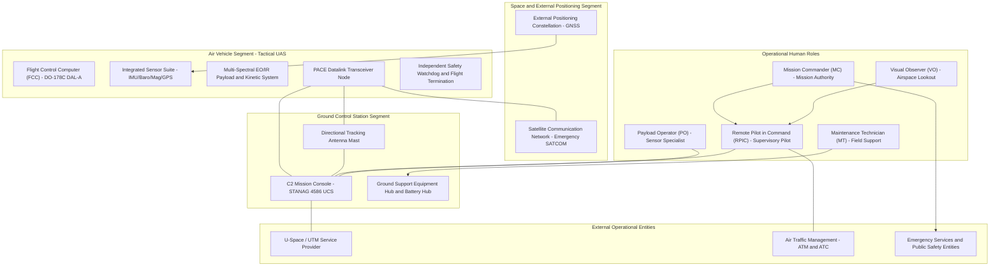
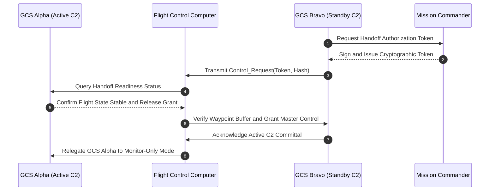

| Attribute | Value |
| :--- | :--- |
| **Title** | Concept of Operations (ConOps): Tactical Unmanned Aircraft System (Tactical UAS) |
| **Version** | 1.0.0 |
| **Date** | 2026-09-02 |

# Concept of Operations (ConOps): Tactical Unmanned Aircraft System (Tactical UAS)

## Table of Contents

- [1. Scope, System Identification & Normative Baseline](#1-scope-system-identification--normative-baseline)
- [2. Current Situation, Deficiency Analysis & Operational Motivation](#2-current-situation-deficiency-analysis--operational-motivation)
- [3. Proposed Capabilities & Operational Justification (Trade-Offs)](#3-proposed-capabilities--operational-justification-trade-offs)
- [4. User Classes, Stakeholder Taxonomy & Operational Lifecycle Modes](#4-user-classes-stakeholder-taxonomy--operational-lifecycle-modes)
- [5. 4D Operational Volume & SORA v2.5 Risk Assessment](#5-4d-operational-volume--sora-v25-risk-assessment)
- [6. OMG UAF Operational Activity Taxonomy](#6-omg-uaf-operational-activity-taxonomy)
- [7. Operational Information Exchange (Op-Tx) Matrix](#7-operational-information-exchange-op-tx-matrix)
- [8. Operational Environments & MIL-STD-810H Environmental Envelopes](#8-operational-environments--mil-std-810h-environmental-envelopes)
- [9. Multi-Threaded Operational Scenarios & Mission Timelines](#9-multi-threaded-operational-scenarios--mission-timelines)
- [10. Maintenance & Ground Support Equipment (GSE) Concepts](#10-maintenance--ground-support-equipment-gse-concepts)
- [11. Operational Impacts, System Limitations & Documented Trade Studies](#11-operational-impacts-system-limitations--documented-trade-studies)
- [12. 7-Row Emergency Decision & Contingency Matrix](#12-7-row-emergency-decision--contingency-matrix)

## 1. Scope, System Identification & Normative Baseline

### 1.1 Document Metadata & Formal Governance
This Concept of Operations (ConOps) defines the operational architecture, stakeholder interactions, operational environments, 4D airspace containment boundaries, and deterministic contingency protocols for the Tactical Unmanned Aircraft System (Tactical UAS). This specification is authored in strict accordance with ISO/IEC/IEEE 29148:2018 §5.2.4 & §6.4.2, OMG Unified Architecture Framework (UAF) v1.2/v2.0, NATO STANAG 4586 Edition 4, and JARUS SORA v2.5.

| Attribute | Specification Value |
| :--- | :--- |
| **System Identifier** | TacticalUAS |
| **Document Version** | 1.0.0 |
| **Publication Date** | 2026-09-02 |
| **Security Classification** | Unclassified / Controlled Operational Baseline |
| **Target System Realization** | Tactical Multi-Mission Cyber-Physical UAS |
| **Authoring Organization** | DEAP Tactical UAS Systems Engineering & Safety Architecture Working Group |
| **Regulatory Baseline** | JARUS SORA v2.5 (Specific Category) / EASA Easy Access Rules / FAA Part 107 Waiver Baseline |

### 1.2 System Classification & Operational Purpose
- **System Identifier:** `TacticalUAS`
- **Operational Domain:** `UAF::OperationalDomain::TacticalInfrastructureSafetyAndISR`
- **Primary Operational Mission:** The Tactical UAS is engineered to execute autonomous perimeter surveillance, multi-spectral optical/thermal reconnaissance, automated target tracking, tactical precision strike / kinetic delivery and target engagement, real-time telemetry streaming, and automated dynamic geofence containment in complex, high-reliability civil and defense operational domains.
- **Core Mission Capabilities:**
  1. Autonomous waypoint navigation, corridor traversal, and on-station surveillance orbiting within parameterized performance envelopes.
  2. Multi-sensor data fusion combining multi-constellation satellite navigation receivers, redundant inertial measurement units (IMUs), barometric altimetry, and optical flow odometry.
  3. Real-time high-definition electro-optical / infrared (EO/IR) sensor streaming, automated target classification ($C_{\mathrm{PID}} \ge 0.95$), and edge neural telemetry inference.
  4. Dual-consent cryptographic arming and positive identification gating for precision kinetic payload delivery.
  5. Deterministic failsafe state machine ensuring autonomous containment within the maximum containment response time threshold $\tau_{\mathrm{containment}} \le 200.0\text{ ms}$ upon critical contingency detection.

### 1.3 System Boundary & Physical/Legal Envelopes
The operational system boundary encompasses all physical, logical, communications, and organizational elements required to conduct end-to-end autonomous mission operations:
- **Physical Flight Envelope:** Bounded operational volume extending from ground level ($0.0\text{ m}$ AGL) up to the maximum operating ceiling $120.0\text{ m}$ AGL ($h_{\mathrm{operating\_ceiling}} = 120.0\text{ m}$).
- **Lateral Operating Boundary:** Designated operational perimeter polygon enclosed within a verified Ground Risk Buffer ($R_{\mathrm{GRB}} = 200.0\text{ m}$) containment envelope.
- **C2 RF Datalink Envelope:** Primary line-of-sight command and control (C2) operational radius of $15.0\text{ km}$ ($R_{\mathrm{C2}} = 15.0\text{ km}$) from the Ground Control Station (GCS) node, backed by alternate network links, contingency narrowband radio, and emergency satellite relays.
- **System Mass & Payload Envelope:** Maximum Takeoff Weight (MTOW) of $25.0\text{ kg}$ ($m_{\mathrm{MTOW}} = 25.0\text{ kg}$) with a dedicated mission payload capacity of $5.0\text{ kg}$ ($m_{\mathrm{payload}} = 5.0\text{ kg}$) and nominal mission endurance of $90.0\text{ min}$.
- **Regulatory & Jurisdictional Boundary:** Governed under JARUS SORA v2.5 Specific Category operations (mitigated GRC-2, ARC-b), civil aviation standard scenarios, and national military flight clearances.

### 1.4 Operational Context Diagram
The following Unified Architecture Framework (UAF) operational context diagram defines the external interfaces, performer nodes, and primary interaction channels:



### 1.5 Normative Standards & Regulatory Baseline
The following normative standards and regulatory baselines govern all architectural, operational, safety, and verification artifacts within this Concept of Operations:

| Standard ID | Issuing Body | Title & Baseline Edition | Applicable Clauses & Focus Areas |
| :--- | :--- | :--- | :--- |
| ISO/IEC/IEEE 29148:2018 | ISO / IEC / IEEE | Systems and software engineering — Requirements engineering | §5.2.4 ConOps & §6.4.2 Operational Concepts |
| OMG UAF v1.2 / v2.0 | Object Management Group (OMG) | Unified Architecture Framework (UAF) Specification | Operational Processes (Op-Pr) & Exchanges (Op-Tx) |
| NATO STANAG 4586 | NATO Standardisation Office | Standard Interfaces of UAV Control System (UCS) for NATO UAV Interoperability (Ed. 4) | Data Link Interfaces (DLI) & Command Profiles |
| JARUS SORA v2.5 | JARUS | Specific Operations Risk Assessment (v2.5) | Annex B (Ground Risk Buffer) & Annex E (OSOs) |
| RTCA DO-178C | RTCA / EUROCAE | Software Considerations in Airborne Systems and Equipment Certification | §6.3.1 Software Fault Detection & DAL-A Assurance |
| RTCA DO-254 | RTCA / EUROCAE | Design Assurance Guidance for Airborne Electronic Hardware | Hardware Safety Watchdog & CPLD/FPGA Architecture |
| RTCA DO-365B | RTCA / EUROCAE | MOPS for Detect and Avoid (DAA) Systems | §2.2.4 DAA Well-Clear Separation Volume |
| RTCA DO-362A | RTCA / EUROCAE | Command and Control (C2) Data Link MOPS | §2.2 Link Availability & PACE Fallback Dynamics |
| MIL-STD-882E | U.S. Department of Defense | Department of Defense Standard Practice: System Safety | §4.3 Hazard Identification & Containment Matrix |
| MIL-STD-810H | U.S. Department of Defense | Environmental Engineering Considerations and Laboratory Tests | Climatic Envelopes (Method 501.7 to 521.4) |
| MIL-STD-461G | U.S. Department of Defense | Requirements for the Control of Electromagnetic Interference | Method RS103 Radiated Susceptibility & HIRF |
| DoD Directive 3000.09 | U.S. Department of Defense | Autonomy in Weapon Systems | §3.1 Human Judgement & Dual-Consent Interlocks |
| CJCSI 3121.01B | Chairman of the Joint Chiefs of Staff | Standing Rules of Engagement / Standing Rules for Use of Force | Enclosure A §4.b Positive Identification (PID) |

## 2. Current Situation, Deficiency Analysis & Operational Motivation

### 2.1 Current Operational Baseline (Predecessors)
The predecessor operational baseline relies on conventional radio-controlled platforms and legacy point-to-point analog/digital video telemetry systems. These systems were primarily designed for visual line-of-sight (VLOS) remote piloting under benign weather conditions, characterized by:
1. **Single-String Non-Redundant Avionics:** Predecessor platforms utilize flight controllers lacking redundant inertial sensors, isolated power buses, and hardware watchdog circuits. A single sensor anomaly or processor stall leads directly to unrecoverable loss of control.
2. **Manual Point-to-Point Control Links:** Command and control relies on single-frequency analog or low-resilience digital radio links vulnerable to multipath fading, intentional electronic warfare (EW) jamming, and line-of-sight terrain obstruction.
3. **Disjointed Sensor Telemetry Displays:** Payload imagery and flight navigational telemetry are processed on isolated, unintegrated display monitors, forcing human operators to perform manual mental correlation of video feeds with spatial maps.
4. **Ad-Hoc Contingency Management:** Contingency responses lack deterministic timing guarantees, formal SORA containment buffers, and dynamic secondary divert routing.

### 2.2 Operational Capability Gaps
Analysis of historical mission logs, field incident reports, and operator debriefs reveals four critical capability gaps that prevent legacy systems from executing high-tempo autonomous surveillance and tactical engagement:

| Gap ID | Capability Gap Name | Operational Manifestation | Mission Impact & Risk |
| :--- | :--- | :--- | :--- |
| **GAP-01** | Safe BVLOS Autonomous Operation | Inability to maintain statutory airspace separation and geofence containment without constant visual observer line-of-sight. | Restricted operational radius (R_VLOS << 15.0 km), preventing wide-area perimeter monitoring and deep tactical reconnaissance. |
| **GAP-02** | Contested RF / EW Resilience | Loss of vehicle control and video telemetry in the presence of intentional navigation jamming, RF interference, or multipath. | High rate of lost-link aborts, mission abandonment, and uncontained trajectory deviations in hostile RF environments. |
| **GAP-03** | Sub-Second Deterministic Failsafe | Slow anomaly detection (tau_human > 2.0 s) and non-deterministic recovery maneuvers resulting in boundary breaches. | Inability to achieve JARUS SORA Specific Category authorization for populated adjacent areas; catastrophic crash hazard. |
| **GAP-04** | Modular Rapid Field Turnaround | Prolonged ground servicing and complex payload swaps requiring extended turnaround (t_turnaround > 45 min). | Sortie rate limited to low operational tempo, leaving perimeter security coverage gaps and increasing vulnerability. |

### 2.3 Legacy System Deficiencies & Technical Limitations
In accordance with ISO/IEC/IEEE 29148:2018 §5.2.4, system deficiencies are categorized across technical, operational, and human domains:

| Technical Domain | Operational Domain | Human Domain |
| :--- | :--- | :--- |
| Single-string sensor architecture | Lack of dynamic geofencing | High NASA-TLX cognitive load |
| Lack of hard RTOS timing bounds | No automated U-space / UTM link | Disjointed payload displays |
| Unshielded EMI/RF susceptibility | Manual flight log extraction | Pilot fatigue during manual flight |
| Non-hermetic IP enclosures | Extended field turnaround overhead | Complex manual calibration rigs |

1. **Technical Deficiencies:**
   - **Avionics & Compute:** Lack of hard real-time operating system (RTOS) guarantees; flight control loops executed on non-deterministic microcontrollers subject to task starvation and priority inversion.
   - **Environmental Hardening:** Non-sealed enclosures (rated below IP67) vulnerable to wind-driven rain, particulate ingress, and corrosive atmosphere over extreme operational temperature ranges ($-40^\circ\text{C}$ to $+55^\circ\text{C}$).
   - **Power Distribution:** Single power rail architecture without isolation barriers; short-circuit in payload subsystem instantly collapses primary flight avionics bus.

2. **Operational Deficiencies:**
   - **Airspace Integration:** Complete lack of automated communication with U-space / UTM service providers, necessitating manual coordination with local airspace authorities.
   - **Contingency Divert:** Pre-programmed return trajectories follow straight-line paths ignoring active terrain obstacles, dynamic weather cells, and pop-up keep-out zones.

3. **Human Deficiencies:**
   - **Cognitive Overload:** Operators are required to simultaneously supervise flight dynamics, steer optical sensors, monitor energy telemetry, and log airspace coordinates manually, leading to NASA-TLX scores exceeding acceptable limits ($\text{TLX} > 70$).
   - **Operational Error:** Fatigued operators during extended operational shifts exhibit increased reaction times ($\tau_{\mathrm{human}} > 2.0\text{ s}$) to contingency warnings, leading to preventable incidents.

### 2.4 Mission Drivers & User Operational Problems
The primary mission drivers compelling the development of the Tactical UAS include:
- **Statutory Regulatory Mandates:** Civil aviation authorities and defense agencies require formal compliance with JARUS SORA v2.5 Annex B for operations beyond visual line-of-sight. This requires verifiable Ground Risk Buffer calculations ($R_{\mathrm{GRB}} = 200.0\text{ m}$) and DO-178C DAL-A software assurance.
- **Continuous Security Coverage:** Critical perimeter protection requires unbroken surveillance coverage across the operational radius of $15.0\text{ km}$ with autonomous asset handoffs.
- **Adverse Environmental Readiness:** The system must operate reliably across extreme climatic envelopes ($-40^\circ\text{C}$ to $+55^\circ\text{C}$, IP67 sealing, and steady wind limits of $15.0\text{ m/s}$ with gusts up to $20.0\text{ m/s}$ per MIL-STD-810H).
- **Zero-Trust Cybersecurity Baseline:** Modern operational environments demand authenticated C2 command links, hardware security module (HSM) key storage, and automated rejection of spoofed telemetry or malicious command injection.

## 3. Proposed Capabilities & Operational Justification (Trade-Offs)

### 3.1 Justification for Proposed Architectural Changes
To resolve the critical deficiencies of predecessor systems and meet statutory SORA v2.5 regulatory requirements, the Tactical UAS transitions the operational paradigm from manual line-of-sight piloting to certified supervisory autonomous execution. This architectural evolution is justified by:
1. **Autonomous Multi-Sensor Navigation:** Integration of multi-constellation GNSS (GPS, GLONASS, Galileo, BeiDou), dual-redundant tactical IMUs, barometric altimeters, and optical flow visual-inertial odometry (VIO) ensuring unbroken state estimation even in GNSS-denied environments.
2. **SORA Risk Containment:** Implementation of mathematically verified 4D geofencing, Ground Risk Buffer containment ($R_{\mathrm{GRB}} = 200.0\text{ m}$), and an autonomous ballistic parachute recovery system reducing ground impact kinetic energy to $E_k \le 34.0\text{ J}$.
3. **Multi-Tiered PACE C2 Link Architecture:** Deployment of a 4-tier communication plan (Primary 5.8 GHz COFDM, Alternate 915 MHz FHSS, Contingency LTE/5G Cellular VPN, and Emergency Autonomous RTH with Satellite Relay) ensuring resilient, un-jammable command and control integrity.
4. **Edge Video Classification & Tracking:** High-efficiency edge neural accelerator (NVIDIA Jetson Orin NX class) executing real-time object detection, multi-spectral feature correlation, automated target classification ($C_{\mathrm{PID}} \ge 0.95$), and KLV metadata injection without saturating narrow-band downlinks.
5. **Sub-200 ms Deterministic Failsafe:** Integration of an independent hardware safety watchdog executing continuous health checks at 1000 Hz and triggering deterministic containment actions within $t_{\mathrm{resp}} \le 200.0\text{ ms}$ upon contingency detection.

### 3.2 Functional Superiority & Operational Value Proposition
The Tactical UAS provides quantifiable functional superiority over the legacy baseline across endurance, reliability, situational awareness, and operational tempo:

| Operational Dimension | Legacy Baseline (Predecessor) | Proposed Tactical UAS | Operational Value Delivered | Quantified Improvement |
| :--- | :--- | :--- | :--- | :--- |
| **Operational Range** | 1.5 km (Visual Line-of-Sight) | 15.0 km (Certified BVLOS Corridor) | 10x expansion in tactical surveillance radius per GCS station. | Delta_Range = +13.5 km |
| **Sortie Turnaround Time** | 45.0 min (Manual Disassembly) | 10.0 min (Tool-less Hot-Swap & Automated PBIT) | Rapid sortie relaunch enables continuous on-station perimeter coverage. | Delta_t_turnaround = -35.0 min |
| **Anomaly Response Time** | 2.5 s (Human Pilot Reaction) | <= 200.0 ms (Autonomous Safety Watchdog) | Instantaneous containment prevents kinetic breaches outside the Ground Risk Buffer. | Delta_tau_response = -2.3 s |
| **Adverse Weather Capability** | 8.0 m/s wind, Non-sealed | 15.0 m/s steady, 20.0 m/s gusts, IP67 Sealing | Mission execution during adverse storm and freezing rain events. | +7.0 m/s wind limit, IP67 sealed |
| **Operator Workload (NASA-TLX)** | 78 / 100 (High Fatigue) | <= 35 / 100 (Supervisory Automation) | Eliminates pilot fatigue errors during long-duration monitoring. | Delta_TLX = -43 points |

### 3.3 System Capability Hierarchy
The system architecture decomposes into a five-level operational capability hierarchy aligned with OMG UAF Operational Performer views:

```
===================================================================================
                       SYSTEM CAPABILITY HIERARCHY (CAP-01..05)
===================================================================================
[CAP-01: Autonomous Flight Guidance & 4D Navigation]
   ├── CAP-01.1: Multi-Constellation Satellite Navigation / INS Sensor Fusion
   ├── CAP-01.2: 4D Waypoint & Curved Corridor Trajectory Generation
   └── CAP-01.3: Visual-Inertial Odometry & Dead-Reckoning Navigation Fallback

[CAP-02: Multi-Spectral Sensor Acquisition & Edge Inference]
   ├── CAP-02.1: Stabilized Multi-Spectral Optical & Thermal Sensor Gimbal Control
   ├── CAP-02.2: Real-Time Edge Object Detection & Telemetry Geo-Tagging (C_PID >= 0.95)
   └── CAP-02.3: Adaptive Hardware Video Compression & Dynamic Bitrate Allocation

[CAP-03: Resilient Multi-Tier PACE Communications]
   ├── CAP-03.1: Primary 5.8 GHz COFDM Point-to-Point High-Bandwidth Datalink
   ├── CAP-03.2: Alternate 915 MHz FHSS Encrypted Mesh Datalink
   ├── CAP-03.3: Contingency Encrypted LTE/5G Cellular VPN Tunnel
   └── CAP-03.4: Emergency Autonomous RTH & Satellite Geo-Beacon (406 MHz / Iridium)

[CAP-04: SORA 4D Containment & Deterministic Failsafe Management]
   ├── CAP-04.1: Continuous 4D Geofence Boundary Proximity Monitoring (R_GRB = 200.0 m)
   ├── CAP-04.2: Dynamic Closed-Loop Bingo Energy Monitoring & Secondary Divert Routing
   └── CAP-04.3: Hardware Safety Watchdog & Autonomous Containment Actuation (t_resp <= 200 ms)

[CAP-05: Rapid Turnaround & Modular Support Logistics]
   ├── CAP-05.1: Tool-Less Modular Quick-Release Payload Interface
   ├── CAP-05.2: Hot-Swappable Smart Energy Module with Integrated BMS
   └── CAP-05.3: Automated Pre-Flight Built-In-Test (PBIT) Diagnostic Logging
===================================================================================
```

### 3.4 Operational Benefits Summary
1. **Full Statutory Compliance:** Certified compliance with JARUS SORA v2.5 Annex B and NATO STANAG 4586 Level 3/4 UCS interoperability.
2. **Persistent Perimeter Security:** Continuous presence over critical facilities with zero visual blind spots across a $15.0\text{ km}$ operational radius.
3. **Deterministic Airspace Safety:** Guaranteed ground and air risk containment with mathematically verified Ground Risk Buffers ($R_{\mathrm{GRB}} = 200.0\text{ m}$) and ballistic parachute impact energy $E_k \le 34.0\text{ J}$.
4. **Total Lifecycle Cost Reduction:** Significant reduction in ground crew workload and extended mean time between maintenance actions ($\text{MTBM} \ge 150.0\text{ hr}$).

## 4. User Classes, Stakeholder Taxonomy & Operational Lifecycle Modes

### 4.1 Stakeholder Roster
The operational lifecycle involves multiple organizational and external stakeholders who interact directly or indirectly with the autonomous system:
- **Civil & Military Aviation Authorities (Aviation Regulators):** Regulatory bodies responsible for issuing operational authorizations, validating SORA safety cases, and monitoring airspace compliance.
- **Range Safety Officer (RSO) & Air Traffic Management (ATM/ATC):** Operational authorities governing flight corridors, approving dynamic airspace activations, and coordinating emergency airspace deconfliction.
- **Procurement & Operations Authority:** Defense, homeland security, or enterprise entities directing mission requirements, security doctrine, and asset allocation.
- **Support & Logistics Organization:** Depot-level maintenance facilities, supply chain managers, and calibration laboratories.

### 4.2 User Class Taxonomy
In accordance with ISO/IEC/IEEE 29148:2018 §5.2.4 and the JSON Schema data contract, the operational user classes are defined as follows:

| User Class ID | Title | Player or Operator | Interfacing Stakeholder | Characteristics & Responsibilities | Training & Qualification | Constraint Source |
| :--- | :--- | :--- | :--- | :--- | :--- | :--- |
| **UC-01** | Remote Pilot in Command (RPIC) | Direct Operator | Civil Aviation Authority (CAA) / Range Safety Officer (RSO) | Holds ultimate legal and operational responsibility for flight safety, supervisory flight guidance oversight, airspace deconfliction, and manual failsafe override initiation. | Certified Remote Pilot with System Type Rating and Level 3/4 STANAG 4586 UCS Qualification | ISO/IEC/IEEE 29148:2018 §5.2.4 / JARUS SORA v2.5 Annex E |
| **UC-02** | Payload Operator (PO) | Direct Operator | Security Operations Center (SOC) / Intelligence Staff | Responsible for multi-spectral sensor tasking, laser rangefinder/designation activation, tracking zone definition, real-time target identification, and video exploitation. | Certified Tactical Sensor Specialist & STANAG 4586 Level 2 Payload Operator Qualification | NATO STANAG 4586 Edition 4 DLI / CCI |
| **UC-03** | Mission Commander (MC) | Supervisor / Player | Theater Command / Enterprise Operations Director | Establishes Rules of Engagement (ROE), authorizes sortie launch and abort commands, manages multi-vehicle allocations, and interfaces directly with range command. | Senior Operational Commander Qualification & MIL-STD-882E System Safety Management Certification | MIL-STD-882E Task 102 / DoDI 5000.02 |
| **UC-04** | Maintenance Technician (MT) | Support Operator | Depot Maintenance / Quality Assurance Office | Conducts Organizational (O-Level) pre-flight inspections, energy module replacements, structural integrity checks, sensor boresight calibration, and modular LRU swaps. | Certified Maintenance Technician / Field Repair Specialist | ISO/IEC/IEEE 29148:2018 §5.2.4 |
| **UC-05** | Visual Observer (VO) | Field Support | Local Airspace Users / Local ATM | Maintains continuous visual/instrument surveillance of surrounding airspace to detect non-cooperative traffic and ground hazards within the operational volume. | Certified Visual Observer Airspace Lookout Training & Tactical Radio Voice Protocol Qualification | JARUS SORA v2.5 Tactical Mitigation M1 |

### 4.3 Skill Prerequisites & Minimum Qualifications
1. **Remote Pilot in Command (RPIC):** Minimum 100 accredited supervisory flight hours; current aviation medical certificate; validated proficiency in emergency decision matrix (`EMG-01`..`EMG-07`) execution under simulated degraded navigation conditions.
2. **Payload Operator (PO):** Validated proficiency in thermal image interpretation, optical tracking locks, target coordinate extraction, and secure video dissemination protocols.
3. **Mission Commander (MC):** Validated proficiency in rules of engagement enforcement, dual-consent cryptographic key handling, and airspace coordination.
4. **Maintenance Technician (MT):** Formal electro-mechanical certification, electronic assembly inspection qualification, and authorized digital maintenance logbook endorsement.
5. **Visual Observer (VO):** Certified visual observer airspace lookout training and tactical radio voice protocol qualification.

### 4.4 Workload Constraints & Human Factors Considerations
To prevent operator fatigue and ensure situational awareness during complex operations:
- **Maximum Shift Duration:** Continuous RPIC supervisory console time is bounded by $t_{\mathrm{shift}} \le 4.0\text{ hr}$ with a mandatory rest interval $t_{\mathrm{rest}} \ge 30.0\text{ min}$.
- **Cognitive Workload Threshold:** Systems shall be engineered to maintain RPIC NASA-Task Load Index (TLX) composite score below 35 during nominal operations and below 55 during degraded or contingency flight phases.
- **Dual-Operator Architecture:** Primary flight safety oversight (RPIC) and sensor payload analysis (PO) are decoupled across distinct physical workstations to prevent operational task interference.

### 4.5 Authority Handoff Chains & Control Transfer Protocols
Handoff of command and control between Ground Control Stations (e.g., GCS Alpha to GCS Bravo) or between RPIC and autonomous flight modes follows a strict cryptographic 4-way handshake with handoff completion time bounded by $t_{\mathrm{handoff}} \le 5.0\text{ s}$:
1. **Initiation:** Receiving station (GCS Bravo) transmits an encrypted Control Request Token over the authenticated C2 link.
2. **Authorization:** Relinquishing station (GCS Alpha) and Mission Commander authenticate the token and transmit an explicit Control Handoff Grant.
3. **Verification:** GCS Bravo executes cross-telemetry alignment, confirms identical waypoint buffer state, and transmits Acknowledgment.
4. **Commit:** Flight Control Computer transfers primary C2 authority to GCS Bravo and transitions GCS Alpha to Monitor-Only mode.



### 4.6 Operational Lifecycle Stages ($\Phi_{\mathrm{lifecycle}}$)
The system operates across six mutually exclusive, deterministic lifecycle stages:
- **Phase_Startup:** Power-on Built-In-Test (PBIT), sensor alignment, navigation filter initialization, cryptographic key injection, and pre-arm interlock validation.
- **Phase_NominalExecution:** Autonomous launch, transit along designated flight corridor, perimeter surveillance orbit, tactical engagement sequence, and real-time telemetry streaming.
- **Phase_DegradedMode:** Non-critical sensor failover, reversion to dead reckoning upon navigation signal loss, PACE datalink fallback switch, and degraded velocity limits.
- **Phase_ContingencyFailsafe:** Autonomous execution of Return-to-Home (RTH), transition to secondary emergency divert waypoint, or controlled hover/containment.
- **Phase_SecureShutdown:** Autonomous precision recovery, touchdown, motor cutoff, mechanical brake lock, cryptographic memory zeroization, and diagnostic log archival.
- **Phase_MaintenanceMode:** Diagnostic telemetry offload, actuator calibration, firmware flashing, and depot-level structural inspection.

## 5. 4D Operational Volume & SORA v2.5 Risk Assessment

### 5.1 4D Spatial-Temporal Operational Volume Formulation
The operational airspace volume is formally defined as a bounded 4D spatial-temporal continuum consisting of the nominal Flight Geometry, the Contingency Volume, and the Ground Risk Buffer (GRB). In accordance with JARUS SORA v2.5 Annex B, the total 4D volume envelope and the minimum Ground Risk Buffer radius are formulated as:

$$
\begin{aligned}
V_{\mathrm{4D}} &= V_{\mathrm{SpatialGeometry}} \cup V_{\mathrm{ContingencyVolume}} \cup V_{\mathrm{GRB}} \\
R_{\mathrm{GRB}} &= h_{\mathrm{max}} \cdot \tan(\theta_{\mathrm{impact}}) + v_{\mathrm{wind,max}} \cdot \sqrt{\frac{2 h_{\mathrm{max}}}{g}} + d_{\mathrm{glide,max}}
\end{aligned}
$$

Where and Operational Parameters:

| Parameter | Symbol | Value | Units | Description |
| :--- | :--- | :--- | :--- | :--- |
| Maximum Operating Ceiling | h_max | 120.0 | m | Maximum operating ceiling above reference ground surface |
| Worst-Case Impact Angle | theta_impact | 45.0 | deg | Worst-case operational trajectory impact angle |
| Maximum Operational Wind Speed | v_wind_max | 15.0 | m/s | Maximum operational wind speed limit |
| Gravitational Acceleration | g | 9.80665 | m/s^2 | Standard gravitational acceleration constant |
| Maximum Glide Distance Margin | d_glide_max | 5.0 | m | Maximum unpowered lateral displacement margin |
| Ground Risk Buffer Radius | R_GRB | 200.0 | m | Declared ground risk buffer lateral containment radius |
| Terminal Velocity with Parachute | v_terminal | 1.65 | m/s | Deployed parachute vertical descent velocity |
| Impact Kinetic Energy | E_impact | 34.0 | J | Kinetic energy at ground impact under parachute |
| Maximum Takeoff Mass | m_system | 25.0 | kg | Total operational mass of the tactical air vehicle |

The symbolic kinematic derivation for $R_{\mathrm{GRB}}$ yields:
- Ballistic fall time from maximum ceiling: $t_{\mathrm{fall}} = \sqrt{\frac{2 \cdot 120.0}{9.80665}} = 4.947\text{ s}$
- Maximum wind drift displacement: $d_{\mathrm{wind}} = 15.0 \cdot 4.947 = 74.2\text{ m}$
- Impact angle projection: $d_{\mathrm{impact}} = 120.0 \cdot \tan(45.0^\circ) = 120.0\text{ m}$
- Theoretical minimum buffer: $R_{\mathrm{calc}} = 120.0 + 74.2 + 5.0 = 199.2\text{ m}$
- The declared $R_{\mathrm{GRB}} = 200.0\text{ m}$ strictly bounds the theoretical minimum ($200.0\text{ m} \ge 199.2\text{ m}$), guaranteeing full 4D containment.

### 5.2 JARUS SORA v2.5 Ground Risk Class (GRC) & Kinetic Impact Limits
1. **Intrinsic Ground Risk Class (Initial GRC):**
   - Maximum characteristic dimension: $L_{\mathrm{char}} = 1.8\text{ m}$.
   - Typical operational cruising velocity: $v_{\mathrm{cruise}} = 18.0\text{ m/s}$.
   - Takeoff Mass: $m_{\mathrm{MTOW}} = 25.0\text{ kg}$.
   - Operational scenario: Operations over controlled ground perimeter with sparsely populated adjacent areas.
   - Intrinsic Ground Risk Class: **GRC-3** per JARUS SORA v2.5 Table 2.

2. **Kinetic Impact Energy Analysis ($E_k$):**
   - Unmitigated kinetic energy formulation at aerodynamic terminal velocity ($v_{\mathrm{terminal}} = 25.0\text{ m/s}$):

$$
\begin{aligned}
E_k &= \frac{1}{2} m_{\mathrm{system}} v_{\mathrm{terminal}}^2
\end{aligned}
$$

Where and Operational Parameters:
- $E_k$: Unmitigated kinetic impact energy at aerodynamic terminal velocity ($7812.5\text{ J}$).
- $m_{\mathrm{system}}$: Total system operational mass ($25.0\text{ kg}$).
- $v_{\mathrm{terminal}}$: Unpowered aerodynamic terminal fall velocity.

   - **Mitigated Kinetic Impact with Ballistic Parachute ($E_k \le 34.0\text{ J}$):**
     Upon contingency activation, the autonomous ballistic recovery parachute deploys within $\tau_{\mathrm{deploy}} \le 500.0\text{ ms}$, reducing descent velocity to $v_{\mathrm{descent}} \le 1.65\text{ m/s}$. The resulting ground impact kinetic energy is strictly bounded by:

$$
\begin{aligned}
E_{k,\mathrm{parachute}} &= \frac{1}{2} \cdot (25.0) \cdot (1.65)^2 = 34.0
\end{aligned}
$$

Where and Operational Parameters:
- $E_{k,\mathrm{parachute}}$: Mitigated ground impact kinetic energy ($34.0\text{ J} \le 34.0\text{ J}$).

3. **Final Ground Risk Class (GRC-3 $\rightarrow$ GRC-2):**
   - Mitigation M1 (Strategic ground risk mitigation - controlled ground perimeter): **-1 GRC** credit.
   - Mitigation M2 (Effects of ground impact - autonomous ballistic parachute ensuring $E_k \le 34.0\text{ J}$): **-1 GRC** credit.
   - Final Ground Risk Class: **GRC-2** (Specific Category low-risk profile).

### 5.3 Air Risk Class (ARC) & Strategic Airspace Deconfliction
- **Initial Air Risk Class:** **ARC-b** (Atypical / Segregated Airspace below $120.0\text{ m}$ AGL in uncontrolled Class G airspace).
- **Strategic Airspace Mitigations:**
  1. Mandatory flight plan filing with U-space / UTM Service Provider prior to launch.
  2. Electronic Conspicuity: Continuous direct Remote ID broadcast (ASTM F3411-22a) and ADS-B In situational awareness receiver.
  3. Tactical Airspace Surveillance: Onboard RTCA DO-365B DAA sensors and visual observer network maintaining continuous 360° airspace deconfliction.

### 5.4 SORA Mitigations (M1–M3)

| Mitigation Level | SORA Mitigation Category | Implementation Mechanism & System Architecture | Target Integrity Level | GRC / ARC Credit |
| :--- | :--- | :--- | :--- | :--- |
| **M1** | Strategic Mitigations for Ground Risk | Controlled ground perimeter fencing, active access control, and 200.0 m Ground Risk Buffer containment. | Medium Integrity (Declared & Audited) | -1 GRC Reduction Credit |
| **M2** | Effects of Ground Impact (Containment) | Autonomous ballistic parachute recovery system deploying in <= 500 ms; reduces descent velocity to <= 1.65 m/s and impact energy to <= 34.0 J. | High Integrity (DO-178C / DO-254 Watchdog) | -1 GRC Reduction Credit |
| **M3** | Emergency Response Plan (ERP) | Formal ERP detailing direct coordination with local emergency services, automated emergency beacon broadcast, and hazardous material isolation. | Medium Integrity (Validated by Drill) | Mandatory Prerequisite for Final SORA Authorization |

### 5.5 Containment Margins & Dynamic Geofence Buffers
To guarantee zero-breach containment of the operational volume:
- **Soft Warning Boundary:** Positioned $50.0\text{ m}$ inboard of the primary operational boundary. Reaching this threshold triggers an automated flight path correction and visual/acoustic alert on the GCS.
- **Hard Geofence Boundary:** The outer edge of the contingency volume. Crossing this threshold activates trigger `EMG-05`, initiating an immediate autonomous $180^\circ$ maximum-rate coordinated turnaround maneuver.
- **Buffer Retention Margin:** The Ground Risk Buffer ($R_{\mathrm{GRB}} = 200.0\text{ m}$) guarantees that in the event of unrecoverable propulsion or control loss at maximum operating ceiling ($120.0\text{ m}$ AGL) under maximum wind conditions ($15.0\text{ m/s}$), all system debris comes to rest strictly within the declared buffer zone.

## 6. OMG UAF Operational Activity Taxonomy

### 6.1 Operational Activity Decomposition
In accordance with OMG Unified Architecture Framework (UAF) v1.2 / v2.0 Operational Processes (Op-Pr) and Operational Taxonomy (Op-Tx), the system operational activities are formally decomposed and allocated 100% to system performer nodes, logical subsystems, and physical resources.

Every operational activity is bound to a machine-verifiable Gate 24 allocation tag (`/// OperationalAllocation: [OA-XX]`) and realization tag (`/// Realises: [UAF-ACT-XX]`).

| Activity ID | Activity Name | Allocated Performer Node & Resource | Operational Description | Traceability & Gate 24 Allocation Tag |
| :--- | :--- | :--- | :--- | :--- |
| **OA-01** | `SystemInitializationAndPBIT` | Flight Avionics Core / Secure MPU | Executes power-on Built-In-Tests (PBIT), cross-checks redundant sensor biases, validates actuator end-stops, verifies cryptographic root of trust, and logs calibration status within t_PBIT <= 10.0 s. | `/// OperationalAllocation: [OA-01]`<br>`/// Realises: [UAF-ACT-01]` |
| **OA-02** | `AutonomousFlightGuidance` | Autopilot Subsystem / DO-178C DAL-A FCC | Computes and tracks 4D curved waypoint trajectories, executes closed-loop aerodynamic control at loop rate f_control = 250 Hz, and performs cross-track error minimization (e_xtrack <= 2.0 m). | `/// OperationalAllocation: [OA-02]`<br>`/// Realises: [UAF-ACT-02]` |
| **OA-03** | `PayloadDataAcquisition` | Sensor Gimbal Node / Edge Neural Compute | Controls multi-axis stabilized optical/thermal sensor payload, captures multi-spectral imagery, executes edge object detection, and formats geo-referenced video metadata. | `/// OperationalAllocation: [OA-03]`<br>`/// Realises: [UAF-ACT-03]` |
| **OA-04** | `ContinuousHealthMonitoring` | Safety Watchdog Subsystem / FPGA Fabric | Performs high-frequency cross-channel consistency checks at rate f_health_monitor = 1000 Hz across satellite navigation, redundant IMUs, barometric pressure, motor current draw, and energy state-of-charge. | `/// OperationalAllocation: [OA-04]`<br>`/// Realises: [UAF-ACT-04]` |
| **OA-05** | `DynamicAirspaceContainment` | Geofence Engine / UTM Client Subsystem | Evaluates 4D spatial boundary proximity against hard geofence limits and U-space dynamic keep-out zones at rate f_geofence = 50 Hz; enforces automated maximum-rate turnaround upon warning threshold breach. | `/// OperationalAllocation: [OA-05]`<br>`/// Realises: [UAF-ACT-05]` |
| **OA-06** | `AutonomousContingencyManagement` | Deterministic Failsafe State Machine | Detects emergency triggers (`EMG-01`..`EMG-07`), arbitrates priorities, and executes deterministic containment maneuvers (RTH, secondary divert, or emergency termination) within t_resp <= 200.0 ms. | `/// OperationalAllocation: [OA-06]`<br>`/// Realises: [UAF-ACT-06]` |
| **OA-07** | `SecureDatalinkRelay` | PACE Communications Transceiver Node | Manages multi-tier encryption, monitors link quality (SNR, BER), executes rapid failover across primary, alternate, contingency, and emergency PACE datalinks within t_switch <= 1.0 s. | `/// OperationalAllocation: [OA-07]`<br>`/// Realises: [UAF-ACT-07]` |
| **OA-08** | `PrecisionRecoveryAndShutdown` | Guidance Subsystem / Recovery Sensor Node | Executes automated precision approach using optical fiducial and RTK landing guidance, terminal flare, motor cutoff, mechanical brake lock, and post-flight cryptographic data zeroization. | `/// OperationalAllocation: [OA-08]`<br>`/// Realises: [UAF-ACT-08]` |

### 6.2 Performer Node Allocation Matrix
The following matrix demonstrates 100% allocation coverage across system nodes:

| System Performer Node | Node Type | Primary Resource | Allocated Activities |
| :--- | :--- | :--- | :--- |
| Air Vehicle Avionics Node | Cyber-Physical Air | Redundant Safety-Critical FCC | OA-01, OA-02, OA-04 |
| Multi-Spectral Payload Node | Sensor Edge Node | Edge Vision AI SoC (NVIDIA Jetson Orin NX) | OA-03 |
| Safety Watchdog Node | Critical Hardware | Independent Hardware Watchdog / FPGA | OA-04, OA-05, OA-06 |
| PACE Transceiver Node | Datalink Router | Multi-Band RF Modem & Transceiver | OA-07 |
| Ground Control Station Node | Ground Performer | Ruggedized Operator Terminal | OA-01, OA-05, OA-07, OA-08 |

### 6.3 Operational Traceability Invariant
Per DEAP Governance Rule `rules/conops-mission-intent-integrity.md`, all downstream SysML v2 architectural blocks, Stateflow behavioral charts, and DO-178C software requirement units must carry direct traceability back to these eight canonical operational activities using the formalized allocation syntax:
- `/// OperationalAllocation: [OA-01]`
- `/// OperationalAllocation: [OA-02]`
- `/// OperationalAllocation: [OA-03]`
- `/// OperationalAllocation: [OA-04]`
- `/// OperationalAllocation: [OA-05]`
- `/// OperationalAllocation: [OA-06]`
- `/// OperationalAllocation: [OA-07]`
- `/// OperationalAllocation: [OA-08]`

## 7. Operational Information Exchange (Op-Tx) Matrix

### 7.1 Inter-Node Communication Architecture
The Operational Information Exchange (Op-Tx) architecture defines all mission-critical, control, telemetry, payload, and safety data exchanges between system nodes. The architecture is structured to support deterministic internal bus protocols and wireless RF datalink protocols in compliance with NATO STANAG 4586 Annex B (Data Link Interface).

### 7.2 Operational Information Exchange (Op-Tx) Matrix Table
In accordance with OMG UAF v1.2 / v2.0 Operational Information Views (Op-Tx) and the JSON Schema data contract, the information exchanges are specified with parametric message rates, throughputs, latency bounds, and Design Assurance Levels (DAL):

| Exchange ID | Source Node | Destination Node | Information Element / Payload Description | Message Frequency (f_sample) | Nominal Throughput (Throughput_nom) | Max Latency Bound (tau_max) | Criticality Level (DAL_req) |
| :--- | :--- | :--- | :--- | :--- | :--- | :--- | :--- |
| **OpTx-01** | PrimarySensorSubsystem | ControllerLogicSubsystem | Raw IMU Delta Angles, Delta Velocities, Barometric Static Pressure, Magnetometer Heading | 250 Hz | 512 kbps | 4.0 ms | High (DO-178C DAL-A) |
| **OpTx-02** | ControllerLogicSubsystem | PropulsionActuators | Motor RPM Demands, Actuator Deflection Commands, Current Limiter Flags | 250 Hz | 256 kbps | 2.0 ms | High (DO-178C DAL-A) |
| **OpTx-03** | GNSSReceiverNode | NavigationFilterSubsystem | Multi-Constellation Satellite PVT Solution, Carrier Phase Residuals, RAIM Integrity Status | 10 Hz | 128 kbps | 20.0 ms | High (DO-178C DAL-A) |
| **OpTx-04** | OpticalPayloadNode | EdgeVisionProcessor | Raw Video Stream Frames, Timestamp Metadata, Radiometric Thermal Matrix | 60 Hz | 1.2 Gbps | 16.0 ms | Low (DO-178C DAL-D) |
| **OpTx-05** | EdgeVisionProcessor | TelemetryTransceiver | Encoded Video Stream (H.265), Target Bounding Boxes, Feature Detections, KLV Geospatial Metadata | 30 Hz | 8.0 Mbps | 33.0 ms | Medium (DO-178C DAL-C) |
| **OpTx-06** | TelemetryTransceiver | GroundControlStation | Downlink Consolidated Flight Telemetry (Attitude, Altitude, Energy SoC, Link Quality, Geofence Margin) | 20 Hz | 2.0 Mbps | 50.0 ms | Medium (DO-178C DAL-B) |
| **OpTx-07** | GroundControlStation | ControllerLogicSubsystem | Uplink C2 Flight Commands, Dynamic Waypoint Updates, ROE Arming Keys, Manual Override Vectors | 50 Hz | 256 kbps | 50.0 ms | High (DO-178C DAL-A) |
| **OpTx-08** | SafetyWatchdogNode | TerminationPyrotechnic | Hardware Flight Abort Trigger, Emergency Recovery Deploy Signal, Power Bus Isolation Strobe | Event-Driven (1000 Hz) | 64 kbps | 5.0 ms | Critical (DO-254 DAL-A) |

### 7.3 Network Quality of Service (QoS) & Protocol Stack Allocation
To guarantee latency bounds and prevent message collisions across operational buses:
1. **Critical Avionics Bus:** Transports `OpTx-01`, `OpTx-02`, and `OpTx-03` over CAN FD and dual-redundant SPI with deterministic priority arbitration; worst-case bus utilization is restricted to $\le 45\%$ under peak load.
2. **Payload & Vision Bus:** Dedicated high-bandwidth PCIe Gen3 and Gigabit Ethernet channels carrying `OpTx-04` and `OpTx-05` logically and electrically isolated from the safety-critical flight control network.
3. **Wireless C2 Datalink:** Authenticated AES-256 encrypted datalink incorporating Forward Error Correction (FEC) and dynamic channel switching across PACE communication tiers (`OpTx-06`, `OpTx-07`).
4. **Safety Watchdog Discrete Line:** Isolated hardware discrete signal path for `OpTx-08` with dual-switch interlocks to eliminate false-trigger risks while providing guaranteed sub-millisecond actuation ($t_{\mathrm{actuate}} \le 5.0\text{ ms}$).

## 8. Operational Environments & MIL-STD-810H Environmental Envelopes

### 8.1 Climatic & Thermal Operating Envelopes ($[-40^\circ\text{C}, +55^\circ\text{C}]$)
In accordance with MIL-STD-810H, the system is engineered to maintain full operational integrity across worldwide climatic categories:
- **Operational Ambient Temperature Range:** $-40^\circ\text{C}$ to $+55^\circ\text{C}$ (continuous operational exposure per MIL-STD-810H Method 501.7 High Temperature Procedure II and Method 502.7 Low Temperature Procedure II).
- **Storage / Transit Temperature Range:** $-45^\circ\text{C}$ to $+70^\circ\text{C}$ (unpowered storage in ruggedized field containers per MIL-STD-810H Method 501.7 / 502.7 Procedure I).
- **Thermal Shock Resilience:** Capable of withstanding thermal gradients up to $10.0^\circ\text{C/min}$ without avionics condensation or optical fogging (Method 503.7).

### 8.2 Ingress Protection (IP67) & Precipitation Limits
- **Enclosure Ingress Rating:** Environmental ingress protection rating **IP67** per IEC 60529 (dust-tight solid protection and immersion resilience up to $1.0\text{ m}$ depth for $30\text{ min}$).
- **Rain & Blowing Rain Resistance:** Verified in accordance with MIL-STD-810H Method 506.6 Procedure I:
  - Maximum precipitation rate: $100.0\text{ mm/h}$ continuous rainfall.
  - Accompanying blowing wind velocity: $18.0\text{ m/s}$.
  - Internal moisture barrier: Hermetic sealing, silicone gasket barriers, and dual elastomeric O-rings across all structural joints and modular disconnect bulkheads.

### 8.3 Wind & Gust Operating Thresholds
The aerodynamic control surfaces and propulsion system are dimensioned to maintain precise path tracking under atmospheric turbulence:
- **Maximum Operational Steady Wind Speed:** $15.0\text{ m/s}$ (29.2 knots).
- **Maximum Operational Wind Gust Speed:** $20.0\text{ m/s}$ (38.9 knots) over peak gust duration of $3.0\text{ s}$.
- **Crosswind Launch & Recovery Limit:** $10.0\text{ m/s}$ perpendicular to recovery heading.

### 8.4 Sand, Dust & Particulate Exposure (MIL-STD-810H Method 510.7)
- **Blowing Dust Concentration:** Particulate concentration $10.6\text{ g/m}^3$ at air velocity $8.9\text{ m/s}$ (Procedure I).
- **Blowing Sand Concentration:** Particulate concentration $2.2\text{ g/m}^3$ at air velocity $18.0\text{ m/s}$ (Procedure II).
- **Protective Countermeasures:** Sealed bearing assemblies, dual contact rubber seals, and hydrophobic / oleophobic membrane vents over barometric and acoustic sensing ports.

### 8.5 Salt Fog & Marine Corrosion Resistance (MIL-STD-810H Method 509.7)
- **Exposure Profile:** $5.0\%\text{ NaCl}$ saline atomization concentration at $+35^\circ\text{C}$ across $48\text{ hr}$ continuous exposure followed by $48\text{ hr}$ drying cycle.
- **Material Selection:** Corrosion-resistant aerospace aluminum 7075-T6, hardcoat anodization, passivated 316 stainless fasteners, and Mil-I-46058C conformal coating across all internal electronics boards.

### 8.6 Solar Radiation & Thermal Loading (MIL-STD-810H Method 505.7)
- **Peak Solar Irradiance:** Maximum solar irradiance $1120.0\text{ W/m}^2$ under hot-dry climatic category exposure (Procedure I).
- **Thermal Solar Loading:** Internal avionics compartment temperature rise constrained to $\Delta T_{\mathrm{internal}} \le 15.0^\circ\text{C}$ above ambient via passive heat sinking, graphite thermal spreaders, and white UV-reflective topcoat.

### 8.7 Icing Conditions & Cold Weather Operation (MIL-STD-810H Method 521.4)
- **Atmospheric Icing Envelope:** Capable of operating in light-to-moderate atmospheric icing conditions down to $-15^\circ\text{C}$ with supercooled liquid water content up to $\text{LWC} = 0.5\text{ g/m}^3$.
- **Anti-Icing Provisions:** Thermally regulated pitot-static heating elements ($50\text{ W}$ resistive) and ice-phobic hydrophobic surface coatings on leading edges and propeller blades to prevent ice accretion.

### 8.8 Electromagnetic Interference (EMI) & RF Environments
- **Radiated Susceptibility:** Withstands high-intensity radiated fields (HIRF) up to $200.0\text{ V/m}$ across frequency spectrum $2.0\text{ MHz}$ to $18.0\text{ GHz}$ per MIL-STD-461G Method RS103.
- **Conducted Susceptibility:** Compliant with MIL-STD-461G CS114/CS115 power lead transient injection limits.
- **GNSS-Denied Operational Resilience:** Maintains tactical navigation for up to $10.0\text{ min}$ of continuous navigation denial via visual-inertial odometry and dead reckoning with drift rate $\le 1.0\%\text{ of distance traveled}$.

### 8.9 Physical Spatial Constraints & Deployment Envelopes
- **Launch & Recovery Footprint:** Minimum cleared level ground staging area of $10.0\text{ m} \times 10.0\text{ m}$.
- **Transit & Packaged Dimensions:** Entire air vehicle, ground control terminal, antenna mast, and support gear packaged into two ruggedized transit containers (total volume $\le 0.45\text{ m}^3$, mass $\le 32.0\text{ kg}$ per case) enabling 2-person rapid tactical deployment.

## 9. Multi-Threaded Operational Scenarios & Mission Timelines

### 9.1 Scenario SCN-01: Nominal Perimeter Surveillance Sortie
Scenario `SCN-01` describes an end-to-end nominal surveillance mission from ground staging through autonomous survey corridor execution and precision recovery.

| Step Number | Elapsed Time (T+) | Stimulus / Trigger | Actor / Performer | Action Executed | Observed Telemetry / System State | Exit Criterion |
| :--- | :--- | :--- | :--- | :--- | :--- | :--- |
| **1** | T0 + 00:00 | Operator powers on GCS and connects flight energy module | Maintenance Technician (MT) | Executes automated Pre-Flight Built-In-Test (PBIT) checklist | PBIT Status: 100% PASS; IMU bias calibrated; Battery SoC >= 95.0%; Link SNR >= 24.0 dB | PBIT verification flag logged; Pre-Arm interlocks green |
| **2** | T0 + 03:00 | Mission Commander issues authenticated Sortie Release Token | Remote Pilot in Command (RPIC) | Uploads cryptographic mission flight plan to FCC and arms autopilot | FCC Mode: Armed_Standby; Waypoints loaded; Geofence active (R_GRB = 200.0 m) | FCC confirms plan checksum; RSO gives launch clearance |
| **3** | T0 + 05:00 | RPIC depresses Dual-Action Launch Switch | Flight Control Computer (FCC) | Executes autonomous takeoff, climbs to cruise altitude 100.0 m AGL, accelerates to 18.0 m/s | Altitude: 100.0 m AGL; Groundspeed: 18.0 m/s; Flight dynamics nominal | Cruising altitude reached; Transition to corridor navigation |
| **4** | T0 + 15:00 | Waypoint WP_station reached | NavigationFilterSubsystem | Transitions to perimeter patrol pattern; activates EO/IR payload tracking | Altitude: 120.0 m AGL; Sensor stream active; Video downlink bitrate 8.0 Mbps | On-station loiter entered; Surveillance stream verified |
| **5** | T0 + 75:00 | Mission survey complete; SOC releases asset | Autopilot / Guidance Subsystem | Computes optimal return trajectory; initiates nominal descent profile | Distance to Base: 12.0 km; Energy SoC >= 35.0%; Descent checklist verified | Recovery corridor entered; Descent checklist completed |
| **6** | T0 + 88:00 | Vehicle arrives over recovery pad at flare altitude | Guidance Subsystem / Recovery Beacon | Acquires optical fiducial marker, aligns into wind, flares, and touches down | Touchdown velocity: <= 1.0 m/s; Motor Cutoff: ACTIVE; Landing error <= 0.3 m | Motors locked; Logs secured; Phase_SecureShutdown committed |

### 9.2 Scenario SCN-02: Multi-Spectral Target Classification & Tracking Sortie
Scenario `SCN-02` details the multi-threaded execution when an automated edge vision detection triggers high-resolution EO/IR payload tasking and coordinate streaming.

| Step Number | Elapsed Time (T+) | Stimulus / Trigger | Actor / Performer | Action Executed | Observed Telemetry / System State | Exit Criterion |
| :--- | :--- | :--- | :--- | :--- | :--- | :--- |
| **1** | T0 + 25:00 | Thermal anomaly detected by wide-angle sensor sweep | Edge Vision Processor Node | Runs neural inference model; confirms vehicle signature with confidence C_PID >= 0.95 | Classification verified; Target coordinates p_target computed | Target bounding box verified; Target Track ID assigned |
| **2** | T0 + 25:02 | Target Track ID emitted over internal bus (OpTx-05) | Payload Gimbal Controller | Slews narrow-field optical camera onto target coordinates; engages centroid lock | Gimbal slewed to target; Tracking Mode: Centroid Lock active | Optical lock stable; Target centered within tracking window |
| **3** | T0 + 25:05 | Target lock confirmed on GCS payload console | Payload Operator (PO) | Activates Laser Rangefinder (LRF) pulse trigger to extract precision 3D geo-coordinates | LRF Range extracted; Target Location Error TLE <= 2.5 m; KLV metadata injected | Precision target telemetry broadcast to SOC |
| **4** | T0 + 25:30 | Mission Commander requests persistent orbit | RPIC / Autopilot Subsystem | Commands autopilot to enter coordinated orbital tracking pattern (Radius = 300.0 m) | Orbit Radius: 300.0 m +/- 5.0 m; Continuous line-of-sight maintained | Orbital surveillance established around target |
| **5** | T0 + 45:00 | Target departs monitored perimeter zone | Mission Commander (MC) | Releases tracking lock; instructs RPIC to resume nominal patrol corridor | Mode: Nominal_Corridor_Navigation; Gimbal: Boresight Stow | Resumed pre-programmed survey waypoint sequence |

### 9.3 Scenario SCN-03: Degraded C2 Lost-Link & Autonomous RTH Sortie
Scenario `SCN-03` defines the autonomous handling of primary RF datalink failure, execution of PACE communications failover, and fallback to lost-link return protocols.

| Step Number | Elapsed Time (T+) | Stimulus / Trigger | Actor / Performer | Action Executed | Observed Telemetry / System State | Exit Criterion |
| :--- | :--- | :--- | :--- | :--- | :--- | :--- |
| **1** | T0 + 35:00 | Localized RF interference / multipath loss encountered | PACE Communications Modem | Primary link SNR drops below 6.0 dB; packet loss detected for duration t_loss > 1.0 s | Link Status: PRIMARY_LOST; Heartbeat timer running: t_loss / 1.0 s timeout | PACE failover sequence initiated |
| **2** | T0 + 35:02 | PACE controller detects primary medium timeout | PACE Datalink Router | Switches C2 telemetry routing to Alternate 915 MHz FHSS encrypted mesh link | Active Medium: Alternate_915MHz; Link Latency <= 80.0 ms; Downlink Bitrate 250 kbps | Bidirectional telemetry restored; Trigger EMG-01 cleared |
| **3** | T0 + 40:00 | Wideband EW jamming covers ISM and UHF bands | PACE Datalink Router | Alternate link drops; Contingency encrypted LTE/5G cellular tunnel activated | Active Medium: Contingency_LTE; Essential C2 commands maintained | Essential C2 commands active; Video stream throttled |
| **4** | T0 + 42:00 | Total RF silence across all terrestrial links for duration tau_timeout = 5.0 s | Hardware Safety Watchdog | Triggers canonical emergency event EMG-01 (Lost C2 Link); enters failsafe state | Mode: Contingency_LostLinkReturn; Failsafe RTH timer initiated | Autonomous lost-link loiter entered for 30.0 s |
| **5** | T0 + 42:30 | Terrestrial link remains disconnected after loiter duration | Autopilot Guidance Core | Climbs to safe clearance altitude 100.0 m AGL, routes direct return to Home recovery point | Heading: Direct Home; Groundspeed: 18.0 m/s; Altitude: 100.0 m AGL | Vehicle arrives at recovery point; Autonomous auto-land executed |

### 9.4 Scenario SCN-04: In-Flight Environmental Stress & Emergency Diversion Sortie
Scenario `SCN-04` covers the handling of dynamic environmental degradation (wind gust increase exceeding operational limits with storm cell ingress) demanding secondary divert execution.

| Step Number | Elapsed Time (T+) | Stimulus / Trigger | Actor / Performer | Action Executed | Observed Telemetry / System State | Exit Criterion |
| :--- | :--- | :--- | :--- | :--- | :--- | :--- |
| **1** | T0 + 50:00 | Rapid barometric drop and continuous wind gusts exceeding 20.0 m/s | Onboard Pitot & IMU Sensor Array | Detects severe atmospheric turbulence and wind exceeding v_wind_limit = 15.0 m/s | Measured Wind Speed: 22.5 m/s; Attitude disturbance detected | Environmental warning flag raised; Alert transmitted to GCS |
| **2** | T0 + 50:15 | Bingo Energy Calculator evaluates return path | Bingo Energy Subsystem | Computes headwind return energy: E_return required exceeds remaining margin | Energy SoC indicates E_current <= E_bingo threshold (786.0 kJ) | Bingo alert active; Secondary divert protocol triggered |
| **3** | T0 + 50:30 | Autopilot queries pre-cleared divert landing sites | Guidance Subsystem / RPIC | Selects Secondary Divert Site LZ-DIVERT-ALPHA (Downwind recovery point at 4.5 km) | Selected Divert: LZ-DIVERT-ALPHA; Divert Energy E_divert = 120.0 kJ validated | Divert waypoint loaded; Cross-track clearance validated |
| **4** | T0 + 50:45 | Mission Commander and RPIC approve divert | RPIC Console | Transmits authenticated Divert Execution Command to Flight Control Computer | FCC Mode: Contingency_SecondaryDivert; Heading aligned with divert corridor | Vehicle enters downwind divert corridor |
| **5** | T0 + 57:00 | Vehicle arrives over Secondary Divert Site | Guidance Subsystem / Ground Sensors | Executes steep descent, activates terminal flare braking, touches down safely | Touchdown Location: LZ-DIVERT-ALPHA; Remaining Energy E_reserve >= 216.0 kJ | System in safe state; Ground recovery crew dispatched |

### 9.5 Scenario SCN-05: Tactical Precision Strike / Kinetic Delivery & Target Engagement Sortie
Scenario `SCN-05` defines the multi-phase execution of a tactical strike / kinetic payload release sortie governed by positive identification, dual-consent cryptographic authorization, terminal guidance, and battle damage assessment.

| Step Number | Elapsed Time (T+) | Stimulus / Trigger | Actor / Performer | Action Executed | Observed Telemetry / System State | Exit Criterion |
| :--- | :--- | :--- | :--- | :--- | :--- | :--- |
| **1** | T0 + 10:00 (Delta_t1: Ingress) | Sortie release authorization received; vehicle ingresses along strike corridor | Guidance Subsystem / FCC | Ascends to transit altitude 120.0 m AGL, navigates strike corridor to engagement zone, maintains silent EMCON profile | Altitude: 120.0 m AGL; Velocity: 20.0 m/s; EMCON: Active; Geofence status: INSIDE | Target area boundary entered; Sensor payload un-stowed |
| **2** | T0 + 18:00 (Delta_t2: Positive ID) | Target detected in multi-spectral optical/infrared sensor footprint | Edge Vision Processor & Sensor Fusion Engine | Correlates EO/IR features, extracts coordinates p_target, evaluates confidence score C_PID >= 0.95 per ROE-02 | Multi-spectral correlation valid; Confidence: C_PID = 0.97 >= 0.95; Target Location Error <= 2.0 m | Positive ID confirmed; Target track locked; ROE-02 satisfied |
| **3** | T0 + 19:00 (Delta_t3: Dual-Consent Arming) | Positive ID presented to Mission Commander and Safety Officer | Mission Commander & Range Safety Officer | Submit dual cryptographic signature tokens (Key_A and Key_B) within arming window delta_t_arm <= 10.0 s per ROE-03; confirm civilian exclusion per ROE-05 | Payload State: Armed_Ready; Signature verification: PASS; Distance to civilian zone >= 250.0 m | Dual-consent arming verified; Arming gate committed; ROE-03/05 green |
| **4** | T0 + 20:00 (Delta_t4: Terminal Guidance) | Terminal engagement release window reached | Flight Guidance Core & Payload Release Mechanism | Executes terminal dive trajectory, minimizes cross-track error (e_terminal <= 0.5 m), actuates release mechanism within delta_t_release <= 50 ms | Terminal trajectory tracking stable; Payload release signal fired; Separation verified | Kinetic payload released; Vehicle transitions to egress pull-up |
| **5** | T0 + 22:00 (Delta_t5: Post-Strike BDA) | Post-release separation confirmed | Sensor Payload & Autopilot Guidance | Transitions to standoff orbital vantage R_BDA = 500.0 m, collects multi-spectral imagery for Battle Damage Assessment (BDA), streams telemetry, executes egress | BDA video stream transmitted; Residual Energy E(t) >= E_bingo(t); Egress corridor active | BDA report logged; Safe recovery trajectory initiated |

## 10. Maintenance & Ground Support Equipment (GSE) Concepts

### 10.1 Three-Tier Maintenance Model (O-Level, I-Level, D-Level)
The maintenance and sustainment concept is structured into three discrete, formalized tiers adhering to military and civil aerospace maintenance standards (ISO/IEC/IEEE 29148:2018 §5.2.4):

| O-Level (Organizational) | I-Level (Intermediate) | D-Level (Depot / Factory) |
| :--- | :--- | :--- |
| Pre/Post-flight inspection | Sensor boresight optical calibration | Composite structural NDI inspection |
| Rapid energy module hot-swap (<= 2 min) | Actuator servo replacement & testing | Motor stator rewinds & balancing |
| Fastener torque verification | Firmware configuration & security rollover | Complete avionics re-certification |
| Visual airframe integrity check | Modular LRU swap (t <= 15 min) | Full environmental stress screening |

1. **Organizational-Level (O-Level) Maintenance:**
   - **Scope & Location:** Executed directly at the forward operating base or field staging area by certified Maintenance Technicians (`UC-04`).
   - **Activities:**
     - Pre-flight visual structural walkaround checking composite skin integrity and optical lens cleanliness.
     - Automated power-on Built-In-Test (PBIT) diagnostics executed via the GCS in $t_{\mathrm{PBIT}} \le 10.0\text{ s}$.
     - Rapid tool-less energy module swapping using keyed, hot-swappable smart battery modules ($t_{\mathrm{swap}} \le 2.0\text{ min}$).
     - Fastener torque verification using calibrated digital torque drivers matching specified fastener torque limits ($1.2\text{ N}\cdot\text{m} \pm 0.1\text{ N}\cdot\text{m}$).
     - Post-flight data log offloading and airframe decontamination.

2. **Intermediate-Level (I-Level) Maintenance:**
   - **Scope & Location:** Conducted at regional mobile maintenance shelters or field workshops equipped with intermediate diagnostic tooling.
   - **Activities:**
     - Replacement of Line Replaceable Units (LRUs) including flight control computers, RF transceivers, speed controllers, and payload gimbals (modular replacement time $t_{\mathrm{LRU\_swap}} \le 15.0\text{ min}$).
     - Multi-axis sensor boresight alignment and optical collimation using field calibration fixtures.
     - Actuator servo dynamic load testing, potentiometer calibration, and control linkage rigging.
     - Firmware updates and cryptographic security key rollover following formal configuration management procedures.

3. **Depot-Level (D-Level) Maintenance:**
   - **Scope & Location:** Performed exclusively at the centralized factory manufacturing facility or certified depot repair overhaul center.
   - **Activities:**
     - Deep composite non-destructive inspection (NDI) utilizing phased-array ultrasonic testing to detect internal delamination or micro-cracking.
     - Propulsion motor bearing replacement, stator rewinding, and dynamic balancing.
     - Complete avionics board-level repair, soldering inspection, and environmental stress screening (ESS).
     - Complete system recalibration, airworthiness re-certification, and factory acceptance testing.

### 10.2 Ground Support Equipment (GSE) Taxonomy
The Ground Support Equipment (GSE) suite provides all electrical, mechanical, and calibration interfaces required for rapid field deployment:

| GSE Identifier | GSE Nomenclature | Functional Purpose & Capabilities | Operating Constraints & Ratings |
| :--- | :--- | :--- | :--- |
| **GSE-01** | Multi-Bay Intelligent Energy Management & Charging Hub | Simultaneously balances and charges up to 6 smart energy modules at 2C charge rate; incorporates fire-suppressed containment chamber. | Input: 100-240V AC / 12-28V DC; Charge Time: <= 35 min; Rating: IP54 |
| **GSE-02** | Ruggedized Field Control Terminal | Dual-screen daylight-readable (1500 nits) terminal executing STANAG 4586 C2 and video display software. | Operating Temp: -40 deg C to +55 deg C; Battery Life: >= 6.0 hr; Rating: IP67 |
| **GSE-03** | Telescoping Antenna Mast & Tracker | 6.0 m pneumatic deployable mast with 2-axis motorized antenna tracking positioner for 5.8 GHz directional datalinks. | Height: 6.0 m; Deployment Time: <= 3.0 min; Wind Limit: 20.0 m/s; 360 deg Azimuth |
| **GSE-04** | Air Data Calibration & Pressure Test Box | Precision pneumatic pressure generator used to verify airspeed sensor calibration, static ports, and leak integrity. | Accuracy: +/- 0.1 hPa; Pressure Range: 300 to 1100 hPa; Portable rugged case |
| **GSE-05** | Precision Optical Boresight Rig | Optical collimator and laser alignment fixture for zeroing payload optical gimbal axes against airframe inertial reference axes. | Angular Precision: <= 0.05 deg; Field portable carbon frame |

### 10.3 Calibration Fixtures & Sensor Alignment Rigs
- **Multi-Axis Inertial Calibration Fixture:** Used during I-Level calibration to verify gyroscopic scale factors, accelerometer bias drift, and thermal compensation polynomials over $-40^\circ\text{C}$ to $+55^\circ\text{C}$.
- **Magnetic Heading Calibration Base:** Non-magnetic designated field circle utilized to calibrate vehicle soft-iron and hard-iron magnetometer calibration vectors.

### 10.4 Ruggedized Transit Cases & Environmental Storage
- All system elements are enclosed in high-impact transit cases with pressure equalization valves and custom closed-cell foam inserts.
- Built-in humidity indicator cards and desiccant ports ensure relative humidity inside storage containers remains below $40\%$ during transport.

### 10.5 Field Maintenance Tooling & Spares Provisioning
- **Standard Field Tool Kit (FTK-01):** Includes calibrated torque limiters ($0.5\text{ N}\cdot\text{m}$ to $5.0\text{ N}\cdot\text{m}$), ESD-grounding wrist straps, connector pin extraction tools, and diagnostic bus analyzer dongles.
- **Authorized Field Spares Kit (FSK-01):** Pre-packaged spares allocation supporting $100.0\text{ hr}$ of autonomous operations (includes matched propeller sets, motor/ESC modules, pitot probes, replacement silicone seals, and spare structural fasteners).

## 11. Operational Impacts, System Limitations & Documented Trade Studies

### 11.1 Operational Workflow & Deployment Impacts
The transition from legacy manual piloting systems to the Tactical UAS introduces substantial positive impacts across operational workflows:
1. **Reduced Crew Staging Footprint:** The operational crew footprint required to maintain continuous surveillance is minimized through supervisory automation (1 Remote Pilot in Command supervisory operator and 1 Payload Operator).
2. **Automated Launch & Mission Staging:** Pre-flight preparation time is compressed to $t_{\mathrm{prep}} \le 10.0\text{ min}$ due to automated digital PBIT routines and tool-less modular interfaces.
3. **Automated Airspace Authorization:** Integration with U-space / UTM service providers automates digital flight plan filing, dynamic geo-zone deconfliction, and electronic conspicuity broadcast.

### 11.2 Organizational Roles & Training Impacts
- **Operator Reskilling:** The primary operator role transitions from continuous manual flight control to supervisory systems management, airspace deconfliction, and tactical payload exploitation.
- **Formal Training Syllabus:** Personnel complete a certified 40-hour training syllabus covering STANAG 4586 UCS software operations, human-in-the-loop emergency matrix execution, and SORA risk buffer monitoring.
- **Maintenance Specialization:** Maintenance technicians transition from purely mechanical repairs to digital bus diagnostics (CAN FD analysis, optical boresight alignment, and cryptographic key loading).

### 11.3 System Limitations & Operational Boundaries
While the system provides robust multi-mission capability, formal operational boundaries and statutory constraints must be observed:
- **Maximum Operational Ceiling:** $120.0\text{ m}$ AGL ($h_{\mathrm{operating\_ceiling}} = 120.0\text{ m}$) in accordance with civil and tactical airspace authorizations.
- **Operational C2 Radius:** $15.0\text{ km}$ ($R_{\mathrm{C2}} = 15.0\text{ km}$) line-of-sight communications range from the primary GCS antenna mast.
- **Flight Endurance:** Flight endurance of $90.0\text{ min}$ ($t_{\mathrm{endurance\_nominal}} = 90.0\text{ min}$) under standard atmospheric conditions; adjusts to $70.0\text{ min}$ at the minimum operating temperature limit $-40^\circ\text{C}$.
- **Maximum Takeoff Weight:** Maximum Takeoff Weight of $25.0\text{ kg}$ ($m_{\mathrm{MTOW}} = 25.0\text{ kg}$) with a dedicated mission payload capacity of $5.0\text{ kg}$ ($m_{\mathrm{payload}} = 5.0\text{ kg}$).
- **Severe Weather Constraints:** Flight is prohibited in atmospheric icing conditions exceeding liquid water content $\text{LWC} = 0.5\text{ g/m}^3$ or convective weather exceeding maximum steady wind limits of $15.0\text{ m/s}$ ($20.0\text{ m/s}$ gusts).

### 11.4 Documented Engineering Trade Studies
To establish the optimal architectural configuration, three formal engineering trade studies were conducted across physical, electrical, and computational design spaces:

#### Trade Study 1: Propulsion & Energy Storage Architecture
- **Objective:** Select energy storage chemistry balancing cold-weather performance at $-40^\circ\text{C}$, gravimetric energy density, and cycle lifetime.
- **Options Evaluated:**
  - Option A: High-Discharge LiPo Chemistry Cells (180 Wh/kg, severe capacity degradation at sub-zero temperatures).
  - Option B: High-Capacity Cylindrical 21700 Li-ion Chemistry with Integrated Thermal Heating Jackets (250 Wh/kg, robust cold-weather discharge with active BMS thermal management).
  - Option C: Solid-State Battery Cells (350 Wh/kg, developmental TRL-4 and prohibitive unit acquisition cost).
- **Decision:** **Option B (High-Capacity 21700 Li-ion Chemistry with Heating Jackets)** was selected. It provides optimal energy density ($250\text{ Wh/kg}$), robust low-temperature performance down to $-40^\circ\text{C}$, and verified 500+ cycle life.

| Metric / Parameter | Option A: High-Discharge LiPo | Option B: 21700 Li-ion + Heat (Selected) | Option C: Solid-State Cells |
| :--- | :--- | :--- | :--- |
| **Gravimetric Energy Density** | 180 Wh/kg | 250 Wh/kg (Selected) | 350 Wh/kg |
| **Cold Temperature Performance** | Degraded (< 50% at -20 deg C) | Nominal (>= 85% at -40 deg C with heat) | Degraded discharge rate |
| **Cycle Lifetime** | 200 cycles | 500 cycles | < 150 cycles |
| **Technology Readiness Level (TRL)** | TRL-9 (Mature) | TRL-8 (Production) | TRL-4 (Developmental) |
| **Unit Pack Cost Impact** | Baseline | +15% Moderate | +300% High |

#### Trade Study 2: Edge Neural Compute vs High-Bandwidth Datalink Compression
- **Objective:** Determine balance between onboard edge AI processing and raw sensor downlink transmission.
- **Options Evaluated:**
  - Option A: Raw Video Streaming with Centralized Ground Station AI Processing (Requires high-power RF link with 1.2 Gbps throughput demand, vulnerable to jamming).
  - Option B: Onboard Edge Neural Inference Accelerator (NVIDIA Jetson Orin NX) with Dynamic H.265 Compression (Requires $15\text{ W}$ onboard power budget, downlink throughput compressed to $8.0\text{ Mbps}$).
- **Decision:** **Option B (Onboard Edge AI Processing)** was selected. Edge processing ensures autonomous object tracking and geo-tagging continue uninterrupted even during datalink degradation or lost-link return phases.

#### Trade Study 3: Autonomous Parachute Recovery vs Airframe Propulsion Redundancy
- **Objective:** Achieve JARUS SORA v2.5 Mitigation M2 ground risk reduction (reducing kinetic impact severity to $E_k \le 34.0\text{ J}$).
- **Options Evaluated:**
  - Option A: Hexarotor / Octocopter Propulsion Motor Redundancy (Provides single-motor-out capability; does not mitigate catastrophic structural failure or complete power bus loss).
  - Option B: Integrated Autonomous Ballistic Parachute Recovery Subsystem with Fast Pyrotechnic Deployment and Motor Cutoff Interlock (Ensures descent velocity $v_{\mathrm{impact}} \le 1.65\text{ m/s}$ and impact energy $E_k \le 34.0\text{ J}$).
- **Decision:** **Option B (Autonomous Ballistic Parachute Subsystem)** was selected. It provides certified SORA M2 High-Integrity containment credit and guarantees ground impact risk reduction ($GRC-3 \rightarrow GRC-2$).

## 12. 7-Row Emergency Decision & Contingency Matrix

In accordance with MIL-STD-882E §4.3, JARUS SORA v2.5 Annex B, and RTCA DO-178C DAL-A safety requirements, the Tactical UAS incorporates a 7-Row Emergency Decision & Contingency Matrix. The deterministic failsafe state machine provides autonomous containment timing guarantees ($t_{\mathrm{resp}} \le 200.0\text{ ms}$) across all seven canonical contingency triggers.

| Trigger ID | Contingency Trigger Event | Anomaly Detection Mechanism | Automated Containment Action | Primary Failsafe State | Max Response Time | HITL Authority Role |
| :--- | :--- | :--- | :--- | :--- | :--- | :--- |
| `EMG-01` | Lost C2 Link | Heartbeat loss duration Delta_t_loss > 5.0 s across all active PACE communications tiers | Switches to autonomous lost-link loiter pattern (30.0 s); if link unrecovered, initiates climb to clearance altitude 100.0 m AGL and Return-to-Home (RTH) trajectory | `Contingency_LostLinkReturn` | t_resp <= 200.0 ms | Supervisory / Manual Override via Emergency Link |
| `EMG-02` | GNSS Navigation Loss | Figure of Merit FOM > 2.0, loss of carrier lock, or Receiver Autonomous Integrity Monitoring (RAIM) alert | Disengages GNSS position updates; switches seamlessly to onboard visual-inertial odometry and dead reckoning; sets speed to 12.0 m/s | `Contingency_DeadReckoning` | t_resp <= 100.0 ms | Supervisory / Command Loiter or Divert |
| `EMG-03` | Propulsion Failure | Inverter telemetry over-current I > 45.0 A, motor RPM drop Delta_RPM > 1500 RPM, or phase cutout | Re-distributes thrust across remaining propulsion units; levels attitude; executes optimal unpowered glide profile to nearest cleared secondary recovery site | `Contingency_EmergencyGlide` | t_resp <= 50.0 ms | Informed / Automated Advisory |
| `EMG-04` | Critical Sensor Fault | Cross-channel disparity Delta_s > 10% across redundant IMUs or barometers lasting Delta_t > 50 ms | Isolates faulty sensor channel via 2-of-3 voting logic; transitions flight control to simplex sensor failsafe mode; logs fault signature | `Degraded_SensorFailsafe` | t_resp <= 100.0 ms | Supervisory / Precautionary Recovery Order |
| `EMG-05` | Geofence Breach Alert | Navigation filter indicates vehicle proximity d_boundary <= 50.0 m to hard geofence containment boundary | Commands immediate autonomous maximum-rate coordinated turnaround maneuver (180 deg turn); applies reverse thrust if boundary breached | `Contingency_GeofenceContainment` | t_resp <= 50.0 ms | Supervisory / Manual Override Authority |
| `EMG-06` | Structural Anomaly | Multi-axis accelerometer detects vibration a_vib > 4.5 g (RMS) or control surface actuator stall | Reduces forward throttle to minimum maneuvering speed 10.0 m/s; initiates immediate controlled precautionary descent | `Contingency_PrecautionaryLand` | t_resp <= 100.0 ms | Supervisory / Override to Divert |
| `EMG-07` | Flight Termination Cmd | Dedicated encrypted manual abort discrete signal received or unrecoverable aerodynamic tumbling (omega_rate > 300 deg/s) | Instantly cuts motor power; deploys autonomous ballistic recovery parachute; activates emergency locator beacon | `Emergency_FlightTermination` | t_resp <= 20.0 ms | Initiator (Dual-Consent Authenticated Command) |

### 12.1 Failsafe State Transition Semantics & Timing Guarantees
The emergency decision logic executes within a dedicated, hard real-time safety watchdog running on an isolated hardware partition. The state machine operates under the following deterministic transition invariants:
1. **Priority Arbitration:** In the event of concurrent multiple anomaly triggers, higher-priority states strictly override lower-priority states:

$$
\begin{aligned}
P_{\mathrm{EMG-07}} > P_{\mathrm{EMG-03}} > P_{\mathrm{EMG-05}} > P_{\mathrm{EMG-06}} > P_{\mathrm{EMG-04}} > P_{\mathrm{EMG-02}} > P_{\mathrm{EMG-01}}
\end{aligned}
$$

2. **Deterministic Response Timing ($t_{\mathrm{resp}} \le 200.0\text{ ms}$):** From initial sensor anomaly threshold crossing to containment command issuance on the actuator bus, the maximum propagation latency is guaranteed to remain strictly bounded by $t_{\mathrm{resp}} \le 200.0\text{ ms}$ across all seven canonical triggers (with flight termination executing within $t_{\mathrm{resp}} \le 20.0\text{ ms}$).
3. **Fail-Safe Retention:** Once a critical emergency state (`Emergency_FlightTermination` or `Contingency_EmergencyGlide`) is triggered, the state machine is non-reentrant and locks until a physical post-flight ground reset and authorized Maintenance Technician clearance are performed.
