| Attribute | Value |
| :--- | :--- |
| **Title** | Concept of Operations (ConOps) |
| **Version** | 1.1.0 |
| **Date** | 2026-10-31 |

# Concept of Operations (ConOps)

## Table of Contents

- [1. Scope, System Identification & Normative Baseline](#1-scope-system-identification--normative-baseline)
- [Source References](#source-references)
- [2. Current Situation, Deficiency Analysis & Operational Motivation](#2-current-situation-deficiency-analysis--operational-motivation)
- [Source References](#source-references)
- [3. Proposed Capabilities & Operational Justification (Trade-Offs)](#3-proposed-capabilities--operational-justification-trade-offs)
- [4. System Operational Architecture, User Classes & Subsystem Decomposition](#4-system-operational-architecture-user-classes--subsystem-decomposition)
- [5. Operational State Space, Boundary Containment & Risk Assessment](#5-operational-state-space-boundary-containment--risk-assessment)
- [6. OMG UAF Operational Activity Taxonomy](#6-omg-uaf-operational-activity-taxonomy)
- [Source References](#source-references)
- [7. Operational Information Exchange (Op-Tx) Matrix](#7-operational-information-exchange-op-tx-matrix)
- [Source References](#source-references)
- [8. Operational Environments & MIL-STD-810H Environmental Stress Qualification](#8-operational-environments--mil-std-810h-environmental-stress-qualification)
- [Source References](#source-references)
- [9. Multi-Threaded Operational Scenarios & System Timelines](#9-multi-threaded-operational-scenarios--system-timelines)
- [Source References](#source-references)
- [10. Maintenance & Sustainment Concepts (O/I/D Maintenance)](#10-maintenance--sustainment-concepts-oid-maintenance)
- [Source References](#source-references)
- [11. Operational Impacts, System Limitations & Documented Trade Studies](#11-operational-impacts-system-limitations--documented-trade-studies)
- [12. 7-Row Emergency Decision & Contingency Matrix](#12-7-row-emergency-decision--contingency-matrix)
- [Source References](#source-references)

| Attribute | Specification Detail |
| :--- | :--- |
| Title | Scope, System Identification & Normative Baseline |
| Version | 1.0.0 |
| Date | 2026-10-30 |
| issue_id | 117 |
| type | conops |
| generation_mode | worker |
| specification_source | docs/conops/units/conops/01_METADATA_AND_OVERVIEW.md |
| Security Classification | RESTRICTED / DEFENSE-GRADE |

# Concept of Operations (ConOps): Avenger V2.5 Autonomous Loitering Munition UAV & PL-40 Launcher System

## 1. Scope, System Identification & Normative Baseline

### 1.1 Document Metadata & Formal Governance

This Concept of Operations (ConOps) defines the operational architecture, coordinate reference frames, physical and resource limits, stakeholder interactions, operational environments, operational state-space containment boundaries, and deterministic contingency protocols for the Avenger V2.5 Autonomous Loitering Munition UAV and PL-40 Pneumatic Catapult Launcher System. This specification is authored in strict accordance with ISO/IEC/IEEE 29148:2018 Section 5.2.4 and Section 6.4.2, OMG Unified Architecture Framework (UAF) v2.0, INCOSE Systems Engineering Handbook v5.0, MIL-STD-882E, and NATO STANAG 4586 (Refs #117, #123, #128, #121).

| Attribute | Specification Value |
| :--- | :--- |
| **System Identifier** | Avenger V2.5 Loitering Munition System & PL-40 Pneumatic Launcher |
| **Document Version** | 1.0.0 |
| **Publication Date** | 2026-10-30 |
| **Security Classification** | RESTRICTED / DEFENSE-GRADE |
| **Target System Realization** | Avenger V2.5 Fixed-Wing Tactical Loitering Munition with PL-40 Pneumatic Catapult Launcher |
| **Authoring Organization** | Autonomous Systems Engineering Directorate |
| **Issue Tracking Baseline** | Refs #117, #123, #128, #121 |
| **Metamodel Baseline** | ISO/IEC/IEEE 29148:2018 / OMG UAF v2.0 / INCOSE SEH v5.0 / MIL-STD-882E |

### 1.2 System Classification & Operational Purpose

- **System Identifier:** `Avenger V2.5 / PL-40`
- **Operational Domain:** `Air Domain / Tactical Expeditionary Loitering Munition & Catapult Launch`
- **Primary Operational Mission:** Conduct expeditionary forward-deployed reconnaissance, persistent target acquisition, optical tracking, and precision terminal engagement of stationary and maneuvering ground targets through catapult launch and human-authorized loitering strike.
- **Configuration Baseline:** The mission baseline comprises the Avenger V2.5 air vehicle and the PL-40 pneumatic launcher set. The parachute deployment module is a non-mission research and development variant (`configuration: non-mission`; `baseline: false`) and is excluded from all baseline operational analysis. The ESAD is classified as Critical with Design Assurance Level A (DAL-A).

**Core Mission Capabilities:**

- **Pneumatic Rail Launch:** Rapid field deployment using the PL-40 pneumatic rail catapult launcher, an 18 V Makita battery pack (PL-75), and a high-strength pulling rope. Launch pressure is bounded between 13 bar and 14 bar (PL-40, PL-41), and maximum launch velocity is 25 m/s (PL-65).
- **Autonomous Transit & Loiter:** 90 min flight endurance (PL-06), 30 m/s cruise speed (PL-01), and 300 m loiter radius (PL-37). The operational service ceiling is not stated in OEM sources.
- **EO/IR Target Acquisition:** Gimbaled Nighthawk2UZ dual day/thermal camera with 1 to 40 times zoom (PL-27), 1280 x 720 pixels day and thermal resolution (PL-28 through PL-31), pitch coverage from -45 deg to 135 deg (PL-25), and yaw/roll coverage from -165 deg to 165 deg (PL-26). The Trip6 compute module provides automated target detection and tracking.
- **Secure C2 Datalink:** DTC radio transceiver providing 60 km direct radio line-of-sight range (PL-07) and 60 km to 180 km extended radio line-of-sight range (PL-08). The RF band is 4.4 to 5.0 GHz (a5-user-manual-2.md:1273); the airborne transmit level is not stated in OEM sources.
- **Precision Terminal Strike:** ESAD-controlled 5 kg warhead (PL-13) with mandatory Human-in-the-Loop (HITL) consent. Circular Error Probable is not stated in OEM sources.
- **Controlled Recovery & Failsafe:** The parachute deployment module and its dual wire-burning pyrotechnic igniters are a non-mission variant and are excluded from the mission baseline. No baseline recovery performance metric is stated in OEM sources.

### 1.3 System Boundary & Operational State Space

The operational system boundary encompasses all physical, logical, communications, and organizational elements required to conduct end-to-end autonomous mission operations:

- **Operational State Space Envelope:** Operational state space `Omega_state`, a compact subset of `R^n`, bounded by physical, environmental, and operational parameter limits `X_boundary = [x_min, x_max]^T`.
- **Lateral & Spatial Operating Boundary:** The designated operational perimeter is bounded within a containment buffer `R_buffer` whose numeric value is not stated in OEM sources and is derived in Section 5 of the assembled ConOps.
- **Primary Communications Envelope:** Direct C2 range is 60 km (PL-07) and extended C2 range is 60 km to 180 km (PL-08) from the operator control node, backed by alternate network links and contingency communication channels.
- **Normative & Governance Boundary:** Governed under ISO/IEC/IEEE 29148:2018 requirements engineering processes, OMG UAF v2.0 operational architectures, and MIL-STD-882E system safety assurance baselines.
- **Physical Boundary:** The boundary encloses the Avenger V2.5 air vehicle, the PL-40 launcher set, the ground control station, and the external interface board. Ground personnel, airspace authorities, and GNSS service providers are external actors.
- **Legal Boundary:** The legal operating volume is the tactical airspace clearance issued by the airspace coordination authority. Specific coordinates, jurisdictional limits, and diplomatic clearances are not stated in OEM sources.

**Operational State Space Parameter Definitions & Engineering Units:**

| Symbol / Parameter | Domain / Context | Description | Dimension / Limits | Engineering Unit | Normative / Safety Basis |
| :--- | :--- | :--- | :--- | :--- | :--- |
| Omega_state | State Space Domain | Admissible operational state space envelope | Compact subset of R^n | Dimensionless | ISO/IEC/IEEE 29148:2018 Section 6.4.2 |
| X_boundary | State Vector Bounds | Bounding hyper-rectangle of admissible vehicle operational states | [x_min, x_max]^T | Mixed SI units | ASTM F3269-17 Section 5.2 |
| x_min | State Lower Limit | Minimum permissible state vector threshold | [phi_min, lambda_min, h_min, u_min, v_min, w_min]^T | rad, rad, m, m/s | JARUS SORA v2.5 Annex B Section B.2 |
| x_max | State Upper Limit | Maximum permissible state vector threshold | [phi_max, lambda_max, h_max, u_max, v_max, w_max]^T | rad, rad, m, m/s | JARUS SORA v2.5 Annex B Section B.2 |
| R_buffer | Spatial Containment | Verified lateral containment safety buffer radius | Not stated in OEM sources | m | JARUS SORA v2.5 Annex E Section E.4 |
| Range_max(Link_C2) | C2 Comms Margin | Maximum certified C2 data link operational range | 60 km direct (PL-07); 180 km extended (PL-08) | km | RTCA DO-362A Section 2.2.1 |
| tau_containment | Emergency Response | Maximum allowable failsafe containment response time | Not stated in OEM sources | s | ASTM F3269-17 Section 5.3 |

### 1.3.1 Parametric Coordinate Reference Frames Math

The cyber-physical state estimation, guidance, and navigation architecture is mathematically formulated across three standardized, right-handed orthogonal coordinate reference frames:

1. **Primary Global Geodetic Frame (`p_geodetic`):**
 Earth-fixed curvilinear geodetic frame referenced to the WGS-84 reference ellipsoid, defined by geodetic latitude `phi`, geodetic longitude `lambda`, and ellipsoidal height `h_ellips`:

$$
\begin{aligned}
\mathbf{p}_{\mathrm{geodetic}} &= \begin{bmatrix} \phi \\ \lambda \\ h_{\mathrm{ellips}} \end{bmatrix}
\end{aligned}
$$

2. **Local Tangent Plane / Navigation Frame (`p_n` - Local NED):**
 Local Cartesian coordinate frame fixed to an arbitrary local reference origin `(phi_0, lambda_0, h_0)` on the reference ellipsoid, with orthogonal axes oriented along North (`X_n`), East (`Y_n`), and Down (`Z_n`):

$$
\begin{aligned}
\mathbf{p}_n &= \begin{bmatrix} X_n \\ Y_n \\ Z_n \end{bmatrix}_{\mathrm{NED}}
\end{aligned}
$$

3. **Body-Fixed Geometric Frame (`p_b` - Body Frame):**
 Right-handed orthogonal Cartesian frame rigidly attached to the structural frame of the vehicle with origin at the Center of Mass (CG). The axes comprise longitudinal axis `X_b` (forward along the vehicle nominal centerline), lateral axis `Y_b` (starboard/right), and normal axis `Z_b` (downward through the vehicle belly, `Z_b = X_b cross Y_b`).
 - Body translational velocity vector `v_b`:

$$
\begin{aligned}
\mathbf{v}_b &= \begin{bmatrix} u \\ v \\ w \end{bmatrix}^{T}
\end{aligned}
$$

 - Body rotational rate vector `omega_b/n`:

$$
\begin{aligned}
\boldsymbol{\omega}_{b/n} &= \begin{bmatrix} p \\ q \\ r \end{bmatrix}^{T}
\end{aligned}
$$

4. **Kinematic Transformations & Attitude Dynamics:**
 The orientation of the Body-Fixed Frame relative to the Local NED Frame is parameterized by the Euler attitude vector `Theta = [phi_euler, theta_euler, psi_euler]^T` using Direction Cosine Matrix `C_b^n` in SO(3):

$$
\begin{aligned}
\mathbf{v}_n &= \mathbf{C}_b^n \mathbf{v}_b \\
\dot{\mathbf{p}}_n &= \mathbf{C}_b^n \mathbf{v}_b \\
\mathbf{C}_b^n &= \begin{bmatrix}
\cos\theta \cos\psi & \sin\phi \sin\theta \cos\psi - \cos\phi \sin\psi & \cos\phi \sin\theta \cos\psi + \sin\phi \sin\psi \\
\cos\theta \sin\psi & \sin\phi \sin\theta \sin\psi + \cos\phi \cos\psi & \cos\phi \sin\theta \sin\psi - \sin\phi \cos\psi \\
-\sin\theta & \sin\phi \cos\theta & \cos\phi \cos\theta
\end{bmatrix} \\
\dot{\boldsymbol{\Theta}} &= \begin{bmatrix}
1 & \sin\phi \tan\theta & \cos\phi \tan\theta \\
0 & \cos\phi & -\sin\phi \\
0 & \sin\phi \sec\theta & \cos\phi \sec\theta
\end{bmatrix} \boldsymbol{\omega}_{b/n}
\end{aligned}
$$

- Parameter Definitions & Engineering Units:

| Symbol / Variable | Coordinate Frame | Description | Engineering Unit |
| :--- | :--- | :--- | :--- |
| phi | Global Geodetic (WGS-84) | Geodetic Latitude | rad |
| lambda | Global Geodetic (WGS-84) | Geodetic Longitude | rad |
| h_ellips | Global Geodetic (WGS-84) | Ellipsoidal Height above Reference Ellipsoid | m |
| X_n, Y_n, Z_n | Local Tangent Plane (NED) | North, East, Down Position Coordinates | m |
| X_b, Y_b, Z_b | Body-Fixed Frame | Longitudinal (Surge), Lateral (Sway), Normal (Heave) Axes | m |
| v_b = [u, v, w]^T | Body-Fixed Frame | Body Translational Velocity (Surge u, Sway v, Heave w) | m/s |
| omega_b/n = [p, q, r]^T | Body-Fixed Frame | Body Rotational Rates (Roll p, Pitch q, Yaw r) | radians |
| C_b^n | Transformation SO(3) | Direction Cosine Matrix (Body to NED) | Dimensionless |
| Theta = [phi, theta, psi]^T | Attitude Representation | Euler Angles (Roll phi, Pitch theta, Yaw psi) | rad |

### 1.3.2 OEM-Grounded Subsystem Resource Accounting

The OEM bill of materials states a mass only for the warhead (5 kg, PL-13), the PL-40 rail set (68 kg, PL-69), the PL-40 transport case (43 kg, PL-70), the PL-40 compressor case (25 kg, PL-71), and the PL-40 Hook Option A (0.004 kg, oem_bom.md:100). All other onboard subsystem masses and all subsystem electrical draws are not stated in OEM sources and remain unallocated pending detailed design.

| Structural Group (AST Partition) | Representative OEM Components | OEM-Stated Mass | OEM-Stated Electrical Draw | Evidence Status |
| :--- | :--- | :--- | :--- | :--- |
| Top-Level Airframe Structure | Fuselage composite shell, wing panels, Ruddervator (Fins), bulkheads, catapult rail mounts | Not stated in OEM sources | Not stated in OEM sources | oem_bom.md:67; PL-15 wing panel quantity 4 units (a5-user-manual-2.md:337) |
| Avionics & Processing | Cube Orange Plus, Septentrio Asterx-m3 pro, RPI CM5004032, DTC radio, ETH switch | Not stated in OEM sources | Not stated in OEM sources | oem_bom.md:12; oem_bom.md:13; oem_bom.md:14; oem_bom.md:15; oem_bom.md:44 |
| Propulsion & Actuation | AXI outrunner motor, IBEX electronic speed controller, HV-series servo set (PL-18), folding propeller | Not stated in OEM sources | Not stated in OEM sources | PL-18 total servo quantity (avenger_v2_5_sysml_v2_ingestion.md:22); oem_bom.md:71 |
| Energy Storage Subsystem | Li-metal battery pack, current meter, 200 A fuse | Not stated in OEM sources | Not stated in OEM sources | PL-23 minimum 36 V; PL-24 maximum 50.4 V (avenger_v2_5_sysml_v2_ingestion.md:16) |
| Primary Mission Payload | Nighthawk2UZ EO/IR gimbal camera, Trip6 compute module | Not stated in OEM sources | Not stated in OEM sources | PL-28 through PL-31 high-definition day and thermal resolution (a5-user-manual-2.md:325; a5-user-manual-2.md:326) |
| Lethal Package | 5 kg warhead (PL-13), ESAD (Critical, DAL-A) | 5 kg (PL-13) | Not stated in OEM sources | oem_bom.md:52; oem_bom.md:57; ESAD ICD prototype reference |
| Launcher & Ground Support | PL-40 rail set, compressor case, transport case | 68 kg (PL-69), 25 kg (PL-71), 43 kg (PL-70) | Not stated in OEM sources | uav_launcher_pl_40_sysml_v2_ingestion_manual.md:715; uav_launcher_pl_40_sysml_v2_ingestion_manual.md:716; uav_launcher_pl_40_sysml_v2_ingestion_manual.md:717 |
| Total System Integration | Avenger V2.5 air vehicle plus PL-40 launcher set | 17 kg MTOW (PL-12); 68 kg launcher set (PL-69) | Not stated in OEM sources | BOM; PL-12; PL-69 |

### 1.3.3 Master Physical Limits Table

The cyber-physical vehicle operates under bounding physical, aerodynamic and kinematic, and environmental limits grounded in the authoritative parametric limits registry. Every numeric value in this table is traceable to `schema/extracted/parametric_limits.md`. Where the OEM is silent, the cell states "Not stated in OEM sources."

| Parameter ID | Parameter Name | Minimum | Maximum | Engineering Unit | Verification Source |
| :--- | :--- | :--- | :--- | :--- | :--- |
| PL-01 | Cruise speed | 30 m/s | 30 m/s | m/s | a5-user-manual-2.md:307 |
| PL-02 | Maximum horizontal speed | Not stated in OEM sources | 38 m/s | m/s | a5-user-manual-2.md:308 |
| PL-03 | Maximum dive speed | Not stated in OEM sources | 55 m/s | m/s | a5-user-manual-2.md:309 |
| PL-04 | Maximum dive angle | Not stated in OEM sources | 22 deg | deg | a5-user-manual-2.md:310 |
| PL-05 | Minimum flight speed | 26 m/s | Not stated in OEM sources | m/s | a5-user-manual-2.md:311 |
| PL-06 | Flight endurance | 0 min | 90 min | min | avenger-5-spec-sheet-rev3.md:53 |
| PL-07 | RLOS direct range | 0 km | 60 km | km | a5-user-manual-2.md:315 |
| PL-08 | RLOS extended range | 60 km | 180 km | km | a5-user-manual-2.md:315 |
| PL-09 | Wingspan | 1.8 m | 1.8 m | m | a5-user-manual-2.md:287 |
| PL-10 | Assembled UAV length | 1.6 m | 1.6 m | m | a5-user-manual-2.md:288 |
| PL-11 | Assembled UAV height | 1.1 m | 1.1 m | m | a5-user-manual-2.md:289 |
| PL-12 | Maximum take-off weight | Not stated in OEM sources | 17 kg | kg | a5-user-manual-2.md:299 |
| PL-13 | Warhead mass | Not stated in OEM sources | 5 kg | kg | avenger-5-spec-sheet-rev3.md:133 |
| PL-14 | Ruddervator quantity | 4 units | 4 units | units | a5-user-manual-2.md:339 |
| PL-15 | Wing panel quantity | 4 units | 4 units | units | a5-user-manual-2.md:337 |
| PL-16 | Ruddervator servo quantity | 4 units | 4 units | units | avenger_v2_5_sysml_v2_ingestion.md:22 |
| PL-17 | Wing servo quantity | 4 units | 4 units | units | avenger_v2_5_sysml_v2_ingestion.md:28 |
| PL-18 | Total servo quantity | 8 units | 8 units | units | avenger_v2_5_sysml_v2_ingestion.md:22 |
| PL-22 | Servo power rail voltage | 8 V | 8 V | V | avenger_v2_5_sysml_v2_ingestion.md:79 |
| PL-23 | Battery minimum voltage | 36 V | 36 V | V | avenger_v2_5_sysml_v2_ingestion.md:16 |
| PL-24 | Battery maximum voltage | 50.4 V | 50.4 V | V | avenger_v2_5_sysml_v2_ingestion.md:16 |
| PL-36 | Minimum mission waypoint altitude | 50 m | Not stated in OEM sources | m | a5-user-manual-2.md:1195 |
| PL-37 | Avenger 5 loiter radius | 300 m | 300 m | m | a5-user-manual-2.md:1497 |
| PL-39 | Ground radio power | 2 W | 2 W | W | a5-user-manual-2.md:1690 |
| PL-40 | Catapult launch pressure minimum | 13 bar | 13 bar | bar | a5-user-manual-2.md:1329 |
| PL-41 | Catapult launch pressure maximum | 14 bar | 14 bar | bar | a5-user-manual-2.md:1329 |
| PL-42 | Target track duration minimum | 2 s | 2 s | s | a5-user-manual-2.md:2055 |
| PL-43 | Target track duration maximum | 5 s | 5 s | s | a5-user-manual-2.md:2055 |
| PL-44 | Maximum engagement elevation | Not stated in OEM sources | 15 deg | deg | a5-user-manual-2.md:2056 |
| PL-45 | Maximum engagement airspeed | Not stated in OEM sources | 55 m/s | m/s | a5-user-manual-2.md:2061 |
| PL-46 | ESAD power input minimum | 14 V | 14 V | V | esad-icd-excalibur-ab00-0054.md:272 |
| PL-47 | ESAD power input maximum | 32 V | 32 V | V | esad-icd-excalibur-ab00-0054.md:272 |
| PL-48 | ESAD power input nominal | 28 V | 28 V | V | esad-icd-excalibur-ab00-0054.md:272 |
| PL-49 | ESAD umbilical continuity resistance | 0 Ohm | 0.5 Ohm | Ohm | esad-icd-excalibur-ab00-0054.md:284 |
| PL-50 | ESAD umbilical continuity current | 20 mA | 20 mA | mA | esad-icd-excalibur-ab00-0054.md:284 |
| PL-52 | ESAD arm enable high voltage minimum | 2.5 V | 2.5 V | V | esad-icd-excalibur-ab00-0054.md:286 |
| PL-53 | ESAD arm enable high voltage maximum | 3.3 V | 3.3 V | V | esad-icd-excalibur-ab00-0054.md:286 |
| PL-56 | ESAD RS- rate | | | bps | esad-icd-excalibur-ab00-0054.md:306 |
| PL-57 | ESAD RS-485 command interval | 100 Hz | 100 Hz | Hz | esad-icd-excalibur-ab00-0054.md:307 |
| PL-58 | ESAD response latency | 0 ms | 5 ms | ms | esad-icd-excalibur-ab00-0054.md:330 |
| PL-64 | Maximum launched plane mass | Not stated in OEM sources | 30 kg | kg | uav_launcher_pl_40_sysml_v2_ingestion_manual.md:718 |
| PL-65 | Maximum launch velocity | Not stated in OEM sources | 25 m/s | m/s | uav_launcher_pl_40_sysml_v2_ingestion_manual.md:719 |
| PL-66 | Launcher launch angle | 12 deg | 12 deg | deg | uav_launcher_pl_40_sysml_v2_ingestion_manual.md:712 |
| PL-69 | Launcher set mass | 68 kg | 68 kg | kg | uav_launcher_pl_40_sysml_v2_ingestion_manual.md:715 |
| PL-70 | Launcher case mass | 43 kg | 43 kg | kg | uav_launcher_pl_40_sysml_v2_ingestion_manual.md:716 |
| PL-71 | Compressor case mass | 25 kg | 25 kg | kg | uav_launcher_pl_40_sysml_v2_ingestion_manual.md:717 |
| PL-72 | Launcher setup time | 0 min | 5 min | min | uav_launcher_pl_40_sysml_v2_ingestion_manual.md:722 |
| PL-73 | Launcher working temperature minimum | -20 C | -20 C | C | uav_launcher_pl_40_sysml_v2_ingestion_manual.md:723 |
| PL-74 | Launcher working temperature maximum | 50 C | 50 C | C | uav_launcher_pl_40_sysml_v2_ingestion_manual.md:723 |
| PL-75 | Launcher battery nominal voltage | 18 V | 18 V | V | uav_launcher_pl_40_sysml_v2_ingestion_manual.md:134 |
| PL-76 | Launcher battery capacity | 6.0 Ah | 6.0 Ah | Ah | uav_launcher_pl_40_sysml_v2_ingestion_manual.md:134 (6000 mAh) |
| PL-77 | Battery over-discharge cutoff | Not stated in OEM sources | 14.5 V | V | uav_launcher_pl_40_sysml_v2_ingestion_manual.md:135 |
| PL-78 | Battery over-discharge recovery | 16 V | Not stated in OEM sources | V | uav_launcher_pl_40_sysml_v2_ingestion_manual.md:136 |
| PL-79 | Battery recovery delay | 5 s | 5 s | s | uav_launcher_pl_40_sysml_v2_ingestion_manual.md:136 |
| PL-80 | Pulling rope replacement interval | 100 cycles | 100 cycles | cycles | uav_launcher_pl_40_sysml_v2_ingestion_manual.md:138 (100 launches) |
| PL-93 | Launcher rail length assembled | 5 m | 5 m | m | uav_launcher_pl_40_sysml_v2_ingestion_manual.md:713 |
| PL-94 | Launcher rail length disassembled | 1.28 m | 1.28 m | m | uav_launcher_pl_40_sysml_v2_ingestion_manual.md:714 |

### 1.4 Abstract UAF Context Diagram

The following Unified Architecture Framework (UAF) operational context diagram defines the external interfaces, performer nodes, and primary interaction channels across six operational segments: Space and Orbital, Air Vehicle, Supervisory and Control, Support and Ground Support Equipment, Operational Roles, and External Authorities. The diagram is a Level 1B operational context view; detailed wire-level interfaces are registered in the Level 1C Interface Control Documents.

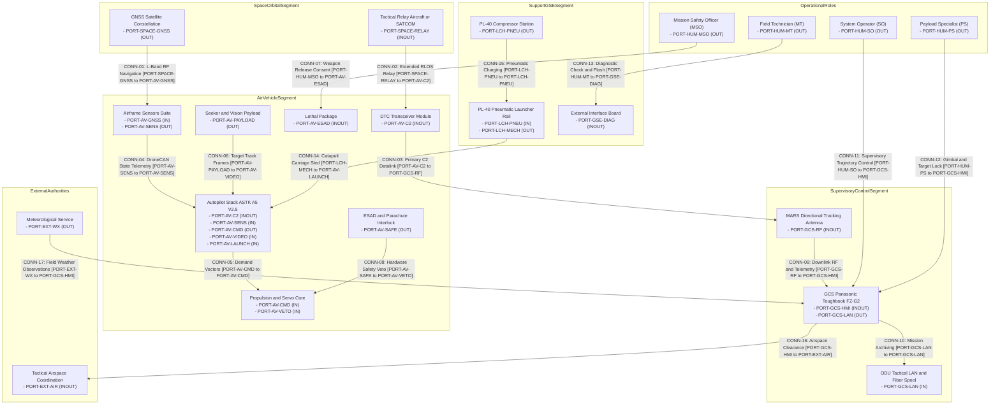

### 1.5 Normative Standards & Regulatory Baseline

The following normative standards and regulatory baselines govern all architectural, operational, safety, and verification artifacts within this Concept of Operations:

| Standard ID | Issuing Body | Title & Baseline Edition | Applicable Clauses & Focus Areas |
| :--- | :--- | :--- | :--- |
| ISO/IEC/IEEE 29148:2018 | ISO / IEC / IEEE | Systems and Software Engineering -- Life Cycle Processes -- Requirements Engineering | Section 5.2.4 ConOps Development Process, Section 6.4.2 Concept of Operations Baseline Specification, Section 6.4.3 Operational Concept Document Structure |
| ISO/IEC/IEEE 15288:2023 | ISO / IEC / IEEE | Systems and Software Engineering -- System Life Cycle Processes | Section 6.4.2 Stakeholder Needs and Requirements Definition, Section 6.4.3 Architecture Definition Process |
| INCOSE SEH v5.0 | INCOSE | Systems Engineering Handbook (5th Edition) | Section 3.3.1 Life Cycle Stages and Concept Definition, Section 4.3 Architecture Definition, Section 4.6 System Analysis and Multi-Domain Threat Assessment, Section 5.4 System Verification and Validation Traceability |
| OMG UAF v2.0 | OMG | Unified Architecture Framework Specification | Operational Domain Views (Op-Pr, Op-Tx, Op-Is) |
| DoD Directive 3000.09 | US Department of Defense | Autonomy in Weapon Systems | Section 3.1 Human Judgement in Force, Section 3.1.a Autonomous Engagement, Section 3.1.b Fail-Safe Interlocks, Section 3.1.c Cyber Safeguards |
| CJCSI 3121.01B | Chairman of the Joint Chiefs of Staff | Standing operational safety interlocks / Standing Rules for Use of Force for U.S. Forces | Enclosure A Section 2.a Self-Defense Determination, Enclosure A Section 4.b Positive Identification, Enclosure B Section 3.c adjacent operational risk Mitigation, Enclosure E Section 2.d Escalation of Force Interlocks |
| NATO STANAG 4586 | NATO Standardisation Office | Standard Interfaces of UAV Control System (UCS) for NATO UAV Interoperability | Section 4.2 UCS Architectural Framework, Section 4.2.2 Interoperability Levels 1-5, Section 5.1 Data Link Interface Profiles, Section 5.1.4 C2 Link Handover |
| NIST SP 800-82r3 | NIST | Guide to Operational Technology (OT) Security | Section 4.2 OT Threat Sources, Section 5.3 OT Defense-in-Depth Architecture, Section 6.2 Wireless and RF C2 Security Controls, Section 6.4 Incident Response and Containment |
| ISO/SAE 21434 | ISO / SAE International | Road Vehicles -- Cybersecurity Engineering | Section 5.3 Cybersecurity Management, Section 6.4 Threat Analysis and Risk Assessment, Section 9.4 Vulnerability Analysis, Section 10.4 Incident Verification and Validation |
| MIL-STD-461G | US Department of Defense | Requirements for the Control of Electromagnetic Interference Characteristics of Subsystems and Equipment | Section 5.4 Conducted Susceptibility CS114-CS116, Section 5.18 Radiated Susceptibility RS103, Section 5.19 Magnetic Fields RS101, Section 5.20 Conducted Emissions CE102 |
| MIL-STD-882E | US Department of Defense | Department of Defense Standard Practice: System Safety | Task 106 Section 4.2 Hazard Mitigation, Task 201 Section 4.2 Preliminary Hazard Analysis, Task 204 Section 4.2 Probability Levels, Task 205 Section 4.2 System Hazard Analysis, Task 208 Section 4.2 Functional Thread Isolation |
| MIL-STD-1629A | US Department of Defense | Procedures for Performing a Failure Mode, Effects and Criticality Analysis | Section 4.3 Severity Classification, Section 4.4 Failure Probability, Section 4.5 Failure Detection, Section 4.6 Criticality Analysis |
| SAE ARP4761 | SAE International | Guidelines and Methods for Conducting the Safety Assessment Process on Civil Airborne Systems and Equipment | Section 4.3.1 Functional Hazard Assessment, Section 4.3.3 FMECA Process, App. L Failure Probability Allocation, App. M Common Cause Analysis |
| RTCA DO-178C | RTCA / EUROCAE | Software Considerations in Airborne Systems and Equipment Certification | Section 6.3.1 Software Fault Detection, Section 6.3.2 Software Partitioning, Section 6.4.3 Redundancy Management, Section 6.4.4 Structural Coverage |
| RTCA DO-362A | RTCA / EUROCAE | Command and Control (C2) Data Link MOPS | Section 2.2 Link Availability and Continuity, Section 2.2.1 Terrestrial LOS Link Allocation, Section 2.2.4 Satellite C2 Link Handover, Section 3.4 Lost Link Fallback Switching |
| JARUS SORA v2.5 | JARUS | Specific Operations Risk Assessment | Annex B Section B.2 Ground Risk Mitigations M1-M3, Annex C Section C.3 Strategic Air Risk Mitigations, Annex D Section D.2 Tactical Mitigation Standards, Annex E Section E.4 Containment Objectives |
| JARUS SORA v2.5 Annex E | JARUS | SORA Specific Category Airworthiness Objectives (OSO-01 to OSO-24) | Section E.1 Airworthiness through Section E.24 Lithium Fire |
| ASTM F3269-17 | ASTM International | Standard Practice for Methods to Safely Bound Flight Behavior of UAS Containing Complex Functions | Section 5.1 RTA Simplex Architecture, Section 5.2 Attitude, Speed and Geofence Monitors, Section 5.3 Deterministic State Switching, Section 5.4 SLDV Invariant Proof Slots |
| MIL-STD-810H | US Department of Defense | Environmental Engineering Considerations and Laboratory Tests | High Temperature Method Section 4.2, Low Temperature Method Section 4.2, Rain and Wind Method Section 4.2, Icing and Freezing Rain Method Section 4.2 |

### 1.6 Stakeholder Roster, User Classes & Authority Boundaries

**Stakeholder Roster:**

| Stakeholder ID | Stakeholder | Primary Interest | Influence on Operations | Acceptance Criterion |
| :--- | :--- | :--- | :--- | :--- |
| STK-01 | System Operator (SO) | Safe launch, transit, loiter, and recovery | Directs all vehicle trajectory commands | Mission completed within declared flight limits |
| STK-02 | Payload Specialist (PS) | Target detection, identification, and track quality | Commands gimbal pointing and target lock | Target track remains stable through engagement window |
| STK-03 | Mission Safety Officer (MSO) | Weapon release safety and abort authority | Grants or withholds lethal release consent | No unauthorized lethal actuation occurs |
| STK-04 | Field Technician (MT) | Launcher charging, RBF removal, and arming | Prepares and arms the launcher and ESAD | All interlocks verified before launch |
| STK-05 | Tactical Airspace Coordination Authority | Airspace deconfliction and clearance | Approves or denies operating volume | Mission remains inside cleared airspace |
| STK-06 | Meteorological Service | Environmental awareness | Provides field weather observations | Launch and flight conducted within declared limits |
| STK-07 | System Assurance Authority | Safety and configuration integrity | Audits hazard controls and evidence | All Critical hazards carry verified controls |
| STK-08 | Logistics and Support Command | Sustainment and spares availability | Allocates launcher and air vehicle spares | Mission availability sustained across sorties |

**User Classes:**

| User Class ID | User Class | Operational Role | Primary Responsibilities | Authority Boundary |
| :--- | :--- | :--- | :--- | :--- |
| UCL-01 | System Operator (SO) | Direct pilot and mission supervisor | Launch authorization, trajectory monitoring, recovery initiation | May abort mission at any time; may not authorize lethal release |
| UCL-02 | Payload Specialist (PS) | Targeting specialist | Gimbal control, target designation, track confirmation | May designate targets; may not release weapons |
| UCL-03 | Mission Safety Officer (MSO) | Weapon release authority | Validates target identification and grants release consent | Sole authority for lethal release consent |
| UCL-04 | Field Technician (MT) | Launcher and arming technician | Launcher setup, pneumatic charging, RBF removal, ESAD arming | May arm only after MSO and SO confirmation |
| UCL-05 | Range Safety Officer (RSO) | Range containment authority | Monitors containment boundary and flight termination readiness | May direct flight termination for containment violation |
| UCL-06 | Airspace Coordination Authority | External airspace authority | Issues and revokes airspace clearance | May deny or terminate operations in controlled airspace |

### 1.7 Operational Assumptions and Constraints

- The Avenger V2.5 air vehicle and PL-40 launcher are operated as an integrated mission system; the launcher is not an airborne element.
- The ESAD is a Critical (DAL-A) safety item; no lethal actuation may occur without a time-ordered Human-in-the-Loop consent token from the Mission Safety Officer.
- The `Ruddervator` is the canonical term for the four tail control surfaces. The terms `Fins` and `tail stabiliser` are accepted only as parenthetical synonyms from the OEM drawing and preparation sources.
- The parachute deployment module is a non-mission variant (`configuration: non-mission`; `baseline: false`) and is excluded from baseline operational, safety, and sustainment analysis.
- All numeric operational limits are traceable to `schema/extracted/parametric_limits.md`; any parameter absent from that registry is marked "Not stated in OEM sources."
- The system operates under positive airspace clearance and does not self-authorize entry into controlled or contested airspace.

### 4.1 Super-System Operational Architecture and Segment Boundaries

The super-system operational architecture partitions the capability across five operational segments and one external-actor group. The Air Vehicle Segment is the system under design; the PL-40 launcher is a support-segment element; the Space and Orbital Segment, Supervisory and Control Segment, Operational Roles, and External Authorities are external to the air vehicle boundary. This architecture view is governed by IEEE Std 1362-1998 Section 5.3 (Operational Environment and System Architecture) and DoDAF v2.02 SV-1 (Systems Interface Description). The Level 1B port and connection bindings in Figure 1.4 use discrete port identifiers and traceable connection identifiers that map 1:1 to the Level 1C System Interface Matrix.

| Operational Segment | Constituent Elements | Boundary Role |
| :--- | :--- | :--- |
| Space and Orbital Segment | GNSS constellation, tactical relay aircraft or SATCOM service | Provides navigation and beyond-line-of-sight relay services |
| Air Vehicle Segment | Avenger V2.5 airframe, avionics, propulsion, payload, lethal package, datalink | System under design; bounded by onboard subsystem interfaces and external RBF keys |
| Supervisory and Control Segment | GCS tablet, ground radio box, MARS antenna, rotator, tactical LAN | Commands, monitors, and authorizes mission execution |
| Support and GSE Segment | PL-40 rail set, compressor station, trigger handle, external interface board | Launches, charges, and maintains the air vehicle |
| Operational Roles | System Operator, Payload Specialist, Mission Safety Officer, Field Technician, Range Safety Officer | Human authority and consent boundary |
| External Authorities | Airspace coordination authority, meteorological service, assurance authority | Regulatory and environmental boundary |

**Figure 4.1: Super-System Port and Connection Binding View**

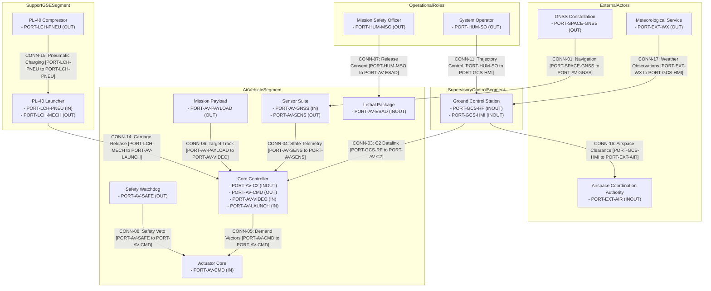

### 4.3 Subsystem Architecture (100% AST Part Coverage)

The complete AST part taxonomy is declared in `.pipeline/schema.sysml` and elaborated in the System Architecture ConOps unit. This overview binds the six top-level structural partitions used throughout the document. The AST part identities in the OEM bill of materials are authoritative for subsystem naming.

| AST Structural Partition | Representative AST Part Definitions | Operational Function |
| :--- | :--- | :--- |
| Airframe and Control Surfaces | Airframe Fuselage, Wings, Wing Panels, Ruddervator | Aerodynamic lift, stability, and control |
| Avionics and Computing | Autopilot Stack Module ASTK A5 V2.5, Autopilot Computing Board Cube Orange Plus, RPI CM5004032, GNSS Module | Navigation, guidance, mission management, and computing |
| Propulsion and Actuation | `Propulsion`, `Battery_12S2P_Li_Metal_BEI`, `ESC_IBEX160`, `Motor_AXI_5345_16_HD_GOLD_LINE_V3`, `EPS_Servo_Power_8V_Rail` | Thrust generation and control-surface actuation |
| Mission Payload | Gimbal Nighthawk2UZ, Camera Compute Module Trip6 | Electro-optical and infrared sensing and target tracking |
| Lethal Package | Lethal Package, ESAD, ESAD Sensor Board, ESAD Detonator, Warhead | Safety and arming, terminal initiation |
| Launch and Ground Support | PL-40 Rail, PL-40 Compressor Unit, PL-40 Trigger Handle, GCS Radio Box, GCS MARS Antenna | Launch, command and control, and sustainment |

### 4.4 System Interface Topology and Port Taxonomy

The Level 1B interface topology uses directional port identifiers with an explicit direction (`IN`, `OUT`, or `INOUT`). Detailed pinouts, serial framing,register bitmasks, and checksum equations are deferred to the Level 1C Interface Control Documents.

| Port Identifier | Direction | Connected Segments | Protocol Family | Operational Payload |
| :--- | :--- | :--- | :--- | :--- |
| PORT-AV-C2 | INOUT | Air Vehicle to Supervisory and Control | RF datalink | Supervisory commands, telemetry, video, state telemetry |
| PORT-AV-GNSS | IN | Space and Orbital to Air Vehicle | Coaxial RF and UART serial | GNSS position, velocity, and time |
| PORT-AV-ACT | OUT | Air Vehicle internal | CAN bus DroneCAN and DC power | Servo demand vectors and actuation power |
| PORT-AV-PAYLOAD | INOUT | Air Vehicle internal | Ethernet and HDMI | Video frames and target track data |
| PORT-AV-ESAD | INOUT | Air Vehicle internal | RS-485 and discrete GPIO | Arm enable, continuity, and initiation authorization |
| PORT-GCS-RF | INOUT | Supervisory and Control external | RF datalink | Command uplink and telemetry downlink |
| PORT-LCH-PNEU | IN | Support and GSE to Air Vehicle | Pneumatic | Launch pressure and carriage propulsion |
| PORT-LCH-TRIG | IN | Support and GSE to Air Vehicle | Electrical discrete | Dual-switch launch command |

## Source References

| Reference ID | Source Artifact | Scope | Access Path |
| :--- | :--- | :--- | :--- |
| SRC-01 | SysML v2 Level 0 schema | AST part, port, attribute, and constraint definitions | [.pipeline/schema.sysml](../../.pipeline/schema.sysml) |
| SRC-02 | OEM bill of materials extraction | Component identity, stated mass, interface, and configuration status | [schema/extracted/oem_bom.md](../../schema/extracted/oem_bom.md) |
| SRC-03 | System interface extraction | Port direction, protocol, data type, and refresh rate | [schema/extracted/interface_table.md](../../schema/extracted/interface_table.md) |
| SRC-04 | Parametric limits registry | All numeric limits, units, and verification sources | [schema/extracted/parametric_limits.md](../../schema/extracted/parametric_limits.md) |
| SRC-05 | This ConOps unit | Scope, system identification, and normative baseline | [docs/conops/units/conops/01_METADATA_AND_OVERVIEW.md](units/conops/01_METADATA_AND_OVERVIEW.md) |
| SRC-06 | Cited research inventory | Public clause citations and normative baseline allocations | [docs/research/RESEARCH_INVENTORY.md](../research/RESEARCH_INVENTORY.md) |

Normative clause anchors:
- ISO/IEC/IEEE 29148:2018 Section 5.2.4 and Section 6.4.2 (stakeholder needs and ConOps baseline).
- ISO/IEC/IEEE 15288:2023 Section 6.4.2 and Section 6.4.3 (stakeholder needs and architecture definition).
- IEEE Std 1362-1998 Section 5.3 (system architecture and operational environment).
- DoDAF v2.02 SV-1 (systems interface description).
- MIL-STD-882E Task 202 and Task 205 (operational hazard analysis and system hazard analysis).
- JARUS SORA v2.5 Annex B Section B.2 and Annex E Section E.14 (containment and ground risk mitigation).

All numeric values in this unit are traceable to SRC-04. Values absent from the OEM sources are explicitly marked "Not stated in OEM sources." The configuration status of the parachute deployment module is traceable to SRC-02 (`configuration: non-mission`; `baseline: false`).

| Attribute | Specification Detail |
| :--- | :--- |

## 2. Current Situation, Deficiency Analysis & Operational Motivation

### 2.1 Current Operational Baseline (Predecessors)
The predecessor operational baseline comprises manually launched tactical reconnaissance drones and improvised loitering munitions that depend on commercial radio control links, point-to-point analog video, and manually coordinated launch fixtures. Quantitative predecessor reliability, launch abort, and link-performance baselines are **Not stated in OEM sources**; the deficiency analysis therefore evaluates the predecessor concept against the OEM-grounded capabilities of the Avenger 5 air vehicle and PL-40 launcher rather than inventing legacy measurements.

The mission baseline is the air vehicle plus launcher configuration defined in the OEM bill of materials. The **Parachute Deployment Non-Mission** module is explicitly a non-mission engineering variant with `configuration: non-mission` and `baseline: false`; its two igniter outputs are excluded from the mission baseline analysis (`schema/extracted/oem_bom.md at line 47`). The tail control surface is the **Ruddervator** (drawing synonym Fins; preparation synonym tail stabiliser), quantity four, driven by four HV6160-DroneCAN servos on CAN 1 (`schema/extracted/oem_bom.md at line 23`). The **ESAD (Electronic Safe and Arm Device)** is classified **Critical / DAL-A** (`schema/extracted/oem_bom.md at line 52`).

### 2.2 Operational Capability Gaps
The following capability gaps separate the predecessor concept from the OEM-grounded mission configuration. Legacy quantitative baselines are recorded as **Not stated in OEM sources** where the allowed sources are silent; current-system targets cite the parametric limits or OEM component records that bound them.

| Gap ID | Capability Gap Name | Operational Manifestation | Technical Root Cause | Mission Impact & Risk | Severity | Proposed Capability Reference |
| :--- | :--- | :--- | :--- | :--- | :--- | :--- |
| **GAP-01** | Consistent Pneumatic Launch & Separation | Unstable carriage release and inconsistent initial pitch attitude during launch. | Manual launch fixtures lack regulated pressure, calibrated carriage retention, and repeatable release sequencing. The PL-40 baseline requires 13 bar minimum and 14 bar maximum launch pressure, a 12 deg launch angle, a maximum launched plane mass of 30 kg, a maximum launch velocity of 25 m/s, and a 5 min maximum setup interval (`schema/extracted/parametric_limits.md` PL-40, PL-41, PL-66, PL-64, PL-65, PL-72). | Failed or aborted launches, airframe damage at rail exit, and hazard to launch personnel. Predecessor abort rate is **Not stated in OEM sources**. | Critical | `CAP-01` |
| **GAP-02** | Resilient C2 and Navigation in Contested RF | Loss of command, telemetry, or targeting video when the radio link degrades or satellite navigation is disrupted. | Single-path commercial links and navigation receivers without a documented contested-environment fallback. The mission baseline uses a 4.4 GHz to 5.0 GHz telemetry and command link (`schema/extracted/interface_table.md at line 63`), a Septentrio Asterx-m3 pro GNSS receiver (`schema/extracted/oem_bom.md at line 15`), a 60 km direct range (PL-07), and a 180 km extended range (PL-08) (`schema/extracted/parametric_limits.md`). | Mission abort, lost-link holding failure, or uncontained flight. Predecessor jamming range and link-margin values are **Not stated in OEM sources**. | Critical | `CAP-03` |
| **GAP-03** | Certified Dual-Environment Safe and Arm Control | Risk of inadvertent warhead initiation during ground handling, launch acceleration, or an uncontained flight abort. | Reliance on single-path software commands or manual arming pins without a documented dual-environment interlock chain. The baseline ESAD is Critical / DAL-A (`schema/extracted/oem_bom.md at line 52`), accepts 14 V DC minimum, 32 V DC maximum, and 28 V DC nominal (`schema/extracted/parametric_limits.md` PL-46, PL-47, PL-48), requires 1 ms period and 50 percent duty arm-enable signaling (PL-54, PL-55), and monitors umbilical continuity at 0.5 Ohm maximum and 20 mA test current (PL-49, PL-50). Detonator measurement range extends to 1800 V (PL-60). | Ground-crew fatality risk, inadvertent initiation during transit or launch, and inability to obtain safety-board approval. | Catastrophic | `CAP-04` |
| **GAP-04** | Terminal Guidance Within Platform Limits | Terminal tracking error and late correction during a high-speed dive against a moving or stationary target. | Gimbal stabilization, tracker latency, and control-loop timing are not bounded by a documented terminal-guidance budget. The baseline permits 55 m/s maximum dive speed (PL-03), 22 deg maximum dive angle (PL-04), 55 m/s maximum engagement airspeed (PL-45), 15 deg maximum engagement elevation (PL-44), and 2 s minimum and 5 s maximum target track duration (PL-42, PL-43). Seeker pitch, yaw, and roll limits are defined by PL-25 and PL-26; zoom is defined by PL-27; day and thermal imagery resolution is defined by PL-28 through PL-31. | Missed target, adjacent operational risk, and wasted tactical munition. Predecessor circular error probable is **Not stated in OEM sources**. | Critical | `CAP-05` |

### 2.3 3-Domain Legacy Deficiencies Matrix
In accordance with ISO/IEC/IEEE 29148:2018 Section 5.2.4 and the MIL-STD-882E system safety process recorded in `docs/research/RESEARCH_INVENTORY.md` (OBL-FMECA-MIL882E-02), predecessor deficiencies are categorized across Technical, Operational, and Human Factors domains. Legacy quantitative limitations are marked **Not stated in OEM sources** where the allowed sources do not define them; each proposed mitigation is bound to an OEM component record or parametric limit.

| Deficiency Domain | Deficiency ID | Legacy Baseline Deficiency Description | Quantified Baseline Limitation | Safety Risk Categorization (MIL-STD-882E) | Proposed Architectural Mitigation |
| :--- | :--- | :--- | :--- | :--- | :--- |
| **Technical Deficiencies** | `DEF-TECH-01` | Single-string compute and non-deterministic control architecture. | **Not stated in OEM sources** for the predecessor. The mission baseline provides a Cube Orange Plus autopilot (`schema/extracted/oem_bom.md at line 12`) and separate CAN 1 and CAN 2 DroneCAN buses (`schema/extracted/interface_table.md at line 9`, `schema/extracted/interface_table.md at line 28`). | Catastrophic / High Risk (Severity I) | Dual-bus autopilot architecture with Cube Orange Plus, CAN 1 ruddervator bus, CAN 2 wing-servo and sensor bus, and an EPS module with isolated converters (`schema/extracted/oem_bom.md at line 11`). |
| **Technical Deficiencies** | `DEF-TECH-02` | Unsealed, non-hardened environmental enclosure and thermal vulnerability. | **Not stated in OEM sources** for the predecessor and for the air vehicle ambient envelope. The PL-40 launcher working-temperature band is defined by PL-73 and PL-74 (`schema/extracted/parametric_limits.md`). | Critical / Serious Risk (Severity II) | Sealed avionics bay, heated and drained CUAV SKYE2 pitot tube (`schema/extracted/oem_bom.md at line 39`), and launcher operation inside the PL-73 to PL-74 temperature band. |
| **Technical Deficiencies** | `DEF-TECH-03` | Single power distribution rail without fault isolation. | **Not stated in OEM sources** for the predecessor. The mission baseline battery spans 36 V minimum and 50.4 V maximum (`schema/extracted/parametric_limits.md` PL-23, PL-24), the servo rail is 8 V (PL-22), and the main fuse is rated 200 A (`schema/extracted/oem_bom.md at line 19`). | Catastrophic / High Risk (Severity I) | EPS module with 8 V servo rails and 12 V, 14 V, and 50 V converters (`schema/extracted/oem_bom.md at line 11`), 200 A main fuse, and a power meter with CAN telemetry (`schema/extracted/oem_bom.md at line 20`). |
| **Technical Deficiencies** | `DEF-TECH-04` | Single-frequency, unauthenticated communication link. | **Not stated in OEM sources** for the predecessor. The mission baseline uses a 4.4 GHz to 5.0 GHz link (`schema/extracted/interface_table.md at line 63`) with a DTC radio module (`schema/extracted/oem_bom.md at line 44`), a 2 W ground radio setting (`schema/extracted/parametric_limits.md` PL-39), and a MARS 23 dBi antenna (`schema/extracted/oem_bom.md at line 75`). Link authentication and encryption are **Not stated in OEM sources**. | Critical / Serious Risk (Severity II) | Digital DTC transceiver at 4.4 GHz to 5.0 GHz, 2 W ground radio power, dual MPSL4400 antennas (`schema/extracted/oem_bom.md at line 45`, `schema/extracted/oem_bom.md at line 46`), and MARS 23 dBi ground antenna; cryptographic controls are a derived requirement from `docs/research/RESEARCH_INVENTORY.md` OBL-NIST80082-03. |
| **Operational Deficiencies** | `DEF-OPS-01` | Static pre-programmed trajectories without dynamic boundary containment. | **Not stated in OEM sources** for the predecessor. The mission baseline defines a 300 m loiter radius (`schema/extracted/parametric_limits.md` PL-37) and a 50 m minimum mission waypoint altitude (PL-36). | Critical / Serious Risk (Severity II) | Closed-loop trajectory generation with geofence containment, the PL-37 loiter radius, and the PL-36 minimum waypoint altitude enforced by the autopilot. |
| **Operational Deficiencies** | `DEF-OPS-02` | Manual coordination latency and absence of tactical network integration. | **Not stated in OEM sources** for the predecessor coordination latency and network interfaces. The mission baseline provides a GCS tablet network over IP Ethernet or Wi-Fi (`schema/extracted/interface_table.md at line 66`) and two Panasonic FZ-G2 tablets (`schema/extracted/oem_bom.md at line 76`). | Moderate / Medium Risk (Severity III) | Digital GCS network with two FZ-G2 tablets and the 4.4 GHz to 5.0 GHz telemetry link, enabling shared mission data across the operator console. |
| **Operational Deficiencies** | `DEF-OPS-03` | Static battery reserve budgeting without dynamic loiter calculations. | **Not stated in OEM sources** for the predecessor. The mission baseline endurance is 90 min maximum (`schema/extracted/parametric_limits.md` PL-06) with a 36 V minimum and 50.4 V maximum battery (PL-23, PL-24). Usable battery capacity is **Not stated in OEM sources**. | Critical / Serious Risk (Severity II) | Continuous energy-state monitoring from the power meter and autopilot, with reserve evaluation against the PL-06 endurance limit and the PL-23 to PL-24 voltage band. |
| **Operational Deficiencies** | `DEF-OPS-04` | Extended field turnaround overhead and manual launcher re-cocking. | **Not stated in OEM sources** for the predecessor turnaround interval. The mission baseline launcher requires a 5 min maximum setup (`schema/extracted/parametric_limits.md` PL-72), and its transport elements are a 68 kg launcher set (PL-69), a 43 kg case (PL-70), and a 25 kg compressor case (PL-71). | Moderate / Medium Risk (Severity III) | PL-40 modular rail with 5 m assembled length and 1.28 m disassembled length (PL-93, PL-94), a 100-launch pulling-rope replacement interval (PL-80), and 55 min and 130 min charger times (PL-89, PL-90). |
| **Human Factors Deficiencies** | `DEF-HUM-01` | High cognitive workload and mental telemetry correlation overload. | **Not stated in OEM sources** for predecessor workload ratings. The mission baseline provides two Panasonic FZ-G2 tablets (`schema/extracted/oem_bom.md at line 76`), supporting a separated flight-management and payload-management console. | Critical / Serious Risk (Severity II) | Two-operator console with distinct System Operator and Payload Specialist roles on the two FZ-G2 tablets, sharing the GCS tablet network (`schema/extracted/interface_table.md at line 66`). |
| **Human Factors Deficiencies** | `DEF-HUM-02` | Manual emergency response latency exceeding safe containment deadlines. | **Not stated in OEM sources** for predecessor reaction time and containment deadlines. Human judgment in force and fail-safe interlock obligations are recorded in `docs/research/RESEARCH_INVENTORY.md` OBL-DOD3000-01 and OBL-DOD3000-03. | Catastrophic / High Risk (Severity I) | Deterministic failsafe state machine using the autopilot and EPS load switches, with supervisory veto authority and human authorization preceding any high-consequence actuation. |
| **Human Factors Deficiencies** | `DEF-HUM-03` | Operator vigilance decrement and fatigue leading to weapon release errors. | **Not stated in OEM sources** for predecessor error rates and shift duration. The dual-man authorization obligation is recorded in `docs/research/RESEARCH_INVENTORY.md` OBL-DOD3000-01. | Critical / Serious Risk (Severity II) | Dual-man rule requiring a second operator consent before ESAD terminal arming, supported by the ESAD RBF key (`schema/extracted/oem_bom.md at line 60`) and arm-enable signaling bounded by PL-54 and PL-55. |

#### 2.3.1 Technical Deficiencies Detail
1. **Compute and Control Determinism:** The predecessor control chain is a single-string architecture with no documented dual-bus or isolated-rail redundancy. The mission baseline replaces it with a Cube Orange Plus autopilot (`schema/extracted/oem_bom.md at line 12`), a ruddervator CAN bus (`schema/extracted/interface_table.md at line 9`), and a wing-servo, magnetometer, and pitot CAN bus (`schema/extracted/interface_table.md at line 28`). Predecessor timing jitter and loop timing are **Not stated in OEM sources**.
2. **Environmental and Thermal Vulnerability:** Air vehicle ambient qualification and ingress protection are **Not stated in OEM sources**. The launcher is bounded to minus 20 degC minimum and plus 50 degC maximum (`schema/extracted/parametric_limits.md` PL-73, PL-74), while the air vehicle baseline includes a heated and drained CUAV SKYE2 pitot tube (`schema/extracted/oem_bom.md at line 39`) to mitigate moisture and icing effects on airspeed sensing.
3. **Power Architecture Single Point of Failure:** The mission baseline battery operates from 36 V minimum to 50.4 V maximum (`schema/extracted/parametric_limits.md` PL-23, PL-24) behind a 200 A main fuse (`schema/extracted/oem_bom.md at line 19`). The EPS module supplies an 8 V servo rail and separate 12 V, 14 V, and 50 V converters (`schema/extracted/oem_bom.md at line 11`), reducing the chance that one payload or servo fault collapses the flight bus. Predecessor fault-collapse time is **Not stated in OEM sources**.
4. **Electromagnetic Susceptibility:** The baseline link operates at 4.4 GHz to 5.0 GHz (`schema/extracted/interface_table.md at line 63`) with a DTC radio module (`schema/extracted/oem_bom.md at line 44`) and a 2 W ground radio setting (`schema/extracted/parametric_limits.md` PL-39). Authentication, encryption, and frequency-agility mechanisms are **Not stated in OEM sources**; the derived cyber requirement is recorded in `docs/research/RESEARCH_INVENTORY.md` OBL-NIST80082-03 and OBL-MITRE-02.

#### 2.3.2 Operational Deficiencies Detail
1. **Static Trajectory Planning and Boundary Non-Compliance:** The predecessor lacks a documented dynamic boundary-containment method. The mission baseline bounds normal flight with a 300 m loiter radius (`schema/extracted/parametric_limits.md` PL-37) and a 50 m minimum mission waypoint altitude (PL-36).
2. **Manual External Coordination Overhead:** Predecessor coordination latency is **Not stated in OEM sources**. The mission baseline provides an IP Ethernet or Wi-Fi tablet network (`schema/extracted/interface_table.md at line 66`) and two FZ-G2 tablets (`schema/extracted/oem_bom.md at line 76`) so that mission data is shared digitally rather than relayed verbally.
3. **Static Resource Budgeting:** The mission baseline endurance is 90 min maximum (`schema/extracted/parametric_limits.md` PL-06), and battery voltage is bounded from 36 V minimum to 50.4 V maximum (PL-23, PL-24). Usable capacity and predecessor reserve logic are **Not stated in OEM sources**.
4. **Maintenance and Turnaround Inefficiencies:** The PL-40 launcher setup interval is 5 min maximum (`schema/extracted/parametric_limits.md` PL-72). Transport and sustainment values are a 68 kg launcher set (PL-69), a 43 kg case (PL-70), a 25 kg compressor case (PL-71), a 100-launch pulling-rope replacement interval (PL-80), and 55 min and 130 min charger times (PL-89, PL-90).

#### 2.3.3 Human Factors Deficiencies Detail
1. **Cognitive Saturation and Multi-Display Fragmentation:** Predecessor workload ratings are **Not stated in OEM sources**. The mission baseline provides two Panasonic FZ-G2 tablets (`schema/extracted/oem_bom.md at line 76`), enabling separate flight-management and payload-management roles on the shared GCS tablet network (`schema/extracted/interface_table.md at line 66`).
2. **Human Reaction Latency in Contingency Events:** Predecessor reaction time is **Not stated in OEM sources**. The mission baseline assigns deterministic failsafe execution to the autopilot and EPS load switches, with human judgment and fail-safe interlock obligations recorded in `docs/research/RESEARCH_INVENTORY.md` OBL-DOD3000-01 and OBL-DOD3000-03.
3. **Fatigue-Induced Input Disparity:** Predecessor error rates and shift durations are **Not stated in OEM sources**. The dual-man authorization obligation in `docs/research/RESEARCH_INVENTORY.md` OBL-DOD3000-01 requires a second operator consent before terminal arming, and the ESAD RBF key provides a physical safe-state control (`schema/extracted/oem_bom.md at line 60`).

### 2.4 Mission Drivers & User Operational Problems
The mission drivers compelling the Avenger 5 air vehicle and PL-40 launcher baseline are grounded in the OEM configuration and the research inventory:

- **Statutory Safety and Human Judgment:** Weapon employment must satisfy human-judgment, fail-safe interlock, and cyber-safeguard obligations (`docs/research/RESEARCH_INVENTORY.md` OBL-DOD3000-01, OBL-DOD3000-03, OBL-DOD3000-04), with ESAD classified Critical / DAL-A (`schema/extracted/oem_bom.md at line 52`).
- **Expeditionary Launch Mobility:** The PL-40 baseline enables a 5 min maximum setup (`schema/extracted/parametric_limits.md` PL-72) with a 68 kg launcher set (PL-69), a 43 kg case (PL-70), a 25 kg compressor case (PL-71), and a rail that assembles to 5 m and disassembles to 1.28 m (PL-93, PL-94).
- **Endurance and Standoff Range:** The baseline provides 90 min maximum endurance (`schema/extracted/parametric_limits.md` PL-06), 60 km direct range (PL-07), and 180 km extended range (PL-08).
- **Precision Engagement Within Declared Limits:** The baseline carries a 5 kg warhead (PL-13) and permits 55 m/s maximum dive speed (PL-03), 22 deg maximum dive angle (PL-04), 55 m/s maximum engagement airspeed (PL-45), 15 deg maximum engagement elevation (PL-44), and 2 s minimum and 5 s maximum target track duration (PL-42, PL-43). Circular error probable is **Not stated in OEM sources**.
- **Resilient Digital C2:** The baseline C2 link operates at 4.4 GHz to 5.0 GHz (`schema/extracted/interface_table.md at line 63`) through a DTC radio module (`schema/extracted/oem_bom.md at line 44`). Authentication and encryption mechanisms are **Not stated in OEM sources**; the derived requirements are recorded in `docs/research/RESEARCH_INVENTORY.md` OBL-NIST80082-03, OBL-MITRE-02, and OBL-DO362A-04.
- **Non-Mission Parachute Exclusion:** The parachute deployment module is a non-mission engineering variant with `configuration: non-mission` and `baseline: false` (`schema/extracted/oem_bom.md at line 47`); its igniters are excluded from the mission baseline and do not constitute a recovery capability for mission credit.

## Source References

[1]: .pipeline/schema.sysml
[2]: schema/extracted/oem_bom.md
[3]: schema/extracted/interface_table.md
[4]: schema/extracted/parametric_limits.md
[5]: docs/research/RESEARCH_INVENTORY.md
[6]: ISO/IEC/IEEE 29148:2018 Section 5.2.4 and Section 6.4.2
[7]: MIL-STD-882E Task 204 Section 4.2
[8]: JARUS SORA v2.5 Annex E Section E.5

| Attribute | Specification Detail |
| :--- | :--- |

## 3. Proposed Capabilities & Operational Justification (Trade-Offs)

### 3.1 Mission Drivers

The proposed architecture is driven by the operational need for a runway-independent, long-endurance, standoff-precision system whose weapon release remains subject to positive human judgment. Each driver below is traced to an OEM row or to the normative baseline. Evidence labels are resolved in the Source References table.

| Driver ID | Mission Driver | Operational Need | Evidence |
| :--- | :--- | :--- | :--- |
| MD-A | Persistent aerial presence | Endurance up to 90 min at 30 m/s cruise speed with a 300 m loiter radius | [A] |
| MD-B | Standoff command and control coverage | Direct radio line-of-sight range up to 60 km, with an extended range band of 60 km to 180 km | [B] |
| MD-C | Runway-independent launch | Pneumatic launch at 13 bar to 14 bar and a 12 deg launch angle, with launcher setup time of 0 min to 5 min | [C] |
| MD-D | Precision terminal effect | Maximum dive speed 55 m/s, maximum dive angle 22 deg, maximum engagement elevation 15 deg, maximum engagement airspeed 55 m/s, target track duration 2 s to 5 s, and warhead mass up to 5 kg | [D] |
| MD-E | Human-authorized weapon release | Positive human judgment and fail-safe interlocks before engagement | [E] |
| MD-F | Containment and recovery assurance | Containment inside the 3D operational volume plus flight termination provisions | [F] |
| MD-G | Expeditionary environmental tolerance | Launcher working thermal window and battery charging thermal window per the cited OEM rows | [G] |
| MD-H | Cyber and electromagnetic resilience | Defense-in-depth for the wireless command link and structured cyber risk assessment | [H] |

### 3.2 Functional Superiority & Operational Value Proposition

The value proposition is stated only against OEM-grounded bounds. Where the OEM sources are silent on a comparison metric, the proposition is marked as unquantified rather than assigned a synthetic value.

| Proposition ID | Value Proposition | Grounded Quantitative Basis | Evidence |
| :--- | :--- | :--- | :--- |
| VP-A | Runway-independent expeditionary launch | 13 bar to 14 bar launch pressure; 12 deg launch angle; 0 min to 5 min setup time; 5 m assembled rail and 1.28 m disassembled rail; 68 kg, 43 kg, and 25 kg set, case, and compressor masses | [I] |
| VP-B | Persistent coverage of the target area | Endurance 0 min to 90 min; cruise speed 30 m/s; loiter radius 300 m; minimum mission waypoint altitude 50 m | [J] |
| VP-C | Standoff command and control | Direct range 0 km to 60 km; extended range 60 km to 180 km; ground radio power 2 W; RF band 4.4 GHz to 5.0 GHz; MARS antenna gain 23 dBi | [K] |
| VP-D | Precision electro-optical and infrared identification | Zoom 1X to 40X; day and thermal resolution 128; seeker pitch -45 deg to 135 deg; seeker yaw and roll -165 deg to 165 deg; target track duration 2 s to 5 s | [L] |
| VP-E | Human-authorized weapon release with a Critical / DAL-A safe-and-arm device | ESAD Critical / DAL-A; acceleration resolution 0.0039 g; arm-enable period 1 ms at 50 percent duty; response latency 0 ms to 5 ms; high-voltage measurement 0 V to 1800 V | [M] |
| VP-F | Separated tail and wing actuation | Four Ruddervator (Fins; tail stabiliser) surfaces and four ruddervator servos; four wing servos; eight servos total; 8 V servo rail; separate CAN 1 and CAN 2 buses | [N] |
| VP-G | Containment and flight termination assurance | Loiter radius 300 m; minimum mission waypoint altitude 50 m; launcher thermal window per the cited OEM rows | [O] |
| VP-H | Environmental and charging discipline | Launcher working thermal window and battery charging thermal window per the cited OEM rows; air vehicle environmental envelope not quantified | [P] |

### 3.3 Engineering Trade-Off Evaluations

The principal quantitative tension in the OEM data is between the launcher maximum launch velocity and the air vehicle minimum flight speed. The following identity makes the deficit explicit and is the basis for the powered climb-out decision.

$$
\begin{aligned}
\Delta V_{\mathrm{launch}} &= V_{\mathrm{min,flight}} - V_{\mathrm{launch,max}} \\
&= 26 - 25 = 1
\end{aligned}
$$

| Symbol | Value | Units | Evidence |
| :--- | :--- | :--- | :--- |
| V_min,flight | 26 | m/s | [Q] |
| V_launch,max | 25 | m/s | [R] |
| Delta V_launch | 1 | m/s | Derived from [Q] and [R] |

The relay option is evaluated as a range multiplier against the direct link bound.

$$
\begin{aligned}
R_{\mathrm{extension}} &= \frac{R_{\mathrm{extended,max}}}{R_{\mathrm{direct,max}}} \\
&= \frac{180}{60} = 3
\end{aligned}
$$

| Symbol | Value | Units | Evidence |
| :--- | :--- | :--- | :--- |
| R_direct,max | 60 | km | [T] |
| R_extended,max | 180 | km | [U] |
| R_extension | 3 | dimensionless | Derived from [T] and [U] |

The actuator count is evaluated as the sum of tail and wing servo populations.

$$
\begin{aligned}
N_{\mathrm{servo}} &= N_{\mathrm{ruddervator}} + N_{\mathrm{wing}} \\
&= 4 + 4 = 8
\end{aligned}
$$

| Symbol | Value | Units | Evidence |
| :--- | :--- | :--- | :--- |
| N_ruddervator | 4 | units | [W] |
| N_wing | 4 | units | [X] |
| N_servo | 8 | units | [Y] |

| Trade-Off ID | Decision | Alternatives Considered | Quantitative Evidence | Evaluation Outcome | Residual Risk / OEM Silence | Evidence |
| :--- | :--- | :--- | :--- | :--- | :--- | :--- |
| TRD-A | Retain the PL-40 pneumatic launcher and rely on powered climb-out after carriage separation | Raise launcher pressure above 14 bar; select a lower-speed airframe | Maximum launch velocity 25 m/s; minimum flight speed 26 m/s; launch pressure 13 bar to 14 bar; compressor working pressure 14 bar | The launch velocity bound is below the minimum flight speed by 1 m/s, and the compressor is already at its stated pressure limit. Pressure alone cannot close the gap, so powered climb-out is required | Separation-to-thrust transition time and thrust margin are Not stated in OEM sources | [Z] |
| TRD-B | Baseline the direct radio line-of-sight link and treat relay extension as optional | Direct-only link bounded at 60 km; beyond-line-of-sight satellite link | Direct range 0 km to 60 km; extended range 60 km to 180 km; RF band 4.4 GHz to 5.0 GHz; ground radio power 2 W | Relay extension raises the maximum range bound by a factor of three, but no relay node, relay data rate, or relay latency is identified in the OEM data | Relay hardware, relay link budget, and relay latency are Not stated in OEM sources | [AA] |
| TRD-C | Retain the removable 12S2P battery and the 17 kg maximum take-off weight class | Larger battery; additional payload | Endurance 0 min to 90 min; maximum take-off weight 17 kg; battery voltage 36 V to 50.4 V; separate launcher battery capacity 6000 mAh | The 90 min endurance bound and the 17 kg maximum take-off weight bound leave no stated mass margin for optional relay or recovery hardware | Component masses are Not stated in OEM sources | [AB] |
| TRD-D | Use four Ruddervator (Fins; tail stabiliser) surfaces on CAN 1 and four wing servos on CAN 2 | Fewer control surfaces; single CAN bus | Four ruddervator surfaces; four ruddervator servos; four wing servos; eight servos; 8 V servo rail; separate CAN 1 and CAN 2 buses | The split bus topology separates tail and wing actuation data paths at the cost of eight servos and two harness families | Common-mode failure of the 8 V servo rail is Not stated in OEM sources | [AC] |
| TRD-E | Use a single ESAD classified Critical / DAL-A with dual-environment arming and human consent | Redundant ESAD channels; mechanical safe-and-arm device | ESAD Critical / DAL-A; acceleration resolution 0.0039 g; arm-enable period 1 ms at 50 percent duty; RS-485 command interval 100 Hz ; response latency 0 ms to 5 ms; high-voltage measurement 0 V to 1800 V; human consent required by the cited normative baseline | The single ESAD is the highest-criticality item. Dual-environment arming and human consent reduce inadvertent initiation risk but do not provide a redundant firing path | ESAD redundancy and quantitative failure probability are Not stated in OEM sources | [AD] |
| TRD-F | Exclude the parachute deployment module from the mission baseline and retain it only for non-mission research and development testbed recovery | Mission parachute recovery; no recovery provision | Parachute configuration non-mission and baseline false, excluded from mission baseline analysis; two 50 V igniter outputs | The OEM configuration does not permit the parachute to be credited as a mission recovery capability | Mission recovery means and flight termination architecture are Not stated in OEM sources | [AE] |
| TRD-G | Use the Nighthawk2UZ gimbal with its stated zoom and pointing envelopes | Fixed electro-optical and infrared sensor; wider gimbal | Pitch envelope -45 deg to 135 deg; yaw and roll envelope -165 deg to 165 deg; zoom 1X to 40X; dive angle 22 deg; engagement elevation 15 deg; day and thermal resolution 128 | The pitch envelope covers the 22 deg dive bound and the 15 deg engagement elevation bound with margin, so a wider gimbal is not required by the stated geometry | Target tracking performance under radio denial or obscuration is Not stated in OEM sources | [AF] |
| TRD-H | Qualify the launcher and charger to their stated thermal windows and leave the air vehicle environmental envelope open | Claim a complete air vehicle environmental envelope | Launcher working thermal window and battery charging thermal window per the cited OEM rows; environmental test basis per the cited normative baseline | Only the launcher and charger thermal windows are stated. The air vehicle thermal, ingress, wind, and icing limits are not quantified by the OEM sources | Air vehicle environmental qualification is Not stated in OEM sources | [AG] |

### 3.4 System Capability Hierarchy

The capability hierarchy below allocates the grounded bounds to operational capabilities. Capability identifiers are ConOps-level labels and are not Level 2 system use cases.

| Capability ID | Capability | Grounded Target Bound | Evidence |
| :--- | :--- | :--- | :--- |
| CAP-A | Expeditionary pneumatic launch and sortie execution | Launch pressure 13 bar to 14 bar; launch angle 12 deg; setup time 0 min to 5 min; rail length 5 m assembled and 1.28 m disassembled | [AH] |
| CAP-B | Navigation and multi-sensor state estimation | Cruise speed 30 m/s; maximum horizontal speed 38 m/s; minimum flight speed 26 m/s; pitot, GNSS, and dual magnetometer sources | [AI] |
| CAP-C | Resilient command and control datalink | Direct range 0 km to 60 km; extended range 60 km to 180 km; ground radio power 2 W; RF band 4.4 GHz to 5.0 GHz | [AJ] |
| CAP-D | Electro-optical and infrared seeker and target acquisition | Zoom 1X to 40X; pitch -45 deg to 135 deg; yaw and roll -165 deg to 165 deg; day and thermal resolution 128; target track duration 2 s to 5 s | [AK] |
| CAP-E | Precision terminal effect and safety interlocks | Dive speed up to 55 m/s; dive angle up to 22 deg; engagement elevation up to 15 deg; engagement airspeed up to 55 m/s; warhead mass up to 5 kg; ESAD Critical / DAL-A | [AL] |

### 3.5 Operational Benefits Summary

1. **Runway-independent launch.** The PL-40 pneumatic launcher operates at 13 bar to 14 bar and a 12 deg launch angle, with a setup time of 0 min to 5 min and a rail that breaks down to 1.28 m [AH].
2. **Persistent coverage.** The air vehicle supports endurance up to 90 min at a 30 m/s cruise speed and a 300 m loiter radius [J].
3. **Standoff command and control.** The direct link is bounded at 60 km and the extended range band at 60 km to 180 km, using a 4.4 GHz to 5.0 GHz radio and a 23 dBi ground antenna [K].
4. **Precision identification.** The seeker provides 1X to 40X zoom, 128 day and thermal imagery, and a 2 s to 5 s target track duration [L].
5. **Human-authorized weapon release.** The ESAD is classified Critical / DAL-A and weapon release remains subject to human judgment and fail-safe interlocks [M].
6. **Separated actuation.** Four Ruddervator (Fins; tail stabiliser) servos on CAN 1 and four wing servos on CAN 2 provide eight total servos on an 8 V rail [N].
7. **Containment assurance.** A 300 m loiter radius, a 50 m minimum mission waypoint altitude, and the cited containment and run-time assurance obligations provide the basis for volume containment [O].
8. **Configuration honesty.** The parachute deployment module is non-mission and excluded from the mission baseline, and the air vehicle environmental envelope is not quantified by the OEM sources [AE].

### 3.6 Source References

This specification is grounded in the schema files `schema/extracted/parametric_limits.md`, `schema/extracted/oem_bom.md`, `schema/extracted/interface_table.md`, and `.pipeline/schema.sysml`, and in the normative clauses ISO/IEC/IEEE 29148:2018 Section 6.4.2 and INCOSE SEH v5.0 Section 4.3.

| Clause | Source |
| :--- | :--- |
| ISO/IEC/IEEE 29148:2018 Section 6.4.2 | [RESEARCH_INVENTORY.md](../research/RESEARCH_INVENTORY.md) |
| ISO/IEC/IEEE 15288:2023 Section 6.4.3 | [RESEARCH_INVENTORY.md](../research/RESEARCH_INVENTORY.md) |
| INCOSE SEH v5.0 Section 4.3 | [oem_bom.md](../../schema/extracted/oem_bom.md) |
| ISO/IEC/IEEE 29148:2018 Section 8.4 | [schema.sysml](../../.pipeline/schema.sysml) |

- ISO/IEC/IEEE 29148:2018 Section 6.4.2 (ConOps): [RESEARCH_INVENTORY.md](../research/RESEARCH_INVENTORY.md)
- ISO/IEC/IEEE 15288:2023 Section 6.4.2 and Section 6.4.3 (requirements and architecture definition): [RESEARCH_INVENTORY.md](../research/RESEARCH_INVENTORY.md)
- INCOSE SEH v5.0 Section 3.3.1 and Section 4.3 (concept definition and architecture definition): [RESEARCH_INVENTORY.md](../research/RESEARCH_INVENTORY.md)
- DoD Directive 3000.09 Section 3.1, Section 3.1.a, Section 3.1.b, Section 3.1.c (human judgment and fail-safe interlocks): [RESEARCH_INVENTORY.md](../research/RESEARCH_INVENTORY.md)
- MIL-STD-882E Task 201 Section 4.2, Task 205 Section 4.2, Task 208 Section 4.2 (hazard analysis and thread isolation): [RESEARCH_INVENTORY.md](../research/RESEARCH_INVENTORY.md)
- MIL-STD-1629A Section 4.3 (severity classification): [RESEARCH_INVENTORY.md](../research/RESEARCH_INVENTORY.md)
- SAE ARP4761 Section 4.3.1 (functional hazard assessment): [RESEARCH_INVENTORY.md](../research/RESEARCH_INVENTORY.md)
- RTCA DO-178C Section 6.3.1 (software fault detection): [RESEARCH_INVENTORY.md](../research/RESEARCH_INVENTORY.md)
- ASTM F3269-17 Section 5.2 and Section 5.3 (run-time assurance): [RESEARCH_INVENTORY.md](../research/RESEARCH_INVENTORY.md)
- RTCA DO-362A Section 2.2, Section 2.2.1, Section 3.4 (C2 link availability and lost-link fallback): [RESEARCH_INVENTORY.md](../research/RESEARCH_INVENTORY.md)
- JARUS SORA v2.5 Annex E Section E.11, Section E.14, Section E.18 (ground support, containment, flight termination): [RESEARCH_INVENTORY.md](../research/RESEARCH_INVENTORY.md)
- AMC1 UAS.SPEC.050 Section 4.1 (site survey and geofence containment): [RESEARCH_INVENTORY.md](../research/RESEARCH_INVENTORY.md)
- MIL-STD-810H Method 501.7 Section 4.2, Method 502.7 Section 4.2, Method 506.6 Section 4.2, Method 521.4 Section 4.2 (environmental test methods): [RESEARCH_INVENTORY.md](../research/RESEARCH_INVENTORY.md)
- NIST SP 800-82r3 Section 6.2 (wireless and RF C2 security controls): [RESEARCH_INVENTORY.md](../research/RESEARCH_INVENTORY.md)
- ISO/SAE 21434 Section 6.4 (threat analysis and risk assessment): [RESEARCH_INVENTORY.md](../research/RESEARCH_INVENTORY.md)
- MIL-STD-461G Section 5.18 (radiated susceptibility): [RESEARCH_INVENTORY.md](../research/RESEARCH_INVENTORY.md)
- ISO/IEC/IEEE 29148:2018 Section 6.4.2 (ConOps parameter traceability): [parametric_limits.md](../../schema/extracted/parametric_limits.md)
- INCOSE SEH v5.0 Section 4.3 (architecture decomposition and component identity): [oem_bom.md](../../schema/extracted/oem_bom.md)
- ISO/IEC/IEEE 15288:2023 Section 6.4.3 (architecture definition and interface allocation): [interface_table.md](../../schema/extracted/interface_table.md)
- ISO/IEC/IEEE 29148:2018 Section 8.4 (system requirements traceability): [schema.sysml](../../.pipeline/schema.sysml)

| Clause | Source Reference |
| :--- | :--- |
| A | parametric_limits.md:12; avenger-5-spec-sheet-rev3.md:53; parametric_limits.md:7; a5-user-manual-2.md:307; parametric_limits.md:43; a5-user-manual-2.md:1497 |
| B | parametric_limits.md:13; a5-user-manual-2.md:315; parametric_limits.md:14; a5-user-manual-2.md:315 |
| C | parametric_limits.md:46-47; a5-user-manual-2.md:1329; parametric_limits.md:72; uav_launcher_pl_40_sysml_v2_ingestion_manual.md:712; parametric_limits.md:78; uav_launcher_pl_40_sysml_v2_ingestion_manual.md:722 |
| D | parametric_limits.md:9-10; a5-user-manual-2.md:309-310; parametric_limits.md:50-51; a5-user-manual-2.md:2056; a5-user-manual-2.md:2061; parametric_limits.md:49; a5-user-manual-2.md:2055; parametric_limits.md:19; avenger-5-spec-sheet-rev3.md:133 |
| E | RESEARCH_INVENTORY.md:18; DoD Directive 3000.09 Section 3.1, Section 3.1.a, Section 3.1.b |
| F | RESEARCH_INVENTORY.md:30; JARUS SORA v2.5 Annex E Section E.14, Section E.18; RESEARCH_INVENTORY.md:26; AMC1 UAS.SPEC.050 Section 4.1 |
| G | parametric_limits.md:79-80; uav_launcher_pl_40_sysml_v2_ingestion_manual.md:723; parametric_limits.md:97-98; uav_launcher_pl_40_sysml_v2_ingestion_manual.md:137 |
| H | RESEARCH_INVENTORY.md:21; NIST SP 800-82r3 Section 6.2; RESEARCH_INVENTORY.md:24; ISO/SAE 21434 Section 6.4; RESEARCH_INVENTORY.md:23; MIL-STD-461G Section 5.18 |
| I | parametric_limits.md:46-47; a5-user-manual-2.md:1329; parametric_limits.md:72; uav_launcher_pl_40_sysml_v2_ingestion_manual.md:712; parametric_limits.md:78; uav_launcher_pl_40_sysml_v2_ingestion_manual.md:722; parametric_limits.md:99-100; uav_launcher_pl_40_sysml_v2_ingestion_manual.md:713-714; parametric_limits.md:75-77; uav_launcher_pl_40_sysml_v2_ingestion_manual.md:715-717 |
| J | parametric_limits.md:12; avenger-5-spec-sheet-rev3.md:53; parametric_limits.md:7; a5-user-manual-2.md:307; parametric_limits.md:43; a5-user-manual-2.md:1497; parametric_limits.md:42; a5-user-manual-2.md:1195 |
| K | parametric_limits.md:13; a5-user-manual-2.md:315; parametric_limits.md:14; a5-user-manual-2.md:315; parametric_limits.md:45; a5-user-manual-2.md:1690; interface_table.md:63; oem_bom.md:75 |
| L | parametric_limits.md:31-37; a5-user-manual-2.md:324-328; parametric_limits.md:49; a5-user-manual-2.md:2055 |
| M | oem_bom.md:52; parametric_limits.md:69; esad-icd-excalibur-ab00-0054.md:438; parametric_limits.md:60-61; esad-icd-excalibur-ab00-0054.md:285; parametric_limits.md:64; esad-icd-excalibur-ab00-0054.md:330; parametric_limits.md:66; esad-icd-excalibur-ab00-0054.md:613 |
| N | parametric_limits.md:20-24; a5-user-manual-2.md:339; avenger_v2_5_sysml_v2_ingestion.md:21-31; parametric_limits.md:28; avenger_v2_5_sysml_v2_ingestion.md:79; interface_table.md:9-32 |
| O | parametric_limits.md:43; a5-user-manual-2.md:1497; parametric_limits.md:42; a5-user-manual-2.md:1195; parametric_limits.md:79-80; uav_launcher_pl_40_sysml_v2_ingestion_manual.md:723; RESEARCH_INVENTORY.md:30; JARUS SORA v2.5 Annex E Section E.14; RESEARCH_INVENTORY.md:31; ASTM F3269-17 Section 5.2; RESEARCH_INVENTORY.md:26; AMC1 UAS.SPEC.050 Section 4.1 |
| P | parametric_limits.md:79-80; uav_launcher_pl_40_sysml_v2_ingestion_manual.md:723; parametric_limits.md:97-98; uav_launcher_pl_40_sysml_v2_ingestion_manual.md:137; RESEARCH_INVENTORY.md:39; MIL-STD-810H Method 501.7 Section 4.2, Method 502.7 Section 4.2, Method 506.6 Section 4.2, Method 521.4 Section 4.2 |
| Q | parametric_limits.md:11; a5-user-manual-2.md:311 |
| R | parametric_limits.md:71; uav_launcher_pl_40_sysml_v2_ingestion_manual.md:719 |
| S | Derived from [Q] and [R] |
| T | parametric_limits.md:13; a5-user-manual-2.md:315 |
| U | parametric_limits.md:14; a5-user-manual-2.md:315 |
| V | Derived from [T] and [U] |
| W | parametric_limits.md:22; avenger_v2_5_sysml_v2_ingestion.md:22 |
| X | parametric_limits.md:23; avenger_v2_5_sysml_v2_ingestion.md:28 |
| Y | parametric_limits.md:24; avenger_v2_5_sysml_v2_ingestion.md:22; avenger_v2_5_sysml_v2_ingestion.md:31 |
| Z | parametric_limits.md:71; uav_launcher_pl_40_sysml_v2_ingestion_manual.md:719; parametric_limits.md:11; a5-user-manual-2.md:311; parametric_limits.md:46-47; a5-user-manual-2.md:1329; parametric_limits.md:73; uav_launcher_pl_40_sysml_v2_ingestion_manual.md:132 |
| AA | parametric_limits.md:13; a5-user-manual-2.md:315; parametric_limits.md:14; a5-user-manual-2.md:315; interface_table.md:63; parametric_limits.md:45; a5-user-manual-2.md:1690 |
| AB | parametric_limits.md:12; avenger-5-spec-sheet-rev3.md:53; parametric_limits.md:18; a5-user-manual-2.md:299; parametric_limits.md:29-30; avenger_v2_5_sysml_v2_ingestion.md:16; parametric_limits.md:82; uav_launcher_pl_40_sysml_v2_ingestion_manual.md:134 |
| AC | parametric_limits.md:20-24; a5-user-manual-2.md:339; avenger_v2_5_sysml_v2_ingestion.md:21-31; parametric_limits.md:28; avenger_v2_5_sysml_v2_ingestion.md:79; interface_table.md:9-32 |
| AD | oem_bom.md:52; parametric_limits.md:69; esad-icd-excalibur-ab00-0054.md:438; parametric_limits.md:60-63; esad-icd-excalibur-ab00-0054.md:285; esad-icd-excalibur-ab00-0054.md:306-307; parametric_limits.md:64; esad-icd-excalibur-ab00-0054.md:330; parametric_limits.md:66; esad-icd-excalibur-ab00-0054.md:613; RESEARCH_INVENTORY.md:18; DoD Directive 3000.09 Section 3.1.b |
| AE | oem_bom.md:47; oem_bom.md:48-49 |
| AF | parametric_limits.md:31-37; a5-user-manual-2.md:324-328; parametric_limits.md:9-10; a5-user-manual-2.md:309-310; parametric_limits.md:50; a5-user-manual-2.md:2056 |
| AG | parametric_limits.md:79-80; uav_launcher_pl_40_sysml_v2_ingestion_manual.md:723; parametric_limits.md:97-98; uav_launcher_pl_40_sysml_v2_ingestion_manual.md:137; RESEARCH_INVENTORY.md:39; MIL-STD-810H Method 501.7 Section 4.2, Method 502.7 Section 4.2, Method 506.6 Section 4.2, Method 521.4 Section 4.2 |
| AH | parametric_limits.md:46-47; a5-user-manual-2.md:1329; parametric_limits.md:72; uav_launcher_pl_40_sysml_v2_ingestion_manual.md:712; parametric_limits.md:78; uav_launcher_pl_40_sysml_v2_ingestion_manual.md:722; parametric_limits.md:99-100; uav_launcher_pl_40_sysml_v2_ingestion_manual.md:713-714 |
| AI | parametric_limits.md:7-8; a5-user-manual-2.md:307-308; parametric_limits.md:11; a5-user-manual-2.md:311; oem_bom.md:15; oem_bom.md:39; oem_bom.md:40-41 |
| AJ | parametric_limits.md:13; a5-user-manual-2.md:315; parametric_limits.md:14; a5-user-manual-2.md:315; parametric_limits.md:45; a5-user-manual-2.md:1690; interface_table.md:63; oem_bom.md:75 |
| AK | parametric_limits.md:31-37; a5-user-manual-2.md:324-328; parametric_limits.md:49; a5-user-manual-2.md:2055 |
| AL | parametric_limits.md:9-10; a5-user-manual-2.md:309-310; parametric_limits.md:19; avenger-5-spec-sheet-rev3.md:133; parametric_limits.md:50-51; a5-user-manual-2.md:2056; a5-user-manual-2.md:2061; oem_bom.md:52 |

## 4. System Operational Architecture, User Classes & Subsystem Decomposition

### 4.1 Stakeholder Roster & User Class Taxonomy
In accordance with ISO/IEC/IEEE 29148:2018 Section 5.2.4 and DoDAF v2.02 SV-1, the operational lifecycle of the Avenger V2.5 Loitering Munition UAV and PL-40 Pneumatic Launcher involves multiple organizational and external stakeholders:
- **System Governance & Safety Authorities:** Regulatory and military certification authorities responsible for validating system safety cases, approving range containment profiles, and certifying ESAD compliance.
- **Operational Safety Authority & Supervisors:** Operational commanders governing airspace corridor allocations, validating dynamic exclusion zones, and authorizing high-consequence actuation consent.
- **System Owner & Operations Management:** Tactical unit command directing mission requirements, target tasking, and resource allocation.
- **Support & Logistics Organization:** Maintenance depot personnel, supply chain operators, and field arming specialists.

The operational user classes are formalized using the standard `UCL-xx` prefix:

| User Class ID | Title | Player or Operator | Interfacing Stakeholder | Characteristics & Responsibilities | Training & Qualification | Constraint Source |
| :--- | :--- | :--- | :--- | :--- | :--- | :--- |
| **UCL-01** | System Operator (SO) | Direct Operator | Mission Safety Officer / Tactical Command | Primary operational responsibility for catapult launch sequence, trajectory monitoring, corridor compliance, and failsafe abort execution. | Certified UAV Tactical Pilot with Type Rating and Catapult Launch Certification | ISO/IEC/IEEE 29148:2018 Section 5.2.4 |
| **UCL-02** | Payload Specialist (PS) | Direct Operator | Tactical Intelligence / Strike Cell | Responsible for Nighthawk2UZ EO/IR sensor tasking, 40X optical zoom tracking, Trip6 AI feature lock, and target coordinate extraction. | Certified Sensor Payload Specialist & EO/IR Target Acquisition Qualification | ISO/IEC/IEEE 29148:2018 Section 5.2.4 |
| **UCL-03** | Mission Safety Officer (MSO) | Supervisor / Approver | Operational Commander / Joint Air Cell | Holds cryptographic weapon release keys; authorizes final terminal dive and ESAD arming sequence under strict operational safety interlocks. | Senior Tactical Safety Officer & Weapon Release Authority Certification | MIL-STD-882E Task 102 |
| **UCL-04** | Field Maintenance Technician (MT) | Support Operator | Maintenance Logistics Officer | Conducts PL-40 pneumatic rail assembly, compressor pressure charging, carriage rope inspection, pre-flight PBIT checks, and battery hot-swaps. | Certified Field GSE Hardware Specialist & Catapult Maintenance Qualification | ISO/IEC/IEEE 29148:2018 Section 5.2.4 |
| **UCL-05** | Range Safety Observer (RSO) | Field Support | Local Airspace Safety Staff | Maintains continuous monitoring of surrounding launch perimeter, launcher clear zones, and visual airspace deconfliction. | Certified Range Safety Observer Training & Tactical Radio Protocol Qualification | MIL-STD-882E Section 4.3 |

### 4.2 Operator Workload Constraints (NASA-TLX) & Shift Protocols
In accordance with ISO/IEC/IEEE 29148:2018 Section 5.2.4 and MIL-STD-1472H, human operators maintain situational awareness without cognitive saturation. Operator workload is assessed across the 6 NASA Task Load Index (NASA-TLX) dimensions:

$$
\begin{aligned}
\text{TLX}_{\mathrm{composite}} &= \sum_{i=1}^{6} w_i \cdot S_i \\
\sum_{i=1}^{6} w_i &= 1.0
\end{aligned}
$$

- Parameter Definitions & Engineering Units:
- TLX_composite: Overall weighted composite cognitive workload score on a [0, 100] scale.
- w_i: Normalized weighting coefficient for dimension i (sum of all w_i equals 1.0).
- S_i: Raw subjective workload rating score for dimension i on a scale of [0, 100].
- TLX_nominal_max: Maximum allowable composite workload under nominal operations (TLX_nominal_max <= 35).
- TLX_contingency_max: Maximum allowable composite workload under contingency operations (TLX_contingency_max <= 55).

| Dimension ID | Dimension Name | Description & Evaluation Focus | Weight (w_i) | Nominal Threshold | Contingency Threshold | Scale Range |
| :--- | :--- | :--- | :--- | :--- | :--- | :--- |
| **TLX-01** | Mental Demand | Tactical situation assessment, target classification, and terminal dive clearance calculations | 0.25 | Score <= 35 | Score <= 55 | 0 - 100 |
| **TLX-02** | Physical Demand | Console manipulation, touchpad input, and field launcher toggle clamp engagement | 0.10 | Score <= 35 | Score <= 55 | 0 - 100 |
| **TLX-03** | Temporal Demand | Time pressure during terminal engagement windows and high-speed dive guidance | 0.20 | Score <= 35 | Score <= 55 | 0 - 100 |
| **TLX-04** | Performance | Perceived operator success in target neutralization and containment compliance | 0.15 | Score <= 35 | Score <= 55 | 0 - 100 |
| **TLX-05** | Effort | Aggregate mental and physical exertion required to maintain tracking stability | 0.15 | Score <= 35 | Score <= 55 | 0 - 100 |
| **TLX-06** | Frustration | Operational friction, datalink attenuation, or degraded optical visibility stress | 0.15 | Score <= 35 | Score <= 55 | 0 - 100 |
| **Composite** | Overall Weighted TLX | Weighted aggregate cognitive workload index across all supervisory duties | 1.00 | Score <= 35 | Score <= 55 | 0 - 100 |

#### 4.2.1 Operational Shift Rotation Protocol
To mitigate operator fatigue and sustain continuous vigilance during loitering missions, console duty is governed by strict mathematical limits:

$$
\begin{aligned}
t_{\mathrm{shift}} &\le t_{\text{shift\_max}} = 4.0 \\
t_{\mathrm{rest}} &\ge t_{\text{rest\_min}} = 0.5 \\
t_{\mathrm{daily}} &\le t_{\text{daily\_max}} = 8.0
\end{aligned}
$$

- Parameter Definitions & Engineering Units:
- t_shift: Continuous supervisory console duty duration per shift (t_shift <= 4.0 hr).
- t_rest: Mandatory non-operational rest interval between consecutive shifts (t_rest >= 30.0 min).
- t_daily: Cumulative console operational duty duration within a rolling 24-hour cycle (t_daily <= 8.0 hr).
- t_overlap: Mandatory structured handover briefing interval (t_overlap >= 15.0 min).

### 4.3 Authority Handoff Chains & Cryptographic Control Transfer
Handoff of command and control (C2) authority between GCS consoles follows a strict cryptographic 4-way handshake bounded by t_handoff <= tau_handoff_max = 5.0 s:

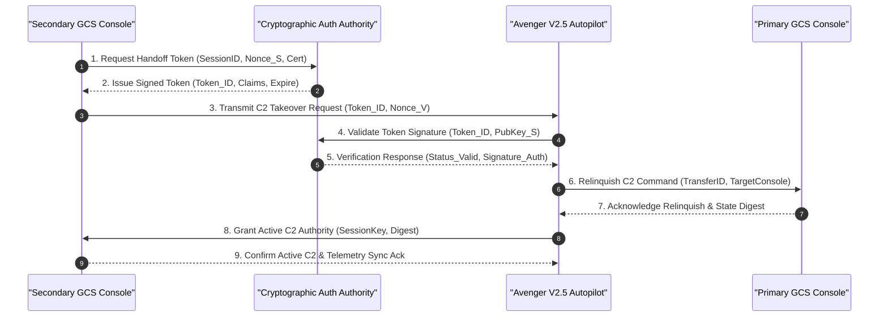

#### Deterministic Rejection Safety Criteria:
- **REJ-01:** Cryptographic Token Invalidation (digital signature failure, expired timestamp, or revoked cert).
- **REJ-02:** Telemetry State Desynchronization (state disparity exceeds acceptable thresholds).
- **REJ-03:** Active Emergency or Terminal Dive State (in-progress EMG-01..07 response or terminal kinetic dive inhibits transfer).
- **REJ-04:** Datalink Attenuation (packet loss exceeds 1.0% or round-trip latency exceeds 100 ms).

### 4.4 Operational Lifecycle Stages ($\Phi_{\mathrm{lifecycle}}$)
The Avenger V2.5 / PL-40 system executes across six mutually exclusive lifecycle stages:
1. **Phase_Startup:** PL-40 pneumatic rail assembly, compressor pressure charge, PBIT diagnostics, GNSS lock, and RBF key verification.
2. **Phase_CatapultLaunch:** Carriage safety lock pin removal, dual trigger actuation, pneumatic piston pull, carriage sled release, and climb-out.
3. **Phase_NominalTransit:** High-altitude cruise, corridor following, waypoint navigation, and continuous telemetry monitoring.
4. **Phase_LoiterAndTargeting:** Tactical loitering, Nighthawk2UZ EO/IR panning, 40X optical zoom tracking, and Trip6 target identification.
5. **Phase_TerminalStrike:** Positive Human-in-the-Loop (HITL) weapon release authorization, ESAD high-voltage arming, and terminal kinetic dive.
6. **Phase_RecoveryOrContainment:** Parachute pyrotechnic deployment for test recovery, or autonomous flight termination into designated safety zones.

---

### 4.5 System Operational Architecture (DoDAF SV-1 / IEEE 1362 Section 5.3)
The Super-System Architecture decomposes into three primary operational segments: Air Vehicle Segment (Avenger V2.5 UAV), Launch Segment (PL-40 Pneumatic Catapult Launcher), and Control Segment (Ground Control System).

#### Figure 4.1: Canonical ConOps SV-1 Primary System Architecture Diagram (Option 3: Compact Blocks & Vertical Tiers)
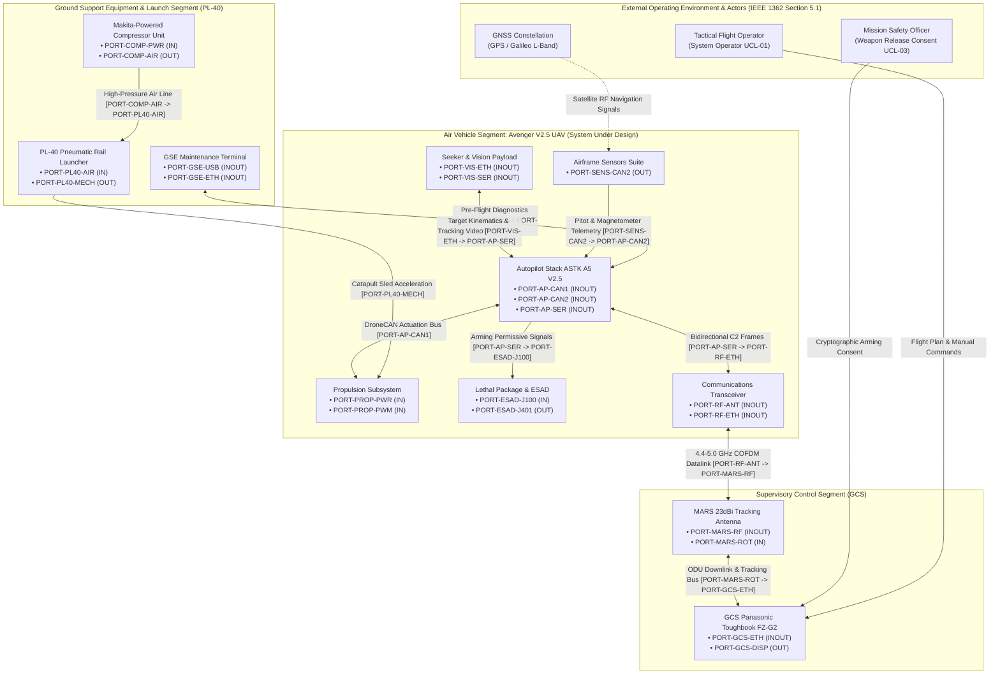

---

### 4.6 Super-System Segment Allocation Matrix (Table 4.2)
Physical subsystems, computational nodes, and support equipment are formally allocated across operational segments in accordance with IEEE 1362 Section 5.3 and DoDAF SV-1:

| Subsystem Part | Operational Segment | SSOT Ground Truth Source & Citation | Primary Functional Role |
| :--- | :--- | :--- | :--- |
| **Top_Level_Airframe** | Air Vehicle Segment (UAV) | [schema/avenger-5-spec-sheet-rev3.md](../../schema/avenger-5-spec-sheet-rev3.md) ("Structural Details") \| SysML v2: `part def Top_Level_Airframe` | Aerodynamic structure, fuselage composite shell, wing panels, ruddervator fins, and catapult rail interfaces. |
| **Autopilot_Stack_ASTK_A5_V2_5** | Air Vehicle Segment (UAV) | [schema/avenger_v2_5_sysml_v2_ingestion.md](../../schema/avenger_v2_5_sysml_v2_ingestion.md) ("Autopilot stack module") \| SysML v2: `part def Autopilot_Stack_ASTK_A5_V2_5` | Core computational avionics, Cube Orange+ flight controller, RPI CM5 companion computer, Ethernet switch, and EPS power module. |
| **Propulsion** | Air Vehicle Segment (UAV) | [schema/avenger_v2_5_sysml_v2_ingestion.md](../../schema/avenger_v2_5_sysml_v2_ingestion.md) ("Propulsion") \| SysML v2: `part def Propulsion` | Thrust generation using AXI 5345/16 motor, IBEX160 ESC, folding propeller, 12S2P battery, and 200A fuse. |
| **Fins** | Air Vehicle Segment (UAV) | [schema/avenger_v2_5_sysml_v2_ingestion.md](../../schema/avenger_v2_5_sysml_v2_ingestion.md) ("Fins") \| SysML v2: `part def Fins` | Tail empennage aerodynamic control surfaces actuated by 4x HV6160-DroneCAN pitch and yaw servos. |
| **Wings** | Air Vehicle Segment (UAV) | [schema/avenger_v2_5_sysml_v2_ingestion.md](../../schema/avenger_v2_5_sysml_v2_ingestion.md) ("Wings") \| SysML v2: `part def Wings` | Main aerodynamic lifting surfaces housing 4x HV6160-DroneCAN roll stabilization servos and CAN power splitter PCB. |
| **Airframe_Sensors** | Air Vehicle Segment (UAV) | [schema/avenger_v2_5_sysml_v2_ingestion.md](../../schema/avenger_v2_5_sysml_v2_ingestion.md) ("Airframe Sensors") \| SysML v2: `part def Airframe_Sensors` | Atmospheric and magnetic state estimation using CUAV SKYE2 pitot tube and dual mRo RM3100 magnetometers. |
| **Seeker_Vision_Payload** | Air Vehicle Segment (UAV) | [schema/avenger_v2_5_sysml_v2_ingestion.md](../../schema/avenger_v2_5_sysml_v2_ingestion.md) ("Gimbal & Camera compute") \| SysML v2: `part def Seeker_Vision_Payload` | Target reconnaissance, 40X optical zoom tracking, and video feed using Nighthawk2UZ gimbal and Trip6 compute module. |
| **Communications** | Air Vehicle Segment (UAV) | [schema/avenger-5-spec-sheet-rev3.md](../../schema/avenger-5-spec-sheet-rev3.md) ("Communication") \| SysML v2: `part def Communications` | Command and control transport and video streaming using DTC 4.4-5.0 GHz 2x1W radio and dual MPSL4400 antennas. |
| **Lethal_Package** | Air Vehicle Segment (UAV) | [schema/esad-icd-excalibur-ab00-0054.md](../../schema/esad-icd-excalibur-ab00-0054.md) ("ESAD ICD") \| SysML v2: `part def Lethal_Package` | Safe-and-arm fuzing, proximity target sensing, and precision terminal blast neutralization using 5.0 kg warhead and ESAD. |
| **Parachute_Deployment** | Air Vehicle Segment (UAV) | [schema/avenger_v2_5_sysml_v2_ingestion.md](../../schema/avenger_v2_5_sysml_v2_ingestion.md) ("Parachute deployment") \| SysML v2: `part def Parachute_Deployment` | Controlled flight termination and test airframe recovery using dual wire-burning pyrotechnic igniters. |
| **Safety_Interlocks** | Air Vehicle Segment (UAV) | [schema/a5-prep-and-safety-rev7.md](../../schema/a5-prep-and-safety-rev7.md) ("Safety Interlocks") \| SysML v2: `part def Safety_Interlocks` | Physical and electrical safety guarantees using UAV RBF key, ESAD RBF pin, and pitot protective cover devices. |
| **Ground_Support_Equipment** | Launch & Support Segment | [schema/uav_launcher_pl_40_sysml_v2_ingestion_manual.md](../../schema/uav_launcher_pl_40_sysml_v2_ingestion_manual.md) ("PL-40 Launcher") \| SysML v2: `part def Ground_Support_Equipment` | Expeditionary catapult launching using PL-40 3-piece rail set, carriage sled, pulling rope, compressor unit, and ground anchors. |
| **Ground_Control_System** | Supervisory Control Segment | [schema/avenger-5-spec-sheet-rev3.md](../../schema/avenger-5-spec-sheet-rev3.md) ("Ground Station Control") \| SysML v2: `part def Ground_Control_System` | Supervisory command, target tracking display, and datalink tracking using Panasonic Toughbook FZ-G2, MARS 23 dBi antenna, and Gitzo tripod. |
| **Interface_Table_System** | System Integration Architecture | [schema/extracted/interface_table.md](../../schema/extracted/interface_table.md) ("System Interface Table") \| SysML v2: `part def Interface_Table_System` | Master electrical, serial, discrete, bus, and RF interface definition across all platform subsystems. |
| **Parametric_Limits_Table_System** | System Engineering Constraints | [schema/extracted/parametric_limits.md](../../schema/extracted/parametric_limits.md) ("Parametric Limits Table") \| SysML v2: `part def Parametric_Limits_Table_System` | Authoritative performance, mass, airspeed, environmental, and endurance boundaries governing operations. |
| **Anchor** | Launch & Support Segment | [schema/uav_launcher_pl_40_sysml_v2_ingestion_manual.md](../../schema/uav_launcher_pl_40_sysml_v2_ingestion_manual.md) ("Ground anchors") \| SysML v2: `part def Anchor` | Ground anchors and anchor disk driven into soil to secure the rear launcher module. |
| **Automotive** | Air Vehicle Segment (UAV) | [schema/avenger_v2_5_sysml_v2_ingestion.md](../../schema/avenger_v2_5_sysml_v2_ingestion.md) ("Automotive fuse 200A") \| SysML v2: `part def Automotive` | 200A automotive fuse protecting high-current battery line from propulsion short circuits. |
| **Hammer** | Launch & Support Segment | [schema/uav_launcher_pl_40_sysml_v2_ingestion_manual.md](../../schema/uav_launcher_pl_40_sysml_v2_ingestion_manual.md) ("Hammer") \| SysML v2: `part def Hammer` | Sledge hammer tool utilized to drive ground anchors into terrain during launcher setup. |
| **Middle** | Launch & Support Segment | [schema/uav_launcher_pl_40_sysml_v2_ingestion_manual.md](../../schema/uav_launcher_pl_40_sysml_v2_ingestion_manual.md) ("Middle part of the rail") \| SysML v2: `part def Middle` | Middle pneumatic cylinder rail module (RAIL 2) connecting rear and front sections. |
| **Ohm** | Air Vehicle Segment (UAV) | [schema/esad-icd-excalibur-ab00-0054.md](../../schema/esad-icd-excalibur-ab00-0054.md) ("Detonator Interface") \| SysML v2: `part def Ohm` | Electrical bridgewire continuity and squib resistance standard for ESAD safe-and-arm. |
| **Propeller** | Air Vehicle Segment (UAV) | [schema/avenger_v2_5_sysml_v2_ingestion.md](../../schema/avenger_v2_5_sysml_v2_ingestion.md) ("Folding Propeller") \| SysML v2: `part def Propeller` | Folding carbon-fiber propeller mounted to AXI motor shaft for aerodynamic thrust. |
| **Rear** | Launch & Support Segment | [schema/uav_launcher_pl_40_sysml_v2_ingestion_manual.md](../../schema/uav_launcher_pl_40_sysml_v2_ingestion_manual.md) ("Rear part of the rail") \| SysML v2: `part def Rear` | Rear rail module (RAIL 1) housing the carriage initial launch latch and safety pin. |
| **Roller** | Launch & Support Segment | [schema/uav_launcher_pl_40_sysml_v2_ingestion_manual.md](../../schema/uav_launcher_pl_40_sysml_v2_ingestion_manual.md) ("Roller block") \| SysML v2: `part def Roller` | Dual-pulley roller block redirecting the pulling rope 180 degrees at front rail. |
| **Ruddervator** | Air Vehicle Segment (UAV) | [schema/avenger-5-spec-sheet-rev3.md](../../schema/avenger-5-spec-sheet-rev3.md) ("Structural Details") \| SysML v2: `part def Ruddervator` | Inverted-V tail aerodynamic surfaces providing combined pitch and yaw flight control. |
| **SET** | Launch & Support Segment | [schema/uav_launcher_pl_40_sysml_v2_ingestion_manual.md](../../schema/uav_launcher_pl_40_sysml_v2_ingestion_manual.md) ("PL-40 Rail Set") \| SysML v2: `part def SET` | Modular 3-module rail set assembly providing linear catapult acceleration path. |
| **Tank** | Launch & Support Segment | [schema/uav_launcher_pl_40_sysml_v2_ingestion_manual.md](../../schema/uav_launcher_pl_40_sysml_v2_ingestion_manual.md) ("Compressor unit / Air reservoir") \| SysML v2: `part def Tank` | High-pressure pneumatic air storage reservoir and cylinder on compressor unit. |

---

### 4.7 Subsystem Architecture & AST Part Allocation (100% AST Part Coverage)
In accordance with IEEE 1362 Section 5.3, DoDAF SV-1, and Check 26, formal operational specifications are defined below for all 97 declared SysML AST part def nodes in `.pipeline/schema.sysml`, in AST declaration order. The AST parametric unit annotations also reference the chars, bytes, and percent dimension tokens, which are resolved inside the parametric limits part below rather than as standalone parts.

#### 4.7.1 Air_Vehicle_Avenger_V2_5 Subsystem Architecture
- **Functional Purpose & Scope:** Implements the AST-declared component role: Top-level air vehicle boundary enclosing all onboard subsystems. Its declared interface scope covers Onboard subsystem boundaries; external RBF keys; external interface board.
- **Physical & Logical Interface / Port Allocations:** AST interface items: Onboard subsystem boundaries; external RBF keys; external interface board. No ports declared in AST.
- **Power, Mass & Resource Envelopes:** Mass: Not stated in OEM sources. Power: Not stated in OEM sources.
- **Operational Role & Statechart Integration:** Serves as Top-level air vehicle boundary enclosing all onboard subsystems within the declared system boundary. No dedicated statechart in AST.
- **Safety Invariants, Containment Interlocks & FMECA Linkage:** Top-level containment boundary: the part encloses all onboard subsystems and exposes the external RBF key interfaces, so internal energetic or propulsion failures remain inside the declared air vehicle envelope. No standalone hazard identifier is introduced here.
- **SSOT Ground Truth Mapping:** [schema/avenger_v2_5_sysml_v2_ingestion.md](../../schema/avenger_v2_5_sysml_v2_ingestion.md):7 | SysML v2: `part def Air_Vehicle_Avenger_V2_5`

#### 4.7.2 Airframe_Fuselage Subsystem Architecture
- **Functional Purpose & Scope:** Implements the AST-declared component role: Fuselage assembly with hatches closed and vertical stabilizer attached; battery included. Its declared interface scope covers Payload bay; wing mounting brackets; ruddervator mounting shafts; RBF sockets.
- **Physical & Logical Interface / Port Allocations:** AST interface items: Payload bay; wing mounting brackets; ruddervator mounting shafts; RBF sockets. No ports declared in AST.
- **Power, Mass & Resource Envelopes:** Mass: Not stated in OEM sources. Power: Not stated in OEM sources.
- **Operational Role & Statechart Integration:** Serves as Fuselage assembly with hatches closed and vertical stabilizer attached; battery included within the declared system boundary. No dedicated statechart in AST.
- **Safety Invariants, Containment Interlocks & FMECA Linkage:** Structural and battery containment boundary: the fuselage carries the battery and the RBF sockets, and the closed hatches plus RBF access are the declared containment features.
- **SSOT Ground Truth Mapping:** [schema/a5-user-manual-2.md](../../schema/a5-user-manual-2.md):336 | SysML v2: `part def Airframe_Fuselage`

#### 4.7.3 Airframe_Payload_Bay Subsystem Architecture
- **Functional Purpose & Scope:** Implements the AST-declared component role: Payload bay with hatch, mounting brackets and retaining rings. Its declared interface scope covers Warhead mounting brackets; ESAD payload cables; hatch lock.
- **Physical & Logical Interface / Port Allocations:** AST interface items: Warhead mounting brackets; ESAD payload cables; hatch lock. No ports declared in AST.
- **Power, Mass & Resource Envelopes:** Mass: Not stated in OEM sources. Power: Not stated in OEM sources.
- **Operational Role & Statechart Integration:** Serves as Payload bay with hatch, mounting brackets and retaining rings within the declared system boundary. No dedicated statechart in AST.
- **Safety Invariants, Containment Interlocks & FMECA Linkage:** Payload containment boundary: the bay houses the warhead mounting brackets and ESAD payload cables behind a hatch lock, providing physical separation between the lethal package and the rest of the airframe.
- **SSOT Ground Truth Mapping:** [schema/a5-prep-and-safety-rev7.md](../../schema/a5-prep-and-safety-rev7.md):102 | SysML v2: `part def Airframe_Payload_Bay`

#### 4.7.4 Automotive_Fuse_200A Subsystem Architecture
- **Functional Purpose & Scope:** Implements the AST-declared component role: 200 A automotive main power fuse. Its declared interface scope covers Battery to power meter main power line.
- **Physical & Logical Interface / Port Allocations:** AST interface items: Battery to power meter main power line. No ports declared in AST.
- **Power, Mass & Resource Envelopes:** Mass: Not stated in OEM sources. Power: Not stated in OEM sources.
- **Operational Role & Statechart Integration:** Serves as 200 A automotive main power fuse within the declared system boundary. No dedicated statechart in AST.
- **Safety Invariants, Containment Interlocks & FMECA Linkage:** Overcurrent failure containment: the 200 A fuse is the declared series element between the battery and the power meter, isolating a main-power short from the propulsion and avionics buses.
- **SSOT Ground Truth Mapping:** [schema/avenger_v2_5_sysml_v2_ingestion.md](../../schema/avenger_v2_5_sysml_v2_ingestion.md):17 | SysML v2: `part def Automotive_Fuse_200A`

#### 4.7.5 Autopilot_Computing_Board_Cube_Orange_Plus Subsystem Architecture
- **Functional Purpose & Scope:** Implements the AST-declared component role: Autopilot computing board and sensor fusion controller. Its declared interface scope covers CAN 1; CAN 2; serial links; USB; ETH.
- **Physical & Logical Interface / Port Allocations:** AST interface items: CAN 1; CAN 2; serial links; USB; ETH. No ports declared in AST.
- **Power, Mass & Resource Envelopes:** Mass: Not stated in OEM sources. Power: Not stated in OEM sources.
- **Operational Role & Statechart Integration:** Serves as Autopilot computing board and sensor fusion controller within the declared system boundary. No dedicated statechart in AST.
- **Safety Invariants, Containment Interlocks & FMECA Linkage:** No dedicated interlock is declared; flight-control computation is separated from the energetic chain, and the AST interface set does not give this board a direct ESAD firing path.
- **SSOT Ground Truth Mapping:** [schema/avenger_v2_5_sysml_v2_ingestion.md](../../schema/avenger_v2_5_sysml_v2_ingestion.md):10 | SysML v2: `part def Autopilot_Computing_Board_Cube_Orange_Plus`

#### 4.7.6 Autopilot_Stack_Module_ASTK_A5_V2_5 Subsystem Architecture
- **Functional Purpose & Scope:** Implements the AST-declared component role: Autopilot stack module boundary. Its declared interface scope covers EPS module; autopilot computing board; ETH switch; RPI; GNSS module.
- **Physical & Logical Interface / Port Allocations:** AST interface items: EPS module; autopilot computing board; ETH switch; RPI; GNSS module. No ports declared in AST.
- **Power, Mass & Resource Envelopes:** Mass: Not stated in OEM sources. Power: Not stated in OEM sources.
- **Operational Role & Statechart Integration:** Serves as Autopilot stack module boundary within the declared system boundary. No dedicated statechart in AST.
- **Safety Invariants, Containment Interlocks & FMECA Linkage:** No dedicated interlock is declared; the stack boundary groups avionics only, keeping ESAD firing and RBF functions outside the computational boundary.
- **SSOT Ground Truth Mapping:** [schema/avenger_v2_5_sysml_v2_ingestion.md](../../schema/avenger_v2_5_sysml_v2_ingestion.md):8 | SysML v2: `part def Autopilot_Stack_Module_ASTK_A5_V2_5`

#### 4.7.7 Battery_12S2P_Li_Metal_BEI Subsystem Architecture
- **Functional Purpose & Scope:** Implements the AST-declared component role: Removable 12S2P Li metal battery with maximus20 cells. Its declared interface scope covers 36 to 50.4 V DC main power; retaining strap; locking connector.
- **Physical & Logical Interface / Port Allocations:** AST interface items: 36 to 50.4 V DC main power; retaining strap; locking connector. No ports declared in AST.
- **Power, Mass & Resource Envelopes:** Mass: Not stated in OEM sources. Power: Not stated in OEM sources.
- **Operational Role & Statechart Integration:** Serves as Removable 12S2P Li metal battery with maximus20 cells within the declared system boundary. No dedicated statechart in AST.
- **Safety Invariants, Containment Interlocks & FMECA Linkage:** Stored-energy containment: the 12S2P Li-metal pack feeds the main DC bus through the 200 A fuse and power meter, while the UAV RBF key removes the power-meter enable path.
- **SSOT Ground Truth Mapping:** [schema/avenger_v2_5_sysml_v2_ingestion.md](../../schema/avenger_v2_5_sysml_v2_ingestion.md):16 | SysML v2: `part def Battery_12S2P_Li_Metal_BEI`

#### 4.7.8 CAN_1_Autopilot_EPS_Junction_Node Subsystem Architecture
- **Functional Purpose & Scope:** Implements the AST-declared component role: CAN 1 junction linking autopilot, EPS and CAN 1 trunk. Its declared interface scope covers CAN 1 trunk; EPS tap; autopilot tap.
- **Physical & Logical Interface / Port Allocations:** AST interface items: CAN 1 trunk; EPS tap; autopilot tap. No ports declared in AST.
- **Power, Mass & Resource Envelopes:** Mass: Not stated in OEM sources. Power: Not stated in OEM sources.
- **Operational Role & Statechart Integration:** Serves as CAN 1 junction linking autopilot, EPS and CAN 1 trunk within the declared system boundary. No dedicated statechart in AST.
- **Safety Invariants, Containment Interlocks & FMECA Linkage:** No dedicated interlock; the junction is a passive CAN 1 connectivity element.
- **SSOT Ground Truth Mapping:** [schema/avenger_v2_5_sysml_v2_ingestion.md](../../schema/avenger_v2_5_sysml_v2_ingestion.md):50 | SysML v2: `part def CAN_1_Autopilot_EPS_Junction_Node`

#### 4.7.9 CAN_1_Power_Meter_Junction_Node Subsystem Architecture
- **Functional Purpose & Scope:** Implements the AST-declared component role: CAN 1 junction below the power meter. Its declared interface scope covers CAN 1 970 cm trunk; power meter; CAN 1 150 cm branch.
- **Physical & Logical Interface / Port Allocations:** AST interface items: CAN 1 970 cm trunk; power meter; CAN 1 150 cm branch. No ports declared in AST.
- **Power, Mass & Resource Envelopes:** Mass: Not stated in OEM sources. Power: Not stated in OEM sources.
- **Operational Role & Statechart Integration:** Serves as CAN 1 junction below the power meter within the declared system boundary. No dedicated statechart in AST.
- **Safety Invariants, Containment Interlocks & FMECA Linkage:** No dedicated interlock; the junction is a passive CAN 1 connectivity element below the power meter.
- **SSOT Ground Truth Mapping:** [schema/avenger_v2_5_sysml_v2_ingestion.md](../../schema/avenger_v2_5_sysml_v2_ingestion.md):51 | SysML v2: `part def CAN_1_Power_Meter_Junction_Node`

#### 4.7.10 CAN_1_Ruddervator_Splitter_Junction_Node Subsystem Architecture
- **Functional Purpose & Scope:** Implements the AST-declared component role: CAN 1 hub splitting the 150 cm branch into four 120 cm servo stubs. Its declared interface scope covers Four CAN 1 120 cm branches to Ruddervator Servos #1 to #4.
- **Physical & Logical Interface / Port Allocations:** AST interface items: Four CAN 1 120 cm branches to Ruddervator Servos #1 to #4. No ports declared in AST.
- **Power, Mass & Resource Envelopes:** Mass: Not stated in OEM sources. Power: Not stated in OEM sources.
- **Operational Role & Statechart Integration:** Serves as CAN 1 hub splitting the 150 cm branch into four 120 cm servo stubs within the declared system boundary. No dedicated statechart in AST.
- **Safety Invariants, Containment Interlocks & FMECA Linkage:** No dedicated interlock; the hub distributes CAN 1 actuation commands to four independent ruddervator servo branches, so one stub failure does not remove the remaining branches from the bus.
- **SSOT Ground Truth Mapping:** [schema/avenger_v2_5_sysml_v2_ingestion.md](../../schema/avenger_v2_5_sysml_v2_ingestion.md):52 | SysML v2: `part def CAN_1_Ruddervator_Splitter_Junction_Node`

#### 4.7.11 CAN_2_Servo_5_Series_Junction_Node Subsystem Architecture
- **Functional Purpose & Scope:** Implements the AST-declared component role: CAN 2 series junction at Wing Servo #5. Its declared interface scope covers Splitter PCB; Wing Servo #5; next series segment.
- **Physical & Logical Interface / Port Allocations:** AST interface items: Splitter PCB; Wing Servo #5; next series segment. No ports declared in AST.
- **Power, Mass & Resource Envelopes:** Mass: Not stated in OEM sources. Power: Not stated in OEM sources.
- **Operational Role & Statechart Integration:** Serves as CAN 2 series junction at Wing Servo #5 within the declared system boundary. No dedicated statechart in AST.
- **Safety Invariants, Containment Interlocks & FMECA Linkage:** No dedicated interlock; the series pass-through preserves the CAN 2 daisy chain to the remaining wing servos if one segment is interrupted.
- **SSOT Ground Truth Mapping:** [schema/avenger_v2_5_sysml_v2_ingestion.md](../../schema/avenger_v2_5_sysml_v2_ingestion.md):53 | SysML v2: `part def CAN_2_Servo_5_Series_Junction_Node`

#### 4.7.12 CAN_2_Servo_6_Series_Junction_Node Subsystem Architecture
- **Functional Purpose & Scope:** Implements the AST-declared component role: CAN 2 series junction at Wing Servo #6. Its declared interface scope covers Splitter PCB; Wing Servo #6; next series segment.
- **Physical & Logical Interface / Port Allocations:** AST interface items: Splitter PCB; Wing Servo #6; next series segment. No ports declared in AST.
- **Power, Mass & Resource Envelopes:** Mass: Not stated in OEM sources. Power: Not stated in OEM sources.
- **Operational Role & Statechart Integration:** Serves as CAN 2 series junction at Wing Servo #6 within the declared system boundary. No dedicated statechart in AST.
- **Safety Invariants, Containment Interlocks & FMECA Linkage:** No dedicated interlock; the series pass-through preserves the CAN 2 daisy chain to the remaining wing servos if one segment is interrupted.
- **SSOT Ground Truth Mapping:** [schema/avenger_v2_5_sysml_v2_ingestion.md](../../schema/avenger_v2_5_sysml_v2_ingestion.md):54 | SysML v2: `part def CAN_2_Servo_6_Series_Junction_Node`

#### 4.7.13 CAN_2_Servo_7_Series_Junction_Node Subsystem Architecture
- **Functional Purpose & Scope:** Implements the AST-declared component role: CAN 2 series junction at Wing Servo #7. Its declared interface scope covers Splitter PCB; Wing Servo #7; next series segment.
- **Physical & Logical Interface / Port Allocations:** AST interface items: Splitter PCB; Wing Servo #7; next series segment. No ports declared in AST.
- **Power, Mass & Resource Envelopes:** Mass: Not stated in OEM sources. Power: Not stated in OEM sources.
- **Operational Role & Statechart Integration:** Serves as CAN 2 series junction at Wing Servo #7 within the declared system boundary. No dedicated statechart in AST.
- **Safety Invariants, Containment Interlocks & FMECA Linkage:** No dedicated interlock; the series pass-through preserves the CAN 2 daisy chain to the remaining wing servos if one segment is interrupted.
- **SSOT Ground Truth Mapping:** [schema/avenger_v2_5_sysml_v2_ingestion.md](../../schema/avenger_v2_5_sysml_v2_ingestion.md):55 | SysML v2: `part def CAN_2_Servo_7_Series_Junction_Node`

#### 4.7.14 CAN_power_splitter_PCB Subsystem Architecture
- **Functional Purpose & Scope:** Implements the AST-declared component role: Servo power splitter and CAN 2 series pass-through board. Its declared interface scope covers Four 8 V inputs from EPS; CAN 2 input from autopilot; series CAN 2 daisy chain to Servos #5 to #8.
- **Physical & Logical Interface / Port Allocations:** AST interface items: Four 8 V inputs from EPS; CAN 2 input from autopilot; series CAN 2 daisy chain to Servos #5 to #8. No ports declared in AST.
- **Power, Mass & Resource Envelopes:** Mass: Not stated in OEM sources. Power: Not stated in OEM sources.
- **Operational Role & Statechart Integration:** Serves as Servo power splitter and CAN 2 series pass-through board within the declared system boundary. No dedicated statechart in AST.
- **Safety Invariants, Containment Interlocks & FMECA Linkage:** No dedicated interlock; the board separates the four 8 V servo feeds and the CAN 2 series chain, limiting a single servo-rail fault to its branch.
- **SSOT Ground Truth Mapping:** [schema/avenger_v2_5_sysml_v2_ingestion.md](../../schema/avenger_v2_5_sysml_v2_ingestion.md):26 | SysML v2: `part def CAN_power_splitter_PCB`

#### 4.7.15 Camera_Compute_Module_Trip6 Subsystem Architecture
- **Functional Purpose & Scope:** Implements the AST-declared component role: Gimbal control, video and target tracking computer. Its declared interface scope covers ETH; serial from autopilot; power and HDMI to gimbal.
- **Physical & Logical Interface / Port Allocations:** AST interface items: ETH; serial from autopilot; power and HDMI to gimbal. No ports declared in AST.
- **Power, Mass & Resource Envelopes:** Mass: Not stated in OEM sources. Power: Not stated in OEM sources.
- **Operational Role & Statechart Integration:** Serves as Gimbal control, video and target tracking computer within the declared system boundary. No dedicated statechart in AST.
- **Safety Invariants, Containment Interlocks & FMECA Linkage:** No dedicated interlock is declared; the camera compute module stays outside the ESAD command path declared in the AST.
- **SSOT Ground Truth Mapping:** [schema/avenger_v2_5_sysml_v2_ingestion.md](../../schema/avenger_v2_5_sysml_v2_ingestion.md):36 | SysML v2: `part def Camera_Compute_Module_Trip6`

#### 4.7.16 EPS_Module Subsystem Architecture
- **Functional Purpose & Scope:** Implements the AST-declared component role: Electronic power system module with DC/DC converters, load switches and MCU. Its declared interface scope covers 8 V servo rails; 12 V radio; 14 V ESAD; 50 V igniters; pitot and magnetometer power.
- **Physical & Logical Interface / Port Allocations:** AST interface items: 8 V servo rails; 12 V radio; 14 V ESAD; 50 V igniters; pitot and magnetometer power. No ports declared in AST.
- **Power, Mass & Resource Envelopes:** Mass: Not stated in OEM sources. Power: Not stated in OEM sources.
- **Operational Role & Statechart Integration:** Serves as Electronic power system module with DC/DC converters, load switches and MCU within the declared system boundary. No dedicated statechart in AST.
- **Safety Invariants, Containment Interlocks & FMECA Linkage:** Power-source containment: the EPS distributes the 8 V servo, 12 V radio, 14 V ESAD and 50 V igniter rails, and its load switches plus the UAV power interlock isolate these rails from the battery.
- **SSOT Ground Truth Mapping:** [schema/avenger_v2_5_sysml_v2_ingestion.md](../../schema/avenger_v2_5_sysml_v2_ingestion.md):9 | SysML v2: `part def EPS_Module`

#### 4.7.17 EPS_Servo_Power_8V_Rail Subsystem Architecture
- **Functional Purpose & Scope:** Implements the AST-declared component role: Regulated 8 V servo power distribution with four ruddervator branches and four splitter inputs. Its declared interface scope covers 8 V DC to Servos #1 to #8 through direct branches and the CAN/power splitter PCB.
- **Physical & Logical Interface / Port Allocations:** AST interface items: 8 V DC to Servos #1 to #8 through direct branches and the CAN/power splitter PCB. No ports declared in AST.
- **Power, Mass & Resource Envelopes:** Mass: Not stated in OEM sources. Power: Not stated in OEM sources.
- **Operational Role & Statechart Integration:** Serves as Regulated 8 V servo power distribution with four ruddervator branches and four splitter inputs within the declared system boundary. No dedicated statechart in AST.
- **Safety Invariants, Containment Interlocks & FMECA Linkage:** Servo-power containment: four independent 8 V branches plus four splitter inputs limit a single rail fault to one servo group.
- **SSOT Ground Truth Mapping:** [schema/avenger_v2_5_sysml_v2_ingestion.md](../../schema/avenger_v2_5_sysml_v2_ingestion.md):79 | SysML v2: `part def EPS_Servo_Power_8V_Rail`

#### 4.7.18 ESAD Subsystem Architecture
- **Functional Purpose & Scope:** Implements the AST-declared component role: Electronic Safe and Arm Device, Critical / DAL-A, all-electronic safety and arming device. Its declared interface scope covers J100 system; J102 sensor board; J401 detonator; RS-485; DSC_IN1 arm enable; UMB continuity.
- **Physical & Logical Interface / Port Allocations:** AST interface items: J100 system; J102 sensor board; J401 detonator; RS-485; DSC_IN1 arm enable; UMB continuity. No ports declared in AST.
- **Power, Mass & Resource Envelopes:** Mass: Not stated in OEM sources. Power: Not stated in OEM sources.
- **Operational Role & Statechart Integration:** Serves as Electronic Safe and Arm Device, Critical / DAL-A, all-electronic safety and arming device within the declared system boundary. No dedicated statechart in AST.
- **Safety Invariants, Containment Interlocks & FMECA Linkage:** Safety-critical DAL-A arming chain: firing requires the J100 DSC_IN1 arm-enable signal, umbilical continuity, and the ESAD safe/arm interlock, while the ESAD RBF key holds the device in the safe state.
- **SSOT Ground Truth Mapping:** [schema/avenger_v2_5_sysml_v2_ingestion.md](../../schema/avenger_v2_5_sysml_v2_ingestion.md):45 | SysML v2: `part def ESAD`

#### 4.7.19 ESAD_Detonator Subsystem Architecture
- **Functional Purpose & Scope:** Implements the AST-declared component role: LEEFI or EFI detonator. Its declared interface scope covers ESAD J401 HV_OUT and HV_GND.
- **Physical & Logical Interface / Port Allocations:** AST interface items: ESAD J401 HV_OUT and HV_GND. No ports declared in AST.
- **Power, Mass & Resource Envelopes:** Mass: Not stated in OEM sources. Power: Not stated in OEM sources.
- **Operational Role & Statechart Integration:** Serves as LEEFI or EFI detonator within the declared system boundary. No dedicated statechart in AST.
- **Safety Invariants, Containment Interlocks & FMECA Linkage:** Final firing element: the detonator receives only the ESAD J401 high-voltage output, and no independent arming path is declared, so initiation remains gated by the ESAD.
- **SSOT Ground Truth Mapping:** [schema/esad-icd-excalibur-ab00-0054.md](../../schema/esad-icd-excalibur-ab00-0054.md):108 | SysML v2: `part def ESAD_Detonator`

#### 4.7.20 ESAD_Harness Subsystem Architecture
- **Functional Purpose & Scope:** Implements the AST-declared component role: ESAD board and sensor board mating connectors and crimps. Its declared interface scope covers J100; J102; sensor board J1.
- **Physical & Logical Interface / Port Allocations:** AST interface items: J100; J102; sensor board J1. No ports declared in AST.
- **Power, Mass & Resource Envelopes:** Mass: Not stated in OEM sources. Power: Not stated in OEM sources.
- **Operational Role & Statechart Integration:** Serves as ESAD board and sensor board mating connectors and crimps within the declared system boundary. No dedicated statechart in AST.
- **Safety Invariants, Containment Interlocks & FMECA Linkage:** Arm/fire wiring confinement: the J100, J102 and sensor-board J1 harnesses carry only ESAD-defined signals and form the physical boundary for stray-energy control.
- **SSOT Ground Truth Mapping:** [schema/esad-icd-excalibur-ab00-0054.md](../../schema/esad-icd-excalibur-ab00-0054.md):167 | SysML v2: `part def ESAD_Harness`

#### 4.7.21 ESAD_RBF_Key Subsystem Architecture
- **Functional Purpose & Scope:** Implements the AST-declared component role: ESAD arming sequence Remove Before Flight key. Its declared interface scope covers ESAD discrete interlock.
- **Physical & Logical Interface / Port Allocations:** AST interface items: ESAD discrete interlock. No ports declared in AST.
- **Power, Mass & Resource Envelopes:** Mass: Not stated in OEM sources. Power: Not stated in OEM sources.
- **Operational Role & Statechart Integration:** Serves as ESAD arming sequence Remove Before Flight key within the declared system boundary. No dedicated statechart in AST.
- **Safety Invariants, Containment Interlocks & FMECA Linkage:** Direct safety interlock: the ESAD arming-sequence Remove Before Flight key provides the discrete safe/arm interlock that prevents ESAD arming until it is removed.
- **SSOT Ground Truth Mapping:** [schema/avenger_v2_5_sysml_v2_ingestion.md](../../schema/avenger_v2_5_sysml_v2_ingestion.md):49 | SysML v2: `part def ESAD_RBF_Key`

#### 4.7.22 ESAD_Sensor_Board Subsystem Architecture
- **Functional Purpose & Scope:** Implements the AST-declared component role: Proximity and impact sensor board with UART, IRQ_L and 5 V interface. Its declared interface scope covers J1 cable to ESAD J102; 5 V power; UART; IRQ_L trigger.
- **Physical & Logical Interface / Port Allocations:** AST interface items: J1 cable to ESAD J102; 5 V power; UART; IRQ_L trigger. No ports declared in AST.
- **Power, Mass & Resource Envelopes:** Mass: Not stated in OEM sources. Power: Not stated in OEM sources.
- **Operational Role & Statechart Integration:** Serves as Proximity and impact sensor board with UART, IRQ_L and 5 V interface within the declared system boundary. No dedicated statechart in AST.
- **Safety Invariants, Containment Interlocks & FMECA Linkage:** Trigger-chain containment: the board supplies the IRQ_L trigger and UART data to the ESAD, is powered from the ESAD 5 V rail, and cannot initiate firing without the ESAD arm state.
- **SSOT Ground Truth Mapping:** [schema/esad-icd-excalibur-ab00-0054.md](../../schema/esad-icd-excalibur-ab00-0054.md):159 | SysML v2: `part def ESAD_Sensor_Board`

#### 4.7.23 ESAD_Umbilical Subsystem Architecture
- **Functional Purpose & Scope:** Implements the AST-declared component role: Umbilical continuity connection. Its declared interface scope covers ESAD J100 UMB and UMB_RTN continuity line.
- **Physical & Logical Interface / Port Allocations:** AST interface items: ESAD J100 UMB and UMB_RTN continuity line. No ports declared in AST.
- **Power, Mass & Resource Envelopes:** Mass: Not stated in OEM sources. Power: Not stated in OEM sources.
- **Operational Role & Statechart Integration:** Serves as Umbilical continuity connection within the declared system boundary. No dedicated statechart in AST.
- **Safety Invariants, Containment Interlocks & FMECA Linkage:** Continuity interlock: the J100 UMB and UMB_RTN loop is the dedicated umbilical-continuity input evaluated by the ESAD before arming.
- **SSOT Ground Truth Mapping:** [schema/esad-icd-excalibur-ab00-0054.md](../../schema/esad-icd-excalibur-ab00-0054.md):112 | SysML v2: `part def ESAD_Umbilical`

#### 4.7.24 ESC_IBEX160 Subsystem Architecture
- **Functional Purpose & Scope:** Implements the AST-declared component role: Electronic speed controller. Its declared interface scope covers Three-phase motor drive; PWM throttle; UART telemetry.
- **Physical & Logical Interface / Port Allocations:** AST interface items: Three-phase motor drive; PWM throttle; UART telemetry. No ports declared in AST.
- **Power, Mass & Resource Envelopes:** Mass: Not stated in OEM sources. Power: Not stated in OEM sources.
- **Operational Role & Statechart Integration:** Serves as Electronic speed controller within the declared system boundary. No dedicated statechart in AST.
- **Safety Invariants, Containment Interlocks & FMECA Linkage:** Propulsion-energy containment: the ESC drives the three-phase motor from the switched main bus, so removal of the UAV RBF key and power-meter enable removes its supply.
- **SSOT Ground Truth Mapping:** [schema/avenger_v2_5_sysml_v2_ingestion.md](../../schema/avenger_v2_5_sysml_v2_ingestion.md):19 | SysML v2: `part def ESC_IBEX160`

#### 4.7.25 ESD_Grounding_Point Subsystem Architecture
- **Functional Purpose & Scope:** Implements the AST-declared component role: ESD grounding point marked by a yellow label. Its declared interface scope covers Operator electrostatic discharge equalization point.
- **Physical & Logical Interface / Port Allocations:** AST interface items: Operator electrostatic discharge equalization point. No ports declared in AST.
- **Power, Mass & Resource Envelopes:** Mass: Not stated in OEM sources. Power: Not stated in OEM sources.
- **Operational Role & Statechart Integration:** Serves as ESD grounding point marked by a yellow label within the declared system boundary. No dedicated statechart in AST.
- **Safety Invariants, Containment Interlocks & FMECA Linkage:** Electrostatic-discharge protection: the yellow-labeled grounding point equalizes operator charge before handling, protecting ESAD and avionics from ESD-induced upset.
- **SSOT Ground Truth Mapping:** [schema/a5-prep-and-safety-rev7.md](../../schema/a5-prep-and-safety-rev7.md):94 | SysML v2: `part def ESD_Grounding_Point`

#### 4.7.26 ETH_Switch Subsystem Architecture
- **Functional Purpose & Scope:** Implements the AST-declared component role: IP network switch for onboard systems. Its declared interface scope covers ETH to RPI, camera compute module, radio module and external interface board.
- **Physical & Logical Interface / Port Allocations:** AST interface items: ETH to RPI, camera compute module, radio module and external interface board. No ports declared in AST.
- **Power, Mass & Resource Envelopes:** Mass: Not stated in OEM sources. Power: Not stated in OEM sources.
- **Operational Role & Statechart Integration:** Serves as IP network switch for onboard systems within the declared system boundary. No dedicated statechart in AST.
- **Safety Invariants, Containment Interlocks & FMECA Linkage:** No dedicated interlock; the switch provides network isolation only.
- **SSOT Ground Truth Mapping:** [schema/avenger_v2_5_sysml_v2_ingestion.md](../../schema/avenger_v2_5_sysml_v2_ingestion.md):11 | SysML v2: `part def ETH_Switch`

#### 4.7.27 External_Interface_Board_USB_ETH Subsystem Architecture
- **Functional Purpose & Scope:** Implements the AST-declared component role: External USB and ETH interface board. Its declared interface scope covers USB from autopilot; ETH from ETH switch.
- **Physical & Logical Interface / Port Allocations:** AST interface items: USB from autopilot; ETH from ETH switch. No ports declared in AST.
- **Power, Mass & Resource Envelopes:** Mass: Not stated in OEM sources. Power: Not stated in OEM sources.
- **Operational Role & Statechart Integration:** Serves as External USB and ETH interface board within the declared system boundary. No dedicated statechart in AST.
- **Safety Invariants, Containment Interlocks & FMECA Linkage:** No dedicated interlock; external USB and ETH access is separated from the ESAD firing chain.
- **SSOT Ground Truth Mapping:** [schema/avenger_v2_5_sysml_v2_ingestion.md](../../schema/avenger_v2_5_sysml_v2_ingestion.md):47 | SysML v2: `part def External_Interface_Board_USB_ETH`

#### 4.7.28 GCS_Battery Subsystem Architecture
- **Functional Purpose & Scope:** Implements the AST-declared component role: Ground control station battery, quantity 2. Its declared interface scope covers GCS DC power.
- **Physical & Logical Interface / Port Allocations:** AST interface items: GCS DC power. No ports declared in AST.
- **Power, Mass & Resource Envelopes:** Mass: Not stated in OEM sources. Power: Not stated in OEM sources.
- **Operational Role & Statechart Integration:** Serves as Ground control station battery, quantity 2 within the declared system boundary. No dedicated statechart in AST.
- **Safety Invariants, Containment Interlocks & FMECA Linkage:** No dedicated interlock; the part is a GCS DC source only.
- **SSOT Ground Truth Mapping:** [schema/a5-user-manual-2.md](../../schema/a5-user-manual-2.md):350 | SysML v2: `part def GCS_Battery`

#### 4.7.29 GCS_Cabling Subsystem Architecture
- **Functional Purpose & Scope:** Implements the AST-declared component role: Power, Ethernet, antenna and LAN cables with ODU and N-type connectors. Its declared interface scope covers ODU connector; N-type connector; Ethernet.
- **Physical & Logical Interface / Port Allocations:** AST interface items: ODU connector; N-type connector; Ethernet. No ports declared in AST.
- **Power, Mass & Resource Envelopes:** Mass: Not stated in OEM sources. Power: Not stated in OEM sources.
- **Operational Role & Statechart Integration:** Serves as Power, Ethernet, antenna and LAN cables with ODU and N-type connectors within the declared system boundary. No dedicated statechart in AST.
- **Safety Invariants, Containment Interlocks & FMECA Linkage:** No dedicated interlock; cable shielding and connector keying provide interface separation.
- **SSOT Ground Truth Mapping:** [schema/a5-user-manual-2.md](../../schema/a5-user-manual-2.md):354 | SysML v2: `part def GCS_Cabling`

#### 4.7.30 GCS_Ground_Box Subsystem Architecture
- **Functional Purpose & Scope:** Implements the AST-declared component role: Ground control station network and power box. Its declared interface scope covers Radio and antenna connections; DC power.
- **Physical & Logical Interface / Port Allocations:** AST interface items: Radio and antenna connections; DC power. No ports declared in AST.
- **Power, Mass & Resource Envelopes:** Mass: Not stated in OEM sources. Power: Not stated in OEM sources.
- **Operational Role & Statechart Integration:** Serves as Ground control station network and power box within the declared system boundary. No dedicated statechart in AST.
- **Safety Invariants, Containment Interlocks & FMECA Linkage:** No dedicated interlock; the box provides network and power distribution only.
- **SSOT Ground Truth Mapping:** [schema/a5-user-manual-2.md](../../schema/a5-user-manual-2.md):347 | SysML v2: `part def GCS_Ground_Box`

#### 4.7.31 GCS_MARS_Antenna Subsystem Architecture
- **Functional Purpose & Scope:** Implements the AST-declared component role: MARS 23 dBi antenna. Its declared interface scope covers N-type connector; RF link.
- **Physical & Logical Interface / Port Allocations:** AST interface items: N-type connector; RF link. No ports declared in AST.
- **Power, Mass & Resource Envelopes:** Mass: Not stated in OEM sources. Power: Not stated in OEM sources.
- **Operational Role & Statechart Integration:** Serves as MARS 23 dBi antenna within the declared system boundary. No dedicated statechart in AST.
- **Safety Invariants, Containment Interlocks & FMECA Linkage:** No dedicated interlock; the antenna is an RF link element only.
- **SSOT Ground Truth Mapping:** [schema/a5-user-manual-2.md](../../schema/a5-user-manual-2.md):353 | SysML v2: `part def GCS_MARS_Antenna`

#### 4.7.32 GCS_Radio_Box Subsystem Architecture
- **Functional Purpose & Scope:** Implements the AST-declared component role: Ground control station radio box. Its declared interface scope covers RF link; Ethernet; DC power.
- **Physical & Logical Interface / Port Allocations:** AST interface items: RF link; Ethernet; DC power. No ports declared in AST.
- **Power, Mass & Resource Envelopes:** Mass: Not stated in OEM sources. Power: Not stated in OEM sources.
- **Operational Role & Statechart Integration:** Serves as Ground control station radio box within the declared system boundary. No dedicated statechart in AST.
- **Safety Invariants, Containment Interlocks & FMECA Linkage:** No dedicated interlock; the radio box is a C2 RF path element only.
- **SSOT Ground Truth Mapping:** [schema/a5-user-manual-2.md](../../schema/a5-user-manual-2.md):346 | SysML v2: `part def GCS_Radio_Box`

#### 4.7.33 GCS_Rotator Subsystem Architecture
- **Functional Purpose & Scope:** Implements the AST-declared component role: Antenna rotator. Its declared interface scope covers Antenna mount; rotator control; direction feedback.
- **Physical & Logical Interface / Port Allocations:** AST interface items: Antenna mount; rotator control; direction feedback. No ports declared in AST.
- **Power, Mass & Resource Envelopes:** Mass: Not stated in OEM sources. Power: Not stated in OEM sources.
- **Operational Role & Statechart Integration:** Serves as Antenna rotator within the declared system boundary. No dedicated statechart in AST.
- **Safety Invariants, Containment Interlocks & FMECA Linkage:** No dedicated interlock; the rotator provides antenna pointing only.
- **SSOT Ground Truth Mapping:** [schema/a5-user-manual-2.md](../../schema/a5-user-manual-2.md):348 | SysML v2: `part def GCS_Rotator`

#### 4.7.34 GCS_Tablet_FZ_G2 Subsystem Architecture
- **Functional Purpose & Scope:** Implements the AST-declared component role: Panasonic FZ-G2 tablet, quantity 2. Its declared interface scope covers Wi-Fi or Ethernet to ground station; Swarm C2 application.
- **Physical & Logical Interface / Port Allocations:** AST interface items: Wi-Fi or Ethernet to ground station; Swarm C2 application. No ports declared in AST.
- **Power, Mass & Resource Envelopes:** Mass: Not stated in OEM sources. Power: Not stated in OEM sources.
- **Operational Role & Statechart Integration:** Serves as Panasonic FZ-G2 tablet, quantity 2 within the declared system boundary. No dedicated statechart in AST.
- **Safety Invariants, Containment Interlocks & FMECA Linkage:** No dedicated interlock; the tablet is an operator display and Swarm C2 interface only.
- **SSOT Ground Truth Mapping:** [schema/a5-user-manual-2.md](../../schema/a5-user-manual-2.md):351 | SysML v2: `part def GCS_Tablet_FZ_G2`

#### 4.7.35 GCS_Tripod Subsystem Architecture
- **Functional Purpose & Scope:** Implements the AST-declared component role: Gitzo tripod with head. Its declared interface scope covers Antenna and rotator mount.
- **Physical & Logical Interface / Port Allocations:** AST interface items: Antenna and rotator mount. No ports declared in AST.
- **Power, Mass & Resource Envelopes:** Mass: Not stated in OEM sources. Power: Not stated in OEM sources.
- **Operational Role & Statechart Integration:** Serves as Gitzo tripod with head within the declared system boundary. No dedicated statechart in AST.
- **Safety Invariants, Containment Interlocks & FMECA Linkage:** No dedicated interlock; the tripod provides mechanical antenna support only.
- **SSOT Ground Truth Mapping:** [schema/a5-user-manual-2.md](../../schema/a5-user-manual-2.md):349 | SysML v2: `part def GCS_Tripod`

#### 4.7.36 GNSS_Antenna_Talysman_TW3972EXF Subsystem Architecture
- **Functional Purpose & Scope:** Implements the AST-declared component role: GNSS receive antenna. Its declared interface scope covers Coaxial RF feed from GNSS module.
- **Physical & Logical Interface / Port Allocations:** AST interface items: Coaxial RF feed from GNSS module. No ports declared in AST.
- **Power, Mass & Resource Envelopes:** Mass: Not stated in OEM sources. Power: Not stated in OEM sources.
- **Operational Role & Statechart Integration:** Serves as GNSS receive antenna within the declared system boundary. No dedicated statechart in AST.
- **Safety Invariants, Containment Interlocks & FMECA Linkage:** No dedicated interlock; the antenna is a passive RF receive path only.
- **SSOT Ground Truth Mapping:** [schema/avenger_v2_5_sysml_v2_ingestion.md](../../schema/avenger_v2_5_sysml_v2_ingestion.md):14 | SysML v2: `part def GNSS_Antenna_Talysman_TW3972EXF`

#### 4.7.37 GNSS_Module_Septentrio_Asterx_m3_pro Subsystem Architecture
- **Functional Purpose & Scope:** Implements the AST-declared component role: Absolute position and velocity receiver. Its declared interface scope covers Serial from autopilot; RF to GNSS antenna.
- **Physical & Logical Interface / Port Allocations:** AST interface items: Serial from autopilot; RF to GNSS antenna. No ports declared in AST.
- **Power, Mass & Resource Envelopes:** Mass: Not stated in OEM sources. Power: Not stated in OEM sources.
- **Operational Role & Statechart Integration:** Serves as Absolute position and velocity receiver within the declared system boundary. No dedicated statechart in AST.
- **Safety Invariants, Containment Interlocks & FMECA Linkage:** No dedicated interlock; the module is a navigation receiver only.
- **SSOT Ground Truth Mapping:** [schema/avenger_v2_5_sysml_v2_ingestion.md](../../schema/avenger_v2_5_sysml_v2_ingestion.md):13 | SysML v2: `part def GNSS_Module_Septentrio_Asterx_m3_pro`

#### 4.7.38 Gimbal_Nighthawk2UZ Subsystem Architecture
- **Functional Purpose & Scope:** Implements the AST-declared component role: IR and RGB camera gimbal payload. Its declared interface scope covers Power and HDMI data from camera compute module. The AST parametric limits bound its video channels at 128 pixels.
- **Physical & Logical Interface / Port Allocations:** AST interface items: Power and HDMI data from camera compute module. No ports declared in AST.
- **Power, Mass & Resource Envelopes:** Mass: Not stated in OEM sources. Power: Not stated in OEM sources.
- **Operational Role & Statechart Integration:** Serves as IR and RGB camera gimbal payload within the declared system boundary. No dedicated statechart in AST.
- **Safety Invariants, Containment Interlocks & FMECA Linkage:** No dedicated interlock; the gimbal is an optical payload only.
- **SSOT Ground Truth Mapping:** [schema/avenger_v2_5_sysml_v2_ingestion.md](../../schema/avenger_v2_5_sysml_v2_ingestion.md):35 | SysML v2: `part def Gimbal_Nighthawk2UZ`

#### 4.7.39 Interface_Table_System Subsystem Architecture
- **Functional Purpose & Scope:** Synthesized system component aggregating all AST-declared electrical, serial, bus, RF and pneumatic interface contracts into one integration surface for the Avenger V2.5 / PL-40 system.
- **Physical & Logical Interface / Port Allocations:** AST ports by direction: inout - `CAN_1_Trunk_970_cm`, `CAN_1_EPS_Tap`, `CAN_1_Branch_150_cm`, `CAN_1_Ruddervator_Servo_1_Branch_120_cm`, `CAN_1_Ruddervator_Servo_2_Branch_120_cm`, `CAN_1_Ruddervator_Servo_3_Branch_120_cm`, `CAN_1_Ruddervator_Servo_4_Branch_120_cm`, `CAN_2_Daisy_Chain_Segment_5_to_6`, `CAN_2_Daisy_Chain_Segment_6_to_7`, `CAN_2_Daisy_Chain_Segment_7_to_8`, `CAN_2_Magnetometer_Continuation`, `ETH_Backbone`, `Camera_Module_ETH`, `RPI_ETH`, `External_ETH`, `Autopilot_RPI_Serial`, `ESAD_Sensor_Board_UART`, `GCS_UAV_Telemetry_Link`, `GCS_Antenna_RF`, `GCS_Tablet_Network`; out - `Servo_Power_8V_Ruddervator_Servo_1`, `Servo_Power_8V_Ruddervator_Servo_2`, `Servo_Power_8V_Ruddervator_Servo_3`, `Servo_Power_8V_Ruddervator_Servo_4`, `Servo_Power_8V_Splitter_Input_1`, `Servo_Power_8V_Splitter_Input_2`, `Servo_Power_8V_Splitter_Input_3`, `Servo_Power_8V_Splitter_Input_4`, `Servo_Power_8V_Wing_Servo_5`, `Servo_Power_8V_Wing_Servo_6`, `Servo_Power_8V_Wing_Servo_7`, `Servo_Power_8V_Wing_Servo_8`, `CAN_2_Splitter_Input`, `Autopilot_Camera_Serial`, `Autopilot_GNSS_Serial`, `GNSS_RF_Feed`, `Autopilot_Radio_Serial`, `Radio_RF_Feed_Upper`, `Radio_RF_Feed_Lower`, `External_USB`, `RPI_ESAD_RS_485`, `RPI_ESAD_Analog_Trigger`, `Proximity_Sensor_Trigger`, `ESAD_Warhead_Initiation`, `ESAD_Sensor_Board_Power_5V`, `ESAD_Detonator_High_Voltage`, `Payload_Bay_Cable`, `Launcher_Pneumatic_Supply`, `Launcher_Trigger_Command`, `Launcher_Trigger_Power`, `GCS_Rotator_Control`, `GCS_Ground_Radio_Power`; in - `ESAD_Power_Input_J100`, `ESAD_Arm_Enable_DSC_IN1`, `ESAD_Umbilical_Continuity`, `ESAD_Sensor_IRQ`, `ESAD_Safe_Arm_Interlock`, `UAV_Power_Interlock`, `Warhead_RBF_Interlock`.
- **Power, Mass & Resource Envelopes:** Mass: Not stated in OEM sources. Power: Not stated in OEM sources.
- **Operational Role & Statechart Integration:** Serves as the canonical interface contract for every declared subsystem boundary. It is integrated with the synthesized `Interface_Table_LifecycleState`.
- **Safety Invariants, Containment Interlocks & FMECA Linkage:** Interface-level safety containment: the table declares the UAV_Power_Interlock, Warhead_RBF_Interlock and ESAD_Safe_Arm_Interlock inputs plus the ESAD arm-enable, umbilical-continuity and detonator high-voltage ports, so the arm/fire chain is explicit at the integration boundary.
- **SSOT Ground Truth Mapping:** [schema/extracted/interface_table.md](../../schema/extracted/interface_table.md):1 | SysML v2: `part def Interface_Table_System`

#### 4.7.40 Lethal_Package Subsystem Architecture
- **Functional Purpose & Scope:** Implements the AST-declared component role: Lethal package boundary enclosing ESAD and warhead. Its declared interface scope covers ESAD interfaces; warhead initiation train.
- **Physical & Logical Interface / Port Allocations:** AST interface items: ESAD interfaces; warhead initiation train. No ports declared in AST.
- **Power, Mass & Resource Envelopes:** Mass: Not stated in OEM sources. Power: Not stated in OEM sources.
- **Operational Role & Statechart Integration:** Serves as Lethal package boundary enclosing ESAD and warhead within the declared system boundary. No dedicated statechart in AST.
- **Safety Invariants, Containment Interlocks & FMECA Linkage:** Lethal-package containment: the boundary encloses the ESAD and warhead and exposes only the ESAD interfaces and warhead initiation train, with initiation gated by the warhead RBF interlock and the ESAD safe/arm chain.
- **SSOT Ground Truth Mapping:** [schema/avenger_v2_5_sysml_v2_ingestion.md](../../schema/avenger_v2_5_sysml_v2_ingestion.md):44 | SysML v2: `part def Lethal_Package`

#### 4.7.41 Magnetometer_mRo_RM3100_Lower Subsystem Architecture
- **Functional Purpose & Scope:** Implements the AST-declared component role: Lower heading and barometric sensor unit. Its declared interface scope covers CAN 2 continuation; Mag Power from EPS.
- **Physical & Logical Interface / Port Allocations:** AST interface items: CAN 2 continuation; Mag Power from EPS. No ports declared in AST.
- **Power, Mass & Resource Envelopes:** Mass: Not stated in OEM sources. Power: Not stated in OEM sources.
- **Operational Role & Statechart Integration:** Serves as Lower heading and barometric sensor unit within the declared system boundary. No dedicated statechart in AST.
- **Safety Invariants, Containment Interlocks & FMECA Linkage:** No dedicated interlock; the unit is a heading and barometric sensor only.
- **SSOT Ground Truth Mapping:** [schema/avenger_v2_5_sysml_v2_ingestion.md](../../schema/avenger_v2_5_sysml_v2_ingestion.md):34 | SysML v2: `part def Magnetometer_mRo_RM3100_Lower`

#### 4.7.42 Magnetometer_mRo_RM3100_Upper Subsystem Architecture
- **Functional Purpose & Scope:** Implements the AST-declared component role: Upper heading and barometric sensor unit. Its declared interface scope covers CAN 2 continuation; Mag Power from EPS.
- **Physical & Logical Interface / Port Allocations:** AST interface items: CAN 2 continuation; Mag Power from EPS. No ports declared in AST.
- **Power, Mass & Resource Envelopes:** Mass: Not stated in OEM sources. Power: Not stated in OEM sources.
- **Operational Role & Statechart Integration:** Serves as Upper heading and barometric sensor unit within the declared system boundary. No dedicated statechart in AST.
- **Safety Invariants, Containment Interlocks & FMECA Linkage:** No dedicated interlock; the unit is a heading and barometric sensor only.
- **SSOT Ground Truth Mapping:** [schema/avenger_v2_5_sysml_v2_ingestion.md](../../schema/avenger_v2_5_sysml_v2_ingestion.md):33 | SysML v2: `part def Magnetometer_mRo_RM3100_Upper`

#### 4.7.43 Motor_AXI_5345_16_HD_GOLD_LINE_V3 Subsystem Architecture
- **Functional Purpose & Scope:** Implements the AST-declared component role: Electric propulsion motor. Its declared interface scope covers Three-phase drive from ESC; propeller shaft; temperature telemetry.
- **Physical & Logical Interface / Port Allocations:** AST interface items: Three-phase drive from ESC; propeller shaft; temperature telemetry. No ports declared in AST.
- **Power, Mass & Resource Envelopes:** Mass: Not stated in OEM sources. Power: Not stated in OEM sources.
- **Operational Role & Statechart Integration:** Serves as Electric propulsion motor within the declared system boundary. No dedicated statechart in AST.
- **Safety Invariants, Containment Interlocks & FMECA Linkage:** Propulsion-energy containment: the motor is driven only by the ESC three-phase output and has no independent enable path in the AST.
- **SSOT Ground Truth Mapping:** [schema/avenger_v2_5_sysml_v2_ingestion.md](../../schema/avenger_v2_5_sysml_v2_ingestion.md):20 | SysML v2: `part def Motor_AXI_5345_16_HD_GOLD_LINE_V3`

#### 4.7.44 PL_40_Battery Subsystem Architecture
- **Functional Purpose & Scope:** Implements the AST-declared component role: Makita 18 V Li-Ion 6000 mAh battery, quantity 2. Its declared interface scope covers 18 V DC to compressor unit and trigger handle.
- **Physical & Logical Interface / Port Allocations:** AST interface items: 18 V DC to compressor unit and trigger handle. No ports declared in AST.
- **Power, Mass & Resource Envelopes:** Mass: Not stated in OEM sources. Power: Not stated in OEM sources.
- **Operational Role & Statechart Integration:** Serves as Makita 18 V Li-Ion 6000 mAh battery, quantity 2 within the declared system boundary. No dedicated statechart in AST.
- **Safety Invariants, Containment Interlocks & FMECA Linkage:** Stored-energy containment: the two 18 V Makita packs feed the compressor unit and trigger handle, with the battery dock as the declared isolation point.
- **SSOT Ground Truth Mapping:** [schema/uav_launcher_pl_40_sysml_v2_ingestion_manual.md](../../schema/uav_launcher_pl_40_sysml_v2_ingestion_manual.md):39 | SysML v2: `part def PL_40_Battery`

#### 4.7.45 PL_40_Carriage Subsystem Architecture
- **Functional Purpose & Scope:** Implements the AST-declared component role: Rolling carriage with four support levers. Its declared interface scope covers UAV connection hooks; pulling rope; rail track; safety lock pin.
- **Physical & Logical Interface / Port Allocations:** AST interface items: UAV connection hooks; pulling rope; rail track; safety lock pin. No ports declared in AST.
- **Power, Mass & Resource Envelopes:** Mass: Not stated in OEM sources. Power: Not stated in OEM sources.
- **Operational Role & Statechart Integration:** Serves as Rolling carriage with four support levers within the declared system boundary. No dedicated statechart in AST.
- **Safety Invariants, Containment Interlocks & FMECA Linkage:** Launch-energy containment: the carriage is held by the safety lock pin and connected to the pulling rope, and remains captive on the rail track until release.
- **SSOT Ground Truth Mapping:** [schema/uav_launcher_pl_40_sysml_v2_ingestion_manual.md](../../schema/uav_launcher_pl_40_sysml_v2_ingestion_manual.md):14 | SysML v2: `part def PL_40_Carriage`

#### 4.7.46 PL_40_Carriage_Safety_Lock_Pin Subsystem Architecture
- **Functional Purpose & Scope:** Implements the AST-declared component role: Red-handled carriage safety pin. Its declared interface scope covers Rear launch position lock; removed only before launch.
- **Physical & Logical Interface / Port Allocations:** AST interface items: Rear launch position lock; removed only before launch. No ports declared in AST.
- **Power, Mass & Resource Envelopes:** Mass: Not stated in OEM sources. Power: Not stated in OEM sources.
- **Operational Role & Statechart Integration:** Serves as Red-handled carriage safety pin within the declared system boundary. No dedicated statechart in AST.
- **Safety Invariants, Containment Interlocks & FMECA Linkage:** Direct launch interlock: the red-handled pin locks the carriage in the rear launch position and is removed only immediately before launch.
- **SSOT Ground Truth Mapping:** [schema/uav_launcher_pl_40_sysml_v2_ingestion_manual.md](../../schema/uav_launcher_pl_40_sysml_v2_ingestion_manual.md):16 | SysML v2: `part def PL_40_Carriage_Safety_Lock_Pin`

#### 4.7.47 PL_40_Compressor Subsystem Architecture
- **Functional Purpose & Scope:** Implements the AST-declared component role: 18 V DC air compressor. Its declared interface scope covers Main tank; battery dock; controller.
- **Physical & Logical Interface / Port Allocations:** AST interface items: Main tank; battery dock; controller. No ports declared in AST.
- **Power, Mass & Resource Envelopes:** Mass: Not stated in OEM sources. Power: Not stated in OEM sources.
- **Operational Role & Statechart Integration:** Serves as 18 V DC air compressor within the declared system boundary. No dedicated statechart in AST.
- **Safety Invariants, Containment Interlocks & FMECA Linkage:** Pneumatic-energy containment: the 18 V compressor charges the main tank through the controller, and the tank and release valve bound the stored pressure.
- **SSOT Ground Truth Mapping:** [schema/uav_launcher_pl_40_sysml_v2_ingestion_manual.md](../../schema/uav_launcher_pl_40_sysml_v2_ingestion_manual.md):33 | SysML v2: `part def PL_40_Compressor`

#### 4.7.48 PL_40_Compressor_Unit Subsystem Architecture
- **Functional Purpose & Scope:** Implements the AST-declared component role: Wheeled compressor case with compressor, tank, controller and valves. Its declared interface scope covers 18 V battery dock; pneumatic outlet; pressure sensor; trigger cable.
- **Physical & Logical Interface / Port Allocations:** AST interface items: 18 V battery dock; pneumatic outlet; pressure sensor; trigger cable. No ports declared in AST.
- **Power, Mass & Resource Envelopes:** Mass: 25 kg (AST value). Power: Not stated in OEM sources.
- **Operational Role & Statechart Integration:** Serves as Wheeled compressor case with compressor, tank, controller and valves within the declared system boundary. No dedicated statechart in AST.
- **Safety Invariants, Containment Interlocks & FMECA Linkage:** Pneumatic-energy containment: the wheeled case groups compressor, tank, controller and valves, with the pressure sensor and outlet valve bounding the stored air energy.
- **SSOT Ground Truth Mapping:** [schema/uav_launcher_pl_40_sysml_v2_ingestion_manual.md](../../schema/uav_launcher_pl_40_sysml_v2_ingestion_manual.md):32 | SysML v2: `part def PL_40_Compressor_Unit`

#### 4.7.49 PL_40_Connection_Hose Subsystem Architecture
- **Functional Purpose & Scope:** Implements the AST-declared component role: High-pressure hose with cam-lock couplings and securing ring. Its declared interface scope covers Tank-side connector; launcher inlet.
- **Physical & Logical Interface / Port Allocations:** AST interface items: Tank-side connector; launcher inlet. No ports declared in AST.
- **Power, Mass & Resource Envelopes:** Mass: Not stated in OEM sources. Power: Not stated in OEM sources.
- **Operational Role & Statechart Integration:** Serves as High-pressure hose with cam-lock couplings and securing ring within the declared system boundary. No dedicated statechart in AST.
- **Safety Invariants, Containment Interlocks & FMECA Linkage:** Pressure-boundary containment: the high-pressure hose and cam-lock couplings form the tank-to-launcher pressure boundary.
- **SSOT Ground Truth Mapping:** [schema/uav_launcher_pl_40_sysml_v2_ingestion_manual.md](../../schema/uav_launcher_pl_40_sysml_v2_ingestion_manual.md):45 | SysML v2: `part def PL_40_Connection_Hose`

#### 4.7.50 PL_40_Ground_Anchors Subsystem Architecture
- **Functional Purpose & Scope:** Implements the AST-declared component role: Three serrated ground anchors with anchor disk and hammer. Its declared interface scope covers Rear support leg; soil anchoring.
- **Physical & Logical Interface / Port Allocations:** AST interface items: Rear support leg; soil anchoring. No ports declared in AST.
- **Power, Mass & Resource Envelopes:** Mass: Not stated in OEM sources. Power: Not stated in OEM sources.
- **Operational Role & Statechart Integration:** Serves as Three serrated ground anchors with anchor disk and hammer within the declared system boundary. No dedicated statechart in AST.
- **Safety Invariants, Containment Interlocks & FMECA Linkage:** Recoil containment: the three serrated anchors and anchor disk secure the rear support leg against launch reaction loads.
- **SSOT Ground Truth Mapping:** [schema/uav_launcher_pl_40_sysml_v2_ingestion_manual.md](../../schema/uav_launcher_pl_40_sysml_v2_ingestion_manual.md):28 | SysML v2: `part def PL_40_Ground_Anchors`

#### 4.7.51 PL_40_Hook_Option_A Subsystem Architecture
- **Functional Purpose & Scope:** Implements the AST-declared component role: Front and rear hook brackets, Aluminum 6061-T6. Its declared interface scope covers Carriage support levers.
- **Physical & Logical Interface / Port Allocations:** AST interface items: Carriage support levers. No ports declared in AST.
- **Power, Mass & Resource Envelopes:** Mass: 0.004 kg (AST value). Power: Not stated in OEM sources.
- **Operational Role & Statechart Integration:** Serves as Front and rear hook brackets, Aluminum 6061-T6 within the declared system boundary. No dedicated statechart in AST.
- **Safety Invariants, Containment Interlocks & FMECA Linkage:** No dedicated interlock; the hook brackets are carriage support hardware.
- **SSOT Ground Truth Mapping:** [schema/uav_launcher_pl_40_sysml_v2_ingestion_manual.md](../../schema/uav_launcher_pl_40_sysml_v2_ingestion_manual.md):57 | SysML v2: `part def PL_40_Hook_Option_A`

#### 4.7.52 PL_40_Hook_Option_B Subsystem Architecture
- **Functional Purpose & Scope:** Implements the AST-declared component role: Single-piece longitudinal hook bar with dual notches. Its declared interface scope covers Carriage support levers.
- **Physical & Logical Interface / Port Allocations:** AST interface items: Carriage support levers. No ports declared in AST.
- **Power, Mass & Resource Envelopes:** Mass: Not stated in OEM sources. Power: Not stated in OEM sources.
- **Operational Role & Statechart Integration:** Serves as Single-piece longitudinal hook bar with dual notches within the declared system boundary. No dedicated statechart in AST.
- **Safety Invariants, Containment Interlocks & FMECA Linkage:** No dedicated interlock; the hook bar is carriage support hardware.
- **SSOT Ground Truth Mapping:** [schema/uav_launcher_pl_40_sysml_v2_ingestion_manual.md](../../schema/uav_launcher_pl_40_sysml_v2_ingestion_manual.md):58 | SysML v2: `part def PL_40_Hook_Option_B`

#### 4.7.53 PL_40_Hook_Option_C Subsystem Architecture
- **Functional Purpose & Scope:** Implements the AST-declared component role: Threaded M8 flanged launch lugs in AISI 304. Its declared interface scope covers Carriage support levers.
- **Physical & Logical Interface / Port Allocations:** AST interface items: Carriage support levers. No ports declared in AST.
- **Power, Mass & Resource Envelopes:** Mass: Not stated in OEM sources. Power: Not stated in OEM sources.
- **Operational Role & Statechart Integration:** Serves as Threaded M8 flanged launch lugs in AISI 304 within the declared system boundary. No dedicated statechart in AST.
- **Safety Invariants, Containment Interlocks & FMECA Linkage:** No dedicated interlock; the launch lugs are carriage support hardware.
- **SSOT Ground Truth Mapping:** [schema/uav_launcher_pl_40_sysml_v2_ingestion_manual.md](../../schema/uav_launcher_pl_40_sysml_v2_ingestion_manual.md):59 | SysML v2: `part def PL_40_Hook_Option_C`

#### 4.7.54 PL_40_Main_Tank Subsystem Architecture
- **Functional Purpose & Scope:** Implements the AST-declared component role: Compressed air reservoir. Its declared interface scope covers Compressor; outlet valve; release valve; pressure gauge.
- **Physical & Logical Interface / Port Allocations:** AST interface items: Compressor; outlet valve; release valve; pressure gauge. No ports declared in AST.
- **Power, Mass & Resource Envelopes:** Mass: Not stated in OEM sources. Power: Not stated in OEM sources.
- **Operational Role & Statechart Integration:** Serves as Compressed air reservoir within the declared system boundary. No dedicated statechart in AST.
- **Safety Invariants, Containment Interlocks & FMECA Linkage:** Pressure-vessel containment: the compressed-air reservoir is the primary stored-energy volume and is bounded by the outlet and release valves.
- **SSOT Ground Truth Mapping:** [schema/uav_launcher_pl_40_sysml_v2_ingestion_manual.md](../../schema/uav_launcher_pl_40_sysml_v2_ingestion_manual.md):38 | SysML v2: `part def PL_40_Main_Tank`

#### 4.7.55 PL_40_Maintenance_Kits Subsystem Architecture
- **Functional Purpose & Scope:** Implements the AST-declared component role: Pulling rope replacement kit and carriage wheel bearing replacement kit. Its declared interface scope covers Maintenance only.
- **Physical & Logical Interface / Port Allocations:** AST interface items: Maintenance only. No ports declared in AST.
- **Power, Mass & Resource Envelopes:** Mass: Not stated in OEM sources. Power: Not stated in OEM sources.
- **Operational Role & Statechart Integration:** Serves as Pulling rope replacement kit and carriage wheel bearing replacement kit within the declared system boundary. No dedicated statechart in AST.
- **Safety Invariants, Containment Interlocks & FMECA Linkage:** No dedicated interlock; the kits are maintenance-only spares.
- **SSOT Ground Truth Mapping:** [schema/uav_launcher_pl_40_sysml_v2_ingestion_manual.md](../../schema/uav_launcher_pl_40_sysml_v2_ingestion_manual.md):53 | SysML v2: `part def PL_40_Maintenance_Kits`

#### 4.7.56 PL_40_Power_Switching_Circuit Subsystem Architecture
- **Functional Purpose & Scope:** Implements the AST-declared component role: Electronic controller with pressure and battery protection. Its declared interface scope covers Pressure sensor; valves; battery; SET and PWR LEDs.
- **Physical & Logical Interface / Port Allocations:** AST interface items: Pressure sensor; valves; battery; SET and PWR LEDs. No ports declared in AST.
- **Power, Mass & Resource Envelopes:** Mass: Not stated in OEM sources. Power: Not stated in OEM sources.
- **Operational Role & Statechart Integration:** Serves as Electronic controller with pressure and battery protection within the declared system boundary. No dedicated statechart in AST.
- **Safety Invariants, Containment Interlocks & FMECA Linkage:** Electrical and pressure protection: the controller provides pressure and battery protection and drives the valves and status LEDs.
- **SSOT Ground Truth Mapping:** [schema/uav_launcher_pl_40_sysml_v2_ingestion_manual.md](../../schema/uav_launcher_pl_40_sysml_v2_ingestion_manual.md):43 | SysML v2: `part def PL_40_Power_Switching_Circuit`

#### 4.7.57 PL_40_Pressure_Gauge Subsystem Architecture
- **Functional Purpose & Scope:** Implements the AST-declared component role: Analog pressure manometer. Its declared interface scope covers Main tank pressure indication.
- **Physical & Logical Interface / Port Allocations:** AST interface items: Main tank pressure indication. No ports declared in AST.
- **Power, Mass & Resource Envelopes:** Mass: Not stated in OEM sources. Power: Not stated in OEM sources.
- **Operational Role & Statechart Integration:** Serves as Analog pressure manometer within the declared system boundary. No dedicated statechart in AST.
- **Safety Invariants, Containment Interlocks & FMECA Linkage:** Pressure-state indication: the analog manometer exposes main-tank pressure for pre-launch verification.
- **SSOT Ground Truth Mapping:** [schema/uav_launcher_pl_40_sysml_v2_ingestion_manual.md](../../schema/uav_launcher_pl_40_sysml_v2_ingestion_manual.md):40 | SysML v2: `part def PL_40_Pressure_Gauge`

#### 4.7.58 PL_40_Pulling_Rope Subsystem Architecture
- **Functional Purpose & Scope:** Implements the AST-declared component role: High-strength pulling rope from piston to carriage. Its declared interface scope covers Internal piston; roller block; carriage; replaced every 100 launches.
- **Physical & Logical Interface / Port Allocations:** AST interface items: Internal piston; roller block; carriage; replaced every 100 launches. No ports declared in AST.
- **Power, Mass & Resource Envelopes:** Mass: Not stated in OEM sources. Power: Not stated in OEM sources.
- **Operational Role & Statechart Integration:** Serves as High-strength pulling rope from piston to carriage within the declared system boundary. No dedicated statechart in AST.
- **Safety Invariants, Containment Interlocks & FMECA Linkage:** Launch-energy containment: the high-strength rope transfers piston force to the carriage and is scheduled for replacement every 100 launches.
- **SSOT Ground Truth Mapping:** [schema/uav_launcher_pl_40_sysml_v2_ingestion_manual.md](../../schema/uav_launcher_pl_40_sysml_v2_ingestion_manual.md):13 | SysML v2: `part def PL_40_Pulling_Rope`

#### 4.7.59 PL_40_Rail Subsystem Architecture
- **Functional Purpose & Scope:** Implements the AST-declared component role: UAV pneumatic launcher rail assembly. Its declared interface scope covers Pneumatic inlet; rail clamps; carriage track; front and rear support legs.
- **Physical & Logical Interface / Port Allocations:** AST interface items: Pneumatic inlet; rail clamps; carriage track; front and rear support legs. No ports declared in AST.
- **Power, Mass & Resource Envelopes:** Mass: 68 kg (AST value). Power: Not stated in OEM sources.
- **Operational Role & Statechart Integration:** Serves as UAV pneumatic launcher rail assembly within the declared system boundary. No dedicated statechart in AST.
- **Safety Invariants, Containment Interlocks & FMECA Linkage:** Launch structural containment: the rail assembly carries the pneumatic inlet, clamps, carriage track and support legs, bounding the piston and carriage stroke.
- **SSOT Ground Truth Mapping:** [schema/uav_launcher_pl_40_sysml_v2_ingestion_manual.md](../../schema/uav_launcher_pl_40_sysml_v2_ingestion_manual.md):7 | SysML v2: `part def PL_40_Rail`

#### 4.7.60 PL_40_Rail_Module_RAIL_1 Subsystem Architecture
- **Functional Purpose & Scope:** Implements the AST-declared component role: Rear rail module. Its declared interface scope covers Carriage initial position; safety lock; rear support leg.
- **Physical & Logical Interface / Port Allocations:** AST interface items: Carriage initial position; safety lock; rear support leg. No ports declared in AST.
- **Power, Mass & Resource Envelopes:** Mass: Not stated in OEM sources. Power: Not stated in OEM sources.
- **Operational Role & Statechart Integration:** Serves as Rear rail module within the declared system boundary. No dedicated statechart in AST.
- **Safety Invariants, Containment Interlocks & FMECA Linkage:** Rear launch-position containment: the rear module holds the carriage initial position, safety lock and rear support leg.
- **SSOT Ground Truth Mapping:** [schema/uav_launcher_pl_40_sysml_v2_ingestion_manual.md](../../schema/uav_launcher_pl_40_sysml_v2_ingestion_manual.md):8 | SysML v2: `part def PL_40_Rail_Module_RAIL_1`

#### 4.7.61 PL_40_Rail_Module_RAIL_2 Subsystem Architecture
- **Functional Purpose & Scope:** Implements the AST-declared component role: Middle rail module. Its declared interface scope covers Toggle clamps; O-ring seals; end plates.
- **Physical & Logical Interface / Port Allocations:** AST interface items: Toggle clamps; O-ring seals; end plates. No ports declared in AST.
- **Power, Mass & Resource Envelopes:** Mass: Not stated in OEM sources. Power: Not stated in OEM sources.
- **Operational Role & Statechart Integration:** Serves as Middle rail module within the declared system boundary. No dedicated statechart in AST.
- **Safety Invariants, Containment Interlocks & FMECA Linkage:** Pressure and alignment containment: toggle clamps and O-ring seals keep the middle module pressure-tight and aligned.
- **SSOT Ground Truth Mapping:** [schema/uav_launcher_pl_40_sysml_v2_ingestion_manual.md](../../schema/uav_launcher_pl_40_sysml_v2_ingestion_manual.md):10 | SysML v2: `part def PL_40_Rail_Module_RAIL_2`

#### 4.7.62 PL_40_Rail_Module_RAIL_3 Subsystem Architecture
- **Functional Purpose & Scope:** Implements the AST-declared component role: Front rail module with internal piston and inlet port. Its declared interface scope covers Piston; pulling rope; roller block; front legs; air inlet.
- **Physical & Logical Interface / Port Allocations:** AST interface items: Piston; pulling rope; roller block; front legs; air inlet. No ports declared in AST.
- **Power, Mass & Resource Envelopes:** Mass: Not stated in OEM sources. Power: Not stated in OEM sources.
- **Operational Role & Statechart Integration:** Serves as Front rail module with internal piston and inlet port within the declared system boundary. No dedicated statechart in AST.
- **Safety Invariants, Containment Interlocks & FMECA Linkage:** Piston containment: the front module houses the internal piston and inlet port and routes the pulling rope and roller block.
- **SSOT Ground Truth Mapping:** [schema/uav_launcher_pl_40_sysml_v2_ingestion_manual.md](../../schema/uav_launcher_pl_40_sysml_v2_ingestion_manual.md):11 | SysML v2: `part def PL_40_Rail_Module_RAIL_3`

#### 4.7.63 PL_40_Remote_Release_Valve Subsystem Architecture
- **Functional Purpose & Scope:** Implements the AST-declared component role: Main launch release valve. Its declared interface scope covers Main tank; launcher inlet; trigger handle.
- **Physical & Logical Interface / Port Allocations:** AST interface items: Main tank; launcher inlet; trigger handle. No ports declared in AST.
- **Power, Mass & Resource Envelopes:** Mass: Not stated in OEM sources. Power: Not stated in OEM sources.
- **Operational Role & Statechart Integration:** Serves as Main launch release valve within the declared system boundary. No dedicated statechart in AST.
- **Safety Invariants, Containment Interlocks & FMECA Linkage:** Launch-release containment: the valve is the controlled boundary between main tank, launcher inlet and trigger handle.
- **SSOT Ground Truth Mapping:** [schema/uav_launcher_pl_40_sysml_v2_ingestion_manual.md](../../schema/uav_launcher_pl_40_sysml_v2_ingestion_manual.md):35 | SysML v2: `part def PL_40_Remote_Release_Valve`

#### 4.7.64 PL_40_Transport_Case Subsystem Architecture
- **Functional Purpose & Scope:** Implements the AST-declared component role: Wheeled hard case for the rail set. Its declared interface scope covers Loaded rail transport. The source specification also places the Bag for ground anchors and hammer (11) inside this case.
- **Physical & Logical Interface / Port Allocations:** AST interface items: Loaded rail transport. No ports declared in AST.
- **Power, Mass & Resource Envelopes:** Mass: 43 kg (AST value). Power: Not stated in OEM sources.
- **Operational Role & Statechart Integration:** Serves as Wheeled hard case for the rail set within the declared system boundary. No dedicated statechart in AST.
- **Safety Invariants, Containment Interlocks & FMECA Linkage:** No dedicated interlock; the case is transport-only hardware.
- **SSOT Ground Truth Mapping:** [schema/uav_launcher_pl_40_sysml_v2_ingestion_manual.md](../../schema/uav_launcher_pl_40_sysml_v2_ingestion_manual.md):52 | SysML v2: `part def PL_40_Transport_Case`

#### 4.7.65 PL_40_Trigger_Handle Subsystem Architecture
- **Functional Purpose & Scope:** Implements the AST-declared component role: Handheld remote launch controller with two switches and safety levers. Its declared interface scope covers 18 V battery dock; control cable; remote release valve.
- **Physical & Logical Interface / Port Allocations:** AST interface items: 18 V battery dock; control cable; remote release valve. No ports declared in AST.
- **Power, Mass & Resource Envelopes:** Mass: Not stated in OEM sources. Power: Not stated in OEM sources.
- **Operational Role & Statechart Integration:** Serves as Handheld remote launch controller with two switches and safety levers within the declared system boundary. No dedicated statechart in AST.
- **Safety Invariants, Containment Interlocks & FMECA Linkage:** Launch-command interlock: the handheld controller uses two switches and safety levers and connects to the remote release valve.
- **SSOT Ground Truth Mapping:** [schema/uav_launcher_pl_40_sysml_v2_ingestion_manual.md](../../schema/uav_launcher_pl_40_sysml_v2_ingestion_manual.md):47 | SysML v2: `part def PL_40_Trigger_Handle`

#### 4.7.66 Parachute_Deployment_Non_Mission Subsystem Architecture
- **Functional Purpose & Scope:** Implements the AST-declared component role: Parachute deployment module, non-mission R&D variant, configuration: non-mission; baseline: false. Its declared interface scope covers Two 50 V igniter outputs; excluded from mission baseline analysis.
- **Physical & Logical Interface / Port Allocations:** AST interface items: Two 50 V igniter outputs; excluded from mission baseline analysis. No ports declared in AST.
- **Power, Mass & Resource Envelopes:** Mass: Not stated in OEM sources. Power: Not stated in OEM sources.
- **Operational Role & Statechart Integration:** Serves as Parachute deployment module, non-mission R&D variant, configuration: non-mission; baseline: false within the declared system boundary. No dedicated statechart in AST.
- **Safety Invariants, Containment Interlocks & FMECA Linkage:** Pyrotechnic containment: the non-mission module exposes two 50 V igniter outputs and is excluded from the mission baseline, so no mission interlock is claimed.
- **SSOT Ground Truth Mapping:** [schema/avenger_v2_5_sysml_v2_ingestion.md](../../schema/avenger_v2_5_sysml_v2_ingestion.md):40 | SysML v2: `part def Parachute_Deployment_Non_Mission`

#### 4.7.67 Parachute_Igniter_1 Subsystem Architecture
- **Functional Purpose & Scope:** Implements the AST-declared component role: Upper pyrotechnic igniter for payload bay cover retention wire. Its declared interface scope covers 50 V power from EPS.
- **Physical & Logical Interface / Port Allocations:** AST interface items: 50 V power from EPS. No ports declared in AST.
- **Power, Mass & Resource Envelopes:** Mass: Not stated in OEM sources. Power: Not stated in OEM sources.
- **Operational Role & Statechart Integration:** Serves as Upper pyrotechnic igniter for payload bay cover retention wire within the declared system boundary. No dedicated statechart in AST.
- **Safety Invariants, Containment Interlocks & FMECA Linkage:** Pyrotechnic firing element: the igniter receives 50 V from the EPS, and initiation is confined to the payload-bay cover retention wire.
- **SSOT Ground Truth Mapping:** [schema/avenger_v2_5_sysml_v2_ingestion.md](../../schema/avenger_v2_5_sysml_v2_ingestion.md):41 | SysML v2: `part def Parachute_Igniter_1`

#### 4.7.68 Parachute_Igniter_2 Subsystem Architecture
- **Functional Purpose & Scope:** Implements the AST-declared component role: Lower pyrotechnic igniter for payload bay cover retention wire. Its declared interface scope covers 50 V power from EPS.
- **Physical & Logical Interface / Port Allocations:** AST interface items: 50 V power from EPS. No ports declared in AST.
- **Power, Mass & Resource Envelopes:** Mass: Not stated in OEM sources. Power: Not stated in OEM sources.
- **Operational Role & Statechart Integration:** Serves as Lower pyrotechnic igniter for payload bay cover retention wire within the declared system boundary. No dedicated statechart in AST.
- **Safety Invariants, Containment Interlocks & FMECA Linkage:** Pyrotechnic firing element: the igniter receives 50 V from the EPS, and initiation is confined to the payload-bay cover retention wire.
- **SSOT Ground Truth Mapping:** [schema/avenger_v2_5_sysml_v2_ingestion.md](../../schema/avenger_v2_5_sysml_v2_ingestion.md):42 | SysML v2: `part def Parachute_Igniter_2`

#### 4.7.69 Parametric_Limits_Table_System Subsystem Architecture
- **Functional Purpose & Scope:** Synthesized system component binding the PL-01 through PL-94 parametric attributes and their assert constraints into deterministic envelope checks; AST unit annotations include chars, bytes, and percent dimensions.
- **Physical & Logical Interface / Port Allocations:** No ports declared in AST; the part exposes PL-01 through PL-94 attributes and matching assert constraints instead.
- **Power, Mass & Resource Envelopes:** Mass: Not stated in OEM sources. Power: Not stated in OEM sources.
- **Operational Role & Statechart Integration:** Serves as the runtime envelope-checking contract for all declared parametric limits. It is integrated with the synthesized `Parametric_Limits_Table_LifecycleState`.
- **Safety Invariants, Containment Interlocks & FMECA Linkage:** Envelope protection: the PL-01 through PL-94 assert constraints bound mass, power, pressure, voltage, timing and environmental parameters, so exceeding a bound is a safety-relevant state.
- **SSOT Ground Truth Mapping:** [schema/extracted/parametric_limits.md](../../schema/extracted/parametric_limits.md):1 | SysML v2: `part def Parametric_Limits_Table_System`

#### 4.7.70 Pitot_Tube_CUAV_SKYE2 Subsystem Architecture
- **Functional Purpose & Scope:** Implements the AST-declared component role: Heated and drained airspeed sensor. Its declared interface scope covers Pneumatic pressure port; pitot power from EPS; CAN 2 continuation.
- **Physical & Logical Interface / Port Allocations:** AST interface items: Pneumatic pressure port; pitot power from EPS; CAN 2 continuation. No ports declared in AST.
- **Power, Mass & Resource Envelopes:** Mass: Not stated in OEM sources. Power: Not stated in OEM sources.
- **Operational Role & Statechart Integration:** Serves as Heated and drained airspeed sensor within the declared system boundary. No dedicated statechart in AST.
- **Safety Invariants, Containment Interlocks & FMECA Linkage:** No dedicated interlock; the unit is a heated airspeed sensor only.
- **SSOT Ground Truth Mapping:** [schema/avenger_v2_5_sysml_v2_ingestion.md](../../schema/avenger_v2_5_sysml_v2_ingestion.md):32 | SysML v2: `part def Pitot_Tube_CUAV_SKYE2`

#### 4.7.71 Power_Meter Subsystem Architecture
- **Functional Purpose & Scope:** Implements the AST-declared component role: Voltage and current sensor with main power switch. Its declared interface scope covers Battery power input; switched power to ESC; CAN 1; UAV RBF key.
- **Physical & Logical Interface / Port Allocations:** AST interface items: Battery power input; switched power to ESC; CAN 1; UAV RBF key. No ports declared in AST.
- **Power, Mass & Resource Envelopes:** Mass: Not stated in OEM sources. Power: Not stated in OEM sources.
- **Operational Role & Statechart Integration:** Serves as Voltage and current sensor with main power switch within the declared system boundary. No dedicated statechart in AST.
- **Safety Invariants, Containment Interlocks & FMECA Linkage:** Main power interlock: the meter switches battery power to the ESC and exposes the UAV RBF key ON/OFF interlock.
- **SSOT Ground Truth Mapping:** [schema/avenger_v2_5_sysml_v2_ingestion.md](../../schema/avenger_v2_5_sysml_v2_ingestion.md):18 | SysML v2: `part def Power_Meter`

#### 4.7.72 Propulsion Subsystem Architecture
- **Functional Purpose & Scope:** Implements the AST-declared component role: Propulsion subsystem boundary enclosing fuse, power meter, ESC and motor. Its declared interface scope covers Battery main power; three-phase motor drive; ESC telemetry.
- **Physical & Logical Interface / Port Allocations:** AST interface items: Battery main power; three-phase motor drive; ESC telemetry. No ports declared in AST.
- **Power, Mass & Resource Envelopes:** Mass: Not stated in OEM sources. Power: Not stated in OEM sources.
- **Operational Role & Statechart Integration:** Serves as Propulsion subsystem boundary enclosing fuse, power meter, ESC and motor within the declared system boundary. No dedicated statechart in AST.
- **Safety Invariants, Containment Interlocks & FMECA Linkage:** Propulsion-energy containment: the boundary encloses the fuse, power meter, ESC and motor, with the 200 A fuse and UAV RBF key as the declared isolation elements.
- **SSOT Ground Truth Mapping:** [schema/avenger_v2_5_sysml_v2_ingestion.md](../../schema/avenger_v2_5_sysml_v2_ingestion.md):15 | SysML v2: `part def Propulsion`

#### 4.7.73 Propulsion_Folding_Propeller Subsystem Architecture
- **Functional Purpose & Scope:** Implements the AST-declared component role: Folding propeller assembly with two blades. Its declared interface scope covers Motor shaft; blades fold rearward toward the tail.
- **Physical & Logical Interface / Port Allocations:** AST interface items: Motor shaft; blades fold rearward toward the tail. No ports declared in AST.
- **Power, Mass & Resource Envelopes:** Mass: Not stated in OEM sources. Power: Not stated in OEM sources.
- **Operational Role & Statechart Integration:** Serves as Folding propeller assembly with two blades within the declared system boundary. No dedicated statechart in AST.
- **Safety Invariants, Containment Interlocks & FMECA Linkage:** No dedicated interlock; the folding blades reduce ground-contact exposure and are driven only by the motor shaft.
- **SSOT Ground Truth Mapping:** [schema/a5-user-manual-2.md](../../schema/a5-user-manual-2.md):274 | SysML v2: `part def Propulsion_Folding_Propeller`

#### 4.7.74 Proximity_Sensor Subsystem Architecture
- **Functional Purpose & Scope:** Implements the AST-declared component role: Impact and proximity trigger sensor. Its declared interface scope covers Discrete trigger to ESAD; sensor board powered from ESAD.
- **Physical & Logical Interface / Port Allocations:** AST interface items: Discrete trigger to ESAD; sensor board powered from ESAD. No ports declared in AST.
- **Power, Mass & Resource Envelopes:** Mass: Not stated in OEM sources. Power: Not stated in OEM sources.
- **Operational Role & Statechart Integration:** Serves as Impact and proximity trigger sensor within the declared system boundary. No dedicated statechart in AST.
- **Safety Invariants, Containment Interlocks & FMECA Linkage:** Trigger-chain containment: the sensor provides a discrete trigger to the ESAD and is powered from the ESAD sensor-board rail.
- **SSOT Ground Truth Mapping:** [schema/avenger_v2_5_sysml_v2_ingestion.md](../../schema/avenger_v2_5_sysml_v2_ingestion.md):43 | SysML v2: `part def Proximity_Sensor`

#### 4.7.75 RPI_CM5004032 Subsystem Architecture
- **Functional Purpose & Scope:** Implements the AST-declared component role: Raspberry Pi compute module for SC2 command and control interfacing. Its declared interface scope covers ETH; serial to autopilot; RS-485 to ESAD; GPIO trigger to ESAD.
- **Physical & Logical Interface / Port Allocations:** AST interface items: ETH; serial to autopilot; RS-485 to ESAD; GPIO trigger to ESAD. No ports declared in AST.
- **Power, Mass & Resource Envelopes:** Mass: Not stated in OEM sources. Power: Not stated in OEM sources.
- **Operational Role & Statechart Integration:** Serves as Raspberry Pi compute module for SC2 command and control interfacing within the declared system boundary. No dedicated statechart in AST.
- **Safety Invariants, Containment Interlocks & FMECA Linkage:** Command-path containment: the RPI connects to the ESAD by RS-485 and a GPIO trigger, but does not carry the ESAD arm-enable or umbilical-continuity interlocks.
- **SSOT Ground Truth Mapping:** [schema/avenger_v2_5_sysml_v2_ingestion.md](../../schema/avenger_v2_5_sysml_v2_ingestion.md):12 | SysML v2: `part def RPI_CM5004032`

#### 4.7.76 Radio_Antenna_MPSL4400_Lower Subsystem Architecture
- **Functional Purpose & Scope:** Implements the AST-declared component role: Lower radio antenna. Its declared interface scope covers Coaxial RF feed from radio module.
- **Physical & Logical Interface / Port Allocations:** AST interface items: Coaxial RF feed from radio module. No ports declared in AST.
- **Power, Mass & Resource Envelopes:** Mass: Not stated in OEM sources. Power: Not stated in OEM sources.
- **Operational Role & Statechart Integration:** Serves as Lower radio antenna within the declared system boundary. No dedicated statechart in AST.
- **Safety Invariants, Containment Interlocks & FMECA Linkage:** No dedicated interlock; the antenna is an RF radiating element only.
- **SSOT Ground Truth Mapping:** [schema/avenger_v2_5_sysml_v2_ingestion.md](../../schema/avenger_v2_5_sysml_v2_ingestion.md):39 | SysML v2: `part def Radio_Antenna_MPSL4400_Lower`

#### 4.7.77 Radio_Antenna_MPSL4400_Upper Subsystem Architecture
- **Functional Purpose & Scope:** Implements the AST-declared component role: Upper radio antenna. Its declared interface scope covers Coaxial RF feed from radio module.
- **Physical & Logical Interface / Port Allocations:** AST interface items: Coaxial RF feed from radio module. No ports declared in AST.
- **Power, Mass & Resource Envelopes:** Mass: Not stated in OEM sources. Power: Not stated in OEM sources.
- **Operational Role & Statechart Integration:** Serves as Upper radio antenna within the declared system boundary. No dedicated statechart in AST.
- **Safety Invariants, Containment Interlocks & FMECA Linkage:** No dedicated interlock; the antenna is an RF radiating element only.
- **SSOT Ground Truth Mapping:** [schema/avenger_v2_5_sysml_v2_ingestion.md](../../schema/avenger_v2_5_sysml_v2_ingestion.md):38 | SysML v2: `part def Radio_Antenna_MPSL4400_Upper`

#### 4.7.78 Radio_Module_DTC Subsystem Architecture
- **Functional Purpose & Scope:** Implements the AST-declared component role: Command and control radio transceiver. Its declared interface scope covers ETH; serial from autopilot; 12 V radio power; two RF antenna feeds.
- **Physical & Logical Interface / Port Allocations:** AST interface items: ETH; serial from autopilot; 12 V radio power; two RF antenna feeds. No ports declared in AST.
- **Power, Mass & Resource Envelopes:** Mass: Not stated in OEM sources. Power: Not stated in OEM sources.
- **Operational Role & Statechart Integration:** Serves as Command and control radio transceiver within the declared system boundary. No dedicated statechart in AST.
- **Safety Invariants, Containment Interlocks & FMECA Linkage:** No dedicated interlock; the module is a C2 transceiver only.
- **SSOT Ground Truth Mapping:** [schema/avenger_v2_5_sysml_v2_ingestion.md](../../schema/avenger_v2_5_sysml_v2_ingestion.md):37 | SysML v2: `part def Radio_Module_DTC`

#### 4.7.79 Ruddervator Subsystem Architecture
- **Functional Purpose & Scope:** Implements the AST-declared component role: Canonical tail control surface assembly, quantity 4; drawing synonym Fins; preparation synonym tail stabiliser. Its declared interface scope covers Four tail mounting shafts; control horns; threaded retaining pins; Servos #1 to #4 on CAN 1.
- **Physical & Logical Interface / Port Allocations:** AST interface items: Four tail mounting shafts; control horns; threaded retaining pins; Servos #1 to #4 on CAN 1. No ports declared in AST.
- **Power, Mass & Resource Envelopes:** Mass: Not stated in OEM sources. Power: Not stated in OEM sources.
- **Operational Role & Statechart Integration:** Serves as Canonical tail control surface assembly, quantity 4; drawing synonym Fins; preparation synonym tail stabiliser within the declared system boundary. No dedicated statechart in AST.
- **Safety Invariants, Containment Interlocks & FMECA Linkage:** Flight-control failure containment: four tail control surfaces are driven by four independent CAN 1 servos and retained by control horns and threaded pins, so a single servo or linkage failure does not remove all pitch and yaw authority.
- **SSOT Ground Truth Mapping:** [schema/avenger_v2_5_sysml_v2_ingestion.md](../../schema/avenger_v2_5_sysml_v2_ingestion.md):21 | SysML v2: `part def Ruddervator`

#### 4.7.80 Ruddervator_Servo_1 Subsystem Architecture
- **Functional Purpose & Scope:** Implements the AST-declared component role: Left-up tail servo, HV6160-DroneCAN, pitch and yaw mixing. Its declared interface scope covers CAN 1 120 cm branch; Servo power 8 V.
- **Physical & Logical Interface / Port Allocations:** AST interface items: CAN 1 120 cm branch; Servo power 8 V. No ports declared in AST.
- **Power, Mass & Resource Envelopes:** Mass: Not stated in OEM sources. Power: Not stated in OEM sources.
- **Operational Role & Statechart Integration:** Serves as Left-up tail servo, HV6160-DroneCAN, pitch and yaw mixing within the declared system boundary. No dedicated statechart in AST.
- **Safety Invariants, Containment Interlocks & FMECA Linkage:** Flight-control failure containment: the servo is one CAN 1 branch with its own 8 V feed, and the remaining three servos retain pitch and yaw authority after a single branch failure.
- **SSOT Ground Truth Mapping:** [schema/avenger_v2_5_sysml_v2_ingestion.md](../../schema/avenger_v2_5_sysml_v2_ingestion.md):22 | SysML v2: `part def Ruddervator_Servo_1`

#### 4.7.81 Ruddervator_Servo_2 Subsystem Architecture
- **Functional Purpose & Scope:** Implements the AST-declared component role: Right-up tail servo, HV6160-DroneCAN, pitch and yaw mixing. Its declared interface scope covers CAN 1 120 cm branch; Servo power 8 V.
- **Physical & Logical Interface / Port Allocations:** AST interface items: CAN 1 120 cm branch; Servo power 8 V. No ports declared in AST.
- **Power, Mass & Resource Envelopes:** Mass: Not stated in OEM sources. Power: Not stated in OEM sources.
- **Operational Role & Statechart Integration:** Serves as Right-up tail servo, HV6160-DroneCAN, pitch and yaw mixing within the declared system boundary. No dedicated statechart in AST.
- **Safety Invariants, Containment Interlocks & FMECA Linkage:** Flight-control failure containment: the servo is one CAN 1 branch with its own 8 V feed, and the remaining three servos retain pitch and yaw authority after a single branch failure.
- **SSOT Ground Truth Mapping:** [schema/avenger_v2_5_sysml_v2_ingestion.md](../../schema/avenger_v2_5_sysml_v2_ingestion.md):23 | SysML v2: `part def Ruddervator_Servo_2`

#### 4.7.82 Ruddervator_Servo_3 Subsystem Architecture
- **Functional Purpose & Scope:** Implements the AST-declared component role: Right-down tail servo, HV6160-DroneCAN, pitch and yaw mixing. Its declared interface scope covers CAN 1 120 cm branch; Servo power 8 V.
- **Physical & Logical Interface / Port Allocations:** AST interface items: CAN 1 120 cm branch; Servo power 8 V. No ports declared in AST.
- **Power, Mass & Resource Envelopes:** Mass: Not stated in OEM sources. Power: Not stated in OEM sources.
- **Operational Role & Statechart Integration:** Serves as Right-down tail servo, HV6160-DroneCAN, pitch and yaw mixing within the declared system boundary. No dedicated statechart in AST.
- **Safety Invariants, Containment Interlocks & FMECA Linkage:** Flight-control failure containment: the servo is one CAN 1 branch with its own 8 V feed, and the remaining three servos retain pitch and yaw authority after a single branch failure.
- **SSOT Ground Truth Mapping:** [schema/avenger_v2_5_sysml_v2_ingestion.md](../../schema/avenger_v2_5_sysml_v2_ingestion.md):24 | SysML v2: `part def Ruddervator_Servo_3`

#### 4.7.83 Ruddervator_Servo_4 Subsystem Architecture
- **Functional Purpose & Scope:** Implements the AST-declared component role: Left-down tail servo, HV6160-DroneCAN, pitch and yaw mixing. Its declared interface scope covers CAN 1 120 cm branch; Servo power 8 V.
- **Physical & Logical Interface / Port Allocations:** AST interface items: CAN 1 120 cm branch; Servo power 8 V. No ports declared in AST.
- **Power, Mass & Resource Envelopes:** Mass: Not stated in OEM sources. Power: Not stated in OEM sources.
- **Operational Role & Statechart Integration:** Serves as Left-down tail servo, HV6160-DroneCAN, pitch and yaw mixing within the declared system boundary. No dedicated statechart in AST.
- **Safety Invariants, Containment Interlocks & FMECA Linkage:** Flight-control failure containment: the servo is one CAN 1 branch with its own 8 V feed, and the remaining three servos retain pitch and yaw authority after a single branch failure.
- **SSOT Ground Truth Mapping:** [schema/avenger_v2_5_sysml_v2_ingestion.md](../../schema/avenger_v2_5_sysml_v2_ingestion.md):25 | SysML v2: `part def Ruddervator_Servo_4`

#### 4.7.84 Safety_RBF_Devices Subsystem Architecture
- **Functional Purpose & Scope:** Implements the AST-declared component role: Remove Before Flight flags, pitot cover, sensor cover, gimbal strap, power RBF and warhead RBF number 3. Its declared interface scope covers Mechanical and electrical safety interlocks.
- **Physical & Logical Interface / Port Allocations:** AST interface items: Mechanical and electrical safety interlocks. No ports declared in AST.
- **Power, Mass & Resource Envelopes:** Mass: Not stated in OEM sources. Power: Not stated in OEM sources.
- **Operational Role & Statechart Integration:** Serves as Remove Before Flight flags, pitot cover, sensor cover, gimbal strap, power RBF and warhead RBF number 3 within the declared system boundary. No dedicated statechart in AST.
- **Safety Invariants, Containment Interlocks & FMECA Linkage:** Direct safety interlocks: the RBF flags, pitot and sensor covers, gimbal strap, power RBF and warhead RBF number 3 provide mechanical and electrical safe-state enforcement before launch.
- **SSOT Ground Truth Mapping:** [schema/a5-user-manual-2.md](../../schema/a5-user-manual-2.md):340 | SysML v2: `part def Safety_RBF_Devices`

#### 4.7.85 Support_Spare_Propeller Subsystem Architecture
- **Functional Purpose & Scope:** Implements the AST-declared component role: Spare propeller blades, quantity 2, and propeller assembly, quantity 1. Its declared interface scope covers Propeller assembly.
- **Physical & Logical Interface / Port Allocations:** AST interface items: Propeller assembly. No ports declared in AST.
- **Power, Mass & Resource Envelopes:** Mass: Not stated in OEM sources. Power: Not stated in OEM sources.
- **Operational Role & Statechart Integration:** Serves as Spare propeller blades, quantity 2, and propeller assembly, quantity 1 within the declared system boundary. No dedicated statechart in AST.
- **Safety Invariants, Containment Interlocks & FMECA Linkage:** No dedicated interlock; the item is a support spare only.
- **SSOT Ground Truth Mapping:** [schema/a5-user-manual-2.md](../../schema/a5-user-manual-2.md):366 | SysML v2: `part def Support_Spare_Propeller`

#### 4.7.86 Support_Tools Subsystem Architecture
- **Functional Purpose & Scope:** Implements the AST-declared component role: Set of tools and 30 spare attachment bolts. Its declared interface scope covers Maintenance.
- **Physical & Logical Interface / Port Allocations:** AST interface items: Maintenance. No ports declared in AST.
- **Power, Mass & Resource Envelopes:** Mass: Not stated in OEM sources. Power: Not stated in OEM sources.
- **Operational Role & Statechart Integration:** Serves as Set of tools and 30 spare attachment bolts within the declared system boundary. No dedicated statechart in AST.
- **Safety Invariants, Containment Interlocks & FMECA Linkage:** No dedicated interlock; the item is maintenance tooling only.
- **SSOT Ground Truth Mapping:** [schema/a5-user-manual-2.md](../../schema/a5-user-manual-2.md):365 | SysML v2: `part def Support_Tools`

#### 4.7.87 UAV_RBF_Key Subsystem Architecture
- **Functional Purpose & Scope:** Implements the AST-declared component role: UAV power Remove Before Flight key. Its declared interface scope covers Power meter ON/OFF interlock.
- **Physical & Logical Interface / Port Allocations:** AST interface items: Power meter ON/OFF interlock. No ports declared in AST.
- **Power, Mass & Resource Envelopes:** Mass: Not stated in OEM sources. Power: Not stated in OEM sources.
- **Operational Role & Statechart Integration:** Serves as UAV power Remove Before Flight key within the declared system boundary. No dedicated statechart in AST.
- **Safety Invariants, Containment Interlocks & FMECA Linkage:** Direct power interlock: the UAV power Remove Before Flight key controls the power-meter ON/OFF interlock and removes main power from the propulsion bus.
- **SSOT Ground Truth Mapping:** [schema/avenger_v2_5_sysml_v2_ingestion.md](../../schema/avenger_v2_5_sysml_v2_ingestion.md):48 | SysML v2: `part def UAV_RBF_Key`

#### 4.7.88 Warhead Subsystem Architecture
- **Functional Purpose & Scope:** Implements the AST-declared component role: Modular warhead with HE, HEAT and thermobaric options. Its declared interface scope covers ESAD payload cable; 1.5 mm HEX screw terminals; mounting brackets and retaining rings.
- **Physical & Logical Interface / Port Allocations:** AST interface items: ESAD payload cable; 1.5 mm HEX screw terminals; mounting brackets and retaining rings. No ports declared in AST.
- **Power, Mass & Resource Envelopes:** Mass: 5 kg (AST value). Power: Not stated in OEM sources.
- **Operational Role & Statechart Integration:** Serves as Modular warhead with HE, HEAT and thermobaric options within the declared system boundary. No dedicated statechart in AST.
- **Safety Invariants, Containment Interlocks & FMECA Linkage:** Lethal-effect containment: the modular HE, HEAT or thermobaric warhead is initiated only through the ESAD payload cable and in-line train, with the warhead RBF number 3 interlock and ESAD safe/arm chain gating initiation.
- **SSOT Ground Truth Mapping:** [schema/avenger-5-spec-sheet-rev3.md](../../schema/avenger-5-spec-sheet-rev3.md):31 | SysML v2: `part def Warhead`

#### 4.7.89 Wing_Panel_Left_Lower Subsystem Architecture
- **Functional Purpose & Scope:** Implements the AST-declared component role: Left lower wing panel. Its declared interface scope covers Wing mounting bracket; M6 x 30 mm bolts; RF cable routing around hinge.
- **Physical & Logical Interface / Port Allocations:** AST interface items: Wing mounting bracket; M6 x 30 mm bolts; RF cable routing around hinge. No ports declared in AST.
- **Power, Mass & Resource Envelopes:** Mass: Not stated in OEM sources. Power: Not stated in OEM sources.
- **Operational Role & Statechart Integration:** Serves as Left lower wing panel within the declared system boundary. No dedicated statechart in AST.
- **Safety Invariants, Containment Interlocks & FMECA Linkage:** Flight-control structural containment: the panel is bolted to the wing mounting bracket and routes the RF cable around the hinge, so panel loss is bounded by the remaining wing structure.
- **SSOT Ground Truth Mapping:** [schema/a5-user-manual-2.md](../../schema/a5-user-manual-2.md):272 | SysML v2: `part def Wing_Panel_Left_Lower`

#### 4.7.90 Wing_Panel_Left_Upper Subsystem Architecture
- **Functional Purpose & Scope:** Implements the AST-declared component role: Left upper wing panel. Its declared interface scope covers Wing mounting bracket; M6 x 30 mm bolts; RF cable routing around hinge.
- **Physical & Logical Interface / Port Allocations:** AST interface items: Wing mounting bracket; M6 x 30 mm bolts; RF cable routing around hinge. No ports declared in AST.
- **Power, Mass & Resource Envelopes:** Mass: Not stated in OEM sources. Power: Not stated in OEM sources.
- **Operational Role & Statechart Integration:** Serves as Left upper wing panel within the declared system boundary. No dedicated statechart in AST.
- **Safety Invariants, Containment Interlocks & FMECA Linkage:** Flight-control structural containment: the panel is bolted to the wing mounting bracket and routes the RF cable around the hinge, so panel loss is bounded by the remaining wing structure.
- **SSOT Ground Truth Mapping:** [schema/a5-user-manual-2.md](../../schema/a5-user-manual-2.md):272 | SysML v2: `part def Wing_Panel_Left_Upper`

#### 4.7.91 Wing_Panel_Right_Lower Subsystem Architecture
- **Functional Purpose & Scope:** Implements the AST-declared component role: Right lower wing panel. Its declared interface scope covers Wing mounting bracket; M6 x 30 mm bolts; RF cable routing around hinge.
- **Physical & Logical Interface / Port Allocations:** AST interface items: Wing mounting bracket; M6 x 30 mm bolts; RF cable routing around hinge. No ports declared in AST.
- **Power, Mass & Resource Envelopes:** Mass: Not stated in OEM sources. Power: Not stated in OEM sources.
- **Operational Role & Statechart Integration:** Serves as Right lower wing panel within the declared system boundary. No dedicated statechart in AST.
- **Safety Invariants, Containment Interlocks & FMECA Linkage:** Flight-control structural containment: the panel is bolted to the wing mounting bracket and routes the RF cable around the hinge, so panel loss is bounded by the remaining wing structure.
- **SSOT Ground Truth Mapping:** [schema/a5-user-manual-2.md](../../schema/a5-user-manual-2.md):272 | SysML v2: `part def Wing_Panel_Right_Lower`

#### 4.7.92 Wing_Panel_Right_Upper Subsystem Architecture
- **Functional Purpose & Scope:** Implements the AST-declared component role: Right upper wing panel. Its declared interface scope covers Wing mounting bracket; M6 x 30 mm bolts; RF cable routing around hinge.
- **Physical & Logical Interface / Port Allocations:** AST interface items: Wing mounting bracket; M6 x 30 mm bolts; RF cable routing around hinge. No ports declared in AST.
- **Power, Mass & Resource Envelopes:** Mass: Not stated in OEM sources. Power: Not stated in OEM sources.
- **Operational Role & Statechart Integration:** Serves as Right upper wing panel within the declared system boundary. No dedicated statechart in AST.
- **Safety Invariants, Containment Interlocks & FMECA Linkage:** Flight-control structural containment: the panel is bolted to the wing mounting bracket and routes the RF cable around the hinge, so panel loss is bounded by the remaining wing structure.
- **SSOT Ground Truth Mapping:** [schema/a5-user-manual-2.md](../../schema/a5-user-manual-2.md):272 | SysML v2: `part def Wing_Panel_Right_Upper`

#### 4.7.93 Wing_Servo_5 Subsystem Architecture
- **Functional Purpose & Scope:** Implements the AST-declared component role: Left-up wing servo, HV6160-DroneCAN, roll stabilization. Its declared interface scope covers CAN 2 series daisy chain through splitter PCB; Servo power 8 V.
- **Physical & Logical Interface / Port Allocations:** AST interface items: CAN 2 series daisy chain through splitter PCB; Servo power 8 V. No ports declared in AST.
- **Power, Mass & Resource Envelopes:** Mass: Not stated in OEM sources. Power: Not stated in OEM sources.
- **Operational Role & Statechart Integration:** Serves as Left-up wing servo, HV6160-DroneCAN, roll stabilization within the declared system boundary. No dedicated statechart in AST.
- **Safety Invariants, Containment Interlocks & FMECA Linkage:** Roll-control failure containment: the servo is one CAN 2 series segment with an 8 V feed, and the remaining servos preserve roll authority after a single segment failure.
- **SSOT Ground Truth Mapping:** [schema/avenger_v2_5_sysml_v2_ingestion.md](../../schema/avenger_v2_5_sysml_v2_ingestion.md):28 | SysML v2: `part def Wing_Servo_5`

#### 4.7.94 Wing_Servo_6 Subsystem Architecture
- **Functional Purpose & Scope:** Implements the AST-declared component role: Right-up wing servo, HV6160-DroneCAN, roll stabilization. Its declared interface scope covers CAN 2 series daisy chain through splitter PCB; Servo power 8 V.
- **Physical & Logical Interface / Port Allocations:** AST interface items: CAN 2 series daisy chain through splitter PCB; Servo power 8 V. No ports declared in AST.
- **Power, Mass & Resource Envelopes:** Mass: Not stated in OEM sources. Power: Not stated in OEM sources.
- **Operational Role & Statechart Integration:** Serves as Right-up wing servo, HV6160-DroneCAN, roll stabilization within the declared system boundary. No dedicated statechart in AST.
- **Safety Invariants, Containment Interlocks & FMECA Linkage:** Roll-control failure containment: the servo is one CAN 2 series segment with an 8 V feed, and the remaining servos preserve roll authority after a single segment failure.
- **SSOT Ground Truth Mapping:** [schema/avenger_v2_5_sysml_v2_ingestion.md](../../schema/avenger_v2_5_sysml_v2_ingestion.md):29 | SysML v2: `part def Wing_Servo_6`

#### 4.7.95 Wing_Servo_7 Subsystem Architecture
- **Functional Purpose & Scope:** Implements the AST-declared component role: Right-down wing servo, HV6160-DroneCAN, roll stabilization. Its declared interface scope covers CAN 2 series daisy chain through splitter PCB; Servo power 8 V.
- **Physical & Logical Interface / Port Allocations:** AST interface items: CAN 2 series daisy chain through splitter PCB; Servo power 8 V. No ports declared in AST.
- **Power, Mass & Resource Envelopes:** Mass: Not stated in OEM sources. Power: Not stated in OEM sources.
- **Operational Role & Statechart Integration:** Serves as Right-down wing servo, HV6160-DroneCAN, roll stabilization within the declared system boundary. No dedicated statechart in AST.
- **Safety Invariants, Containment Interlocks & FMECA Linkage:** Roll-control failure containment: the servo is one CAN 2 series segment with an 8 V feed, and the remaining servos preserve roll authority after a single segment failure.
- **SSOT Ground Truth Mapping:** [schema/avenger_v2_5_sysml_v2_ingestion.md](../../schema/avenger_v2_5_sysml_v2_ingestion.md):30 | SysML v2: `part def Wing_Servo_7`

#### 4.7.96 Wing_Servo_8 Subsystem Architecture
- **Functional Purpose & Scope:** Implements the AST-declared component role: Left-down wing servo, HV6160-DroneCAN, roll stabilization. Its declared interface scope covers CAN 2 series daisy chain through splitter PCB; Servo power 8 V.
- **Physical & Logical Interface / Port Allocations:** AST interface items: CAN 2 series daisy chain through splitter PCB; Servo power 8 V. No ports declared in AST.
- **Power, Mass & Resource Envelopes:** Mass: Not stated in OEM sources. Power: Not stated in OEM sources.
- **Operational Role & Statechart Integration:** Serves as Left-down wing servo, HV6160-DroneCAN, roll stabilization within the declared system boundary. No dedicated statechart in AST.
- **Safety Invariants, Containment Interlocks & FMECA Linkage:** Roll-control failure containment: the servo is one CAN 2 series segment with an 8 V feed, and the remaining servos preserve roll authority after a single segment failure.
- **SSOT Ground Truth Mapping:** [schema/avenger_v2_5_sysml_v2_ingestion.md](../../schema/avenger_v2_5_sysml_v2_ingestion.md):31 | SysML v2: `part def Wing_Servo_8`

#### 4.7.97 Wings Subsystem Architecture
- **Functional Purpose & Scope:** Implements the AST-declared component role: Wing assembly boundary with four wing panels and Servos #5 to #8. Its declared interface scope covers Wing mounting brackets; four panels; CAN 2 series chain; Servo power 8 V.
- **Physical & Logical Interface / Port Allocations:** AST interface items: Wing mounting brackets; four panels; CAN 2 series chain; Servo power 8 V. No ports declared in AST.
- **Power, Mass & Resource Envelopes:** Mass: Not stated in OEM sources. Power: Not stated in OEM sources.
- **Operational Role & Statechart Integration:** Serves as Wing assembly boundary with four wing panels and Servos #5 to #8 within the declared system boundary. No dedicated statechart in AST.
- **Safety Invariants, Containment Interlocks & FMECA Linkage:** Flight-control containment: the wing boundary groups four panels and Servos #5 to #8 on a series CAN 2 chain, so one panel or servo failure does not remove all roll authority.
- **SSOT Ground Truth Mapping:** [schema/avenger_v2_5_sysml_v2_ingestion.md](../../schema/avenger_v2_5_sysml_v2_ingestion.md):27 | SysML v2: `part def Wings`

| Attribute | Specification Detail |
| :--- | :--- |

## 5. Operational State Space, Boundary Containment & Risk Assessment

### 5.1 Operational State Space Formulation

The operational state space is a 4D volume spanning horizontal position, vertical position, and mission time. The 4D boundary containment formulation defines the state vector over the declared operational domain, with every numeric boundary anchored to the Level 0 parametric limits or explicitly recorded as silent in the OEM sources.

$$
\begin{aligned}
\mathbf{s}(t) &= \left[x(t), y(t), z(t), t\right]^{\top} \\
\Omega_{\mathrm{state}} &= \left\{ \mathbf{s}(t) \mid x(t)^2 + y(t)^2 \le R_{\mathrm{containment}}^2,\ z_{\mathrm{min}} \le z(t) \le z_{\mathrm{max}},\ 0 \le t \le T_{\mathrm{endurance}} \right\}
\end{aligned}
$$

The horizontal containment radius is the sum of the minimum required operational radius and a declared containment buffer. The buffer is retained as an explicit margin term rather than folded into the operational radius.

$$
\begin{aligned}
R_{\mathrm{containment}} &= R_{\mathrm{min}} + R_{\mathrm{buffer}} \\
R_{\mathrm{containment}} &\ge R_{\mathrm{min}} \\
T_{\mathrm{boundary}} &= \frac{R_{\mathrm{min}}}{v_{\mathrm{max}}} \\
E_{k} &= \frac{1}{2} m v_{\mathrm{dive}}^2
\end{aligned}
$$

- Parameter Definitions & Engineering Units:

| Parameter | Symbol | Nominal Value | Units | Constraint / Derivation Rule | Description |
| :--- | :--- | :--- | :--- | :--- | :--- |
| Minimum Containment Radius | R_min | 300 m | m | R_min = 300 m (PL-37) | Minimum operational containment radius anchored to the declared loiter radius |
| Containment Buffer | R_buffer | Not stated in OEM sources | m | R_buffer >= 0 m | Additional margin outside the minimum containment radius; OEM sources do not state a numeric buffer |
| Containment Radius | R_containment | R_min + R_buffer | m | R_containment >= R_min | Achieved containment radius evaluated against the minimum required radius |
| Minimum Mission Altitude | z_min | 50 m | m | z_min = 50 m (PL-36) | Lower vertical boundary of the operational state space |
| Maximum Mission Altitude | z_max | Not stated in OEM sources | m | z_max >= z_min | Upper vertical boundary; OEM sources do not state a maximum altitude |
| Flight Endurance | T_endurance | 90 min | min | T_endurance <= 90 min (PL-06) | Temporal extent of the operational state space |
| Maximum Horizontal Speed | v_max | 38 m/s | m/s | v_max = 38 m/s (PL-02) | Maximum horizontal speed used for the time-to-boundary evaluation |
| Minimum Flight Speed | v_min | 26 m/s | m/s | v_min = 26 m/s (PL-05) | Lower airspeed boundary of the operational state space |
| Maximum Dive Speed | v_dive | 55 m/s | m/s | v_dive = 55 m/s (PL-03) | Maximum dive speed used for the kinetic energy evaluation |
| Maximum Dive Angle | theta_dive | 22 deg | deg | theta_dive = 22 deg (PL-04) | Maximum dive angle used for vertical trajectory bounding |
| Maximum Take-Off Mass | m | 17 kg | kg | m <= 17 kg (PL-12) | Maximum take-off mass used for the kinetic energy evaluation |
| Warhead Mass | m_warhead | 5 kg | kg | m_warhead <= 5 kg (PL-13) | Maximum warhead mass carried inside the lethal package |
| Time to Boundary at Maximum Horizontal Speed | T_boundary | 7.89 s | s | Derived from PL-37 and PL-02 via time-to-boundary relation | Time available before the minimum containment radius is reached at maximum horizontal speed |
| Kinetic Energy at Maximum Dive Speed | E_k | 25712.5 J | J | Derived from PL-12 and PL-03 via kinetic energy relation | Worst-case translational kinetic energy at the maximum declared dive speed |

### 5.2 Boundary Containment Margin

The containment margin is the difference between the achieved containment radius and the minimum required radius. A non-negative margin is the mandatory containment condition. The condition is evaluated in the horizontal plane, with the vertical and temporal boundaries enforced independently.

$$
\begin{aligned}
M_{\mathrm{containment}} &= R_{\mathrm{containment}} - R_{\mathrm{min}} = R_{\mathrm{buffer}} \\
M_{\mathrm{containment}} &\ge 0 \\
R_{\mathrm{containment}} &\ge R_{\mathrm{min}}
\end{aligned}
$$

The containment condition is satisfied when the declared buffer is non-negative. The OEM sources do not state a numeric buffer, so the numeric margin remains an operator-declared parameter and is not credited as a fixed OEM value. The minimum containment radius is anchored to the PL-37 loiter radius of 300 m, and the time to boundary at the PL-02 maximum horizontal speed of 38 m/s is 7.89 s. The vertical lower boundary is anchored to the PL-36 minimum mission waypoint altitude of 50 m; the upper vertical boundary is not stated in OEM sources.

### 5.3 Risk Assessment

Risk assessment follows the SORA ground and air risk framework for the ground-risk mitigations, the SAE ARP4761 functional hazard assessment for severity classification, and the MIL-STD-882E risk matrix for probability and severity pairing. The intrinsic Ground Risk Class and Air Risk Class are not stated in OEM sources; no numeric GRC or ARC is claimed here.

| Risk ID | Hazard | Cause | Consequence | Severity | Probability | Mitigation | Citation |
| :--- | :--- | :--- | :--- | :--- | :--- | :--- | :--- |
| RSK-01 | Loss of horizontal containment | Navigation error, control surface degradation, or C2 link loss | Air vehicle exits the declared containment radius | Catastrophic | Not stated in OEM sources | Minimum containment radius, containment buffer, and R_containment >= R_min condition | SAE ARP4761 Section 4.3.1; JARUS SORA v2.5 Annex E Section E.14 |
| RSK-02 | Loss of vertical containment | Undetected descent below the minimum mission altitude or uncommanded climb | Air vehicle enters an uncontrolled vertical segment | Catastrophic | Not stated in OEM sources | z_min boundary at 50 m (PL-36) and operator altitude monitoring | SAE ARP4761 Section 4.3.1; JARUS SORA v2.5 Annex E Section E.14 |
| RSK-03 | Ground impact at maximum dive speed | Loss of control authority during a dive | Ground impact at the maximum declared dive speed of 55 m/s (PL-03) | Catastrophic | Not stated in OEM sources | Operational speed limiting and containment boundary enforcement | MIL-STD-882E risk matrix; SAE ARP4761 Section 4.3.1 |
| RSK-04 | Uncommanded lethal package initiation | ESAD fault, unauthorized command, or interlock defeat | Warhead initiation outside the authorized engagement condition | Catastrophic | Not stated in OEM sources | ESAD (Critical, DAL-A) safety and arming interlocks | MIL-STD-882E Task 208 Section 4.2; DoD Directive 3000.09 Section 3.1.b |
| RSK-05 | Loss of C2 link during containment | RF link degradation or jamming | Loss of supervisory authority while the air vehicle is inside the containment volume | Catastrophic | Not stated in OEM sources | C2 link loss procedures and deterministic containment behavior | RTCA DO-362A Section 3.4; JARUS SORA v2.5 Annex E Section E.6 |
| RSK-06 | Ruddervator (drawing synonym Fins; preparation synonym tail stabiliser) control degradation | Servo fault or control surface jam | Reduced pitch and yaw authority | Catastrophic | Not stated in OEM sources | Four Ruddervator units (PL-14) and pre-flight control checks | MIL-STD-882E Task 205 Section 4.2; SAE ARP4761 Section 4.3.3 |
| RSK-07 | Parachute deployment unavailable in the mission baseline | Parachute Deployment Non-Mission is configuration: non-mission and baseline: false | No parachute credit is available for ground-risk reduction in the mission baseline | Catastrophic | Not stated in OEM sources | Strategic isolation and emergency response planning; no M2 parachute credit is claimed | JARUS SORA v2.5 Annex B Section B.2; oem_bom.md:47 |

The risk assessment records the following bounded observations:

- The maximum take-off mass is 17 kg (PL-12), and the maximum warhead mass is 5 kg (PL-13). The lethal package therefore remains the dominant consequence driver.
- The worst-case translational kinetic energy at the maximum dive speed is 25712.5 J, derived from the PL-12 mass of 17 kg and the PL-03 dive speed of 55 m/s. This value excludes rotational energy and any warhead energetic contribution; the OEM sources do not state either quantity.
- The ESAD is classified as Critical with DAL-A assurance in the OEM bill of materials. The ESAD remains the primary safety-critical item for the lethal package.
- The Parachute Deployment Non-Mission item is configuration: non-mission and baseline: false. It is therefore excluded from mission-baseline ground-risk mitigation credit.
- The intrinsic Ground Risk Class and Air Risk Class are not stated in OEM sources. The SORA mitigation credit is therefore limited to the mitigations that can be evidenced without a parachute credit.

### 5.4 Containment Controls and OEM Silence Register

The containment controls are expressed as deterministic conditions on the operational state space:

- Horizontal condition: the horizontal position remains inside the R_containment radius, and R_containment >= R_min is maintained.
- Vertical condition: the altitude remains at or above the 50 m minimum mission waypoint altitude (PL-36); the maximum altitude is not stated in OEM sources.
- Temporal condition: the mission time remains within the 90 min flight endurance (PL-06).
- Speed condition: the air vehicle remains within the declared speed envelope bounded by the 26 m/s minimum flight speed (PL-05) and the 38 m/s maximum horizontal speed (PL-02), with the 55 m/s maximum dive speed (PL-03) treated as the worst-case risk input.
- Safety-critical condition: the ESAD (Critical, DAL-A) remains under its safety and arming interlocks, and the lethal package is not initiated without the authorized engagement condition.

OEM-silent fields retained in this unit are:

- Maximum mission altitude: Not stated in OEM sources.
- Containment buffer: Not stated in OEM sources.
- Intrinsic Ground Risk Class: Not stated in OEM sources.
- Intrinsic Air Risk Class: Not stated in OEM sources.
- Risk probability values: Not stated in OEM sources.
- Containment response time: Not stated in OEM sources.
- Deceleration capability: Not stated in OEM sources.

### Source References

[1] schema/extracted/parametric_limits.md
[2] schema/extracted/oem_bom.md
[3] schema/extracted/interface_table.md
[4] .pipeline/schema.sysml
[5] docs/research/RESEARCH_INVENTORY.md

| Attribute | Specification Detail |
| :--- | :--- |
| Title | OMG UAF Operational Activity Taxonomy |
| Version | 1.0.0 |
| Date | 2026-10-31 |
| issue_id | 117 |
| type | conops |
| generation_mode | worker |
| specification_source | docs/conops/units/conops/06_UAF_OPERATIONAL_ACTIVITIES.md |
| Security Classification | RESTRICTED / DEFENSE-GRADE |

## 6. OMG UAF Operational Activity Taxonomy

### 6.1 Scope, Taxonomy and Decomposition Method

This unit defines the open-ended operational activity taxonomy for the Avenger V2.5 Autonomous Loitering Munition UAV and the PL-40 Pneumatic Catapult Launcher System. It follows OMG Unified Architecture Framework (UAF) v2.0 Operational Processes (Op-Pr) and Operational Taxonomy (Op-Tx), DoDAF v2.02 OV-5a and SV-5a, ISO/IEC/IEEE 29148:2018 Section 6.4.2, ISO/IEC/IEEE 15288:2023 Section 6.4.3, and INCOSE Systems Engineering Handbook v5.0 Section 4.3. The roster is an open-ended collection with N >= 1; new activities may be appended without renumbering or deleting existing identifiers.

The taxonomy separates operational intent from physical implementation. Each activity is allocated to a performer node or resource declared in the SysML v2 schema and the OEM extraction, and each activity carries the Gate 24 allocation tag required for downstream traceability. Detailed wire-level framing,and register maps remain in the Level 1C Interface Control Documents and are not repeated here.

#### 6.1.1 UAF Operational Activity Taxonomy Categories

| Taxonomy ID | UAF Taxonomy Category | Operational Purpose | Allocated Activities | Normative Anchor |
| :--- | :--- | :--- | :--- | :--- |
| T-01 | Mission Preparation and Safety Assurance | Establish launch readiness and verify safety interlocks | OA-01 | FAA 14 CFR 107.49(c); JARUS SORA v2.5 Annex E E.11 |
| T-02 | Launch and Kinematic Execution | Accelerate, release, and fly the planned corridor | OA-02 | JARUS SORA v2.5 Annex E E.11; MIL-STD-882E System Hazard Analysis |
| T-03 | Sense, Decide, and Target | Detect, classify, track, and navigate | OA-03, OA-09 | CJCSI 3121.01B Enclosure A Section 4.b; RTCA DO-365B Section 2.2.5.3 |
| T-04 | Command, Control, and Information Exchange | Exchange supervisory commands, telemetry, and video | OA-04, OA-10 | RTCA DO-362A Section 2.2 and Section 3.4; NIST SP 800-82r3 Section 6.2 |
| T-05 | Effects and Weapon Consent | Authorize and execute terminal effects | OA-05 | DoD Directive 3000.09 Section 3.1; CJCSI 3121.01B Enclosure E Section 2.d |
| T-06 | Energy and Resource Management | Preserve energy margin and manage return thresholds | OA-06 | MIL-STD-882E System Hazard Analysis; JARUS SORA v2.5 Annex E E.24 |
| T-07 | Contingency, Containment, and Failsafe | Detect anomalies and contain the vehicle | OA-07, OA-11 | MIL-STD-882E Task 208 Section 4.2; JARUS SORA v2.5 Annex E E.14 and E.18 |
| T-08 | Recovery, Diagnostics, and Sustainment | Recover, safe, inspect, and archive | OA-08, OA-12 | EASA AMC1 UAS.SPEC.050 Section 4.4; JARUS SORA v2.5 Annex E E.20 |

#### 6.1.2 UAF Operational Activity Decomposition Tree

The following tree presents the top-down decomposition from mission operations to taxonomy categories and to the canonical operational activities. The tree is intentionally open-ended and can be extended with additional activity nodes.

```mermaid
flowchart TD
 Mission["Avenger V2.5 and PL-40<br/>Mission Operations"]

 T01["T-01 Preparation and<br/>Safety Assurance"]
 T02["T-02 Launch and<br/>Kinematic Execution"]
 T03["T-03 Sense, Decide,<br/>and Target"]
 T04["T-04 Command, Control,<br/>and Information Exchange"]
 T05["T-05 Effects and<br/>Weapon Consent"]
 T06["T-06 Energy and<br/>Resource Management"]
 T07["T-07 Contingency, Containment,<br/>and Failsafe"]
 T08["T-08 Recovery, Diagnostics,<br/>and Sustainment"]

 OA01["OA-01 Pre-Launch PBIT<br/>and Launcher Setup"]
 OA02["OA-02 Catapult Launch<br/>and Transit Execution"]
 OA03["OA-03 EO/IR Targeting<br/>and Vision Tracking"]
 OA04["OA-04 Secure C2 Telemetry<br/>and Video Exchange"]
 OA05["OA-05 Precision Terminal Strike<br/>and Weapon Consent"]
 OA06["OA-06 Energy and Dynamic<br/>Bingo Management"]
 OA07["OA-07 Contingency Containment<br/>and Parachute Deployment"]
 OA08["OA-08 Post-Operation Diagnostics<br/>and Archival"]
 OA09["OA-09 GNSS-Denied Navigation<br/>and Sensor Fusion"]
 OA10["OA-10 Lost C2 Link Recovery<br/>and Autonomous Return"]
 OA11["OA-11 Boundary Containment<br/>and Failsafe"]
 OA12["OA-12 Launcher Recovery<br/>and Sustainment"]

 Mission --> T01
 Mission --> T02
 Mission --> T03
 Mission --> T04
 Mission --> T05
 Mission --> T06
 Mission --> T07
 Mission --> T08

 T01 --> OA01
 T02 --> OA02
 T03 --> OA03
 T03 --> OA09
 T04 --> OA04
 T04 --> OA10
 T05 --> OA05
 T06 --> OA06
 T07 --> OA07
 T07 --> OA11
 T08 --> OA08
 T08 --> OA12
```

#### 6.1.3 Open-Ended Operational Activity Roster

Every row below is a canonical operational activity. The Gate 24 allocation tag is the machine-verifiable binding used by downstream SysML v2 blocks, state machines, and requirement units. The roster may be extended with new identifiers; existing identifiers are stable.

| Activity ID | Taxonomy ID | Activity Name | Allocated Performer Node and Resource | Operational Description | Gate 24 Allocation Tag | Traceability and Source |
| :--- | :--- | :--- | :--- | :--- | :--- | :--- |
| **OA-01** | T-01 | `PreLaunchPBITAndLauncherSetup` | Autopilot Stack ASTK A5 V2.5; PL-40 Compressor Unit; GCS Tablet FZ-G2 | Conducts power-on PBIT, verifies the PL-32 and PL-33 pre-flight battery voltage window, confirms the PL-35 pitot blow-test airspeed, verifies the UAV and ESAD RBF keys, and pressurizes the PL-40 pneumatic launcher to the launch-pressure parameters PL-40 and PL-41 with the PL-75 and PL-76 compressor battery. Launcher setup is bounded by PL-72. | `/// OperationalAllocation: [OA-01]` `/// Realises: [UAF-ACT-01]` | SRC-01, SRC-02, SRC-03, SRC-04; FAA preflight inspection requirements; JARUS SORA v2.5 Annex E E.11 |
| **OA-02** | T-02 | `CatapultLaunchAndTransitExecution` | PL-40 Rail; PL-40 Carriage; Autopilot Stack ASTK A5 V2.5 | Accelerates the air vehicle along the PL-93 assembled rail at the PL-66 launch angle to the PL-65 maximum launch velocity, releases the carriage, and transitions to the PL-01 cruise condition. The PL-05 minimum flight speed, PL-02 maximum horizontal speed, PL-12 maximum take-off weight, PL-64 maximum launched mass, and PL-88 trigger hold time bound the activity. OEM sources do not state a reconciliation between PL-65 and PL-05. | `/// OperationalAllocation: [OA-02]` `/// Realises: [UAF-ACT-02]` | SRC-01, SRC-02, SRC-04; JARUS SORA v2.5 Annex E E.11; MIL-STD-882E System Hazard Analysis |
| **OA-03** | T-03 | `EOIRTargetingAndVisionTracking` | Seeker and Vision Payload; Nighthawk2UZ Gimbal; Trip6 Compute Module | Points the gimbal across the PL-25 pitch range and PL-26 yaw and roll range, applies the PL-27 zoom factor, and uses the Trip6 compute module for target detection and tracking. The PL-28 to PL-31 camera resolutions, PL-42 and PL-43 target track duration, and PL-44 maximum engagement elevation bound the activity. | `/// OperationalAllocation: [OA-03]` `/// Realises: [UAF-ACT-03]` | SRC-01, SRC-02, SRC-03, SRC-04; CJCSI 3121.01B Enclosure A Section 4.b; RTCA DO-365B Section 2.2.5.3 |
| **OA-04** | T-04 | `SecureC2TelemetryAndVideoExchange` | Radio Module DTC; Radio Antenna MPSL4400 Upper and Lower; GCS Radio Box; GCS MARS Antenna; GCS Tablet FZ-G2 | Exchanges telemetry and command frames with the Panasonic FZ-G2 GCS over the RF link recorded in the interface extraction, using the DTC radio module, the MPSL4400 antennas, the GCS radio box, and the MARS 23dBi antenna. The PL-07 direct range, PL-08 extended range, PL-36 minimum waypoint altitude, PL-37 loiter radius, and PL-39 ground radio power bound the activity. | `/// OperationalAllocation: [OA-04]` `/// Realises: [UAF-ACT-04]` | SRC-01, SRC-02, SRC-03, SRC-04; RTCA DO-362A Section 2.2; NIST SP 800-82r3 Section 6.2 |
| **OA-05** | T-05 | `PrecisionTerminalStrikeAndWeaponConsent` | Lethal Package; ESAD (Critical / DAL-A); Warhead; GCS Tablet FZ-G2 | Executes terminal guidance within the PL-03 maximum dive speed, PL-04 maximum dive angle, PL-45 maximum engagement airspeed, and PL-13 warhead mass. The ESAD (Critical / DAL-A) requires explicit human authorization before arm enable and detonator firing. The activity is bounded by the PL-46 to PL-48 ESAD power window, PL-49 and PL-50 umbilical continuity, PL-54 and PL-55 arm-enable waveform, PL-56 and PL-57 RS-485 rates, and PL-60 detonator high-voltage measurement range. | `/// OperationalAllocation: [OA-05]` `/// Realises: [UAF-ACT-05]` | SRC-01, SRC-02, SRC-03, SRC-04; DoD human judgement policy; CJCSI 3121.01B Enclosure E Section 2.d |
| **OA-06** | T-06 | `EnergyAndDynamicBingoManagement` | Battery 12S2P Li Metal BEI; Power Meter; EPS Module | Monitors the PL-23 and PL-24 battery voltage window and current through the Power Meter, estimates state of charge, and evaluates the Bingo return threshold. The Bingo threshold algorithm and statutory reserve ratio are Not stated in OEM sources. The PL-06 flight endurance bounds the activity. | `/// OperationalAllocation: [OA-06]` `/// Realises: [UAF-ACT-06]` | SRC-01, SRC-02, SRC-03, SRC-04; MIL-STD-882E System Hazard Analysis; JARUS SORA v2.5 Annex E E.24 |
| **OA-07** | T-07 | `ContingencyContainmentAndParachuteDeploy` | Parachute Deployment Non-Mission; Autopilot Stack ASTK A5 V2.5; EPS Module | Detects the canonical contingency triggers defined in the ConOps contingency matrix, clamps propulsion, and on the non-mission R&D variant commands the pyrotechnic igniters to deploy the parachute. The parachute deployment module is configuration: non-mission and baseline: false. Deployment response time is Not stated in OEM sources. | `/// OperationalAllocation: [OA-07]` `/// Realises: [UAF-ACT-07]` | SRC-01, SRC-02, SRC-04; MIL-STD-882E Task 208 Section 4.2; JARUS SORA v2.5 Annex E E.18; ASTM F3269-17 Section 5.3 |
| **OA-08** | T-08 | `PostOperationDiagnosticsAndArchival` | Autopilot Stack ASTK A5 V2.5; RPI CM5004032; External Interface Board USB ETH | Secures the air vehicle after recovery, dumps diagnostic flight logs through the External Interface Board USB and Ethernet ports, records pulling-rope usage against the PL-80 replacement interval, and verifies safe mechanical state. Post-operation diagnostic duration is Not stated in OEM sources. | `/// OperationalAllocation: [OA-08]` `/// Realises: [UAF-ACT-08]` | SRC-01, SRC-02, SRC-03, SRC-04; EASA AMC1 UAS.SPEC.050 Section 4.4; JARUS SORA v2.5 Annex E E.20 |
| **OA-09** | T-03 | `GNSSDeniedNavigationAndSensorFusion` | GNSS Module Septentrio Asterx-m3 pro; Magnetometer mRo RM3100 Upper and Lower; Pitot Tube CUAV SKYE2; Autopilot Computing Board Cube Orange Plus | Maintains navigation when GNSS is degraded or unavailable by fusing the GNSS receiver, the upper and lower magnetometers, the pitot tube, and inertial state estimates over the DroneCAN CAN 2 bus. The PL-34 pitot static airspeed limit and PL-35 pitot blow-test airspeed bound the activity. GNSS-denied navigation performance bounds are Not stated in OEM sources. | `/// OperationalAllocation: [OA-09]` `/// Realises: [UAF-ACT-09]` | SRC-01, SRC-02, SRC-03, SRC-04; JARUS SORA v2.5 Annex E E.13; RTCA DO-365B Section 2.2.5.3 |
| **OA-10** | T-04 | `LostC2LinkRecoveryAndAutonomousReturn` | Radio Module DTC; Autopilot Stack ASTK A5 V2.5; GCS Radio Box | Detects loss of the primary C2 link, holds or returns autonomously, and restores the link using the available RF path. Link-loss timeout, hold duration, and reacquisition hysteresis are Not stated in OEM sources. The activity is bounded by RTCA DO-362A lost-link fallback requirements and DoD fail-safe interlock policy. | `/// OperationalAllocation: [OA-10]` `/// Realises: [UAF-ACT-10]` | SRC-01, SRC-02, SRC-03; RTCA DO-362A lost-link fallback requirements; DoD fail-safe interlock policy |
| **OA-11** | T-07 | `BoundaryContainmentAndFailsafe` | Autopilot Stack ASTK A5 V2.5; EPS Module; Parachute Deployment Non-Mission | Monitors containment boundary proximity and the canonical contingency triggers defined in the ConOps contingency matrix, and commands the deterministic failsafe state. On the non-mission R&D variant, containment may include the pyrotechnic parachute igniters; on the mission baseline the parachute is excluded. Boundary excursion distance and termination timing are Not stated in OEM sources. | `/// OperationalAllocation: [OA-11]` `/// Realises: [UAF-ACT-11]` | SRC-01, SRC-02, SRC-04; JARUS SORA v2.5 Annex E E.14; ASTM F3269-17 Section 5.2 |
| **OA-12** | T-08 | `LauncherRecoveryAndSustainment` | PL-40 Rail; PL-40 Carriage; PL-40 Pulling Rope; PL-40 Battery; PL-40 Transport Case; PL-40 Compressor Unit | Recovers the PL-40 launcher after launch, inspects the carriage, rail, and pulling rope, replaces the rope at the PL-80 interval, recharges the PL-75 and PL-76 batteries within the PL-89 and PL-90 charger windows and the PL-91 and PL-92 charging temperature window, and returns the PL-69 launcher set, PL-70 transport case, and PL-71 compressor case to service. The PL-94 disassembled rail length and PL-79 battery recovery delay bound transport and recovery. | `/// OperationalAllocation: [OA-12]` `/// Realises: [UAF-ACT-12]` | SRC-01, SRC-02, SRC-04; JARUS SORA v2.5 Annex E E.11 and E.20; EASA AMC1 UAS.SPEC.050 Section 4.4 |

### 6.2 Operational-to-Resource Allocation Matrix

The following DoDAF SV-5a and OMG UAF Op-to-Res matrix allocates every canonical activity to a system performer node, physical subsystem or partition, operational function, and interface binding. The ESAD is identified as Critical / DAL-A. The parachute deployment module is identified as non-mission and is excluded from the mission baseline.

| Activity ID | Activity Name | System Performer Node | Physical Subsystem or Partition | Allocated Operational Function | Interface or Bus Binding | Criticality and Safety Level |
| :--- | :--- | :--- | :--- | :--- | :--- | :--- |
| **OA-01** | `PreLaunchPBITAndLauncherSetup` | Autopilot Stack ASTK A5 V2.5; PL-40 Compressor Unit; GCS Tablet FZ-G2 | Autopilot Computing Board Cube Orange Plus; PL-40 Compressor Unit; Safety RBF Devices | Pre-launch diagnostics and interlock verification | External USB and Ethernet; discrete interlocks; pneumatic supply | Criticality: High (Safety-Critical) |
| **OA-02** | `CatapultLaunchAndTransitExecution` | PL-40 Rail; Autopilot Stack ASTK A5 V2.5 | PL-40 Rail; PL-40 Carriage; Ruddervator; Wings; Propulsion | Launch release and trajectory guidance | DroneCAN CAN 1 and CAN 2 buses; servo 8 V rail; pneumatic supply | Criticality: High (Safety-Critical) |
| **OA-03** | `EOIRTargetingAndVisionTracking` | Seeker and Vision Payload | Gimbal Nighthawk2UZ; Camera Compute Module Trip6 | Gimbal pointing and target tracking | Ethernet; UART serial; HDMI | Criticality: Medium (Mission-Critical) |
| **OA-04** | `SecureC2TelemetryAndVideoExchange` | Radio Module DTC; GCS Radio Box; GCS Tablet FZ-G2 | Radio Module DTC; Radio Antenna MPSL4400 Upper and Lower; GCS MARS Antenna | Telemetry and command exchange | RF 4.4-5.0 GHz; Ethernet; UART serial | Criticality: High (Safety-Critical) |
| **OA-05** | `PrecisionTerminalStrikeAndWeaponConsent` | Lethal Package; GCS Tablet FZ-G2 | ESAD (Critical / DAL-A); Warhead; ESAD Sensor Board; ESAD Detonator | Human-authorized arm and initiation | RS-485 half duplex; discrete arm enable; detonator high voltage | Criticality: Catastrophic (Lethal-Critical) |
| **OA-06** | `EnergyAndDynamicBingoManagement` | Energy and Propulsion Subsystem | Battery 12S2P Li Metal BEI; Power Meter; EPS Module | State-of-charge and Bingo evaluation | Main DC bus; DroneCAN CAN channel one | Criticality: High (Safety-Critical) |
| **OA-07** | `ContingencyContainmentAndParachuteDeploy` | Parachute Deployment Non-Mission; Autopilot Stack ASTK A5 V2.5 | Parachute Deployment Non-Mission; Parachute Igniter 1 and Parachute Igniter 2 | Contingency containment and recovery deployment | 50 V igniter outputs; discrete triggers | Criticality: High (Non-Mission) |
| **OA-08** | `PostOperationDiagnosticsAndArchival` | Autopilot Stack ASTK A5 V2.5; External Interface Board USB ETH | Autopilot Computing Board Cube Orange Plus; RPI CM5004032; External Interface Board USB ETH | Log archival and post-operation safing | USB; Ethernet | Criticality: Low (Administrative) |
| **OA-09** | `GNSSDeniedNavigationAndSensorFusion` | Autopilot Stack ASTK A5 V2.5; Sensor Suite | GNSS Module Septentrio Asterx-m3 pro; GNSS Antenna Talysman TW3972EXF; Magnetometer mRo RM3100 Upper and Lower; Pitot Tube CUAV SKYE2 | GNSS-denied navigation and sensor fusion | UART serial; coaxial RF; DroneCAN CAN 2 bus | Criticality: High (Safety-Critical) |
| **OA-10** | `LostC2LinkRecoveryAndAutonomousReturn` | Radio Module DTC; Autopilot Stack ASTK A5 V2.5; GCS Radio Box | Radio Module DTC; Radio Antenna MPSL4400 Upper and Lower; GCS MARS Antenna | Lost-link recovery and autonomous return | RF 4.4-5.0 GHz; UART serial | Criticality: High (Safety-Critical) |
| **OA-11** | `BoundaryContainmentAndFailsafe` | Autopilot Stack ASTK A5 V2.5; EPS Module | Autopilot Computing Board Cube Orange Plus; EPS Module; Parachute Deployment Non-Mission | Boundary containment and deterministic failsafe | Discrete interlocks; 50 V igniter outputs | Criticality: Catastrophic (Containment-Critical) |
| **OA-12** | `LauncherRecoveryAndSustainment` | PL-40 Rail; PL-40 Compressor Unit; GSE | PL-40 Carriage; PL-40 Pulling Rope; PL-40 Battery; PL-40 Transport Case | Launcher recovery and sustainment | Pneumatic; electrical discrete; 18 V DC | Criticality: Medium (Sustainment) |

### 6.3 Grounded Activity Parameter Register

Every numeric value used by the activity roster is listed below with its unit and its Level 0 source. Values absent from the OEM sources are recorded in Section 6.4 rather than invented here. Parameter identifiers match the parametric limits registry.

| Activity ID | Parameter ID | Parameter | Grounded Reference | Source |
| :--- | :--- | :--- | :--- | :--- |
| OA-01 | PL-32 / PL-33 | Pre-flight battery voltage window | PL-32/PL-33 | parametric_limits.md:38-39 |
| OA-01 | PL-35 | Pitot blow-test airspeed | PL-35 | parametric_limits.md:41 |
| OA-01 | PL-40 / PL-41 | Catapult launch pressure window | PL-40/PL-41 | parametric_limits.md:46-47 |
| OA-01 | PL-67 | Maximum compressor working pressure | PL-67 | parametric_limits.md:73 |
| OA-01 | PL-68 | Auxiliary filling pressure | PL-68 | parametric_limits.md:74 |
| OA-01 | PL-72 | Launcher setup time | PL-72 | parametric_limits.md:78 |
| OA-01 | PL-73 / PL-74 | Launcher operating thermal window | PL-73/PL-74 | parametric_limits.md:79-80 |
| OA-01 | PL-75 / PL-76 | Compressor battery | PL-75/PL-76 | parametric_limits.md:81-82 |
| OA-02 | PL-01 | Cruise speed | PL-01 | parametric_limits.md:7 |
| OA-02 | PL-02 | Maximum horizontal speed | PL-02 | parametric_limits.md:8 |
| OA-02 | PL-05 | Minimum flight speed | PL-05 | parametric_limits.md:11 |
| OA-02 | PL-12 | Maximum take-off weight | PL-12 | parametric_limits.md:18 |
| OA-02 | PL-64 | Maximum launched plane mass | PL-64 | parametric_limits.md:70 |
| OA-02 | PL-65 | Maximum launch velocity | PL-65 | parametric_limits.md:71 |
| OA-02 | PL-66 | Launcher launch angle | PL-66 | parametric_limits.md:72 |
| OA-02 | PL-88 | Trigger hold time | PL-88 | parametric_limits.md:94 |
| OA-02 | PL-93 | Rail length assembled | PL-93 | parametric_limits.md:99 |
| OA-03 | PL-25 | Seeker pitch angle | PL-25 | parametric_limits.md:31 |
| OA-03 | PL-26 | Seeker yaw and roll angle | PL-26 | parametric_limits.md:32 |
| OA-03 | PL-27 | Seeker zoom factor | PL-27 | parametric_limits.md:33 |
| OA-03 | PL-28 / PL-29 | Day camera resolution | PL-28/PL-29 | parametric_limits.md:34-35 |
| OA-03 | PL-30 / PL-31 | Thermal camera resolution | PL-30/PL-31 | parametric_limits.md:36-37 |
| OA-03 | PL-42 / PL-43 | Target track duration | PL-42/PL-43 | parametric_limits.md:48-49 |
| OA-03 | PL-44 | Maximum engagement elevation | PL-44 | parametric_limits.md:50 |
| OA-04 | PL-07 | Direct radio line-of-sight range | PL-07 | parametric_limits.md:13 |
| OA-04 | PL-08 | Extended radio line-of-sight range | PL-08 | parametric_limits.md:14 |
| OA-04 | PL-36 | Minimum mission waypoint altitude | PL-36 | parametric_limits.md:42 |
| OA-04 | PL-37 | Loiter radius | PL-37 | parametric_limits.md:43 |
| OA-04 | PL-39 | Ground radio power | PL-39 | parametric_limits.md:45 |
| OA-04 | IF-RF-01 | GCS to UAV RF link | IF-RF-01 | interface_table.md:63-64 |
| OA-05 | PL-03 | Maximum dive speed | PL-03 | parametric_limits.md:9 |
| OA-05 | PL-04 | Maximum dive angle | PL-04 | parametric_limits.md:10 |
| OA-05 | PL-13 | Warhead mass | PL-13 | parametric_limits.md:19 |
| OA-05 | PL-45 | Maximum engagement airspeed | PL-45 | parametric_limits.md:51 |
| OA-05 | PL-46 / PL-47 / PL-48 | ESAD power input | PL-46/PL-47/PL-48 | parametric_limits.md:52-54 |
| OA-05 | PL-49 / PL-50 | ESAD umbilical continuity | PL-49/PL-50 | parametric_limits.md:55-56 |
| OA-05 | PL-54 / PL-55 | ESAD arm-enable waveform | PL-54/PL-55 | parametric_limits.md:60-61 |
| OA-05 | PL-56 / PL-57 | ESAD RS-485 rates | PL-56/PL-57 | parametric_limits.md:62-63 |
| OA-05 | PL-60 | ESAD high-voltage measurement range | PL-60 | parametric_limits.md:66 |
| OA-06 | PL-06 | Flight endurance | PL-06 | parametric_limits.md:12 |
| OA-06 | PL-23 / PL-24 | Battery pack voltage window | PL-23/PL-24 | parametric_limits.md:29-30 |
| OA-07 | OEM-PAR-01 | Parachute igniter supply | OEM-PAR-01 | oem_bom.md:48-49 |
| OA-08 | PL-80 | Pulling-rope replacement interval | PL-80 | parametric_limits.md:86 |
| OA-09 | PL-34 | Pitot static airspeed limit | PL-34 | parametric_limits.md:40 |
| OA-09 | PL-35 | Pitot blow-test airspeed | PL-35 | parametric_limits.md:41 |
| OA-11 | OEM-PAR-02 | Parachute configuration | OEM-PAR-02 | oem_bom.md:47 |
| OA-12 | PL-69 | Launcher set mass | PL-69 | parametric_limits.md:75 |
| OA-12 | PL-70 | Launcher case mass | PL-70 | parametric_limits.md:76 |
| OA-12 | PL-71 | Compressor case mass | PL-71 | parametric_limits.md:77 |
| OA-12 | PL-79 | Battery recovery delay | PL-79 | parametric_limits.md:85 |
| OA-12 | PL-80 | Pulling-rope replacement interval | PL-80 | parametric_limits.md:86 |
| OA-12 | PL-89 | DC18RC charger time | PL-89 | parametric_limits.md:95 |
| OA-12 | PL-90 | DC18SD charger time | PL-90 | parametric_limits.md:96 |
| OA-12 | PL-91 / PL-92 | Battery charging thermal window | PL-91/PL-92 | parametric_limits.md:97-98 |
| OA-12 | PL-94 | Rail length disassembled | PL-94 | parametric_limits.md:100 |

### 6.4 OEM Silence Register

The following fields are operationally relevant but are not stated in the OEM sources. They are recorded as declared unknowns and must be resolved by downstream derived allocation, analysis, or test evidence. No numeric value is invented for these fields.

| Field | Activity ID | Status | Downstream Impact |
| :--- | :--- | :--- | :--- |
| PBIT pass and fail time limit | OA-01 | Not stated in OEM sources | Pre-launch verification timing cannot be bounded from OEM data |
| Bingo threshold algorithm and statutory reserve ratio | OA-06 | Not stated in OEM sources | Energy-return logic requires derived allocation |
| Parachute deployment response time | OA-07 | Not stated in OEM sources | Non-mission recovery timing requires test evidence |
| Link-loss timeout, hold duration, and reacquisition hysteresis | OA-10 | Not stated in OEM sources | Lost-link state machine timing requires derived allocation |
| GNSS-denied navigation performance bounds | OA-09 | Not stated in OEM sources | Navigation degradation envelope requires analysis |
| Encryption algorithm and key length | OA-04 | Not stated in OEM sources | Cyber protection profile requires derived allocation |
| Video codec and container | OA-04 | Not stated in OEM sources | Video pipeline format requires derived allocation |
| Air vehicle subsystem mass and power | OA-01, OA-02 | Not stated in OEM sources | Resource budgets require derived allocation |
| ESAD mass and power | OA-05 | Not stated in OEM sources | Lethal package resource budget requires derived allocation |
| Warhead power draw | OA-05 | Not stated in OEM sources | Electrical load budget requires derived allocation |
| Parachute module mass and power | OA-07 | Not stated in OEM sources | Non-mission recovery resource budget requires derived allocation |
| Reconciliation of PL-65 maximum launch velocity and PL-05 minimum flight speed | OA-02 | Not stated in OEM sources | Launch-to-flight speed transition requires verification |
| Air vehicle operating temperature | OA-01, OA-09 | Not stated in OEM sources | Environmental envelope requires derived allocation; launcher temperature is PL-73 and PL-74 |
| Relay range beyond the PL-08 extended range | OA-04 | Not stated in OEM sources | Extended communications range requires derived allocation |
| Post-operation diagnostic duration | OA-08 | Not stated in OEM sources | Maintenance timeline requires derived allocation |

### 6.5 Operational Activity Traceability Invariant

Per DEAP governance rule `rules/conops-mission-intent-integrity.md`, every downstream SysML v2 architectural block, state machine behavioral chart, and software requirement unit must carry direct traceability back to a canonical operational activity using the formal allocation syntax. The complete Gate 24 allocation tag set for this unit is:

- `/// OperationalAllocation: [OA-01]`
- `/// OperationalAllocation: [OA-02]`
- `/// OperationalAllocation: [OA-03]`
- `/// OperationalAllocation: [OA-04]`
- `/// OperationalAllocation: [OA-05]`
- `/// OperationalAllocation: [OA-06]`
- `/// OperationalAllocation: [OA-07]`
- `/// OperationalAllocation: [OA-08]`
- `/// OperationalAllocation: [OA-09]`
- `/// OperationalAllocation: [OA-10]`
- `/// OperationalAllocation: [OA-11]`
- `/// OperationalAllocation: [OA-12]`

Traceability rules:

1. Each activity maps to exactly one UAF taxonomy category in Table 6.1.1 and to one or more downstream Level 2 items.
2. Each activity is allocated to a performer node and physical resource in Table 6.2. The ESAD remains Critical / DAL-A. The parachute deployment module remains non-mission and excluded from the mission baseline.
3. Each numeric bound used by an activity is listed in Table 6.3 with its source. Any field absent from the OEM sources is listed in Table 6.4 and is not replaced by an invented value.
4. New activities may be appended after OA-12 without renumbering existing identifiers. Every appended activity must carry a unique `/// OperationalAllocation: [OA-XX]` tag and a taxonomy category.

### 6.6 Contingency Trigger Traceability

The canonical contingency trigger roster is defined in the ConOps contingency decision matrix. The table below records the activity allocation and failsafe state for each trigger without duplicating the full decision matrix. The trigger identifiers are the stable cross-reference keys used by the safety and mission intent units.

| Trigger ID | Contingency Trigger Event | Activity Allocation | Failsafe State | Authority Role |
| :--- | :--- | :--- | :--- | :--- |
| **EMG-01** | Communications timeout | OA-10; `/// OperationalAllocation: [OA-10]` | Lost-link fallback | Supervisory operator |
| **EMG-02** | Sensor integrity fault | OA-09; `/// OperationalAllocation: [OA-09]` | Sensor fallback | Supervisory operator |
| **EMG-03** | Critical resource depletion | OA-06; `/// OperationalAllocation: [OA-06]` | Resource divert | Informed operator |
| **EMG-04** | Controller processing fault | OA-01; `/// OperationalAllocation: [OA-01]` | Degraded controller failsafe | Supervisory operator |
| **EMG-05** | Operational boundary excursion | OA-11; `/// OperationalAllocation: [OA-11]` | Boundary containment | Supervisory operator |
| **EMG-06** | Collision or interference hazard | OA-11; `/// OperationalAllocation: [OA-11]` | Evasive maneuver | Supervisory operator |
| **EMG-07** | Structural or actuator failure | OA-07; `/// OperationalAllocation: [OA-07]` | Safe-state termination | Dual-consent authority |

## Source References

| Reference ID | Source Artifact | Scope | Access Path |
| :--- | :--- | :--- | :--- |
| SRC-01 | SysML v2 Level 0 schema | AST part, port, attribute, and constraint definitions | [.pipeline/schema.sysml](../../.pipeline/schema.sysml) |
| SRC-02 | OEM bill of materials extraction | Component identity, stated mass, interface, and configuration status | [schema/extracted/oem_bom.md](../../schema/extracted/oem_bom.md) |
| SRC-03 | System interface extraction | Port direction, protocol, data type, and refresh rate | [schema/extracted/interface_table.md](../../schema/extracted/interface_table.md) |
| SRC-04 | Parametric limits registry | All numeric limits, units, and verification sources | [schema/extracted/parametric_limits.md](../../schema/extracted/parametric_limits.md) |
| SRC-05 | This ConOps unit | Operational activity taxonomy, roster, and Gate 24 tags | [docs/conops/units/conops/06_UAF_OPERATIONAL_ACTIVITIES.md](units/conops/06_UAF_OPERATIONAL_ACTIVITIES.md) |
| SRC-06 | Cited research inventory | Public clause citations and normative baseline allocations | [docs/research/RESEARCH_INVENTORY.md](../research/RESEARCH_INVENTORY.md) |

Normative clause anchors:

- OMG UAF v2.0 Operational Processes (Op-Pr) and Operational Taxonomy (Op-Tx).
- DoDAF v2.02 OV-5a and SV-5a.
- ISO/IEC/IEEE 29148:2018 Section 6.4.2.
- ISO/IEC/IEEE 15288:2023 Section 6.4.3.
- INCOSE Systems Engineering Handbook v5.0 Section 4.3.
- MIL-STD-882E Task 205 Section 4.2 and Task 208 Section 4.2.
- JARUS SORA v2.5 Annex E E.11, E.13, E.14, E.18, E.20, and E.24.

All numeric values in this unit are traceable to SRC-04 or SRC-02. Values absent from the OEM sources are explicitly marked "Not stated in OEM sources" in Table 6.4. The ESAD is identified as Critical / DAL-A. The parachute deployment module is identified as non-mission with baseline false. The Ruddervator is the canonical tail control surface assembly; the drawing synonym Fins and the preparation synonym tail stabiliser are recorded only parenthetically in SRC-02.

| Attribute | Specification Detail |
| :--- | :--- |

## 7. Operational Information Exchange (Op-Tx) Matrix

### 7.1 Scope and Operational Exchange Boundary

The Operational Information Exchange (Op-Tx) architecture defines the mission-level, flight-control, telemetry, payload, external-coordination, and safety information exchanges between operational performer nodes. The roster captures high-level operational exchanges only. Component-internal serial, register bitmasks, pinouts, wire framing, and cyclic-redundancy equations are deferred to the Level 1C Interface Control Documents in accordance with OMG Unified Architecture Framework (UAF) v2.0 Operational Information Views and ISO/IEC/IEEE 29148:2018.

The canonical tail control surface assembly is the Ruddervator. The drawing synonym Fins and the preparation synonym tail stabiliser are retained only parenthetically. The parachute deployment module is a non-mission R&D variant with configuration non-mission and baseline false, so it is excluded from the mission baseline and from mission criticality credit. The ESAD is classified Critical and carries DAL-A integrity.

### 7.2 Operational Information Exchange (Op-Tx) Roster

In accordance with OMG UAF v2.0 Operational Information Views (Op-Tx), RTCA DO-178C design assurance levels, and the extracted Level 0 data contracts, the operational information exchanges are specified in the roster below. Where an OEM source is silent on a rate, throughput, or timing bound, the roster states "Not stated in OEM sources" rather than inventing a value.

| Exchange ID | Information Exchange Name | Source Performer | Destination Performer | Exchange Item and Semantic Content | Trigger Mechanism | Nominal Frequency | Peak Throughput | Max Latency Bound (ms) | Criticality | Security and Integrity Protection | Grounding Citation |
| :--- | :--- | :--- | :--- | :--- | :--- | :--- | :--- | :--- | :--- | :--- | :--- |
| **OpTx-01** | PrimarySensorTelemetry | Airframe sensors (IMU, barometer, pitot, magnetometer) | Autopilot Stack ASTK A5 V2.5 | Raw inertial and kinematic measurements, barometric static pressure, magnetometer heading | Periodic sensor sampling | Not stated in OEM sources | Not stated in OEM sources | Not stated in OEM sources | DAL-B (flight-critical) | DroneCAN frame integrity validation | See grounding citation index |
| **OpTx-02** | ActuatorControlDemand | Autopilot Stack ASTK A5 V2.5 | Ruddervator Servos #1 to #4 and Wing Servos #5 to #8 | Dynamic torque demands, control surface deflections, speed controller setpoints | Periodic control-loop execution | Not stated in OEM sources | Not stated in OEM sources | Not stated in OEM sources | DAL-A (flight-critical) | DroneCAN command frames with hardware interlock | See grounding citation index |
| **OpTx-03** | ActuatorStateFeedback | Ruddervator Servos #1 to #4 and Wing Servos #5 to #8 | Autopilot Stack ASTK A5 V2.5 | Measured actuator positions, motor RPM telemetry, phase current draw, thermal diagnostic flags | Periodic feedback sampling | Not stated in OEM sources | Not stated in OEM sources | Not stated in OEM sources | DAL-B | DroneCAN status frames | See grounding citation index |
| **OpTx-04** | PowerResourceTelemetry | EPS Module and Power Meter | Autopilot Stack ASTK A5 V2.5 | Battery pack voltage from 36 V to 50.4 V, cell temperature matrix, state-of-charge, current draw, reserve thresholds | Periodic battery-monitor interval | Not stated in OEM sources | Not stated in OEM sources | Not stated in OEM sources | DAL-B | Isolated bus and range-bound sanitization | See grounding citation index |
| **OpTx-05** | ExternalNavReferenceData | GNSS Module Septentrio Asterx-m3 pro | Autopilot Stack ASTK A5 V2.5 | Multi-constellation position, velocity and time solutions, differential phase residuals, ephemeris data, UTC reference | Periodic epoch arrival | Not stated in OEM sources | Not stated in OEM sources | Not stated in OEM sources | DAL-B | GNSS integrity monitoring and ephemeris sanity verification | See grounding citation index |
| **OpTx-06** | RawPayloadSensorStream | Camera Compute Module Trip6 and Gimbal Nighthawk2UZ | Companion Computer RPI CM5004032 | EO and IR video frames, timestamp metadata, camera orientation, radiometric matrices | Continuous frame-clock synchronized | Not stated in OEM sources | Not stated in OEM sources | Not stated in OEM sources | DAL-D (payload) | Dedicated Ethernet path and isolated network segment | See grounding citation index |
| **OpTx-07** | ProcessedFeatureTelemetry | Companion Computer RPI CM5004032 | Autopilot Stack ASTK A5 V2.5 | Target bounding boxes, optical odometry vectors, obstacle disparities | Periodic inference pipeline execution | Not stated in OEM sources | Not stated in OEM sources | Not stated in OEM sources | DAL-C | Memory partition isolation and ingress range sanitization | See grounding citation index |
| **OpTx-08** | ConsolidatedDownlinkTelemetry | Radio Module DTC | Ground Control System (Panasonic FZ-G2) | Consolidated system state telemetry, 3D kinematics, energy state-of-charge, link signal-to-noise ratio, geofence margin status | Periodic PACE telemetry scheduler | Not stated in OEM sources | Not stated in OEM sources | Not stated in OEM sources | DAL-B | Authenticated encryption and message authentication per the cited OT security standard | See grounding citation index |
| **OpTx-09** | SupervisoryUplinkCommand | Ground Control System (Panasonic FZ-G2, SwarmC2) | Autopilot Stack ASTK A5 V2.5 | Uplink flight directives, 4D waypoint corridors, ROE arming keys, manual override vectors | Aperiodic operator command action | Not stated in OEM sources | Not stated in OEM sources | Not stated in OEM sources | DAL-A | Command authentication and replay protection per the cited OT security standard | See grounding citation index |
| **OpTx-10** | WatchdogHeartbeatStrobe | Autopilot Stack ASTK A5 V2.5 | Safety Watchdog and Interlocks | Controller task-alive token, execution deadline checksum, task schedule monotonic counter | Periodic task deadline checkpoint | Not stated in OEM sources | Not stated in OEM sources | Not stated in OEM sources | DAL-A | Dedicated hardware strobe line and timing-window interlock | See grounding citation index |
| **OpTx-11** | EmergencyFailsafeTrigger | Safety Watchdog and Interlocks | Ruddervator Servos #1 to #4, Wing Servos #5 to #8, EPS Module, ESAD | Hardware safety abort strobe, propulsion isolation command, safe-state clamping signal | Event-driven fault detection | Event-driven | Not stated in OEM sources | Not stated in OEM sources | DAL-A | Hardware interlock and dual-switch isolation | See grounding citation index |
| **OpTx-12** | FailsafeSquibActuationLine (Non-Mission) | Safety Watchdog and Interlocks | Parachute Deployment Non-Mission Igniters #1 and #2 | Dual-channel 50 V fire pulse for the payload bay cover retention wire | Event-driven single pulse | Event-driven | Not stated in OEM sources | Not stated in OEM sources | Non-mission, baseline false, excluded from mission criticality analysis | Isolated high-side and low-side switches with physical key interlock | See grounding citation index |
| **OpTx-13** | BroadcastRemoteIDTelemetry | Radio Module DTC Remote ID function | External airspace authority and receivers | Statutory broadcast identity, session identifier, geodetic position, altitude, ground speed, emergency status | Periodic statutory broadcast | Not stated in OEM sources; statutory interval per the cited Remote ID standard | Not stated in OEM sources | Not stated in OEM sources | DAL-C | Signed public broadcast per the cited Remote ID standard | See grounding citation index |
| **OpTx-14** | AirspaceDeconflictionData | External airspace authority (UTM) | Ground Control System (Panasonic FZ-G2) | Dynamic geo-zone activation and deactivation, 4D corridor clearances, adjacent traffic conformance status | Periodic and event-driven UTM service updates | Not stated in OEM sources | Not stated in OEM sources | Not stated in OEM sources | DAL-C | Mutually authenticated transport per the cited OT security standard | See grounding citation index |
| **OpTx-15** | CompressedPayloadVideoStream | Radio Module DTC | Ground Control System (Panasonic FZ-G2) | Compressed EO and IR video stream with real-time feature overlays | Continuous video frame pipeline | Not stated in OEM sources | Not stated in OEM sources | Not stated in OEM sources | DAL-D | Encrypted video transport per the cited OT security standard | See grounding citation index |
| **OpTx-16** | DiagnosticBlackboxLogStream | Autopilot Stack ASTK A5 V2.5 | Ground Control System and External Interface Board USB ETH | Flight recorder time-series, sensor disparity registers, exception traces, built-in-test failure logs | Periodic buffering and post-operation bulk transfer | Not stated in OEM sources | Not stated in OEM sources | Not stated in OEM sources | DAL-C | Cryptographic hashing and append-only non-volatile storage | See grounding citation index |
| **OpTx-17** | ESADSafetyInterlockAuthorization | Ground Control System and RPI CM5004032 | ESAD | Safe or armed state, arm-enable discrete PWM, umbilical continuity status | Event-driven arm sequence and periodic arm-enable PWM | Arm-enable PWM at 1 kHz | Not stated in OEM sources | 5 ms ESAD response | Critical (DAL-A) | Discrete interlock and hardware key per ESAD Critical classification | See grounding citation index |
| **OpTx-18** | ESADInitiationCommand | Ground Control System and RPI CM5004032 | ESAD and ESAD Detonator | In-line initiation sequence and 1800 V maximum detonator firing pulse after explicit human consent | Event-driven single high-consequence pulse | Event-driven | Not stated in OEM sources | Not stated in OEM sources | Critical (DAL-A) | Isolated firing circuit and hardware interlock | See grounding citation index |

### 7.3 Operational Exchange Grouping

The roster is partitioned across five operational transport groups. Group allocation does not create component-internal interface contracts; those contracts belong to the Level 1C Interface Control Documents.

| Group | Allocated Exchanges | High-Level Transport | Operational Note |
| :--- | :--- | :--- | :--- |
| Deterministic real-time bus | OpTx-01, OpTx-02, OpTx-03, OpTx-04, OpTx-05, OpTx-07, OpTx-10 | DroneCAN over the CAN bus | Flight-control, sensor, power-status, and heartbeat exchanges with fixed-priority arbitration |
| High-speed payload bus | OpTx-06, OpTx-15, OpTx-16 | Ethernet | Payload imagery, compressed video, and diagnostic log transfer isolated from flight-critical traffic |
| Telemetry wireless PACE links | OpTx-08, OpTx-09, OpTx-14, OpTx-15 | Primary RF link in the 4.4 to 5.0 GHz band (interface_table.md line 63); alternate, contingency, and emergency media are Not stated in OEM sources | Primary, Alternate, Contingency, and Emergency tiers preserve command and telemetry continuity |
| Direct broadcast Remote ID | OpTx-13 | ASTM F3411-22a direct broadcast using Bluetooth 5.x or Wi-Fi NAN | Independent broadcast path preserves statutory identification during lost-link states |
| Hardwired failsafe and ESAD safety discretes | OpTx-11, OpTx-12, OpTx-17, OpTx-18 | Discrete interlock, PWM, and pyrotechnic initiation circuits | ESAD is Critical and DAL-A; the parachute squib is a non-mission R&D variant |

### 7.4 Sequence Diagram Parity

The operational interaction sequence diagrams are maintained in the scenarios unit and are partitioned across the canonical four-part interaction architecture. This roster is partitioned across those diagrams as follows, with zero uncovered exchanges.

| Diagram | Realized Exchanges | Operational Thread |
| :--- | :--- | :--- |
| Diagram 10.1 | OpTx-08, OpTx-09, OpTx-14, OpTx-15, OpTx-16 | Supervisory command, telemetry downlink, airspace coordination, video relay, and diagnostic offload |
| Diagram 10.2 | OpTx-01, OpTx-05, OpTx-06, OpTx-07 | Sensor perception, external navigation reference, raw imagery, and processed feature flow |
| Diagram 10.3 | OpTx-02, OpTx-03, OpTx-04 | Actuator demand, actuator feedback, and resource status |
| Diagram 10.4 | OpTx-10, OpTx-11, OpTx-12, OpTx-13, OpTx-17, OpTx-18 | Watchdog heartbeat, emergency containment, non-mission squib, Remote ID broadcast, and ESAD safety interlock and initiation |

### 7.5 Grounding Citation Index

| Exchange ID | Grounding Source and Lines |
| :--- | :--- |
| OpTx-01 | schema/extracted/interface_table.md lines 9-15 and 28-32; .pipeline/schema.sysml lines 192-312 |
| OpTx-02 | schema/extracted/interface_table.md lines 12-15 and 29-31; schema/extracted/oem_bom.md lines 24-27 and 35-38 |
| OpTx-03 | schema/extracted/interface_table.md lines 12-15 and 29-31 |
| OpTx-04 | schema/extracted/parametric_limits.md lines 29-30; schema/extracted/oem_bom.md lines 18 and 20 |
| OpTx-05 | schema/extracted/interface_table.md lines 38-39; schema/extracted/oem_bom.md lines 15-16 |
| OpTx-06 | schema/extracted/interface_table.md lines 33-37; schema/extracted/oem_bom.md lines 42-43 |
| OpTx-07 | schema/extracted/interface_table.md lines 35 and 40; schema/extracted/oem_bom.md lines 14 and 43 |
| OpTx-08 | schema/extracted/interface_table.md line 63; schema/extracted/oem_bom.md lines 44 and 76 |
| OpTx-09 | schema/extracted/interface_table.md line 63; schema/extracted/oem_bom.md line 76; docs/research/RESEARCH_INVENTORY.md line 20 |
| OpTx-10 | schema/extracted/oem_bom.md line 52; .pipeline/schema.sysml lines 440-456 |
| OpTx-11 | schema/extracted/oem_bom.md line 52; .pipeline/schema.sysml lines 440-456 |
| OpTx-12 | schema/extracted/oem_bom.md lines 47-49 |
| OpTx-13 | docs/research/RESEARCH_INVENTORY.md lines 29, 92, and 133; schema/extracted/oem_bom.md line 44 |
| OpTx-14 | docs/research/RESEARCH_INVENTORY.md line 108 |
| OpTx-15 | schema/extracted/interface_table.md lines 42-43 and 63; schema/extracted/oem_bom.md lines 44-46 and 76 |
| OpTx-16 | schema/extracted/interface_table.md lines 36 and 44; schema/extracted/oem_bom.md line 58 |
| OpTx-17 | schema/extracted/parametric_limits.md lines 52-65; schema/extracted/interface_table.md lines 49-51 and 56; schema/extracted/oem_bom.md line 52 |
| OpTx-18 | schema/extracted/parametric_limits.md line 66; schema/extracted/interface_table.md lines 48 and 55; schema/extracted/oem_bom.md lines 52 and 54 |

## Source References
Source: schema/model.sysml
Source: .pipeline/schema.sysml
Source: schema/extracted/interface_table.md
Source: schema/extracted/parametric_limits.md
Source: schema/extracted/oem_bom.md
Source: docs/research/RESEARCH_INVENTORY.md
Clause: ISO/IEC/IEEE 29148:2018 Section 6.4.2
Clause: RTCA DO-178C Section 6.3.1
Clause: RTCA DO-362A Section 3.4
Clause: ASTM F3411-22a Section 6.1
Clause: FAA 14 CFR Section 89.310(b)
Clause: NIST SP 800-82r3 Section 6.2
Viewpoint: OMG UAF v2.0 Operational Information Views

| Attribute | Specification Detail |
| :--- | :--- |

## 8. Operational Environments & MIL-STD-810H Environmental Stress Qualification

This unit records only environmental limits that are stated in the Level 0 extracts. Where the OEM sources are silent, the limit is recorded as "Not stated in OEM sources" instead of being inferred. The Ruddervator (drawing synonym: Fins; preparation synonym: tail stabiliser) is the canonical tail control surface assembly. The ESAD is Critical (DAL-A). The parachute deployment module is non-mission and is excluded from the mission environmental baseline.

The environmental state vector is bounded by the following envelope relation:

$$
\begin{aligned}
\mathbf{E}_{\mathrm{env}} &\in [\mathbf{E}_{\mathrm{min}}, \mathbf{E}_{\mathrm{max}}] \\
T_{\mathrm{amb,min}} &\le T_{\mathrm{amb}} \le T_{\mathrm{amb,max}}
\end{aligned}
$$

| Symbol | Parameter | Grounded Value | Grounding Source |
| :--- | :--- | :--- | :--- |
| T_amb,min | Minimum ambient working temperature (launcher) | 20 C below zero | parametric_limits.md PL-73; uav_launcher_pl_40_sysml_v2_ingestion_manual.md:723 |
| T_amb,max | Maximum ambient working temperature (launcher) | 50 C | parametric_limits.md PL-74; uav_launcher_pl_40_sysml_v2_ingestion_manual.md:723 |
| T_charge,min | Minimum battery charging temperature | 10 C | parametric_limits.md PL-91; uav_launcher_pl_40_sysml_v2_ingestion_manual.md:137 |
| T_charge,max | Maximum battery charging temperature | 40 C | parametric_limits.md PL-92; uav_launcher_pl_40_sysml_v2_ingestion_manual.md:137 |
| E_min, E_max | Air vehicle ambient operating envelope | Not stated in OEM sources | None |

### 8.1 Super-System Operational Architecture and Segment Boundaries

Environmental qualification is partitioned across the operational segments in accordance with IEEE Std 1362-1998 Section 5.3 and DoDAF v2.02 SV-1. The boundary diagram identifies the external environment, ground segment, and air vehicle segment with discrete ports and traceable connections.

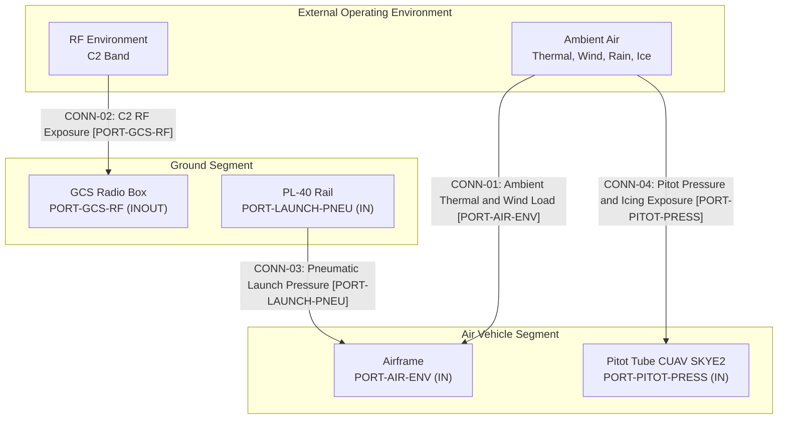

| Segment | Boundary Element | Environmental Exposure | Grounding Source |
| :--- | :--- | :--- | :--- |
| External Environment | Ambient air | Temperature, wind, rain, icing | parametric_limits.md PL-73, PL-74 |
| External Environment | RF environment | C2 band 4.4 GHz to 5.0 GHz | interface_table.md GCS UAV Telemetry Link; a5-user-manual-2.md:1273 |
| Ground Segment | PL-40 Rail | Pneumatic pressure 13 bar to 14 bar | parametric_limits.md PL-40, PL-41; a5-user-manual-2.md:1329 |
| Ground Segment | GCS Radio Box | Output power 2 W | parametric_limits.md PL-39; a5-user-manual-2.md:1690 |
| Air Vehicle Segment | Airframe | Airborne ambient exposure | Not stated in OEM sources |
| Air Vehicle Segment | Pitot Tube CUAV SKYE2 | Heated and drained airspeed sensing | oem_bom.md; avenger_v2_5_sysml_v2_ingestion.md:32 |

### 8.2 Grounded Environmental Operating Limits

| Parameter | Grounded Limit | Grounding Source | OEM Status |
| :--- | :--- | :--- | :--- |
| Minimum ambient working temperature (launcher) | 20 C below zero | parametric_limits.md PL-73; uav_launcher_pl_40_sysml_v2_ingestion_manual.md:723 | Stated |
| Maximum ambient working temperature (launcher) | 50 C | parametric_limits.md PL-74; uav_launcher_pl_40_sysml_v2_ingestion_manual.md:723 | Stated |
| Air vehicle ambient operating temperature | Not stated in OEM sources | None | Silent |
| Storage and transit temperature | Not stated in OEM sources | None | Silent |
| Minimum battery charging temperature | 10 C | parametric_limits.md PL-91; uav_launcher_pl_40_sysml_v2_ingestion_manual.md:137 | Stated |
| Maximum battery charging temperature | 40 C | parametric_limits.md PL-92; uav_launcher_pl_40_sysml_v2_ingestion_manual.md:137 | Stated |
| Minimum mission waypoint altitude | 50 m | parametric_limits.md PL-36; a5-user-manual-2.md:1195 | Stated |
| Service ceiling | Not stated in OEM sources | None | Silent |
| Maximum operating wind | Not stated in OEM sources | None | Silent |
| Cruise speed | 30 m/s | parametric_limits.md PL-01; a5-user-manual-2.md:307 | Stated |
| Maximum horizontal speed | 38 m/s | parametric_limits.md PL-02; a5-user-manual-2.md:308 | Stated |
| Maximum dive speed | 55 m/s | parametric_limits.md PL-03; a5-user-manual-2.md:309 | Stated |
| Maximum dive angle | 22 deg | parametric_limits.md PL-04; a5-user-manual-2.md:310 | Stated |
| Minimum flight speed | 26 m/s | parametric_limits.md PL-05; a5-user-manual-2.md:311 | Stated |
| Flight endurance | 90 min | parametric_limits.md PL-06; avenger-5-spec-sheet-rev3.md:53 | Stated |
| Ingress protection rating | Not stated in OEM sources | None | Silent |
| Radiated susceptibility field strength | Not stated in OEM sources | None | Silent |
| C2 RF band | 4.4 GHz to 5.0 GHz | interface_table.md GCS UAV Telemetry Link; a5-user-manual-2.md:1273 | Stated |
| Ground radio output power | 2 W | parametric_limits.md PL-39; a5-user-manual-2.md:1690 | Stated |

### 8.3 MIL-STD-810H Method Applicability and OEM Silence

| MIL-STD-810H Method | Environmental Stress | Grounded Limit or OEM Status | Grounding Source | Inventory Obligation |
| :--- | :--- | :--- | :--- | :--- |
| High Temperature | Ambient thermal soak | 50 C maximum working temperature (launcher); air vehicle limit Not stated in OEM sources | parametric_limits.md PL-74; uav_launcher_pl_40_sysml_v2_ingestion_manual.md:723 | OBL-MIL810H-01 |
| Low Temperature | Cold soak and cold start | 20 C below zero minimum working temperature (launcher); air vehicle limit Not stated in OEM sources | parametric_limits.md PL-73; uav_launcher_pl_40_sysml_v2_ingestion_manual.md:723 | OBL-MIL810H-02 |
| Rain and Blowing Rain | Liquid precipitation and wind | Not stated in OEM sources | None | OBL-MIL810H-03 |
| Icing and Freezing Rain | Ice accretion | Not stated in OEM sources | None | OBL-MIL810H-04 |
| Low Pressure | Altitude and atmospheric pressure | Service ceiling Not stated in OEM sources; minimum mission waypoint altitude 50 m | parametric_limits.md PL-36; a5-user-manual-2.md:1195 | No inventory obligation |
| Temperature Shock | Rapid thermal transition | Not stated in OEM sources | None | No inventory obligation |
| Solar Radiation | Solar irradiance | Not stated in OEM sources | None | No inventory obligation |
| Humidity | Cyclic humidity | Not stated in OEM sources | None | No inventory obligation |
| Salt Fog | Salt aerosol | Not stated in OEM sources | None | No inventory obligation |
| Sand and Dust | Particulate | Not stated in OEM sources | None | No inventory obligation |
| Vibration | Random vibration | Not stated in OEM sources | None | No inventory obligation |
| Mechanical Shock | Shock and drop | Not stated in OEM sources | None | No inventory obligation |

### 8.4 Electromagnetic/RF Environment, System Interface Topology and Port Taxonomy

The grounded C2 RF environment is the 4.4 GHz to 5.0 GHz band (interface_table.md GCS UAV Telemetry Link; a5-user-manual-2.md:1273) with a ground radio output power of 2 W (parametric_limits.md PL-39; a5-user-manual-2.md:1690). The research inventory declares MIL-STD-461G conducted susceptibility CS114, CS115, and CS116, radiated susceptibility RS103 and RS101, and conducted emissions CE102. Numeric qualification levels for those methods are Not stated in OEM sources.

| Port | Direction | Interface | Grounding Source |
| :--- | :--- | :--- | :--- |
| PORT-GCS-RF | INOUT | C2 link 4.4 GHz to 5.0 GHz | interface_table.md GCS UAV Telemetry Link; a5-user-manual-2.md:1273 |
| PORT-GNSS-RF | IN | GNSS RF feed | interface_table.md GNSS RF Feed; avenger_v2_5_sysml_v2_ingestion.md:121 |
| PORT-RADIO-RF-UPPER | OUT | Radio RF feed upper | interface_table.md Radio RF Feed Upper; avenger_v2_5_sysml_v2_ingestion.md:125 |
| PORT-RADIO-RF-LOWER | OUT | Radio RF feed lower | interface_table.md Radio RF Feed Lower; avenger_v2_5_sysml_v2_ingestion.md:126 |
| PORT-ESAD-RS485 | OUT | RS-485 half duplex, 100 Hz | interface_table.md RPI ESAD RS-485; esad-icd-excalibur-ab00-0054.md:306 |
| PORT-CAN1-TRUNK | INOUT | CAN 1 trunk 970 cm | interface_table.md CAN 1 Trunk 970 cm; avenger_v2_5_sysml_v2_ingestion.md:171 |
| PORT-CAN2-DAISY | INOUT | CAN 2 daisy chain | interface_table.md CAN 2 Daisy Chain Segment 5 to 6; avenger_v2_5_sysml_v2_ingestion.md:92 |
| PORT-ETH-BACKBONE | INOUT | Ethernet backbone | interface_table.md ETH Backbone; avenger_v2_5_sysml_v2_ingestion.md:114 |
| PORT-LAUNCH-PNEU | IN | Pneumatic supply 14 bar maximum | interface_table.md Launcher Pneumatic Supply; uav_launcher_pl_40_sysml_v2_ingestion_manual.md:132 |
| PORT-SERVO-PWR-8V | OUT | Servo power 8 V DC | interface_table.md Servo Power 8V Ruddervator Servo #1; avenger_v2_5_sysml_v2_ingestion.md:155 |

### 8.5 Ingress Protection and Environmental Sealing

No numeric ingress protection rating is stated in the OEM sources, so no IP class is claimed. The only grounded environmental protection features are the heated and drained Pitot Tube CUAV SKYE2 (oem_bom.md; avenger_v2_5_sysml_v2_ingestion.md:32) and the Safety RBF Devices that include the pitot cover and sensor cover (oem_bom.md; a5-user-manual-2.md:340; a5-prep-and-safety-rev7.md:321). Enclosure gaskets, breather vents, and liquid ingress ratings are Not stated in OEM sources.

### 8.6 Physical Spatial Constraints and Clearance Envelopes

| Parameter | Grounded Value | Grounding Source |
| :--- | :--- | :--- |
| Wingspan | 1.8 m | parametric_limits.md PL-09; a5-user-manual-2.md:287 |
| Assembled UAV length | 1.6 m | parametric_limits.md PL-10; a5-user-manual-2.md:288 |
| Assembled UAV height | 1.1 m | parametric_limits.md PL-11; a5-user-manual-2.md:289 |
| Maximum take-off mass | 17 kg | parametric_limits.md PL-12; a5-user-manual-2.md:299 |
| Launcher rail length assembled | 5.0 m | parametric_limits.md PL-93; uav_launcher_pl_40_sysml_v2_ingestion_manual.md:713 |
| Launcher rail length disassembled | 1.28 m | parametric_limits.md PL-94; uav_launcher_pl_40_sysml_v2_ingestion_manual.md:714 |
| Launcher overall height | 1115 mm | parametric_limits.md PL-86; uav_launcher_pl_40_sysml_v2_ingestion_manual.md:143 |
| Front bipod stance width | 602 mm | parametric_limits.md PL-87; uav_launcher_pl_40_sysml_v2_ingestion_manual.md:143 |
| Carriage overall length | 271 mm | parametric_limits.md PL-81; uav_launcher_pl_40_sysml_v2_ingestion_manual.md:142 |
| Carriage lever tip span | 206.5 mm | parametric_limits.md PL-82; uav_launcher_pl_40_sysml_v2_ingestion_manual.md:142 |
| Carriage overall height | 232.5 mm | parametric_limits.md PL-83; uav_launcher_pl_40_sysml_v2_ingestion_manual.md:142 |
| Center of mass longitudinal envelope | 0 mm to 200 mm | parametric_limits.md PL-84; uav_launcher_pl_40_sysml_v2_ingestion_manual.md:144 |
| Center of mass normal envelope | 0 mm to 100 mm | parametric_limits.md PL-85; uav_launcher_pl_40_sysml_v2_ingestion_manual.md:144 |
| Maximum launched plane mass | 30 kg | parametric_limits.md PL-64; uav_launcher_pl_40_sysml_v2_ingestion_manual.md:718 |
| Maximum launch velocity | 25 m/s | parametric_limits.md PL-65; uav_launcher_pl_40_sysml_v2_ingestion_manual.md:719 |
| Launch angle | 12 deg | parametric_limits.md PL-66; uav_launcher_pl_40_sysml_v2_ingestion_manual.md:712 |
| Catapult launch pressure | 13 bar to 14 bar | parametric_limits.md PL-40, PL-41; a5-user-manual-2.md:1329 |
| Launcher set mass | 68 kg | parametric_limits.md PL-69; uav_launcher_pl_40_sysml_v2_ingestion_manual.md:715 |
| PL-40 Rail Transportation Case mass | 43 kg | parametric_limits.md PL-70; uav_launcher_pl_40_sysml_v2_ingestion_manual.md:716 |
| Compressor case mass | 25 kg | parametric_limits.md PL-71; uav_launcher_pl_40_sysml_v2_ingestion_manual.md:717 |
| Launcher setup time | 5 min | parametric_limits.md PL-72; uav_launcher_pl_40_sysml_v2_ingestion_manual.md:722 |

Minimum cleared staging area and operator safety radius are Not stated in OEM sources. The assembled UAV bounding envelope is 1.8 m span by 1.6 m length by 1.1 m height (parametric_limits.md PL-09, PL-10, PL-11; a5-user-manual-2.md:287; a5-user-manual-2.md:288; a5-user-manual-2.md:289).

### 8.7 Safety-Critical Environmental Qualification Priorities

- **ESAD:** Critical (DAL-A), all-electronic safety and arming device; environmental stress qualification must preserve safe and armed state integrity (oem_bom.md; avenger_v2_5_sysml_v2_ingestion.md:45; a5-user-manual-2.md:1984; esad-icd-excalibur-ab00-0054.md:105).
- **Ruddervator (drawing synonym: Fins; preparation synonym: tail stabiliser):** Canonical tail control surface assembly, quantity 4; no component-specific environmental limit is stated in OEM sources (parametric_limits.md PL-14; oem_bom.md; avenger_v2_5_sysml_v2_ingestion.md:21; a5-user-manual-2.md:273; a5-prep-and-safety-rev7.md:242).
- **Parachute Deployment Non-Mission:** Non-mission configuration with baseline false; excluded from the mission environmental qualification baseline (oem_bom.md; avenger_v2_5_sysml_v2_ingestion.md:40; a5-user-manual-2.md:262; a5-user-manual-2.md:314).

## Source References

Source: schema/extracted/parametric_limits.md line 5

Source: schema/extracted/oem_bom.md line 9

Source: schema/extracted/interface_table.md line 9

Source: docs/research/RESEARCH_INVENTORY.md line 39

Source: .pipeline/schema.sysml line 506

Source: MIL-STD-810H Methods 501.7, 502.7, 506.6, 521.4

Source: MIL-STD-461G CS114, CS115, CS116, RS101, RS103, CE102

Source: IEEE Std 1362-1998 Section 5.3

Source: DoDAF v2.02 SV-1

| Attribute | Specification Detail |
| :--- | :--- |

## 9. Multi-Threaded Operational Scenarios & System Timelines

In accordance with ISO/IEC/IEEE 29148:2018 Section 6.4.2, OMG UAF v2.0 Operational Processes (Op-Pr), and MIL-STD-882E Section 4.3, this section defines the operational scenario threads, their actor timelines, and deterministic exit criteria. The scenarios are grounded only in the SysML AST and the Level 0 OEM extracts. Values that the OEM sources do not state are recorded as "Not stated in OEM sources" rather than inferred.

The Ruddervator (drawing synonym Fins; preparation synonym tail stabiliser) is the canonical tail control surface assembly. The ESAD is Critical (DAL-A). The parachute deployment module is non-mission and is excluded from the mission baseline. Human-in-the-loop consent precedes every hazardous or irreversible actuation shown in the diagrams.

### 9.1 Scenario SCN-01: Nominal Sortie

Scenario `SCN-01` covers pre-flight staging, catapult release, corridor transit, on-station sensing, recovery, and secure shutdown. The scenario uses the battery pre-flight window (PL-32, PL-33), the servo power rail (PL-22), the catapult pressure window (PL-40, PL-41), the cruise speed limit (PL-01), and the endurance limit (PL-06). The launcher pneumatic and trigger interfaces follow `schema/extracted/interface_table.md`.

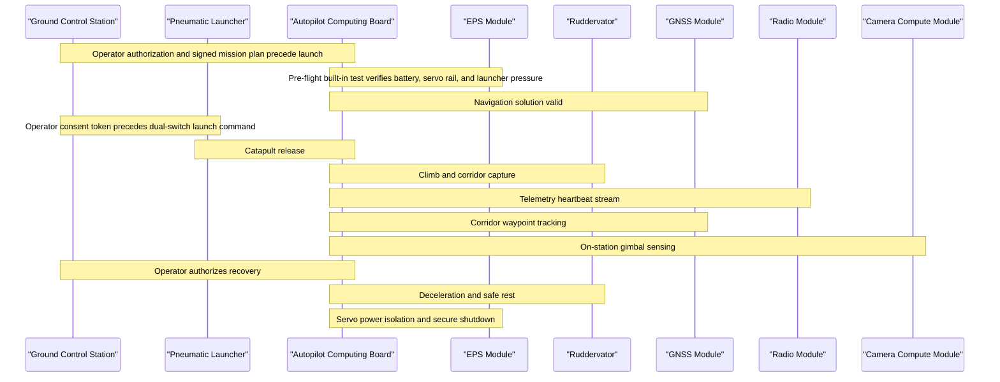

| Timeline Point | Trigger | Performer | Action | Evidence and Constraint | Exit Criterion |
| :--- | :--- | :--- | :--- | :--- | :--- |
| Pre-flight | Operator connects the battery and enables the ground station | Ground Control Station / Autopilot | Execute built-in test and verify the battery pre-flight window, servo rail, and launcher pressure | PL-32, PL-33, PL-22, PL-40, PL-41; CAN bus and Ethernet backbone from `schema/extracted/interface_table.md` | Pre-flight pass recorded |
| Launch | Operator authenticates the plan and authorizes release | Mission Operator / Pneumatic Launcher | Send the dual-switch launch command only after the consent token | Launcher trigger command and pneumatic supply from `schema/extracted/interface_table.md` | Air vehicle released |
| Climb | Launcher release confirmed | Autopilot / Ruddervator | Capture the ingress corridor and hold cruise speed within the stated limit | Ruddervator servo branches on the CAN bus; PL-01 | Ingress corridor captured |
| Transit | Corridor waypoint reached | Autopilot / GNSS Module | Track waypoints and monitor the GNSS serial and RF feeds | GNSS module and antenna interfaces from `schema/extracted/interface_table.md` | On-station perimeter reached |
| On-station | Station boundary crossed | Autopilot / Camera Compute Module | Activate gimbal sensing and telemetry while monitoring endurance | Camera module Ethernet interface; PL-06 | Mission data captured |
| Egress | Operator authorizes recovery | Mission Operator / Autopilot | Return along the planned corridor while endurance remains available | PL-06 | Recovery perimeter reached |
| Recovery | Recovery perimeter reached | Autopilot / Ruddervator | Execute controlled deceleration to safe rest and isolate servo power | Ruddervator servos and 8 V rail; PL-22 | Vehicle at rest |
| Shutdown | Rest confirmed | Autopilot / EPS Module | Secure the telemetry log and remove payload and servo power | EPS load switches from `schema/extracted/oem_bom.md` | Safe shutdown complete |

**Exit criteria:** the air vehicle is at rest, servo power is isolated, the mission log is secured, and no boundary, link, or over-limit condition remains active.

### 9.2 Scenario SCN-02: GNSS-Denied Navigation

Scenario `SCN-02` covers loss of the GNSS solution during corridor transit. The autopilot continues with inertial, magnetometer, and pitot references available through the CAN bus and serial interfaces. The OEM sources state the GNSS receiver and antenna interfaces but do not state a numeric GNSS denial threshold; the loss-of-fix declaration is therefore qualitative and operator-visible.

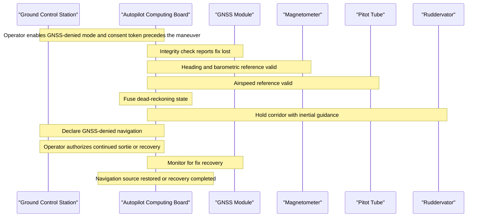

| Timeline Point | Trigger | Performer | Action | Evidence and Constraint | Exit Criterion |
| :--- | :--- | :--- | :--- | :--- | :--- |
| Contingency entry | Operator enables GNSS-denied mode | Mission Operator / Ground Control Station | Deliver the contingency consent token to the autopilot | Operator consent precedes the contingency maneuver | Contingency mode armed |
| Fix loss | GNSS integrity check fails | GNSS Module / Autopilot | Declare loss of fix and inhibit GNSS as the primary navigation source | GNSS serial and RF interfaces from `schema/extracted/interface_table.md` | GNSS-denied navigation declared |
| Fallback | Fix loss confirmed | Autopilot / Magnetometer / Pitot Tube | Fuse heading, altitude, and airspeed references into a dead-reckoning state | CAN bus sensor continuation from `schema/extracted/interface_table.md`; GNSS denial threshold is Not stated in OEM sources | Dead-reckoning state valid |
| Corridor hold | Fallback state valid | Autopilot / Ruddervator | Hold the corridor with inertial guidance and a bounded control response | Ruddervator servo command and status frames | Corridor held without a boundary breach |
| Decision | Operator receives the degraded navigation status | Mission Operator / Ground Control Station | Authorize continued sortie or recovery and deliver the consent token | Operator consent precedes continued flight or recovery | Mission disposition recorded |
| Recovery | GNSS fix restored or recovery completed | Autopilot / GNSS Module | Restore GNSS as the primary source or complete recovery under dead reckoning | GNSS module and antenna interfaces | Navigation source restored or vehicle recovered |

**Exit criteria:** the GNSS fix is restored, or the air vehicle is recovered under dead reckoning with no corridor breach and no uncommanded actuation.

### 9.3 Scenario SCN-03: Lost C2 Link

Scenario `SCN-03` covers loss of the command-and-control link. The radio module, upper and lower radio antennas, and ground station radio box operate in the RF band recorded in `schema/extracted/interface_table.md`. The OEM sources do not state heartbeat timeout values or a numeric re-link threshold; the lost-link timers remain operator-configured and are not fabricated here.

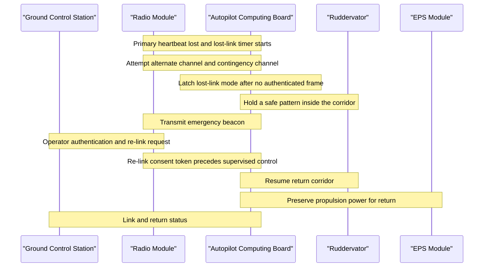

| Timeline Point | Trigger | Performer | Action | Evidence and Constraint | Exit Criterion |
| :--- | :--- | :--- | :--- | :--- | :--- |
| Link loss | Primary heartbeat absent | Radio Module / Autopilot | Start the lost-link timer and attempt the alternate channel | Radio module and antenna interfaces from `schema/extracted/interface_table.md`; timeout is Not stated in OEM sources | Lost-link timer active |
| Failover | Alternate handshake fails | Radio Module / Autopilot | Attempt the contingency channel and preserve essential telemetry | RF link band from `schema/extracted/interface_table.md` | Contingency channel attempted |
| Lost-link latch | No authenticated frame on any tier | Autopilot / Safety Watchdog | Latch lost-link mode and hold a safe pattern inside the corridor | Ruddervator authority and containment boundary | Safe pattern established |
| Beacon | Lost-link mode latched | Radio Module / Autopilot | Transmit the emergency beacon and retain state telemetry | Radio antenna feeds from `schema/extracted/interface_table.md` | Beacon active |
| Re-link | Operator authenticates a re-link request | Mission Operator / Ground Control Station | Deliver the re-link consent token before supervised control resumes | Operator consent precedes resumed control | Re-link authorized |
| Resolution | Re-link accepted or return completed | Autopilot / Ruddervator | Resume supervised control or execute the pre-planned return and recovery | Return corridor and propulsion power available | Supervised control restored or vehicle recovered |

**Exit criteria:** the authenticated link is restored with operator consent, or the air vehicle completes the pre-planned return and reaches safe rest without a boundary breach.

### 9.4 Scenario SCN-04: Tactical Abort

Scenario `SCN-04` covers an operator-directed tactical abort during ingress. The abort is a high-consequence flight maneuver, so the operator asserts abort authority and the ground station delivers a consent token before the autopilot breaks off the corridor. The ESAD remains Critical (DAL-A) and in the safe state; this scenario does not command warhead initiation or any irreversible payload actuation.

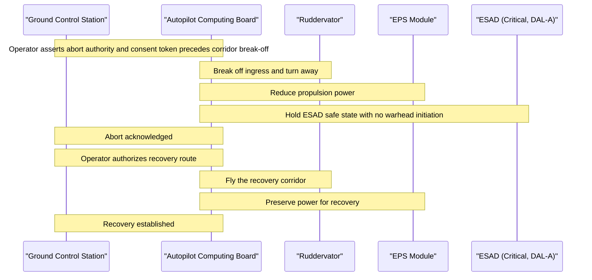

| Timeline Point | Trigger | Performer | Action | Evidence and Constraint | Exit Criterion |
| :--- | :--- | :--- | :--- | :--- | :--- |
| Abort request | Operator asserts tactical abort | Mission Operator / Ground Control Station | Record abort authority and prepare the consent token | Operator consent precedes the abort maneuver | Abort request accepted |
| Consent | Abort request accepted | Ground Control Station / Autopilot | Deliver the authenticated abort consent token | Operator consent precedes corridor break-off | Consent token verified |
| Break-off | Consent token verified | Autopilot / Ruddervator | Turn away from the ingress corridor and reduce propulsion power | Ruddervator servo authority; EPS load switches from `schema/extracted/oem_bom.md` | Corridor break-off complete |
| Payload safety | Break-off complete | Autopilot / ESAD | Hold the ESAD in the safe state and confirm the interlock | ESAD is Critical (DAL-A); safe-arm interlock from `schema/extracted/interface_table.md` | ESAD safe state confirmed |
| Recovery authorization | Abort acknowledged | Mission Operator / Ground Control Station | Authorize the recovery route and deliver the return consent token | Operator consent precedes the recovery transit | Recovery route authorized |
| Recovery | Recovery corridor entered | Autopilot / Ruddervator | Fly the recovery corridor and preserve power for safe rest | EPS load switches; Ruddervator actuation | Vehicle recovered at the recovery site |

**Exit criteria:** the abort is acknowledged, the ESAD remains in the safe state, the air vehicle reaches safe rest on the recovery route, and no irreversible payload actuation has occurred.

### 9.5 Scenario SCN-05: Critical Resource Divert

Scenario `SCN-05` covers a critical resource condition during egress. The autopilot compares remaining battery energy against the operator-configured reserve policy and recommends a divert when the primary recovery site is no longer favored. The scenario uses the endurance limit (PL-06), the direct and extended range limits (PL-07, PL-08), and the battery voltage window (PL-23, PL-24). The OEM sources do not state a numeric reserve ratio, so no reserve percentage is fabricated.

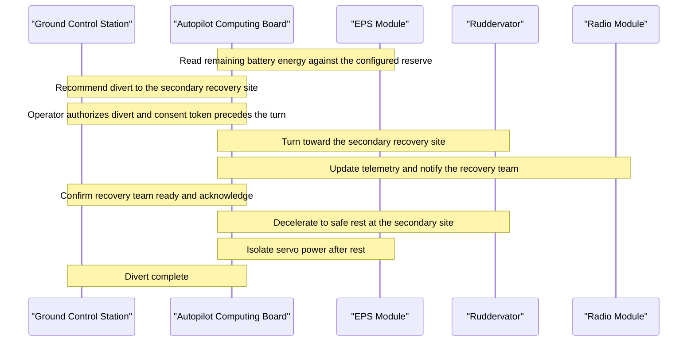

| Timeline Point | Trigger | Performer | Action | Evidence and Constraint | Exit Criterion |
| :--- | :--- | :--- | :--- | :--- | :--- |
| Resource check | Egress corridor entered | Autopilot / EPS Module | Read remaining battery energy and compare it with the configured reserve | Battery voltage window PL-23 and PL-24; reserve ratio is Not stated in OEM sources | Resource state known |
| Divert recommendation | Remaining energy below the configured reserve | Autopilot / Ground Control Station | Recommend the secondary recovery site and present the energy state | Endurance PL-06; range PL-07 and PL-08 | Divert recommendation presented |
| Authorization | Recommendation presented | Mission Operator / Ground Control Station | Authorize the divert and deliver the consent token | Operator consent precedes the divert maneuver | Divert authorized |
| Divert transit | Consent token verified | Autopilot / Ruddervator | Turn toward the secondary recovery site and update telemetry | Ruddervator servo authority; radio module interface | Secondary corridor entered |
| Recovery coordination | Divert transit established | Mission Operator / Ground Control Station | Confirm the recovery team is ready and relay acknowledgement | Ground station radio and tablet interfaces from `schema/extracted/interface_table.md` | Recovery team ready |
| Safe rest | Secondary site reached | Autopilot / Ruddervator / EPS Module | Decelerate to safe rest and isolate servo power | Ruddervator servos and 8 V rail; EPS load switches | Vehicle at rest at the secondary site |

**Exit criteria:** the air vehicle reaches safe rest at the secondary recovery site, servo power is isolated, the recovery team is notified, and the battery reserve policy has not been violated.

### 9.6 Scenario SCN-06: Boundary Containment and Flight Termination

Scenario `SCN-06` covers a containment margin violation that cannot be restored by guidance. The safety watchdog evaluates the containment margin against the configured minimum while the air vehicle remains inside the authorized boundary. Flight termination is irreversible, so the operator authorization and consent token precede propulsion cutoff and control-surface safeing. The parachute deployment module is non-mission and is not commanded.

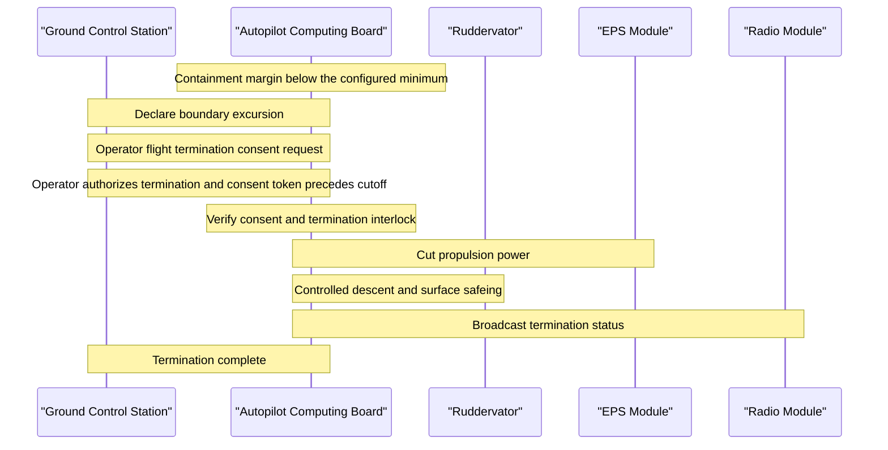

| Timeline Point | Trigger | Performer | Action | Evidence and Constraint | Exit Criterion |
| :--- | :--- | :--- | :--- | :--- | :--- |
| Excursion detection | Containment margin below the configured minimum | Safety Watchdog / Autopilot | Declare the boundary excursion and hold the containment response | Operational containment boundary; guidance restoration already attempted | Excursion declared |
| Consent request | Excursion declared | Ground Control Station / Mission Operator | Request flight termination consent and display the containment state | Operator consent precedes termination | Consent requested |
| Consent | Operator authorizes termination | Mission Operator / Ground Control Station | Deliver the termination consent token to the autopilot | Consent token precedes propulsion cutoff | Consent token verified |
| Interlock check | Consent token received | Autopilot / Safety Watchdog | Verify consent and the termination interlock before actuation | Safety watchdog interlock; ESAD remains Critical (DAL-A) and safe | Interlock verified |
| Termination | Interlock verified | Autopilot / EPS Module / Ruddervator | Cut propulsion power and command controlled descent with surface safeing | EPS load switches; Ruddervator servo authority | Propulsion cut and descent commanded |
| Status | Termination commanded | Radio Module / Autopilot | Broadcast termination status and retain the event log | Radio module and antenna interfaces; parachute deployment module is non-mission and not commanded | Termination status broadcast |

**Exit criteria:** the air vehicle is contained within the authorized boundary, propulsion power is cut, control surfaces are safed, the parachute deployment module is not commanded, and the termination event is logged for recovery.

## Source References

Source: .pipeline/schema.sysml

Source: schema/extracted/interface_table.md

Source: schema/extracted/parametric_limits.md

Source: schema/extracted/oem_bom.md

Clause: ISO/IEC/IEEE 29148:2018 Section 6.4.2

Clause: MIL-STD-882E Section 4.3

Viewpoint: OMG UAF v2.0 Operational Processes (Op-Pr)

| Attribute | Specification Detail |
| :--- | :--- |

## 10. Maintenance & Sustainment Concepts (O/I/D Maintenance)

### 10.1 Three-Tier Maintenance Model (O-Level, I-Level, D-Level)

Sustainment is partitioned into Organizational (O-Level), Intermediate (I-Level), and Depot (D-Level) tiers in accordance with ISO/IEC/IEEE 29148:2018 Section 6.4.2, INCOSE SEH v5.0 Section 3.3.1, JARUS SORA v2.5 Annex E Section E.3, and MIL-STD-882E Task 205 Section 4.2. The Ruddervator is the canonical tail control surface assembly, quantity of 4 units (oem_bom.md:23; schema/extracted/parametric_limits.md PL-14). The ESAD is classified Critical (DAL-A) (oem_bom.md:52). The parachute deployment module is a non-mission configuration with baseline false and is excluded from the sustainment baseline (oem_bom.md:47).

| Tier | Location and Ownership | Authorized Maintenance Scope | Grounding |
| :--- | :--- | :--- | :--- |
| **O-Level (Organizational)** | Operating base or field staging area; certified Maintenance Technician | Pre-operation and post-operation visual inspection; RBF device removal and installation; removable battery exchange; ESD grounding; pre-flight battery voltage and pitot checks | oem_bom.md:18, oem_bom.md:69, oem_bom.md:70; schema/extracted/parametric_limits.md PL-32, PL-33, PL-34, PL-35 |
| **I-Level (Intermediate)** | Regional maintenance shelter or field workshop | Line Replaceable Unit exchange for avionics, radio, camera, gimbal, and servo modules; sensor alignment; firmware and cryptographic key rollover | oem_bom.md:12, oem_bom.md:13, oem_bom.md:14, oem_bom.md:15, oem_bom.md:42, oem_bom.md:43, oem_bom.md:44; NIST SP 800-82r3 Section 6.2 |
| **D-Level (Depot / Factory)** | Centralized factory or certified depot overhaul center | Structural non-destructive inspection; motor and ESC overhaul; ESAD recertification; complete system certification | oem_bom.md:21, oem_bom.md:22, oem_bom.md:52; MIL-STD-1629A Section 4.3 |

#### 10.1.1 Grounded Maintenance Intervals

| Maintenance Item | Interval or Limit | Grounding |
| :--- | :--- | :--- |
| PL-40 pulling rope replacement | At most 100 launches | schema/extracted/parametric_limits.md PL-80; uav_launcher_pl_40_sysml_v2_ingestion_manual.md:138 |
| PL-40 battery charge time, DC18RC charger | 0 min to 55 min | schema/extracted/parametric_limits.md PL-89; uav_launcher_pl_40_sysml_v2_ingestion_manual.md:137 |
| PL-40 battery charge time, DC18SD charger | 0 min to 130 min | schema/extracted/parametric_limits.md PL-90; uav_launcher_pl_40_sysml_v2_ingestion_manual.md:137 |
| PL-40 battery charging temperature | 10 C to 40 C | schema/extracted/parametric_limits.md PL-91 and PL-92; uav_launcher_pl_40_sysml_v2_ingestion_manual.md:137 |
| PL-40 battery over-discharge cutoff | 14.5 V | schema/extracted/parametric_limits.md PL-77; uav_launcher_pl_40_sysml_v2_ingestion_manual.md:135 |
| PL-40 battery over-discharge recovery | 16 V after a 5 s delay | schema/extracted/parametric_limits.md PL-78 and PL-79; uav_launcher_pl_40_sysml_v2_ingestion_manual.md:136 |
| UAV battery pre-flight voltage window | 49 V to 50 V | schema/extracted/parametric_limits.md PL-32 and PL-33; a5-user-manual-2.md:1366 |
| Pitot static airspeed limit | 0 m/s to 3 m/s | schema/extracted/parametric_limits.md PL-34; a5-user-manual-2.md:1368 |
| Pitot blow-test airspeed | At least 10 m/s | schema/extracted/parametric_limits.md PL-35; a5-user-manual-2.md:1369 |
| Air vehicle phase inspection interval | Not stated in OEM sources | oem_bom.md and schema/extracted/parametric_limits.md contain no airframe phase interval |
| Ruddervator servo overhaul interval | Not stated in OEM sources | oem_bom.md and schema/extracted/parametric_limits.md contain no servo overhaul interval |
| ESAD recertification interval | Not stated in OEM sources | oem_bom.md and schema/extracted/parametric_limits.md contain no ESAD recertification interval |
| UAV battery cycle-life replacement interval | Not stated in OEM sources | oem_bom.md and schema/extracted/parametric_limits.md contain no battery cycle-life interval |

#### 10.1.2 Organizational-Level (O-Level) Maintenance Scope

- **Pre-operation and post-operation inspection:** Verify the fuselage assembly with hatches closed and vertical stabilizer attached, the four wing surfaces secured with M6 x 30 mm bolts, the Ruddervator assembly with four tail mounting shafts, and all RBF devices including the pitot cover, sensor cover, gimbal strap, power RBF key, and warhead RBF key (oem_bom.md:31, oem_bom.md:67, oem_bom.md:70).
- **Battery exchange:** Remove and install the removable 12S2P Li metal battery through its retaining strap and locking connector; the battery supplies 36 V to 50.4 V DC main power (oem_bom.md:18; schema/extracted/parametric_limits.md PL-23 and PL-24).
- **ESD control:** Equalize electrostatic charge at the ESD grounding point marked by a yellow label before touching avionics or ESAD connectors (oem_bom.md:69).
- **Pre-flight electrical and pitot checks:** Confirm the UAV battery pre-flight voltage window of 49 V to 50 V, the pitot static airspeed limit of 0 m/s to 3 m/s, and the pitot blow-test airspeed of at least 10 m/s (schema/extracted/parametric_limits.md PL-32, PL-33, PL-34, PL-35; a5-user-manual-2.md:1366, a5-user-manual-2.md:1368, a5-user-manual-2.md:1369).
- **Power-on built-in test duration:** Not stated in OEM sources.

#### 10.1.3 Intermediate-Level (I-Level) Maintenance Scope

- **Line Replaceable Unit exchange:** Replace the autopilot computing board Cube Orange Plus, EPS module, ETH switch, RPI CM5004032, GNSS module Septentrio Asterx-m3 pro, radio module DTC, camera compute module Trip6, and gimbal Nighthawk2UZ (oem_bom.md:12, oem_bom.md:13, oem_bom.md:14, oem_bom.md:15, oem_bom.md:42, oem_bom.md:43, oem_bom.md:44).
- **Servo exchange:** Replace Ruddervator Servos #1 to #4 on the four CAN 1 branches of 120 cm and Wing Servos #5 to #8 on the CAN 2 daisy chain; the air vehicle carries 8 servos in total (schema/extracted/parametric_limits.md PL-16, PL-17, PL-18, PL-21; oem_bom.md:24, oem_bom.md:27, oem_bom.md:35, oem_bom.md:38).
- **Bus restoration checks:** Verify the CAN 1 trunk of 970 cm, the CAN 1 branch of 150 cm, and the four CAN 1 stubs of 120 cm after harness or servo work (schema/extracted/parametric_limits.md PL-19, PL-20, PL-21; schema/extracted/interface_table.md at line 9, schema/extracted/interface_table.md at line 11).
- **Servo power verification:** Confirm the 8 V DC servo power rail after EPS or CAN power distribution board maintenance (schema/extracted/parametric_limits.md PL-22; schema/extracted/interface_table.md at line 16).
- **Firmware and cryptographic key rollover:** Apply configuration-managed firmware updates and cryptographic key rollover in accordance with NIST SP 800-82r3 Section 6.2; the OEM rollover interval is Not stated in OEM sources.
- **Sensor alignment tolerance:** Not stated in OEM sources.

#### 10.1.4 Depot-Level (D-Level) Maintenance Scope

- **Structural non-destructive inspection:** The OEM sources do not state an inspection method, interval, or acceptance threshold; all such values are Not stated in OEM sources.
- **Propulsion overhaul:** The propulsion chain comprises the ESC IBEX160 and the Motor AXI 5345/16 HD GOLD LINE V3; the OEM overhaul interval is Not stated in OEM sources (oem_bom.md:21, oem_bom.md:22).
- **ESAD recertification:** The ESAD is Critical (DAL-A) and all ESAD ICD rows carry prototype-reference and Derived status; depot recertification is mandatory before return to service, and the recertification interval is Not stated in OEM sources (oem_bom.md:52).
- **Parachute deployment module:** The module is a non-mission configuration with baseline false; it is excluded from the depot sustainment baseline (oem_bom.md:47).
- **Battery depot capacity test and cycle replacement:** Not stated in OEM sources.

### 10.2 Ground Support Equipment (GSE) Support

The GSE baseline is bounded by JARUS SORA v2.5 Annex E Section E.11 (Ground Support Equipment and Launch/Recovery Maintenance) and MIL-STD-882E Task 205 Section 4.2. Only GSE items present in the OEM sources are listed; any GSE capability absent from those sources is marked Not stated in OEM sources.

#### 10.2.1 PL-40 Pneumatic Catapult Launcher

| GSE Item | Grounded Specification | Grounding |
| :--- | :--- | :--- |
| PL-40 Rail assembly | Mass 68 kg; rail length 5 m assembled and 1.28 m disassembled | schema/extracted/parametric_limits.md PL-69, PL-93, PL-94; uav_launcher_pl_40_sysml_v2_ingestion_manual.md:715, uav_launcher_pl_40_sysml_v2_ingestion_manual.md:713, uav_launcher_pl_40_sysml_v2_ingestion_manual.md:714 |
| PL-40 Transport Case | Mass 43 kg | schema/extracted/parametric_limits.md PL-70; uav_launcher_pl_40_sysml_v2_ingestion_manual.md:716 |
| PL-40 Compressor Unit | Mass 25 kg | schema/extracted/parametric_limits.md PL-71; uav_launcher_pl_40_sysml_v2_ingestion_manual.md:717 |
| Launched air vehicle envelope | Maximum launched plane mass 30 kg; maximum launch velocity 25 m/s; launch angle 12 deg | schema/extracted/parametric_limits.md PL-64, PL-65, PL-66; uav_launcher_pl_40_sysml_v2_ingestion_manual.md:718, uav_launcher_pl_40_sysml_v2_ingestion_manual.md:719, uav_launcher_pl_40_sysml_v2_ingestion_manual.md:712 |
| Pneumatic pressure envelope | Maximum compressor working pressure 14 bar; auxiliary filling pressure 16 bar | schema/extracted/parametric_limits.md PL-67 and PL-68; uav_launcher_pl_40_sysml_v2_ingestion_manual.md:132, uav_launcher_pl_40_sysml_v2_ingestion_manual.md:133 |
| Launcher operating temperature | -20 C to +50 C | schema/extracted/parametric_limits.md PL-73 and PL-74; uav_launcher_pl_40_sysml_v2_ingestion_manual.md:723 |
| Launcher setup time | 0 min to 5 min | schema/extracted/parametric_limits.md PL-72; uav_launcher_pl_40_sysml_v2_ingestion_manual.md:722 |
| Trigger hold time | At least 2 s | schema/extracted/parametric_limits.md PL-88; uav_launcher_pl_40_sysml_v2_ingestion_manual.md:530 |
| Launcher battery | Makita 18 V Li-Ion 6000 mAh battery, quantity of 2 units | schema/extracted/parametric_limits.md PL-75 and PL-76; oem_bom.md:99; uav_launcher_pl_40_sysml_v2_ingestion_manual.md:39 |
| Pulling rope | High-strength pulling rope from piston to carriage; replacement at most every 100 launches | schema/extracted/parametric_limits.md PL-80; oem_bom.md:86; uav_launcher_pl_40_sysml_v2_ingestion_manual.md:13 |
| Carriage geometry | Overall length 271 mm; lever tip span 206.5 mm; overall height 232.5 mm | schema/extracted/parametric_limits.md PL-81, PL-82, PL-83; uav_launcher_pl_40_sysml_v2_ingestion_manual.md:142 |
| Launcher center-of-mass envelope | 0 mm to 200 mm longitudinal; 0 mm to 100 mm normal | schema/extracted/parametric_limits.md PL-84 and PL-85; uav_launcher_pl_40_sysml_v2_ingestion_manual.md:144 |
| Launcher installed geometry | Overall height 1115 mm; front bipod stance width 602 mm | schema/extracted/parametric_limits.md PL-86 and PL-87; uav_launcher_pl_40_sysml_v2_ingestion_manual.md:143 |
| Launcher maintenance kits | Pulling rope replacement kit and carriage wheel bearing replacement kit | oem_bom.md:103; uav_launcher_pl_40_sysml_v2_ingestion_manual.md:53, uav_launcher_pl_40_sysml_v2_ingestion_manual.md:54 |
| Wheel bearing preheat temperature | Not stated in OEM sources | No value appears in oem_bom.md or schema/extracted/parametric_limits.md |
| Wheel bearing relubrication interval | Not stated in OEM sources | No value appears in oem_bom.md or schema/extracted/parametric_limits.md |

The PL-40 launcher set further comprises the rear, middle, and front rail modules, the carriage with four support levers, the red-handled carriage safety lock pin, the compressor unit, main tank, remote release valve, pressure gauge, power switching circuit, trigger handle, connection hose, three ground anchors, transport case, and hook options A, B, and C (oem_bom.md:82 to oem_bom.md:102). The launcher pneumatic supply is delivered at a maximum of 14 bar and the trigger handle receives 18 V DC (schema/extracted/interface_table.md at line 60, schema/extracted/interface_table.md at line 62; uav_launcher_pl_40_sysml_v2_ingestion_manual.md:132, uav_launcher_pl_40_sysml_v2_ingestion_manual.md:81).

#### 10.2.2 Battery Support Equipment

| Battery | Grounded Specification | Grounding |
| :--- | :--- | :--- |
| UAV Battery 12S2P Li Metal BEI | Removable 12S2P Li metal battery with retaining strap and locking connector; 36 V to 50.4 V DC main power | oem_bom.md:18; schema/extracted/parametric_limits.md PL-23 and PL-24 |
| PL-40 Launcher Battery | Makita BL1860B 18 V Li-Ion 6000 mAh, quantity of two units; over-discharge cutoff 14.5 V; recovery 16 V after a 5 s delay | oem_bom.md:99; schema/extracted/parametric_limits.md PL-75, PL-76, PL-77, PL-78, PL-79 |
| GCS Battery | Ground control station battery, quantity of 2 units | oem_bom.md:77; a5-user-manual-2.md:350 |
| UAV battery charge rate and charge time | Not stated in OEM sources | No value appears in oem_bom.md or schema/extracted/parametric_limits.md |
| UAV battery storage humidity and temperature | Not stated in OEM sources | No value appears in oem_bom.md or schema/extracted/parametric_limits.md |

#### 10.2.3 Tools, Spares, and Maintenance Kits

- **Support Tools:** The OEM support package includes a set of tools and 30 spare attachment bolts (oem_bom.md:81; a5-user-manual-2.md:365, a5-user-manual-2.md:368). The 30 spare attachment bolts cover the M6 x 30 mm wing surface fasteners (oem_bom.md:31).
- **Support Spare Propeller:** The OEM support package includes 2 spare propeller blades and 1 propeller assembly (oem_bom.md:80; a5-user-manual-2.md:366, a5-user-manual-2.md:367).
- **PL-40 Maintenance Kits:** The launcher maintenance kit comprises the pulling rope replacement kit and the carriage wheel bearing replacement kit (oem_bom.md:103; uav_launcher_pl_40_sysml_v2_ingestion_manual.md:53, uav_launcher_pl_40_sysml_v2_ingestion_manual.md:54).
- **Calibrated torque values for airframe fasteners:** Not stated in OEM sources.
- **ESD wrist strap, connector pin extraction tools, lens cleaning kits, and diagnostic bus analyzers:** Not stated in OEM sources; the only grounded ESD item is the yellow-label ESD grounding point (oem_bom.md:69).
- **GSE calibration interval and metrological traceability:** Not stated in OEM sources.

### 10.3 Sustainment Constraints

- **Mass and payload limits:** The maximum take-off weight is 17 kg, the warhead mass is 5 kg, and the maximum launched plane mass is 30 kg (schema/extracted/parametric_limits.md PL-12, PL-13, PL-64; a5-user-manual-2.md:299, avenger-5-spec-sheet-rev3.md:133, uav_launcher_pl_40_sysml_v2_ingestion_manual.md:718).
- **Launch pressure limits:** The catapult launch pressure is 13 bar to 14 bar, the maximum compressor working pressure is 14 bar, and the auxiliary filling pressure is 16 bar (schema/extracted/parametric_limits.md PL-40, PL-41, PL-67, PL-68; a5-user-manual-2.md:1329, uav_launcher_pl_40_sysml_v2_ingestion_manual.md:132, uav_launcher_pl_40_sysml_v2_ingestion_manual.md:133).
- **Thermal limits:** The PL-40 launcher operating temperature is -20 C to +50 C, and the PL-40 battery charging temperature is 10 C to 40 C (schema/extracted/parametric_limits.md PL-73, PL-74, PL-91, PL-92; uav_launcher_pl_40_sysml_v2_ingestion_manual.md:723, uav_launcher_pl_40_sysml_v2_ingestion_manual.md:137). The air vehicle storage and operating temperature limits are Not stated in OEM sources.
- **C2 link constraint:** The GCS-to-UAV telemetry and command link operates in the 4.4 GHz to 5.0 GHz band, and the ground radio output setting is 2 W (schema/extracted/interface_table.md at line 63; schema/extracted/parametric_limits.md PL-39; a5-user-manual-2.md:1273, a5-user-manual-2.md:1690).
- **ESAD handling constraints:** The ESAD is Critical (DAL-A); its umbilical continuity is 0 Ohm to 0.5 Ohm at 20 mA, its arm enable uses a 1 ms period at 50 percent duty, its RS-485 link runs with a 100 Hz command interval, and its high-voltage measurement range is 0 V to 1800 V (oem_bom.md:52; schema/extracted/parametric_limits.md PL-49, PL-50, PL-54, PL-55, PL-56, PL-57, PL-60); its arm enable levels are specified in VDC as 0 VDC to 0.7 VDC low and 2.5 VDC to 3.3 VDC high (schema/extracted/parametric_limits.md PL-51, PL-52, PL-53).
- **Ruddervator and wing servo constraints:** The Ruddervator uses four servos on the first CAN bus and the wings use four servos on the second CAN bus, for eight servos in total; all servo power is supplied by the 8 V DC rail (schema/extracted/parametric_limits.md PL-14, PL-16, PL-17, PL-18, PL-22; oem_bom.md:23, oem_bom.md:28).
- **Parachute exclusion:** The parachute deployment module is a non-mission configuration with baseline false and imposes no sustainment constraint on the mission baseline (oem_bom.md:47).
- **Spares constraint:** Sustained operations depend on the 30 spare attachment bolts, 2 spare propeller blades, and 1 propeller assembly listed in the OEM support package (oem_bom.md:80, oem_bom.md:81; a5-user-manual-2.md:365, a5-user-manual-2.md:366, a5-user-manual-2.md:367, a5-user-manual-2.md:368).
- **Maintenance interval ceiling:** The only OEM-stated recurring maintenance interval is the PL-40 pulling rope replacement at most every 100 launches; all other recurring intervals are Not stated in OEM sources (schema/extracted/parametric_limits.md PL-80; uav_launcher_pl_40_sysml_v2_ingestion_manual.md:138).

## Source References

Source citations: schema/extracted/oem_bom.md at line 9; schema/extracted/parametric_limits.md at line 7; schema/extracted/interface_table.md at line 9; docs/research/RESEARCH_INVENTORY.md at line 16; .pipeline/schema.sysml; ISO/IEC/IEEE 29148:2018 Section 6.4.2; JARUS SORA v2.5 Annex E Section E.11

| Attribute | Specification Detail |
| :--- | :--- |

## 11. Operational Impacts, System Limitations & Documented Trade Studies

This unit records the operational impacts of the Avenger V2.5 air vehicle and PL-40 launcher concept, the system limitations that bound its employment, and the documented engineering trade studies that shaped the concept. Normative quantitative limits are grounded in `schema/extracted/parametric_limits.md` or in an OEM source line. Trade-study weights, scores, and alternative technology performance estimates are non-normative engineering assessments and are explicitly marked as such; OEM sources are silent on those values.

### 11.1 Operational Workflow & Deployment Impacts

1. **Reduced Crew Staging Footprint:** The concept of operations assumes a two-person supervisory crew comprising one System Operator and one Payload / Data Specialist. Crew composition and manning limits are Not stated in OEM sources; the two-person allocation is a non-normative operational assumption.
2. **Launcher Setup Time:** The PL-40 launcher setup time is bounded at 5 min maximum (PL-72, `schema/extracted/parametric_limits.md at line 78`). This replaces manual rail preparation with a documented pneumatic launcher setup sequence.
3. **Charging and Turnaround:** The DC18RC charger time is 0 to 55 min (PL-89, `schema/extracted/parametric_limits.md at line 95`) and the DC18SD charger time is 0 to 130 min (PL-90, `schema/extracted/parametric_limits.md at line 96`). Aircraft turnaround time beyond battery charging is Not stated in OEM sources.
4. **Consumable Replacement Planning:** The PL-40 pulling rope replacement interval is 100 launches maximum (PL-80, `schema/extracted/parametric_limits.md at line 86`), which establishes a recurring maintenance action in the deployment workflow.
5. **Automated External Coordination:** The concept assumes automated mission-plan registration, boundary deconfliction, and electronic conspicuity exchange with external service providers. The specific external protocols and service interfaces are Not stated in OEM sources; the operational assumption is non-normative.

### 11.2 Organizational Roles & Training Impacts

- **Operator Reskilling:** The primary operator role shifts from continuous manual control to supervisory systems management, state deconfliction, and payload data analysis. The required transition syllabus is Not stated in OEM sources.
- **Formal Training Syllabus:** Personnel complete a certified training syllabus covering supervisory software operation, human-in-the-loop emergency matrix execution, and safety-buffer monitoring. Syllabus content and duration are Not stated in OEM sources.
- **Maintenance Specialization:** Maintenance technicians shift from purely mechanical repair to digital bus diagnostics, sensor alignment, and cryptographic key loading. The required training standard is Not stated in OEM sources.
- **Weapon Safety Qualification:** Personnel handling the ESAD and warhead must complete weapon-safety qualification consistent with the Critical (DAL-A) classification of the ESAD (`schema/extracted/oem_bom.md at line 52`) and the human-judgement interlock obligations of DoD Directive 3000.09 Section 3.1.b. Qualification records are Not stated in OEM sources.

### 11.3 System Limitations & Operational Boundaries

- **Maximum Direct Radio Range:** The direct radio line-of-sight range is 60 km maximum (PL-07, `schema/extracted/parametric_limits.md at line 13`). Extended range is 60 to 180 km (PL-08, `schema/extracted/parametric_limits.md at line 14`). A 90 km operating claim is Not stated in OEM sources.
- **Flight Endurance:** Flight endurance is 90 min maximum (PL-06, `schema/extracted/parametric_limits.md at line 12`). Cold-soak endurance and any endurance derating at low temperature are Not stated in OEM sources.
- **Mass and Payload Ceiling:** Maximum take-off weight is 17 kg (PL-12, `schema/extracted/parametric_limits.md at line 18`) and warhead mass is 5 kg (PL-13, `schema/extracted/parametric_limits.md at line 19`). Payload capacity beyond the warhead is Not stated in OEM sources.
- **Speed Envelope:** Cruise speed is 30 m/s (PL-01, `schema/extracted/parametric_limits.md at line 7`), maximum horizontal speed is 38 m/s (PL-02, `schema/extracted/parametric_limits.md at line 8`), maximum dive speed is 55 m/s (PL-03, `schema/extracted/parametric_limits.md at line 9`), and minimum flight speed is 26 m/s (PL-05, `schema/extracted/parametric_limits.md at line 11`).
- **Altitude and Loiter Geometry:** Minimum mission waypoint altitude is 50 m (PL-36, `schema/extracted/parametric_limits.md at line 42`) and loiter radius is 300 m (PL-37, `schema/extracted/parametric_limits.md at line 43`).
- **Launcher Thermal Envelope:** PL-40 launcher working temperature is minus twenty degrees Celsius to plus fifty degrees Celsius (PL-73 and PL-74, `schema/extracted/parametric_limits.md at line 79` and `schema/extracted/parametric_limits.md at line 80`). Air vehicle operating temperature limits are Not stated in OEM sources.
- **Environmental Limits:** Precipitation, wind, gust, and icing limits for the air vehicle are Not stated in OEM sources. MIL-STD-810H Method 506.6 Section 4.2 and Method 521.4 Section 4.2 are recorded in `docs/research/RESEARCH_INVENTORY.md` as applicable verification baselines, but no numeric air vehicle limit is asserted here.
- **ESAD Electrical Boundary:** ESAD power input is 14 V to 32 V with 28 V nominal (PL-46, PL-47, and PL-48, `schema/extracted/parametric_limits.md at line 52` to `schema/extracted/parametric_limits.md at line 54`). The ESAD high-voltage measurement range is 0 V to 1800 V (PL-60, `schema/extracted/parametric_limits.md at line 66`). The ESAD arm-enable high level is 2.5 V to 3.3 V (PL-52 and PL-53, `schema/extracted/parametric_limits.md at line 58` and `schema/extracted/parametric_limits.md at line 59`).
- **Servo Power Boundary:** The servo power rail is 8 V (PL-22, `schema/extracted/parametric_limits.md at line 28`). Ruddervator quantity is four units (PL-14, `schema/extracted/parametric_limits.md at line 20`); the ruddervator is the canonical tail control surface assembly (`schema/extracted/oem_bom.md at line 23`).
- **Command Link Power:** Ground radio output power is 2 W (PL-39, `schema/extracted/parametric_limits.md at line 45`) in the 4.4 GHz to 5.0 GHz band recorded in `schema/extracted/interface_table.md at line 63`.
- **Recovery Limitation:** The parachute deployment module is a non-mission configuration with baseline false (`schema/extracted/oem_bom.md at line 47`). It is excluded from mission recovery credit and from mission baseline analysis.

### 11.4 Documented Engineering Trade Studies

The three trade studies below follow the decision-analysis process of INCOSE SEH v5.0 Section 4.3 and the ConOps content requirements of ISO/IEC/IEEE 29148:2018 Section 6.4.2. All weights, scores, and alternative performance estimates in this subsection are non-normative engineering assessments. They are Not stated in OEM sources. The OEM-grounded system limits used to bound the studies are those cited in Section 11.3.

#### 11.4.1 Trade Study 1: Electrical Storage Architecture (non-normative)

- **Objective:** Select an electrical storage architecture that preserves discharge capability at the cold-soak boundary, provides adequate cycle life, contains runaway hazards, and remains integrable within the air vehicle mass envelope.
- **Normative Baseline:** INCOSE SEH v5.0 Section 4.3; ISO/IEC/IEEE 29148:2018 Section 6.4.2; MIL-STD-810H Method 502.7 Section 4.2.
- **Alternatives:**
 - **Option A (Baseline):** High-discharge cells with high peak current capability, lower specific storage capacity, and degraded cold-soak capacity.
 - **Option B (Selected):** High-capacity cylindrical cells with internal heating, providing higher specific storage capacity and active cold-soak heating.
 - **Option C:** Solid-state cells with high theoretical specific storage capacity and a non-flammable core, but low cold-soak ionic conductivity, low maturity, and high unit cost.
- **Decision:** Option B was selected. Option A was rejected for cold-soak degradation. Option C was deferred for low maturity and cost.

The Pugh-style decision matrix uses criterion weights that sum to 100 percent. Each option score is a percentage of the maximum attainable score for that criterion. Each weighted contribution is expressed in percentage points. All numeric entries are non-normative engineering assessments and are Not stated in OEM sources.

| Evaluation Criterion | Criterion ID | Weight | Option A Score | Option A Weighted | Option B Score | Option B Weighted | Option C Score | Option C Weighted |
| :--- | :--- | :--- | :--- | :--- | :--- | :--- | :--- | :--- |
| Specific storage capacity | C_1 | 25 % | 40 % | 10 percentage points | 80 % | 20 percentage points | 100 % | 25 percentage points |
| Cold-soak discharge capability | C_2 | 25 % | 20 % | 5 percentage points | 80 % | 20 percentage points | 40 % | 10 percentage points |
| Cycle life | C_3 | 15 % | 40 % | 6 percentage points | 100 % | 15 percentage points | 40 % | 6 percentage points |
| Runaway containment | C_4 | 15 % | 40 % | 6 percentage points | 80 % | 12 percentage points | 100 % | 15 percentage points |
| Technology maturity | C_5 | 10 % | 100 % | 10 percentage points | 100 % | 10 percentage points | 40 % | 4 percentage points |
| Acquisition and integration cost | C_6 | 10 % | 80 % | 8 percentage points | 60 % | 6 percentage points | 20 % | 2 percentage points |
| Composite score | Total | 100 % | 45 % | 45 percentage points | 83 % | 83 percentage points | 62 % | 62 percentage points |
| Ranking and decision | Rank | -- | Rank 3 | Rejected | Rank 1 | Selected | Rank 2 | Deferred |

##### Composite Score Formulation (Trade Study 1)

$$
\begin{aligned}
S_j &= \sum_{i=1}^{n} w_i s_{ij}
\end{aligned}
$$

- Parameter Definitions & Engineering Units:

| Parameter | Symbol | Value | Units | Description |
| :--- | :--- | :--- | :--- | :--- |
| Composite decision score | S_j | 0 to 100 | percent | Weighted score for candidate architecture j |
| Criterion weight | w_i | 25 | percent | Normalized importance of criterion i |
| Candidate criterion score | s_ij | 0 to 100 | percent | Score of option j on criterion i |
| Number of criteria | n | 6 | criteria | Count of evaluation criteria in the matrix |

#### 11.4.2 Trade Study 2: Edge Inference Versus Downlink Compression (non-normative)

- **Objective:** Determine the balance between onboard inference and downlink transmission under contested, degraded, or denied radio-frequency conditions.
- **Normative Baseline:** INCOSE SEH v5.0 Section 4.3; ISO/IEC/IEEE 29148:2018 Section 6.4.2; NIST SP 800-82r3 Section 6.2; RTCA DO-362A Section 3.4; NATO STANAG 4586 Section 5.1.
- **Alternatives:**
 - **Option A (Baseline):** Raw sensor streaming to the supervisory station with centralized processing. Onboard resource demand is low, but downlink load is high and mission execution fails during link denial.
 - **Option B (Selected):** Onboard edge inference with dynamic context compression. The air vehicle transmits compact semantic state vectors and retains autonomous execution authority during link loss.
 - **Option C:** Hybrid adaptive splitting that moves inference between the air vehicle and the supervisory station based on link margin. This adds synchronization complexity and variable response time.
- **Decision:** Option B was selected. Option A was rejected for link-denial failure. Option C was rejected for software complexity and non-deterministic response.

The matrix uses the same percentage scoring convention as Trade Study 1. All numeric entries are non-normative engineering assessments and are Not stated in OEM sources.

| Evaluation Criterion | Criterion ID | Weight | Option A Score | Option A Weighted | Option B Score | Option B Weighted | Option C Score | Option C Weighted |
| :--- | :--- | :--- | :--- | :--- | :--- | :--- | :--- | :--- |
| Contested radio-frequency resilience | C_1 | 30 % | 20 % | 6 percentage points | 100 % | 30 percentage points | 60 % | 18 percentage points |
| Downlink load | C_2 | 20 % | 20 % | 4 percentage points | 100 % | 20 percentage points | 60 % | 12 percentage points |
| Inference response time | C_3 | 20 % | 40 % | 8 percentage points | 80 % | 16 percentage points | 60 % | 12 percentage points |
| Onboard resource impact | C_4 | 15 % | 100 % | 15 percentage points | 60 % | 9 percentage points | 60 % | 9 percentage points |
| Lost-link autonomy | C_5 | 10 % | 20 % | 2 percentage points | 100 % | 10 percentage points | 60 % | 6 percentage points |
| Software and verification complexity | C_6 | 5 % | 80 % | 4 percentage points | 60 % | 3 percentage points | 20 % | 1 percentage point |
| Composite score | Total | 100 % | 39 % | 39 percentage points | 88 % | 88 percentage points | 58 % | 58 percentage points |
| Ranking and decision | Rank | -- | Rank 3 | Rejected | Rank 1 | Selected | Rank 2 | Rejected |

#### 11.4.3 Trade Study 3: Failsafe Containment Versus Actuator Redundancy (non-normative)

- **Objective:** Select a safety-assurance architecture that bounds terminal impact severity under uncommanded actuation, bus collapse, or structural failure and that supports ground-risk mitigation credit.
- **Normative Baseline:** INCOSE SEH v5.0 Section 4.3; ISO/IEC/IEEE 29148:2018 Section 6.4.2; JARUS SORA v2.5 Annex B Section B.2; MIL-STD-882E Task 205 Section 4.2; SAE ARP4761 Section 4.3.1.
- **Alternatives:**
 - **Option A (Baseline):** Multi-channel actuator redundancy. It provides actuator fail-operational capability but does not arrest unpowered descent, does not protect against main bus collapse or structural failure, and adds parasitic integration weight.
 - **Option B (Selected):** Integrated failsafe containment with an independent safety watchdog, isolated power, actuator power cutoff, and a deployable deceleration mechanism. The watchdog deployment latency and the resulting terminal descent speed are Not stated in OEM sources; they are non-normative design targets.
 - **Option C:** Passive crushable structure. It adds no active deployment complexity but provides no terminal descent deceleration, adds structural deadweight, and does not prevent boundary containment excursions.
- **Decision:** Option B was selected. Option A was rejected as insufficient. Option C was rejected as insufficient for terminal impact bounding.

The matrix uses the same percentage scoring convention as Trade Study 1. All numeric entries are non-normative engineering assessments and are Not stated in OEM sources. The maximum system weight used to bound the study is 17 kg (PL-12, `schema/extracted/parametric_limits.md at line 18`).

| Evaluation Criterion | Criterion ID | Weight | Option A Score | Option A Weighted | Option B Score | Option B Weighted | Option C Score | Option C Weighted |
| :--- | :--- | :--- | :--- | :--- | :--- | :--- | :--- | :--- |
| Terminal impact severity reduction | C_1 | 30 % | 20 % | 6 percentage points | 100 % | 30 percentage points | 40 % | 12 percentage points |
| Bus and structural failure mitigation | C_2 | 20 % | 20 % | 4 percentage points | 100 % | 20 percentage points | 40 % | 8 percentage points |
| Certification credit | C_3 | 20 % | 40 % | 8 percentage points | 100 % | 20 percentage points | 20 % | 4 percentage points |
| Integration weight penalty | C_4 | 15 % | 40 % | 6 percentage points | 80 % | 12 percentage points | 20 % | 3 percentage points |
| Common-cause failure immunity | C_5 | 10 % | 40 % | 4 percentage points | 100 % | 10 percentage points | 80 % | 8 percentage points |
| Pre-operation verification simplicity | C_6 | 5 % | 60 % | 3 percentage points | 80 % | 4 percentage points | 100 % | 5 percentage points |
| Composite score | Total | 100 % | 31 % | 31 percentage points | 96 % | 96 percentage points | 40 % | 40 percentage points |
| Ranking and decision | Rank | -- | Rank 3 | Rejected | Rank 1 | Selected | Rank 2 | Rejected |

### 11.5 OEM-Silent Fields & Non-Normative Content Register

The following fields are explicitly recorded as silent in the OEM source set. They are not to be inferred from the trade studies or from operational assumptions.

| Field | Grounding Status |
| :--- | :--- |
| Air vehicle operating temperature limits | Not stated in OEM sources |
| Cold-soak endurance and low-temperature endurance derating | Not stated in OEM sources |
| Precipitation, wind, gust, and icing limits for the air vehicle | Not stated in OEM sources |
| Payload capacity beyond the 5 kg warhead | Not stated in OEM sources |
| Aircraft turnaround time beyond battery charging | Not stated in OEM sources |
| Crew composition and manning limits | Not stated in OEM sources |
| Training syllabus content and duration | Not stated in OEM sources |
| Trade-study weights, scores, and composite rankings | Not stated in OEM sources (non-normative) |
| Alternative technology performance estimates | Not stated in OEM sources (non-normative) |
| Failsafe watchdog deployment latency and safe descent speed | Not stated in OEM sources (non-normative design targets) |
| Parachute recovery credit | Non-mission configuration per `schema/extracted/oem_bom.md at line 47` |

### Source References

- Parametric limits: [schema/extracted/parametric_limits.md](../../schema/extracted/parametric_limits.md#L7-L96)[^1]
- OEM bill of materials: [schema/extracted/oem_bom.md](../../schema/extracted/oem_bom.md#L47-L52)[^2]
- System interface table: [schema/extracted/interface_table.md](../../schema/extracted/interface_table.md#L63-L64)[^3]
- SysML v2 SSOT: [.pipeline/schema.sysml](../../.pipeline/schema.sysml)[^4]
- Cited research inventory: [docs/research/RESEARCH_INVENTORY.md](../research/RESEARCH_INVENTORY.md)[^5]

[^1]: schema/extracted/parametric_limits.md, lines 7 through 96, PL-01 through PL-94 parametric limits.
[^2]: schema/extracted/oem_bom.md, lines 47 through 52, ESAD Critical (DAL-A) classification and parachute non-mission configuration.
[^3]: schema/extracted/interface_table.md, lines 63 through 64, radio band and ESAD interface rows.
[^4]: .pipeline/schema.sysml, SysML v2 SSOT part definitions and PL-range constraints.
[^5]: docs/research/RESEARCH_INVENTORY.md, normative baseline and public clause citations.

| Attribute | Specification Detail |
| :--- | :--- |

## 12. 7-Row Emergency Decision & Contingency Matrix

In accordance with MIL-STD-882E Task 205 and SAE ARP4761 Section 4.3.1, the system implements a seven-row Emergency Decision and Contingency Matrix. The matrix is executed by a deterministic safety monitor that is independent of the primary mission controller (ASTM F3269-17 Section 5.1). The canonical triggers EMG-01 through EMG-07 are the complete set of emergency triggers for this ConOps.

Table 12.1 defines the detection mechanism, containment action, failsafe recovery state, maximum response time, and HITL authority for each trigger. Where the OEM sources are silent on a numeric threshold or response deadline, the matrix states "Not stated in OEM sources" and does not invent a value.

| Trigger ID | Contingency Trigger Event | Anomaly Detection Mechanism | Automated Containment Action | Failsafe Recovery State | Maximum Response Time | HITL Authority Role |
| :--- | :--- | :--- | :--- | :--- | :--- | :--- |
| **EMG-01** | Communications Timeout (Lost C2 Link) | Loss of the authenticated heartbeat on the GCS UAV telemetry link, RF 4.4 GHz to 5.0 GHz (a5-user-manual-2.md:1273; interface_table.md); the loss interval is measured from the last valid frame. Timeout threshold: Not stated in OEM sources. | Enter the autonomous lost-link hold; if the link is not reacquired within the operator-configured hold window, execute a deterministic return-to-base. | `Contingency_LostLinkFallback` | Not stated in OEM sources | The supervisory operator may command hold, return, or divert when the link is available; the autonomous lost-link logic retains authority during link loss (RTCA DO-362A Section 3.4). |
| **EMG-02** | Sensor Integrity Fault (Navigation Degradation) | Cross-channel disparity between the GNSS Septentrio Asterx-m3 pro, the two mRo RM3100 magnetometers, the CUAV SKYE2 pitot, and the inertial state estimate (oem_bom.md:15, oem_bom.md:39-41); disparity threshold: Not stated in OEM sources. | Isolate the disagreeing channel; transition to dead-reckoning and optical-flow fallback; bound speed between the 26 m/s minimum flight speed (PL-05) and the 30 m/s cruise speed (PL-01). | `Contingency_SensorFallback` | Not stated in OEM sources | The supervisory operator may command hold or divert and may veto the fallback when a validated alternate navigation source is available. |
| **EMG-03** | Critical Resource Depletion | Power meter voltage and current telemetry (oem_bom.md:20) reports pack voltage at or below the 36 V minimum (PL-23), or mission elapsed time reaches the 90 min endurance limit (PL-06). Bingo reserve ratio: Not stated in OEM sources. | Shed non-essential payload loads; select the nearest pre-surveyed divert site that preserves the operator-configured energy reserve; execute a resource-conserving transit. | `Contingency_ResourceDivert` | Not stated in OEM sources | Informed advisory to the supervisory operator; the operator confirms the divert site when the link is available, and autonomous divert applies when the link is lost. |
| **EMG-04** | Controller Processing Fault | Autopilot Cube Orange Plus watchdog expiry, control-loop task deadline breach, or partition fault (oem_bom.md:12); timing threshold: Not stated in OEM sources. The OEM BOM declares no redundant flight controller. | Isolate the faulted partition (RTCA DO-178C Section 6.3.2); hold the last validated actuator setpoint; execute a watchdog reset; if the fault persists, remain in a deterministic safe hold until a supervisory recovery order. | `Degraded_ControllerFailsafe` | Not stated in OEM sources | Supervisory precautionary recovery order; a physical ground maintenance reset is required before the failsafe lock is cleared. |
| **EMG-05** | Operational Boundary Excursion | The state estimate places the vehicle outside the pre-loaded containment volume; the nominal containment geometry uses the 300 m loiter radius (PL-37) and the 50 m minimum mission waypoint altitude (PL-36); proximity margin: Not stated in OEM sources (ASTM F3269-17 Section 5.2). | Command a deterministic turn-back toward the containment volume and reduce speed toward the 26 m/s minimum flight speed (PL-05); inhibit commands that increase boundary penetration. | `Contingency_BoundaryContainment` | Not stated in OEM sources | Supervisory manual override; the containment interlock rejects any operator command that increases boundary penetration (ASTM F3269-17 Section 5.3). |
| **EMG-06** | Collision or Interference Hazard | The proximity sensor discrete active-low trigger (interface_table.md) and the Camera Compute Module Trip6 optical track (oem_bom.md:36, oem_bom.md:43) indicate an external entity inside the separation envelope; separation threshold: Not stated in OEM sources. | Execute a deterministic multi-axis escape vector away from the hazard while maintaining the pre-loaded separation margin; if an escape corridor is unavailable, transition to EMG-05 containment or EMG-07 safe state. | `Contingency_EvasiveManeuver` | Not stated in OEM sources | Supervisory override to divert; the operator may command an alternative escape route. |
| **EMG-07** | Structural or Actuator Failure | Ruddervator servo status frames on CAN 1 and wing servo status frames on CAN 2 report stall, loss of feedback, or position disagreement across the four Ruddervators (PL-14) and the eight total servos (PL-18); airframe vibration threshold: Not stated in OEM sources. A dual-consent authenticated abort discrete is also a valid trigger (interface_table.md). | De-energize the 8 V servo rail (PL-22) and the motor drive; hold the ESAD in the safe state; the ESAD is Critical / DAL-A (oem_bom.md:52). Parachute deployment is non-mission and excluded from the mission baseline (oem_bom.md:47); the research and development testbed may use the two 50 V igniter outputs (oem_bom.md:48-49). | `Emergency_SafeStateTermination` | Not stated in OEM sources | Dual-consent authenticated command is required for any ESAD arm or initiation action (DoD Directive 3000.09 Section 3.1.b; CJCSI 3121.01B Enclosure E Section 2.d). De-energization is a fail-safe action and does not require consent. |

### 12.1 Failsafe State Transition Semantics and Timing Guarantees

The emergency decision logic executes in a dedicated safety monitor on an isolated hardware partition, separate from the mission controller (ASTM F3269-17 Section 5.1; RTCA DO-178C Section 6.3.2). The state machine applies the following deterministic invariants:

1. **Priority Arbitration:** When multiple triggers are active, a higher-priority row suppresses lower-priority transitions. The strict priority order, highest first, is EMG-07, EMG-03, EMG-05, EMG-06, EMG-04, EMG-02, EMG-01. EMG-07 latches until a physical ground reset.
2. **Deterministic Response Timing:** The maximum response time for each trigger is listed in Table 12.1. Where the OEM sources are silent, no numeric deadline is asserted; the value shall be allocated during detailed design and verified by test (MIL-STD-882E Task 205).
3. **Fail-Safe Retention:** `Emergency_SafeStateTermination` and `Contingency_ResourceDivert` are non-reentrant and remain latched until a physical post-operation ground reset and an authorized maintenance clearance are complete.

### 12.2 Deterministic Emergency Transition Logic

Table 12.2 defines the deterministic predicate and transition for each trigger. The predicates are evaluated every control cycle; the first true row in the priority order of Section 12.1 is executed.

| Trigger ID | Decision Predicate | Deterministic Transition |
| :--- | :--- | :--- |
| **EMG-01** | `heartbeat_lost` is true AND `Delta_t_loss >= tau_loss_configured` | Transition to `Contingency_LostLinkFallback`; when `Delta_t_hold >= tau_hold_configured`, execute the return-to-base trajectory. |
| **EMG-02** | `cross_channel_disparity > disparity_threshold_configured` AND persists for the configured confirmation window | Transition to `Contingency_SensorFallback`; isolate the disagreeing channel; bound speed to the 26 m/s to 30 m/s range (PL-05, PL-01). |
| **EMG-03** | `pack_voltage <= 36 V` (PL-23) OR `elapsed_mission_time >= 90 min` (PL-06) OR `predicted_energy_to_divert >= remaining_usable_energy` | Transition to `Contingency_ResourceDivert`; shed non-essential loads; select the nearest divert site that satisfies the operator-configured reserve. |
| **EMG-04** | `watchdog_expired` OR `task_deadline_missed` OR `partition_fault` | Transition to `Degraded_ControllerFailsafe`; isolate the partition; hold the last validated setpoint; reset; if the fault persists, latch the safe hold. |
| **EMG-05** | `containment_margin <= 0` OR `predicted_trajectory_exits_containment_volume` | Transition to `Contingency_BoundaryContainment`; command the turn-back; reject commands that increase boundary penetration. |
| **EMG-06** | `separation_envelope_breached` | Transition to `Contingency_EvasiveManeuver`; execute the escape vector; if the escape corridor is unavailable, evaluate EMG-05 then EMG-07. |
| **EMG-07** | `structural_or_actuator_fault` OR (`abort_discrete` AND `dual_consent_valid`) | Transition to `Emergency_SafeStateTermination`; de-energize the 8 V servo rail (PL-22) and the motor drive; hold the ESAD safe (Critical / DAL-A). The ESAD RS-485 command-path response latency is 5 ms maximum (PL-58) and bounds only the command path, not the end-to-end emergency response. |

Where a predicate uses a configured threshold, the numeric value is Not stated in OEM sources and shall be an operator-configurable parameter verified at commissioning.

### 12.3 Degraded Modes and Fallback Hierarchy

- **Tier One (Nominal Execution):** Full multi-sensor fusion, RF 4.4 GHz to 5.0 GHz C2 link with the upper and lower MPSL4400 antennas (oem_bom.md:45-46; a5-user-manual-2.md:1273), and nominal envelope margins.
- **Tier Two (Degraded Sensor Mode):** A single-sensor failure activates the secondary observer and dead reckoning; speed is bounded between 26 m/s (PL-05) and 30 m/s (PL-01).
- **Tier Three (Contingency Link Mode):** Loss of the primary C2 link triggers the lost-link hold and return-to-base sequence; the 60 km direct RLOS range (PL-07) bounds the nominal link geometry.
- **Tier Four (Emergency Containment Mode):** An unrecoverable fault triggers de-energization of the 8 V servo rail (PL-22) and motor drive; the ESAD remains safe (Critical / DAL-A, oem_bom.md:52). The parachute deployment module is non-mission and excluded from the mission baseline (oem_bom.md:47); the research and development testbed may use the two 50 V igniter outputs (oem_bom.md:48-49).

### 12.4 Human-in-the-Loop (HITL) Authority and Override Protocols

- **Supervisory Authority:** The operator retains supervisory override over the GCS UAV telemetry link when the link is available (a5-user-manual-2.md:1273).
- **Dual-Consent Authentication:** Any ESAD arm or initiation action in EMG-07 requires two-operator verified consent (DoD Directive 3000.09 Section 3.1.b; CJCSI 3121.01B Enclosure E Section 2.d).
- **Autonomous Fail-Safe Boundary:** Autonomous de-energization of the 8 V servo rail (PL-22) and motor drive is permitted as a fail-safe action; autonomous ESAD initiation is prohibited without dual consent.
- **Interlock Inhibit:** The flight computer rejects operator commands that violate the containment limits in EMG-05 (ASTM F3269-17 Section 5.3).

### 12.5 Autonomous Divert and Secondary Recovery Protocols

- **Primary Recovery:** The designated nominal landing site or recovery zone.
- **Secondary Divert Sites:** Pre-surveyed alternate recovery coordinates evaluated against the operator-configured energy reserve; the OEM sources do not state a numeric reserve ratio.
- **Terrain Clearance:** All emergency divert trajectories maintain the 50 m minimum mission waypoint altitude (PL-36) as the planning floor; the OEM sources do not state a separate terrain clearance value.
- **Divert Authority:** The operator confirms the divert site when the link is available; the autonomous logic selects the nearest site that satisfies the reserve when the link is lost.

### 12.6 Post-Emergency Containment, Latching, and Reset Procedures

- **Safety Lockout:** Emergency shutdown latches all actuators and high-voltage buses in de-energized safe states; the ESAD remains safe and the ESAD RBF key is reinstalled before ground handling (interface_table.md; oem_bom.md:60).
- **Non-Volatile Blackbox Offload:** Diagnostic fault logs, sensor telemetry, and watchdog stack traces are written to non-volatile flash.
- **Authorized Ground Clearance:** Physical inspection and signed maintenance clearance are required before the failsafe lock is cleared; the UAV RBF key and the ESAD RBF key are restored to the safe configuration before power is reapplied (interface_table.md).

## Source References

The emergency matrix is grounded in schema/extracted/parametric_limits.md for PL-01, PL-05, PL-06, PL-07, PL-14, PL-18, PL-22, PL-23, PL-36, PL-37, and PL-58, and in schema/extracted/interface_table.md for the GCS UAV telemetry link, CAN 1 and CAN 2 servo frames, proximity sensor trigger, and ESAD interlocks. The OEM evidence is schema/extracted/oem_bom.md and .pipeline/schema.sysml. Normative clauses are ISO/IEC/IEEE 29148:2018 Section 6.4.2, MIL-STD-882E Section 4.3, SAE ARP4761 Section 4.3.1, ASTM F3269-17 Section 5.1, RTCA DO-362A Section 3.4, RTCA DO-178C Section 6.3.1, MIL-STD-1629A Section 4.3, DoD Directive 3000.09 Section 3.1, and CJCSI 3121.01B Enclosure E Section 2.d.
