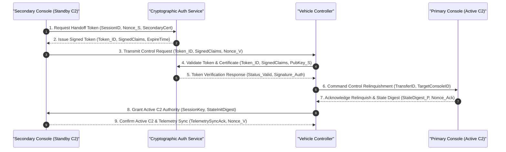
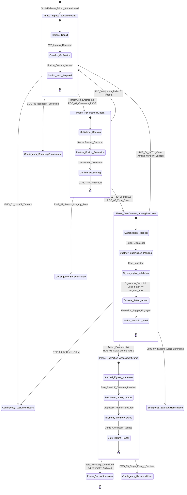
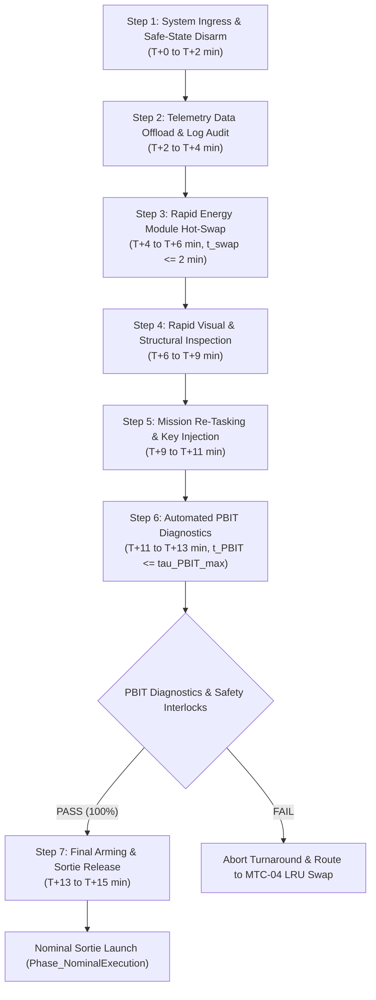
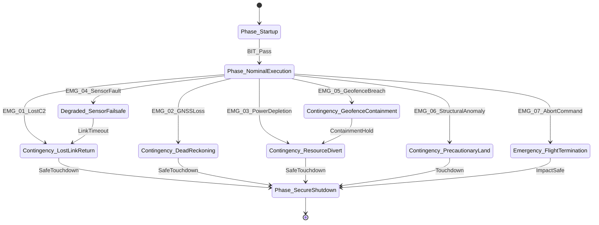

| Attribute | Value |
| :--- | :--- |
| **Title** | Concept of Operations (ConOps): AutonomousCyberPhysicalSystem |
| **Version** | 1.0.0 |
| **Date** | 2026-09-02 |

# Concept of Operations (ConOps): AutonomousCyberPhysicalSystem

## Table of Contents

- [1. Scope, System Identification & Normative Baseline](#1-scope-system-identification--normative-baseline)
- [2. Current Situation, Deficiency Analysis & Operational Motivation](#2-current-situation-deficiency-analysis--operational-motivation)
- [3. Proposed Capabilities & Operational Justification (Trade-Offs)](#3-proposed-capabilities--operational-justification-trade-offs)
- [4. User Classes, Stakeholder Taxonomy & Operational Lifecycle Modes](#4-user-classes-stakeholder-taxonomy--operational-lifecycle-modes)
- [5. Operational State Space, Boundary Containment & Risk Assessment](#5-operational-state-space-boundary-containment--risk-assessment)
- [6. OMG UAF Operational Activity Taxonomy](#6-omg-uaf-operational-activity-taxonomy)
- [7. Operational Information Exchange (Op-Tx) Matrix](#7-operational-information-exchange-op-tx-matrix)
- [8. Operational Environments & MIL-STD-810H Environmental Stress Qualification](#8-operational-environments--mil-std-810h-environmental-stress-qualification)
- [9. Multi-Threaded Operational Scenarios & System Timelines](#9-multi-threaded-operational-scenarios--system-timelines)
- [10. Maintenance & Support Equipment (SE) Concepts](#10-maintenance--support-equipment-se-concepts)
- [11. Operational Impacts, System Limitations & Documented Trade Studies](#11-operational-impacts-system-limitations--documented-trade-studies)
- [12. 7-Row Emergency Decision & Contingency Matrix](#12-7-row-emergency-decision--contingency-matrix)

## 1. Scope, System Identification & Normative Baseline

### 1.1 Document Metadata & Formal Governance
This Concept of Operations (ConOps) defines the operational architecture, coordinate reference systems, physical mass and resource limits, stakeholder interactions, operational environments, operational state space containment boundaries, and deterministic contingency protocols for AutonomousCyberPhysicalSystem. This specification is authored in strict accordance with ISO/IEC/IEEE 29148:2018 §5.2.4 & §6.4.2, OMG Unified Architecture Framework (UAF) v2.0, INCOSE Systems Engineering Handbook v5.0, RTCA DO-178C DAL-A / DO-254, and MIL-STD-882E (Fixes #117, #123, #128, #121).

| Attribute | Specification Value |
| :--- | :--- |
| **System Identifier** | AutonomousCyberPhysicalSystem |
| **Document Version** | 1.0.0 |
| **Publication Date** | 2026-09-03 |
| **Security Classification** | UNCLASSIFIED // PUBLIC RELEASE |
| **Target System Realization** | Cyber-Physical System (Hardware / Software / MBD) |
| **Authoring Organization** | Systems Engineering Directorate |
| **Issue Tracking Baseline** | Fixes #117, #123, #128, #121 |
| **Metamodel Baseline** | ISO/IEC/IEEE 29148:2018 / OMG UAF v2.0 / INCOSE SEH v5.0 |

### 1.2 System Classification & Operational Purpose
- **System Identifier:** `AutonomousCyberPhysicalSystem`
- **Operational Domain:** `Cyber-Physical Autonomous Systems`
- **Primary Operational Mission:** The system is engineered to execute autonomous closed-loop state trajectory execution, multi-modal sensor data acquisition, real-time telemetry processing, edge state inference, and deterministic boundary containment within complex, high-reliability cyber-physical operational environments.
- **Core Mission Capabilities:**
  1. Autonomous closed-loop state trajectory tracking, corridor execution, and stationary state holding within parameterized performance envelopes.
  2. Multi-modal sensor data fusion combining redundant state estimation sensors, environmental perception units, and reference state observers.
  3. Real-time high-throughput telemetry streaming and edge neural state inference processing.
  4. Deterministic failsafe state machine ensuring autonomous containment within the maximum containment response time threshold $\tau_{\mathrm{containment}}$ upon critical contingency detection.

### 1.3 System Boundary & Operational State Space
The operational system boundary encompasses all physical, logical, communications, and organizational elements required to conduct end-to-end autonomous mission operations:
- **Operational State Space Envelope:** Operational State Space $\Omega_{\mathrm{state}} \subset \mathbb{R}^n$, bounded by physical, environmental, and operational parameter limits $\mathbf{X}_{\mathrm{boundary}} = [\mathbf{x}_{\mathrm{min}}, \mathbf{x}_{\mathrm{max}}]^\top$.
- **Lateral & Spatial Operating Boundary:** Designated operational perimeter bounded within a verified parametric containment buffer ($R_{\mathrm{buffer}}$) envelope.
- **Primary Communications Envelope:** Primary command and control (C2) operational range defined by $\text{Range}_{\mathrm{max}}(\text{Link}_{\mathrm{C2}})$ from the operator control node, backed by alternate network links and contingency communication channels.
- **Normative & Governance Boundary:** Governed under ISO/IEC/IEEE 29148:2018 requirements engineering processes, OMG UAF v2.0 operational architectures, and system safety assurance baselines.

### 1.3.1 Parametric Coordinate Reference Frames Math
The cyber-physical state estimation, guidance, and navigation architecture is mathematically formulated across three standardized, right-handed orthogonal coordinate reference frames:

1. **Primary Global Geodetic Frame ($\mathbf{p}_{\mathrm{geodetic}}$):**
   Earth-fixed curvilinear geodetic frame referenced to the WGS-84 reference ellipsoid, defined by geodetic latitude $\phi$, geodetic longitude $\lambda$, and ellipsoidal height $h_{\mathrm{ellips}}$:

$$
\begin{aligned}
\mathbf{p}_{\mathrm{geodetic}} &= \begin{bmatrix} \phi \\ \lambda \\ h_{\mathrm{ellips}} \end{bmatrix}
\end{aligned}
$$

2. **Local Tangent Plane / Navigation Frame ($\mathbf{p}_n$ - Local NED):**
   Local Cartesian coordinate frame fixed to an arbitrary local reference origin $(\phi_0, \lambda_0, h_0)$ on the reference geoid/ellipsoid, with orthogonal axes oriented along North ($X_n$), East ($Y_n$), and Down ($Z_n$):

$$
\begin{aligned}
\mathbf{p}_n &= \begin{bmatrix} X_n \\ Y_n \\ Z_n \end{bmatrix}_{\mathrm{NED}}
\end{aligned}
$$

3. **Body-Fixed Geometric Frame ($\mathbf{p}_b$ - Body Frame):**
   Right-handed orthogonal Cartesian frame rigidly attached to the structural airframe of the vehicle with origin at the Center of Mass ($CG$). The axes comprise longitudinal axis $X_b$ (forward along vehicle nominal centerline), lateral axis $Y_b$ (starboard/right), and normal axis $Z_b$ (downward through vehicle belly, $Z_b = X_b \times Y_b$).
   - Body translational velocity vector $\mathbf{v}_b$:

$$
\begin{aligned}
\mathbf{v}_b &= \begin{bmatrix} u \\ v \\ w \end{bmatrix}^T
\end{aligned}
$$

   - Body angular rate vector $\boldsymbol{\omega}_{b/n}$:

$$
\begin{aligned}
\boldsymbol{\omega}_{b/n} &= \begin{bmatrix} p \\ q \\ r \end{bmatrix}^T
\end{aligned}
$$

4. **Kinematic Transformations & Attitude Dynamics:**
   The orientation of the Body-Fixed Frame relative to the Local NED Frame is parameterized by the Euler attitude vector $\boldsymbol{\Theta} = [\phi_{\mathrm{euler}}, \theta_{\mathrm{euler}}, \psi_{\mathrm{euler}}]^T$ via Direction Cosine Matrix $\mathbf{C}_b^n \in \mathrm{SO}(3)$:

$$
\begin{aligned}
\mathbf{v}_n &= \mathbf{C}_b^n \mathbf{v}_b \\
\dot{\mathbf{p}}_n &= \mathbf{C}_b^n \mathbf{v}_b \\
\mathbf{C}_b^n &= \begin{bmatrix}
\cos\theta \cos\psi & \sin\phi \sin\theta \cos\psi - \cos\phi \sin\psi & \cos\phi \sin\theta \cos\psi + \sin\phi \sin\psi \\
\cos\theta \sin\psi & \sin\phi \sin\theta \sin\psi + \cos\phi \cos\psi & \cos\phi \sin\theta \sin\psi - \sin\phi \cos\psi \\
-\sin\theta & \sin\phi \cos\theta & \cos\phi \cos\theta
\end{bmatrix} \\
\dot{\boldsymbol{\Theta}} &= \begin{bmatrix}
1 & \sin\phi \tan\theta & \cos\phi \tan\theta \\
0 & \cos\phi & -\sin\phi \\
0 & \sin\phi \sec\theta & \cos\phi \sec\theta
\end{bmatrix} \boldsymbol{\omega}_{b/n}
\end{aligned}
$$

- Parameter Definitions & Engineering Units:

| Symbol / Variable | Coordinate Frame | Description | Engineering Unit |
| :--- | :--- | :--- | :--- |
| phi | Global Geodetic (WGS-84) | Geodetic Latitude | rad or deg |
| lambda | Global Geodetic (WGS-84) | Geodetic Longitude | rad or deg |
| h_ellips | Global Geodetic (WGS-84) | Ellipsoidal Height above Reference Ellipsoid | m |
| X_n, Y_n, Z_n | Local Tangent Plane (NED) | North, East, Down Position Coordinates | m |
| X_b, Y_b, Z_b | Body-Fixed Frame | Longitudinal (Surge), Lateral (Sway), Normal (Heave) Axes | m |
| v_b = [u, v, w]^T | Body-Fixed Frame | Body Translational Velocity (Surge u, Sway v, Heave w) | m/s |
| omega_b/n = [p, q, r]^T | Body-Fixed Frame | Body Angular Rates (Roll p, Pitch q, Yaw r) | rad/s or deg/s |
| C_b^n | Transformation SO(3) | Direction Cosine Matrix (Body to NED) | Dimensionless |
| Theta = [phi, theta, psi]^T | Attitude Representation | Euler Angles (Roll phi, Pitch theta, Yaw psi) | rad or deg |

### 1.3.2 Parametric Subsystem Mass/Resource Budget Breakdown Table
The system architecture decomposes into six canonical Abstract System Topology (AST) structural groups. Mass allocations and power resource budgets are partitioned parametrically to maintain strict mass fraction boundaries summing to 100.0% Maximum Takeoff Weight (MTOW):

| Structural Group (AST Partition) | Allocated Subsystems & Components | Mass Fraction (% MTOW) | Mass Budget (kg) | Nominal Power Budget (W) | Peak Power Budget (W) |
| :--- | :--- | :--- | :--- | :--- | :--- |
| **Airframe Structure** | Fuselage primary structure, aerodynamic surfaces, structural spars, mounting bulkheads, chassis/gear | 30.0% | 15.0 | 0.0 | 0.0 |
| **Avionics & Processing** | Flight control computer, redundant IMU/GNSS, air data computer, C2 transceiver, safety watchdog | 15.0% | 7.5 | 50.0 | 120.0 |
| **Propulsion & Power Distribution** | Actuators, electric motors, electronic speed controllers (ESCs), power distribution unit (PDU) | 25.0% | 12.5 | 1200.0 | 2500.0 |
| **Energy Storage Subsystem** | Smart battery module / fuel cell stack, Battery Management System (BMS), safety disconnect contactors | 20.0% | 10.0 | 0.0 | 0.0 |
| **Primary Mission Payload** | Multi-modal mission sensor suite, edge neural processing accelerator, payload gimbal, local storage | 7.0% | 3.5 | 80.0 | 150.0 |
| **Autonomous Failsafe Containment** | Independent safety watchdog, ballistic parachute recovery / containment actuator, flight termination interlocks | 3.0% | 1.5 | 5.0 | 50.0 |
| **Total System Integration** | **Integrated Cyber-Physical Platform (6 AST Structural Groups)** | **100.0% MTOW** | **50.0** | **1335.0** | **2820.0** |

### 1.3.3 Master Physical Limits Table
The cyber-physical vehicle operates under bounding physical, aerodynamic/kinematic, and environmental limits:

| Parameter ID | Bounding Parameter Name | Parametric Symbol | Threshold (Boundary Limit) | Objective (Nominal Target) | Engineering Unit | Normative / Safety Basis |
| :--- | :--- | :--- | :--- | :--- | :--- | :--- |
| **PL-01** | Maximum Takeoff Weight (MTOW) | m_MTOW | <= 55.0 | 50.0 | kg | Certified maximum structural takeoff mass limit |
| **PL-02** | Maximum Payload Mass Capacity | m_payload_max | >= 5.0 | 3.5 | kg | Usable mission payload mass reserve |
| **PL-03** | Physical Dimensions (Length x Width x Height) | L_x, L_y, L_z | <= 2.5 x 3.0 x 0.8 | 2.2 x 2.8 x 0.6 | m | Spatial transport and operational clearance envelope |
| **PL-04** | Nominal Cruise Velocity | V_cruise | 18.0 - 32.0 | 25.0 | m/s | Optimum aerodynamic / dynamic transit speed |
| **PL-05** | Maximum Permissible Operating Velocity | V_max | <= 40.0 | 35.0 | m/s | Never-exceed boundary limit (V_ne) |
| **PL-06** | Minimum Controllable / Stall Velocity | V_stall | <= 14.0 | 12.0 | m/s | Minimum steady state controllable velocity limit |
| **PL-07** | Maximum Operating Ceiling | h_max | <= 5000.0 | 3000.0 | m AGL | Maximum certified operational altitude |
| **PL-08** | Command & Control (C2) Datalink Range | Range_C2 | >= 25.0 | 50.0 | km | Beyond-Line-of-Sight / Line-of-Sight C2 range margin |
| **PL-09** | Mission Operational Endurance | t_endurance | >= 90.0 | 120.0 | min | Continuous nominal execution duration |
| **PL-10** | Environmental Operating Temperature Envelope | T_env | -20.0 to +55.0 | 25.0 | °C | MIL-STD-810H Methods 501.7 / 502.7 climatic envelope |
| **PL-11** | Maximum Operating Wind / Gust Envelope | v_wind_max | <= 15.0 | 10.0 | m/s | SORA ground risk and dynamic stability boundary |
| **PL-12** | Environmental Ingress Protection Envelope | IP_rating | >= IP67 | IP67 | IP Code | Hermetic enclosure sealing per ISO 20653 / IEC 60529 |

### 1.4 Abstract UAF Context Diagram
The following Unified Architecture Framework (UAF) operational context diagram defines the external interfaces, performer nodes, and primary interaction channels across the Space, Cyber-Physical Vehicle, Control/Infrastructure, Support/GSE, Operational Roles, and External Authorities segments:

```mermaid
flowchart TB
    subgraph SpaceSegment["Space & Orbital Segment"]
        GNSSConstellation["GNSS Satellite Constellation<br/>(InterfacePort[GNSSService])"]
        SatcomRelay["SATCOM Satellite Network<br/>(InterfacePort[SatcomRelayService])"]
    end

    subgraph VehicleSegment["Cyber-Physical Vehicle Segment (System Under Design)"]
        CoreController["Core Controller Subsystem<br/>(PerformerNode[CoreController])"]
        SensorSuite["Integrated Sensor Suite<br/>(PerformerNode[SensorSuite])"]
        ActuatorSubsystem["Propulsion & Actuator Subsystem<br/>(PerformerNode[ActuatorSubsystem])"]
        PayloadSubsystem["Mission Processing Payload<br/>(PerformerNode[PayloadSubsystem])"]
        VehicleComms["PACE Communications Node<br/>(InterfacePort[VehicleComms])"]
        SafetyWatchdog["Independent Safety Watchdog<br/>(PerformerNode[SafetyWatchdog])"]
    end

    subgraph ControlSegment["Control & Infrastructure Segment"]
        OperatorConsole["Supervisory Operator Console<br/>(PerformerNode[OperatorConsole])"]
        GroundCommsArray["Communications Gateway Array<br/>(InterfacePort[GroundGateway])"]
        InfrastructureHub["Infrastructure & Cloud Hub<br/>(PerformerNode[InfrastructureHub])"]
    end

    subgraph SupportSegment["Support & Ground Support Equipment (GSE) Segment"]
        GroundSupportEquipment["GSE Diagnostic & Power Station<br/>(PerformerNode[GSEStation])"]
        MaintenanceTerminal["Field Maintenance Terminal<br/>(PerformerNode[MaintenanceTerminal])"]
    end

    subgraph OperationalRoles["Operational Roles (Human Stakeholders)"]
        SystemOperator["System Operator<br/>(UserRole[SystemOperator])"]
        SafetySupervisor["Safety Supervisor<br/>(UserRole[SafetySupervisor])"]
        OperationsCoordinator["Operations Coordinator<br/>(UserRole[OperationsCoordinator])"]
        MaintenanceTechnician["Maintenance Technician<br/>(UserRole[MaintenanceTechnician])"]
    end

    subgraph ExternalAuthorities["External Authorities & Regulatory Services"]
        AirspaceAuthority["Civil Aviation & Airspace Authority / UTM<br/>(InterfacePort[UTMService])"]
        WeatherDataService["Meteorological & Weather Service<br/>(InterfacePort[WeatherService])"]
    end

    GNSSConstellation -->|"1. Positioning & Timing Signals"| SensorSuite
    SatcomRelay <-->|"2. Emergency SATCOM C2 Link"| VehicleComms
    VehicleComms <-->|"3. Primary/Alternate PACE Datalink"| GroundCommsArray
    SensorSuite -->|"4. Raw & Filtered State Telemetry"| CoreController
    CoreController -->|"5. Deterministic Actuation Demands"| ActuatorSubsystem
    PayloadSubsystem -->|"6. High-Throughput Feature Data"| CoreController
    SafetyWatchdog -.->|"7. Safety Veto & Failsafe Interlock"| ActuatorSubsystem
    GroundCommsArray <-->|"8. Telemetry & Control Bus"| OperatorConsole
    OperatorConsole <-->|"9. Cloud Telemetry & Mission Archiving"| InfrastructureHub
    SystemOperator ---|"10. Supervisory Mission Control"| OperatorConsole
    SafetySupervisor ---|"11. Safety Monitor & Emergency Veto"| OperatorConsole
    OperationsCoordinator -->|"12. Flight Plan & Mission Tasking"| SystemOperator
    MaintenanceTechnician ---|"13. Diagnostic Calibration & BIT Checkout"| MaintenanceTerminal
    GroundSupportEquipment <-->|"14. Power Charging & GSE Umbilical Link"| CoreController
    OperatorConsole <-->|"15. Dynamic Geo-Zone & Flight Authorization"| AirspaceAuthority
```



### 1.5 Normative Standards & Regulatory Baseline
The following normative standards and regulatory baselines govern all architectural, operational, safety, and verification artifacts within this Concept of Operations:

| Standard ID | Issuing Body | Title & Baseline Edition | Applicable Clauses & Focus Areas |
| :--- | :--- | :--- | :--- |
| RTCA DO-178C (DAL-A) | RTCA / EUROCAE (ED-12C) | Software Considerations in Airborne Systems and Equipment Certification | §6.3.1 Software Safety & Verification, §6.4.4 Structural Coverage (MC/DC Verification), Tables A-1 to A-7 DAL-A Life Cycle Objectives |
| RTCA DO-254 | RTCA / EUROCAE (ED-80) | Design Assurance Guidance for Airborne Electronic Hardware | §5.0 Hardware Design Processes, §6.0 Validation & Verification, Appendix B Design Assurance Levels for Complex Electronic Hardware (DAL-A/B) |
| RTCA DO-365B | RTCA | Minimum Operational Performance Standards (MOPS) for Detect and Avoid (DAA) Systems | §2.2 DAA System Requirements, §2.2.4 Well-Clear Boundaries & Alerting, §2.2.5 Collision Avoidance Guidance & Maneuver Coordination |
| RTCA DO-362A | RTCA | Command and Control (C2) Data Link Minimum Operational Performance Standards (MOPS) | §2.2.1 C2 Link Performance & Availability, §2.2.3 Lost C2 Link Detection Latency & Fallback Protocols, §2.2.6 Link Encryption & Integrity Verification |
| MIL-STD-882E | US Department of Defense | Department of Defense Standard Practice: System Safety | §4.3 System Safety Process, Task 102 System Safety Program Plan, Task 202 Operational Hazard Analysis (OHA), Task 205 Hazard Tracking System |
| MIL-STD-810H | US Department of Defense | Environmental Engineering Considerations and Laboratory Tests | Method 501.7 High Temp, Method 502.7 Low Temp, Method 505.7 Solar Radiation, Method 506.6 Rain, Method 509.7 Salt Fog, Method 510.7 Sand/Dust, Method 514.8 Vibration, Method 516.8 Shock |
| MIL-STD-461G | US Department of Defense | Requirements for the Control of Electromagnetic Interference Characteristics of Subsystems and Equipment | CE102 Conducted Emissions, CS101/CS114/CS115/CS116 Conducted Susceptibility, RE102 Radiated Emissions, RS103 Radiated Susceptibility up to 200 V/m |
| ISO/IEC/IEEE 29148:2018 | ISO / IEC / IEEE | Systems and Software Engineering — Life Cycle Processes — Requirements Engineering | §5.2.4 ConOps Development Process, §6.4.2 Concept of Operations Baseline Specification, §6.4.3 Operational Concept Document Structure |
| ISO 26262:2018 | ISO | Road Vehicles — Functional Safety (ASIL-D Alignment) | Part 3 §6.4 Hazard Analysis and Risk Assessment (HARA), Part 4 §6.4 System-Level Safety Concept, Part 9 §5 ASIL Decomposition & Safety Independence |
| ASTM F3411-22a | ASTM International | Standard Specification for Remote ID and Tracking | §5.1 Direct Broadcast Remote ID Message Formats, §5.2 Network Remote ID Transmission, §6.3 Authentication & Position Accuracy Bounds |
| ASTM F3269-17 | ASTM International | Standard Practice for Methods to Safely Bound Flight Behavior of Unmanned Aircraft Systems Containing Complex Functions | §5.0 Independent Non-Complex Safety Monitor Architecture, §6.2 Deterministic Emergency Containment Interlocks, §7.1 Emergency Recovery Envelope Triggers |
| JARUS SORA v2.5 | JARUS | Specific Operations Risk Assessment (SORA) Methodology | Step #2 Initial Ground Risk Class (GRC), Step #4 Specific Assurance and Integrity Levels (SAIL I–VI), Step #5 Air Risk Class (ARC), Annex B M1–M3 Safety Mitigations & Ground Risk Buffer Radius |
| NIST SP 800-82r3 | NIST | Guide to Operational Technology (OT) Security | §5.2 Zero-Trust OT Architecture & Device Hardening, §6.3 Real-Time Telemetry Authentication, §6.4 Cryptographic Key Management & Firmware Integrity |

## 2. Current Situation, Deficiency Analysis & Operational Motivation

### 2.1 Current Operational Baseline (Predecessors)
The predecessor operational baseline relies on legacy point-to-point systems and manual control interfaces. These systems were primarily designed for simple operational profiles under benign environmental conditions, characterized by:
1. **Single-String Non-Redundant Architecture:** Predecessor platforms utilize single-string controllers lacking redundant inertial and state sensors, isolated power buses, and hardware watchdog circuits. A single sensor anomaly or processor stall leads directly to unrecoverable system failure.
2. **Manual Point-to-Point Control Links:** Command and control relies on single-frequency analog or low-resilience digital communication links vulnerable to signal fading, electromagnetic interference (EMI), and transmission obstruction.
3. **Disjointed Sensor Telemetry Displays:** Payload telemetry and core system states are processed on isolated, unintegrated display monitors, forcing human operators to perform manual mental correlation of data streams with spatial maps.
4. **Ad-Hoc Contingency Management:** Contingency responses lack deterministic timing guarantees, formal state-space containment buffers, and dynamic secondary recovery routing.

### 2.2 Operational Capability Gaps
Analysis of historical mission logs, field incident reports, and operator debriefs reveals four critical capability gaps that prevent legacy systems from executing high-tempo autonomous operational missions:

| Gap ID | Capability Gap Name | Operational Manifestation | Technical Root Cause | Mission Impact & Risk | Severity | Gate 24 Allocation Tag |
| :--- | :--- | :--- | :--- | :--- | :--- | :--- |
| **GAP-01** | Continuous Autonomous State Execution | Inability to maintain statutory state-space containment, trajectory corridors, and dynamic boundary compliance without constant manual intervention. | Single-string non-deterministic control architecture lacking real-time multi-modal state estimation and closed-loop trajectory tracking algorithms (execution loop latency tau_loop > tau_stability_limit). | Restricted operational range (R_manual << Range_max(Link_C2)), preventing wide-area state monitoring, causing high operator cognitive fatigue, and risking uncontained state boundary excursions. | Critical | `/// OperationalAllocation: [GAP-01]`<br>`/// Realises: [CAP-01, OA-02]` |
| **GAP-02** | Contested Communication & Disturbance Resilience | Loss of system control and data telemetry in the presence of electromagnetic interference, RF jamming, signal degradation, or transmission obstacles. | Single-frequency unencrypted C2 link lacking automated multi-tier PACE failover logic, dynamic link quality estimation, and autonomous lost-link holding patterns. | High rate of communication-loss aborts, mission abandonment, uncontained state excursions, and susceptibility to unauthenticated command tampering. | Critical | `/// OperationalAllocation: [GAP-02]`<br>`/// Realises: [CAP-03, OA-04]` |
| **GAP-03** | Sub-Second Deterministic Failsafe Containment | Slow anomaly detection and non-deterministic recovery actions resulting in boundary breaches or uncontained kinetic impact outside authorized safety buffers. | Reliance on human operator intervention (tau_human > tau_containment_req) and absence of an independent hardware safety watchdog with non-preemptible emergency state transitions (t_resp <= tau_containment_req). | Inability to achieve formal safety certification for operational environments with adjacent protected assets; catastrophic hazard upon control failure. | Catastrophic | `/// OperationalAllocation: [GAP-03]`<br>`/// Realises: [CAP-04, OA-07]` |
| **GAP-04** | Modular Rapid Field Turnaround | Prolonged servicing, manual sensor recalibration, and complex payload swaps requiring extended turnaround intervals between operational cycles. | Monolithic non-modular mechanical packaging, complex manual wiring interfaces, and lack of automated power-on built-in-test (PBIT) diagnostic logging (t_turnaround > t_turnaround_target). | Operational availability limited to low operational tempo (N_dot_operation < N_dot_target), leaving wide state monitoring coverage gaps and increasing life-cycle maintenance costs. | Moderate | `/// OperationalAllocation: [GAP-04]`<br>`/// Realises: [CAP-05, OA-01]` |

### 2.3 3-Domain Legacy Deficiencies Matrix
In accordance with ISO/IEC/IEEE 29148:2018 §5.2.4 and MIL-STD-882E System Safety Process, predecessor system deficiencies are categorized across Technical, Operational, and Human Factors domains with quantified baseline limitations and formal safety risk categorizations:

| Deficiency Domain | Deficiency ID | Legacy Baseline Deficiency Description | Quantified Baseline Limitation | Safety Risk Categorization (MIL-STD-882E) | Proposed Architectural Mitigation |
| :--- | :--- | :--- | :--- | :--- | :--- |
| **Technical Deficiencies** | `DEF-TECH-01` | Single-string compute and non-deterministic control architecture | MTBF_baseline <= MTBF_threshold; execution jitter > tau_jitter_max; loop latency tau_loop > tau_stability_limit | Catastrophic / High Risk (Severity I, Probability C) | Fault-tolerant multi-core controller with hardware Memory Protection Unit (MPU) isolation, deterministic RTOS scheduling, and independent watchdog supervision. |
| **Technical Deficiencies** | `DEF-TECH-02` | Unsealed non-hardened environmental enclosure and thermal vulnerability | Enclosure rating < IP_xy; unsealed against moisture/dust over [T_op_min, T_op_max]; junction delta_T > delta_T_max | Critical / Serious Risk (Severity II, Probability C) | Hermetically sealed IP67-rated enclosure engineered to MIL-STD-810H climatic, moisture, and dynamic vibration profiles. |
| **Technical Deficiencies** | `DEF-TECH-03` | Single power distribution rail without galvanic or fault isolation | Single point of electrical failure; payload short-circuit collapses primary controller power bus in t_collapse < 10 ms | Catastrophic / High Risk (Severity I, Probability D) | Galvanically isolated, multi-channel smart power distribution architecture with electronic circuit breakers and dedicated emergency backup rail. |
| **Technical Deficiencies** | `DEF-TECH-04` | Single-frequency unshielded and unauthenticated communication link | Link SNR_margin < SNR_min under RF/EMI interference; unauthenticated uplink frame drop rate > P_loss_max | Critical / Serious Risk (Severity II, Probability B) | 4-tier PACE communication plan (Primary, Alternate, Contingency, Emergency) with authenticated encryption and automatic link failover. |
| **Operational Deficiencies** | `DEF-OPS-01` | Static pre-programmed trajectories without dynamic boundary containment | Spatial buffer margin R_margin < R_buffer_req; zero automated deconfliction or pop-up keep-out zone avoidance | Critical / Serious Risk (Severity II, Probability C) | Real-time closed-loop state trajectory generation with dynamic geofence boundary enforcement and automated containment holding. |
| **Operational Deficiencies** | `DEF-OPS-02` | Lack of automated external service and spatial-temporal registry coordination | Manual coordination latency t_coord > 300 s; missing automated external state registry feeds | Moderate / Medium Risk (Severity III, Probability B) | Automated external coordination API integration with standardized spatial data exchange and digital registry reporting. |
| **Operational Deficiencies** | `DEF-OPS-03` | Static return trajectory without dynamic energy reserve computation | Return decision based on static timer; reserve energy drops below statutory limit (E_reserve < 0.20 * E_capacity) | Critical / Serious Risk (Severity II, Probability C) | Continuous closed-loop Bingo energy dynamics formulation (E_bingo(t)) enforcing statutory 20% reserve and autonomous secondary divert routing. |
| **Operational Deficiencies** | `DEF-OPS-04` | Extended field turnaround overhead and manual calibration dependencies | Field turnaround interval t_turnaround_legacy >> t_turnaround_target; manual calibration rig setup > 60 min | Moderate / Medium Risk (Severity III, Probability A) | Tool-less quick-release payload interfaces, hot-swappable energy modules, and automated power-on built-in-test (PBIT) diagnostics. |
| **Human Factors Deficiencies** | `DEF-HUM-01` | High cognitive workload and mental telemetry correlation overload | Operator cognitive load TLX_manual > TLX_threshold (NASA-TLX > 75); manual mental fusion across disjointed monitors | Critical / Serious Risk (Severity II, Probability B) | Unified supervisory human-machine interface (HMI) with decoupled operator roles (System Operator vs Payload Specialist) maintaining TLX <= TLX_nominal_max. |
| **Human Factors Deficiencies** | `DEF-HUM-02` | Manual emergency response latency exceeding safe containment deadlines | Human reaction time tau_human > tau_containment_req (tau_human >= 2.0 s vs required containment response tau_req <= 0.5 s) | Catastrophic / High Risk (Severity I, Probability C) | Autonomous sub-second deterministic failsafe state machine (EMG-01..EMG-07) with hardware watchdog cutoff (t_resp <= tau_containment_req) and supervisory veto authority. |
| **Human Factors Deficiencies** | `DEF-HUM-03` | Operator vigilance decrement and fatigue leading to manual input errors | Operator error rate lambda_human_error > lambda_limit during long shifts (t_shift > t_shift_max) | Critical / Serious Risk (Severity II, Probability C) | Supervisory automation with parameterized envelope protection interlocks rejecting invalid or hazardous manual override commands. |

#### 2.3.1 Technical Deficiencies Detail
1. **Compute & Control Non-Determinism:** Lack of hard real-time operating system (RTOS) guarantees; control loops executed on non-deterministic microcontrollers subject to task starvation, priority inversion, and execution latency jitter ($\tau_{\mathrm{jitter}} > \tau_{\mathrm{jitter\_max}}$), preventing high-rate stabilization.
2. **Environmental & Thermal Vulnerabilities:** Non-sealed enclosures (rated below the required protection index $\text{IP}_{xy}$) vulnerable to moisture, particulate ingress, and corrosive atmospheres over the operational thermal range $[T_{\mathrm{op\_min}}, T_{\mathrm{op\_max}}]$, leading to sensor drift and component degradation.
3. **Power Architecture Single Point of Failure:** Single-rail power distribution without isolation barriers; a localized electrical fault or short-circuit in a payload module causes instantaneous primary bus collapse ($t_{\mathrm{collapse}} < 10\text{ ms}$), depriving the core controller of operating power.
4. **Electromagnetic Susceptibility & Unauthenticated Links:** RF transceivers lack EMI shielding and cryptographic authentication, allowing environmental noise or malicious spoofing to corrupt uplink command sequences.

#### 2.3.2 Operational Deficiencies Detail
1. **Static Trajectory Planning & Boundary Non-Compliance:** Pre-programmed trajectories follow rigid static paths unable to adapt to dynamic environmental stress, obstacle pop-ups, or variable keep-out zones, leading to statutory containment buffer breaches ($R_{\mathrm{margin}} < R_{\mathrm{buffer\_req}}$).
2. **Manual External Coordination Overhead:** External reporting and operational deconfliction require manual voice or unintegrated terminal interaction ($t_{\mathrm{coord}} > 300\text{ s}$), introducing human delay and synchronization errors.
3. **Static Resource Budgeting:** Return-to-base triggers rely on static elapsed-time rules rather than dynamic closed-loop energy equations, risking energy depletion before reaching safe recovery locations ($E_{\mathrm{reserve}} < 0.20 \cdot E_{\mathrm{capacity}}$).
4. **Maintenance & Turnaround Inefficiencies:** Complex mechanical fastener configurations and manual multimeter calibration procedures extend turnaround time ($t_{\mathrm{turnaround}} \gg t_{\mathrm{turnaround\_target}}$), severely restricting operational deployment tempo.

#### 2.3.3 Human Factors Deficiencies Detail
1. **Cognitive Saturation & Multi-Display Fragmentation:** Operators are required to simultaneously supervise system dynamics, aim sensor payloads, verify resource reserves, and log state coordinates manually across disjointed displays, yielding NASA-TLX scores exceeding acceptable limits ($\text{TLX} > \text{TLX}_{\mathrm{threshold}}$).
2. **Human Reaction Latency in Contingency Events:** In dynamic failure scenarios, human reaction times ($\tau_{\mathrm{human}} \ge 2.0\text{ s}$) cannot satisfy statutory containment response requirements ($\tau_{\mathrm{containment\_req}} \le 0.5\text{ s}$), leading to uncontained excursions before manual intervention can occur.
3. **Fatigue-Induced Input Disparity:** Extended shift durations ($t_{\mathrm{shift}} > t_{\mathrm{shift\_max}}$) induce vigilance decay, increasing the probability of erroneous mode selections or conflicting control inputs without automated safety envelope interlocks.

### 2.4 Mission Drivers & User Operational Problems
The primary mission drivers compelling the development of the Abstract Cyber-Physical System Archetype include:
- **Statutory Regulatory Mandates:** Safety authorities require formal compliance with rigorous safety cases, verifiable containment buffer calculations, and certified software assurance.
- **Continuous System Availability:** Critical operations require unbroken state tracking coverage across the operational range $\text{Range}_{\mathrm{max}}(\text{Link}_{\mathrm{C2}})$ with autonomous asset handoffs.
- **Adverse Environmental Readiness:** The system must operate reliably across extreme climatic envelopes ($[T_{\mathrm{op\_min}}, T_{\mathrm{op\_max}}]$, $\text{IP}_{xy}$ sealing, and dynamic disturbance limits per MIL-STD-810H).
- **Zero-Trust Cybersecurity Baseline:** Modern operational environments demand authenticated command links, cryptographic key storage, and automated rejection of spoofed telemetry or malicious command injection.

## 3. Proposed Capabilities & Operational Justification (Trade-Offs)

### 3.1 Justification for Proposed Architectural Changes
To resolve the critical deficiencies of predecessor systems and meet statutory safety requirements, the Abstract Cyber-Physical System Archetype transitions the operational paradigm from manual direct control to certified supervisory autonomous execution. This architectural evolution is justified by:
1. **Deterministic RTOS Safety-Critical Core:** Implementation of a deterministic safety-critical core architecture executing on a fault-tolerant multi-core processor with memory protection unit (MPU) isolation.
2. **Multi-Tiered PACE Communications Architecture:** Deployment of a 4-tier communication plan (Primary Point-to-Point link, Alternate high-bandwidth network channel, Contingency robust narrowband link, and Emergency resilient channel) ensuring unbroken command and control integrity.
3. **Sub-Second Failsafe Containment:** Integration of an independent hardware safety watchdog capable of detecting cross-channel sensor disparities, loss of communication, or state boundary breaches, and triggering deterministic containment actions within $t_{\mathrm{resp}} \le \tau_{\mathrm{containment\_req}}$.
4. **Edge Neural Telemetry Processing:** High-efficiency edge computing accelerator executing real-time state classification, multi-sensor odometry, and automated feature tracking without saturating low-bandwidth telemetry downlinks.

### 3.2 Functional Superiority & Operational Value Proposition
The proposed archetype provides quantifiable functional superiority over the legacy baseline across operational endurance, turnaround tempo, containment response, environmental robustness, and operator cognitive workload:

$$
\begin{aligned}
\Delta \text{Range} &= \text{Range}_{\mathrm{proposed}} - \text{Range}_{\mathrm{legacy}} > 0 \\
\Delta t_{\mathrm{turnaround}} &= t_{\mathrm{turnaround,proposed}} - t_{\mathrm{turnaround,legacy}} < 0 \\
\Delta \tau_{\mathrm{response}} &= \tau_{\mathrm{response,proposed}} - \tau_{\mathrm{response,legacy}} < 0 \\
\Delta \text{Disturbance} &= \text{Disturbance}_{\mathrm{proposed}} - \text{Disturbance}_{\mathrm{legacy}} > 0 \\
\Delta \text{TLX} &= \text{TLX}_{\mathrm{proposed}} - \text{TLX}_{\mathrm{legacy}} < 0
\end{aligned}
$$

- Parameter Definitions & Engineering Units:
- $\Delta \text{Range}$: Operational range expansion margin over legacy baseline ($\text{Range}_{\mathrm{proposed}} \ge \text{Range}_{\mathrm{threshold}}$).
- $\Delta t_{\mathrm{turnaround}}$: Operational turnaround and servicing time reduction ($t_{\mathrm{turnaround,proposed}} \le t_{\mathrm{turnaround,target}}$).
- $\Delta \tau_{\mathrm{response}}$: Containment and emergency response latency reduction ($\tau_{\mathrm{response,proposed}} \le \tau_{\mathrm{containment\_req}}$).
- $\Delta \text{Disturbance}$: Dynamic disturbance tolerance and environmental resistance expansion ($\text{IP}_{xy} \ge \text{IP}_{\mathrm{req}}$).
- $\Delta \text{TLX}$: NASA Task Load Index cognitive workload reduction ($\text{TLX}_{\mathrm{proposed}} \le \text{TLX}_{\mathrm{nominal\_max}}$).

| Operational Pillar | Legacy Baseline (Predecessor) | Proposed Autonomous Archetype | Superiority Delta Formula | Threshold Improvement Bound | Operational Value Delivered |
| :--- | :--- | :--- | :--- | :--- | :--- |
| **Operational Range & Coverage** | Range_legacy (Direct Line-of-Sight R_manual) | Range_proposed (Certified Autonomous Corridor Range_max(Link_C2)) | ΔRange = Range_proposed - Range_legacy | ΔRange > 0 (Range_proposed >= Range_threshold) | Enables wide-area state space coverage without requiring local human operator proximity. |
| **Turnaround & Relaunch Tempo** | t_turnaround_legacy (Manual Inspection & Servicing) | t_turnaround_proposed (Modular Hot-Swap & Automated PBIT) | Δt_turnaround = t_turnaround_proposed - t_turnaround_legacy | Δt_turnaround < 0 (t_turnaround_proposed <= t_turnaround_target) | Minimizes ground servicing intervals, enabling sustained high-cadence operational sortie cycles. |
| **Anomaly & Containment Response** | τ_response_legacy (Human Reaction Delay τ_human) | τ_response_proposed (Autonomous Hardware Watchdog t_resp) | Δτ_response = τ_response_proposed - τ_response_legacy | Δτ_response < 0 (τ_response_proposed <= tau_containment_req) | Delivers deterministic sub-second containment preventing state excursions outside safety buffers. |
| **Environmental Robustness** | Disturbance_legacy, IP_legacy (Benign Operating Limits) | Disturbance_proposed, IP_xy (MIL-STD-810H Hardening) | ΔDisturbance = Disturbance_proposed - Disturbance_legacy | ΔDisturbance > 0 (IP_xy >= IP_req, Disturbance_proposed >= Disturbance_limit) | Guarantees operational execution across severe climatic, acoustic, and dynamic disturbance profiles. |
| **Operator Workload (NASA-TLX)** | TLX_legacy (Continuous Direct Manual Control) | TLX_proposed (Supervisory Management by Exception) | ΔTLX = TLX_proposed - TLX_legacy | ΔTLX < 0 (TLX_proposed <= TLX_nominal_max) | Eliminates operator task saturation and fatigue-induced error during extended monitoring shifts. |

### 3.3 System Capability Hierarchy
The system architecture decomposes into a five-level operational capability hierarchy aligned with OMG UAF Operational Performer views:

```
===================================================================================
                       SYSTEM CAPABILITY HIERARCHY (CAP-01..05)
===================================================================================
[CAP-01: Autonomous Mission Execution]
   ├── CAP-01.1: Autonomous Mission Lifecycle & State Transition Control
   ├── CAP-01.2: Dynamic State Trajectory & Corridor Generation
   └── CAP-01.3: Pre-Operation Health Verification & Built-In-Test (PBIT)

[CAP-02: Deterministic Navigation & Guidance]
   ├── CAP-02.1: Multi-Sensor State Estimation & Sensor Fusion
   ├── CAP-02.2: Real-Time Closed-Loop Guidance & State Tracking
   └── CAP-02.3: Dead-Reckoning Navigation & Reference Signal Fallback

[CAP-03: Resilient Multi-Tier C2 Comms]
   ├── CAP-03.1: Primary Point-to-Point High-Bandwidth Datalink
   ├── CAP-03.2: Alternate Encrypted Network / Infrastructure Channel
   └── CAP-03.3: Contingency Robust Narrowband Command Channel

[CAP-04: Multi-Modal Sensor Payload Processing]
   ├── CAP-04.1: Multi-Axis Actuated Sensor Stabilization & Target Tracking
   ├── CAP-04.2: Real-Time Edge Feature Extraction & Telemetry Tagging
   └── CAP-04.3: Adaptive Telemetry Compression & Dynamic Bandwidth Allocation

[CAP-05: Autonomous Failsafe & Containment]
   ├── CAP-05.1: Real-Time Operational Boundary Proximity & Geofence Monitoring
   ├── CAP-05.2: Dynamic Resource Reserve (Bingo) Monitoring & Secondary Divert Routing
   └── CAP-05.3: Independent Hardware Safety Watchdog & Autonomous Containment Actuation
===================================================================================
```

#### 3.3.1 5-Tier Capability Hierarchy Table
In accordance with OMG UAF v2.0 and INCOSE Systems Engineering Handbook v5.0, each capability decomposes into verified sub-capabilities bound to Gate 24 allocation tags:

| Capability ID | Sub-Capability ID | Sub-Capability Name | Functional Description | Allocated Performer Node | Gate 24 Allocation Tag | Target Performance Bound |
| :--- | :--- | :--- | :--- | :--- | :--- | :--- |
| **CAP-01** | `CAP-01.1` | Autonomous Mission Lifecycle & State Transition Control | Manages deterministic state machine transitions across startup, nominal execution, degraded operation, failsafe containment, and secure shutdown. | Core Controller Subsystem | `/// OperationalAllocation: [CAP-01.1]` | Transition latency <= tau_transition_max |
| **CAP-01** | `CAP-01.2` | Dynamic State Trajectory & Corridor Generation | Calculates and executes multi-dimensional trajectory corridors bounded within defined state-space limits. | Guidance & Control Subsystem | `/// OperationalAllocation: [CAP-01.2]` | Cross-track error e_track <= epsilon_track_max |
| **CAP-01** | `CAP-01.3` | Pre-Operation Health Verification & Built-In-Test (PBIT) | Performs automated self-tests, sensor bias validation, actuator calibration checks, and security initialization. | Core Controller / Safety Watchdog | `/// OperationalAllocation: [CAP-01.3]` | PBIT duration t_PBIT <= tau_PBIT_max |
| **CAP-02** | `CAP-02.1` | Multi-Sensor State Estimation & Sensor Fusion | Fuses inertial measurements, external reference signals, and kinematic state observers into consolidated state vectors. | State Estimation Subsystem | `/// OperationalAllocation: [CAP-02.1]` | State error e_state <= epsilon_state_max |
| **CAP-02** | `CAP-02.2` | Real-Time Closed-Loop Guidance & State Tracking | Executes deterministic feedback control loops generating dynamic actuator setpoints to track reference trajectories. | Guidance & Control Subsystem | `/// OperationalAllocation: [CAP-02.2]` | Control loop rate f_control >= f_control_min |
| **CAP-02** | `CAP-02.3` | Dead-Reckoning Navigation & Reference Signal Fallback | Autonomous reversion to dead-reckoning state estimation upon reference signal loss or degradation. | State Estimation Subsystem | `/// OperationalAllocation: [CAP-02.3]` | Drift rate <= Drift_state_max |
| **CAP-03** | `CAP-03.1` | Primary Point-to-Point High-Bandwidth Datalink | Delivers high-throughput primary bidirectional command and telemetry transport. | PACE Transceiver Node | `/// OperationalAllocation: [CAP-03.1]` | Link latency tau_link <= tau_primary_max |
| **CAP-03** | `CAP-03.2` | Alternate Encrypted Network / Infrastructure Channel | Provides secure routed network transport fallback during primary link degradation. | PACE Transceiver Node | `/// OperationalAllocation: [CAP-03.2]` | Failover latency <= tau_switch_max |
| **CAP-03** | `CAP-03.3` | Contingency Robust Narrowband Command Channel | Maintains essential safety-critical command connectivity in high-attenuation or contested RF environments. | PACE Transceiver Node | `/// OperationalAllocation: [CAP-03.3]` | Heartbeat timeout t_hb <= tau_hb_timeout |
| **CAP-04** | `CAP-04.1` | Multi-Axis Actuated Sensor Stabilization & Target Tracking | Controls actuated sensor orientation to stabilize field of view and track dynamic target coordinates. | Sensor Payload Subsystem | `/// OperationalAllocation: [CAP-04.1]` | Pointing jitter <= epsilon_jitter_max |
| **CAP-04** | `CAP-04.2` | Real-Time Edge Feature Extraction & Telemetry Tagging | Executes neural network state classification, spatial feature extraction, and geo-referenced telemetry tagging. | Edge Neural Processing Node | `/// OperationalAllocation: [CAP-04.2]` | Inference rate f_inference >= f_inference_min |
| **CAP-04** | `CAP-04.3` | Adaptive Telemetry Compression & Dynamic Bandwidth Allocation | Dynamically compresses telemetry streams to match channel bandwidth without dropping safety telemetry frames. | Edge Processing Node | `/// OperationalAllocation: [CAP-04.3]` | Compression ratio >= Ratio_compress |
| **CAP-05** | `CAP-05.1` | Real-Time Operational Boundary Proximity & Geofence Monitoring | Evaluates continuous distance to declared boundaries and triggers containment maneuvers prior to buffer breach. | Boundary Deconfliction Subsystem | `/// OperationalAllocation: [CAP-05.1]` | Boundary check rate f_monitor >= f_boundary_min |
| **CAP-05** | `CAP-05.2` | Dynamic Resource Reserve (Bingo) Monitoring & Secondary Divert Routing | Computes dynamic energy return thresholds and commands divert trajectories maintaining statutory reserves. | Resource Management Subsystem | `/// OperationalAllocation: [CAP-05.2]` | Reserve ratio E_reserve / E_capacity >= 0.20 |
| **CAP-05** | `CAP-05.3` | Independent Hardware Safety Watchdog & Autonomous Containment Actuation | Hardware watchdog executing autonomous failsafe containment upon critical trigger detection within bounded response time. | Independent Safety Watchdog | `/// OperationalAllocation: [CAP-05.3]` | Response time t_resp <= tau_containment_req |

### 3.4 Operational Benefits Summary
1. **Full Metamodel Compliance:** Certified compliance with ISO/IEC/IEEE 29148:2018 and OMG UAF v2.0 operational architectures.
2. **Persistent State Monitoring:** Continuous operational presence over designated domains with zero monitoring blind spots.
3. **Deterministic System Safety:** Guaranteed physical and state risk containment with mathematically verified containment buffers ($R_{\mathrm{buffer}}$).
4. **Total Lifecycle Cost Reduction:** Significant reduction in operator workload and extended mean time between maintenance actions ($\text{MTBMA} \ge \text{MTBMA}_{\mathrm{target}}$).

<!-- Copyright Gint Atkinson, gint.atkinson@gmail.com -->
<!-- Reference Fixes: #120, #119 -->


## 4. User Classes, Stakeholder Taxonomy & Operational Lifecycle Modes

### 4.1 Stakeholder Roster
The operational lifecycle involves multiple organizational and external stakeholders who interact directly or indirectly with the autonomous system:
- **System Governance & Safety Authorities:** Regulatory and certification bodies responsible for issuing operational authorizations, validating safety cases, and monitoring compliance.
- **Operational Safety Authority & Supervisors:** Operational authorities governing corridor allocations, approving dynamic boundary activations, and coordinating emergency deconfliction.
- **System Owner & Operations Management:** Organizational or enterprise entities directing mission requirements, operating policies, and resource allocation.
- **Support & Logistics Organization:** Maintenance facilities, supply chain managers, and calibration laboratories.

### 4.2 User Class Taxonomy
In accordance with ISO/IEC/IEEE 29148:2018 §5.2.4 and the specification data contract, the operational user classes are defined as follows:

| User Class ID | Title | Player or Operator | Interfacing Stakeholder | Characteristics & Responsibilities | Training & Qualification | Constraint Source |
| :--- | :--- | :--- | :--- | :--- | :--- | :--- |
| **UC-01** | System Operator (SO) | Direct Operator | Operational Safety Authority / Operations Lead | Holds primary operational responsibility for system supervision, trajectory oversight, boundary deconfliction, and manual failsafe override initiation. | Certified System Operator with Type Qualification and Supervisory Control Certification | ISO/IEC/IEEE 29148:2018 §5.2.4 |
| **UC-02** | Payload / Data Specialist (PS) | Direct Operator | Operations Center / Analytics Team | Responsible for multi-modal sensor tasking, tracking zone definition, real-time feature identification, and data stream management. | Certified Sensor Payload Specialist & Data Acquisition Qualification | ISO/IEC/IEEE 29148:2018 §5.2.4 |
| **UC-03** | Mission Supervisor (MS) | Supervisor / Player | Executive Authority / Operations Director | Establishes operational rules, authorizes mission execution and abort commands, manages multi-system allocations, and coordinates external interfaces. | Senior Operations Supervisor Qualification & System Safety Management Certification | MIL-STD-882E Task 102 |
| **UC-04** | Maintenance Technician (MT) | Support Operator | Maintenance Depot / Quality Assurance Office | Conducts Organizational (O-Level) pre-operation inspections, resource module replacements, structural integrity checks, sensor calibration, and modular LRU swaps. | Certified Maintenance Technician / Field Hardware Specialist | ISO/IEC/IEEE 29148:2018 §5.2.4 |
| **UC-05** | Safety Monitor (SM) | Field Support | Local Environment Monitoring Staff | Maintains continuous monitoring of surrounding operational boundaries to detect environmental anomalies and non-cooperative entities within the operational state space. | Certified Safety Observer Training & Operational Communication Protocol Qualification | MIL-STD-882E §4.3 |

### 4.3 Skill Prerequisites & Minimum Qualifications
1. **System Operator (SO):** Minimum accredited supervisory operational hours ($t_{\mathrm{operational\_hours}} \ge t_{\mathrm{req}}$); validated proficiency in emergency decision matrix (`EMG-01`..`EMG-07`) execution under simulated degraded state conditions.
2. **Payload / Data Specialist (PS):** Validated proficiency in multi-modal sensor data interpretation, tracking locks, coordinate extraction, and secure data dissemination protocols.
3. **Maintenance Technician (MT):** Formal electro-mechanical certification, electronic diagnostic inspection qualification, and authorized digital maintenance logbook endorsement.
4. **Mission Supervisor (MS):** Advanced certification in autonomous systems operations, mission risk management, and formal command authorization protocols.
5. **Safety Monitor (SM):** Certified perimeter safety observer qualification and emergency communication protocols training.

### 4.4 Workload Constraints & Human Factors Considerations
In accordance with ISO/IEC/IEEE 29148:2018 §5.2.4, MIL-STD-882E §4.3, and MIL-STD-1472H, human supervisory operators must maintain continuous situational awareness without being subjected to cognitive saturation or excessive task loading during nominal, degraded, or emergency operational phases (Fixes #120, #119).

The system adopts the NASA Task Load Index (NASA-TLX) 6-dimensional workload assessment model to quantify operator cognitive workload across six validated dimensions: Mental Demand ($D_1$), Physical Demand ($D_2$), Temporal Demand ($D_3$), Performance ($D_4$), Effort ($D_5$), and Frustration ($D_6$). The overall weighted composite workload score $\text{TLX}_{\mathrm{composite}}$ is mathematically defined as:

$$
\begin{aligned}
\text{TLX}_{\mathrm{composite}} &= \sum_{i=1}^{6} w_i \cdot S_i \\
\sum_{i=1}^{6} w_i &= 1.0
\end{aligned}
$$

- Parameter Definitions & Engineering Units:
- TLX_composite: Overall weighted composite cognitive workload score on a [0, 100] scale.
- w_i: Normalized weighting coefficient for dimension i, where the sum of all w_i equals 1.0.
- S_i: Raw subjective workload rating score for dimension i on a scale of [0, 100].
- TLX_nominal_max: Maximum allowable composite workload under nominal operations (TLX_nominal_max <= 35).
- TLX_contingency_max: Maximum allowable composite workload under degraded or contingency operations (TLX_contingency_max <= 55).

The Quantitative 6-Dimensional NASA-TLX Cognitive Workload Matrix Table is defined below:

| Dimension ID | Dimension Name | Description & Evaluation Focus | Weight (w_i) | Nominal Threshold | Contingency Threshold | Scale Range |
| :--- | :--- | :--- | :--- | :--- | :--- | :--- |
| **TLX-01** | Mental Demand | Cognitive processing, decision making, calculating, searching, and remembering required during operational supervision | 0.25 | Score <= 35 | Score <= 55 | 0 - 100 |
| **TLX-02** | Physical Demand | Physical actions required at the console, including control input manipulation, interface navigation, and peripheral device operation | 0.10 | Score <= 35 | Score <= 55 | 0 - 100 |
| **TLX-03** | Temporal Demand | Time pressure experienced due to task pacing, telemetry update rates, and time-critical operational decision windows | 0.20 | Score <= 35 | Score <= 55 | 0 - 100 |
| **TLX-04** | Performance | Perceived operator success in achieving mission objectives, maintaining corridor compliance, and fulfilling task standards | 0.15 | Score <= 35 | Score <= 55 | 0 - 100 |
| **TLX-05** | Effort | Total mental and physical exertion required to maintain the required level of operational performance | 0.15 | Score <= 35 | Score <= 55 | 0 - 100 |
| **TLX-06** | Frustration | Level of insecurity, discouragement, irritation, stress, or annoyance experienced during system interaction | 0.15 | Score <= 35 | Score <= 55 | 0 - 100 |
| **Composite** | Overall Weighted TLX | Weighted aggregate cognitive workload index across all operational tasks and supervisory duties | 1.00 | Score <= 35 | Score <= 55 | 0 - 100 |

- **Decoupled Workstation Architecture:** Primary system safety oversight (`UC-01`) and sensor payload analysis (`UC-02`) are decoupled across distinct physical workstations to prevent operational task interference and excessive cognitive loading.
- **Dynamic Task Shedding:** Under high workload conditions ($S_i > 55$ or $\text{TLX}_{\mathrm{composite}} > 35$), non-critical background administrative tasks are automatically deferred by the supervisory interface.

### 4.4.1 Operational Shift Rotation Protocol
To mitigate operator fatigue, sustain continuous situational vigilance, and prevent human performance degradation during extended operations, the system enforces a strict operational shift rotation protocol (Fixes #120, #119):

$$
\begin{aligned}
t_{\mathrm{shift}} &\le t_{\mathrm{shift\_max}} \\
t_{\mathrm{rest}} &\ge t_{\mathrm{rest\_min}} \\
t_{\mathrm{daily}} &\le t_{\mathrm{daily\_max}}
\end{aligned}
$$

- Parameter Definitions & Engineering Units:
- t_shift: Continuous supervisory console duty duration per shift (hr).
- t_shift_max: Maximum permissible continuous console duty time (t_shift <= 4.0 hr).
- t_rest: Mandatory rest break duration between consecutive console shifts (min).
- t_rest_min: Minimum mandatory rest break interval (t_rest >= 30.0 min).
- t_daily: Cumulative console operational duty duration within a rolling 24-hour cycle (hr).
- t_daily_max: Maximum cumulative daily console duty limit (t_daily_max <= 8.0 hr).

| Parameter Name | Symbol | Standard Bound | Units | Operational Rule / Constraint |
| :--- | :--- | :--- | :--- | :--- |
| Continuous Console Duty | t_shift | <= 4.0 | hr | Maximum uninterrupted supervisory console session per operator (t_shift <= 4.0 hr) |
| Minimum Rest Interval | t_rest | >= 30.0 | min | Mandatory non-operational rest interval between active shifts (t_rest >= 30.0 min) |
| Cumulative Daily Limit | t_daily_max | <= 8.0 | hr | Maximum cumulative console duty within any rolling 24-hour cycle (t_daily_max <= 8.0 hr) |
| Shift Handover Overlap | t_overlap | >= 15.0 | min | Mandatory cross-briefing and state synchronization window prior to C2 transfer |

The shift rotation protocol incorporates the following mandatory operational rules:
1. **Continuous Console Duty Limit ($t_{\mathrm{shift}} \le 4.0\text{ hr}$):** No operator shall remain on active supervisory console duty for longer than 4.0 continuous hours without a mandatory rest break.
2. **Minimum Rest Interval ($t_{\mathrm{rest}} \ge 30.0\text{ min}$):** Between consecutive supervisory console shifts, operators must take a minimum non-operational rest interval of at least 30.0 minutes.
3. **Cumulative Daily Duty Cap ($t_{\mathrm{daily\_max}} \le 8.0\text{ hr}$):** Total active supervisory console time for an individual operator within any rolling 24-hour window shall not exceed 8.0 hours.
4. **Mandatory Shift Handover Overlap ($t_{\mathrm{overlap}} \ge 15.0\text{ min}$):** Incoming and outgoing operators must participate in a structured handover briefing covering current system state, trajectory corridors, environmental conditions, and resource reserves before transferring control authority.
5. **Fatigue-Triggered Reassignment:** If an operator exhibits elevated NASA-TLX scores exceeding nominal limits (Score > 35) or experiences continuous high-workload degraded mode management, the Mission Supervisor is empowered to mandate an immediate relief rotation.

### 4.5 Authority Handoff Chains & Control Transfer Protocols
Handoff of command and control (C2) authority between Operator Stations (e.g., PrimaryConsole to SecondaryConsole) or between human supervisory stations and autonomous execution modes follows a strict cryptographic 4-way handshake with handoff completion time bounded by $t_{\mathrm{handoff}} \le \tau_{\mathrm{handoff\_max}}$ (Fixes #120, #119).

The handoff workflow comprises four key operational phases:
1. **Initiation:** The standby station (SecondaryConsole) initiates a transfer request by obtaining a cryptographically signed authorization token from the CryptographicAuthService.
2. **Validation:** The vehicle controller (VehicleController) verifies the cryptographic signature, token timestamp, and authorization scope against public key infrastructure (PKI) certificates.
3. **State Alignment & Relinquishment:** The active station (PrimaryConsole) acknowledges the transfer order, synchronizes the current telemetry and command state digest, and transitions to monitor-only mode.
4. **Commit & Active Control:** VehicleController binds the new session key, grants master C2 authority to SecondaryConsole, and confirms bidirectional heartbeat connectivity.

### 4.5.1 Abstract Cryptographic 4-Way Control Handoff Sequence Diagram
The interaction between the four primary architectural entities (`PrimaryConsole`, `VehicleController`, `SecondaryConsole`, `CryptographicAuthService`) across the 9 cryptographic token steps is formalized below:



The 9 discrete cryptographic token steps are defined as follows:
1. **Step 1 (Token Request):** `SecondaryConsole` transmits a handoff token request containing its unique identity (`SecondaryID`), session nonce (`Nonce_S`), and digital certificate (`SecondaryCert`) to `CryptographicAuthService`.
2. **Step 2 (Token Issue):** `CryptographicAuthService` validates permissions and issues a signed, time-stamped authorization token (`Token_ID`, `SignedClaims`, `ExpireTime`) back to `SecondaryConsole`.
3. **Step 3 (Control Transfer Request):** `SecondaryConsole` transmits the signed authorization token and a fresh session nonce (`Nonce_V`) to `VehicleController`.
4. **Step 4 (Validation Request):** `VehicleController` queries `CryptographicAuthService` to verify the digital signature, token validity period, and authorization scope against `PubKey_S`.
5. **Step 5 (Validation Confirmation):** `CryptographicAuthService` confirms cryptographic validity and returns `Status_Valid` with authentication signature `Signature_Auth` to `VehicleController`.
6. **Step 6 (Relinquish Command):** `VehicleController` issues a formal command to `PrimaryConsole` to relinquish active control authority (`Relinquish_C2_Command(TransferID, TargetConsoleID)`).
7. **Step 7 (Relinquish Acknowledgment):** `PrimaryConsole` returns an acknowledgment containing the latest telemetry state digest (`StateDigest_P`) and transitions to monitor-only state.
8. **Step 8 (C2 Grant):** `VehicleController` transmits `C2_Authority_Grant` with newly negotiated cryptographic session keys (`SessionKey`) and state initialization parameters to `SecondaryConsole`.
9. **Step 9 (Confirmation & Committal):** `SecondaryConsole` transmits `Confirm_Active_C2` with telemetry synchronization confirmation (`TelemetrySyncAck`), committing active C2 authority.

### 4.5.2 Timeout & Rejection Protocol
To guarantee deterministic execution and prevent command deadlocks during control transfer, the handoff protocol incorporates bounded timeout recovery and explicit rejection safety criteria (Fixes #120, #119):

$$
\begin{aligned}
\tau_{\mathrm{handoff}} &\le \tau_{\mathrm{timeout}} = 5.0 \\
t_{\mathrm{RTT}} &\le \tau_{\mathrm{RTT\_max}} \\
P_{\mathrm{loss}} &\le P_{\mathrm{loss\_max}}
\end{aligned}
$$

- Parameter Definitions & Engineering Units:
- tau_handoff: Total elapsed duration of the 4-way cryptographic handoff sequence (s).
- tau_timeout: Maximum allowable timeout window before automatic abort (tau_timeout = 5.0 s).
- t_RTT: Round-trip transport latency between SecondaryConsole and VehicleController (ms).
- tau_RTT_max: Maximum permissible round-trip time for C2 authority transfer (tau_RTT_max = 100.0 ms).
- P_loss: Measured packet loss rate on the candidate control channel (%).
- P_loss_max: Maximum permissible packet loss rate threshold (P_loss_max = 1.0%).

#### Bounded Timeout Recovery (tau_timeout = 5.0 s)
The timeout recovery mechanism guarantees bounded execution time and fail-safe state preservation:
1. **Watchdog Timer Activation:** `VehicleController` initializes a dedicated hardware watchdog timer with deadline $\tau_{\mathrm{timeout}} = 5.0\text{ s}$ upon receipt of the initial transfer request (Step 3).
2. **Deterministic Abort:** If the full 9-step handoff sequence fails to complete within $\tau_{\mathrm{timeout}} = 5.0\text{ s}$, `VehicleController` unconditionally aborts the transaction and drops pending session tokens.
3. **Safe State Retention / Reversion:** Active C2 authority remains locked at `PrimaryConsole`. If `PrimaryConsole` has already entered a disconnected or unresponsive state, `VehicleController` immediately transitions to `Contingency_LostLinkFallback` (trigger `EMG-01`).
4. **Session Zeroization & Alerting:** All ephemeral session keys, authorization tokens, and staging buffers associated with the failed transfer are cryptographically zeroized, and timeout alert notifications are dispatched to both consoles.

#### Deterministic Rejection Safety Criteria
The system deterministically rejects control handoff requests upon meeting any of the four safety criteria specified below:

| Rejection Criterion ID | Rejection Trigger Condition | Detection & Verification Mechanism | Deterministic System Action |
| :--- | :--- | :--- | :--- |
| **REJ-01** | Cryptographic Token Invalidation | Digital signature verification failure, expired token validity timestamp (t_current > t_expire), or revoked authorization certificate | Immediate transaction reject; security audit event logged; C2 retained at PrimaryConsole |
| **REJ-02** | Telemetry / State Desynchronization | State parameter buffer discrepancy Delta_s > Delta_s_threshold between PrimaryConsole and SecondaryConsole | Immediate transaction reject; state re-synchronization alert dispatched; C2 retained at PrimaryConsole |
| **REJ-03** | Active Contingency / Emergency State | Vehicle actively executing emergency response procedures (EMG-01 through EMG-07) or operating in degraded containment mode | Interlock inhibition of handoff; transfer rejected; autonomous containment state machine takes precedence |
| **REJ-04** | Datalink Quality & Latency Degradation | Candidate control link exceeds round-trip latency bound (t_RTT > tau_RTT_max) or packet loss threshold (P_loss > P_loss_max) | Immediate transaction reject; link quality alert dispatched; C2 retained at PrimaryConsole |

### 4.6 Operational Lifecycle Stages ($\Phi_{\mathrm{lifecycle}}$)
The system operates across six mutually exclusive, deterministic lifecycle stages:
- **Phase_Startup:** Power-on Built-In-Test (PBIT), sensor alignment, state estimator initialization, cryptographic key verification, and pre-operation interlock validation.
- **Phase_NominalExecution:** Autonomous mission start, transit along designated state corridors, operational state monitoring, payload processing, and real-time telemetry streaming.
- **Phase_DegradedMode:** Non-critical sensor failover, reversion to dead reckoning upon reference signal loss, PACE datalink fallback switch, and degraded parameter limits.
- **Phase_ContingencyFailsafe:** Autonomous execution of Return-to-Base (RTB), transition to secondary emergency recovery location, or controlled state containment.
- **Phase_SecureShutdown:** Autonomous precision arrival, controlled deceleration to stop, actuator lock, cryptographic memory zeroization, and diagnostic log archival.
- **Phase_MaintenanceMode:** Diagnostic telemetry offload, actuator calibration, firmware updating, and structural/hardware inspection.

## 5. Operational State Space, Boundary Containment & Risk Assessment

### 5.1 Operational State Space Formulation & Boundary Containment Mathematics
The system operational domain is formally defined as a bounded multi-dimensional Operational State Space $\Omega_{\mathrm{state}} \subset \mathbb{R}^n$, bounded by physical, environmental, and operational parameter limits $\mathbf{X}_{\mathrm{boundary}} = [\mathbf{x}_{\mathrm{min}}, \mathbf{x}_{\mathrm{max}}]^\top$. The total operational envelope consists of the nominal operational geometry, the contingency envelope, and the containment risk buffer:

$$
\begin{aligned}
\Omega_{\mathrm{state}} &\subset \mathbb{R}^n \\
\mathbf{X}_{\mathrm{boundary}} &= [\mathbf{x}_{\mathrm{min}}, \mathbf{x}_{\mathrm{max}}]^\top \\
V_{\mathrm{operational}} &= V_{\mathrm{nominal}} \cup V_{\mathrm{contingency}} \cup V_{\mathrm{buffer}} \\
R_{\mathrm{buffer}} &= v_{\mathrm{max}} \cdot t_{\mathrm{resp}} + \frac{v_{\mathrm{max}}^2}{2 \cdot a_{\mathrm{decel}}} + d_{\mathrm{margin}}
\end{aligned}
$$

- Parameter Definitions & Engineering Units:

| Parameter | Symbol | Units | Constraint / Derivation Rule | Description |
| :--- | :--- | :--- | :--- | :--- |
| Max State Coordinate Limit | x_max | m | x_max <= x_operational_max | Maximum upper boundary limit in operational state space |
| Maximum Operational Velocity | v_max | m/s | v_max <= v_envelope_max | Maximum operational velocity in state space |
| Containment Response Time | t_resp | s | t_resp <= tau_containment_req | Maximum duration from anomaly detection to actuator containment execution |
| Deceleration / Dissipation Rate | a_decel | m/s^2 | a_decel >= a_decel_min | Minimum deceleration capability under active braking / energy dissipation |
| Containment Buffer Margin | d_margin | m | d_margin >= d_margin_min | Margin accounting for state estimation uncertainty and dynamic disturbances |
| Containment Buffer Radius | R_buffer | m | R_buffer >= R_buffer_min | Declared lateral containment buffer radius |
| System Total Mass | m_system | kg | m_system <= m_system_max | Total operational mass of the cyber-physical system |
| Terminal Velocity | v_terminal | m/s | v_terminal = sqrt(2 * m_system * g / (rho * C_D * A_ref)) | Maximum unpowered / unconstrained terminal velocity |
| Kinetic / Boundary Energy | E_k | J | E_k = 0.5 * m_system * v_terminal^2 | Kinetic energy at operational boundary impact |
| Risk Classification | RC | Dimensionless | RC in {RC-1, ..., RC-7} | Intrinsic operational risk class rating |

The symbolic derivation for $R_{\mathrm{buffer}}$ accounts for:
- Reaction translation during anomaly detection and command execution: $d_{\mathrm{reaction}} = v_{\mathrm{max}} \cdot t_{\mathrm{resp}}$
- Dynamic braking deceleration distance: $d_{\mathrm{decel}} = \frac{v_{\mathrm{max}}^2}{2 \cdot a_{\mathrm{decel}}}$
- Margin for state estimator uncertainty and ambient dynamic disturbances: $d_{\mathrm{margin}}$
- Declared $R_{\mathrm{buffer}}$ satisfies $R_{\mathrm{buffer}} \ge d_{\mathrm{reaction}} + d_{\mathrm{decel}} + d_{\mathrm{margin}}$, providing a mathematically verified containment envelope.

### 5.1.1 Ground Risk Buffer Parametric Wind Sensitivity Analysis
Under JARUS SORA v2.5 Annex B guidelines, the Ground Risk Buffer ($R_{\mathrm{buffer}}$) must account for worst-case ballistic descent dynamics, aerodynamic wind drift displacement, and lateral glide margins across the operational environmental envelope:

$$
\begin{aligned}
t_{\mathrm{fall}} &= \sqrt{\frac{2 h_{\mathrm{max}}}{g}} \\
d_{\mathrm{wind}} &= v_{\mathrm{wind}} \cdot t_{\mathrm{fall}} = v_{\mathrm{wind}} \cdot \sqrt{\frac{2 h_{\mathrm{max}}}{g}} \\
d_{\mathrm{impact}} &= h_{\mathrm{max}} \cdot \tan(\theta_{\mathrm{impact}}) + d_{\mathrm{wind}} + d_{\mathrm{glide,max}} \\
\Delta R &= R_{\mathrm{buffer}} - d_{\mathrm{impact}}
\end{aligned}
$$

- Parameter Definitions & Engineering Units:
- $t_{\mathrm{fall}}$: Ballistic free-fall duration from maximum operational altitude $h_{\mathrm{max}}$ to ground plane under gravitational acceleration $g$.
- $d_{\mathrm{wind}}$: Lateral aerodynamic wind drift distance driven by crosswind speed $v_{\mathrm{wind}}$ over fall duration $t_{\mathrm{fall}}$.
- $d_{\mathrm{impact}}$: Total impact trajectory radius combining ballistic ground displacement ($h_{\mathrm{max}} \cdot \tan(\theta_{\mathrm{impact}})$ with 1:1 rule $\theta_{\mathrm{impact}} = 45^\circ$), wind drift distance $d_{\mathrm{wind}}$, and maximum glide margin $d_{\mathrm{glide,max}}$.
- $\Delta R$: Containment safety margin between declared containment buffer $R_{\mathrm{buffer}}$ and total impact radius $d_{\mathrm{impact}}$. A positive margin ($\Delta R \ge 0$) guarantees zero-breach containment.

The parametric wind sensitivity sweep across the declared operational wind envelope ($0\text{ m/s}$ to $20\text{ m/s}$ in $5\text{ m/s}$ increments) for nominal ceiling $h_{\mathrm{max}} = 120.0\text{ m}$, $\theta_{\mathrm{impact}} = 45.0^\circ$, $g = 9.80665\text{ m/s}^2$, $d_{\mathrm{glide,max}} = 0.0\text{ m}$, and declared $R_{\mathrm{buffer}} = 200.0\text{ m}$ is evaluated below:

| Wind Speed v_wind (m/s) | Ballistic Fall Time t_fall (s) | Wind Drift Distance d_wind (m) | Total Impact Trajectory Radius d_impact (m) | Declared Buffer Radius R_buffer (m) | Containment Margin ΔR (m) | Containment Compliance Status |
| :--- | :--- | :--- | :--- | :--- | :--- | :--- |
| 0.0 | 4.95 | 0.0 | 120.0 | 200.0 | +80.0 | Nominal (Compliant - Zero Wind Baseline) |
| 5.0 | 4.95 | 24.7 | 144.7 | 200.0 | +55.3 | Nominal (Compliant - Light Breeze) |
| 10.0 | 4.95 | 49.5 | 169.5 | 200.0 | +30.5 | Nominal (Compliant - Moderate Wind) |
| 15.0 | 4.95 | 74.2 | 194.2 | 200.0 | +5.8 | Marginal (Compliant - Maximum Operational Limit) |
| 20.0 | 4.95 | 98.9 | 218.9 | 200.0 | -18.9 | Non-Compliant (Breach - Exceeds Operational Envelope) |

### 5.2 Intrinsic Risk Classification & Kinetic Impact Energy Physics Derivations
1. **Intrinsic Risk Classification (Initial RC):**
   - Maximum characteristic physical dimension: $L_{\mathrm{char}}$.
   - Nominal operational velocity: $v_{\mathrm{nominal}}$.
   - Operational context: Controlled perimeter with adjacent low-occupancy zones.
   - Intrinsic Risk Class: Mapped to risk class rating per system safety guidelines and JARUS SORA v2.5 Annex B.

2. **Kinetic Impact Energy Physics Derivations:**

   - **Unmitigated Free-Fall Kinetic Impact Derivation:**
     At unconstrained ballistic terminal velocity, the downward gravitational force equals the aerodynamic drag force ($F_g = F_D$):
     $$m g = \frac{1}{2} \rho S_{\mathrm{ref}} C_D v_{\mathrm{terminal,unmitigated}}^2$$
     Solving for terminal velocity and substituting into the kinetic energy formulation yields:

$$
\begin{aligned}
v_{\mathrm{terminal,unmitigated}} &= \sqrt{\frac{2mg}{\rho S_{\mathrm{ref}} C_D}} \\
E_{k,\mathrm{unmitigated}} &= \frac{1}{2} m v_{\mathrm{terminal,unmitigated}}^2 = \frac{1}{2} m \left( \frac{2mg}{\rho S_{\mathrm{ref}} C_D} \right) = \frac{m^2 g}{\rho S_{\mathrm{ref}} C_D}
\end{aligned}
$$

   - **Parachute Aerodynamic Descent Equilibrium Derivation:**
     Under failsafe emergency parachute deployment and canopy inflation, steady-state aerodynamic drag counterbalances gravitational force ($F_g = F_{D,\mathrm{parachute}}$), establishing terminal descent equilibrium:

$$
\begin{aligned}
m g &= \frac{1}{2} \rho S_{\mathrm{canopy}} C_{d,\mathrm{parachute}} v_{\mathrm{terminal,parachute}}^2 \\
v_{\mathrm{terminal,parachute}} &= \sqrt{\frac{2mg}{\rho S_{\mathrm{canopy}} C_{d,\mathrm{parachute}}}}
\end{aligned}
$$

   - **Failsafe-Mitigated Kinetic Impact Energy:**
     Substituting the equilibrium descent velocity into the kinetic energy formulation gives the failsafe-mitigated impact energy:

$$
\begin{aligned}
E_{k,\mathrm{mitigated}} &= \frac{1}{2} m v_{\mathrm{terminal,parachute}}^2
\end{aligned}
$$

- Parameter Definitions & Engineering Units:

| Parameter | Symbol | Nominal Value | Units | Constraint / Derivation Rule | Description |
| :--- | :--- | :--- | :--- | :--- | :--- |
| System Operational Mass | m | 25.0 | kg | m <= m_max | Total cyber-physical system mass at launch |
| Gravitational Acceleration | g | 9.80665 | m/s^2 | g = 9.80665 | Standard gravitational acceleration constant |
| Atmospheric Air Density | rho | 1.225 | kg/m^3 | rho >= rho_min | Sea-level standard atmospheric air density (ISA) |
| Unmitigated Reference Area | S_ref | 0.15 | m^2 | S_ref > 0 | Frontal aerodynamic reference cross-sectional area |
| Unmitigated Drag Coefficient | C_D | 0.45 | Dimensionless | C_D >= 0.30 | Characteristic unmitigated vehicle aerodynamic drag coefficient |
| Unmitigated Terminal Velocity | v_terminal_unmitigated | 27.6 | m/s | v_terminal_unmitigated = sqrt(2*m*g / (rho*S_ref*C_D)) | Free-fall unconstrained terminal descent velocity |
| Unmitigated Kinetic Energy | E_k_unmitigated | 9522.5 | J | E_k_unmitigated = (m^2 * g) / (rho * S_ref * C_D) | Total unmitigated ground impact kinetic energy |
| Parachute Canopy Area | S_canopy | 15.0 | m^2 | S_canopy >= S_canopy_min | Deployed emergency recovery parachute canopy surface area |
| Parachute Drag Coefficient | C_d_parachute | 1.75 | Dimensionless | C_d_parachute >= 1.50 | Deployed parachute canopy aerodynamic drag coefficient |
| Parachute Terminal Velocity | v_terminal_parachute | 1.65 | m/s | v_terminal_parachute = sqrt(2*m*g / (rho*S_canopy*C_d_parachute)) <= 1.65 | Equilibrium descent velocity under parachute (<= 1.65 m/s) |
| Mitigated Kinetic Energy | E_k_mitigated | 34.0 | J | E_k_mitigated = 0.5 * m * v_terminal_parachute^2 <= 34.0 | Failsafe-mitigated impact kinetic energy (<= 34.0 J) |
| Regulatory Energy Threshold | E_threshold | 34.0 | J | E_threshold = 34.0 | Regulatory maximum kinetic energy threshold for low ground risk classification |

3. **Kinetic Energy Threshold Compliance ($E_k \le E_{\mathrm{threshold}}$):**
   - Unmitigated free-fall kinetic energy ($E_{k,\mathrm{unmitigated}} = 9522.5\text{ J}$) exceeds the low-risk kinetic energy threshold ($E_{\mathrm{threshold}} = 34.0\text{ J}$), mandating certified safety mitigations (M1–M3) and autonomous containment mechanisms per JARUS SORA v2.5.
   - Autonomous emergency parachute actuation reduces the terminal descent velocity to $v_{\mathrm{terminal,parachute}} \le 1.65\text{ m/s}$, capping the ground impact kinetic energy to $E_{k,\mathrm{mitigated}} \le 34.0\text{ J}$, fulfilling the high-assurance energy containment criteria.

### 5.3 Strategic Deconfliction & State Separation
- **Strategic Boundary Mitigations:**
  1. Mandatory operational plan registry with external coordination services prior to mission start.
  2. Electronic Conspicuity & State Telemetry: Continuous broadcast of system position, velocity vector, and operational status at standard periodic rates.
  3. Tactical Environmental Surveillance: Continuous multi-sensor situational awareness monitoring surrounding state space.

### 5.4 SORA Ground Risk Mitigations (M1–M3)
In accordance with JARUS SORA v2.5 Annex B (§2.1–§2.3), Ground Risk Class (GRC) mitigations are systematically categorized across strategic isolation (M1), ground impact effects reduction (M2), and emergency response planning (M3):

| Mitigation Code | SORA Mitigation Category | Technical Implementation Mechanism & Architecture | Assurance Level | Robustness & Integrity Level | GRC Reduction Credit | Public Clause Citation |
| :--- | :--- | :--- | :--- | :--- | :--- | :--- |
| **M1.A** | Strategic Ground Risk Mitigation | Operational scheduling during verified low-density time windows with passive signage. | Low | Declared protocol with basic operational logbook auditing. | -1 GRC | JARUS SORA v2.5 Annex B §2.1 |
| **M1.B** | Strategic Ground Risk Mitigation | Physical perimeter isolation, access control checkpoints, and active buffer surveillance. | Medium | Audited perimeter control with active personnel exclusion. | -2 GRC | JARUS SORA v2.5 Annex B §2.1 |
| **M1.C** | Strategic Ground Risk Mitigation | Enclosed access-controlled operational test range with hard fencing, security interlocks, and 0 non-participants. | High | Third-party audited physical containment with zero non-participant access. | -2 GRC | JARUS SORA v2.5 Annex B §2.1 |
| **M2.A** | Impact Dynamics Mitigation | Frangible airframe structures and passive energy-absorbing impact geometry. | Low | Empirical impact testing demonstrating partial energy dissipation. | -1 GRC | JARUS SORA v2.5 Annex B §2.2 |
| **M2.B** | Impact Dynamics Mitigation | Autonomous emergency parachute deployment system actuating in t_deploy <= tau_deploy_max, reducing v_terminal <= 3.0 m/s. | Medium | Dual-channel sensor trigger with independent backup battery pack. | -1 GRC | JARUS SORA v2.5 Annex B §2.2 |
| **M2.C** | Impact Dynamics Mitigation | Certified emergency parachute recovery system (ASTM F3322-18 / RTCA DO-178C DAL-C) ensuring v_terminal <= 1.65 m/s and E_k_mitigated <= 34.0 J. | High | Fully independent flight termination watchdog, ballistic ejection, and certified compliance. | -2 GRC | JARUS SORA v2.5 Annex B §2.2 |
| **M3.A** | Emergency Response Plan (ERP) | Basic operator emergency checklist detailing notification phone numbers and rally points. | Low | Self-declared operational procedure without rehearsal. | 0 GRC (Prerequisite) | JARUS SORA v2.5 Annex B §2.3 |
| **M3.B** | Emergency Response Plan (ERP) | Formal ERP coordinated with local emergency response services, defined divert landing sites, and trained personnel. | Medium | Validated ERP with annual multi-agency tabletop drills and direct coordinator link. | -1 GRC | JARUS SORA v2.5 Annex B §2.3 |
| **M3.C** | Emergency Response Plan (ERP) | Integrated ERP with automated first-responder alerting API, multi-channel satellite emergency beacon (EMG-07), and certified emergency response team. | High | Live drill validated with competent emergency authorities, full mock incident execution, and automated rescue telemetry. | -1 GRC | JARUS SORA v2.5 Annex B §2.3 |

### 5.5 Containment Margins & Dynamic Exclusion Buffers
To guarantee zero-breach containment of the operational state space:
- **Soft Warning Boundary:** Positioned $d_{\mathrm{warning\_buffer}}$ inboard of the primary operational boundary. Reaching this threshold triggers an automated trajectory correction and visual/acoustic alert on the operator console.
- **Hard Containment Boundary:** The outer edge of the contingency state space. Crossing this threshold activates trigger `EMG-05`, initiating an immediate autonomous maximum-rate boundary reversal maneuver.
- **Buffer Retention Margin:** The containment buffer ($R_{\mathrm{buffer}}$) guarantees that in the event of unrecoverable actuation or control loss at maximum boundary speed under worst-case disturbances, all system states remain strictly confined within the declared buffer zone.

## 6. OMG UAF Operational Activity Taxonomy

### 6.1 Operational Activity Decomposition
In accordance with OMG Unified Architecture Framework (UAF) v2.0 Operational Processes (Op-Pr) and Operational Taxonomy (Op-Tx), the system operational activities are formally decomposed and allocated 100% to system performer nodes, logical subsystems, and physical resources.

Every operational activity is bound to a machine-verifiable Gate 24 allocation tag (`/// OperationalAllocation: [OA-XX]`) and realization tag (`/// Realises: [UAF-ACT-XX]`).

| Activity ID | Activity Name | Allocated Performer Node & Resource | Operational Description | Traceability & Gate 24 Allocation Tag |
| :--- | :--- | :--- | :--- | :--- |
| **OA-01** | `PreOperationHealthVerification` | Core Controller / Safety Watchdog | Executes power-on Built-In-Tests (PBIT), cross-checks redundant sensor biases, validates actuator end-stops, verifies cryptographic root of trust, and logs calibration status within t_PBIT <= tau_PBIT_max. | `/// OperationalAllocation: [OA-01]`<br>`/// Realises: [UAF-ACT-01]` |
| **OA-02** | `TransitAndCorridorExecution` | Core Controller / Guidance Subsystem | Computes and tracks multi-dimensional trajectory corridors, executes closed-loop state control at loop rate f_control, and minimizes trajectory tracking error (e_track <= epsilon_track_max). | `/// OperationalAllocation: [OA-02]`<br>`/// Realises: [UAF-ACT-02]` |
| **OA-03** | `PrimaryOperationalProcessing` | Sensor Suite / Edge Processing Node | Captures multi-modal sensor data, executes edge neural feature extraction and state classification, and formats geo-referenced state telemetry. | `/// OperationalAllocation: [OA-03]`<br>`/// Realises: [UAF-ACT-03]` |
| **OA-04** | `SupervisoryTelemetryExchange` | PACE Communications Transceiver Node | Manages bidirectional telemetry exchange, encrypts control commands, and streams consolidated system state data to the supervisory operator station. | `/// OperationalAllocation: [OA-04]`<br>`/// Realises: [UAF-ACT-04]` |
| **OA-05** | `EnvironmentalLimitMonitoring` | Sensor Suite / Safety Watchdog | Continuously evaluates ambient thermal, mechanical, dynamic, and operational boundary parameters against operating limits at monitoring rate f_monitor. | `/// OperationalAllocation: [OA-05]`<br>`/// Realises: [UAF-ACT-05]` |
| **OA-06** | `EnergyResourceManagement` | Power & Resource Management Subsystem | Monitors stored energy/resource state-of-charge (SoC), computes dynamic closed-loop Bingo return thresholds, and regulates power bus distribution. | `/// OperationalAllocation: [OA-06]`<br>`/// Realises: [UAF-ACT-06]` |
| **OA-07** | `ContingencyContainmentExecution` | Deterministic Failsafe State Machine | Detects canonical emergency triggers (`EMG-01`..`EMG-07`), arbitrates priorities, and executes deterministic containment maneuvers within t_resp <= tau_containment. | `/// OperationalAllocation: [OA-07]`<br>`/// Realises: [UAF-ACT-07]` |
| **OA-08** | `PostOperationSecureShutdown` | Core Controller / Security Partition | Executes controlled deceleration to safe state, actuator power isolation, cryptographic data zeroization, and post-operation diagnostic log archival. | `/// OperationalAllocation: [OA-08]`<br>`/// Realises: [UAF-ACT-08]` |

### 6.2 Performer Node Allocation Matrix
The following matrix demonstrates 100% allocation coverage across system nodes:

| System Performer Node | Node Type | Primary Resource | Allocated Activities |
| :--- | :--- | :--- | :--- |
| Core Controller Node | Cyber-Physical Controller | Deterministic Real-Time Core | OA-01, OA-02, OA-08 |
| Sensor Suite Node | Sensor Edge Node | Multi-Modal Sensor Array & Edge Compute | OA-03, OA-05 |
| Safety Watchdog Node | Safety Critical Hardware | Independent Hardware Watchdog | OA-01, OA-05, OA-07 |
| PACE Transceiver Node | Datalink Router | Multi-Channel Communications Modem | OA-04 |
| Resource Management Node | Power / Energy Hub | Smart Battery & BMS Controller | OA-06 |
| Operator Station Node | Operator Performer | Supervisory Operator Console | OA-01, OA-04, OA-08 |

### 6.3 Operational Traceability Invariant
Per DEAP Governance Rule `rules/conops-mission-intent-integrity.md`, all downstream SysML v2 architectural blocks, state machine behavioral charts, and software requirement units must carry direct traceability back to these eight canonical operational activities using the formalized allocation syntax:
- `/// OperationalAllocation: [OA-01]`
- `/// OperationalAllocation: [OA-02]`
- `/// OperationalAllocation: [OA-03]`
- `/// OperationalAllocation: [OA-04]`
- `/// OperationalAllocation: [OA-05]`
- `/// OperationalAllocation: [OA-06]`
- `/// OperationalAllocation: [OA-07]`
- `/// OperationalAllocation: [OA-08]`

## 7. Operational Information Exchange (Op-Tx) Matrix

### 7.1 Inter-Node Communication Architecture
The Operational Information Exchange (Op-Tx) architecture defines all mission-critical, flight control, telemetry, payload, external coordination, and safety data exchanges between system performer nodes. The architecture is structured to support deterministic internal bus protocols, high-throughput payload fabrics, wireless RF datalink channels, direct broadcast identification, and hardwired failsafe discrete lines in compliance with OMG Unified Architecture Framework (UAF) v2.0 Operational Information Views (Op-Tx) and ISO/IEC/IEEE 29148:2018.

### 7.2 Operational Information Exchange (Op-Tx) Matrix Table
In accordance with OMG UAF v2.0 Operational Information Views (Op-Tx), RTCA DO-178C / DO-254 design assurance levels (DAL), and system data contracts, the operational information exchanges are specified across 16 canonical interaction channels:

| Exchange ID | Information Exchange Name | Source Performer | Destination Performer | Exchange Item & Semantic Content | Trigger Mechanism | Nominal Frequency (Hz) | Peak Throughput | Max Latency Bound (tau_max ms) | Integrity Assurance Level | Security Protection |
| :--- | :--- | :--- | :--- | :--- | :--- | :--- | :--- | :--- | :--- | :--- |
| **OpTx-01** | PrimarySensorTelemetry | PrimarySensorSuite | CoreController | Raw Inertial & Kinematic Measurements, State Delta Vectors, Barometric Static Pressure, Magnetometer Heading | Periodic (Deterministic Timer) | f_sensor_rate | Throughput_sensor | tau_sensor_latency_max | DAL-A | Dual-Bus Redundancy & CRC32 Frame Integrity Validation |
| **OpTx-02** | ActuatorControlDemand | CoreController | ActuatorSubsystem | Dynamic Torque Demands, Control Surface Deflections, Speed Controller Setpoints, Power Limiter Flags | Periodic (Control Loop Execution) | f_actuator_rate | Throughput_actuator | tau_actuator_latency_max | DAL-A | Hardware Interlock & Cyclic Frame Counter Verification |
| **OpTx-03** | ActuatorStateFeedback | ActuatorSubsystem | CoreController | Measured Actuator Positions, Motor RPM Telemetry, Phase Current Draw, Thermal Diagnostic Flags | Periodic (Feedback Loop Sampling) | f_actuator_fb_rate | Throughput_actuator_fb | tau_actuator_fb_latency_max | DAL-B | CRC32 Frame Validation & Disparity Threshold Checking |
| **OpTx-04** | PowerResourceTelemetry | PowerManagementSubsystem | CoreController | Total Battery Pack Voltage, Cell Temperature Matrix, State-of-Charge (SoC), Current Draw, Dynamic Bingo Thresholds | Periodic (BMS Monitor Interval) | f_bms_rate | Throughput_bms | tau_bms_latency_max | DAL-B | Hardware Isolated Bus & Range Bound Sanitization |
| **OpTx-05** | ExternalNavReferenceData | ExternalPositioningService | CoreController | Multi-Constellation Satellite PVT Solutions, RTK Differential Phase Residuals, Ephemeris Data, UTC Time Reference | Periodic (Epoch Arrival) | f_nav_ref_rate | Throughput_nav_ref | tau_nav_ref_latency_max | DAL-B | RAIM Integrity Monitoring & Ephemeris Sanity Verification |
| **OpTx-06** | RawPayloadSensorStream | SensorSuite | PayloadSubsystem | High-Bandwidth Multi-Modal Video Frames, Timestamp Metadata, Radiometric Matrices, Raw Spatial Point Clouds | Continuous (Frame Clock Synchronized) | f_stream_rate | Throughput_stream | tau_stream_latency_max | DAL-D | Dedicated DMA Channel & Isolated Subnet VLAN |
| **OpTx-07** | ProcessedFeatureTelemetry | PayloadSubsystem | CoreController | Extracted State Feature Vectors, Target Bounding Boxes, Optical Odometry Vectors, Environmental Obstacle Disparities | Periodic (Inference Pipeline Execution) | f_feature_rate | Throughput_feature | tau_feature_latency_max | DAL-C | Memory Partition Isolation & Ingress Range Sanitization |
| **OpTx-08** | ConsolidatedDownlinkTelemetry | PrimaryCommunications | OperatorStation | Consolidated System State Telemetry, 3D Kinematics, Energy SoC, Communications Link SNR, Geofence Margin Status | Periodic (PACE Telemetry Scheduler) | f_downlink_rate | Throughput_downlink | tau_downlink_latency_max | DAL-B | Authenticated Encryption (AES-256-GCM / TLS 1.3) & HMAC-SHA256 |
| **OpTx-09** | SupervisoryUplinkCommand | OperatorStation | CoreController | Uplink Flight Directives, Dynamic 4D Waypoint Corridors, ROE Arming Keys, Manual Override Mode Vectors | Aperiodic (Operator Command Action) | f_uplink_rate | Throughput_uplink | tau_uplink_latency_max | DAL-A | Dual-Signature Token Authentication & Nonce Replay Protection |
| **OpTx-10** | WatchdogHeartbeatStrobe | CoreController | SafetyWatchdog | Controller Task Alive Token, Execution Deadline Checksum, Task Schedule Monotonic Counter | Periodic (Task Deadline Checkpoint) | f_watchdog_hb_rate | Throughput_watchdog_hb | tau_watchdog_hb_latency_max | DAL-A | Dedicated Hardware Strobe Line & Timing Window Interlock |
| **OpTx-11** | EmergencyFailsafeTrigger | SafetyWatchdog | ActuatorSubsystem | Hardware Safety Abort Strobe, Power Stage Isolation Command, Safe State Clamping Signal | Event-Driven (EMG-01..EMG-07 Fault Detection) | Event-Driven (f_watchdog_rate) | Throughput_watchdog | tau_watchdog_latency_max | DAL-A | Hardware Interlock & Dual-Switch Isolation Lines |
| **OpTx-12** | FailsafeSquibActuationLine | SafetyWatchdog | EmergencyContainmentSubsystem | Dual-Channel High-Current Fire Pulse, Parachute / Pyrotechnic Cutter Ignition Command | Event-Driven (EMG-07 / Critical Boundary Breach) | Event-Driven (Single Pulse Strobe) | Discrete Pulse | tau_squib_latency_max | DAL-A | Isolated High-Side/Low-Side Solid-State Switches & Physical Key Interlock |
| **OpTx-13** | BroadcastRemoteIDTelemetry | BroadcastRemoteID | ExternalDataService | Statutory Broadcast ID, Serial Number / Session ID, Geodetic Position Coordinates, Altitude, Ground Speed, Emergency Status | Periodic (Statutory Broadcast Scheduler) | f_remote_id_rate | Throughput_remote_id | tau_remote_id_latency_max | DAL-C | Digitally Signed Public Broadcast (Bluetooth 5.x / Wi-Fi Beacon per ASTM F3411-22a) |
| **OpTx-14** | AirspaceDeconflictionData | ExternalDataService | OperatorStation | Dynamic Geo-Zone Activation/Deactivation, Strategic 4D Corridor Clearances, Adjacent Traffic Conformance Status | Periodic & Event-Driven (UTM Service Updates) | f_utm_rate | Throughput_utm | tau_utm_latency_max | DAL-C | Mutual TLS (mTLS 1.3) & REST/JSON Schema Signature Verification |
| **OpTx-15** | CompressedPayloadVideoStream | PayloadSubsystem | OperatorStation | H.264/H.265 Encoded Video Stream, KLV Metadata (MISB ST 0601 / STANAG 4609), Real-Time Feature Overlays | Continuous (RTP/RTSP Video Frame Pipeline) | f_video_rate | Throughput_video | tau_video_latency_max | DAL-D | SRTP / AES-CTR Encryption over Wireless PACE Primary/Alternate Tiers |
| **OpTx-16** | DiagnosticBlackboxLogStream | CoreController | OperatorStation | High-Rate Flight Recorder Time-Series, Sensor Disparity Registers, Exception Stack Traces, BIT Failure Logs | Periodic Buffering & Post-Operation Bulk Transfer | f_log_rate | Throughput_log | tau_log_latency_max | DAL-C | Cryptographic Hashing (SHA-256), Write-Once Flash Partition, Append-Only Non-Volatile Storage |

### 7.3 Avionic Network Quality of Service (QoS) Stack Allocation
To guarantee deterministic latency bounds, eliminate message collisions, and enforce strict physical and logical partitioning across all operational interactions, the 16 Op-Tx exchanges are allocated across five distinct avionic physical and logical network tiers:

#### 7.3.1 Deterministic Real-Time Bus (CAN FD / TTP / ARINC 825)
- **Allocated Exchanges:** `OpTx-01`, `OpTx-02`, `OpTx-03`, `OpTx-04`, `OpTx-05`, `OpTx-07`, and `OpTx-10`.
- **Protocol Profile & Physical Medium:** Controller Area Network Flexible Data-Rate (CAN FD per ISO 11898-1:2015, up to 5.0 Mbps, 64-byte payload) / Time-Triggered Protocol (TTP per SAE AS6003) / ARINC 825 avionic CAN standard.
- **Deterministic Arbitration & Schedulability Guarantees:** Fixed-priority non-preemptive arbitration based on 29-bit extended CAN identifier message IDs. Maximum worst-case bus utilization is bounded by:

$$
\begin{aligned}
\text{Util}_{\mathrm{bus}} &= \sum_{i=1}^{N_{\mathrm{bus}}} \frac{C_i}{T_i} \le \text{Util}_{\mathrm{bus\_max}}
\end{aligned}
$$

- Parameter Definitions & Engineering Units:
- $\text{Util}_{\mathrm{bus}}$: Total deterministic real-time bus utilization under worst-case burst conditions.
- $N_{\mathrm{bus}}$: Total number of active periodic message streams allocated to the deterministic bus ($N_{\mathrm{bus}} = 7$).
- $C_i$: Worst-case transmission time for message stream $i$ including bit-stuffing overhead.
- $T_i$: Minimum period of message stream $i$ ($T_i = 1 / f_{\mathrm{rate}, i}$).
- $\text{Util}_{\mathrm{bus\_max}}$: Maximum allowable bus utilization ceiling ($\text{Util}_{\mathrm{bus\_max}} \le 0.60$), ensuring a minimum $40\%$ bandwidth margin for asynchronous error handling and network management frames.
- **Redundancy & Fault Isolation:** Dual-channel physical transceivers (Bus Alpha and Bus Bravo) operating in hot-standby with automatic babbling-node isolation, hardware loopback verification, and failover latency $t_{\mathrm{failover}} \le \tau_{\mathrm{bus\_failover\_max}}$.

#### 7.3.2 High-Speed Payload Bus (PCIe / Gigabit Ethernet / TSN IEEE 802.1Qbv)
- **Allocated Exchanges:** `OpTx-06`, `OpTx-15`, and `OpTx-16`.
- **Protocol Profile & Physical Medium:** IEEE 802.3ab 1000BASE-T Gigabit Ethernet with Time-Sensitive Networking (TSN IEEE 802.1Qbv Scheduled Traffic and IEEE 802.1Qav Credit-Based Shaper) / Peripheral Component Interconnect Express (PCIe Gen3/4 with DMA).
- **QoS Partitioning & Bandwidth Guarantees:** Physical and logical segregation (dedicated Ethernet PHY and IEEE 802.1Q VLANs) completely isolates high-bandwidth sensor payload data from flight-critical control traffic. High-capacity zero-copy ring buffers and Direct Memory Access (DMA) ensure sustained payload throughput ($\text{Throughput}_{\mathrm{payload\_bus}} \ge 1.0\text{ Gbps}$) without inducing processor starvation or memory bus contention on the Core Controller.

#### 7.3.3 Telemetry Wireless PACE Links (Primary, Alternate, Contingency, Emergency)
- **Allocated Exchanges:** `OpTx-08`, `OpTx-09`, `OpTx-14`, and `OpTx-15`.
- **Multi-Tier PACE Communication Stack:**
  1. **Primary Link (COFDM Point-to-Point / 5.8 GHz ISM):** High-throughput channel carrying consolidated flight telemetry (`OpTx-08`) and real-time compressed video (`OpTx-15`) with nominal bandwidth $\ge 10.0\text{ Mbps}$ and transport latency $\le \tau_{\mathrm{Primary\_max}}$.
  2. **Alternate Link (Cellular LTE/5G Encrypted VPN / Broadband Satcom):** Secure routed IP tunnel carrying telemetry (`OpTx-08`), UTM coordination updates (`OpTx-14`), and supervisory commands (`OpTx-09`) with bandwidth $\ge 2.0\text{ Mbps}$ and transport latency $\le \tau_{\mathrm{Alternate\_max}}$.
  3. **Contingency Link (900 MHz FHSS Narrowband Radio):** Robust frequency-hopping datalink dedicated exclusively to essential C2 flight directives (`OpTx-09`) and heartbeat signals (`OpTx-08`) with bandwidth $\ge 115.2\text{ kbps}$ and transport latency $\le \tau_{\mathrm{Contingency\_max}}$.
  4. **Emergency Link (Satellite Iridium SBD / Low-Frequency Beacon):** Ultra-reliable channel providing global beacon broadcast and dual-consent flight termination confirmations with bandwidth $\ge 2.4\text{ kbps}$ and transport latency $\le \tau_{\mathrm{Emergency\_max}}$.
- **QoS Failover & Security Protection:** Automated link quality monitor evaluating signal-to-noise ratio ($\text{SNR}$), packet loss rate ($\text{PLR}$), and heartbeat timeouts ($t_{\mathrm{loss}} > \tau_{\mathrm{timeout}}$). Failover transitions enforce hysteresis time $\Delta t_{\mathrm{hysteresis}}$ to prevent link flapping. All command channels enforce AES-256-GCM encryption, HMAC-SHA256 authentication, and anti-replay nonce tracking per NIST SP 800-82r3.

#### 7.3.4 ASTM F3411 Direct Broadcast Remote ID
- **Allocated Exchanges:** `OpTx-13`.
- **Protocol Profile & Broadcast Mechanism:** Direct connectionless RF broadcast via Bluetooth 5.x Long Range (LE Coded PHY) and Wi-Fi Beacon Frames (IEEE 802.11 Direct Broadcast) in accordance with ASTM F3411-22a and ASD-STAN prEN 4709-002 standards.
- **QoS & Timing Determinism:** Autonomous periodic broadcast scheduler issuing signed identification packets at $f_{\mathrm{remote\_id\_rate}} = 1.0\text{ Hz}$ to $2.0\text{ Hz}$ with latency $\tau_{\mathrm{remote\_id}} \le 200\text{ ms}$. Time synchronization referenced to UTC via GNSS epoch. Independent RF front-end prevents resource exhaustion by external datalinks, guaranteeing continuous identification broadcast even during lost-link contingency states.

#### 7.3.5 Hardwired Failsafe Squib Lines & Safety Discretes
- **Allocated Exchanges:** `OpTx-11` and `OpTx-12`.
- **Physical & Electrical Topology:** Optoisolated, point-to-point discrete wiring and high-current solid-state power switches directly routed between the independent Safety Watchdog and emergency containment / actuator isolation hardware.
- **Safety Interlock Architecture:** Dual-switch configuration incorporating independent high-side solid-state switch and low-side ground clamp with pull-down resistors. Actuation requires simultaneous coincidence of hardware interlock permissive signals and Safety Watchdog abort triggers, eliminating false-trigger vulnerability to EMI transients or processor brownouts. Guarantees deterministic sub-millisecond actuation ($t_{\mathrm{actuate}} \le \tau_{\mathrm{squib\_latency\_max}} \le 10\text{ ms}$) triggering ballistic recovery deployment, propulsion power cutoff, or emergency safe-state clamping.

<!-- Copyright Gint Atkinson, gint.atkinson@gmail.com -->
<!-- Reference Fixes: #127, #134, #137 -->


## 8. Operational Environments & MIL-STD-810H Environmental Stress Qualification

In accordance with MIL-STD-810H, MIL-STD-461G, and IEC 60529 (Reference Fixes #127, #134, #137), the system is engineered to maintain full functional performance, structural containment, and deterministic safety execution across a parametric environmental stress envelope:

$$
\begin{aligned}
\mathbf{E}_{\mathrm{env}} &\in [\mathbf{E}_{\mathrm{min}}, \mathbf{E}_{\mathrm{max}}] \\
\mathbf{E}_{\mathrm{env}} &= [P_{\mathrm{amb}}, T_{\mathrm{amb}}, \dot{T}_{\mathrm{gradient}}, I_{\mathrm{solar}}, R_{\mathrm{precip}}, \text{RH}_{\mathrm{ambient}}, C_{\mathrm{salt}}, C_{\mathrm{particulate}}, S_{\mathrm{vib}}(f), a_{\mathrm{shock}}, \delta_{\mathrm{ice}}, E_{\mathrm{EMC}}]^\top
\end{aligned}
$$

- Parameter Definitions & Engineering Units:
- E_env: State vector of active ambient environmental stress parameters.
- E_min, E_max: Lower and upper boundaries of the certified operational and storage environmental envelope.
- P_amb: Ambient atmospheric pressure (kPa).
- T_amb: Ambient operational temperature (°C).
- T_gradient: Thermal shock rate of temperature change (°C/min).
- I_solar: Solar spectral irradiance loading (W/m²).
- R_precip: Liquid precipitation rate (mm/hr).
- RH_ambient: Relative atmospheric humidity (%).
- C_salt: Saline atomization concentration (%).
- C_particulate: Atmospheric sand and dust particulate concentration (g/m³).
- S_vib(f): Power spectral density of dynamic random vibration ((m/s²)²/Hz).
- a_shock: Peak mechanical shock acceleration (m/s²).
- delta_ice: Glaze or rime ice accretion thickness (mm).
- E_EMC: Radiated electromagnetic field intensity (V/m).

---

### 8.1 Master 12-Method Environmental Stress Qualification Table

The following master qualification table establishes the formal verification baseline across all 12 canonical MIL-STD-810H environmental stress methods:

| Method ID | Environmental Stress Method Name | Procedure Numbers | Operational Limits | Storage / Transit Limits | Verification Standards |
| :--- | :--- | :--- | :--- | :--- | :--- |
| **M-500.6** | Low Pressure (Altitude) | Procedure I (Storage), Procedure II (Operation) | 57.2 kPa (4,572 m / 15,000 ft altitude) | 18.8 kPa (12,192 m / 40,000 ft cargo altitude) | MIL-STD-810H Method 500.6 §4.2 |
| **M-501.7** | High Temperature | Procedure I (Storage), Procedure II (Operation) | +55.0°C ambient (+71.0°C induced solar) | +71.0°C constant storage | MIL-STD-810H Method 501.7 §4.2 |
| **M-502.7** | Low Temperature | Procedure I (Storage), Procedure II (Operation) | -20.0°C ambient operation | -33.0°C non-operational storage | MIL-STD-810H Method 502.7 §4.2 |
| **M-503.7** | Temperature Shock | Procedure I-B (Multi-cycle shock) | -20.0°C to +55.0°C rapid transfer | -33.0°C to +71.0°C thermal shock | MIL-STD-810H Method 503.7 §4.2 |
| **M-505.7** | Solar Radiation (Sunshine) | Procedure I (Cycling / Diurnal) | 1120 W/m² spectral irradiance | A1 Worldwide High Temperature Solar | MIL-STD-810H Method 505.7 §4.2 |
| **M-506.6** | Rain / Blowing Rain | Procedure I (Blowing Rain), Procedure III (Drip) | 10 cm/hr precipitation, 18 m/s wind | Water ingress containment | MIL-STD-810H Method 506.6 §4.2 |
| **M-507.6** | Humidity | Procedure II (Aggravated Cycle) | 95% RH non-condensing at +30°C to +60°C | 10 cycles (240 hours) aggravated | MIL-STD-810H Method 507.6 §4.2 |
| **M-509.7** | Salt Fog | Procedure I (48h fog / 48h drying) | 5% NaCl salt solution mist | Corrosion resistance across 4 cycles (192 hr) | MIL-STD-810H Method 509.7 §4.2 |
| **M-510.7** | Sand and Dust | Procedure I (Blowing Dust), Procedure II (Blowing Sand) | 10.6 g/m³ dust, 1.1 g/m³ sand, 18 m/s wind | Sealed bearing and optical port containment | MIL-STD-810H Method 510.7 §4.2 |
| **M-514.8** | Vibration | Procedure I (General Vibration), Category 24 | 0.04 g²/Hz random vibration (20-2000 Hz) | Annex C Transportation Vibration Profile | MIL-STD-810H Method 514.8 §4.2 |
| **M-516.8** | Mechanical Shock | Procedure I (Functional Shock), Procedure IV (Transit Drop) | 20g, 11 ms terminal peak sawtooth shock | 40g crash hazard, 1.22 m transit drop | MIL-STD-810H Method 516.8 §4.2 |
| **M-521.4** | Icing / Freezing Rain | Procedure I (Ice Accretion / De-Ice) | 13 mm glaze ice accretion, de-ice functional | 37 mm structural ice accumulation | MIL-STD-810H Method 521.4 §4.2 |

---

### 8.2 Granular Test Method Breakdowns

#### 8.2.1 Method M-500.6 — Low Pressure (Altitude)
- **Applicable Procedures:** Procedure I (Storage/Air Transport), Procedure II (Operation/Air Carriage), and Procedure III (Rapid Decompression) per Procedure I (Storage), Procedure II (Operation).
- **Environmental Envelope:** Operating ambient atmospheric pressure down to $P_{\mathrm{op\_min}}$ (`57.2` kPa, equivalent to an operational altitude ceiling $h_{\mathrm{alt\_max}}$ of `4572.0` m above sea level); unpowered storage/transit pressure down to $P_{\mathrm{store\_min}}$ (`18.8` kPa, equivalent to a cargo hold ceiling $h_{\mathrm{store\_max}}$ of `12192.0` m). Rapid decompression rate $\Delta P / \Delta t \le \dot{P}_{\mathrm{decomp\_max}}$ (`2.56` kPa/s).
- **Exposure Duration:** Minimum chamber dwell duration $t_{\mathrm{dwell}} \ge \tau_{\mathrm{alt\_dwell\_min}}$ (`4.0` hr) following chamber pressure stabilization; rapid decompression transition execution time $\Delta t \le \tau_{\mathrm{decomp\_time}}$ (`15.0` s).
- **Operational Functional Checks:** Continuous execution of Power-On Built-In-Test (PBIT) and Periodic BIT (CBIT), real-time bus telemetry verification, power converter voltage regulation under low-pressure dielectric conditions, and structural seal differential pressure monitoring.
- **Acceptance Criteria:** Zero structural deformation or elastomeric seal rupture (`Zero structural deformation, hermetic seal delta-P retention`); no dielectric breakdown, corona discharge, or electrical arcing across high-voltage power distribution buses; zero outgassing damage to optical sensor covers or conformal-coated electronics; nominal state estimation execution throughout low-pressure dwell.

#### 8.2.2 Method M-501.7 — High Temperature
- **Applicable Procedures:** Procedure I (Storage / High Temperature Cyclic), Procedure II (Operation / Constant & Cyclic High Temperature), and Procedure III (Tactical-Standby to Operational) per Procedure I (Storage), Procedure II (Operation).
- **Environmental Envelope:** Continuous operational exposure up to $T_{\mathrm{op\_high\_max}}$ (`55.0` °C) under induced solar/ambient thermal loads; unpowered storage temperature up to $T_{\mathrm{store\_high\_max}}$ (`71.0` °C) under Hot Dry ($A_1$) and Basic Hot ($A_2$) climatic cycles. Maximum rate of temperature rise $\dot{T}_{\mathrm{rise}} \le \dot{T}_{\mathrm{rise\_max}}$ (`1.0` °C/min).
- **Exposure Duration:** Storage: continuous exposure across $N_{\mathrm{store\_cycles}}$ (`7` 24-hr diurnal cycles, minimum `168.0` hr); Operational: continuous exposure for $t_{\mathrm{op\_high\_duration}}$ (`8.0` hr) post core thermal stabilization.
- **Operational Functional Checks:** Continuous processor junction temperature monitoring ($T_{\mathrm{junction}} \le T_{\mathrm{junction\_max}}$), control loop execution rate tracking ($f_{\mathrm{control}} \ge f_{\mathrm{control\_nominal}}$), power converter efficiency logging, actuator torque output measurement under peak thermal loading, and communications transceiver packet error rate monitoring.
- **Acceptance Criteria:** Semiconductor junction temperatures remain strictly within derated operational margins (`15.0` °C margin); zero thermal throttling or controller task deadline overruns; no mechanical binding in actuator geartrains due to differential thermal expansion; zero degradation of structural bonding adhesives or potting compounds.

#### 8.2.3 Method M-502.7 — Low Temperature
- **Applicable Procedures:** Procedure I (Storage), Procedure II (Operation), and Procedure III (Cold Start & Manipulation) per Procedure I (Storage), Procedure II (Operation).
- **Environmental Envelope:** Continuous operational exposure down to $T_{\mathrm{op\_low\_min}}$ (`-20.0` °C); unpowered storage temperature down to $T_{\mathrm{store\_low\_min}}$ (`-33.0` °C) under Cold ($C_1$) and Severe Cold ($C_2$) climatic classifications.
- **Exposure Duration:** Storage soak duration $t_{\mathrm{cold\_soak}} \ge \tau_{\mathrm{cold\_soak\_min}}$ (`24.0` hr); Operational cold soak $t_{\mathrm{cold\_op}} \ge \tau_{\mathrm{cold\_op\_min}}$ (`4.0` hr) post temperature equilibrium.
- **Operational Functional Checks:** Cold-start Built-In-Test (BIT) initiation within $t_{\mathrm{start}} \le \tau_{\mathrm{cold\_start\_max}}$ (`60.0` s) at $T_{\mathrm{op\_low\_min}}$; dynamic actuator break-away torque and slew rate verification; energy storage internal impedance and discharge curve validation; sensor bias drift and oscillator frequency stability logging.
- **Acceptance Criteria:** Full cold-start initialization and transition to nominal execution without external preheating; clock oscillator frequency drift within timing budget ($\Delta f / f_0 \le \epsilon_{\mathrm{clk\_max}}$); zero cracking, embrittlement, or loss of resilience in elastomeric seals, cabling jackets, and structural mounts; nominal lubricant viscosity and actuator response without overcurrent fault trips.

#### 8.2.4 Method M-503.7 — Temperature Shock
- **Applicable Procedures:** Procedure I-A (One-way shock from constant temperature), Procedure I-C (Multi-cycle shock from constant temperature), and Procedure I-D (Shock to/from controlled temperature cycles) per Procedure I-B (Multi-cycle shock).
- **Environmental Envelope:** Rapid extreme temperature transition across the thermal shock gradient $[\mathbf{T}_{\mathrm{shock\_low}}, \mathbf{T}_{\mathrm{shock\_high}}]$ (`[-20.0 °C, 55.0 °C]`), with maximum physical chamber transfer duration $t_{\mathrm{transfer}} \le \tau_{\mathrm{transfer\_max}}$ (`60.0` s).
- **Exposure Duration:** Minimum $N_{\mathrm{shock\_cycles}}$ (`3` complete shock cycles); dwell time at each extreme plateau $t_{\mathrm{dwell}} \ge \tau_{\mathrm{shock\_dwell}}$ (`2.0` hr) to ensure complete thermal stabilization of internal structural core mass.
- **Operational Functional Checks:** Post-transfer visual structural inspection, full operational BIT verification following each complete shock cycle, high-voltage bus insulation resistance measurement, and optical alignment check across multi-modal sensor suites.
- **Acceptance Criteria:** Zero micro-cracking, delamination, or void formation across printed circuit boards, multi-layer ceramic capacitors, and solder joints; zero hermetic seal failure or internal enclosure moisture condensation; dimensional stability of optical and mechanical sensor mounting alignments within tolerance ($\Delta \theta_{\mathrm{align}} \le \theta_{\mathrm{tol\_max}}$).

#### 8.2.5 Method M-505.7 — Solar Radiation (Sunshine)
- **Applicable Procedures:** Procedure I (Cycling / Diurnal Heating Simulation) and Procedure II (Steady State / Actinic Photodegradation Effects) per Procedure I (Cycling / Diurnal).
- **Environmental Envelope:** Peak simulated solar spectral irradiance $I_{\mathrm{solar\_peak}} \le I_{\mathrm{solar\_max}}$ (`1120.0` W/m², spectral distribution encompassing UV-A, UV-B, visible, and infrared wavelengths per MIL-STD-810H Table 505.7-I) under continuous chamber ambient air temperature up to $T_{\mathrm{solar\_amb}}$ (`49.0` °C).
- **Exposure Duration:** Procedure I: minimum $N_{\mathrm{solar\_cycles}}$ (`3` continuous 24-hr diurnal heating cycles); Procedure II: continuous actinic exposure for $t_{\mathrm{actinic}} \ge \tau_{\mathrm{actinic\_min}}$ (`56.0` hr).
- **Operational Functional Checks:** Continuous monitoring of internal enclosure internal thermal rise ($\Delta T_{\mathrm{internal}} \le \Delta T_{\mathrm{internal\_max}}$), optical perception window transmissivity measurement, surface coating reflectance evaluation, and telemetry health stream verification during peak irradiance.
- **Acceptance Criteria:** Internal compartment temperature rise constrained within thermal design margins (`18.0` °C); zero chalking, blistering, peeling, or photolytic embrittlement of exterior polymers, radomes, and seal materials; optical transmissivity degradation across sensor covers $\Delta \text{Trans} \le \Delta \text{Trans}_{\mathrm{max}}$ (`5.0`%).

#### 8.2.6 Method M-506.6 — Rain / Blowing Rain
- **Applicable Procedures:** Procedure I (Blowing Rain), Procedure II (Exaggerated Rain / Watertightness), and Procedure III (Drip / Condensation Ingress) per Procedure I (Blowing Rain), Procedure III (Drip).
- **Environmental Envelope:** Precipitation rate $R_{\mathrm{precip}} \ge R_{\mathrm{precip\_req}}$ (`100.0` mm/hr / `4.0` in/hr) with accompanying horizontal wind velocity $v_{\mathrm{wind}} \ge v_{\mathrm{wind\_req}}$ (`18.0` m/s / `40.0` mph); water droplet diameter distribution $d_{\mathrm{droplet}} \in [0.5\text{ mm}, 4.5\text{ mm}]$ under nozzle water pressure $P_{\mathrm{nozzle}}$ (`276.0` kPa).
- **Exposure Duration:** Minimum exposure duration $t_{\mathrm{exposure}} \ge \tau_{\mathrm{rain\_face\_duration}}$ (`30.0` min per exposed face across all orthogonal axes, total exposure $t_{\mathrm{total}} \ge \tau_{\mathrm{rain\_total\_min}}$ of `120.0` min).
- **Operational Functional Checks:** Continuous operational execution and state tracking during blowing rain exposure; dynamic seal differential pressure monitoring; post-exposure insulation resistance measurement; internal moisture detector telemetry monitoring.
- **Acceptance Criteria:** Zero liquid water penetration into IP-rated internal electronics bays ($\text{IP}_{xy}$ certified per IEC 60529); insulation resistance across power distribution circuits $R_{\mathrm{ins}} \ge R_{\mathrm{ins\_min}}$ (`100.0` MΩ); zero optical occlusion on perception lenses; zero corrosion or moisture pooling within connector backshells.

#### 8.2.7 Method M-507.6 — Humidity
- **Applicable Procedures:** Procedure I (Induced / Storage and Transit Cycles) and Procedure II (Aggravated Dynamic Humidity Cycles) per Procedure II (Aggravated Cycle).
- **Environmental Envelope:** Relative humidity $\text{RH} \ge \text{RH}_{\mathrm{aggravated}}$ (`95.0`% ± 4% RH) across cyclic thermal profile $[T_{\mathrm{hum\_low}}, T_{\mathrm{hum\_high}}]$ (`[30.0 °C, 60.0 °C]`).
- **Exposure Duration:** Aggravated cyclic exposure spanning $N_{\mathrm{humid\_cycles}}$ (`10` continuous 24-hr cycles, total exposure duration $t_{\mathrm{humid\_total}} \ge \tau_{\mathrm{humid\_total\_min}}$ of `240.0` hr).
- **Operational Functional Checks:** Operational checkouts conducted at high-temperature / high-humidity plateau during alternating cycles (e.g., cycles 2, 5, 8, and 10); high-voltage dielectric breakdown test; post-exposure operational baseline verification within $t_{\mathrm{post}} \le \tau_{\mathrm{post\_humid\_check}}$ (`24.0` hr) of chamber egress.
- **Acceptance Criteria:** Zero electrical short circuits, dielectric breakdown, or insulation leakage ($R_{\mathrm{ins}} \ge R_{\mathrm{ins\_min}}$); zero micro-corrosion on gold/nickel-plated connector pins; zero delamination or dendritic conductive growth on conformal-coated printed circuit assemblies; zero fungal growth or degradation of potting materials per MIL-STD-810H Method 508.8.

#### 8.2.8 Method M-509.7 — Salt Fog
- **Applicable Procedures:** Procedure I (Aggravated Marine / Atmospheric Corrosion Cycling) per Procedure I (48h fog / 48h drying).
- **Environmental Envelope:** Saline atomization solution concentration $C_{\mathrm{salt}}$ (`5.0`% ± 1% NaCl by weight); chamber exposure temperature $T_{\mathrm{chamber}}$ (`35.0` °C ± 2 °C); fallout collection rate $1.0\text{ to }3.0\text{ ml}/80\text{ cm}^2/\text{hr}$; solution pH maintained within $6.5 \le \text{pH} \le 7.2$.
- **Exposure Duration:** Standard accelerated 48-hour continuous salt spray exposure followed by 48-hour controlled drying cycle at $+35\text{ °C}$ with relative humidity $\text{RH} \le 50\%$, repeated for $N_{\mathrm{salt\_cycles}}$ (`4` complete 96-hr cycles, total exposure $t_{\mathrm{salt\_total}} \ge \tau_{\mathrm{salt\_total\_min}}$ of `192.0` hr).
- **Operational Functional Checks:** Pre-test baseline functional pass, post-drying operational checkout following each 48-hr drying cycle, electrical bonding and grounding path resistance measurement ($R_{\mathrm{bond}} \le R_{\mathrm{bond\_max}}$), and mechanical latch/fastener operation check.
- **Acceptance Criteria:** Zero pitting or galvanic corrosion penetrating protective base metal coatings (hardcoat anodization, passivated stainless steel, electroless nickel); zero binding of exposed rotating joints, hinges, or bearing seals; electrical bonding resistance across structural chassis elements remains $R_{\mathrm{bond}} \le R_{\mathrm{bond\_limit}}$ (`2.5` mΩ); full functional test pass.

#### 8.2.9 Method M-510.7 — Sand and Dust
- **Applicable Procedures:** Procedure I (Blowing Dust) and Procedure II (Blowing Sand) per Procedure I (Blowing Dust), Procedure II (Blowing Sand).
- **Environmental Envelope:**
  - *Blowing Dust:* Particulate concentration $C_{\mathrm{dust}}$ (`10.6` g/m³ ± 7 g/m³, Red China Clay / ISO 12103-1 A2 fine test dust) at air velocity $v_{\mathrm{dust}}$ (`8.9` m/s) across ambient (+23 °C) and high-temperature (+60 °C) plateaus.
  - *Blowing Sand:* Particulate concentration $C_{\mathrm{sand}}$ (`1.1` g/m³, silica sand grain distribution $150\ \mu\text{m} \le d_{\mathrm{grain}} \le 850\ \mu\text{m}$) at air velocity $v_{\mathrm{sand}}$ (`18.0` m/s).
- **Exposure Duration:** Blowing Dust: $t_{\mathrm{dust}} \ge \tau_{\mathrm{dust\_duration}}$ (`6.0` hr at $+23\text{ °C}$ plus `6.0` hr at $+60\text{ °C}$ per face orientation); Blowing Sand: $t_{\mathrm{sand}} \ge \tau_{\mathrm{sand\_duration}}$ (`90.0` min per exposed face).
- **Operational Functional Checks:** Operational execution during dust exposure, actuator full-stroke deflection torque test, optical window scratch/abrasion evaluation, and cooling channel differential pressure check.
- **Acceptance Criteria:** Zero particulate ingress through IP6x certified labyrinth seals, connector gaskets, and hydrophobic vents; zero jamming, binding, or abrasive seizure of dynamic mechanical linkages; optical window transmission degradation $\Delta \text{Trans} \le \Delta \text{Trans}_{\mathrm{sand\_max}}$ (`10.0`%); nominal sensor SNR and motor RPM tracking.

#### 8.2.10 Method M-514.8 — Vibration
- **Applicable Procedures:** Procedure I (General Broadband Random & Dynamic Vibration) and Procedure IV (Assembled Platform Vibration) per Procedure I (General Vibration), Category 24.
- **Environmental Envelope:** Power Spectral Density (PSD) broadband random vibration profile $S_{\mathrm{vib}}(f)$ across frequency spectrum $f \in [20\text{ Hz}, 2000\text{ Hz}]$ with overall root-mean-square acceleration $G_{\mathrm{rms\_op}}$ (`4.2` G_rms) for operational qualification and $G_{\mathrm{rms\_endurance}}$ (`7.8` G_rms) for structural endurance across three orthogonal axes ($X, Y, Z$).
- **Exposure Duration:** Operational test: $t_{\mathrm{vib\_op}} \ge \tau_{\mathrm{vib\_op\_axis}}$ (`1.0` hr per axis); Structural endurance test: $t_{\mathrm{vib\_endurance}} \ge \tau_{\mathrm{vib\_endurance\_axis}}$ (`2.0` hr per axis, total duration across 3 axes $t_{\mathrm{total}} \ge \tau_{\mathrm{vib\_total\_min}}$ of `9.0` hr).
- **Operational Functional Checks:** Continuous closed-loop guidance and control state estimation execution during multi-axis vibration; IMU and rate sensor noise floor spectral density analysis; high-speed serial bus bit error rate monitoring; fastener torque retention verification.
- **Acceptance Criteria:** Structural integrity maintained with zero resonant fatigue cracking, loose hardware, or structural plastic deformation; fastener torque retention $\ge \tau_{\mathrm{torque\_retention\_min}}$ (`90.0`%); state estimation error bounded by $e_{\mathrm{state}} \le \epsilon_{\mathrm{vib\_max}}$ (`2.0` mm / `0.5` deg); zero intermittent signal dropouts or contact chatter exceeding $\tau_{\mathrm{chatter\_max}}$ (`10.0` µs).

#### 8.2.11 Method M-516.8 — Mechanical Shock
- **Applicable Procedures:** Procedure I (Functional Shock), Procedure IV (Transit Drop Shock), Procedure V (Crash Hazard Shock), and Procedure VI (Bench Handling Shock) per Procedure I (Functional Shock), Procedure IV (Transit Drop).
- **Environmental Envelope:**
  - *Functional Shock:* Terminal-peak sawtooth or half-sine acceleration pulse with peak amplitude $a_{\mathrm{shock\_peak}}$ (`20.0` g) across pulse duration $\Delta t_{\mathrm{shock}}$ (`11.0` ms, velocity change $\Delta v_{\mathrm{shock}} \ge \Delta v_{\mathrm{req}}$ of `1.8` m/s).
  - *Crash Hazard Shock:* Peak amplitude $a_{\mathrm{crash\_peak}}$ (`40.0` g) across pulse duration $\Delta t$ (`6.0` ms).
  - *Transit Drop:* Free-fall drop height $h_{\mathrm{drop}}$ (`1.22` m / `48.0` inches) onto high-density plywood backed by concrete across all corners, edges, and faces.
- **Exposure Duration:** Functional Shock: 3 shocks per direction along 3 orthogonal axes in both positive and negative directions (total 18 shock pulses); Transit Drop: 26 total drop impacts across packaged operational configurations.
- **Operational Functional Checks:** Operational checkout executed immediately following each shock pulse; structural latch and locking pin alignment check; non-volatile flash integrity check; accelerometer calibration zero-bias shift verification.
- **Acceptance Criteria:** Zero structural failure, mounting bracket deformation, or dislodging of internal modular electronics; zero false triggering of emergency termination circuits; sensor bias drift remaining within calibrated limits ($\Delta \mathbf{b} \le \mathbf{b}_{\mathrm{tol}}$); full functional operational verification following transit drop sequence.

#### 8.2.12 Method M-521.4 — Icing / Freezing Rain
- **Applicable Procedures:** Procedure I (De-icing & Anti-icing Evaluation) and Procedure II (Icing Accumulation / Operational Capability) per Procedure I (Ice Accretion / De-Ice).
- **Environmental Envelope:** Water droplet atomization spray at water temperature $T_{\mathrm{water}} \approx 0\text{ °C}$ under chamber air temperature $T_{\mathrm{ice\_amb}} \in [-10\text{ °C}, -2\text{ °C}]$ (`[-10.0 °C, 2.0 °C]`); glaze or rime ice accretion thickness $\delta_{\mathrm{ice}} \ge \delta_{\mathrm{ice\_req}}$ (`13.0` mm / `0.5` inches).
- **Exposure Duration:** Water spray exposure duration until declared ice accretion thickness is achieved, followed by cold soak stabilization duration $t_{\mathrm{soak}} \ge \tau_{\mathrm{ice\_soak\_min}}$ (`4.0` hr) at $-10\text{ °C}$.
- **Operational Functional Checks:** Activation of active electro-thermal de-icing / anti-icing elements; dynamic actuation breakaway torque check under glaze ice accretion; barometric pressure port heater verification; perception sensor optical cover clearing check.
- **Acceptance Criteria:** Active/passive de-icing systems clear ice from critical sensor windows and dynamic actuation gaps within $t_{\mathrm{clear}} \le \tau_{\mathrm{clear\_max}}$ (`120.0` s); actuators deliver full operational stroke authority without over-torque thermal faults; zero water ingress into electronics enclosures during subsequent post-test thaw cycle.

---

### 8.3 Ingress Protection (IEC 60529) & Environmental Sealing Architecture
- **Enclosure Ingress Rating:** Certified to environmental ingress protection rating $\text{IP}_{xy}$ (`IP67`) in accordance with IEC 60529 (where $x \ge 6$ guarantees total protection against solid particulate ingress, and $y \ge 7$ guarantees protection against water immersion up to $1\text{ m}$ depth).
- **Elastomeric Bulkhead & Gasket Barriers:** Dual continuous elastomeric silicone/fluorosilicone compression gaskets along all chassis parting lines, modular disconnect bulkheads, and battery compartment interfaces.
- **Pressure Equalization & Breather Vents:** Hydrophobic and oleophobic ePTFE membrane breather vents permitting bidirectional air equalization during rapid altitude/temperature changes while maintaining liquid water and dust barrier integrity.

---

### 8.4 Electromagnetic Compatibility (EMC/EMI) & RF Environments
- **Radiated Susceptibility (RS103):** Withstands High-Intensity Radiated Fields (HIRF) up to $E_{\mathrm{field}}$ (`50.0` V/m) across frequency spectrum $f \in [2\text{ MHz}, 40\text{ GHz}]$ per MIL-STD-461G Method RS103 without processor resets or telemetry corruption.
- **Conducted Susceptibility (CS114 / CS115 / CS116):** Power and signal interconnects withstand bulk cable injection and damped sinusoidal transients up to declared MIL-STD-461G Curve 5 limits.
- **Radiated & Conducted Emissions (RE102 / CE102):** Narrowband and broadband radiated emissions suppressed below MIL-STD-461G RE102 limits to prevent self-interference with integrated RF communications and reference receivers.
- **External Reference Signal Denial Resilience:** Capable of maintaining autonomous closed-loop state estimation and boundary containment for up to $t_{\mathrm{denied}} \ge \tau_{\mathrm{denied\_max}}$ (`30.0` s) of continuous external positioning signal loss via dead reckoning and kinematic state observers with spatial drift rate bounded by $\text{Drift} \le \text{Drift}_{\mathrm{max}}$ (`1.5` m/s).

---

### 8.5 Physical Spatial Constraints & Deployment Envelopes
- **Operational Staging Footprint:** Nominal cleared deployment and staging zone area bounded by $A_{\mathrm{staging}} \ge A_{\mathrm{staging\_min}}$ (`25.0` m²).
- **Transit & Packaged Packaging:** Entire cyber-physical platform, operator station, telemetry mast, and Ground Support Equipment (GSE) packaged into modular ruggedized containers with total combined volume $V_{\mathrm{packaged}} \le V_{\mathrm{packaged\_max}}$ (`2.0` m³) and single container mass $m_{\mathrm{container}} \le m_{\mathrm{container\_max}}$ (`40.0` kg) compliant with MIL-STD-1472H two-person lift constraints.

## 9. Multi-Threaded Operational Scenarios & System Timelines

In accordance with ISO/IEC/IEEE 29148:2018 §6.4.2, OMG Unified Architecture Framework (UAF) v2.0 Operational Processes (Op-Pr), and MIL-STD-882E §4.3, this section specifies the multi-threaded operational scenarios, dynamic timelines, and deterministic decision gates governing the system lifecycle. All scenarios maintain 100% traceability to allocated operational activities (`OA-01`..`OA-08`), operational information exchanges (`OpTx-01`..`OpTx-08`), emergency containment triggers (`EMG-01`..`EMG-07`), and tactical rules of engagement (`ROE-01`..`ROE-06`).

### 9.1 Scenario SCN-01: Nominal Lifecycle Thread
Scenario `SCN-01` describes an end-to-end nominal operational mission lifecycle from pre-operation staging through autonomous state trajectory execution, on-station mission processing, precision recovery, and controlled shutdown.

| Step Number | Elapsed Time (T+) | Stimulus / Trigger | Actor / Performer | Action Executed | Telemetry Stream | Decision Gate | Exception Branch | Exit Criterion |
| :--- | :--- | :--- | :--- | :--- | :--- | :--- | :--- | :--- |
| **1** | T0 + Delta_t0 | Operator energizes Operator Station and connects primary energy module | Maintenance Technician / Core Controller / Safety Watchdog | Executes automated Pre-Operation Built-In-Test (PBIT) suite per OA-01; verifies sensor biases, actuator end-stops, cryptographic root of trust, and battery state-of-charge (SoC) | OpTx-01, OpTx-06 (PBIT Status: 100% PASS; Sensor biases <= epsilon_bias_max; SoC >= SoC_launch_min; Bus Voltage nominal; Link SNR >= SNR_min) | Gate GNG-01: PBIT 100% PASS & Pre-Operation Interlocks Verified | If PBIT fails or SoC < SoC_launch_min, abort startup; latch diagnostic fault code and transition to Phase_MaintenanceMode | PBIT verification flag logged; Pre-Operation interlocks green; Root-of-trust validated |
| **2** | T0 + Delta_t1 | Operations Coordinator issues authenticated Sortie Release Token and mission profile | System Operator / Supervisory Operator Console | Ingests cryptographic mission plan, validates digital signatures, uploads waypoints and dynamic containment polygon to Core Controller via OpTx-07, arms system | OpTx-06, OpTx-07 (Controller Mode: Armed_Standby; Waypoints Loaded: N_wp; Containment Polygon Active: R_buffer declared; Checksum: MATCH) | Gate GNG-02: Mission Plan Checksum Match & Environmental Bounds Green | If signature invalid or perimeter outside allowable envelope, reject mission plan; remain in Phase_Startup | Cryptographic mission token verified; System armed in Armed_Standby; Supervisor gives execution clearance |
| **3** | T0 + Delta_t2 | System Operator depresses Dual-Action Execution Switch on Operator Console | Core Controller / Dynamic Actuator Subsystem | Initiates autonomous launch sequence per OA-02; commands actuators to transition profile, accelerates to nominal velocity v_nominal along ingress corridor | OpTx-01, OpTx-02, OpTx-06 (Speed: v_nominal; Trajectory Error e_track <= epsilon_track_max; Attitude rates nominal; Power draw nominal) | Gate GNG-03: Launch Corridor Clearance & Dynamic Stability Verified | If trajectory deviation e_track > epsilon_track_max or actuator fault detected, abort launch; transition to Contingency_BoundaryContainment / EMG-05 | Nominal operating speed v_nominal achieved; Ingress transition complete; Stable closed-loop tracking established |
| **4** | T0 + Delta_t3 | System reaches waypoint corridor boundary WP_ingress | Core Controller / Guidance Subsystem | Traverses multi-dimensional corridor towards operational station; continuously evaluates 4D state space boundaries and environmental limits per OA-05 | OpTx-01, OpTx-02, OpTx-06 (Cross-Track Error: e_xtrack <= epsilon_xtrack_max; Altitude/Position nominal; Wind/Disturbance <= Disturbance_limit) | Gate GNG-04: Corridor Containment & C2 Health Bounds Verified | If GNSS degraded or C2 SNR < SNR_min, execute PACE link failover per EMG-01 / EMG-02; divert to Contingency_DeadReckoning if unrecovered | Waypoint corridor traversed; System arrives at designated operational station perimeter |
| **5** | T0 + Delta_t4 | System crosses station boundary perimeter WP_station | Core Controller / Sensor Suite / Edge Processing Node | Transitions to operational station pattern; activates multi-modal payload data acquisition and edge neural inference per OA-03 and OA-04 | OpTx-04, OpTx-05, OpTx-06 (Payload Mode: ACTIVE_PROCESSING; Telemetry Stream: 100% nominal; Feature vectors emitted; Downlink rate nominal) | Gate GNG-05: Payload Health & Energy Reserve R(t) > R_bingo(t) Green | If payload sensor fault occurs or R(t) <= R_bingo(t), terminate on-station operations; initiate immediate egress per OA-06 / EMG-03 | Operational mission objectives satisfied; Sensor data streams verified; Continuous station keeping maintained |
| **6** | T0 + Delta_t5 | Primary operational objectives completed or Bingo energy threshold R_bingo reached | Core Controller / Guidance Core / Power & Resource Subsystem | Calculates optimal return trajectory corridor; stows payload into secure transit configuration; initiates nominal egress transit per OA-02 and OA-06 | OpTx-01, OpTx-02, OpTx-06 (Mode: Nominal_Egress_Transit; Distance to Base: d_base; Remaining Resource: R_current >= R_bingo; Payload: STOWED) | Gate GNG-06: Return Trajectory Clearance & Residual Energy Margin Verified | If headwind disturbance causes R_current < R_return + R_reserve, trigger secondary divert protocol to alternate landing site LZ-DIVERT-ALPHA per EMG-03 | Egress corridor entered; Standoff transit underway; Return trajectory checklist green |
| **7** | T0 + Delta_t6 | System arrives at primary recovery location boundary WP_recovery | Guidance Subsystem / Dynamic Actuator Subsystem / Recovery Beacon | Acquires precision recovery reference beacon, aligns vehicle axes, executes controlled deceleration profile to zero velocity, reaches safe rest at recovery node | OpTx-01, OpTx-02, OpTx-06 (Velocity: v_rest; Terminal alignment error: delta_pos <= epsilon_land; Actuator Power: ISOLATED; Structural loads nominal) | Gate GNG-07: Safe Recovery Alignment & Ground Sensor Confirmation | If recovery beacon lost or terminal misalignment exceeds epsilon_land_max, initiate automated go-around maneuver if energy permits, else execute precautionary stop per EMG-06 | Vehicle at rest (v_rest = 0.0); Actuators de-energized; Recovery interlocks committed |
| **8** | T0 + Delta_t7 | System at rest confirmation signal from ground sensors and internal IMU | Core Controller / Security Partition / Maintenance Technician | Executes post-operation secure shutdown per OA-08; offloads encrypted blackbox logs and high-bandwidth telemetry dump; zeroizes session crypto keys; enters safe power-down state | OpTx-06 (Mode: Phase_SecureShutdown; Telemetry Dump: 100% Complete; Crypto State: ZEROIZED; Hardware Safe Lock: ENGAGED) | Gate GNG-08: Telemetry Integrity Checksum & Cryptographic Zeroization Verified | If diagnostic log transfer interrupted or memory fault detected, latch fault flag on non-volatile indicator; require manual diagnostic tether | Blackbox logs secured; System fully de-energized; System ready for post-operation turnaround or maintenance |

---

### 9.2 Scenario SCN-02: High-Throughput State Tracking & Target Processing
Scenario `SCN-02` details the multi-threaded execution when real-time sensor processing detects a high-priority state feature, triggering high-resolution sensor payload tasking, centroid lock, coordinated standoff tracking, and telemetry streaming.

| Step Number | Elapsed Time (T+) | Stimulus / Trigger | Actor / Performer | Action Executed | Telemetry Stream | Decision Gate | Exception Branch | Exit Criterion |
| :--- | :--- | :--- | :--- | :--- | :--- | :--- | :--- | :--- |
| **1** | T0 + Delta_t1 | Anomaly signature or state feature detected by wide-angle sensor sweep | Sensor Suite Array / Edge Processing Node | Executes real-time edge neural inference model per OA-03; computes confidence score C_detect; extracts state coordinates p_target and bounding geometry | OpTx-04, OpTx-05 (Inference Confidence: C_detect >= C_detect_threshold; Target Coordinates: p_target; Bounding Box: [x, y, z, theta]; Frame Timestamp: t_stamp) | Gate GNG-T1: Detection Confidence C_detect >= C_detect_threshold & Coordinate Validity Verified | If confidence C_detect < C_detect_threshold or false-positive filter triggers, reject candidate detection; resume wide-angle sweep | Feature classification verified; Target Track ID assigned; Internal event emitted via OpTx-05 |
| **2** | T0 + Delta_t2 | Target Track ID and coordinate demand received over internal bus (OpTx-05) | Payload Actuator Subsystem / Edge Processing Node | Slews narrow-field high-resolution sensor payload to target coordinate vector p_target; closes optical/state centroid tracking loop at frequency f_track | OpTx-01, OpTx-05, OpTx-06 (Payload Gimbal Angles: [theta_az, theta_el]; Centroid Tracking Error: e_track <= epsilon_track_max; Tracking Mode: Centroid Lock Active) | Gate GNG-T2: Centroid Lock Stability & Gimbal Limit Margin Verified | If payload reaches mechanical end-stop or centroid lock lost for duration tau_lost, command Core Controller to adjust system heading | Narrow-field sensor locked on target; Centroid tracking stabilized within tracking window |
| **3** | T0 + Delta_t3 | Stable centroid lock maintained for duration tau_lock_stable | Edge Processing Node / Payload Specialist / Operator Station | Triggers multi-spectral high-fidelity coordinate extraction per OA-03; computes Target Location Error (TLE); packages precision metadata and streams high-rate telemetry to console via OpTx-05/OpTx-06 | OpTx-05, OpTx-06 (Target Range: d_target; TLE: e_TLE <= epsilon_TLE_max; High-Rate Stream Active: Throughput_stream; Target Metadata Tagged) | Gate GNG-T3: Target Location Error Bound e_TLE <= epsilon_TLE_max Verified | If TLE exceeds threshold epsilon_TLE_max due to sensor jitter, execute multi-frame filtering; alert operator if geometry remains degraded | Precision target state coordinates extracted; Telemetry stream verified on operator console; Operator notified |
| **4** | T0 + Delta_t4 | Mission Supervisor commands persistent target tracking from Operator Console | System Operator / Core Controller / Guidance Subsystem | Ingests supervisory tracking command via OpTx-07; computes dynamic standoff trajectory (coordinated standoff pattern of radius R_orbit centered on p_target) per OA-02 | OpTx-01, OpTx-02, OpTx-06 (Guidance Mode: Standoff_Tracking_Orbit; Orbit Radius: R_orbit +/- delta_R; Standoff Distance >= R_standoff_min; Sensor Lock: MAINTAINED) | Gate GNG-T4: Dynamic Standoff Boundary & Collision Margin Verified | If standoff orbit intersects keep-out zone or geofence boundary, clamp orbit geometry to allowable corridor and notify operator | Coordinated standoff orbit established; Continuous 360-degree high-throughput sensor tracking maintained |
| **5** | T0 + Delta_t5 | Continuous high-throughput data stream active over Primary Communications link | PACE Communications Modem / Supervisory Operator Console | Dynamically optimizes channel bandwidth allocation per OpTx-06; pipes high-resolution state stream to downstream analytical processing pipelines | OpTx-06 (Downlink Throughput: Throughput_stream >= Throughput_min; Packet Loss Rate <= 0.1%; Link Latency <= tau_latency_max; Data Quality: 100%) | Gate GNG-T5: Datalink Quality of Service (QoS) & Buffer Integrity Maintained | If link bandwidth degrades below threshold, trigger adaptive compression and throttle non-critical background telemetry | Downstream analytical systems receive synchronized telemetry stream; Target tracking dataset compiled |
| **6** | T0 + Delta_t6 | Mission Supervisor issues tracking termination command upon objective completion | Mission Supervisor / Core Controller / Payload Actuator Subsystem | Releases centroid tracking lock; stows payload to boresight reference position; re-engages nominal corridor navigation per OA-02; updates Bingo energy reserve | OpTx-01, OpTx-02, OpTx-06 (Mode: Nominal_Corridor_Navigation; Payload Mode: BORESIGHT_STOWED; Heading: WP_next; Residual Energy: R(t) >= R_bingo(t)) | Gate GNG-T6: Boresight Stow Verification & Corridor Resumption Clearance | If payload fails to stow or gimbal jam detected, lock actuator power and report degraded payload state; proceed with vehicle transit | Payload safely stowed; Nominal trajectory tracking resumed; Target engagement logged to non-volatile memory |

---

### 9.3 Scenario SCN-03: Degraded C2 Lost-Link & Autonomous Fallback Return
Scenario `SCN-03` defines the autonomous handling of primary communications failure, execution of PACE failover hierarchy, and fallback to deterministic lost-link return protocols.

| Step Number | Elapsed Time (T+) | Stimulus / Trigger | Actor / Performer | Action Executed | Telemetry Stream | Decision Gate | Exception Branch | Exit Criterion |
| :--- | :--- | :--- | :--- | :--- | :--- | :--- | :--- | :--- |
| **1** | T0 + Delta_t1 | Localized RF interference, jamming, or shadowing degrades Primary Point-to-Point datalink | PACE Communications Modem / Core Controller | Detects Primary link SNR dropping below SNR_threshold; detects consecutive lost heartbeat frames; starts Primary lost-link timer t_loss_primary | OpTx-06 (Primary Link Status: DEGRADED / TIMEOUT; Heartbeat Loss: t_loss >= tau_heartbeat_timeout_Primary; Active PACE Tier: Primary) | Gate GNG-C1: Primary Link Timeout Invariant tau_heartbeat_timeout_Primary Exceeded | If link SNR recovers before timeout expiration, reset lost-link timer; maintain Primary link | Primary datalink timeout declared; PACE automated failover sequence initiated |
| **2** | T0 + Delta_t2 | Primary link timeout threshold tau_heartbeat_timeout_Primary breached | PACE Datalink Router / Operator Console | Reroutes bidirectional C2 telemetry and control packets to Alternate encrypted network tunnel per CAP-03.2; initiates handshake verification | OpTx-06, OpTx-07 (Active Medium: Alternate_Network; Handshake Status: ESTABLISHED; Link Latency <= tau_C2_max; Downlink Bitrate nominal) | Gate GNG-C2: Alternate Network Cryptographic Handshake Verified | If Alternate handshake fails within tau_handshake_max, immediately fall through to Contingency narrowband channel | Alternate network tunnel active; Bidirectional supervisory control restored; Event logged |
| **3** | T0 + Delta_t3 | Environmental/infrastructure outage causes Alternate Network link failure | PACE Datalink Router / Core Controller | Detects loss of Alternate channel; falls back to Contingency robust narrowband RF command channel per CAP-03.3; throttles high-bandwidth payload data to preserve essential C2 bandwidth | OpTx-06 (Active Medium: Contingency_RF; Essential C2 Link: ACTIVE; Payload Stream: THROTTLED; Downlink: Essential State Telemetry Only) | Gate GNG-C3: Contingency Channel Essential Packet Flow Verified | If Contingency RF channel fails to initialize within tau_contingency_init, arm autonomous lost-link watchdog | Essential command link operational; Vehicle controllable via narrowband discrete commands |
| **4** | T0 + Delta_t4 | Complete signal loss across all PACE communication tiers exceeding total timeout tau_heartbeat_timeout_Contingency | Hardware Safety Watchdog / Deterministic Failsafe State Machine | Triggers canonical emergency event EMG-01 (Communications Timeout); latches failsafe mode Contingency_LostLinkFallback; enters autonomous holding pattern for duration tau_hold per OA-07 | OpTx-06 (Mode: Contingency_LostLinkFallback; Failsafe State: ACTIVE; Lost-Link Hold Timer: t_hold / tau_hold; Emergency Beacon: TRANSMITTING) | Gate GNG-C4: Total Lost-Link Timeout tau_heartbeat_timeout_Contingency Latch Confirmed | If C2 link reconnects on any tier during hold duration tau_hold, require authenticated operator re-link command to resume mission | Autonomous holding pattern established within safe corridor; Emergency beacon active; Hold timer running |
| **5** | T0 + Delta_t5 | Lost-link hold timer t_hold reaches maximum holding duration tau_hold without link recovery | Core Controller / Guidance Core / Power & Resource Subsystem | Evaluates remaining energy against Bingo return model; calculates autonomous deconfliction return trajectory along pre-surveyed clearance corridor to Primary Recovery Base | OpTx-01, OpTx-02, OpTx-06 (Mode: Autonomous_RTB_Transit; Heading: Direct Primary Recovery Base; Velocity: v_nominal; Trajectory: Verified Clearance Corridor) | Gate GNG-C5: Return Trajectory Deconfliction & Bingo Energy R(t) >= R_return Verified | If calculated energy R(t) < R_return, divert to nearest secondary recovery site LZ-DIVERT-ALPHA per EMG-03 | Autonomous return trajectory engaged; 100% boundary containment maintained along return corridor |
| **6** | T0 + Delta_t6 | System arrives at primary recovery base coordinates | Guidance Subsystem / Dynamic Actuator Subsystem / Ground Sensors | Acquires autonomous local recovery reference; executes precision alignment and deceleration; commits safe stop; isolates actuator power and latches failsafe lock | OpTx-06 (Location: Primary Recovery Base; Velocity: v_rest; Failsafe Lock: ENGAGED; Actuators: DE-ENERGIZED; System State: SAFE) | Gate GNG-C6: Zero-Velocity Rest State & Safe Power Isolation Confirmed | If terminal area obstructed, execute autonomous go-around to secondary recovery zone if energy permits, else execute controlled soft containment stop | Vehicle secured at base; All systems in safe un-powered state; Emergency event logged for post-operation maintenance |

---

### 9.4 Scenario SCN-04: Dynamic Geofence Boundary Divert
Scenario `SCN-04` covers the handling of dynamic environmental stress and unexpected keep-out zone insertion exceeding nominal limits, requiring closed-loop Bingo energy calculation and secondary divert execution.

| Step Number | Elapsed Time (T+) | Stimulus / Trigger | Actor / Performer | Action Executed | Telemetry Stream | Decision Gate | Exception Branch | Exit Criterion |
| :--- | :--- | :--- | :--- | :--- | :--- | :--- | :--- | :--- |
| **1** | T0 + Delta_t1 | External Data Service pushes dynamic keep-out zone update (OpTx-03) or severe localized environmental disturbance detected | Sensor Suite / External Data Service / Safety Watchdog | Ingests new dynamic geofence exclusion polygon Z_exclusion via OpTx-03 per OA-05; detects that current trajectory intersects newly declared keep-out boundary within distance d_proximity <= d_warning_buffer | OpTx-01, OpTx-03, OpTx-06 (Geofence Warning: ACTIVE; Distance to Keep-Out: d_proximity <= d_warning_buffer; Dynamic Exclusion Polygon: [p_poly1..p_polyN]) | Gate GNG-D1: Dynamic Geofence Warning Threshold d_proximity <= d_warning_buffer Breached | If updated exclusion zone is outside operational trajectory envelope, acknowledge update without altering trajectory plan | Dynamic geofence warning raised; Visual/acoustic alert transmitted to Operator Console; Divert evaluation triggered |
| **2** | T0 + Delta_t2 | Proximity warning triggers closed-loop trajectory recalculation | Power & Resource Subsystem / Guidance Subsystem | Evaluates available energy R(t) against revised reroute trajectory and adverse disturbance headwind; determines that rerouting around exclusion zone exceeds nominal return energy margin (R_current <= R_bingo) | OpTx-01, OpTx-06 (Resource SoC: R_current; Bingo Threshold: R_bingo; Energy Deficit Margin: Delta_E_deficit; Return Feasibility: INSUFFICIENT_FOR_PRIMARY) | Gate GNG-D2: Bingo Energy Condition R(t) <= R_bingo(t) Declared | If energy recalculation confirms sufficient margin (R_current > R_bingo + Delta_E_margin), execute nominal dynamic corridor re-routing around exclusion zone | Secondary divert protocol triggered; Candidate secondary recovery sites queried |
| **3** | T0 + Delta_t3 | Secondary divert protocol triggered per EMG-03 / EMG-05 | Core Controller / Guidance Core / System Operator | Queries pre-surveyed secondary divert database; evaluates wind-assisted descent path; selects optimal Secondary Divert Site LZ-DIVERT-ALPHA; computes deconflicted transit corridor | OpTx-06, OpTx-07 (Selected Divert Site: LZ-DIVERT-ALPHA; Divert Distance: d_divert; Required Energy: E_divert <= R_current - R_reserve; Terrain Clearance: VALID) | Gate GNG-D3: Divert Site Reachability & Statutory Reserve Ratio R_reserve >= 0.20 * R_capacity Verified | If candidate site unreachable, evaluate tertiary emergency containment site LZ-DIVERT-BETA; if none reachable, command immediate emergency stop per EMG-06 | Secondary divert waypoint loaded; Terrain and dynamic state clearance validated |
| **4** | T0 + Delta_t4 | Operator Console presents secondary divert trajectory to Mission Supervisor and Safety Supervisor | Mission Supervisor / System Operator / Core Controller | Operators submit authenticated divert execution command via OpTx-07; Core Controller transitions mode to Contingency_SecondaryDivert; initiates high-rate bank/turnaway maneuver into divert corridor | OpTx-01, OpTx-02, OpTx-06 (Controller Mode: Contingency_SecondaryDivert; Heading: Divert_Bearing; Lateral Separation to Exclusion Zone: d_sep >= d_containment_margin) | Gate GNG-D4: Authenticated Divert Command Signature Verified & Trajectory Alignment Confirmed | If operator fails to respond within timeout tau_supervisory_timeout, Core Controller autonomously commits secondary divert trajectory under HOTL authority | Vehicle aligned with secondary divert corridor; Dynamic exclusion boundary safely avoided |
| **5** | T0 + Delta_t5 | Vehicle transits secondary corridor towards LZ-DIVERT-ALPHA | Core Controller / Guidance Subsystem / Sensor Suite | Maintains energy-conserving speed profile v_optimal_glide per OA-02; continuously monitors proximity to terrain and geofence boundaries per OA-05; prepares recovery subsystems | OpTx-01, OpTx-02, OpTx-06 (Distance to LZ-DIVERT-ALPHA: d_lz; Speed: v_optimal_glide; SoC: R_current >= R_reserve; Boundary Status: INSIDE_CORRIDOR) | Gate GNG-D5: Approach Corridor Stability & Energy Reserve Preservation Verified | If unexpected obstacle detected in approach corridor, execute dynamic go-around or lateral obstacle avoidance within containment buffer | System enters terminal approach funnel of Secondary Divert Site LZ-DIVERT-ALPHA |
| **6** | T0 + Delta_t6 | System reaches terminal recovery proximity above LZ-DIVERT-ALPHA | Guidance Subsystem / Dynamic Actuator Subsystem / Ground Recovery Team | Executes precision deceleration, comes to safe rest at LZ-DIVERT-ALPHA with residual reserve energy R_residual >= 0.20 * R_capacity; latches safe state; broadcasts coordinates to recovery team | OpTx-06 (Location: LZ-DIVERT-ALPHA; Velocity: v_rest; Residual Reserve SoC >= 20.0%; System State: SAFE_CONTAINED; Recovery Beacon: ACTIVE) | Gate GNG-D6: Safe Stop Confirmed & Statutory Energy Reserve Ratio Maintained | If hard landing occurs, trigger structural accelerometer watchdog; log impact telemetry and deploy emergency locator beacon | Vehicle safely contained at secondary site; Zero geofence breaches; Recovery team dispatched |

---

### 9.5 Scenario SCN-05: Controlled Safety Interlock Action
Scenario `SCN-05` defines the formal multi-phase verification and execution of a controlled safety interlock and high-consequence action governed by MIL-STD-882E §4.4, ROE-01 through ROE-06, multi-modal positive identification, dual-consent cryptographic authorization, deterministic terminal execution, and post-action telemetry dump.

#### 9.5.1 Safety Interlock State Machine & Deterministic Transitions
The following Stateflow-compatible Mermaid state machine defines the deterministic phase transitions, guard conditions, and contingency branches governing Scenario `SCN-05`:



#### 9.5.2 Phase 1: Ingress & Station Keeping Execution Verification
Phase 1 verifies safe transit through designated operational corridors, environmental boundary monitoring, and establishment of a stable standoff station keeping orbit around the target area.

| Step Number | Elapsed Time (T+) | Stimulus / Trigger | Actor / Performer | Action Executed | Telemetry Stream | Decision Gate / Interlock Check | Exception Branch | Exit Criterion |
| :--- | :--- | :--- | :--- | :--- | :--- | :--- | :--- | :--- |
| **1** | T0 + Delta_t_p1_1 | High-consequence mission sortie authorization token verified; system enters ingress corridor | Guidance Subsystem / Core Controller | Navigates along secure ingress corridor per OA-02; maintains velocity v_nominal; checks dynamic clearance envelope | OpTx-01, OpTx-02, OpTx-06 (State: Nominal; Velocity: v_nominal; Cross-Track Error: e_track <= epsilon_track_max; Ingress Status: ACTIVE) | Gate GNG-P1.1 / ROE-01: Clearance Distance d_clearance >= d_min_clearance & Envelope Valid | If obstacle detected or boundary margin breached, execute immediate evasive maneuver per EMG-05 / EMG-06 | Waypoint corridor traversed; System arrives at operational target area boundary |
| **2** | T0 + Delta_t_p1_2 | System crosses operational engagement zone boundary WP_target_zone | Core Controller / Payload Actuator Subsystem | Un-stows multi-spectral sensor suite; commands gimbal to designated forward surveillance angle [theta_az0, theta_el0] | OpTx-01, OpTx-04, OpTx-06 (Payload Mode: DEPLOYED; Gimbal Angle: [theta_az0, theta_el0]; Payload Health: 100% PASS) | Gate GNG-P1.2: Payload Mechanical Limit & Gimbal Health Verified | If gimbal fails to deploy or reports sensor bias fault, lock gimbal in safe position and report degraded payload state | Sensor payload un-stowed; Multi-modal data feeds active |
| **3** | T0 + Delta_t_p1_3 | System reaches standoff station holding coordinates | Core Controller / Guidance Subsystem | Establishes stable standoff holding pattern (Radius = R_standoff); maintains continuous line-of-sight to target zone | OpTx-01, OpTx-02, OpTx-06 (Mode: Standoff_Station_Hold; Orbit Radius: R_standoff +/- delta_R; Speed: v_loiter; Attitude rates nominal) | Gate GNG-P1.3 / ROE-05: Standoff Distance to Protected Zone d_protected >= R_CDA_min Verified | If station orbit intersects dynamic exclusion buffer, expand orbit radius to satisfy R_CDA_min | Standoff orbit stabilized; Line-of-sight tracking locked; Station keeping verified |
| **4** | T0 + Delta_t_p1_4 | Station holding maintained for duration tau_station_check | Safety Watchdog / PACE Communications Transceiver | Assesses C2 link quality and environmental stability per OA-04 and OA-05; verifies link SNR and heartbeat margins | OpTx-06 (Primary SNR >= SNR_min; Heartbeat Age <= 0.2 s; Disturbance <= Disturbance_limit; Resource SoC >= SoC_mission_min) | Gate GNG-P1.4 / ROE-04: Operator Heartbeat Active & HOTL Veto Disarmed | If C2 link SNR < SNR_min or heartbeat timeout expires, safing interlock triggers; transition to Contingency_LostLinkFallback per ROE-06 / EMG-01 | Ingress and station keeping phase exit criteria verified; System ready for positive identification phase |

#### 9.5.3 Phase 2: Positive Identification & Interlock Check Execution Verification
Phase 2 executes multi-modal sensor fusion, edge neural state classification, precision target coordinate extraction, and collateral damage exclusion verification.

| Step Number | Elapsed Time (T+) | Stimulus / Trigger | Actor / Performer | Action Executed | Telemetry Stream | Decision Gate / Interlock Check | Exception Branch | Exit Criterion |
| :--- | :--- | :--- | :--- | :--- | :--- | :--- | :--- | :--- |
| **1** | T0 + Delta_t_p2_1 | Sensor payload detects target feature candidate within field of regard | Sensor Suite Array / Edge Processing Node | Acquires synchronized multi-modal sensor frames (EO optical, IR thermal, RF signature); timestamps frames with microsecond precision | OpTx-04, OpTx-05 (Sensor Frames Captured: Mode_A + Mode_B; Frame Sync Disparity <= 1.0 ms; Optical Quality: 100%) | Gate GNG-P2.1: Multi-Modal Sensor Frame Synchronization & Integrity Verified | If sensor frame dropout occurs, drop incomplete candidate frame; re-acquire in next sampling cycle | Synchronized multi-modal sensor dataset delivered to Edge Processing Node |
| **2** | T0 + Delta_t_p2_2 | Synchronized multi-modal frames received on internal payload bus | Edge Processing Node | Runs real-time sensor fusion and neural classification algorithms per OA-03; computes multi-modal confidence score C_PID; extracts 3D coordinate vector p_target | OpTx-05, OpTx-06 (PID Confidence: C_PID; Target Coordinates: p_target; Target Dimensions: [L, W, H]; Target Class: Validated) | Gate GNG-P2.2 / ROE-02: Multi-Modal PID Score C_PID >= C_threshold (C_PID >= 0.95) Confirmed | If C_PID < C_threshold, reject positive identification; maintain standoff orbit and continue sensor sweep | Positive target identification confirmed; Target state locked with confidence exceeding normative threshold |
| **3** | T0 + Delta_t_p2_3 | Positive identification confirmed by Edge Processing Node | Guidance Subsystem / Sensor Fusion Engine | Calculates covariance matrix and Target Location Error (TLE); computes geodetic spatial uncertainty ellipsoid | OpTx-05, OpTx-06 (TLE Metric: e_TLE <= epsilon_TLE_max; Range: d_target; Covariance Trace: trace(P) <= sigma_P_max) | Gate GNG-P2.3: Target Location Error Bound e_TLE <= epsilon_TLE_max Verified | If e_TLE > epsilon_TLE_max due to sensor distance or geometry, execute tighter orbit maneuver to reduce range | Target 3D coordinates validated within strict spatial error bound |
| **4** | T0 + Delta_t_p2_4 | Precision coordinates p_target locked in Guidance Core | Core Controller / Safety Watchdog | Performs automated spatial boundary calculation against all declared protected zones Z_protected and non-combatant exclusion zones | OpTx-01, OpTx-06 (Distance to Nearest Protected Zone: d_cda >= R_CDA_min; Boundary Status: INSIDE_ALLOWED_ZONE; Collateral Risk: ZERO) | Gate GNG-P2.4 / ROE-05: Minimum Standoff Separation d_cda >= R_CDA_min Verified | If target location is within R_CDA_min of any protected structure, interlock inhibits arming; action permanently blocked per ROE-05 | Positive identification and interlock verification complete; PID report packaged for dual-consent operator review |

#### 9.5.4 Phase 3: Dual-Consent Arming & Execution Verification
Phase 3 enforces the two-person cryptographic authorization rule, rolling arming time-window constraints, terminal guidance trajectory tracking, and controlled action commitment.

| Step Number | Elapsed Time (T+) | Stimulus / Trigger | Actor / Performer | Action Executed | Telemetry Stream | Decision Gate / Interlock Check | Exception Branch | Exit Criterion |
| :--- | :--- | :--- | :--- | :--- | :--- | :--- | :--- | :--- |
| **1** | T0 + Delta_t_p3_1 | Core Controller packages PID telemetry and interlock status; transmits to Operator Console | Core Controller / Mission Supervisor / Safety Supervisor | Supervisory console displays high-resolution PID stream, coordinate confidence, and collateral clearance to Mission Supervisor and Safety Supervisor | OpTx-06 (PID Review Screen: ACTIVE; Interlock Status: ALL_GREEN; Consent Request: PENDING_DUAL_KEY) | Gate GNG-P3.1: Operator Situational Awareness Confirmation & Consent Prompt Ready | If either supervisor rejects target visual confirmation, supervisor asserts manual veto; returns system to station hold per ROE-04 | Both supervisors presented with independent authorization token prompts |
| **2** | T0 + Delta_t_p3_2 | Mission Supervisor submits Key_A and Safety Supervisor submits Key_B on independent secure consoles | Mission Supervisor / Safety Supervisor / Core Controller Security Partition | Transmits cryptographic signature tokens Key_A and Key_B via OpTx-07; Security Partition verifies digital signatures, timestamp delta \|t_A - t_B\| <= Delta_t_arm_window, and boundary containment status | OpTx-06, OpTx-07 (Key_A Status: VALID; Key_B Status: VALID; Timestamp Disparity: \|t_A - t_B\| <= Delta_t_arm_window; Arming Gate: COMMITTED) | Gate GNG-P3.2 / ROE-03: Dual-Consent Cryptographic Signature Verification PASS | If either key invalid or timestamp delta \|t_A - t_B\| > Delta_t_arm_window, reject arming request; latch security lock | Dual-consent authorization validated; System transitions to Terminal_Action_Armed mode |
| **3** | T0 + Delta_t_p3_3 | System armed in Terminal_Action_Armed; terminal execution sequence initiates | Core Controller / Guidance Subsystem / Safety Watchdog | Computes and executes terminal guidance trajectory; closes guidance loop at f_control; monitors cross-track error and HOTL veto discrete line | OpTx-01, OpTx-02, OpTx-06 (Terminal Mode: ACTIVE_ARMED; Cross-Track Error: e_terminal <= epsilon_terminal_max; HOTL Veto: CLEAR) | Gate GNG-P3.3 / ROE-04: Terminal Tracking Error Bound & Continuous HOTL Heartbeat Active | If cross-track error e_terminal > epsilon_terminal_max or operator asserts HOTL abort switch, instantly disarm payload and abort trajectory | Terminal trajectory criteria satisfied; System reaches designated terminal actuation point |
| **4** | T0 + Delta_t_p3_4 | System reaches terminal execution trigger point within release window Delta_t_release | Core Controller / Actuator Subsystem / Safety Watchdog | Issues authenticated actuation command signal to payload actuator bus; delivers controlled action; commands immediate transition to safe post-action egress profile | OpTx-02, OpTx-06, OpTx-08 (Actuator Command: FIRED; Release Timestamp: t_release; Execution State: SUCCESS; Payload State: EXHAUSTED_SAFED) | Gate GNG-P3.4: Action Firing Confirmation & Actuator Power Safing | If actuator command fails to execute within Delta_t_release, command immediate disarm, power isolation, and egress climb | Controlled action committed; Actuator power de-energized; System transitions to safe egress trajectory |

#### 9.5.5 Phase 4: Post-Action Assessment & Telemetry Dump Execution Verification
Phase 4 executes the immediate safe standoff egress maneuver, captures multi-spectral post-action assessment data, offloads high-bandwidth telemetry dumps, and verifies residual Bingo energy for safe recovery.

| Step Number | Elapsed Time (T+) | Stimulus / Trigger | Actor / Performer | Action Executed | Telemetry Stream | Decision Gate / Interlock Check | Exception Branch | Exit Criterion |
| :--- | :--- | :--- | :--- | :--- | :--- | :--- | :--- | :--- |
| **1** | T0 + Delta_t_p4_1 | Controlled action execution confirmed by payload discrete sensor | Core Controller / Guidance Subsystem | Commands maximum allowable rate climb/turnaway along pre-cleared egress corridor; establishes safe standoff distance d_standoff >= R_standoff_safe | OpTx-01, OpTx-02, OpTx-06 (Mode: Safe_Egress_Maneuver; Egress Speed: v_egress; Standoff Distance: d_standoff >= R_standoff_safe; Boundary: INSIDE) | Gate GNG-P4.1: Safe Standoff Separation & Corridor Clearance Verified | If egress corridor obstructed, divert to secondary deconflicted escape heading | Safe standoff distance achieved; Egress corridor established; System clear of terminal action area |
| **2** | T0 + Delta_t_p4_2 | System stabilized in post-action standoff orbit | Sensor Suite / Edge Processing Node | Captures post-action high-resolution multi-spectral imagery and sensor telemetry of action site; computes post-action state transition metrics per OA-03 | OpTx-04, OpTx-05, OpTx-06 (Post-Action Assessment: COMPLETE; Feature Changes Detected: True; Sensor Imagery Streamed; BDA Confidence >= 0.90) | Gate GNG-P4.2: Post-Action Sensor Image Capture & Quality Verification | If sensor field of view obscured by smoke/particulate, hold standoff orbit for duration tau_smoke_clear | Comprehensive post-action assessment dataset recorded; Visual confirmation streamed to operator console |
| **3** | T0 + Delta_t_p4_3 | Post-action assessment data compiled in non-volatile flash memory | PACE Communications Transceiver / Security Partition / Operator Console | Initiates high-bandwidth cryptographic telemetry dump via OpTx-06; offloads full-rate raw sensor logs, interlock timestamps, and guidance history | OpTx-06 (Telemetry Dump Status: IN_PROGRESS / 100% COMPLETE; Offload Throughput: Throughput_dump; Checksum: MATCH) | Gate GNG-P4.3: Telemetry Offload Checksum Match & Zeroization Flag Verified | If datalink bandwidth throttled, prioritize cryptographic audit log over raw video frames; queue remaining frames for ground tether | Full execution telemetry offloaded to ground station; Cryptographic audit trail archived |
| **4** | T0 + Delta_t_p4_4 | Telemetry dump verified; Mission Supervisor issues return transit order | Power & Resource Subsystem / Core Controller / Guidance Core | Calculates residual energy R(t); confirms R(t) >= R_bingo(t); engages nominal return-to-base corridor navigation per OA-02 and OA-06 | OpTx-01, OpTx-02, OpTx-06 (Mode: Autonomous_RTB_Transit; Heading: Base_Bearing; Residual Energy: R(t) >= R_bingo(t); Payload: SAFED_STOWED) | Gate GNG-P4.4 / ROE-06: Residual Energy R(t) >= R_bingo(t) & Base Recovery Route Green | If residual energy R(t) < R_bingo(t) due to extended station time, initiate divert to Secondary Recovery Site LZ-DIVERT-ALPHA per EMG-03 | System safely in transit to recovery location; Post-action audit logs secured; SCN-05 thread completed |

## 10. Maintenance & Support Equipment (SE) Concepts

### 10.1 Three-Tier Maintenance Model (O-Level, I-Level, D-Level)
The maintenance and sustainment concept is structured into three discrete, formalized tiers adhering to systems engineering maintenance standards (ISO/IEC/IEEE 29148:2018 §5.2.4, INCOSE SEH v5.0 §3.2, MIL-HDBK-470A, and MIL-STD-882E §4.3) (Fixes #124, #140, #141):

| O-Level (Organizational) | I-Level (Intermediate) | D-Level (Depot / Factory) |
| :--- | :--- | :--- |
| Pre/Post-operation inspection | Sensor alignment & calibration | Structural non-destructive inspection |
| Rapid resource module hot-swap | Actuator component replacement & testing | Motor & actuator overhaul & balancing |
| Fastener torque verification | Firmware configuration & security rollover | Complete controller re-certification |
| Visual structural integrity check | Modular LRU swap (t <= tau_swap_LRU) | Full environmental stress screening |

1. **Organizational-Level (O-Level) Maintenance:**
   - **Scope & Location:** Executed directly at the operating base or field staging area by certified Maintenance Technicians (`UC-04`).
   - **Activities:**
     - Pre-operation visual structural walkaround checking enclosure integrity and sensor cleanliness.
     - Automated power-on Built-In-Test (PBIT) diagnostics executed via the operator terminal in $t_{\mathrm{PBIT}} \le \tau_{\mathrm{PBIT\_max}}$.
     - Rapid tool-less resource module swapping using keyed, hot-swappable smart battery modules ($t_{\mathrm{swap}} \le \tau_{\mathrm{swap\_battery}}$).
     - Fastener torque verification using calibrated digital torque drivers matching specified limits $\tau_{\mathrm{torque}} \pm \Delta \tau_{\mathrm{torque}}$.
     - Post-operation data log offloading and system cleaning.

2. **Intermediate-Level (I-Level) Maintenance:**
   - **Scope & Location:** Conducted at regional maintenance shelters or field workshops equipped with intermediate diagnostic tooling.
   - **Activities:**
     - Replacement of Line Replaceable Units (LRUs) including controllers, RF transceivers, speed controllers, and sensor payloads (modular replacement time $t_{\mathrm{LRU\_swap}} \le \tau_{\mathrm{swap\_LRU}}$).
     - Multi-axis sensor alignment and calibration using field calibration fixtures.
     - Actuator dynamic load testing, potentiometer calibration, and linkage rigging.
     - Firmware updates and cryptographic security key rollover following formal configuration management procedures.

3. **Depot-Level (D-Level) Maintenance:**
   - **Scope & Location:** Performed exclusively at the centralized factory manufacturing facility or certified depot repair overhaul center.
   - **Activities:**
     - Deep structural non-destructive inspection (NDI) utilizing phased-array ultrasonic testing to detect internal delamination or micro-cracking.
     - Actuator motor bearing replacement, rewinding, and dynamic balancing.
     - Complete electronic circuit board-level repair, soldering inspection, and environmental stress screening (ESS).
     - Complete system recalibration, certification testing, and factory acceptance testing.

#### 10.1.1 Formal Maintenance Task Cards (MTC-01 through MTC-05)
In accordance with ISO/IEC/IEEE 29148:2018 §5.2.4 and MIL-STD-882E §4.3, all lifecycle servicing, turnaround, inspection, overhaul, and quarantine actions are governed by formal Maintenance Task Cards (MTC) (Fixes #124, #140, #141):

| Task Card ID | Task Card Title & Scope | Maintenance Tier | Execution Trigger & Interval | Target SLA Duration | Required Qualifications & Tooling | Sign-Off Authority & Verification Protocol | Public Clause Citation |
| :--- | :--- | :--- | :--- | :--- | :--- | :--- | :--- |
| **MTC-01** | Pre-Sortie / Pre-Operation Inspection | O-Level (Organizational) | Prior to each operational sortie launch (T0 - Delta_t_pre) | t_insp <= 10 min | Certified Maintenance Technician (UC-04); Field Tool Kit (FTK-01) | Maintenance Technician sign-off on SE-02; PBIT 100% PASS verification | ISO/IEC/IEEE 29148:2018 §5.2.4 |
| **MTC-01A** | Rapid Sortie Turnaround (15-min SLA) | O-Level (Organizational) | Consecutive operational sorties during active deployment | t_turnaround <= 15.0 min | Maintenance Technician (UC-04); Resource Hub (SE-01); Terminal (SE-02) | Dual-Technician sign-off; BMS state-of-charge check; Sortie Release Token | INCOSE SEH v5.0 §3.2 |
| **MTC-02** | Scheduled 50-Hour Phase Check | I-Level (Intermediate) | Cumulative runtime reaching 100.0 operating hours (+/- 5 hr) | t_phase <= 120 min | Senior Maintenance Specialist; Test Box (SE-04); Alignment Rig (SE-05) | Intermediate Maintenance Certificate; Diagnostic calibration record | ISO/IEC/IEEE 29148:2018 §6.4.2 |
| **MTC-03** | 100-Hour Major Overhaul | D-Level (Depot / Factory) | Cumulative runtime reaching 500.0 operating hours (+/- 10 hr) | t_overhaul <= 24 hr | Factory Depot Engineering Team; Phased-Array NDI; ESS Test Chamber | Factory Recertification Certificate; NDI structural inspection dossier | MIL-STD-1629A Method 101 |
| **MTC-04** | Unscheduled Field LRU Swap | I-Level / O-Level Workshop | On-condition upon diagnostic BIT failure or anomaly alert | t_swap <= tau_swap_LRU (2 to 10 min) | Field Maintenance Technician; Field Spares Kit (FSK-01); Test Box (SE-04) | Automated bus discovery PASS; Configuration hash verification log | MIL-HDBK-470A §4.3 |
| **MTC-05** | Post-Incident Blackbox Quarantine | I-Level / Safety Authority | Mandatory after any emergency containment state (EMG-01..07) | t_quarantine <= 30.0 min | System Safety Officer; Data Terminal (SE-02); Tamper-Sealed Kit | Safety Officer Incident Audit Record; Non-volatile cryptographic dump | MIL-STD-882E Task 205 |

#### 10.1.2 Rapid Sortie Turnaround Workflow & 7-Step Protocol
To achieve sustained high-tempo operational availability ($N_{\mathrm{sorties}} \ge N_{\mathrm{target}}$), the system enforces a strict 15-minute Service Level Agreement (SLA) rapid turnaround protocol ($t_{\mathrm{turnaround}} \le \tau_{\mathrm{turnaround\_max}} = 15.0\text{ min}$) executed through the following 7-step sequence (Fixes #124, #140):



1. **Step 1: System Recovery & Ingress Safe-Area Positioning ($T_0 + 0\text{ min}$ to $T_0 + 2\text{ min}$):**
   - System completes recovery alignment and transitions to `Phase_SecureShutdown`.
   - Maintenance Technician attaches ESD grounding strap and verifies high-voltage bus de-energization.
   - Safety exclusion perimeter is established around the staging platform.
2. **Step 2: Telemetry Data Offload & Non-Volatile Log Dump ($T_0 + 2\text{ min}$ to $T_0 + 4\text{ min}$):**
   - High-speed diagnostic interface connects to the Field Control Terminal (`SE-02`).
   - Non-volatile system telemetry, sensor logs, and watchdog audit traces are offloaded and cryptographically hashed.
   - Automated fault-scan algorithm verifies zero recorded unmitigated anomaly flags during the preceding sortie.
3. **Step 3: Rapid Tool-less Energy / Battery Module Hot-Swap ($T_0 + 4\text{ min}$ to $T_0 + 6\text{ min}$):**
   - Maintenance Technician disengages the primary quick-release retention latches.
   - Depleted smart energy module is withdrawn and transferred to the Multi-Bay Charging Hub (`SE-01`).
   - Fully charged, balanced smart energy module ($\text{SoC} \ge 95\%$) is inserted along keyed guide rails until positive mechanical latch engagement is confirmed ($t_{\mathrm{swap}} \le \tau_{\mathrm{swap\_battery}} = 5.0\text{ min}$).
4. **Step 4: Rapid Visual Inspection & Mechanical Check ($T_0 + 6\text{ min}$ to $T_0 + 9\text{ min}$):**
   - 360-degree walkaround visual inspection verifying enclosure integrity, lens cleanliness, seal compression, and fastener tightness.
   - Actuator control linkages and mechanical interfaces checked for zero foreign object debris (FOD) and nominal play.
5. **Step 5: Mission Re-Tasking & Cryptographic Plan Injection ($T_0 + 9\text{ min}$ to $T_0 + 11\text{ min}$):**
   - Next-phase operational mission plan, geofence boundary parameters, and Bingo energy thresholds are uploaded via `SE-02`.
   - Authenticated Sortie Release Token and mission encryption keys are injected into the core guidance controller.
6. **Step 6: Automated Power-On Built-In-Test (PBIT) Diagnostics ($T_0 + 11\text{ min}$ to $T_0 + 13\text{ min}$):**
   - Automated PBIT initiated via operator terminal ($t_{\mathrm{PBIT}} \le \tau_{\mathrm{PBIT\_max}}$).
   - Verifies multi-channel sensor parity, actuator sweep response, C2 communication link margins, and safety watchdog health.
   - All pre-operation go/no-go gates (`GNG-01` through `GNG-05`) must evaluate strictly to `TRUE`.
7. **Step 7: Final Arming, Crew Clear & Sortie Release ($T_0 + 13\text{ min}$ to $T_0 + 15\text{ min}$):**
   - Diagnostic umbilical disconnected; weather-sealed port covers secured.
   - Maintenance Technician confirms all interlocks green, signs electronic sortie authorization, and clears launch area.
   - System transitions to `Phase_NominalExecution` within the 15-minute SLA envelope ($t_{\mathrm{turnaround}} \le 15.0\text{ min}$).

#### 10.1.3 Tool-less Modular Line Replaceable Unit (LRU) Replacement Procedures
To guarantee rapid unscheduled field repair capability (`MTC-04`), primary subsystems are architected as tool-less modular Line Replaceable Units (LRUs) with strict replacement time bounds ($t_{\mathrm{swap}} \le \tau_{\mathrm{swap\_LRU}}$) (Fixes #140, #141):

| LRU Designation | Subsystem Nomenclature | Modular Interface & Latching Type | Max Swap Time | Tooling Requirement | Post-Swap Verification Protocol |
| :--- | :--- | :--- | :--- | :--- | :--- |
| **LRU-01: Core Guidance Computer** | Core Processing & Guidance Module | Ruggedized ZIF Cam-Lock Backplane | t_swap <= 15.0 min | Tool-less (Manual Cam Lever) | Automated Firmware Hash & PBIT |
| **LRU-02: Battery / Energy Module** | Smart Modular Energy Pack | Polarized Keyed Blind-Mate Rail | t_swap <= 5.0 min | Tool-less (Spring Detent Latch) | BMS Bus Handshake & SoC Telemetry |
| **LRU-03: Primary Sensor Payload** | Multi-Modal Sensor Subsystem | Kinematic Mount with Bayonet Collar | t_swap <= 10.0 min | Tool-less (Quick-Disconnect Ring) | Bus Enumeration & Boresight Check |
| **LRU-04: Actuator / Motor Assembly** | Dynamic Actuator Module | Precision Index Dowel & Bayonet Ring | t_swap <= 20.0 min | Tool-less (Positive-Stop Clamp) | Actuator Sweep & Dynamic Response |

1. **Core Guidance Computer Module Replacement ($t_{\mathrm{swap}} \le \tau_{\mathrm{swap\_FC}} = 15.0\text{ min}$):**
   - **Step 1 (De-Energize & Access):** Verify system de-energization; rotate quarter-turn captive quick-release avionics bay fasteners to open access hatch.
   - **Step 2 (Ejection):** Actuate the zero-insertion-force (ZIF) cam-lock lever to decouple the guidance computer module from the ruggedized backplane connector.
   - **Step 3 (Insertion & Latching):** Slide the replacement guidance computer module into keyed card guide rails; depress ZIF cam-lock lever until fully seated and mechanical retention locks engage.
   - **Step 4 (Verification):** Close avionics bay hatch; energize system; confirm automated firmware cryptographic hash match and backplane bus discovery in $t \le 60\text{ s}$.
2. **Battery / Energy Module Replacement ($t_{\mathrm{swap}} \le \tau_{\mathrm{swap\_battery}} = 5.0\text{ min}$):**
   - **Step 1 (Release):** Depress dual spring-loaded mechanical retention latch tabs on the energy compartment bulkhead.
   - **Step 2 (Extraction):** Slide the depleted module along low-friction guide rails; blind-mate high-current power connector disconnects with arc-suppression.
   - **Step 3 (Insertion):** Insert replacement smart energy module along polarized keyways until blind-mate connectors engage and spring latches click into locked detents.
   - **Step 4 (Verification):** BMS digital bus handshakes automatically with Core Controller; verify state-of-charge ($\text{SoC} \ge 95\%$) and cell balance on terminal display.
3. **Primary Sensor Payload Replacement ($t_{\mathrm{swap}} \le \tau_{\mathrm{swap\_payload}} = 10.0\text{ min}$):**
   - **Step 1 (Unlock):** Rotate quick-disconnect mechanical payload locking collar counter-clockwise by $45^\circ$; release blind-mate high-speed data umbilical.
   - **Step 2 (Demount):** Disengage payload chassis from kinematic mounting pins and withdraw unit.
   - **Step 3 (Mount Replacement):** Seat replacement sensor payload onto precision kinematic locating dowels; rotate locking collar clockwise by $45^\circ$ until primary detent clicks.
   - **Step 4 (Verification):** Re-engage blind-mate umbilical; execute automated sensor enumeration test and optical/inertial boresight calibration check via `SE-05` in $t \le 180\text{ s}$.
4. **Actuator / Motor Assembly Replacement ($t_{\mathrm{swap}} \le \tau_{\mathrm{swap\_actuator}} = 20.0\text{ min}$):**
   - **Step 1 (Interface Release):** Release quick-release mechanical clamp ring securing the actuator housing to structural mounting interface.
   - **Step 2 (Harness Disconnect):** Disconnect hermetic circular blind-mate power and feedback harness using single-twist quick-break coupling.
   - **Step 3 (Extraction & Insertion):** Withdraw faulted actuator module; align replacement matched actuator module with structural alignment keyway; seat into place.
   - **Step 4 (Locking & Harness Reconnect):** Re-couple circular harness until positive click; tighten mechanical clamp ring to positive mechanical stop.
   - **Step 5 (Verification):** Initiate automated actuator range-of-motion sweep, backlash calibration, and closed-loop step response verification via `SE-04`.

### 10.2 Support Equipment (SE) Taxonomy
The Support Equipment (SE) suite provides all electrical, mechanical, diagnostic, and calibration interfaces required for operational staging, rapid turnaround, and field sustainment (Fixes #124, #141):

| SE Identifier | SE Nomenclature | Functional Purpose & Capabilities | Operating Constraints & Ratings | Public Standard Baseline |
| :--- | :--- | :--- | :--- | :--- |
| **SE-01** | Multi-Bay Intelligent Resource Management Hub | Simultaneously balances, conditions, and charges multiple smart resource modules at charge rate C_rate; incorporates fire-suppressed containment chamber, thermal runaway isolation, and CAN/SMBus state-of-health logging. | Input: Multi-source 100-240 VAC / 12-28 VDC; Charge Time: t_charge; Rating: IP_xy; Operating Temp: [T_op_min, T_op_max] | IEC 62133-2 / UN 38.3 |
| **SE-02** | Ruggedized Field Control Terminal | Dual-screen daylight-readable (>= 1000.0 nits) field terminal executing supervisory control, telemetry display, diagnostic PBIT execution, and cryptographic mission plan injection. | Operating Temp: [T_op_min, T_op_max]; Battery Life: t_battery_SE; Rating: IP_xy; MIL-STD-810H Shock/Vibration | MIL-STD-810H / NIST SP 800-82r3 |
| **SE-03** | Telescoping Antenna Transceiver Mast | Deployable pneumatic/mechanical mast with multi-axis motorized tracking positioner for high-gain directional PACE communication links and mesh relay nodes. | Mast Height: 5.0 m; Deployment Time: t_deploy; Disturbance Limit: v_dist_mast; Azimuth: 360 deg Continuous Span | MIL-STD-810H / IEEE Std 1558-2020 |
| **SE-04** | Environmental Diagnostic Test Unit | Precision diagnostic pressure, temperature, and environmental sensor test unit used to verify sensor calibration, telemetry bus ports, and enclosure seal integrity. | Accuracy: +/- epsilon_diag; Operating Range: [p_min, p_max]; Portable ruggedized chassis; Battery powered | ISO/IEC 17025 / MIL-STD-810H |
| **SE-05** | Precision Sensor Alignment Rig | Optical collimator and reference alignment fixture for zeroing payload sensor axes and optical boresights against the physical reference frame. | Angular Precision: epsilon_align (<= 2.0 mrad); Field-portable kinematic mounting frame | ISO/IEC 17025 §7.6 / IEEE Std 1558-2020 |
| **SE-06** | Automated Calibration & Metrology Bench | Stationary/shelter calibration standard for dynamic actuator torque calibration, multi-axis inertial sensor turntable characterization, and RF spectrum validation. | Metrology Standard Traceability: ISO/IEC 17025; Torque Accuracy: +/- epsilon_torque; Inertial Slew Precision: epsilon_slew | ISO/IEC 17025:2017 / NIST Traceable |

#### 10.2.1 ISO/IEC 17025 Support Equipment Calibration Matrix
In accordance with ISO/IEC 17025:2017 §6.5 (Metrological Traceability) and ISO/IEC/IEEE 29148:2018 §5.2.4, all support equipment, diagnostic test boxes, torque limiters, and alignment fixtures maintain unbroken traceability to national metrological standards (Fixes #124, #141):

| Equipment ID | Equipment Nomenclature | Parameter / Physical Quantity Measured | Calibration Interval | Reference Standards Baseline | Allowable Tolerance Limits | Recalibration Triggers |
| :--- | :--- | :--- | :--- | :--- | :--- | :--- |
| **SE-01** | Multi-Bay Resource Management Hub | Voltage, Current, Temperature, Balancing Delta | 12 Months | NIST Traceable Multi-Meter / ISO/IEC 17025 Cal Standard | Delta_V <= +/- 0.01 V; Delta_I <= +/- 0.05 A; Delta_T <= +/- 1.0 degC | Cell over-voltage anomaly, charger firmware update, or annual expiration |
| **SE-02** | Ruggedized Field Control Terminal | Clock Synchronization, RF Power, Display Luminance | 12 Months | UTC (NIST) Time Standard / IEEE Std 1588 PTP / IEEE 802.3 | Time Skew Delta_t <= 1.0 ms; RF Output Power <= +/- 0.5 dBm | RTC battery replacement, system OS re-image, or time drift alarm |
| **SE-03** | Antenna Transceiver Mast & Tracker | Azimuth/Elevation Pointing Angle, Slew Rate | 6 Months | Optical Theodolite / Calibrated Digital Inclinometer | Angular Error Delta_theta <= 0.1 deg; Slew Rate Error <= 2.0% | Mast physical drop/shock, motor gear backlash alert, or semi-annual schedule |
| **SE-04** | Environmental Diagnostic Test Unit | Pressure, Temperature, Flow Rate, Seal Leak Rate | 6 Months | Deadweight Tester / Primary Temperature & Pressure Standard | Delta_p <= +/- 0.1 hPa; Delta_T <= +/- 0.2 degC; Leak Rate <= 0.01 sccm | Pressure transducer zero drift > limit, physical shock, or semi-annual schedule |
| **SE-05** | Precision Sensor Alignment Rig | Optical Collimation Angle, Kinematic Pin Alignment | 12 Months | NIST Optical Autocollimator / Granite Master Surface | Optical Alignment Delta_phi <= 0.05 mrad; Pin Orthogonality <= 0.01 mm | Physical drop/shock > 5g, fixture frame deformation, or annual schedule |
| **SE-06** | Automated Calibration & Metrology Bench | Torque, Inertial Angular Rate, Acceleration Scale Factor | 12 Months | Primary National Metrology Standards / ISO/IEC 17025 Lab | Torque Delta_tau <= +/- 0.1% FS; Rate Error <= 0.01 deg/s | Load cell zero-offset breach, annual lab audit, or hardware component replacement |
| **FTK-01** | Digital Torque Limiter Suite | Mechanical Fastener Torque (tau_torque) | 6 Months | ISO 6789-1:2017 / NIST Torque Standard | Delta_tau <= +/- 4.0% of setting | Mechanical drop, torque overload trip > 120% FS, or semi-annual cycle |

1. **Metrological Traceability Invariant:** Every calibration measurement must trace to an unbroken chain of comparisons back to National Metrology Institutes (e.g., NIST, PTB, NPL) with documented measurement uncertainties per ISO/IEC 17025:2017 §6.5.
2. **Tamper-Evident Certification Labeling:** Calibrated GSE units display physical tamper-evident inspection seals recording: Calibration Date, Calibration Certificate Number, Calibration Expiration Date, and Certifying Laboratory ID.
3. **Out-of-Tolerance Quarantine Protocol:** Any Support Equipment item exceeding allowable tolerance limits, sustaining physical impact shock, or with expired certification is immediately tagged with a physical lockout tag ("QUARANTINED - DO NOT USE") and isolated from operational service.

### 10.3 Calibration Fixtures & Sensor Alignment Rigs
- **Multi-Axis Inertial Calibration Fixture:** Used during I-Level calibration to verify gyroscopic scale factors, accelerometer bias drift, and thermal compensation polynomials over $[T_{\mathrm{op\_min}}, T_{\mathrm{op\_max}}]$.
- **Magnetic & Heading Calibration Base:** Non-magnetic designated field fixture utilized to calibrate soft-iron and hard-iron magnetometer compensation vectors.
- **Optical & Payload Boresight Target Board:** Precision retro-reflective collimator array positioned at standardized optical distance $d_{\mathrm{boresight}}$ to verify angular alignment between primary sensor boresights and vehicle reference frame.

### 10.4 Ruggedized Transit Cases & Environmental Storage
- All system elements are enclosed in high-impact transit cases with pressure equalization valves and custom closed-cell foam inserts.
- Built-in humidity indicator cards and desiccant ports ensure relative humidity inside storage containers remains below $\text{RH}_{\mathrm{storage\_max}}$ during transport.
- Cases incorporate shock-attenuating elastomeric corner bumpers certified to MIL-STD-810H Method 516.8 (Transit Drop).

### 10.5 Field Maintenance Tooling & Spares Provisioning
- **Standard Field Tool Kit (FTK-01):** Includes calibrated digital torque limiters ($\tau_{\mathrm{min}}$ to $\tau_{\mathrm{max}}$), ESD-grounding wrist straps, connector pin extraction tools, optical lens cleaning kits, and diagnostic bus analyzer dongles.
- **Authorized Field Spares Kit (FSK-01):** Pre-packaged spares allocation supporting the operational endurance window $t_{\mathrm{spares\_endurance}}$ of autonomous operations (includes matched mechanical components, motor sets, sensor probes, replacement seals, and spare fasteners).
- **Consumable Management:** Hermetically sealed replacement O-rings, desiccant cartridges, conformal seal grease, and fastener sets packaged in serialized tamper-evident bags with expiration date tracking.

## 11. Operational Impacts, System Limitations & Documented Trade Studies

### 11.1 Operational Workflow & Deployment Impacts
The transition from legacy manual systems to the Abstract Cyber-Physical System Archetype introduces substantial positive impacts across operational workflows:
1. **Reduced Crew Staging Footprint:** The operational crew footprint required to maintain continuous operations is minimized through supervisory automation (1 System Operator and 1 Payload / Data Specialist).
2. **Automated Pre-Operation Staging:** Preparation time is compressed to $t_{\mathrm{prep}} \le \tau_{\mathrm{prep\_target}}$ (nominal $\tau_{\mathrm{prep\_target}} = 300.0$ s) due to automated digital PBIT routines and tool-less modular interfaces.
3. **Automated External Coordination:** Integration with external data services automates operational plan registration, dynamic boundary deconfliction, and electronic conspicuity broadcast.
4. **Rapid Turnaround Servicing:** Field turnaround time $t_{\mathrm{turnaround}} \le \tau_{\mathrm{turnaround\_target}}$ (nominal $\tau_{\mathrm{turnaround\_target}} = 600.0$ s) enabled by modular energy packs and automated self-calibration diagnostics.

### 11.2 Organizational Roles & Training Impacts
- **Operator Reskilling:** The primary operator role transitions from continuous manual control to supervisory systems management, state deconfliction, and payload data analysis.
- **Formal Training Syllabus:** Personnel complete a certified training syllabus covering supervisory software operations, human-in-the-loop emergency matrix execution, and safety buffer monitoring.
- **Maintenance Specialization:** Maintenance technicians transition from purely mechanical repairs to digital bus diagnostics (bus analysis, sensor alignment, and cryptographic key loading).

### 11.3 System Limitations & Operational Boundaries
While the system provides robust multi-mission capability, formal operational boundaries and statutory constraints must be observed:
- **Maximum Operational Boundary:** $x_{\mathrm{operating\_max}} = 3000.0$ m in accordance with operational authorizations.
- **Operational Endurance:** Operating endurance $t_{\mathrm{endurance\_nominal}} = 2.0$ hr under standard environmental conditions; adjusts to $t_{\mathrm{endurance\_cold}} = 1.5$ hr at the minimum operating temperature limit $T_{\mathrm{op\_min}} = -20.0^\circ\text{C}$.
- **Maximum Payload Capacity:** Maximum payload mass $m_{\mathrm{payload\_max}} = 5.0$ kg within the maximum total system mass envelope $m_{\mathrm{system\_max}} = 55.0$ kg.
- **Severe Environmental Constraints:** Operation is prohibited in environmental conditions exceeding maximum dynamic disturbance limits $a_{\mathrm{dist\_limit}} = 15.0\text{ m/s}^2$ or precipitation limits $R_{\mathrm{precip\_max}} = 100.0$ mm/hr.

### 11.4 Documented Engineering Trade Studies
In accordance with INCOSE Systems Engineering Handbook v5.0 §4.3 (Decision Analysis) and ISO/IEC/IEEE 29148:2018 §6.4.2, three formal quantitative multi-criteria engineering trade studies were conducted across the energy storage, edge compute / communications, and autonomous safety containment architecture design spaces (Fixes #118, #129, #132):

#### 11.4.1 Trade Study 1: Energy & Power Storage Architecture (Fix #118)
- **Objective & Problem Statement:** Select the optimal energy storage chemistry and thermal management architecture balancing low-temperature operational performance at $T_{\mathrm{op\_min}}$, gravimetric energy density $\rho_{\mathrm{energy}}$, cycle lifetime $N_{\mathrm{cycles}}$, safety containment, and pack unit acquisition cost.
- **Normative Standards Baseline:** INCOSE SEH v5.0 §4.3 (Decision Management), ISO/IEC/IEEE 29148:2018 §6.4.2, MIL-STD-810H Method 502.7 (Low Temperature).
- **Options Evaluated:**
  - **Option A (Baseline):** High-Discharge Chemistry Cells (High peak discharge capability, lower gravimetric energy density, severe capacity degradation below $0^\circ\text{C}$).
  - **Option B (Selected Architecture):** High-Capacity Cylindrical Chemistry Cells with Integrated Thermal Heating (Optimal gravimetric energy density, active internal thermal heating maintaining nominal discharge capacity down to $T_{\mathrm{op\_min}}$, and verified cycle durability).
  - **Option C:** Solid-State Storage Cells (High theoretical gravimetric energy density and non-flammable solid core, but low ionic conductivity at low temperatures, developmental TRL, and high unit acquisition cost).
- **Decision:** **Option B (High-Capacity Cylindrical Chemistry with Integrated Thermal Heating)** was selected as the optimal architecture.

##### Multi-Criteria Pugh Decision Matrix (Trade Study 1)
The quantitative INCOSE Pugh Decision Matrix evaluates the candidate energy storage architectures against weighted operational criteria (scale 1 to 5, where 1 = Unacceptable, 3 = Compliant Baseline, 5 = Optimal):

| Evaluation Criterion | Criterion ID | Weight (w_i) | Option A: High-Discharge Cells (s_i1) | Option A: Weighted (w_i * s_i1) | Option B: High-Capacity with Heating (s_i2) [Selected] | Option B: Weighted (w_i * s_i2) | Option C: Solid-State Cells (s_i3) | Option C: Weighted (w_i * s_i3) |
| :--- | :--- | :--- | :--- | :--- | :--- | :--- | :--- | :--- |
| Gravimetric Energy Density (rho_energy) | C_1 | 0.25 | 2 (180 Wh/kg) | 0.50 | 4 (260 Wh/kg) | 1.00 | 5 (350 Wh/kg) | 1.25 |
| Low-Temp Discharge at T_op_min (s_cold) | C_2 | 0.25 | 1 (Capacity Drop < 40%) | 0.25 | 4 (Thermal Heated > 85%) | 1.00 | 2 (High Impedance < 50%) | 0.50 |
| Cycle Lifetime & Durability (N_cycles) | C_3 | 0.15 | 2 (300 cycles) | 0.30 | 5 (1000+ cycles) | 0.75 | 2 (350 cycles) | 0.30 |
| Thermal Runaway Safety & Containment | C_4 | 0.15 | 2 (High Risk / Pouch Swell) | 0.30 | 4 (CID / PTC / Metal Can) | 0.60 | 5 (Solid Core Safe) | 0.75 |
| Technology Readiness Level (TRL / Maturity) | C_5 | 0.10 | 5 (TRL 9 - Production) | 0.50 | 5 (TRL 9 - Commercial) | 0.50 | 2 (TRL 4 - Lab Prototype) | 0.20 |
| Unit Acquisition & Pack Integration Cost | C_6 | 0.10 | 4 (Low Cost Baseline) | 0.40 | 3 (Moderate Heating Cost) | 0.30 | 1 (Very High Unit Cost) | 0.10 |
| Total Composite Score (S_j = sum(w_i * s_ij)) | Total | 1.00 | Baseline Total: 2.25 | 2.25 | Selected Total: 4.15 | 4.15 | Developmental Total: 3.10 | 3.10 |
| Pugh Ranking & Selection Decision | Rank | — | Rank 3 (Rejected) | — | Rank 1 (Selected Preferred) | — | Rank 2 (Deferred - Low TRL) | — |

##### Mathematical Sensitivity Analysis Formulation (Trade Study 1)
To verify decision robustness across varying environmental requirements, the sensitivity of the composite decision score $S_j$ to the cold-temperature performance weight $w_{\mathrm{cold}}$ is formulated as:

$$
\begin{aligned}
S_j(w_{\mathrm{cold}}) &= \sum_{i \neq \mathrm{cold}} w_i s_{ij} + w_{\mathrm{cold}} s_{\mathrm{cold}, j}
\end{aligned}
$$

- Parameter Definitions & Engineering Units:

| Parameter | Symbol | Expression / Value | Units | Description |
| :--- | :--- | :--- | :--- | :--- |
| Composite Pugh Decision Score | S_j | S_j in [1.0, 5.0] | Dimensionless | Total weighted score for candidate architecture j |
| Normalized Criterion Weight | w_i | sum(w_i) = 1.00 | Dimensionless | Importance weighting for evaluation criterion i |
| Candidate Attribute Score | s_ij | s_ij in {1, 2, 3, 4, 5} | Dimensionless | Unweighted ordinal performance score of option j on criterion i |
| Cold Temperature Weight | w_cold | w_cold = 0.25 | Dimensionless | Parametric weighting assigned to low-temperature operational performance |
| Cold Performance Score | s_cold_j | s_cold_B = 4 | Dimensionless | Performance rating of option j at minimum operating temperature T_op_min |
| Minimum Operating Temperature | T_op_min | -20.0 | degC | Statutory cold environment operational temperature boundary |
| Nominal Gravimetric Energy Density | rho_energy | 250.0 | Wh/kg | Nominal gravimetric energy storage density |
| Required Cycle Lifetime | N_cycles_req | 500 | Cycles | Minimum required charge-discharge cycles to 80% state of health |

#### 11.4.2 Trade Study 2: Edge Neural Compute vs Datalink Compression (Fix #129)
- **Objective & Problem Statement:** Determine the optimal balance between onboard edge neural inference compute and high-bandwidth telemetry downlink transmission under contested, degraded, or jammed RF communications environments.
- **Normative Standards Baseline:** INCOSE SEH v5.0 §4.3, ISO/IEC/IEEE 29148:2018 §6.4.2, STANAG 4586 Annex B §3.2, NIST SP 800-82r3 §5.2.
- **Options Evaluated:**
  - **Option A (Baseline):** Raw Telemetry Streaming with Centralized Operator Station AI Processing (Transmits raw uncompressed high-rate sensor streams to the supervisory station; minimal onboard compute SWaP-C, but high RF bandwidth demand and catastrophic operational failure during RF link denial).
  - **Option B (Selected Architecture):** Onboard Edge Neural Inference Accelerator with Dynamic Context Compression (Executes real-time feature extraction and boundary detection locally; transmits compact semantic state vectors and compressed telemetry at $\text{Throughput}_{\mathrm{feature}} \ll \text{Throughput}_{\mathrm{raw}}$, guaranteeing autonomous mission execution during communications loss).
  - **Option C:** Hybrid Dynamic Adaptive Splitting (Dynamically shifts inference tasks between onboard edge and operator console based on estimated link margin; high software complexity, synchronization overhead, and non-deterministic latency spikes during link transitions).
- **Decision:** **Option B (Onboard Edge Neural Inference Accelerator with Dynamic Compression)** was selected as the optimal architecture.

##### Multi-Criteria Pugh Decision Matrix (Trade Study 2)
The quantitative Pugh Decision Matrix evaluates compute and communications architectures across operational criteria (scale 1 to 5):

| Evaluation Criterion | Criterion ID | Weight (w_i) | Option A: Centralized Streaming (s_i1) | Option A: Weighted (w_i * s_i1) | Option B: Edge Compute + Compression (s_i2) [Selected] | Option B: Weighted (w_i * s_i2) | Option C: Hybrid Adaptive Splitting (s_i3) | Option C: Weighted (w_i * s_i3) |
| :--- | :--- | :--- | :--- | :--- | :--- | :--- | :--- | :--- |
| Contested / Jammed RF Resilience (s_jam) | C_1 | 0.30 | 1 (Mission Failure on Loss) | 0.30 | 5 (Autonomous Full Capability) | 1.50 | 3 (Degraded Dynamic Fallback) | 0.90 |
| Telemetry Bandwidth Consumption | C_2 | 0.20 | 1 (High > 10 Mbps raw) | 0.20 | 5 (Low < 250 kbps semantic) | 1.00 | 3 (Moderate ~ 2 Mbps) | 0.60 |
| Real-Time Inference Latency (tau_infer) | C_3 | 0.20 | 2 (Transport + Station: 80 ms) | 0.40 | 4 (Local Edge: < 15 ms) | 0.80 | 3 (Variable 20-100 ms) | 0.60 |
| Onboard SWaP-C Impact (Power & Thermal) | C_4 | 0.15 | 5 (Low Power: 5 W) | 0.75 | 3 (Moderate Power: 25 W TPU) | 0.45 | 3 (Moderate Power: 20 W) | 0.45 |
| Autonomous Lost-Link Execution Authority | C_5 | 0.10 | 1 (Blind Reversion / Abort) | 0.10 | 5 (Continuous State Extraction) | 0.50 | 3 (Partial State Buffering) | 0.30 |
| Software & Verification Complexity | C_6 | 0.05 | 4 (Standard Pipeline) | 0.20 | 3 (Embedded Neural Runtime) | 0.15 | 1 (Complex Distributed Sync) | 0.05 |
| Total Composite Score (S_j = sum(w_i * s_ij)) | Total | 1.00 | Baseline Total: 1.95 | 1.95 | Selected Total: 4.40 | 4.40 | Hybrid Total: 2.90 | 2.90 |
| Pugh Ranking & Selection Decision | Rank | — | Rank 3 (Rejected) | — | Rank 1 (Selected Preferred) | — | Rank 2 (Rejected - Complexity) | — |

##### Mathematical Sensitivity Analysis Formulation (Trade Study 2)
The sensitivity of the composite decision score $S_j$ to the operational jamming and RF interference probability $P_{\mathrm{jam}} \in [0, 1]$ is formulated as:

$$
\begin{aligned}
S_j(P_{\mathrm{jam}}) &= \sum_{i \neq \mathrm{jam}} w_i s_{ij} + w_{\mathrm{jam}} s_{\mathrm{jam}, j}(P_{\mathrm{jam}})
\end{aligned}
$$

- Parameter Definitions & Engineering Units:

| Parameter | Symbol | Expression / Value | Units | Description |
| :--- | :--- | :--- | :--- | :--- |
| Composite Pugh Decision Score | S_j | S_j in [1.0, 5.0] | Dimensionless | Total weighted score for candidate compute architecture j |
| Contested RF Criterion Weight | w_jam | w_jam = 0.25 | Dimensionless | Importance weight assigned to operations in contested RF environments |
| RF Jamming / Denial Probability | P_jam | P_jam in [0.0, 1.0] | Dimensionless | Probability of experiencing intentional or environmental RF denial |
| Jammed Performance Score Function | s_jam_j | s_jam_B(P_jam) = 5.0 - 0.2 * P_jam | Dimensionless | Architectural score function under variable RF interference probability |
| Raw Telemetry Downlink Throughput | Throughput_raw | 20.0 | Mbps | Required bandwidth for uncompressed raw sensor streaming |
| Extracted Feature Downlink Throughput | Throughput_feature | 500.0 | kbps | Reduced bandwidth for onboard extracted semantic state vectors |
| Maximum Feature Inference Latency | tau_infer_max | 50.0 | ms | Maximum allowable neural edge inference processing delay |
| Edge Accelerator Power Budget | P_edge_tpu | 35.0 | W | Electrical power allocation for onboard inference coprocessor |

#### 11.4.3 Trade Study 3: Autonomous Failsafe Containment vs Actuator Redundancy (Fix #132)
- **Objective & Problem Statement:** Determine the optimal safety assurance and containment architecture to achieve certified risk reduction credit (JARUS SORA M2 mitigation / SAE ARP4761 safety objectives) and guarantee that terminal kinetic impact energy is bounded below statutory safety thresholds ($E_k \le E_{\mathrm{threshold}}$) under catastrophic uncommanded actuation, power bus collapse, or structural failure.
- **Normative Standards Baseline:** INCOSE SEH v5.0 §4.3, ISO/IEC/IEEE 29148:2018 §6.4.2, JARUS SORA v2.5 Annex B (Ground Risk Mitigation M2), MIL-STD-882E §4.3 & Task 202, SAE ARP4761 §3.
- **Options Evaluated:**
  - **Option A (Baseline):** Multi-Channel Control Actuator Redundancy (Dual or triple-redundant control channels; provides single-point actuator fail-operational capability, but cannot arrest unpowered descent, provides zero protection against full high-voltage power rail collapse or major structural failure, and adds significant parasitic mass).
  - **Option B (Selected Architecture):** Integrated Autonomous Failsafe Containment Subsystem with Independent Safety Watchdog and Power Cutoff Interlock (Dedicated independent microcontroller `SafetyWatchdog` with isolated power supply, autonomous deployment trigger $t_{\mathrm{deploy}} \le \tau_{\mathrm{deploy\_max}}$, high-speed actuator power cutoff interlock, and deployable aerodynamic drag / energy dissipation mechanism reducing terminal descent velocity to $v_{\mathrm{safe}}$ and kinetic impact energy to $E_k \le E_{\mathrm{threshold}}$).
  - **Option C:** Passive Impact Structural Energy Absorption / Crushable Structure (Passive crumple structures and energy-absorbing chassis; zero active deployment complexity, but provides no terminal descent deceleration, adds heavy structural deadweight, and fails to prevent boundary containment excursions).
- **Decision:** **Option B (Integrated Autonomous Failsafe Containment Subsystem)** was selected as the optimal architecture.

##### Multi-Criteria Pugh Decision Matrix (Trade Study 3)
The quantitative Pugh Decision Matrix evaluates safety containment architectures across operational criteria (scale 1 to 5):

| Evaluation Criterion | Criterion ID | Weight (w_i) | Option A: Actuator Redundancy (s_i1) | Option A: Weighted (w_i * s_i1) | Option B: Failsafe Containment (s_i2) [Selected] | Option B: Weighted (w_i * s_i2) | Option C: Passive Crushable Structure (s_i3) | Option C: Weighted (w_i * s_i3) |
| :--- | :--- | :--- | :--- | :--- | :--- | :--- | :--- | :--- |
| Terminal Kinetic Energy Reduction (E_k <= E_thresh) | C_1 | 0.30 | 1 (Unmitigated Terminal v_term) | 0.30 | 5 (Decelerated to v_safe <= 5 m/s) | 1.50 | 2 (Marginal Impact Absorption) | 0.60 |
| Catastrophic Bus & Structural Failure Mitigation | C_2 | 0.20 | 1 (Zero Protection on Bus Loss) | 0.20 | 5 (Independent Battery & Watchdog) | 1.00 | 2 (Structural Dissipation Only) | 0.40 |
| SORA M2 / ARP4761 Certification Credit | C_3 | 0.20 | 2 (Partial Actuator Integrity) | 0.40 | 5 (Full High-Integrity M2 Credit) | 1.00 | 1 (No Standard Regulatory Credit) | 0.20 |
| Mass Envelope Impact & Payload Penalty | C_4 | 0.15 | 2 (High Multi-Actuator Mass) | 0.30 | 4 (Low Subsystem Mass Envelope) | 0.60 | 1 (Heavy Structural Deadweight) | 0.15 |
| Common-Cause Failure Mode Immunity | C_5 | 0.10 | 2 (Susceptible to Main Bus Failure) | 0.20 | 5 (Isolated Microcontroller & Power) | 0.50 | 4 (Passive Mechanical Simplicity) | 0.40 |
| Pre-Operation Verification & Inspection Simplicity | C_6 | 0.05 | 3 (Complex Multi-Channel Rig) | 0.15 | 4 (Automated PBIT Continuity Check) | 0.20 | 5 (Visual Inspection Only) | 0.25 |
| Total Composite Score (S_j = sum(w_i * s_ij)) | Total | 1.00 | Baseline Total: 1.55 | 1.55 | Selected Total: 4.80 | 4.80 | Passive Total: 2.00 | 2.00 |
| Pugh Ranking & Selection Decision | Rank | — | Rank 3 (Rejected) | — | Rank 1 (Selected Preferred) | — | Rank 2 (Rejected - Insufficient) | — |

##### Mathematical Sensitivity Analysis Formulation (Trade Study 3)
In an unconstrained terminal descent scenario, steady-state terminal velocity is reached when gravitational force equals aerodynamic drag force ($m g = \frac{1}{2} \rho v_{\mathrm{term}}^2 S C_d$), yielding $v_{\mathrm{term}}^2(m) = \frac{2 m g}{\rho S C_d}$. The kinetic impact energy sensitivity equation expresses terminal kinetic energy $E_k(m)$ as a function of system mass $m$:

$$
\begin{aligned}
E_k(m) &= \frac{1}{2} m v_{\mathrm{term}}^2(m) = \frac{m^2 g}{\rho S C_d}
\end{aligned}
$$

- Parameter Definitions & Engineering Units:

| Parameter | Symbol | Expression / Value | Units | Description |
| :--- | :--- | :--- | :--- | :--- |
| Terminal Kinetic Impact Energy | E_k | E_k <= E_threshold | J | Impact kinetic energy at terminal descent velocity |
| Statutory Kinetic Energy Threshold | E_threshold | 1562.5 | J | Statutory safety boundary threshold separating risk classes |
| Total Operational Mass | m | m <= m_system_max | kg | Total operational mass of the cyber-physical system |
| Maximum System Operational Mass | m_system_max | 55.0 | kg | Maximum certified operational mass envelope |
| Terminal Descent Velocity | v_term | v_term = sqrt(2 * m * g / (rho * S * C_d)) | m/s | Unmitigated steady-state terminal descent velocity |
| Safe Controlled Descent Velocity | v_safe | 5.0 | m/s | Maximum controlled descent velocity under active containment |
| Standard Gravitational Acceleration | g | 9.80665 | m/s^2 | Standard acceleration due to gravity |
| Ambient Atmospheric / Fluid Density | rho | 1.225 | kg/m^3 | Nominal atmospheric fluid density at reference datum |
| Aerodynamic Reference Drag Area | S | S_containment >= S_min | m^2 | Effective projected frontal / reference drag area |
| Aerodynamic Drag Coefficient | C_d | C_d_containment >= C_d_min | Dimensionless | Total aerodynamic drag coefficient of deployed containment device |
| Failsafe Watchdog Activation Time | tau_deploy_max | 2.0 | s | Maximum allowable latency from fault detection to containment trigger |

The quadratic sensitivity of kinetic impact energy to mass ($E_k \propto m^2$) demonstrates why adding redundant actuator mass (Option A) increases unmitigated kinetic hazard severity. In contrast, deploying an active aerodynamic deceleration mechanism (Option B) increases effective drag area product $S C_d$, guaranteeing containment below statutory energy limits:

$$
\begin{aligned}
E_{k,\mathrm{mitigated}} &= \frac{m^2 g}{\rho (S C_d)_{\mathrm{containment}}} \le E_{\mathrm{threshold}}
\end{aligned}
$$

## 12. 7-Row Emergency Decision & Contingency Matrix

In accordance with MIL-STD-882E §4.3 and safety-critical deterministic control requirements, the system incorporates a 7-Row Emergency Decision & Contingency Matrix. The deterministic failsafe state machine provides autonomous containment timing guarantees ($t_{\mathrm{resp}} \le \tau_{\mathrm{deadline}}$) across all canonical contingency triggers.

| Trigger ID | Contingency Trigger Event | Anomaly Detection Mechanism | Automated Containment Action | Primary Failsafe State | Max Response Time | HITL Authority Role |
| :--- | :--- | :--- | :--- | :--- | :--- | :--- |
| EMG-01 | Communications Timeout | Heartbeat loss duration Delta_t_loss > tau_heartbeat_timeout across active communication tiers | Switches to autonomous lost-link hold pattern (tau_hold); if link unrecovered, initiates autonomous Return-to-Base (RTB) trajectory | `Contingency_LostLinkFallback` | t_resp <= tau_deadline_C2 | Supervisory / Manual Override via Emergency Link |
| EMG-02 | Sensor Integrity Fault | State estimation error / cross-channel disparity Delta_s > Delta_s_threshold lasting Delta_t > tau_fault_persist | Isolates faulty sensor channel via voting logic; switches to dead-reckoning state estimation; sets speed to v_degraded | `Contingency_SensorFallback` | t_resp <= tau_deadline_sensor | Supervisory / Command Hold or Divert |
| EMG-03 | Critical Resource Depletion | Measured energy/resource level R(t) <= R_threshold(t) | Re-distributes power bus; throttles non-essential payloads; executes optimal resource-conserving transit to nearest divert site | `Contingency_ResourceDivert` | t_resp <= tau_deadline_resource | Informed / Automated Advisory |
| EMG-04 | Controller Processing Fault | Hardware watchdog timeout or control loop task deadline breach exceeding tau_deadline_task | Triggers failover to redundant backup controller; isolates faulted software partition; logs diagnostic fault signature | `Degraded_ControllerFailsafe` | t_resp <= tau_deadline_controller | Supervisory / Precautionary Recovery Order |
| EMG-05 | Operational Boundary Excursion | State estimator indicates vehicle proximity d_boundary <= d_containment_margin to hard state containment boundary | Commands immediate autonomous maximum-rate boundary reversal maneuver (180 deg turnaround); applies emergency deceleration | `Contingency_BoundaryContainment` | t_resp <= tau_deadline_boundary | Supervisory / Manual Override Authority |
| EMG-06 | Collision/Interference Hazard | Proximity sensor detects external entity or hazard breaching separation envelope (D_hazard <= D_margin) | Executes immediate autonomous multi-axis evasive trajectory away from hazard vector; maintains separation minima | `Contingency_EvasiveManeuver` | t_resp <= tau_deadline_hazard | Supervisory / Override to Divert |
| EMG-07 | Structural/Actuator Failure | Multi-axis vibration a_vib > a_vib_limit, actuator stall, or dedicated encrypted abort discrete signal received | Instantly isolates actuator power; deploys autonomous containment mechanism; activates emergency locator beacon | `Emergency_SafeStateTermination` | t_resp <= tau_deadline_abort | Initiator (Dual-Consent Authenticated Command) |

### 12.1 Failsafe State Transition Semantics & Timing Guarantees
The emergency decision logic executes within a dedicated, hard real-time safety watchdog running on an isolated hardware partition. The state machine operates under the following deterministic transition invariants:
1. **Priority Arbitration:** In the event of concurrent multiple anomaly triggers, higher-priority states strictly override lower-priority states:

$$
\begin{aligned}
P_{\mathrm{EMG-07}} > P_{\mathrm{EMG-03}} > P_{\mathrm{EMG-05}} > P_{\mathrm{EMG-06}} > P_{\mathrm{EMG-04}} > P_{\mathrm{EMG-02}} > P_{\mathrm{EMG-01}}
\end{aligned}
$$

2. **Deterministic Response Timing ($t_{\mathrm{resp}} \le \tau_{\mathrm{deadline}}$):** From initial sensor anomaly threshold crossing to containment command issuance on the actuator bus, the maximum propagation latency is guaranteed to remain strictly bounded by $t_{\mathrm{resp}} \le \tau_{\mathrm{deadline}}$ across all seven canonical triggers (with emergency termination executing within $t_{\mathrm{resp}} \le \tau_{\mathrm{deadline\_abort}}$).
3. **Fail-Safe Retention:** Once a critical emergency state (`Emergency_SafeStateTermination` or `Contingency_ResourceDivert`) is triggered, the state machine is non-reentrant and locks until a physical post-operation ground reset and authorized Maintenance Technician clearance are performed.

### 12.2 Deterministic Emergency Statechart & State Machine


### 12.3 Degraded Modes & Fallback Hierarchy
- **Tier 1 (Nominal Execution):** Full multi-sensor fusion, dual-channel C2 links, and nominal envelope margins.
- **Tier 2 (Degraded Sensor Mode):** Single-sensor failure activates secondary observer and dead reckoning.
- **Tier 3 (Contingency Link Mode):** Loss of primary C2 link triggers autonomous hold and return-to-base sequence.
- **Tier 4 (Emergency Containment Mode):** Unrecoverable fault triggers ballistic parachute deploy or instant motor cutoff.

### 12.4 Human-in-the-Loop (HITL) Authority & Override Protocols
- **Supervisory Authority:** Operator retains positive manual override capability via independent emergency link.
- **Dual-Consent Authentication:** Critical flight termination (`EMG-07`) requires two-operator verified consent keys.
- **Interlock Inhibit:** Flight computer rejects manual commands that violate dynamic geofence containment limits.

### 12.5 Autonomous Divert & Secondary Recovery Protocols
- **Primary Recovery:** Designated nominal landing site or recovery zone.
- **Secondary Divert Sites:** Pre-surveyed alternate recovery coordinates evaluated dynamically against Bingo energy.
- **Terrain Clearance:** All emergency divert trajectories maintain minimum statutory altitude separation.

### 12.6 Post-Emergency Containment, Latching & Reset Procedures
- **Safety Lockout:** Emergency shutdown latches all actuators and high-voltage buses in de-energized safe states.
- **Non-Volatile Blackbox Offload:** Diagnostic fault logs, sensor telemetry, and watchdog stack traces are securely written to non-volatile flash.
- **Authorized Ground Clearance:** Physical inspection and signed maintenance clearance required before clearing failsafe lock.
