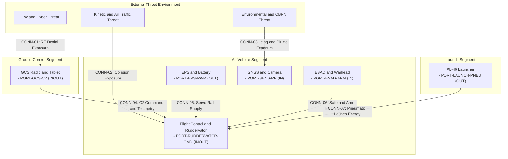
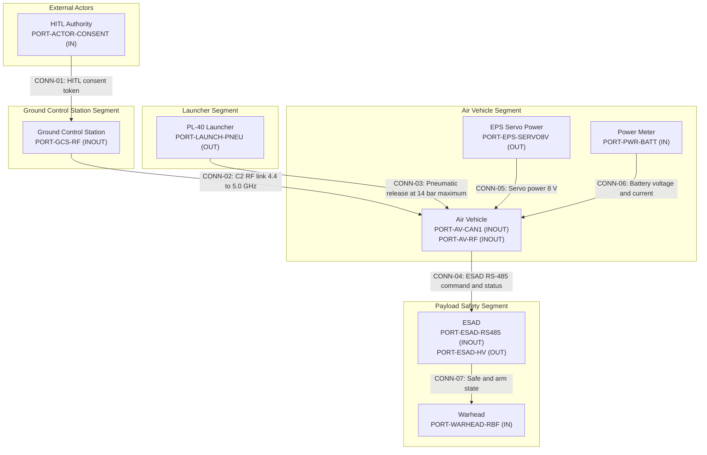

| Attribute | Value |
| :--- | :--- |
| **Title** | Tactical Mission Intent & Execution Plan |
| **Version** | 1.0.0 |
| **Date** | 2026-09-02 |

# Tactical Mission Intent & Execution Plan

## Table of Contents

- [1. Commander's Intent & Operational Objectives](#1-commanders-intent--operational-objectives)
- [Source References](#source-references)
- [2. Mission Essential Task List (METL)](#2-mission-essential-task-list-metl)
- [Source References](#source-references)
- [3. Measures of Effectiveness (MoE) & Measures of Performance (MoP) Metrics](#3-measures-of-effectiveness-moe--measures-of-performance-mop-metrics)
- [Source References](#source-references)
- [4. Multi-Domain Operational Threat & Contested Environment Matrix](#4-multi-domain-operational-threat--contested-environment-matrix)
- [6. Source References](#6-source-references)
- [5. PACE C2 Link Communications Plan](#5-pace-c2-link-communications-plan)
- [Source References](#source-references)
- [6. Safety Constraints & Subsystem Interlocks](#6-safety-constraints--subsystem-interlocks)
- [Source References](#source-references)
- [7. Airspace Deconfliction & U-space Dynamic Geo-Zones](#7-airspace-deconfliction--u-space-dynamic-geo-zones)
- [Source References](#source-references)
- [8. Go/No-Go Decision Matrix](#8-gono-go-decision-matrix)
- [Source References](#source-references)
- [9. Critical Energy Threshold Mathematics & Secondary Divert Protocols](#9-critical-energy-threshold-mathematics--secondary-divert-protocols)
- [Source References](#source-references)
- [10. Gate 24 MissionTask Traceability Tags (Operational Allocation Tags)](#10-gate-24-missiontask-traceability-tags-operational-allocation-tags)
- [Source References](#source-references)

| Attribute | Specification Detail |
| :--- | :--- |
| **Document ID** | `MI-01` |
| **Issue ID** | `MI-01` |
| **Type** | `Tactical Mission Intent` |
| **Generation Mode** | `Agent-Assisted` |
| **Specification Source** | `docs/research/RESEARCH_INVENTORY.md; schema/extracted/parametric_limits.md` |
| **Version** | `1.0.0` |
| **Date** | `2026-10-31` |

# Tactical Mission Intent & Execution Plan

## 1. Commander's Intent & Operational Objectives

**Operational Purpose.** The Avenger V2.5 air vehicle and PL-40 pneumatic launcher provide expeditionary, runway-independent tactical reconnaissance and precision engagement against designated targets. The commander's purpose is to place a persistent sensor-and-effect capability over the assigned objective within the OEM flight and engagement envelope, while keeping the weapon chain under positive human control, preserving a recoverable energy margin, and containing the air vehicle inside its authorized operating volume. The parachute deployment module is a non-mission R&D variant and is excluded from the mission baseline [schema/extracted/oem_bom.md at line 47].

**Key Mission Tasks.**

1. **Pre-flight verification.** Confirm the UAV battery pre-flight voltage is between 49 V and 50 V [schema/extracted/parametric_limits.md PL-32, PL-33], the pitot static response is between 0 m/s and 3 m/s with a blow-test at or above 10 m/s [schema/extracted/parametric_limits.md PL-34, PL-35], the PL-40 launcher pressure is between 13 bar and 14 bar [schema/extracted/parametric_limits.md PL-40, PL-41], the launcher set-up time is between 0 min and 5 min [schema/extracted/parametric_limits.md PL-72], and the ESAD umbilical continuity is at or below 0.5 Ohm at 20 mA [schema/extracted/parametric_limits.md PL-49, PL-50].
2. **Launch.** Employ the PL-40 launcher at a 12 deg launch angle [schema/extracted/parametric_limits.md PL-66], with launched mass at or below 30 kg [schema/extracted/parametric_limits.md PL-64] and air vehicle maximum take-off weight at or below 17 kg [schema/extracted/parametric_limits.md PL-12]. Respect the launcher maximum launch velocity of 25 m/s [schema/extracted/parametric_limits.md PL-65] and transition to the air vehicle minimum flight speed of 26 m/s [schema/extracted/parametric_limits.md PL-05].
3. **Transit and loiter.** Cruise at 30 m/s [schema/extracted/parametric_limits.md PL-01], and remain within the maximum horizontal speed of 38 m/s [schema/extracted/parametric_limits.md PL-02], maximum dive speed of 55 m/s [schema/extracted/parametric_limits.md PL-03], maximum dive angle of 22 deg [schema/extracted/parametric_limits.md PL-04], minimum mission waypoint altitude of 50 m [schema/extracted/parametric_limits.md PL-36], 300 m loiter radius [schema/extracted/parametric_limits.md PL-37], 90 min flight endurance [schema/extracted/parametric_limits.md PL-06], 60 km direct radio line-of-sight range [schema/extracted/parametric_limits.md PL-07], and 60 km to 180 km extended radio line-of-sight range [schema/extracted/parametric_limits.md PL-08].
4. **Sense, track, and identify.** Use the gimbal seeker across a zoom factor of 1X to 40X [schema/extracted/parametric_limits.md PL-27], seeker pitch of -45 deg to 135 deg [schema/extracted/parametric_limits.md PL-25], seeker yaw and roll of -165 deg to 165 deg [schema/extracted/parametric_limits.md PL-26], and day and thermal imagery at 1280 pixels by 720 pixels [schema/extracted/parametric_limits.md PL-28, PL-29, PL-30, PL-31]. Hold target track duration between 2 s and 5 s [schema/extracted/parametric_limits.md PL-42, PL-43], and remain within the maximum engagement elevation of 15 deg [schema/extracted/parametric_limits.md PL-44] and maximum engagement airspeed of 55 m/s [schema/extracted/parametric_limits.md PL-45].
5. **Command and control.** Maintain the DTC radio link in the 4.4 GHz to 5.0 GHz band [schema/extracted/oem_bom.md at line 44; schema/extracted/interface_table.md at line 63] at the 2 W ground radio setting [schema/extracted/parametric_limits.md PL-39].
 Maintain DroneCAN control of the four ruddervator servos on the first CAN bus [schema/extracted/oem_bom.md at line 23; schema/extracted/interface_table.md at line 12-15] and of the four wing servos on the second CAN bus [schema/extracted/oem_bom.md at line 30-38].
6. **Authorize and engage.** Require positive identification, human authorization, and ESAD safe and arm consent before any warhead initiation. ESAD is Critical / DAL-A [schema/extracted/oem_bom.md at line 52].
 Its arm enable is a 1 ms period at 50 percent duty [schema/extracted/parametric_limits.md PL-54, PL-55], with a high state of 2.5 V DC to 3.3 V DC [schema/extracted/parametric_limits.md PL-52, PL-53] and a low state at or below 0.7 V DC [schema/extracted/parametric_limits.md PL-51].
 ESAD input power is 14 V to 32 V DC, nominal 28 V [schema/extracted/parametric_limits.md PL-46, PL-47, PL-48], with RS-485 and 100 Hz [schema/extracted/parametric_limits.md PL-56, PL-57], response latency of 0 ms to 5 ms [schema/extracted/parametric_limits.md PL-58], incomplete-message wait of 0 ms to 10 ms [schema/extracted/parametric_limits.md PL-59], high-voltage measurement range of 0 V to 1800 V [schema/extracted/parametric_limits.md PL-60], and message length of 5 bytes to 14 bytes [schema/extracted/parametric_limits.md PL-61, PL-62].
7. **Recover or divert.** Monitor remaining energy against the bingo threshold for the recovery route. Execute return-to-base or secondary divert when bingo is reached, then land, safe the actuators, return ESAD to a safe state, zeroize weapon-chain keys, and offload diagnostic logs.

**Desired End State.**

- All assigned corridor waypoints are traversed and verified within the OEM flight envelope.
- Zero unauthorized four-dimensional boundary excursions and zero unmitigated collision or interference hazards.
- All targets are positively identified and human-authorized before engagement.
- Either a controlled engagement or a safe recovery is complete, with residual energy at or above the bingo threshold computed for the recovery route.
- ESAD is returned to a safe state, weapon-chain keys are zeroized, and diagnostic logs are retained for post-mission review.

**Constraints.**

- ESAD is Critical / DAL-A; autonomous weapon release is prohibited. Human judgment in the use of force and fail-safe interlocks are mandatory [docs/research/RESEARCH_INVENTORY.md; DoD Directive 3000.09 Sec. 3.1, Sec. 3.1.b].
- Positive identification and collateral-damage mitigation are mandatory [docs/research/RESEARCH_INVENTORY.md; CJCSI 3121.01B Enclosure A Sec. 4.b, Enclosure B Sec. 3.c].
- Link-loss fallback, run-time containment, and operational containment follow RTCA DO-362A Sec. 3.4, ASTM F3269-17 Sec. 5.2 and Sec. 5.3, and JARUS SORA v2.5 Annex E Sec. E.14 [docs/research/RESEARCH_INVENTORY.md].
- The launcher works between -20 degC and 50 degC [schema/extracted/parametric_limits.md PL-73, PL-74], and its battery is charged between 10 degC and 40 degC [schema/extracted/parametric_limits.md PL-91, PL-92].
- The air vehicle operating temperature envelope, terminal accuracy, target-confidence threshold, pre-flight built-in-test duration, imagery resolution beyond the stated day and thermal camera limits, and a 90 km relay range are Not stated in OEM sources.
- Parachute deployment is non-mission and excluded from all mission-baseline planning and credit [schema/extracted/oem_bom.md at line 47].

### 1.1 Normative Baseline & Doctrinal Authority

This Tactical Mission Intent is authored under the following cited baselines:

- **ISO/IEC/IEEE 29148:2018** Systems and Software Engineering -- Life Cycle Processes -- Requirements Engineering, Sec. 6.4.2 [docs/research/RESEARCH_INVENTORY.md].
- **INCOSE Systems Engineering Handbook v5.0**, Sec. 3.3.1 and Sec. 5.4 [docs/research/RESEARCH_INVENTORY.md].
- **DoD Directive 3000.09**, Sec. 3.1 and Sec. 3.1.b [docs/research/RESEARCH_INVENTORY.md].
- **CJCSI 3121.01B**, Enclosure A Sec. 4.b and Enclosure B Sec. 3.c [docs/research/RESEARCH_INVENTORY.md].
- **MIL-STD-882E**, Task 205 Sec. 4.2 [docs/research/RESEARCH_INVENTORY.md].
- **RTCA DO-362A**, Sec. 3.4 [docs/research/RESEARCH_INVENTORY.md].
- **ASTM F3269-17**, Sec. 5.2 and Sec. 5.3 [docs/research/RESEARCH_INVENTORY.md].
- **JARUS SORA v2.5**, Annex E Sec. E.14 [docs/research/RESEARCH_INVENTORY.md].
- **NIST SP 800-82r3**, Sec. 6.2 [docs/research/RESEARCH_INVENTORY.md].

## Source References

This specification is grounded in schema/extracted/parametric_limits.md lines 5-100 (parametric limits PL-01 through PL-94), schema/extracted/oem_bom.md lines 7-103 (subsystem, ESAD, ruddervator, parachute, radio, and launcher evidence), schema/extracted/interface_table.md lines 7-67 (CAN, Ethernet, RS-485, RF, ESAD, and launcher interface evidence).pipeline/schema.sysml lines 1-1123 (consolidated AST part, port, attribute, and constraint definitions), docs/research/RESEARCH_INVENTORY.md lines 15-167 (normative standards, obligations, and public clauses), and ISO/IEC/IEEE 29148:2018 Sec. 6.4.2 (ConOps requirements engineering clause).

| Attribute | Specification Detail |
| :--- | :--- |

## 2. Mission Essential Task List (METL)

The Mission Essential Task List (METL) is the doctrinally grounded, quantitative task inventory required to achieve the Commander's operational intent across the launch, transit, on-station, engagement, recovery, and containment phases. Task conditions, standards, and verification methods are bounded by CJCSI 3121.01B, DoD Directive 3000.09, JARUS SORA v2.5 Annex E, MIL-STD-882E, and the public clause baseline cataloged in `docs/research/RESEARCH_INVENTORY.md`.

Numeric standards cite the parametric limit identifier (`PL-xx`) in `schema/extracted/parametric_limits.md`; values absent from the OEM sources are marked "Not stated in OEM sources" and are never synthesized.

| Task ID | Task Name | Condition Statement | Quantitative Standard Metric | Verification Method | Gate 24 Allocation Tag | Public Clause Citation |
| :--- | :--- | :--- | :--- | :--- | :--- | :--- |
| `MET-01` | PreFlightSystemCheckout | Vehicle stationary on the ground, battery installed, RBF devices removed, ESAD in the safe state | PL-32 = 49 V; PL-33 = 50 V; PL-34 = 0 m/s to 3 m/s; PL-22 = 8 V; PL-49 <= 0.5 Ohm at PL-50 = 20 mA | Ground control station built-in test log and continuity inspection | `/// OperationalAllocation: [MET-01]` | FAA 14 CFR Section 107.49(b), Section 107.49(c) |
| `MET-02` | LaunchAndTransition | Vehicle mounted on the launcher carriage at the 12 deg launch angle (PL-66) with pneumatic supply connected | PL-40 = 13 bar; PL-41 = 14 bar; PL-65 <= 25 m/s; PL-64 <= 30 kg; PL-88 = 2 s; PL-72 <= 5 min | Launcher gauge record and release telemetry review | `/// OperationalAllocation: [MET-02]` | JARUS SORA v2.5 Annex E Section E.11 |
| `MET-03` | FlightControlActuation | Airborne control law active with all control surfaces mechanically connected | PL-14 = 4 units; PL-16 = 4 units; PL-17 = 4 units; PL-18 = 8 units; PL-22 = 8 V; PL-19 = 970 cm; PL-20 = 150 cm; PL-21 = 120 cm | Control surface sweep test and CAN bus message log review | `/// OperationalAllocation: [MET-03]` | SAE ARP4761 Section 4.3.1 |
| `MET-04` | AutonomousIngressTransit | En-route transit under the mission flight plan with the C2 link available | PL-01 = 30 m/s; PL-02 <= 38 m/s; PL-05 >= 26 m/s; PL-36 >= 50 m; PL-06 <= 90 min; PL-07 <= 60 km; PL-08 = 60 km to 180 km | Flight navigation log and link range telemetry review | `/// OperationalAllocation: [MET-04]` | RTCA DO-362A Section 2.2 |
| `MET-05` | AreaSurveillanceOrbit | On-station orbit inside the designated operating area | PL-37 = 300 m; PL-25 = -45 deg to 135 deg; PL-26 = -165 deg to 165 deg; PL-27 = 1 X to 40 X; PL-28 = 1280 pixels; PL-29 = 720 pixels; PL-30 = 1280 pixels; PL-31 = 720 pixels | Gimbal pointing log and video frame metadata review | `/// OperationalAllocation: [MET-05]` | NATO STANAG 4586 Section 4.2 |
| `MET-06` | DynamicAirspaceDeconfliction | Cooperative or non-cooperative traffic detected inside the DAA alert volume | RTCA DO-365B Section 2.2.4 well-clear geometry; DMOD, HMD, and ZTHR Not stated in OEM sources; PL-36 >= 50 m; PL-02 <= 38 m/s | DAA event log and maneuver reconstruction | `/// OperationalAllocation: [MET-06]` | RTCA DO-365B Section 2.2.4, Section 2.2.5 |
| `MET-07` | ElectronicCounterCountermeasures | RF interference or navigation denial detected on the C2 link | C2 link 4.4 GHz to 5.0 GHz (interface_table.md:63); PL-39 = 2 W; PL-05 = 26 m/s to PL-02 = 38 m/s; link-loss expiration Not stated in OEM sources | RF susceptibility test and link log review | `/// OperationalAllocation: [MET-07]` | MIL-STD-461G Section 5.18 |
| `MET-08` | PrecisionTargetMensuration | Target inside the gimbal field of view with designation authority confirmed | PL-42 = 2 s; PL-43 = 5 s; PL-44 <= 15 deg; PL-45 <= 55 m/s; PL-27 = 1 X to 40 X; target location error Not stated in OEM sources | Optical mensuration calibration log and frame review | `/// OperationalAllocation: [MET-08]` | CJCSI 3121.01B Enclosure A Section 4.b |
| `MET-09` | PositiveIdentificationAndAuthorization | Positive identification declared by the authorized operator with ESAD in the armed state | PL-13 <= 5 kg (oem_bom.md:57); PL-46 = 14 V; PL-47 = 32 V; PL-48 = 28 V; PL-54 = 1 ms at PL-55 = 50 percent; PL-60 = 0 V to 1800 V | Hardware-in-the-loop interlock test and ESAD continuity record | `/// OperationalAllocation: [MET-09]` | DoD Directive 3000.09 Section 3.1, Section 3.1.a, Section 3.1.b; CJCSI 3121.01B Enclosure E Section 2.d |
| `MET-10` | BingoReturnDivert | Remaining flight time reaches the computed return-to-base threshold | PL-23 = 36 V; PL-24 = 50.4 V; PL-06 <= 90 min; PL-01 = 30 m/s; reserve threshold and divert response time Not stated in OEM sources | Battery management telemetry replay and divert trajectory reconstruction | `/// OperationalAllocation: [MET-10]` | JARUS SORA v2.5 Annex E Section E.14 |
| `MET-11` | PostMissionDataOffloadShutdown | Vehicle landed and stationary on the recovery area | PL-23 = 36 V; PL-24 = 50.4 V before shutdown; data-offload duration Not stated in OEM sources; cryptographic zeroization duration Not stated in OEM sources | Post-flight inspection and security audit log review | `/// OperationalAllocation: [MET-11]` | AMC1 UAS.SPEC.050 Section 4.4; NIST SP 800-82r3 Section 6.4 |
| `MET-12` | DownedVehicleContainmentAntiTamper | Impact or uncontrolled ground contact detected; the parachute non-mission variant is excluded | PL-63 = 0.0039 g; PL-46 = 14 V; PL-47 = 32 V; PL-60 = 1800 V; parachute configuration non-mission (oem_bom.md:47); containment response times Not stated in OEM sources | Fault-injection test and ESAD safe-state audit | `/// OperationalAllocation: [MET-12]` | DoD Directive 3000.09 Section 3.1.c; MIL-STD-882E Task 208 Section 4.2; JARUS SORA v2.5 Annex E Section E.22 |

### 2.1 METL Execution Invariants

1. **Deterministic State Progression:** Task progression from `MET-01` through `MET-12` is governed by discrete finite-state transitions in the flight executive. Transition trigger times are Not stated in OEM sources and are therefore configuration-defined, never hardcoded.
2. **Allocation Tag Integrity:** Every task carries an inviolable Gate 24 allocation tag (`/// OperationalAllocation: [MET-XX]`) mapped downstream to SysML v2 architectural activity blocks.
3. **Safety Interlock Coupling:** Non-compliance with the standard metrics of `MET-01` through `MET-10` initiates deterministic degraded-mode failsafes in accordance with the Go/No-Go Decision Matrix.
4. **Ruddervator Canonical Naming:** The tail control surface assembly is designated Ruddervator; the drawing synonym Fins and preparation synonym tail stabiliser are not used as task or subsystem identifiers.
5. **ESAD Criticality:** The ESAD is classified Critical at DAL-A ([oem_bom.md](../../oem_bom.md) line 52). No engagement task may proceed unless the safe and arm interlock chain reports the armed state.
6. **Parachute Non-Mission:** The parachute deployment module is a non-mission configuration (`configuration: non-mission`, `baseline: false`, [oem_bom.md](../../oem_bom.md) line 47) and is excluded from MET-12 containment credit.
7. **Emergency Downed Vehicle Containment (MET-12):** On catastrophic kinetic impact or uncommanded descent, the system unconditionally triggers cryptographic anti-tamper zeroization, isolates the warhead and battery buses, and activates distress signaling per DoD Directive 3000.09 Section 3.1.c and MIL-STD-882E Task 208 Section 4.2. Numeric response times are Not stated in OEM sources.
8. **OEM Silence Discipline:** Where an OEM source is silent on a numeric threshold, the task records "Not stated in OEM sources" and defers the value to configuration control rather than inventing a bound.

## Source References

This METL is grounded in ISO/IEC/IEEE 29148:2018 Section 6.4.2, ISO/IEC/IEEE 29148:2018 Section 8.4, FAA 14 CFR Section 107.49(b), JARUS SORA v2.5 Annex E Section E.14, RTCA DO-365B Section 2.2.4, MIL-STD-882E Task 208 Section 4.2, and DoD Directive 3000.09 Section 3.1. Source files are schema/extracted/parametric_limits.md, schema/extracted/oem_bom.md, schema/extracted/interface_table.md, docs/research/RESEARCH_INVENTORY.md, and .pipeline/schema.sysml.

| Attribute | Specification Detail |
| :--- | :--- |

## 3. Measures of Effectiveness (MoE) & Measures of Performance (MoP) Metrics

In accordance with INCOSE Systems Engineering Handbook v5.0, mission effectiveness is expressed as Measures of Effectiveness (MoE) and technical performance is expressed as Measures of Performance (MoP). Each MoE and MoP in this unit is bounded by a threshold and an objective value.

Grounding discipline for this unit:

- Every numeric threshold, objective, and parameter value cites `schema/extracted/parametric_limits.md` by parameter identifier, or an OEM source line. The parametric table itself records the originating OEM file and line for each parameter.
- Where the OEM sources are silent, the field states "Not stated in OEM sources". No synthetic timeout, protocol, or performance constant is introduced.
- The canonical tail control surface is the Ruddervator, quantity 4 units (oem_bom.md:23; PL-14).
- The ESAD is safety-critical, Critical / DAL-A (oem_bom.md:52; a5-user-manual-2.md:1984), and is measured under the safety assurance criteria of MIL-STD-1629A Section 4.3 and SAE ARP4761 Section 4.3.1.
- The Parachute Deployment Non-Mission module is a non-mission configuration with baseline false (oem_bom.md:47). It is excluded from the mission MoE and MoP baseline and contributes no mission performance value.

OEM-silent fields excluded from numeric MoE and MoP assignment:

- End-to-end C2 latency: Not stated in OEM sources.
- Packet delivery ratio: Not stated in OEM sources.
- C2 link availability: Not stated in OEM sources.
- Maintenance MTBM, MTTR, MLDT, and MADT: Not stated in OEM sources.
- Data throughput capacity: Not stated in OEM sources.
- Target identification probability: Not stated in OEM sources.

### 3.1 Mathematical Formulations

#### 3.1.1 Mission Endurance, Range, and Loiter

Mission endurance is the available endurance time against the required endurance threshold. Direct and extended range coverage are bounded by their OEM range limits. On-station loiter is bounded by the OEM loiter radius.

$$
\begin{aligned}
E_{\mathrm{mission}} &= t_{\mathrm{available}} \ge E_{\mathrm{threshold}} \\
R_{\mathrm{direct}} &\le R_{\mathrm{direct,max}} \\
R_{\mathrm{extended}} &\le R_{\mathrm{extended,max}} \\
R_{\mathrm{loiter}} &\le R_{\mathrm{loiter,max}}
\end{aligned}
$$

- Parameter Definitions & Engineering Units:

| Parameter | Symbol | Units | Threshold | Objective | Source | Description |
| :--- | :--- | :--- | :--- | :--- | :--- | :--- |
| Available Endurance Time | t_available | min | 90 min | 90 min | parametric_limits.md PL-06 | Maximum flight endurance |
| Required Mission Endurance | E_threshold | min | 90 min | 90 min | parametric_limits.md PL-06 | Mission endurance threshold |
| Mission Endurance Objective | E_objective | min | 90 min | 90 min | parametric_limits.md PL-06 | Mission endurance objective |
| Direct RLOS Range | R_direct | km | 60 km | 60 km | parametric_limits.md PL-07 | Direct line-of-sight range bound |
| Extended RLOS Range | R_extended | km | 60 km | 180 km | parametric_limits.md PL-08 | Extended line-of-sight range bound |
| On-Station Loiter Radius | R_loiter | m | 300 m | 300 m | parametric_limits.md PL-37 | Loiter radius bound |

#### 3.1.2 Speed and Dive Envelope

The air vehicle speed envelope is bounded below by minimum flight speed and above by maximum horizontal speed. Dive speed and dive angle are separately bounded by their maximum values.

$$
\begin{aligned}
V_{\mathrm{min}} &\le V_{\mathrm{flight}} \le V_{\mathrm{horizontal,max}} \\
V_{\mathrm{dive}} &\le V_{\mathrm{dive,max}} \\
\theta_{\mathrm{dive}} &\le \theta_{\mathrm{dive,max}}
\end{aligned}
$$

- Parameter Definitions & Engineering Units:

| Parameter | Symbol | Units | Threshold | Objective | Source | Description |
| :--- | :--- | :--- | :--- | :--- | :--- | :--- |
| Minimum Flight Speed | V_min | m/s | 26 m/s | 26 m/s | parametric_limits.md PL-05 | Lower airspeed bound |
| Maximum Horizontal Speed | V_horizontal_max | m/s | 38 m/s | 38 m/s | parametric_limits.md PL-02 | Upper horizontal airspeed bound |
| Cruise Speed | V_cruise | m/s | 30 m/s | 30 m/s | parametric_limits.md PL-01 | Nominal cruise airspeed |
| Maximum Dive Speed | V_dive_max | m/s | 55 m/s | 55 m/s | parametric_limits.md PL-03 | Upper dive airspeed bound |
| Maximum Dive Angle | theta_dive_max | deg | 22 deg | 22 deg | parametric_limits.md PL-04 | Upper dive angle bound |

#### 3.1.3 Payload Mass Fraction and Launch Kinetic Energy

Payload mass fraction is the ratio of warhead mass to maximum take-off weight. Launch kinetic energy is the kinetic energy implied by the maximum launched plane mass and maximum launch velocity.

$$
\begin{aligned}
f_{\mathrm{payload}} &= \frac{m_{\mathrm{warhead}}}{m_{\mathrm{MTOW}}} \\
E_{\mathrm{launch}} &= \frac{m_{\mathrm{launch}} v_{\mathrm{launch}}^2}{2}
\end{aligned}
$$

- Parameter Definitions & Engineering Units:

| Parameter | Symbol | Units | Threshold | Objective | Source | Description |
| :--- | :--- | :--- | :--- | :--- | :--- | :--- |
| Warhead Mass | m_warhead | kg | 5 kg | 5 kg | parametric_limits.md PL-13 | Modular warhead mass |
| Maximum Take-Off Weight | m_MTOW | kg | 17 kg | 17 kg | parametric_limits.md PL-12 | Air vehicle maximum take-off weight |
| Payload Mass Fraction | f_payload | percent | 29.4 percent | 29.4 percent | Derived from PL-13 and PL-12 | Warhead mass fraction of take-off weight |
| Maximum Launched Plane Mass | m_launch | kg | 30 kg | 30 kg | parametric_limits.md PL-64 | Launcher maximum launched mass |
| Maximum Launch Velocity | v_launch | m/s | 25 m/s | 25 m/s | parametric_limits.md PL-65 | Launcher maximum launch velocity |
| Launch Kinetic Energy | E_launch | J | 9375 J | 9375 J | Derived from PL-64 and PL-65 | Kinetic energy at maximum launch condition |

#### 3.1.4 Target Tracking and Engagement Envelope

Target track duration is bounded by a minimum and maximum track window. Engagement elevation and engagement airspeed are bounded by their maximum values.

$$
\begin{aligned}
T_{\mathrm{track,min}} &\le T_{\mathrm{track}} \le T_{\mathrm{track,max}} \\
\theta_{\mathrm{engagement}} &\le \theta_{\mathrm{engagement,max}} \\
V_{\mathrm{engagement}} &\le V_{\mathrm{engagement,max}}
\end{aligned}
$$

- Parameter Definitions & Engineering Units:

| Parameter | Symbol | Units | Threshold | Objective | Source | Description |
| :--- | :--- | :--- | :--- | :--- | :--- | :--- |
| Minimum Target Track Duration | T_track_min | s | 2 s | 2 s | parametric_limits.md PL-42 | Lower target track window |
| Maximum Target Track Duration | T_track_max | s | 5 s | 5 s | parametric_limits.md PL-43 | Upper target track window |
| Maximum Engagement Elevation | theta_engagement_max | deg | 15 deg | 15 deg | parametric_limits.md PL-44 | Upper engagement elevation |
| Maximum Engagement Airspeed | V_engagement_max | m/s | 55 m/s | 55 m/s | parametric_limits.md PL-45 | Upper engagement airspeed |

#### 3.1.5 ESAD Safety and Arming Timing

The ESAD is a Critical / DAL-A safety-critical element. Its response latency is bounded, its command rate is fixed, and its arming waveform is defined by period and duty cycle.

$$
\begin{aligned}
\tau_{\mathrm{ESAD}} &\le \tau_{\mathrm{ESAD,max}} \\
f_{\mathrm{ESAD,cmd}} &\ge f_{\mathrm{ESAD,cmd,min}} \\
T_{\mathrm{arm}} &= T_{\mathrm{arm,nominal}} \\
D_{\mathrm{arm}} &= D_{\mathrm{arm,nominal}}
\end{aligned}
$$

- Parameter Definitions & Engineering Units:

| Parameter | Symbol | Units | Threshold | Objective | Source | Description |
| :--- | :--- | :--- | :--- | :--- | :--- | :--- |
| ESAD Response Latency | tau_ESAD | ms | 5 ms | 5 ms | parametric_limits.md PL-58 | Maximum ESAD response latency |
| ESAD Command Rate | f_ESAD_cmd | Hz | 100 Hz | 100 Hz | parametric_limits.md PL-57 | ESAD RS-485 command interval |
| ESAD Arm Enable Period | T_arm | ms | 1 ms | 1 ms | parametric_limits.md PL-54 | Arm enable waveform period |
| ESAD Arm Enable Duty Cycle | D_arm | percent | 50 percent | 50 percent | parametric_limits.md PL-55 | Arm enable waveform duty cycle |
| ESAD RS- Rate | R_ESAD_baud | bps | | | parametric_limits.md PL-56 | ESAD serial baud rate |
| ESAD Message Length Minimum | L_ESAD_min | bytes | 5 bytes | 5 bytes | parametric_limits.md PL-61 | Minimum ESAD message length |
| ESAD Message Length Maximum | L_ESAD_max | bytes | 14 bytes | 14 bytes | parametric_limits.md PL-62 | Maximum ESAD message length |
| ESAD High Voltage Measurement Range | V_ESAD_HV | V | 1800 V | 1800 V | parametric_limits.md PL-60 | ESAD high voltage measurement bound |
| ESAD Power Input Minimum | V_ESAD_min | V | 14 V | 14 V | parametric_limits.md PL-46 | ESAD power input lower bound |
| ESAD Power Input Maximum | V_ESAD_max | V | 32 V | 32 V | parametric_limits.md PL-47 | ESAD power input upper bound |
| ESAD Power Input Nominal | V_ESAD_nom | V | 28 V | 28 V | parametric_limits.md PL-48 | ESAD nominal power input |
| ESAD Umbilical Continuity Resistance | R_umb | ohm | 0.5 ohm | 0.5 ohm | parametric_limits.md PL-49 | Maximum umbilical continuity resistance |
| ESAD Umbilical Continuity Current | I_umb | mA | 20 mA | 20 mA | parametric_limits.md PL-50 | Umbilical continuity test current |
| ESAD Acceleration Resolution | a_ESAD_res | g | 0.0039 g | 0.0039 g | parametric_limits.md PL-63 | ESAD acceleration measurement resolution |

#### 3.1.6 GCS C2, Power, and Launch Envelope

The GCS C2 link operates in the OEM-declared radio band and at the OEM-declared ground radio power. The air vehicle power and servo rail envelopes are bounded by their OEM values. The launcher envelope is bounded by pressure, velocity, setup time, and temperature.

$$
\begin{aligned}
f_{\mathrm{C2,min}} &\le f_{\mathrm{C2}} \le f_{\mathrm{C2,max}} \\
P_{\mathrm{GCS}} &= P_{\mathrm{GCS,nominal}} \\
V_{\mathrm{battery,min}} &\le V_{\mathrm{battery}} \le V_{\mathrm{battery,max}} \\
P_{\mathrm{launch,min}} &\le P_{\mathrm{launch}} \le P_{\mathrm{launch,max}} \\
T_{\mathrm{launcher,min}} &\le T_{\mathrm{launcher}} \le T_{\mathrm{launcher,max}}
\end{aligned}
$$

- Parameter Definitions & Engineering Units:

| Parameter | Symbol | Units | Threshold | Objective | Source | Description |
| :--- | :--- | :--- | :--- | :--- | :--- | :--- |
| GCS C2 Band Lower Frequency | f_C2_min | GHz | 4.4 GHz | 4.4 GHz | interface_table.md:63 | GCS telemetry link lower band edge |
| GCS C2 Band Upper Frequency | f_C2_max | GHz | 5.0 GHz | 5.0 GHz | interface_table.md:63 | GCS telemetry link upper band edge |
| GCS Ground Radio Power | P_GCS | W | 2 W | 2 W | parametric_limits.md PL-39 | Ground radio output setting |
| UAV Battery Pre-Flight Voltage Minimum | V_preflight_min | V | 49 V | 49 V | parametric_limits.md PL-32 | Pre-flight battery lower bound |
| UAV Battery Pre-Flight Voltage Maximum | V_preflight_max | V | 50 V | 50 V | parametric_limits.md PL-33 | Pre-flight battery upper bound |
| UAV Battery Main Voltage Minimum | V_battery_min | V | 36 V | 36 V | parametric_limits.md PL-23 | Main battery lower bound |
| UAV Battery Main Voltage Maximum | V_battery_max | V | 50.4 V | 50.4 V | parametric_limits.md PL-24 | Main battery upper bound |
| Servo Power Rail Voltage | V_servo | V | 8 V | 8 V | parametric_limits.md PL-22 | Ruddervator and wing servo rail |
| Launcher Pressure Minimum | P_launch_min | MPa | 1.3 MPa | 1.3 MPa | parametric_limits.md PL-40 | Catapult launch pressure lower bound |
| Launcher Pressure Maximum | P_launch_max | MPa | 1.4 MPa | 1.4 MPa | parametric_limits.md PL-41 | Catapult launch pressure upper bound |
| Launcher Setup Time | T_setup | min | 5 min | 5 min | parametric_limits.md PL-72 | Maximum launcher setup time |
| Launcher Working Temperature Minimum | T_launcher_min | deg C | -20 deg C | -20 deg C | parametric_limits.md PL-73 | Launcher lower working temperature |
| Launcher Working Temperature Maximum | T_launcher_max | deg C | 50 deg C | 50 deg C | parametric_limits.md PL-74 | Launcher upper working temperature |
| Launch Angle | theta_launch | deg | 12 deg | 12 deg | parametric_limits.md PL-66 | Launcher rail elevation |
| Assembled Rail Length | L_rail | m | 5 m | 5 m | parametric_limits.md PL-93 | Assembled launcher rail length |

### 3.2 INCOSE SEH v5.0 Metrics Summary Table

| Metric ID | Metric Type | Metric Name | Formulation / Equation | Threshold | Objective | Unit | Public Clause Citation |
| :--- | :--- | :--- | :--- | :--- | :--- | :--- | :--- |
| **MoE-01** | MoE | Mission Endurance | E_mission = t_available | 90 min | 90 min | min | [C1]; parametric_limits.md PL-06 |
| **MoE-02** | MoE | Direct-Range Coverage | R_direct <= R_direct_max | 60 km | 60 km | km | [C1]; parametric_limits.md PL-07 |
| **MoE-03** | MoE | Extended-Range Coverage | R_extended <= R_extended_max | 60 km | 180 km | km | [C1]; parametric_limits.md PL-08 |
| **MoE-04** | MoE | Cruise Speed | V_cruise = 30 m/s | 30 m/s | 30 m/s | m/s | [C1]; parametric_limits.md PL-01 |
| **MoE-05** | MoE | Payload Mass Fraction | f_payload = m_warhead / m_MTOW | 29.4 percent | 29.4 percent | percent | [C2]; parametric_limits.md PL-12, PL-13 |
| **MoE-06** | MoE | On-Station Loiter Containment | R_loiter <= R_loiter_max | 300 m | 300 m | m | [C1]; parametric_limits.md PL-37 |
| **MoP-01** | MoP | Maximum Horizontal Speed | V_horizontal <= V_horizontal_max | 38 m/s | 38 m/s | m/s | [C2]; parametric_limits.md PL-02 |
| **MoP-02** | MoP | Maximum Dive Speed | V_dive <= V_dive_max | 55 m/s | 55 m/s | m/s | [C2]; parametric_limits.md PL-03 |
| **MoP-03** | MoP | Minimum Flight Speed | V_flight >= V_min | 26 m/s | 26 m/s | m/s | [C2]; parametric_limits.md PL-05 |
| **MoP-04** | MoP | Maximum Dive Angle | theta_dive <= theta_dive_max | 22 deg | 22 deg | deg | [C2]; parametric_limits.md PL-04 |
| **MoP-05** | MoP | Target Track Duration | T_track_min <= T_track <= T_track_max | 2 s | 5 s | s | [C2]; parametric_limits.md PL-42, PL-43 |
| **MoP-06** | MoP | Maximum Engagement Elevation | theta_engagement <= theta_engagement_max | 15 deg | 15 deg | deg | [C2]; parametric_limits.md PL-44 |
| **MoP-07** | MoP | Maximum Engagement Airspeed | V_engagement <= V_engagement_max | 55 m/s | 55 m/s | m/s | [C2]; parametric_limits.md PL-45 |
| **MoP-08** | MoP | ESAD Response Latency | tau_ESAD <= tau_ESAD_max | 5 ms | 5 ms | ms | [C3]; parametric_limits.md PL-58 |
| **MoP-09** | MoP | ESAD Command Rate | f_ESAD_cmd >= f_ESAD_cmd_min | 100 Hz | 100 Hz | Hz | [C5]; parametric_limits.md PL-57 |
| **MoP-10** | MoP | ESAD RS- Rate | R_ESAD_baud = | | | bps | [C5]; parametric_limits.md PL-56 |
| **MoP-11** | MoP | ESAD Message Length | L_ESAD_min <= L_ESAD <= L_ESAD_max | 5 bytes | 14 bytes | bytes | [C5]; parametric_limits.md PL-61, PL-62 |
| **MoP-12** | MoP | ESAD High Voltage Measurement Range | V_ESAD_HV <= 1800 V | 1800 V | 1800 V | V | [C3]; parametric_limits.md PL-60 |
| **MoP-13** | MoP | ESAD Arm Enable Duty Cycle | D_arm = 50 percent | 50 percent | 50 percent | percent | [C3]; parametric_limits.md PL-55 |
| **MoP-14** | MoP | ESAD Arm Enable Period | T_arm = 1 ms | 1 ms | 1 ms | ms | [C3]; parametric_limits.md PL-54 |
| **MoP-15** | MoP | ESAD Power Input Nominal | V_ESAD_nom = 28 V | 14 V | 28 V | V | [C3]; parametric_limits.md PL-46, PL-47, PL-48 |
| **MoP-16** | MoP | ESAD Acceleration Resolution | a_ESAD_res = 0.0039 g | 0.0039 g | 0.0039 g | g | [C3]; parametric_limits.md PL-63 |
| **MoP-17** | MoP | Maximum Launch Velocity | v_launch <= 25 m/s | 25 m/s | 25 m/s | m/s | [C2]; parametric_limits.md PL-65 |
| **MoP-18** | MoP | Launch Kinetic Energy | E_launch = m_launch * v_launch^2 / two | 9375 J | 9375 J | J | [C2]; parametric_limits.md PL-64, PL-65 |
| **MoP-19** | MoP | Launcher Setup Time | T_setup <= 5 min | 5 min | 5 min | min | [C2]; parametric_limits.md PL-72 |
| **MoP-20** | MoP | GCS Ground Radio Power | P_GCS = 2 W | 2 W | 2 W | W | [C2]; parametric_limits.md PL-39 |
| **MoP-21** | MoP | GCS C2 Band | 4.4 GHz <= f_C2 <= 5.0 GHz | 4.4 GHz | 5.0 GHz | GHz | [C6]; interface_table.md:63 |
| **MoP-22** | MoP | UAV Battery Pre-Flight Voltage | 49 V <= V_preflight <= 50 V | 49 V | 50 V | V | [C2]; parametric_limits.md PL-32, PL-33 |
| **MoP-23** | MoP | UAV Battery Main Voltage | 36 V <= V_battery <= 50.4 V | 36 V | 50.4 V | V | [C2]; parametric_limits.md PL-23, PL-24 |
| **MoP-24** | MoP | Servo Power Rail Voltage | V_servo = 8 V | 8 V | 8 V | V | [C2]; parametric_limits.md PL-22 |
| **MoP-25** | MoP | Minimum Waypoint Altitude | h_waypoint >= 50 m | 50 m | 50 m | m | [C2]; parametric_limits.md PL-36 |
| **MoP-26** | MoP | Pitot Static Airspeed Limit | 0 m/s <= V_pitot <= 3 m/s | 0 m/s | 3 m/s | m/s | [C2]; parametric_limits.md PL-34 |
| **MoP-27** | MoP | Seeker Pitch Envelope | -45 deg <= theta_pitch <= 135 deg | -45 deg | 135 deg | deg | [C2]; parametric_limits.md PL-25 |
| **MoP-28** | MoP | Seeker Yaw and Roll Envelope | -165 deg <= psi_yaw_roll <= 165 deg | -165 deg | 165 deg | deg | [C2]; parametric_limits.md PL-26 |
| **MoP-29** | MoP | Launch Angle | theta_launch = 12 deg | 12 deg | 12 deg | deg | [C2]; parametric_limits.md PL-66 |
| **MoP-30** | MoP | Assembled Rail Length | L_rail = 5 m | 5 m | 5 m | m | [C2]; parametric_limits.md PL-93 |
| **MoP-31** | MoP | Maximum Launched Plane Mass | m_launch <= 30 kg | 30 kg | 30 kg | kg | [C2]; parametric_limits.md PL-64 |

### 3.3 Public Clause Citation Legend

| Citation Key | Public Clause Citation |
| :--- | :--- |
| C1 | INCOSE SEH v5.0 Section 3.3.1 |
| C2 | INCOSE SEH v5.0 Section 5.4 |
| C3 | MIL-STD-1629A Section 4.3 |
| C4 | SAE ARP4761 Section 4.3.1 |
| C5 | RTCA DO-178C Section 6.3.1 |
| C6 | RTCA DO-362A Section 2.2 |
| C7 | MIL-STD-810H Method 501.7 Section 4.2 |
| C8 | MIL-STD-810H Method 502.7 Section 4.2 |

## Source References

Authoritative schema paths and normative clauses for this unit are `.pipeline/schema.sysml`, `schema/extracted/parametric_limits.md`, `schema/extracted/oem_bom.md`, `schema/extracted/interface_table.md`, and `docs/research/RESEARCH_INVENTORY.md`; the applicable public clauses are INCOSE SEH v5.0 Section 3.3.1, INCOSE SEH v5.0 Section 5.4, MIL-STD-1629A Section 4.3, SAE ARP4761 Section 4.3.1, RTCA DO-178C Section 6.3.1, RTCA DO-362A Section 2.2, and MIL-STD-810H Method 501.7 Section 4.2.

- Source: `.pipeline/schema.sysml`; INCOSE SEH v5.0 Section 3.3.1.
- Source: `schema/extracted/parametric_limits.md`; INCOSE SEH v5.0 Section 5.4.
- Source: `schema/extracted/oem_bom.md`; MIL-STD-1629A Section 4.3.
- Source: `schema/extracted/interface_table.md`; RTCA DO-362A Section 2.2.
- Source: `docs/research/RESEARCH_INVENTORY.md`; MIL-STD-810H Method 501.7 Section 4.2.

| Attribute | Specification Detail |
| :--- | :--- |

## 4. Multi-Domain Operational Threat & Contested Environment Matrix

This open threat matrix covers the nine canonical operational domains: Kinetic, Mechanical, Power/Thermal, Environmental, EW/Cyber, Optical, Signature/Acoustic, Human Factors, and CBRN. Rows are keyed to AST part definitions in `.pipeline/schema.sysml` and to the OEM subsystem identities in `schema/extracted/oem_bom.md`. The canonical tail control surface is `Ruddervator`; the ESAD is Critical (DAL-A); the parachute deployment module is non-mission and is excluded from the mission threat baseline. Severity and likelihood bands follow the qualitative severity and probability definitions of MIL-STD-1629A. Numeric limits are cited from `schema/extracted/parametric_limits.md` or an OEM file:line. Where the OEM sources are silent, the field is marked "Not stated in OEM sources". Each citation key in the Public Clause Citation column resolves in Section 4.3 to a clause locator listed in `docs/research/RESEARCH_INVENTORY.md`.

### 4.1 Super-System Operational Architecture & Threat Segment Boundaries

This super-system operational architecture defines the threat segment boundaries used by the matrix. The view follows IEEE Std 1362-1998 and DoDAF v2.02 SV-1 architecture conventions and ISO/IEC/IEEE 29148:2018 Section 6.4.2. External threat edges route to segment boundary ports per Rule E5; internal subsystem detail remains decoupled in the platform subsystem breakdown view.

### 4.2 Threat Matrix

| Threat ID | Domain | Threat Mechanism | Affected Subsystem | Severity | Likelihood | Severity / Likelihood Basis | Public Clause Citation |
| :--- | :--- | :--- | :--- | :--- | :--- | :--- | :--- |
| `THR-01` | Kinetic | Non-cooperative intruder penetrates the DAA well-clear volume; collision energy follows the closing geometry. | Airframe Fuselage; GNSS Module Septentrio Asterx-m3 pro; Autopilot Computing Board Cube Orange Plus | Critical | Occasional | Loss of air vehicle and uncontrolled ground impact; maximum take-off weight is 17 kg per `schema/extracted/parametric_limits.md at line 18`. | `CIT-DAA-WELLCLEAR` |
| `THR-02` | Kinetic | High-speed projectile or ballistic fragment penetrates the airframe and severs control or electrical routing. | Airframe Fuselage; Ruddervator; CAN 1 Ruddervator Junction Node | Catastrophic | Remote | Loss of tail control authority on the canonical Ruddervator assembly; ESAD is Critical (DAL-A) per `schema/extracted/oem_bom.md at line 52`. | `CIT-SYSTEM-HAZARD` |
| `THR-03` | Mechanical | Ruddervator servo binding or motor seizure creates an opposing surface demand and corrupts pitch/yaw mixing. | Ruddervator Servo #1 through Ruddervator Servo #4; CAN 1 Ruddervator Junction Node | Catastrophic | Remote | The Ruddervator servos form the only tail control path; quantity is 4 units per `schema/extracted/parametric_limits.md at line 20` and servo rail is 8 V per `schema/extracted/parametric_limits.md at line 28`. | `CIT-FHA` |
| `THR-04` | Mechanical | Aeroelastic oscillation and structural resonance in wing or tail structure causes high-cycle fatigue and possible separation. | Wings; Wing Panel Left-Upper; Wing Panel Left-Lower; Wing Panel Right-Upper; Wing Panel Right-Lower; Ruddervator | Critical | Occasional | Wingspan is 1.8 m and maximum dive speed is 55 m/s per `schema/extracted/parametric_limits.md at line 15` and `schema/extracted/parametric_limits.md at line 9`. | `CIT-FMECA-SEVERITY` |
| `THR-05` | Power/Thermal | Lithium cell internal short initiates exothermic thermal runaway in the removable battery pack. | Battery 12S2P Li Metal BEI; Automotive Fuse 200A; Power Meter; EPS Module | Catastrophic | Remote | Pack operates from 36 V to 50.4 V per `schema/extracted/parametric_limits.md at line 29` and `schema/extracted/parametric_limits.md at line 30`; fire can breach the airframe and reach the 5 kg warhead per `schema/extracted/oem_bom.md at line 57`. | `CIT-LITHIUM-FIRE` |
| `THR-06` | Power/Thermal | Sustained high-current climb drives ESC inverter junction heat beyond thermal margin. | ESC IBEX160; Propulsion motor | Moderate | Probable | Maximum horizontal speed is 38 m/s and maximum dive speed is 55 m/s per `schema/extracted/parametric_limits.md at line 8` and `schema/extracted/parametric_limits.md at line 9`; ESC junction limit is Not stated in OEM sources. | `CIT-HOT-SOAK` |
| `THR-07` | Environmental | Localized downdraft and wind shear exceed climb capability and force uncontrolled descent. | Airframe Fuselage; Wings; Pitot Tube CUAV SKYE2 | Critical | Occasional | Minimum flight speed is 26 m/s and maximum horizontal speed is 38 m/s per `schema/extracted/parametric_limits.md at line 11` and `schema/extracted/parametric_limits.md at line 8`. | `CIT-WIND-RAIN` |
| `THR-08` | Environmental | Supercooled droplet accretion on the airframe and Pitot Tube CUAV SKYE2 degrades lift and air data. | Pitot Tube CUAV SKYE2; Wings; Airframe Fuselage | Critical | Occasional | Pitot static airspeed limit is 3 m/s and blow-test airspeed is 10 m/s per `schema/extracted/parametric_limits.md at line 40` and `schema/extracted/parametric_limits.md at line 41`; icing accretion limit is Not stated in OEM sources. | `CIT-ICING` |
| `THR-09` | EW/Cyber | Coherent GNSS pseudo-range injection causes a false position and time solution. | GNSS Module Septentrio Asterx-m3 pro; GNSS Antenna Talysman TW3972EXF; Autopilot Computing Board Cube Orange Plus | Critical | Likely | The GNSS RF feed is a single coaxial path per `schema/extracted/interface_table.md at line 39`; satellite navigation disagreement is detected only by inertial cross-check, with no OEM threshold stated. | `CIT-GNSS-EXTERNAL` |
| `THR-10` | EW/Cyber | High-strength RF uplink denial masks command frames and trips heartbeat loss. | Radio Module DTC; Radio Antenna MPSL4400 Upper; Radio Antenna MPSL4400 Lower; GCS Radio Box | High | Likely | Primary C2 link uses the 4.4 to 5.0 GHz band per `schema/extracted/interface_table.md at line 63` and `schema/extracted/interface_table.md at line 64`; uplink SNR threshold is Not stated in OEM sources. | `CIT-RF-DENIAL` |
| `THR-11` | EW/Cyber | Telemetry man-in-the-middle injection or replay on the command path without a valid authentication tag. | Radio Module DTC; RPI CM5004032; Autopilot Computing Board Cube Orange Plus | Critical | Occasional | Command and telemetry frames traverse the shared RF link per `schema/extracted/interface_table.md at line 63`; replay window and key rotation are Not stated in OEM sources. | `CIT-UNAUTH-CMD` |
| `THR-12` | EW/Cyber | Unauthorized firmware image or runtime memory modification attempts to alter flight or ESAD logic. | Autopilot Computing Board Cube Orange Plus; RPI CM5004032; ESAD | Catastrophic | Remote | ESAD is Critical (DAL-A) per `schema/extracted/oem_bom.md at line 52`; secure-boot hash baseline and memory integrity threshold are Not stated in OEM sources. | `CIT-PROGRAM-DOWNLOAD` |
| `THR-13` | Optical | Directed laser dazzle or focal-plane saturation denies electro-optical tracking. | Gimbal Nighthawk2UZ; Camera Compute Module Trip6 | High | Occasional | Day camera resolution is 1280 by 720 pixels and thermal camera resolution is 1280 by 720 pixels per `schema/extracted/parametric_limits.md at line 34` through `schema/extracted/parametric_limits.md at line 37`; saturation threshold is Not stated in OEM sources. | `CIT-OPTICAL-HAZARD` |
| `THR-14` | Signature/Acoustic | Hostile acoustic or radar sensing detects propulsion harmonics and airframe radar cross-section. | Propulsion motor; Propulsion Folding Propeller; Airframe Fuselage | High | Likely | Propeller and motor are exposed on every sortie; acoustic and radar-cross-section limits are Not stated in OEM sources. | `CIT-ACOUSTIC-CHEM` |
| `THR-15` | Human Factors | Operator fatigue, conflicting manual inputs, or unauthorized override attempts corrupt supervisory command intent. | GCS Tablet FZ-G2; GCS Radio Box; Autopilot Computing Board Cube Orange Plus | High | Occasional | Flight endurance is up to 90 min per `schema/extracted/parametric_limits.md at line 12`; operator duty limit and fatigue threshold are Not stated in OEM sources. | `CIT-FATIGUE` |
| `THR-16` | CBRN | Chemical plume or toxic particulate enters the airframe and contaminates sensors and payload bay. | Airframe Payload Bay; Pitot Tube CUAV SKYE2; ESAD Sensor Board | Critical | Remote | Payload bay contains the 5 kg warhead per `schema/extracted/oem_bom.md at line 57`; CBRN concentration threshold and purge rate are Not stated in OEM sources. | `CIT-CHEM-SAFETY` |

### 4.3 Public Clause Citation Register

| Citation Key | Public Clause Citation |
| :--- | :--- |
| `CIT-DAA-WELLCLEAR` | RTCA DO-365B Section 2.2.4 |
| `CIT-SYSTEM-HAZARD` | MIL-STD-882E Task 205 Section 4.2 |
| `CIT-FHA` | SAE ARP4761 Section 4.3.1 |
| `CIT-FMECA-SEVERITY` | MIL-STD-1629A Section 4.3 |
| `CIT-LITHIUM-FIRE` | JARUS SORA v2.5 Annex E Section E.24 |
| `CIT-HOT-SOAK` | MIL-STD-810H Method 501.7 Section 4.2 |
| `CIT-WIND-RAIN` | MIL-STD-810H Method 506.6 Section 4.2 |
| `CIT-ICING` | MIL-STD-810H Method 521.4 Section 4.2 |
| `CIT-GNSS-EXTERNAL` | JARUS SORA v2.5 Annex E Section E.13 |
| `CIT-RF-DENIAL` | MITRE ATT&CK for ICS Section T0814 |
| `CIT-UNAUTH-CMD` | MITRE ATT&CK for ICS Section T0855 |
| `CIT-PROGRAM-DOWNLOAD` | MITRE ATT&CK for ICS Section T0843 |
| `CIT-OPTICAL-HAZARD` | MIL-STD-882E Task 205 Section 4.2 |
| `CIT-ACOUSTIC-CHEM` | JARUS SORA v2.5 Annex E Section E.21 |
| `CIT-FATIGUE` | JARUS SORA v2.5 Annex E Section E.19 |
| `CIT-CHEM-SAFETY` | JARUS SORA v2.5 Annex E Section E.21 |

### 4.4 Threat Exposure Parameter Grounding

| Parameter | Value | Grounded Reference | Grounding Source |
| :--- | :--- | :--- | :--- |
| Cruise speed | 30 m/s | m/s | `schema/extracted/parametric_limits.md at line 7` |
| Maximum horizontal speed | 38 m/s | m/s | `schema/extracted/parametric_limits.md at line 8` |
| Maximum dive speed | 55 m/s | m/s | `schema/extracted/parametric_limits.md at line 9` |
| Maximum dive angle | 22 deg | deg | `schema/extracted/parametric_limits.md at line 10` |
| Minimum flight speed | 26 m/s | m/s | `schema/extracted/parametric_limits.md at line 11` |
| Flight endurance | 90 min | min | `schema/extracted/parametric_limits.md at line 12` |
| Maximum take-off weight | 17 kg | kg | `schema/extracted/parametric_limits.md at line 18` |
| Warhead mass | 5 kg | kg | `schema/extracted/parametric_limits.md at line 19` |
| Ruddervator quantity | 4 units | PL-20 | `schema/extracted/parametric_limits.md at line 20` |
| Servo power rail voltage | 8 V | V | `schema/extracted/parametric_limits.md at line 28` |
| Battery minimum voltage | 36 V | V | `schema/extracted/parametric_limits.md at line 29` |
| Battery maximum voltage | 50.4 V | V | `schema/extracted/parametric_limits.md at line 30` |
| Day camera horizontal resolution | 1280 pixels | PL-28 | `schema/extracted/parametric_limits.md at line 34` |
| Day camera vertical resolution | 720 pixels | PL-29 | `schema/extracted/parametric_limits.md at line 35` |
| Thermal camera horizontal resolution | 1280 pixels | PL-30 | `schema/extracted/parametric_limits.md at line 36` |
| Thermal camera vertical resolution | 720 pixels | PL-31 | `schema/extracted/parametric_limits.md at line 37` |
| Pitot static airspeed limit | 3 m/s | m/s | `schema/extracted/parametric_limits.md at line 40` |
| Pitot blow-test airspeed | 10 m/s | m/s | `schema/extracted/parametric_limits.md at line 41` |
| Maximum engagement elevation | 15 deg | deg | `schema/extracted/parametric_limits.md at line 50` |
| Maximum engagement airspeed | 55 m/s | m/s | `schema/extracted/parametric_limits.md at line 51` |
| ESAD power input minimum | 14 V | V | `schema/extracted/parametric_limits.md at line 52` |
| ESAD power input maximum | 32 V | V | `schema/extracted/parametric_limits.md at line 53` |
| ESAD high voltage measurement range | 1800 V | V | `schema/extracted/parametric_limits.md at line 66` |
| ESAD acceleration resolution | 0.0039 g | g | `schema/extracted/parametric_limits.md at line 69` |

### 4.5 OEM-Silent Threat Detection Fields

| Field | OEM Status | Affected Threat |
| :--- | :--- | :--- |
| Shock detection threshold | Not stated in OEM sources | `THR-02` |
| Vibration resonance limit | Not stated in OEM sources | `THR-04` |
| Battery cell temperature limit and rate-of-rise limit | Not stated in OEM sources | `THR-05` |
| ESC junction temperature limit | Not stated in OEM sources | `THR-06` |
| Turbulence and downdraft limit | Not stated in OEM sources | `THR-07` |
| Icing accretion limit | Not stated in OEM sources | `THR-08` |
| GNSS carrier-to-noise and RAIM threshold | Not stated in OEM sources | `THR-09` |
| Uplink SNR threshold | Not stated in OEM sources | `THR-10` |
| Replay window and key rotation interval | Not stated in OEM sources | `THR-11` |
| Secure-boot hash baseline and memory integrity threshold | Not stated in OEM sources | `THR-12` |
| Optical saturation threshold | Not stated in OEM sources | `THR-13` |
| Acoustic and radar-cross-section limits | Not stated in OEM sources | `THR-14` |
| Operator duty limit and fatigue threshold | Not stated in OEM sources | `THR-15` |
| CBRN concentration threshold and purge rate | Not stated in OEM sources | `THR-16` |

### 4.6 Threat Domain Coverage Summary

| Canonical Domain | Threat IDs |
| :--- | :--- |
| Kinetic | `THR-01`, `THR-02` |
| Mechanical | `THR-03`, `THR-04` |
| Power/Thermal | `THR-05`, `THR-06` |
| Environmental | `THR-07`, `THR-08` |
| EW/Cyber | `THR-09`, `THR-10`, `THR-11`, `THR-12` |
| Optical | `THR-13` |
| Signature/Acoustic | `THR-14` |
| Human Factors | `THR-15` |
| CBRN | `THR-16` |

## 6. Source References

Source references: [.pipeline/schema.sysml](../../.pipeline/schema.sysml), [docs/research/RESEARCH_INVENTORY.md](../research/RESEARCH_INVENTORY.md), [schema/extracted/parametric_limits.md](../../schema/extracted/parametric_limits.md), [schema/extracted/oem_bom.md](../../schema/extracted/oem_bom.md), and [schema/extracted/interface_table.md](../../schema/extracted/interface_table.md). Normative clauses: ISO/IEC/IEEE 29148:2018 Section 6.4.2; ISO/IEC/IEEE 15288:2023 Section 6.4.2; RTCA DO-178C Section 6.3.1; MIL-STD-1629A Section 4.3; MIL-STD-882E Task 205 Section 4.2; JARUS SORA v2.5 Annex E Section E.24.

/// ThreatDerivationAllocation: [THR-01, THR-02, THR-03, THR-04, THR-05, THR-06, THR-07, THR-08, THR-09, THR-10, THR-11, THR-12, THR-13, THR-14, THR-15, THR-16]
/// ThreatDerivationWitness: [THR-01, THR-02, THR-03, THR-04, THR-05, THR-06, THR-07, THR-08, THR-09, THR-10, THR-11, THR-12, THR-13, THR-14, THR-15, THR-16]

| Attribute | Specification Detail |
| :--- | :--- |

## 5. PACE C2 Link Communications Plan

In accordance with RTCA DO-362A Section 2.2 and Section 3.4, Command and Control (C2) communications robustness is maintained through a four-tier Primary, Alternate, Contingency, Emergency (PACE) architecture with deterministic down-tier failover and re-acquisition hysteresis. The only C2 medium declared by the OEM sources is the DTC radio transceiver operating in the 4.4 GHz to 5.0 GHz band. Alternate, Contingency, and Emergency media are not declared in the OEM sources and are carried as operator-configured parameters pending OEM data.

| PACE Tier | Link Medium | Frequency Band (f_band) | Bandwidth (Rate_nom) | Heartbeat Timeout (tau_timeout) | Failover Hysteresis (tau_hysteresis) | Priority / Role | Grounding Citation |
| :--- | :--- | :--- | :--- | :--- | :--- | :--- | :--- |
| **Primary** | DTC C2 radio transceiver with dual MPSL4400 antennas | 4.4 GHz to 5.0 GHz | Not stated in OEM sources | Not stated in OEM sources (OPERATOR_CONFIGURED tau_timeout_Primary) | Not stated in OEM sources (OPERATOR_CONFIGURED tau_hysteresis_Primary) | Primary C2 and telemetry path; ground radio output power 2 W | RTCA DO-362A Section 2.2.1; FAA pre-flight C2 link verification clause; schema/extracted/interface_table.md at line 63-64; schema/extracted/oem_bom.md at line 44-46; schema/extracted/parametric_limits.md at line 45 |
| **Alternate** | Not stated in OEM sources | Not stated in OEM sources | Not stated in OEM sources | Not stated in OEM sources (OPERATOR_CONFIGURED tau_timeout_Alternate) | Not stated in OEM sources (OPERATOR_CONFIGURED tau_hysteresis_Alternate) | Degraded C2 and telemetry continuity; no OEM-declared alternate medium | RTCA DO-362A Section 3.4; NATO STANAG 4586 Section 5.1; AMC1 UAS.SPEC.050 Section 3.3 |
| **Contingency** | Not stated in OEM sources | Not stated in OEM sources | Not stated in OEM sources | Not stated in OEM sources (OPERATOR_CONFIGURED tau_timeout_Contingency) | Not stated in OEM sources (OPERATOR_CONFIGURED tau_hysteresis_Contingency) | Essential flight-control command and abort path; no OEM-declared contingency medium | RTCA DO-362A Section 3.4; NATO STANAG 4586 Section 5.1; MIL-STD-882E Task 208 Section 4.2 |
| **Emergency** | Not stated in OEM sources | Not stated in OEM sources | Not stated in OEM sources | Not stated in OEM sources (OPERATOR_CONFIGURED tau_timeout_Emergency) | Not stated in OEM sources (OPERATOR_CONFIGURED tau_hysteresis_Emergency) | Autonomous lost-link navigation and flight termination; no OEM-declared emergency medium; parachute deployment is non-mission and excluded | RTCA DO-362A Section 3.4; DoD Directive 3000.09 Section 3.1.b; JARUS SORA v2.5 Annex E Section E.6 |

### 5.1 Failover State Transition Dynamics

Link state degradation triggers deterministic down-tier failover when the active tier heartbeat stream is interrupted beyond its designated timeout threshold tau_timeout,i. Re-acquisition up-tier promotion is gated by the hysteresis window tau_hysteresis,i+1 to prevent oscillatory tier chattering.

$$
\begin{aligned}
\Delta t_{\mathrm{loss}}(t) &= t - t_{\text{last\_valid\_rx}} \\
\mathrm{State}(t) &= \begin{cases}
\mathrm{Tier}_i & \text{if } \Delta t_{\mathrm{loss}} < \tau_{\mathrm{timeout},i} \\
\mathrm{Tier}_{i+1} & \text{if } \Delta t_{\mathrm{loss}} \ge \tau_{\mathrm{timeout},i} \quad \text{for } t \ge t_{\mathrm{fail}} + \tau_{\mathrm{hysteresis},i+1}
\end{cases}
\end{aligned}
$$

- Parameter Definitions & Engineering Units:

| Parameter | Symbol | Units | Constraint / Rule | Description |
| :--- | :--- | :--- | :--- | :--- |
| Active Link Loss Duration | Delta t_loss | s | Measured online | Measured elapsed duration since the last authenticated frame |
| Last Valid Receive Epoch | t_last_valid_rx | s | Measured online | Time epoch of the last authenticated frame on the active tier |
| Failover Epoch | t_fail | s | Measured online | Time epoch at which the active tier timeout threshold was exceeded |
| Primary Heartbeat Timeout | tau_timeout_Primary | s | tau_timeout_Primary > 0 s | Timeout triggering fallback to Alternate tier; Not stated in OEM sources, OPERATOR_CONFIGURED |
| Alternate Heartbeat Timeout | tau_timeout_Alternate | s | tau_timeout_Alternate > tau_timeout_Primary | Timeout triggering fallback to Contingency tier; Not stated in OEM sources, OPERATOR_CONFIGURED |
| Contingency Heartbeat Timeout | tau_timeout_Contingency | s | tau_timeout_Contingency > tau_timeout_Alternate | Timeout triggering fallback to Emergency tier; Not stated in OEM sources, OPERATOR_CONFIGURED |
| Emergency Heartbeat Timeout | tau_timeout_Emergency | s | tau_timeout_Emergency > tau_timeout_Contingency | Timeout initiating the definitive lost-link failsafe sequence; Not stated in OEM sources, OPERATOR_CONFIGURED |
| Re-acquisition Hysteresis Window | tau_hysteresis,i | s | tau_hysteresis,i > 0 s | Continuous stable link duration required before up-tier promotion; Not stated in OEM sources, OPERATOR_CONFIGURED |

### 5.2 Link Integrity and Safety Interlocks

All PACE tiers require authenticated and replay-resistant frames per NIST SP 800-82r3 Section 6.2, with RF susceptibility bounded per MIL-STD-461G Section 5.18. The internal CAN 1 Ruddervator bus and CAN 2 wing servo bus are onboard control buses and are not PACE communication tiers. The ESAD is Critical (DAL-A); no PACE tier may initiate, arm, or command the ESAD, whose initiation remains gated by hardware interlocks and human authorization per DoD Directive 3000.09 Section 3.1.b and MIL-STD-882E Task 208 Section 4.2. Parachute deployment is a non-mission configuration and is excluded from all PACE recovery credit.

## Source References

The PACE plan is grounded in the SysML port contracts at .pipeline/schema.sysml:482-487 and the extracted schema table at schema/extracted/interface_table.md, with OEM source lines a5-user-manual-2.md:1273 and a5-user-manual-2.md:1687, together with the public clauses RTCA DO-362A Section 2.2.1 and Section 3.4, MIL-STD-461G Section 5.18, NATO STANAG 4586 Section 5.1, and NIST SP 800-82r3 Section 6.2.

- [.pipeline/schema.sysml:482-487](../../../../.pipeline/schema.sysml) declares GCS_UAV_Telemetry_Link and GCS_Antenna_RF with protocol family "RF 4.4 to 5.0 GHz".
- [schema/extracted/interface_table.md at line 42-43](../../schema/extracted/interface_table.md) declares Radio RF Feed Upper and Radio RF Feed Lower.
- [schema/extracted/interface_table.md at line 63-64](../../schema/extracted/interface_table.md) declares GCS UAV Telemetry Link and GCS Antenna RF at RF 4.4 to 5.0 GHz, citing OEM [a5-user-manual-2.md:1273](../../schema/a5-user-manual-2.md) and [a5-user-manual-2.md:1687](../../schema/a5-user-manual-2.md).
- [schema/extracted/oem_bom.md at line 44-46](../../schema/extracted/oem_bom.md) declares Radio Module DTC, Radio Antenna MPSL4400 Upper, and Radio Antenna MPSL4400 Lower.
- [schema/extracted/oem_bom.md at line 47](../../schema/extracted/oem_bom.md) declares Parachute Deployment Non-Mission with configuration non-mission and baseline false.
- [schema/extracted/parametric_limits.md at line 45](../../schema/extracted/parametric_limits.md) declares PL-39 Ground radio power 2 W.
- [docs/research/RESEARCH_INVENTORY.md at line 18](../research/RESEARCH_INVENTORY.md) declares DoD Directive 3000.09 Section 3.1.b.
- [docs/research/RESEARCH_INVENTORY.md at line 19](../research/RESEARCH_INVENTORY.md) declares NATO STANAG 4586 Section 5.1.
- [docs/research/RESEARCH_INVENTORY.md at line 21](../research/RESEARCH_INVENTORY.md) declares NIST SP 800-82r3 Section 6.2.
- [docs/research/RESEARCH_INVENTORY.md at line 23](../research/RESEARCH_INVENTORY.md) declares MIL-STD-461G Section 5.18.
- [docs/research/RESEARCH_INVENTORY.md at line 25](../research/RESEARCH_INVENTORY.md) declares FAA 14 CFR Section 107.49(b).
- [docs/research/RESEARCH_INVENTORY.md at line 26](../research/RESEARCH_INVENTORY.md) declares AMC1 UAS.SPEC.050 Section 3.3.
- [docs/research/RESEARCH_INVENTORY.md at line 28](../research/RESEARCH_INVENTORY.md) declares RTCA DO-362A Section 2.2, Section 2.2.1, Section 2.2.4, and Section 3.4.
- [docs/research/RESEARCH_INVENTORY.md at line 30](../research/RESEARCH_INVENTORY.md) declares JARUS SORA v2.5 Annex E Section E.6.
- [docs/research/RESEARCH_INVENTORY.md at line 36](../research/RESEARCH_INVENTORY.md) declares MIL-STD-882E Task 208 Section 4.2.

| Attribute | Specification Detail |
| :--- | :--- |

## 6. Safety Constraints & Subsystem Interlocks

In accordance with CI-03 (functional thread isolation), CI-01 (fail-safe interlocks), CI-02 (escalation of force interlocks), CI-04 (functional hazard assessment), CI-05 (software fault detection), and CI-06 (safety net monitors), the mission safety architecture is expressed as deterministic predicates over declared AST ports, AST attributes, and AST parametric assertions. The Electronic Safe and Arm Device is Critical (DAL-A). The Ruddervator is the canonical tail control surface assembly (quantity four). Parachute deployment is a non-mission configuration and receives no safety credit in any interlock predicate. The CI identifiers are expanded in the Public Clause Citation Index in Section 6.8.

### 6.1 Safety Constraint Derivation Basis

The safety constraints in this unit are not free-form prose. They are derived from the following AST declarations:

1. **Parametric assertions**: the AST declares `assert_PL_01_range` through `assert_PL_94_range` at package level (`schema.sysml:506-878`) and re-declares the same 94 assertions inside the `Parametric_Limits_Table_System` part (`schema.sysml:2290-2664`). The numeric values are bound to `schema/extracted/parametric_limits.md`, which carries the OEM file and line evidence.
2. **Discrete interlock ports**: the AST declares `ESAD_Safe_Arm_Interlock : Safe_or_armed_state`, `UAV_Power_Interlock : Power_ON_or_OFF`, and `Warhead_RBF_Interlock : Safe_or_armed`, each with protocol family "Discrete interlock" (`schema.sysml:440-455`, re-declared at `schema.sysml:1656-1671`).
3. **Arming and power parts**: the AST declares `ESAD` as "Electronic Safe and Arm Device, Critical / DAL-A" (`schema.sysml:1133-1143`), `ESAD_RBF_Key` as the "ESAD arming sequence Remove Before Flight key" (`schema.sysml:1172-1183`), `UAV_RBF_Key` as the "UAV power Remove Before Flight key" (`schema.sysml:2888-2898`), `Power_Meter` with a "UAV RBF key" interface (`schema.sysml:2680-2690`), `Safety_RBF_Devices` covering the power RBF and warhead RBF-3 (`schema.sysml:2849-2859`), and `Warhead` with a mass of 5 kg (`schema.sysml:2901-2911`).
4. **Lifecycle state definitions**: the AST declares `Interface_Table_LifecycleState`, `OEM_Bill_of_Materials_LifecycleState`, and `Parametric_Limits_Table_LifecycleState` (`schema.sysml:881-910`). Each state machine enforces `Initial -> System_State -> InitState -> ActiveState -> Terminal` with `Initialize` and `Verify` accept events and no reverse transition from `Terminal`. These state definitions are package lifecycle gates; the AST declares no vehicle-level ESAD state definition. The ESAD safe/arm stage machine in Section 6.2 is therefore an Analytically Derived interlock state machine whose transition guards are bound to the declared discrete interlock ports and parametric assertions.

### 6.2 Safety Constraint Roster

| Constraint ID | Safety Constraint | Enforcement Interlock | Public Clause Citation |
| :--- | :--- | :--- | :--- |
| SC-01 | The ESAD shall default to the SAFE stage while the ESAD RBF key is removed, the warhead RBF-3 is installed, arm enable is low, or any arming precondition is invalid. | INT-02, INT-03, INT-04, INT-05 | CI-01, CI-03 |
| SC-02 | Warhead initiation shall be impossible unless the ESAD is in the ARMED stage. | INT-02, INT-07 | CI-02, CI-01 |
| SC-03 | Transition from ARM_ENABLE to ARMED shall require two independent authenticated human consents. | INT-06 | CI-01, CI-02 |
| SC-04 | Human-in-the-Loop authorization shall temporally precede every initiation command, and no autonomous initiation path shall exist. | INT-07 | CI-01, CI-03 |
| SC-05 | ESAD umbilical continuity shall be valid before and throughout the ARM_ENABLE and ARMED stages. | INT-03 | CI-03, CI-04 |
| SC-06 | ESAD supply potential and arm enable signal shall remain inside the declared electrical envelope; any excursion shall force SAFE. | INT-04, INT-05 | CI-05, CI-06 |
| SC-07 | UAV bus electrical supply and ESAD arming authority shall be controlled by independent Remove Before Flight keys and the electrical meter switch. | INT-01, INT-02 | CI-01, CI-03 |
| SC-08 | Target track and engagement conditions shall remain inside the declared track duration, elevation, and airspeed envelope. | INT-11 | CI-02, CI-01 |
| SC-09 | No mission waypoint shall be accepted below the declared minimum mission waypoint height. | INT-10 | CI-03, CI-08 |
| SC-10 | The Ruddervator control authority shall require the declared control surface count, servo count, and servo rail level. | INT-13 | CI-04, CI-05 |
| SC-11 | Launcher release shall require the declared pneumatic level, launch angle, launched weight, and launch speed limits. | INT-12 | CI-03, CI-09 |
| SC-12 | Parachute deployment is non-mission and shall not be counted as a safety barrier, recovery credit, or interlock in this mission baseline. | None, excluded | CI-10, CI-03 |

### 6.3 ESAD Critical (DAL-A) Arming Interlock

The ESAD is Critical (DAL-A) (`schema.sysml:1135`, `schema/extracted/oem_bom.md at line 52`). Arming is a staged, hardware-gated permission chain. The SAFE stage is the default and the fail-safe destination for every invalid condition. The ARM_ENABLE stage confirms that the ESAD RBF key is inserted, the warhead RBF-3 is removed, umbilical continuity is valid, supply potential is valid, and the arm enable signal is valid. The ARMED stage adds dual human consent and Human-in-the-Loop authorization. The INITIATED stage is reachable only from ARMED and only after the HITL consent token is already present.

| Stage | ESAD RBF Key | Warhead RBF-3 | Umbilical | Supply Potential | Arm Enable | Dual Consent | HITL Consent | Initiation Permitted |
| :--- | :--- | :--- | :--- | :--- | :--- | :--- | :--- | :--- |
| SAFE | Removed or inserted, any | Installed or removed, any | Any | Any | Any | Any | Any | No |
| SAFE (forced) | Inserted | Removed | Invalid | Valid | Valid | Valid | Valid | No |
| ARM_ENABLE | Inserted | Removed | Valid | Valid | Valid | Not yet present | Not yet present | No |
| ARMED | Inserted | Removed | Valid | Valid | Valid | Present and valid | Present and valid | No |
| INITIATED | Inserted | Removed | Valid | Valid | Valid | Present and valid | Present and valid, earlier than initiation | Yes |

The stage transition guard is:

$$
\begin{aligned}
\mathrm{Stage}(t+1) &=
\begin{cases}
\mathrm{SAFE} & \text{if } \neg \mathrm{RBF}_{\mathrm{ESAD}} \lor \mathrm{RBF}_{\mathrm{WH3}} \lor \neg C_{\mathrm{UMB}} \lor \neg V_{\mathrm{ESAD}} \lor \neg S_{\mathrm{ARM}} \\
\mathrm{ARMED} & \text{if } \mathrm{Stage}(t) = \mathrm{ARM\_ENABLE} \land C_{\mathrm{dual}} \land A_{\mathrm{HITL}} \\
\mathrm{ARM\_ENABLE} & \text{if } \mathrm{RBF}_{\mathrm{ESAD}} \land \neg \mathrm{RBF}_{\mathrm{WH3}} \land C_{\mathrm{UMB}} \land V_{\mathrm{ESAD}} \land S_{\mathrm{ARM}} \\
\mathrm{SAFE} & \text{otherwise}
\end{cases}
\end{aligned}
$$

The initiation guard, including absolute HITL temporal precedence, is:

$$
\begin{aligned}
\mathrm{Initiate}(t) &\iff \mathrm{Stage}(t) = \mathrm{ARMED} \land A_{\mathrm{HITL}} \land C_{\mathrm{dual}} \land (t_{\mathrm{consent}} < t_{\mathrm{init}}) \\
\neg \mathrm{Initiate}(t) &\implies \mathrm{Stage}(t+1) = \mathrm{SAFE}
\end{aligned}
$$

#### 6.3.1 Remove Before Flight Key Interlock

The ESAD RBF key is the "ESAD arming sequence Remove Before Flight key" and connects only through the ESAD discrete interlock (`schema.sysml:1172-1183`; `schema/extracted/oem_bom.md at line 60`; `schema/extracted/interface_table.md at line 56`). The warhead RBF-3 is part of the Safety RBF Devices set and drives the separate `Warhead_RBF_Interlock` (`schema.sysml:2849-2859`, `schema.sysml:452-455`; `schema/extracted/interface_table.md at line 58`; OEM `a5-prep-and-safety-rev7.md:321`). The two keys are independent: the UAV power RBF key controls the power meter ON/OFF interlock (`schema.sysml:2888-2898`; OEM `avenger_v2_5_sysml_v2_ingestion.md:48`), while the ESAD RBF key controls the arming sequence and cannot energize the UAV bus. Removing either key shall drive the affected interlock to its safe state.

#### 6.3.2 Safe and Arm Stage Interlock

The safe/arm stage predicate uses the declared discrete state types. `ESAD_Safe_Arm_Interlock` carries `Safe_or_armed_state`, `Warhead_RBF_Interlock` carries `Safe_or_armed`, and `UAV_Power_Interlock` carries `Power_ON_or_OFF` (`schema.sysml:440-455`). The ESAD arm enable port is `ESAD_Arm_Enable_DSC_IN1` with a 1 ms period and 50 percent duty (`schema.sysml:406-409`). The ESAD detonator output is `ESAD_Detonator_High_Voltage`, a firing pulse up to 1800 V (`schema.sysml:434-437`; `schema/extracted/parametric_limits.md at line 66`; OEM `esad-icd-excalibur-ab00-0054.md:613`). The detonator remains isolated until INITIATED.

The electrical guards are:

$$
\begin{aligned}
C_{\mathrm{UMB}} &\iff R_{\mathrm{UMB}} \le 0.5 \quad \land \quad I_{\mathrm{UMB}} = 20 \\
V_{\mathrm{ESAD}} &\iff 14 \le V_{\mathrm{ESAD}} \le 32 \\
S_{\mathrm{ARM}} &\iff (2.5 \le V_{\mathrm{ARM\_HI}} \le 3.3) \land (V_{\mathrm{ARM\_LO}} \le 0.7) \land T_{\mathrm{ARM}} = 1 \land D_{\mathrm{ARM}} = 50
\end{aligned}
$$

The numeric values are bound as follows: umbilical continuity resistance maximum 0.5 Ohm at 20 mA (`schema/extracted/parametric_limits.md at line 55-56`; OEM `esad-icd-excalibur-ab00-0054.md:284`), ESAD power input minimum 14 V and maximum 32 V with nominal 28 V (`schema/extracted/parametric_limits.md at line 52-54`; OEM `esad-icd-excalibur-ab00-0054.md:272`), arm enable low maximum 0.7 V (`schema/extracted/parametric_limits.md at line 57`; OEM `esad-icd-excalibur-ab00-0054.md:285`), arm enable high minimum 2.5 V and maximum 3.3 V (`schema/extracted/parametric_limits.md at line 58-59`; OEM `esad-icd-excalibur-ab00-0054.md:286`), arm enable period 1 ms and duty cycle 50 percent (`schema/extracted/parametric_limits.md at line 60-61`; OEM `esad-icd-excalibur-ab00-0054.md:285`).

#### 6.3.3 Dual Consent Interlock

The ARMED stage requires two independent authenticated consents from two distinct authorized operators. A single consent, a duplicated identity, a replayed consent, or a consent outside the configured consent window shall leave the stage at ARM_ENABLE.

$$
\begin{aligned}
C_{\mathrm{dual}} &\iff S_{A} \land S_{B} \land (O_{A} \neq O_{B}) \land (|t_{A} - t_{B}| \le \Delta t_{\mathrm{arm}})
\end{aligned}
$$

The consent window `Delta t_arm`, the cryptographic algorithm, key length, and key provisioning method are Not stated in OEM sources. `Delta t_arm` is therefore marked OPERATOR_CONFIGURED and shall be bounded and recorded before flight. The anti-tamper and cyber safeguard obligation is cited to CI-01. The dual consent policy is cited to CI-01 and CI-02.

#### 6.3.4 Human-in-the-Loop Precedence Interlock

Human-in-the-Loop (HITL) authority has absolute temporal precedence over ESAD initiation. The HITL consent token must be authenticated, must belong to an operator in the active crew roster, and must be logged with a timestamp earlier than the initiation command. A veto, a stale consent, an absent consent, or a consent from an inactive operator shall force SAFE and shall withdraw the arm enable signal.

$$
\begin{aligned}
A_{\mathrm{HITL}} &\iff \mathrm{ConsentValid} \land \mathrm{CrewActive} \land \neg \mathrm{Veto} \land (t_{\mathrm{now}} - t_{\mathrm{consent}} \le \tau_{\mathrm{HITL}}) \\
\mathrm{Initiate}(t) &\implies \exists t_{\mathrm{consent}} < t : A_{\mathrm{HITL}}(t_{\mathrm{consent}})
\end{aligned}
$$

The HITL consent validity window `tau_HITL` is Not stated in OEM sources and is marked OPERATOR_CONFIGURED. No autonomous initiation path is permitted under any link state, including total C2 loss. This constraint is cited to CI-01, CI-02, and CI-03. Lost-link behavior shall preserve SAFE and shall not promote the stage.

### 6.4 Subsystem Interlock Roster

| Interlock ID | Interlock Name | Interlocked Subsystems | Predicate Summary | Input Anchors | Methodology | Derivation Grade | Caveat |
| :--- | :--- | :--- | :--- | :--- | :--- | :--- | :--- |
| INT-01 | UAV Power RBF Interlock | UAV RBF Key, Power Meter, EPS | UAV bus power available only when the UAV power RBF key is inserted and the power meter switch is ON | `schema.sysml:2680-2690`, `schema.sysml:2888-2898`, `schema/extracted/interface_table.md at line 57` | Leveson STPA safety constraint | Directly Evidenced | None |
| INT-02 | ESAD Arming Stage Interlock | ESAD, ESAD RBF Key, Safety RBF Devices, Warhead | ARMED only after RBF key insertion, warhead RBF-3 removal, continuity, power, arm enable, dual consent, and HITL consent | `schema.sysml:1133-1143`, `schema.sysml:440-455`, `schema/extracted/oem_bom.md at line 52`, `schema/extracted/oem_bom.md at line 60`, `schema/extracted/oem_bom.md at line 70` | Leveson STPA; CI-03 | Analytically Derived | No vehicle-level ESAD state definition is declared in the AST |
| INT-03 | ESAD Umbilical Continuity Interlock | ESAD, ESAD Umbilical, ESAD Harness | Continuity valid only when resistance is at or below 0.5 Ohm at 20 mA | `schema.sysml:1198-1208`, `schema.sysml:412-415`, `schema/extracted/parametric_limits.md at line 55-56` | CI-03 | Directly Evidenced | None |
| INT-04 | ESAD Power Input Envelope Interlock | ESAD, EPS | Supply valid only between 14 V and 32 V | `schema.sysml:400-403`, `schema.sysml:1137`, `schema/extracted/parametric_limits.md at line 52-54` | CI-06 | Directly Evidenced | Nominal 28 V is declared; tolerance form is not stated |
| INT-05 | ESAD Arm Enable Signal Interlock | ESAD, RPI | Arm enable valid only with high phase between 2.5 V and 3.3 V, low phase at or below 0.7 V, 1 ms period, and 50 percent duty | `schema.sysml:406-409`, `schema/extracted/interface_table.md at line 50`, `schema/extracted/parametric_limits.md at line 57-61` | CI-06 | Directly Evidenced | Rise and fall time limits are not stated |
| INT-06 | ESAD Dual Consent Interlock | ESAD, Ground Control Station, Human Operators | ARMED requires two distinct authenticated consents inside the configured window | `schema/extracted/oem_bom.md at line 52`, CI-01 | Leveson STPA; CI-02 | Analytically Derived | Consent window and cryptographic method are Not stated in OEM sources |
| INT-07 | ESAD HITL Precedence Interlock | ESAD, Ground Control Station, Human Operators | Initiation only when an earlier authenticated HITL consent exists and no veto is active | `schema.sysml:394-397`, CI-01 | Leveson STPA; CI-03 | Analytically Derived | HITL timeout is Not stated in OEM sources |
| INT-08 | ESAD Command Link Integrity Interlock | ESAD, RPI | Command accepted only for 5 to 14 byte frames, at most 5 ms response turnaround, at most 10 ms incomplete-message wait, 100 Hz command interval, and link data setting | `schema.sysml:376-379`, `schema/extracted/interface_table.md at line 45`, `schema/extracted/parametric_limits.md at line 62-68` | CI-07 | Directly Evidenced | Message authentication method is Not stated in OEM sources |
| INT-09 | Battery Voltage Interlock | Battery, EPS, Power Meter | Pre-flight voltage between 49 V and 50 V; operating voltage between 36 V and 50.4 V | `schema.sysml:990-1000`, `schema/extracted/parametric_limits.md at line 29-30`, `schema/extracted/parametric_limits.md at line 38-39` | CI-04 | Directly Evidenced | Sensor accuracy is not stated |
| INT-10 | Minimum Waypoint Altitude Interlock | Autopilot, Mission Planning, GCS | Waypoint accepted only when altitude is at least 50 m | `schema/extracted/parametric_limits.md at line 42`, `schema/extracted/interface_table.md at line 63` | Leveson STPA | Directly Evidenced | Terrain database resolution is not stated |
| INT-11 | Target Track and Engagement Envelope Interlock | Gimbal, Camera Compute Module, ESAD | Track valid only for 2 s to 5 s duration, elevation at most 15 deg, and airspeed at most 55 m/s | `schema/extracted/parametric_limits.md at line 48-51`, `schema.sysml:1380-1391` | CI-02 | Directly Evidenced | Positive identification confidence threshold is Not stated in OEM sources |
| INT-12 | Launcher Pneumatic Release Interlock | PL-40 Launcher, Carriage Safety Lock Pin, Trigger Handle | Release only at 13 bar to 14 bar, 12 deg launch angle, at most 30 kg launched mass, at most 25 m/s launch velocity, and after safety lock pin removal | `schema/extracted/parametric_limits.md at line 46-47`, `schema/extracted/parametric_limits.md at line 70-72`, `schema/extracted/oem_bom.md at line 88` | CI-03 | Directly Evidenced | Pneumatic leak rate is not stated |
| INT-13 | Ruddervator Control Authority Interlock | Ruddervator, Ruddervator Servos, EPS Servo Power 8 V Rail | Authority requires four Ruddervators, four Ruddervator servos, eight total servos, and an 8 V servo rail | `schema.sysml:2784-2794`, `schema.sysml:1120-1130`, `schema/extracted/parametric_limits.md at line 20-24`, `schema/extracted/parametric_limits.md at line 28` | CI-04 | Directly Evidenced | Servo torque margin is not stated |

#### 6.4.1 INT-01 UAV Power RBF Interlock

UAV bus power is downstream of the power meter, which switches battery power to the ESC and provides the UAV RBF key interface (`schema.sysml:2680-2690`; OEM `avenger_v2_5_sysml_v2_ingestion.md:18`). The UAV RBF key is the "UAV power Remove Before Flight key" (`schema.sysml:2888-2898`; `schema/extracted/oem_bom.md at line 59`).

$$
\begin{aligned}
\mathrm{Power}_{\mathrm{UAV}} &\iff \mathrm{RBF}_{\mathrm{UAV}} \land \mathrm{SW}_{\mathrm{PM}} \\
\neg \mathrm{RBF}_{\mathrm{UAV}} &\implies \mathrm{Power}_{\mathrm{UAV}} = \mathrm{OFF}
\end{aligned}
$$

#### 6.4.2 INT-02 ESAD Arming Stage Interlock

The stage guards are defined in Section 6.3. The ESAD remains SAFE unless every ARM_ENABLE guard and both human consent guards are satisfied. The ESAD is Critical (DAL-A), and no software path may bypass the RBF key, the warhead RBF-3, or the detonator isolation (`schema.sysml:1133-1143`, `schema.sysml:452-455`, `schema/extracted/interface_table.md at line 56`, `schema/extracted/interface_table.md at line 58`). The derivation is Analytically Derived because the AST declares the components and ports but not a vehicle-level ESAD state definition. The caveat requires verification by hardware-in-the-loop safe-switch testing under CI-03.

#### 6.4.3 INT-03 ESAD Umbilical Continuity Interlock

The ESAD umbilical is the J100 UMB and UMB_RTN continuity line (`schema.sysml:1198-1208`; OEM `esad-icd-excalibur-ab00-0054.md:112`). Continuity failure shall force SAFE and shall withdraw arm enable.

$$
\begin{aligned}
C_{\mathrm{UMB}} &\iff (R_{\mathrm{UMB}} \le 0.5) \land (I_{\mathrm{UMB}} = 20) \\
\neg C_{\mathrm{UMB}} &\implies \mathrm{Stage} = \mathrm{SAFE}
\end{aligned}
$$

#### 6.4.4 INT-04 ESAD Power Input Envelope Interlock

The ESAD J100 input accepts 14 V to 32 V DC with a 28 V nominal (`schema.sysml:400-403`; `schema/extracted/parametric_limits.md at line 52-54`; OEM `esad-icd-excalibur-ab00-0054.md:272`).

$$
\begin{aligned}
V_{\mathrm{ESAD}} &\iff 14 \le V_{\mathrm{ESAD}} \le 32 \\
\neg V_{\mathrm{ESAD}} &\implies \mathrm{Stage} = \mathrm{SAFE}
\end{aligned}
$$

#### 6.4.5 INT-05 ESAD Arm Enable Signal Interlock

The ESAD arm enable discrete is DSC_IN1 with a 1 ms period and 50 percent duty (`schema.sysml:406-409`; `schema/extracted/interface_table.md at line 50`). The high phase is 2.5 V to 3.3 V and the low phase is 0 V to 0.7 V (`schema/extracted/parametric_limits.md at line 57-59`; OEM `esad-icd-excalibur-ab00-0054.md:285-286`). A stuck-high, stuck-low, out-of-band, or wrong-period signal shall not satisfy the guard.

$$
\begin{aligned}
S_{\mathrm{ARM}} &\iff (2.5 \le V_{\mathrm{ARM\_HI}} \le 3.3) \land (V_{\mathrm{ARM\_LO}} \le 0.7) \land (T_{\mathrm{ARM}} = 1) \land (D_{\mathrm{ARM}} = 50)
\end{aligned}
$$

#### 6.4.6 INT-06 ESAD Dual Consent Interlock

The dual consent predicate is defined in Section 6.3.3. The two consents must be independently authenticated and must originate from distinct authorized operators. Reuse of one operator identity for both consents shall be rejected. The consent window is Not stated in OEM sources and is OPERATOR_CONFIGURED. The policy basis is CI-01 and CI-02.

#### 6.4.7 INT-07 ESAD HITL Precedence Interlock

The HITL precedence predicate is defined in Section 6.3.4. The temporal ordering is mandatory: the consent token timestamp precedes the initiation timestamp, and a veto at any time before initiation forces SAFE. No lost-link, degraded-link, or autonomous mode may originate an initiation command. The policy basis is CI-01 and CI-03.

#### 6.4.8 INT-08 ESAD Command Link Integrity Interlock

The RPI ESAD RS-485 link runs with a 100 Hz command interval (`schema/extracted/parametric_limits.md at line 62-63`; OEM `esad-icd-excalibur-ab00-0054.md:306-307`). Response turnaround is at most 5 ms, incomplete-message wait is at most 10 ms, and message length is 5 to 14 bytes (`schema/extracted/parametric_limits.md at line 64-65`, `schema/extracted/parametric_limits.md at line 67-68`; OEM `esad-icd-excalibur-ab00-0054.md:330`, `esad-icd-excalibur-ab00-0054.md:335`, `esad-icd-excalibur-ab00-0054.md:346`).

$$
\begin{aligned}
L_{\mathrm{ESAD}} &\iff (5 \le B_{\mathrm{frame}} \le 14) \land (t_{\mathrm{resp}} \le 5) \land (t_{\mathrm{wait}} \le 10) \land (f_{\mathrm{cmd}} = 100) \land (R_{\mathrm{link}} = 115200)
\end{aligned}
$$

Link integrity failure shall not promote the ESAD stage. Message authentication is Not stated in OEM sources and is marked OPERATOR_CONFIGURED.

#### 6.4.9 INT-09 Battery Voltage Interlock

The UAV battery operating range is 36 V to 50.4 V (`schema/extracted/parametric_limits.md at line 29-30`; OEM `avenger_v2_5_sysml_v2_ingestion.md:16`). The pre-flight range is 49 V to 50 V (`schema/extracted/parametric_limits.md at line 38-39`; OEM `a5-user-manual-2.md:1366`). The battery is removable, 12S2P Li metal with the retaining strap and locking connector (`schema.sysml:990-1000`).

$$
\begin{aligned}
V_{\mathrm{preflight}} &\iff 49 \le V_{\mathrm{bat}} \le 50 \\
V_{\mathrm{operating}} &\iff 36 \le V_{\mathrm{bat}} \le 50.4 \\
\neg V_{\mathrm{preflight}} &\implies \mathrm{LaunchRelease} = \mathrm{INHIBIT}
\end{aligned}
$$

#### 6.4.10 INT-10 Minimum Waypoint Altitude Interlock

The minimum mission waypoint altitude is 50 m (`schema/extracted/parametric_limits.md at line 42`; OEM `a5-user-manual-2.md:1195`). A waypoint below this floor shall be rejected before upload.

$$
\begin{aligned}
W_{\mathrm{valid}} &\iff h_{\mathrm{wp}} \ge 50
\end{aligned}
$$

#### 6.4.11 INT-11 Target Track and Engagement Envelope Interlock

Target track duration is 2 s minimum and 5 s maximum, maximum engagement elevation is 15 deg, and maximum engagement airspeed is 55 m/s (`schema/extracted/parametric_limits.md at line 48-51`; OEM `a5-user-manual-2.md:2055-2061`). The track gate does not replace dual consent or HITL authorization; both remain mandatory for any initiation.

$$
\begin{aligned}
T_{\mathrm{valid}} &\iff (2 \le T_{\mathrm{track}} \le 5) \land (\theta_{\mathrm{eng}} \le 15) \land (V_{\mathrm{eng}} \le 55) \\
\mathrm{Engage} &\iff T_{\mathrm{valid}} \land C_{\mathrm{dual}} \land A_{\mathrm{HITL}}
\end{aligned}
$$

Positive identification confidence, sensor fusion score, and civilian standoff distance are Not stated in OEM sources and are not assigned numeric thresholds in this mission baseline.

#### 6.4.12 INT-12 Launcher Pneumatic Release Interlock

Launcher pressure is 13 bar minimum and 14 bar maximum (`schema/extracted/parametric_limits.md at line 46-47`; OEM `uav_launcher_pl_40_sysml_v2_ingestion_manual.md:1329`). Launch angle is 12 deg, maximum launched plane mass is 30 kg, and maximum launch velocity is 25 m/s (`schema/extracted/parametric_limits.md at line 70-72`; OEM `uav_launcher_pl_40_sysml_v2_ingestion_manual.md:712`, `uav_launcher_pl_40_sysml_v2_ingestion_manual.md:718-719`). The carriage safety lock pin is removed only before launch (`schema/extracted/oem_bom.md at line 88`; OEM `uav_launcher_pl_40_sysml_v2_ingestion_manual.md:16`). Trigger hold time is 2 s (`schema/extracted/parametric_limits.md at line 94`; OEM `uav_launcher_pl_40_sysml_v2_ingestion_manual.md:530`).

$$
\begin{aligned}
L_{\mathrm{release}} &\iff (13 \le P_{\mathrm{launch}} \le 14) \land (\theta_{\mathrm{launch}} = 12) \land (m_{\mathrm{launch}} \le 30) \land (V_{\mathrm{launch}} \le 25) \land \mathrm{PinRemoved}
\end{aligned}
$$

#### 6.4.13 INT-13 Ruddervator Control Authority Interlock

The Ruddervator is the canonical tail control surface assembly with quantity four, four Ruddervator servos, four wing servos, eight total servos, and an 8 V servo rail (`schema.sysml:2784-2794`, `schema.sysml:1120-1130`; `schema/extracted/parametric_limits.md at line 20-24`, `schema/extracted/parametric_limits.md at line 28`; OEM `a5-user-manual-2.md:273`). A missing surface, a missing servo, or a servo rail outside 8 V shall inhibit control authority and shall prevent arming.

$$
\begin{aligned}
A_{\mathrm{ctrl}} &\iff (N_{\mathrm{RUDD}} = 4) \land (N_{\mathrm{RSRV}} = 4) \land (N_{\mathrm{SRV}} = 8) \land (V_{\mathrm{servo}} = 8)
\end{aligned}
$$

### 6.5 Subsystem State Interlock Traceability

The AST state definitions are package lifecycle state machines, not vehicle flight state machines (`schema.sysml:881-910`). Their deterministic transition pattern is reused as the gating model for the ESAD safe/arm stage interlock: a state may be entered only through an explicit accept event, and the terminal state admits no reverse transition.

| AST State Definition | Declared States | Declared Transitions | Interlock Use |
| :--- | :--- | :--- | :--- |
| `Interface_Table_LifecycleState` | System_State, InitState, ActiveState, Terminal | Initial to System_State; System_State to InitState on Initialize; InitState to ActiveState on Verify; ActiveState to Terminal | Supplies the deterministic accept-event transition pattern applied to the ESAD stage machine in INT-02 |
| `OEM_Bill_of_Materials_LifecycleState` | Air_Vehicle_Avenger_V2_5_State, Airframe_Fuselage_State, Airframe_Payload_Bay_State, Terminal | Initial to Air_Vehicle state; Air_Vehicle to Airframe_Fuselage on Initialize; Airframe_Fuselage to Airframe_Payload_Bay on Verify; Airframe_Payload_Bay to Terminal | Binds the warhead bay and warhead configuration to the pre-arm verification gate in INT-02 and INT-12 |
| `Parametric_Limits_Table_LifecycleState` | System_State, InitState, ActiveState, Terminal | Initial to System_State; System_State to InitState on Initialize; InitState to ActiveState on Verify; ActiveState to Terminal | Binds all 94 parametric assertions to the verified active state used by INT-03 through INT-13 |

The subsystem state interlock map is:

| Subsystem | Required State Before Mission | Forbidden State | Enforcing Interlock |
| :--- | :--- | :--- | :--- |
| ESAD | SAFE until ARM_ENABLE guards pass | ARMED while any arming guard is false, or INITIATED from any stage other than ARMED | INT-02, INT-03, INT-04, INT-05, INT-06, INT-07 |
| Power Meter | ON only after UAV RBF key insertion | ON with UAV RBF key removed | INT-01 |
| ESAD Umbilical | Continuity valid | Open or above 0.5 Ohm at 20 mA | INT-03 |
| Battery | Pre-flight 49 V to 50 V; operating 36 V to 50.4 V | Launch release outside the pre-flight range | INT-09 |
| ESAD Command Link | Frames within 5 to 14 bytes and turnaround within 5 ms | Link promotion of the ESAD stage while integrity is invalid | INT-08 |
| Warhead | Mechanically installed in the warhead bay with RBF-3 removed only for authorized flight | Initiation train complete while RBF-3 is installed | INT-02, INT-07 |
| Ruddervator | Four surfaces, four Ruddervator servos, eight total servos, 8 V rail | Arming with missing surface, missing servo, or invalid rail | INT-13 |
| Launcher | 13 bar to 14 bar, 12 deg, at most 30 kg, at most 25 m/s, safety lock pin removed | Release with safety lock pin installed or pressure outside 13 bar to 14 bar | INT-12 |

### 6.6 Consolidated Parameter Definitions

| Parameter | Symbol | Grounded Reference | Value or Constraint | Source Citation |
| :--- | :--- | :--- | :--- | :--- |
| ESAD supply potential minimum | V_ESAD_min | V | 14 V | `schema/extracted/parametric_limits.md at line 52`; OEM `esad-icd-excalibur-ab00-0054.md:272` |
| ESAD supply potential maximum | V_ESAD_max | V | 32 V | `schema/extracted/parametric_limits.md at line 53`; OEM `esad-icd-excalibur-ab00-0054.md:272` |
| ESAD supply potential nominal | V_ESAD_nom | V | 28 V | `schema/extracted/parametric_limits.md at line 54`; OEM `esad-icd-excalibur-ab00-0054.md:272` |
| ESAD umbilical continuity resistance | R_UMB_max | PL-49/PL-50 | 0.5 Ohm | `schema/extracted/parametric_limits.md at line 55`; OEM `esad-icd-excalibur-ab00-0054.md:284` |
| ESAD umbilical continuity current | I_UMB | mA | 20 mA | `schema/extracted/parametric_limits.md at line 56`; OEM `esad-icd-excalibur-ab00-0054.md:284` |
| ESAD arm enable low maximum | V_ARM_LO_max | V | 0.7 V | `schema/extracted/parametric_limits.md at line 57`; OEM `esad-icd-excalibur-ab00-0054.md:285` |
| ESAD arm enable high minimum | V_ARM_HI_min | V | 2.5 V | `schema/extracted/parametric_limits.md at line 58`; OEM `esad-icd-excalibur-ab00-0054.md:286` |
| ESAD arm enable high maximum | V_ARM_HI_max | V | 3.3 V | `schema/extracted/parametric_limits.md at line 59`; OEM `esad-icd-excalibur-ab00-0054.md:286` |
| ESAD arm enable period | T_ARM | ms | 1 ms | `schema/extracted/parametric_limits.md at line 60`; OEM `esad-icd-excalibur-ab00-0054.md:285` |
| ESAD arm enable duty cycle | D_ARM | percent | 50 percent | `schema/extracted/parametric_limits.md at line 61`; OEM `esad-icd-excalibur-ab00-0054.md:285` |
| ESAD RS-485 rate | R_link | bps | | `schema/extracted/parametric_limits.md at line 62`; OEM `esad-icd-excalibur-ab00-0054.md:306` |
| ESAD command interval | f_cmd | Hz | 100 Hz | `schema/extracted/parametric_limits.md at line 63`; OEM `esad-icd-excalibur-ab00-0054.md:307` |
| ESAD response turnaround maximum | t_resp_max | ms | 5 ms | `schema/extracted/parametric_limits.md at line 64`; OEM `esad-icd-excalibur-ab00-0054.md:330` |
| ESAD incomplete message wait maximum | t_wait_max | ms | 10 ms | `schema/extracted/parametric_limits.md at line 65`; OEM `esad-icd-excalibur-ab00-0054.md:335` |
| ESAD detonator high voltage maximum | V_HV_max | V | 1800 V | `schema/extracted/parametric_limits.md at line 66`; OEM `esad-icd-excalibur-ab00-0054.md:613` |
| ESAD message length minimum | B_frame_min | bytes | 5 bytes | `schema/extracted/parametric_limits.md at line 67`; OEM `esad-icd-excalibur-ab00-0054.md:346` |
| ESAD message length maximum | B_frame_max | bytes | 14 bytes | `schema/extracted/parametric_limits.md at line 68`; OEM `esad-icd-excalibur-ab00-0054.md:346` |
| UAV battery operating minimum | V_bat_op_min | V | 36 V | `schema/extracted/parametric_limits.md at line 29`; OEM `avenger_v2_5_sysml_v2_ingestion.md:16` |
| UAV battery operating maximum | V_bat_op_max | V | 50.4 V | `schema/extracted/parametric_limits.md at line 30`; OEM `avenger_v2_5_sysml_v2_ingestion.md:16` |
| UAV battery pre-flight minimum | V_bat_pf_min | V | 49 V | `schema/extracted/parametric_limits.md at line 38`; OEM `a5-user-manual-2.md:1366` |
| UAV battery pre-flight maximum | V_bat_pf_max | V | 50 V | `schema/extracted/parametric_limits.md at line 39`; OEM `a5-user-manual-2.md:1366` |
| Minimum mission waypoint altitude | h_wp_min | m | 50 m | `schema/extracted/parametric_limits.md at line 42`; OEM `a5-user-manual-2.md:1195` |
| Target track duration minimum | T_track_min | s | 2 s | `schema/extracted/parametric_limits.md at line 48`; OEM `a5-user-manual-2.md:2055` |
| Target track duration maximum | T_track_max | s | 5 s | `schema/extracted/parametric_limits.md at line 49`; OEM `a5-user-manual-2.md:2055` |
| Maximum engagement elevation | theta_eng_max | deg | 15 deg | `schema/extracted/parametric_limits.md at line 50`; OEM `a5-user-manual-2.md:2056` |
| Maximum engagement airspeed | V_eng_max | m/s | 55 m/s | `schema/extracted/parametric_limits.md at line 51`; OEM `a5-user-manual-2.md:2061` |
| Launcher pressure minimum | P_launch_min | PL-40/PL-41 | 13 bar | `schema/extracted/parametric_limits.md at line 46`; OEM `uav_launcher_pl_40_sysml_v2_ingestion_manual.md:1329` |
| Launcher pressure maximum | P_launch_max | PL-40/PL-41 | 14 bar | `schema/extracted/parametric_limits.md at line 47`; OEM `uav_launcher_pl_40_sysml_v2_ingestion_manual.md:1329` |
| Maximum launched plane mass | m_launch_max | kg | 30 kg | `schema/extracted/parametric_limits.md at line 70`; OEM `uav_launcher_pl_40_sysml_v2_ingestion_manual.md:718` |
| Maximum launch velocity | V_launch_max | m/s | 25 m/s | `schema/extracted/parametric_limits.md at line 71`; OEM `uav_launcher_pl_40_sysml_v2_ingestion_manual.md:719` |
| Launcher launch angle | theta_launch | deg | 12 deg | `schema/extracted/parametric_limits.md at line 72`; OEM `uav_launcher_pl_40_sysml_v2_ingestion_manual.md:712` |
| Trigger hold time | T_trigger | s | 2 s | `schema/extracted/parametric_limits.md at line 94`; OEM `uav_launcher_pl_40_sysml_v2_ingestion_manual.md:530` |
| Ruddervator quantity | N_RUDD | PL-20/PL-24 | 4 units | `schema/extracted/parametric_limits.md at line 20`; OEM `a5-user-manual-2.md:339` |
| Ruddervator servo quantity | N_RSRV | PL-20/PL-24 | 4 units | `schema/extracted/parametric_limits.md at line 22`; OEM `avenger_v2_5_sysml_v2_ingestion.md:22` |
| Total servo quantity | N_SRV | PL-20/PL-24 | 8 units | `schema/extracted/parametric_limits.md at line 24`; OEM `avenger_v2_5_sysml_v2_ingestion.md:31` |
| Servo power rail voltage | V_servo | V | 8 V | `schema/extracted/parametric_limits.md at line 28`; OEM `avenger_v2_5_sysml_v2_ingestion.md:79` |
| Dual consent window | Delta t_arm | s | Not stated in OEM sources; OPERATOR_CONFIGURED | No OEM line; declared assumption |
| HITL consent validity window | tau_HITL | s | Not stated in OEM sources; OPERATOR_CONFIGURED | No OEM line; declared assumption |
| Positive identification confidence threshold | C_PID | dimensionless | Not stated in OEM sources | No OEM line; declared assumption |
| Parachute deployment | None | Not stated in OEM sources | Non-mission configuration; excluded | `schema/extracted/oem_bom.md at line 47`; `schema.sysml:2061-2071` |

### 6.7 OEM-Silent Fields and Declared Assumptions

The following fields have no OEM numeric declaration and are explicitly carried as declared assumptions or operator-configured values. They are not presented as OEM facts:

1. **Dual consent window `Delta t_arm`**: Not stated in OEM sources. The interlock requires only that both consents fall inside the configured window and that the operator identities differ.
2. **Consent cryptographic method**: Not stated in OEM sources. The anti-tamper obligation is cited to CI-01; the algorithm and key length require a downstream security architecture.
3. **HITL consent validity window `tau_HITL`**: Not stated in OEM sources. The precedence relation is fixed; only the freshness window is configurable.
4. **ESAD safe-to-arm and arm-to-fire dwell times**: Not stated in OEM sources. No dwell-time credit is claimed.
5. **ESAD command authentication**: Not stated in OEM sources. The RS-485 frame timing and length bounds are declared, but message authentication is not declared.
6. **Positive identification confidence**: Not stated in OEM sources. No multi-spectral confidence threshold is asserted in this unit.
7. **Civilian standoff distance**: Not stated in OEM sources. No standoff radius is asserted in this unit.
8. **Servo torque margin and actuator rate limits**: Not stated in OEM sources. The control authority interlock verifies only presence, count, and rail voltage.
9. **Pneumatic leak rate and compressor duty cycle**: Not stated in OEM sources. The launcher interlock verifies only the declared release envelope.
10. **Battery sensor accuracy and state-of-charge model**: Not stated in OEM sources. The voltage interlock uses the declared voltage bounds only.

Parachute deployment is explicitly non-mission (`schema/extracted/oem_bom.md at line 47`; `schema.sysml:2061-2071`). It is excluded from every safety constraint, interlock predicate, and recovery credit in this unit.

### 6.8 Public Clause Citation Index

| Citation ID | Public Clause Citation | Applied To | Verification Mechanism |
| :--- | :--- | :--- | :--- |
| CI-01 | DoD Directive 3000.09 Section 3.1, Section 3.1.a, Section 3.1.b, Section 3.1.c | SC-01, SC-02, SC-03, SC-04, SC-07, INT-02, INT-06, INT-07 | Human judgement policy audit and consent verification |
| CI-02 | CJCSI 3121.01B Enclosure A Section 2.a, Enclosure A Section 4.b, Enclosure B Section 3.c, Enclosure E Section 2.d | SC-02, SC-03, SC-08, INT-06, INT-11 | Escalation of force interlock and identification audit |
| CI-03 | MIL-STD-882E Task 106 Section 4.2, Task 201 Section 4.2, Task 204 Section 4.2, Task 205 Section 4.2, Task 208 Section 4.2 | SC-01, SC-04, SC-05, SC-07, SC-09, SC-11, SC-12, INT-02, INT-03, INT-08, INT-12 | System hazard analysis and functional thread isolation check |
| CI-04 | SAE ARP4761 Section 4.3.1, Section 4.3.3, App. L, App. M | SC-05, SC-10, INT-09, INT-13 | Functional hazard assessment and common cause analysis |
| CI-05 | RTCA DO-178C Section 6.3.1, Section 6.3.2, Section 6.4.3, Section 6.4.4 | SC-06, SC-10, INT-02, INT-05 | Software fault detection and structural coverage review |
| CI-06 | ASTM F3269-17 Section 5.1, Section 5.2, Section 5.3, Section 5.4 | SC-06, INT-04, INT-05 | Run-time assurance monitor and deterministic state switching check |
| CI-07 | MIL-STD-1629A Section 4.3, Section 4.4, Section 4.5, Section 4.6 | INT-08 | Failure detection timing and criticality review |
| CI-08 | FAA 14 CFR Section 107.49(a), Section 107.49(b), Section 107.49(c), Section 107.49(d) | SC-09, INT-10 | Pre-flight inspection and vehicle integrity audit |
| CI-09 | AMC1 UAS.SPEC.050 Section 3.2, Section 3.3, Section 4.1, Section 4.4 | SC-11, INT-12 | Pre-flight checklist and site survey verification |
| CI-10 | JARUS SORA v2.5 Annex E Section E.5, Section E.17, Section E.18 | SC-12 | Single point of failure and payload containment review |

## Source References

This unit is grounded in the SysML interlock port contracts at .pipeline/schema.sysml:440-455, the package lifecycle state definitions at .pipeline/schema.sysml:881-910, the ESAD and RBF key part definitions at .pipeline/schema.sysml:1133-1143 and .pipeline/schema.sysml:1172-1183, the extracted interface table at schema/extracted/interface_table.md at line 45-59, the extracted OEM BOM at schema/extracted/oem_bom.md at line 47-70, the extracted parametric limits at schema/extracted/parametric_limits.md at line 20-94, and the normative baseline at docs/research/RESEARCH_INVENTORY.md at line 18-37.

- [.pipeline/schema.sysml:440-455](../../../../.pipeline/schema.sysml) declares the ESAD safe/arm, UAV power, and warhead RBF discrete interlock ports.
- [.pipeline/schema.sysml:881-910](../../../../.pipeline/schema.sysml) declares the three package lifecycle state definitions.
- [.pipeline/schema.sysml:1133-1143](../../../../.pipeline/schema.sysml) declares the ESAD as Critical (DAL-A).
- [.pipeline/schema.sysml:1172-1183](../../../../.pipeline/schema.sysml) declares the ESAD RBF key.
- [.pipeline/schema.sysml:2061-2071](../../../../.pipeline/schema.sysml) declares parachute deployment as non-mission.
- [.pipeline/schema.sysml:2680-2690](../../../../.pipeline/schema.sysml) declares the power meter and UAV RBF key interface.
- [.pipeline/schema.sysml:2849-2859](../../../../.pipeline/schema.sysml) declares the Safety RBF Devices set including warhead RBF-3.
- [.pipeline/schema.sysml:2888-2898](../../../../.pipeline/schema.sysml) declares the UAV power RBF key.
- [.pipeline/schema.sysml:2901-2911](../../../../.pipeline/schema.sysml) declares the warhead with a 5 kg mass.
- [schema/extracted/interface_table.md at line 45-59](../../schema/extracted/interface_table.md) declares the ESAD communication, power, arm enable, umbilical, detonator, and interlock interfaces.
- [schema/extracted/oem_bom.md at line 47-70](../../schema/extracted/oem_bom.md) declares the parachute exclusion, ESAD family, warhead, RBF keys, warhead bay, and safety RBF devices.
- [schema/extracted/parametric_limits.md at line 20-94](../../schema/extracted/parametric_limits.md) carries the parameter values and their OEM file and line evidence used by every numeric interlock.
- [docs/research/RESEARCH_INVENTORY.md at line 18](../research/RESEARCH_INVENTORY.md) declares DoD Directive 3000.09 clauses Section 3.1, Section 3.1.a, Section 3.1.b, and Section 3.1.c.
- [docs/research/RESEARCH_INVENTORY.md at line 20](../research/RESEARCH_INVENTORY.md) declares CI-02 and Enclosure E Section 2.d.
- [docs/research/RESEARCH_INVENTORY.md at line 36](../research/RESEARCH_INVENTORY.md) declares CI-03.
- [docs/research/RESEARCH_INVENTORY.md at line 34-37](../research/RESEARCH_INVENTORY.md) declares CI-07, CI-04, and CI-05.
- [docs/research/RESEARCH_INVENTORY.md at line 31](../research/RESEARCH_INVENTORY.md) declares CI-06.

| Attribute | Specification Detail |
| :--- | :--- |

## 7. Airspace Deconfliction & U-space Dynamic Geo-Zones

Airspace deconfliction is bounded by the OEM-derived radio line-of-sight envelope, the OEM-derived minimum mission altitude, and externally sourced dynamic geo-zone volumes. Strategic air risk mitigation follows JARUS SORA v2.5 Annex C Section C.3 and containment follows JARUS SORA v2.5 Annex E Section E.14. Detect and Avoid (DAA) separation is governed by RTCA DO-365B Section 2.2.4. No numeric geo-zone value is asserted where the OEM sources are silent; such fields are marked "Not stated in OEM sources".

The airborne system under design is the Avenger 5 air vehicle, whose boundary encloses all onboard subsystems (oem_bom.md:9). Deconfliction maneuvers are executed through the canonical Ruddervator assembly, quantity 4, driven by Servos #1 to #4 on the CAN 1 bus (oem_bom.md:23 through oem_bom.md:27; interface_table.md:12 through interface_table.md:15). The Ruddervator term is the canonical OEM designation for the tail control surface assembly; the OEM drawing synonym and preparation synonym are not used in this unit (oem_bom.md:23).

### 7.1 Primary Boundary Perimeter

- **Horizontal Boundary Geometry:** The primary operational airspace is an authorized convex polygon defined by geodetic vertices supplied by the site survey required by AMC1 UAS.SPEC.050 Section 4.1. The polygon is contained inside the direct radio line-of-sight range limit of 60 km (PL-07; a5-user-manual-2.md:315). Extended-range operations are bounded by the extended RLOS range of 60 km to 180 km (PL-08; a5-user-manual-2.md:315).
- **Vertical Boundary Geometry:** The altitude floor is the minimum mission waypoint altitude of 50 m (PL-36; a5-user-manual-2.md:1195). The operating ceiling is "Not stated in OEM sources"; no ceiling is asserted in this unit. The assembled air vehicle height is 1.1 m (PL-11; a5-user-manual-2.md:289) and is the physical vertical extent carried inside the envelope.
- **Containment Buffers:** The lateral containment buffer and the vertical containment buffer are both "Not stated in OEM sources". No inward margin is fabricated. Buffer geometry is defined at mission planning inside the authorized polygon and is monitored by the run-time geofence monitor required by ASTM F3269-17 Section 5.2.
- **Perimeter Action:** Crossing the configured containment buffer commands a closed-loop turnaround executed through the four Ruddervator servos (oem_bom.md:23 through oem_bom.md:27; interface_table.md:12 through interface_table.md:15). The available turnaround rate is "Not stated in OEM sources"; maneuver authority is bounded by the maximum horizontal speed of 38 m/s (PL-02; a5-user-manual-2.md:308), the minimum flight speed of 26 m/s (PL-05; a5-user-manual-2.md:311), and the maximum dive angle of 22 deg (PL-04; a5-user-manual-2.md:310).
- **No Parachute Credit:** The parachute deployment module is a non-mission configuration and is excluded from the mission baseline (oem_bom.md:47); it provides no containment credit for perimeter excursion recovery.

### 7.2 Dynamic Exclusion and Keep-Out Zones

- **Dynamic Geo-Zone Ingestion:** Dynamic exclusion volumes are received as external tactical geofence updates over the command and control link operating in the 4.4 GHz to 5.0 GHz band (interface_table.md:63; a5-user-manual-2.md:1273). Ingested volumes are treated as keep-out constraints by the flight guidance function before any trajectory update is accepted.
- **Critical Infrastructure Standoff:** The minimum standoff radius around critical infrastructure and populated assemblies is "Not stated in OEM sources". No exclusion radius is fabricated. The keep-out volume vertical span starts at the 50 m minimum mission waypoint altitude (PL-36; a5-user-manual-2.md:1195) and extends upward to the operating ceiling, which is "Not stated in OEM sources".
- **Temporary Restrictions:** Temporary airspace restrictions are handled as externally sourced keep-out polygons on the same ingestion path as dynamic geo-zones. Strategic deconfliction credit is taken only under JARUS SORA v2.5 Annex C Section C.3, and the re-plan is bounded by the run-time geofence monitor and deterministic state switching of ASTM F3269-17 Section 5.2 and Section 5.3.
- **Payload Isolation:** Dynamic exclusion zone avoidance does not arm or safe the ESAD. The ESAD is a Critical / DAL-A assembly (oem_bom.md:52) and remains governed by its discrete safe/arm interlock (interface_table.md:56); geo-zone re-planning has no authority over that interlock.

### 7.3 Inclusion Zones and Authorized Operating Volume

- **Authorized Operating Volume:** The inclusion zone is the volume inside the primary polygon of Section 7.1, above the 50 m minimum mission waypoint altitude (PL-36; a5-user-manual-2.md:1195), inside the 60 km direct RLOS range (PL-07; a5-user-manual-2.md:315), and outside every current dynamic keep-out volume of Section 7.2.
- **Loiter Inclusion:** The on-station loiter geometry uses the OEM loiter radius of 300 m (PL-37; a5-user-manual-2.md:1497). The loiter center is an inclusion-zone waypoint and not a keep-out center.
- **Extended-Range Inclusion:** Operations beyond the 60 km direct RLOS range and up to the 180 km extended RLOS range (PL-08; a5-user-manual-2.md:315) remain inside the same horizontal polygon only when the extended-range link condition is satisfied. The enabling extended-range configuration is "Not stated in OEM sources".
- **Engagement Sub-Envelope:** The engagement inclusion sub-envelope is bounded by the maximum engagement elevation of 15 deg (PL-44; a5-user-manual-2.md:2056), the maximum engagement airspeed of 55 m/s (PL-45; a5-user-manual-2.md:2061), and the maximum dive angle of 22 deg (PL-04; a5-user-manual-2.md:310). Engagement geometry does not expand the authorized perimeter.
- **Inclusion Enforcement:** Inclusion-zone conformance is continuously monitored under ASTM F3269-17 Section 5.2, and the safety net takes deterministic authority under ASTM F3269-17 Section 5.3. Operational containment objectives follow JARUS SORA v2.5 Annex E Section E.14.

### 7.4 Horizontal and Vertical Separation Minima

| Separation Parameter | Applicable Boundary | Minimum Value | Units | Grounding and Operational Definition |
| :--- | :--- | :--- | :--- | :--- |
| Horizontal separation minimum | DAA well-clear horizontal boundary | Not stated in OEM sources | m | No OEM numeric separation is stated. Boundary definition follows RTCA DO-365B Section 2.2.4.1. |
| Vertical separation minimum | DAA well-clear vertical boundary | Not stated in OEM sources | m | No OEM numeric separation is stated. Boundary definition follows RTCA DO-365B Section 2.2.4.2. |
| Modified tau warning threshold | Time to closest point of approach | Not stated in OEM sources | s | No OEM numeric threshold is stated. Threshold definition follows RTCA DO-365B Section 2.2.4.3. |
| Corrective alert horizon | Advisory to maneuver transition | Not stated in OEM sources | s | No OEM numeric horizon is stated. Horizon definition follows RTCA DO-365B Section 2.2.5. |
| Preventative alert horizon | Traffic proximity advisory | Not stated in OEM sources | s | No OEM numeric horizon is stated. Horizon definition follows RTCA DO-365B Section 2.2.5.1. |
| Multi-asset separation minimum | Inter-vehicle horizontal and vertical spacing | Not stated in OEM sources | m | No OEM numeric swarm spacing is stated. Coordination follows JARUS SORA v2.5 Annex E Section E.16. |

- **Well-Clear Definition:** The DAA well-clear volume is the RTCA DO-365B Section 2.2.4 volume defined by its horizontal distance, horizontal miss distance, modified tau, and vertical threshold terms. The numeric terms are not restated in this unit because no OEM numeric value is stated; they are instantiated from the controlling DAA standard at mission planning.
- **Maneuver Rule:** When the well-clear boundary is predicted to be breached, the guidance function commands a horizontal or vertical avoidance maneuver through the four Ruddervator servos (oem_bom.md:23 through oem_bom.md:27). The commanded turn rate is "Not stated in OEM sources"; the maneuver remains inside the speed and dive limits of Section 7.1.
- **Recovery Hysteresis:** Well-clear re-establishment uses the recovery hysteresis defined by RTCA DO-365B Section 2.2.5.2. The numerical hysteresis value is "Not stated in OEM sources".
- **Sensor Basis:** Cooperative and non-cooperative traffic tracks are fused per RTCA DO-365B Section 2.2.5.3. No datalink protocol beyond the OEM command and control link of interface_table.md:63 is asserted.

### 7.5 Boundary Containment Mathematics

The containment condition is evaluated by the run-time safety net on every navigation update. The horizontal containment radius is measured from the mission polygon center, and the vertical condition is bounded below by the OEM minimum mission waypoint altitude. The operating ceiling term remains unbounded in this unit because the OEM sources are silent.

$$
\begin{aligned}
R_{\mathrm{containment}}(t) &= \left\| \mathbf{p}_{\mathrm{xy}}(t) - \mathbf{p}_{\mathrm{center}} \right\| \\
R_{\mathrm{containment}}(t) &\le R_{\mathrm{boundary}} - d_{\mathrm{lateral}} \\
h_{\mathrm{floor}} + d_{\mathrm{vertical}} &\le h(t) \le h_{\mathrm{ceiling}}
\end{aligned}
$$

Parameter Definitions and Engineering Units:

| Parameter | Symbol | Value | Units | Grounding and Description |
| :--- | :--- | :--- | :--- | :--- |
| Containment radius | R_containment | Computed online | m | Horizontal distance from the polygon center to the vehicle position |
| Boundary radius | R_boundary | 60000 m | m | PL-07 maximum direct RLOS range of 60 km (a5-user-manual-2.md:315) |
| Minimum mission waypoint altitude | h_floor | 50 m | m | PL-36 (a5-user-manual-2.md:1195) |
| Vehicle altitude | h | Computed online | m | Barometric and satellite-referenced altitude estimate |
| Lateral containment buffer | d_lateral | Not stated in OEM sources | m | No OEM numeric buffer is stated; site survey defines it under AMC1 UAS.SPEC.050 Section 4.1 |
| Vertical containment buffer | d_vertical | Not stated in OEM sources | m | No OEM numeric buffer is stated |
| Operating ceiling | h_ceiling | Not stated in OEM sources | m | No OEM ceiling is stated |
| On-station loiter radius | R_loiter | 300 m | m | PL-37 (a5-user-manual-2.md:1497) |
| Cruise speed | v_cruise | 30 m/s | m/s | PL-01 (a5-user-manual-2.md:307) |
| Maximum horizontal speed | v_max | 38 m/s | m/s | PL-02 (a5-user-manual-2.md:308) |
| Minimum flight speed | v_min | 26 m/s | m/s | PL-05 (a5-user-manual-2.md:311) |
| Flight endurance | t_endurance | 90 min | min | PL-06 (avenger-5-spec-sheet-rev3.md:53) |

- **Deterministic Switch:** When the containment predicate is false, the safety net switches to the bounded recovery state under ASTM F3269-17 Section 5.3, and the recovery is recorded for post-flight review under AMC1 UAS.SPEC.050 Section 4.4.

### 7.6 Control Authority Handover and Multi-Asset Deconfliction

- **Control Authority Handover:** Handover of control authority between ground control stations follows the Level of Interoperability framework of NATO STANAG 4586 Section 4.2.2 and the control handover interface of NATO STANAG 4586 Section 5.1.4. The handover expiry interval is "Not stated in OEM sources"; no interval is fabricated. The ground control station radio interface is the 4.4 GHz to 5.0 GHz link of interface_table.md:63.
- **Multi-Asset Coordination:** Multi-air-vehicle coordination follows JARUS SORA v2.5 Annex E Section E.16. Inter-vehicle separation minima are "Not stated in OEM sources". No inter-vehicle mesh protocol, frequency plan, or asset identifier is asserted beyond the OEM command and control link.
- **Perimeter Consistency:** Every handover preserves the active primary polygon, the active dynamic keep-out set, and the 50 m altitude floor (PL-36; a5-user-manual-2.md:1195). A handover does not reset nor relax the containment buffers of Section 7.1.

### 7.7 Escalation, Safety Interlocks, and ESAD Boundary

- **Boundary Breach Escalation:** A confirmed containment breach escalates from the run-time safety net to the deterministic recovery state under ASTM F3269-17 Section 5.3. Additional escalation to lethal effect initiation is outside the geo-zone plan and is governed by the ESAD safety chain.
- **ESAD Criticality:** The ESAD is classified Critical / DAL-A (oem_bom.md:52). Any ESAD state transition remains subject to the discrete safe/arm interlock (interface_table.md:56), the arm-enable input (interface_table.md:50), and the human judgement and fail-safe interlock obligations of DoD Directive 3000.09 Section 3.1 and Section 3.1.b. Geo-zone logic has no authority to arm, safe, or initiate the ESAD.
- **Parachute Non-Mission:** The parachute deployment module is non-mission and carries no containment, recovery, or deconfliction function in the mission baseline (oem_bom.md:47).
- **Ruddervator Authority:** All geo-zone avoidance and recovery maneuvers remain within the authority of the four Ruddervator servos on the CAN 1 bus (oem_bom.md:23 through oem_bom.md:27; interface_table.md:12 through interface_table.md:15). The autonomous engagement bounding obligation of DoD Directive 3000.09 Section 3.1.a and the escalation-of-force interlock obligation of CJCSI 3121.01B Enclosure E Section 2.d remain in force inside the authorized volume.

## Source References

All numeric values in this unit are cited from the OEM extraction set. The controlling references are [parametric_limits.md:7](../../schema/extracted/parametric_limits.md#L7), [oem_bom.md:9](../../schema/extracted/oem_bom.md#L9), [interface_table.md:9](../../schema/extracted/interface_table.md#L9), and [RESEARCH_INVENTORY.md:27](../research/RESEARCH_INVENTORY.md#L27).

- [S1] `schema/extracted/parametric_limits.md at line 7` - OEM numeric limits with source line citations.
- [S2] `schema/extracted/oem_bom.md at line 9` - OEM component identity, criticality, and mission baseline status.
- [S3] `schema/extracted/interface_table.md at line 9` - OEM interface, protocol, and link characteristics.
- [S4] `docs/research/RESEARCH_INVENTORY.md at line 27` - normative public clause baseline for SORA, DO-365B, STANAG 4586, ASTM F3269-17, and AMC1 UAS.SPEC.050.
- [S5] `.pipeline/schema.sysml:4` - AST parameter nodes PL-01 through PL-94 and ESAD/Ruddervator part definitions.

| Attribute | Specification Detail |
| :--- | :--- |
| **Issue ID** | MI-08 |

## 8. Go/No-Go Decision Matrix

This unit defines deterministic phase-gate checks for pre-operation, in-operation, and recovery phases. Every gate is a boolean conjunction term: a phase may proceed only when all of its gates evaluate TRUE. Numeric thresholds are bounded by the OEM parametric extraction set. Where the OEM sources are silent, the gate is marked as operator-configured or omitted, and no synthetic numeric threshold is introduced.

### 8.1 Super-System Operational Architecture and Segment Boundaries

The super-system operational architecture partitions the mission into the air vehicle segment, the ground control station segment, the launcher segment, the payload safety segment, and external actors. Segment boundaries and connections follow the standards governance below.

Standards governance: IEEE Std 1362-1998 Section 5.3 and DoDAF SV-1. The diagram is a compact operational context view; internal wire pinouts remain in the Level 1C interface control documents.

### 8.2 Gate Conjunction and HITL Authority Policy

A phase transition is permitted only when every gate in that phase is TRUE.

$$
\begin{aligned}
\mathrm{Go}_{\mathrm{pre}} &\iff \bigwedge_{c \in \mathcal{C}_{\mathrm{pre}}} c = \mathrm{TRUE} \\
\mathrm{Go}_{\mathrm{in}} &\iff \bigwedge_{c \in \mathcal{C}_{\mathrm{in}}} c = \mathrm{TRUE} \\
\mathrm{Go}_{\mathrm{rec}} &\iff \bigwedge_{c \in \mathcal{C}_{\mathrm{rec}}} c = \mathrm{TRUE}
\end{aligned}
$$

| Parameter | Symbol | Units | Constraint / Rule | Description |
| :--- | :--- | :--- | :--- | :--- |
| Pre-operation gate set | C_pre | dimensionless | Contains every pre-operation gate | Conjunction set that authorizes launch commit |
| In-operation gate set | C_in | dimensionless | Contains every in-operation gate | Conjunction set that authorizes mission continuation |
| Recovery gate set | C_rec | dimensionless | Contains every recovery gate | Conjunction set that authorizes safe shutdown |
| Gate truth value | c | dimensionless | TRUE or FALSE | Deterministic boolean result of one GNG check |

HITL authority is mandatory for launch commit, payload arming, engagement, and recovery shutdown. The Mission Commander authorizes launch commit and mission continuation changes. The Safety Supervisor holds veto authority over ESAD arming, warhead initiation, and any recovery action that could release hazardous material. The GCS Operator executes link, route, and airspeed changes under Mission Commander direction. No autonomous software path may bypass a HITL consent token for a high-consequence actuation.

Governing authority: DoD Directive 3000.09 Section 3.1 and Section 3.1.b and CJCSI 3121.01B Enclosure E Section 2.d. Gate overrides are prohibited for ESAD, warhead, and launch-release gates; only the Safety Supervisor may reset a latched No-Go after the underlying condition is cleared and re-verified.

### 8.3 Subsystem Architecture (100% AST Part Coverage)

The subsystem architecture for gate sensing and actuation uses the SSOT ground truth bindings below. Each subsystem part has a functional purpose tied to at least one gate.

| Subsystem Part | Functional Purpose | SSOT Ground Truth |
| :--- | :--- | :--- |
| `Battery_12S2P_Li_Metal_BEI` | Main DC source; pack voltage window for pre-flight and in-operation power gates | [oem_bom.md:18](../../schema/extracted/oem_bom.md#L18), [parametric_limits.md:29](../../schema/extracted/parametric_limits.md#L29) |
| `Power_Meter` | Voltage and current sensing; UAV RBF power interlock | [oem_bom.md:20](../../schema/extracted/oem_bom.md#L20) |
| `EPS_Servo_Power_8V_Rail` | Regulated 8 V rail for all eight servos | [oem_bom.md:28](../../schema/extracted/oem_bom.md#L28), [parametric_limits.md:28](../../schema/extracted/parametric_limits.md#L28) |
| `Ruddervator` | Canonical tail control surface assembly, quantity 4 | [oem_bom.md:23](../../schema/extracted/oem_bom.md#L23), [parametric_limits.md:20](../../schema/extracted/parametric_limits.md#L20) |
| `Ruddervator_Servo_1` | Left-up tail servo, pitch and yaw mixing | [oem_bom.md:24](../../schema/extracted/oem_bom.md#L24) |
| `Ruddervator_Servo_2` | Right-up tail servo, pitch and yaw mixing | [oem_bom.md:25](../../schema/extracted/oem_bom.md#L25) |
| `Ruddervator_Servo_3` | Right-down tail servo, pitch and yaw mixing | [oem_bom.md:26](../../schema/extracted/oem_bom.md#L26) |
| `Ruddervator_Servo_4` | Left-down tail servo, pitch and yaw mixing | [oem_bom.md:27](../../schema/extracted/oem_bom.md#L27) |
| `Autopilot_Computing_Board_Cube_Orange_Plus` | State estimation, CAN 1 and CAN 2 management, gate arbitration | [oem_bom.md:12](../../schema/extracted/oem_bom.md#L12) |
| `GNSS_Module_Septentrio_Asterx_m3_pro` | Absolute position and velocity receiver for navigation gates | [oem_bom.md:15](../../schema/extracted/oem_bom.md#L15) |
| `Pitot_Tube_CUAV_SKYE2` | Heated and drained airspeed sensor for airspeed gates | [oem_bom.md:39](../../schema/extracted/oem_bom.md#L39) |
| `Radio_Module_DTC` | Command and control radio transceiver in the 4.4 to 5.0 GHz band | [oem_bom.md:44](../../schema/extracted/oem_bom.md#L44) |
| `GCS_Radio_Box` | Ground control station radio, 2 W output setting | [oem_bom.md:72](../../schema/extracted/oem_bom.md#L72), [parametric_limits.md:45](../../schema/extracted/parametric_limits.md#L45) |
| `ESAD` | Electronic Safe and Arm Device, Critical / DAL-A | [oem_bom.md:52](../../schema/extracted/oem_bom.md#L52) |
| `Warhead` | Modular warhead, 5 kg | [oem_bom.md:57](../../schema/extracted/oem_bom.md#L57), [parametric_limits.md:19](../../schema/extracted/parametric_limits.md#L19) |
| `PL_40_Rail` | Pneumatic launcher rail and pressure boundary | [oem_bom.md:82](../../schema/extracted/oem_bom.md#L82) |
| `PL_40_Compressor_Unit` | Launcher air compressor and pressure source | [oem_bom.md:89](../../schema/extracted/oem_bom.md#L89) |
| `PL_40_Trigger_Handle` | Handheld launch controller with dual switches | [oem_bom.md:95](../../schema/extracted/oem_bom.md#L95) |
| `Gimbal_Nighthawk2UZ` | IR and RGB camera gimbal payload for target tracking | [oem_bom.md:42](../../schema/extracted/oem_bom.md#L42) |
| `Camera_Compute_Module_Trip6` | Gimbal control, video, and target tracking computer | [oem_bom.md:43](../../schema/extracted/oem_bom.md#L43) |

### 8.4 System Interface Topology and Port Taxonomy

The port taxonomy below binds every gate sensor and mechanism to a declared interface. Port directions follow the interface table and the consolidated SysML AST.

| Port | Direction | Peer | Protocol | Gate Binding | SSOT Ground Truth |
| :--- | :--- | :--- | :--- | :--- | :--- |
| `PORT-AV-CAN1` | INOUT | Autopilot and ruddervator servos | CAN bus DroneCAN | GNG-16 | [interface_table.md:9](../../schema/extracted/interface_table.md#L9) |
| `PORT-EPS-SERVO8V` | OUT | Ruddervator servos and wing servos | DC power 8 V | GNG-02, GNG-16 | [interface_table.md:16](../../schema/extracted/interface_table.md#L16) |
| `PORT-PWR-BATT` | IN | Battery main power | DC power 36 V to 50.4 V | GNG-01, GNG-17 | [oem_bom.md:18](../../schema/extracted/oem_bom.md#L18) |
| `PORT-ESAD-RS485` | OUT | ESAD command and status | RS-485 half duplex, | GNG-07, GNG-15 | [interface_table.md:45](../../schema/extracted/interface_table.md#L45) |
| `PORT-ESAD-ARM` | IN | ESAD arm enable DSC_IN1 | Discrete PWM, 1 ms period, 50 percent duty | GNG-07 | [interface_table.md:50](../../schema/extracted/interface_table.md#L50) |
| `PORT-ESAD-UMB` | IN | ESAD umbilical continuity | Analog continuity, 0.5 Ohm maximum at 20 mA | GNG-07 | [interface_table.md:51](../../schema/extracted/interface_table.md#L51) |
| `PORT-ESAD-HV` | OUT | ESAD detonator high voltage | High voltage, firing pulse up to 1800 V | GNG-15 | [interface_table.md:55](../../schema/extracted/interface_table.md#L55) |
| `PORT-UAV-RBF` | IN | UAV power interlock | Discrete interlock, power ON or OFF | GNG-01 | [interface_table.md:57](../../schema/extracted/interface_table.md#L57) |
| `PORT-WARHEAD-RBF` | IN | Warhead RBF interlock | Discrete interlock, safe or armed | GNG-08 | [interface_table.md:58](../../schema/extracted/interface_table.md#L58) |
| `PORT-GCS-RF` | INOUT | GCS MARS antenna and air vehicle radio | RF 4.4 to 5.0 GHz | GNG-09 | [interface_table.md:63](../../schema/extracted/interface_table.md#L63) |
| `PORT-LAUNCH-PNEU` | OUT | PL-40 rail inlet | Pneumatic, 14 bar maximum | GNG-03 | [interface_table.md:60](../../schema/extracted/interface_table.md#L60) |
| `PORT-LAUNCH-TRIG` | OUT | PL-40 trigger handle | Electrical discrete, dual-switch launch command | GNG-05, GNG-06 | [interface_table.md:61](../../schema/extracted/interface_table.md#L61) |
| `PORT-PITOT` | IN | Pitot tube CUAV SKYE2 | Pneumatic pressure port for airspeed sensing | GNG-11 | [oem_bom.md:39](../../schema/extracted/oem_bom.md#L39) |

### 8.5 Pre-Operation Phase Gates

| Check ID | Phase | Parameter / Check | Threshold Condition | Sensor / Mechanism | Go Action | No-Go Action | HITL Authority | OEM / Parametric Source |
| :--- | :--- | :--- | :--- | :--- | :--- | :--- | :--- | :--- |
| `GNG-01` | Pre-Operation | UAV battery pre-flight voltage | V_pack >= 49 V and V_pack <= 50 V | Power Meter voltage sensor and UAV RBF key | Authorize power-on and built-in test | Hold; do not remove UAV RBF key | Mission Commander and Ground Crew Lead | [parametric_limits.md:38](../../schema/extracted/parametric_limits.md#L38), [oem_bom.md:20](../../schema/extracted/oem_bom.md#L20) |
| `GNG-02` | Pre-Operation | Servo power rail and ruddervator complement | V_servo = 8 V and all four ruddervator surfaces and all four ruddervator servos valid | EPS 8 V rail monitor and CAN1 DroneCAN servo status | Enable 8 V rail and verify all four ruddervator servos | Inhibit launch; keep 8 V rail off | Flight Crew Lead | [parametric_limits.md:20](../../schema/extracted/parametric_limits.md#L20), [parametric_limits.md:22](../../schema/extracted/parametric_limits.md#L22), [parametric_limits.md:28](../../schema/extracted/parametric_limits.md#L28) |
| `GNG-03` | Pre-Operation | PL-40 catapult launch pressure | P_launch >= 13 bar and P_launch <= 14 bar | PL-40 pressure gauge and power switching circuit | Remove carriage safety lock pin and arm trigger | Inhibit launch; adjust pressure to the stated window | Launch Crew Lead | [parametric_limits.md:46](../../schema/extracted/parametric_limits.md#L46), [parametric_limits.md:47](../../schema/extracted/parametric_limits.md#L47), [oem_bom.md:93](../../schema/extracted/oem_bom.md#L93) |
| `GNG-04` | Pre-Operation | Launcher working temperature | T_launch >= -20 deg C and T_launch <= 50 deg C | Ambient thermometer and PL-40 visual inspection | Proceed with launcher setup | Hold; shelter or reschedule launch | Launch Crew Lead and Safety Supervisor | [parametric_limits.md:79](../../schema/extracted/parametric_limits.md#L79), [parametric_limits.md:80](../../schema/extracted/parametric_limits.md#L80) |
| `GNG-05` | Pre-Operation | PL-40 battery state | V_batt >= 16 V and V_batt nominal 18 V and capacity 6000 mAh and cutoff 14.5 V | PL-40 battery dock and power switching circuit | Enable trigger power | Replace or charge battery; hold | Launch Crew Lead | [parametric_limits.md:81](../../schema/extracted/parametric_limits.md#L81), [parametric_limits.md:82](../../schema/extracted/parametric_limits.md#L82), [parametric_limits.md:83](../../schema/extracted/parametric_limits.md#L83), [parametric_limits.md:84](../../schema/extracted/parametric_limits.md#L84) |
| `GNG-06` | Pre-Operation | Launch mass and velocity envelope | m_launched <= 30 kg and m_takeoff <= 17 kg and v_launch <= 25 m/s and theta_launch = 12 deg | Mass verification record, launcher rail angle, and rail length | Release safety lock and authorize launch | Reconfigure or re-ballast; hold | Mission Commander and Launch Crew Lead | [parametric_limits.md:18](../../schema/extracted/parametric_limits.md#L18), [parametric_limits.md:70](../../schema/extracted/parametric_limits.md#L70), [parametric_limits.md:71](../../schema/extracted/parametric_limits.md#L71), [parametric_limits.md:72](../../schema/extracted/parametric_limits.md#L72) |
| `GNG-07` | Pre-Operation | ESAD safe and arm interlock | ESAD safe and R_umb <= 0.5 Ohm at 20 mA and arm enable low <= 0.7 VDC until consent | ESAD RBF key, umbilical continuity monitor, and DSC_IN1 arm enable | Keep ESAD safe; authorize armed state only with HITL consent | Keep ESAD RBF key installed; inhibit arming | Safety Supervisor and Mission Commander | [interface_table.md:49](../../schema/extracted/interface_table.md#L49), [interface_table.md:50](../../schema/extracted/interface_table.md#L50), [interface_table.md:51](../../schema/extracted/interface_table.md#L51), [oem_bom.md:52](../../schema/extracted/oem_bom.md#L52) |
| `GNG-08` | Pre-Operation | Warhead RBF interlock | Warhead_RBF = SAFE | Warhead RBF key and discrete interlock | Permit ESAD arming only after HITL consent | Hold payload arming | Safety Supervisor | [interface_table.md:58](../../schema/extracted/interface_table.md#L58), [oem_bom.md:57](../../schema/extracted/oem_bom.md#L57) |
| `GNG-09` | Pre-Operation | Primary C2 link band and ground radio power | 4.4 GHz <= f_C2 <= 5.0 GHz and P_ground_radio = 2 W | DTC transceiver diagnostics and GCS radio power setting | Proceed to launch commit | Hold; restore link and radio setting | GCS Operator and Mission Commander | [interface_table.md:63](../../schema/extracted/interface_table.md#L63), [parametric_limits.md:45](../../schema/extracted/parametric_limits.md#L45) |

### 8.6 In-Operation Phase Gates

| Check ID | Phase | Parameter / Check | Threshold Condition | Sensor / Mechanism | Go Action | No-Go Action | HITL Authority | OEM / Parametric Source |
| :--- | :--- | :--- | :--- | :--- | :--- | :--- | :--- | :--- |
| `GNG-10` | In-Operation | GNSS fix validity | GNSS fix valid; no numeric PDOP or satellite-count threshold is stated in OEM sources | GNSS Module Septentrio Asterx-m3 pro | Continue navigation | Hold or execute operator-authorized dead reckoning | GCS Operator | [oem_bom.md:15](../../schema/extracted/oem_bom.md#L15) |
| `GNG-11` | In-Operation | Airspeed and dive envelope | V_air >= 26 m/s and V_air <= 38 m/s and V_dive <= 55 m/s and dive angle <= 22 deg | Pitot Tube CUAV SKYE2 and GNSS state estimate | Continue mission | Reduce speed, recover dive, or abort | GCS Operator | [parametric_limits.md:7](../../schema/extracted/parametric_limits.md#L7), [parametric_limits.md:8](../../schema/extracted/parametric_limits.md#L8), [parametric_limits.md:9](../../schema/extracted/parametric_limits.md#L9), [parametric_limits.md:10](../../schema/extracted/parametric_limits.md#L10) |
| `GNG-12` | In-Operation | Altitude floor and loiter radius | h >= 50 m and R_loiter = 300 m | GNSS and barometric altitude, autopilot loiter controller | Continue mission | Climb to or above the floor and re-enter the loiter geometry | GCS Operator | [parametric_limits.md:42](../../schema/extracted/parametric_limits.md#L42), [parametric_limits.md:43](../../schema/extracted/parametric_limits.md#L43) |
| `GNG-13` | In-Operation | Flight endurance | t_flight <= 90 min | Autopilot mission timer and battery telemetry | Continue mission | Return to recovery area or divert | Mission Commander | [parametric_limits.md:12](../../schema/extracted/parametric_limits.md#L12) |
| `GNG-14` | In-Operation | Target track and engagement envelope | t_track >= 2 s and t_track <= 5 s and elevation <= 15 deg and V_air <= 55 m/s | Gimbal Nighthawk2UZ, Camera Compute Module Trip6, and GNSS | Present engagement solution to HITL authority | Wave off; no engagement authorization | Mission Commander and Safety Supervisor | [parametric_limits.md:48](../../schema/extracted/parametric_limits.md#L48), [parametric_limits.md:49](../../schema/extracted/parametric_limits.md#L49), [parametric_limits.md:50](../../schema/extracted/parametric_limits.md#L50), [parametric_limits.md:51](../../schema/extracted/parametric_limits.md#L51) |
| `GNG-15` | In-Operation | ESAD high-voltage monitor | 0 V <= V_HV <= 1800 V and firing pulse <= 1800 V | ESAD high-voltage monitor | Keep safe; release firing only with HITL consent token | Inhibit firing; keep ESAD safe | Mission Commander and Safety Supervisor | [parametric_limits.md:66](../../schema/extracted/parametric_limits.md#L66), [interface_table.md:55](../../schema/extracted/interface_table.md#L55) |
| `GNG-16` | In-Operation | Ruddervator control authority | N_ruddervator = 4 and N_ruddervator_servo = 4 and V_servo = 8 V and all four servo status frames valid | CAN 1 DroneCAN servo status and EPS 8 V rail monitor | Continue mission | Revert to direct control or abort | GCS Operator | [parametric_limits.md:20](../../schema/extracted/parametric_limits.md#L20), [parametric_limits.md:22](../../schema/extracted/parametric_limits.md#L22), [parametric_limits.md:28](../../schema/extracted/parametric_limits.md#L28), [interface_table.md:9](../../schema/extracted/interface_table.md#L9) |
| `GNG-17` | In-Operation | In-flight battery voltage window | V_pack >= 36 V and V_pack <= 50.4 V | Power Meter voltage sensor | Continue mission | Land or divert before the lower limit is reached | Mission Commander | [parametric_limits.md:29](../../schema/extracted/parametric_limits.md#L29), [parametric_limits.md:30](../../schema/extracted/parametric_limits.md#L30) |

### 8.7 Recovery and Post-Operation Phase Gates

| Check ID | Phase | Parameter / Check | Threshold Condition | Sensor / Mechanism | Go Action | No-Go Action | HITL Authority | OEM / Parametric Source |
| :--- | :--- | :--- | :--- | :--- | :--- | :--- | :--- | :--- |
| `GNG-18` | Recovery | Payload safe state after recovery | ESAD safe and Warhead_RBF = SAFE and 0 V <= V_HV <= 1800 V | ESAD high-voltage monitor, ESAD RBF key, and warhead RBF key | Authorize recovery shutdown | Hold at safe state; keep RBF keys installed | Safety Supervisor | [interface_table.md:56](../../schema/extracted/interface_table.md#L56), [interface_table.md:58](../../schema/extracted/interface_table.md#L58), [parametric_limits.md:66](../../schema/extracted/parametric_limits.md#L66) |
| `GNG-19` | Post-Operation | Post-flight battery and launcher battery state | 36 V <= V_pack <= 50.4 V and V_launcher_batt >= 16 V | Power Meter voltage sensor and PL-40 battery dock | Authorize post-flight inspection and recharge | Quarantine battery and inspect before recharge | Ground Crew Lead | [parametric_limits.md:29](../../schema/extracted/parametric_limits.md#L29), [parametric_limits.md:30](../../schema/extracted/parametric_limits.md#L30), [parametric_limits.md:84](../../schema/extracted/parametric_limits.md#L84) |

### 8.8 OEM-Silent Gate Parameters

The OEM sources are silent on the following parameters. They are not assigned synthetic numeric thresholds in this unit.

| OEM-Silent Parameter | Disposition |
| :--- | :--- |
| GNSS PDOP and minimum visible satellite count | Not stated in OEM sources; use a valid-fix boolean and operator procedure |
| C2 link margin and received signal strength | Not stated in OEM sources; use the grounded RF band and radio power checks |
| State-estimation figure of merit and position error bound | Not stated in OEM sources; no numeric gate is defined |
| ESC, motor, and battery temperature limits | Not stated in OEM sources; no numeric in-operation thermal gate is defined |
| Spatial containment distance to boundary | Not stated in OEM sources; containment geometry belongs to the airspace geozone unit |
| Battery state of charge percentage and cell imbalance | Not stated in OEM sources; use the grounded pack voltage window |
| Surface wind, gust, and crosswind limits | Not stated in OEM sources; no numeric wind gate is defined |
| Parachute deployment as a mission recovery means | Parachute is non-mission in the OEM BOM; not used as a mission gate or credit |

### 8.9 Public Clause Traceability

| Check ID | Governing public clause |
| :--- | :--- |
| `GNG-01` through `GNG-06` | FAA 14 CFR Section 107.49(a), Section 107.49(b), Section 107.49(c); AMC1 UAS.SPEC.050 Section 3.2; INCOSE SEH v5.0 Section 3.3.1 |
| `GNG-03` through `GNG-05` | MIL-STD-810H Method 501.7 Section 4.2 and Method 502.7 Section 4.2 |
| `GNG-07` and `GNG-08` | DoD Directive 3000.09 Section 3.1 and Section 3.1.b; CJCSI 3121.01B Enclosure E Section 2.d |
| `GNG-09` and `GNG-10` | RTCA DO-362A Section 2.2 and Section 3.4; NATO STANAG 4586 Section 5.1 |
| `GNG-11` through `GNG-17` | ASTM F3269-17 Section 5.2 and Section 5.3; MIL-STD-882E Task 204 Section 4.2 and Task 205 Section 4.2 |
| `GNG-14` and `GNG-15` | CJCSI 3121.01B Enclosure A Section 4.b and Enclosure E Section 2.d; DoD Directive 3000.09 Section 3.1 |
| `GNG-16` | RTCA DO-178C Section 6.3.1; MIL-STD-1629A Section 4.5; SAE ARP4761 Section 4.3.3 |
| `GNG-18` and `GNG-19` | MIL-STD-882E Task 106 Section 4.2; JARUS SORA v2.5 Annex E Section E.14 |

## Source References

All numeric thresholds in this unit are cited from the OEM extraction set. The controlling references are [parametric_limits.md:7](../../schema/extracted/parametric_limits.md#L7), [oem_bom.md:9](../../schema/extracted/oem_bom.md#L9), and [interface_table.md:9](../../schema/extracted/interface_table.md#L9). Public clause obligations are cited from [RESEARCH_INVENTORY.md:25](../research/RESEARCH_INVENTORY.md#L25).

- [S1] `schema/extracted/parametric_limits.md at line 7` - OEM numeric limits with source line citations.
- [S2] `schema/extracted/oem_bom.md at line 9` - OEM component identity, criticality, and mission baseline status.
- [S3] `schema/extracted/interface_table.md at line 9` - OEM interface, protocol, and link characteristics.
- [S4] `.pipeline/schema.sysml:4` - AST parameter nodes PL-01 through PL-94 and part definitions.
- [S5] `docs/research/RESEARCH_INVENTORY.md at line 25` - normative public clause baseline for FAA, EASA, RTCA, ASTMs, MIL-STD, and SORA obligations.

| Attribute | Specification Detail |
| :--- | :--- |

## 9. Critical Energy Threshold Mathematics & Secondary Divert Protocols

In accordance with the spec-conops-engineering skill Section 2.2 and INCOSE SEH v5.0 Section 4.6, mission endurance is bounded by a continuously evaluated critical energy threshold. The statutory reserve ratio of at least 20 percent is a declared mission constraint, not an OEM-measured value. The OEM sources do not publish a usable battery energy capacity, so the threshold is defined symbolically and evaluated from measured battery voltage and current telemetry.

### 9.1 Critical Energy Dynamics Formulation

The critical energy state is the sum of the return transit energy, the secondary divert energy, and the mandatory reserve. The reserve ratio is bounded below by the declared mission constraint.

$$
\begin{aligned}
E_{\mathrm{critical}}(t) &= E_{\mathrm{bingo}}(t) \\
E_{\mathrm{bingo}}(t) &= E_{\mathrm{return}}(t) + E_{\mathrm{divert}} + E_{\mathrm{reserve}} \\
E_{\mathrm{return}}(t) &= \int_{t}^{t_{\mathrm{recovery}}} P_{\mathrm{total}}(\tau) \, d\tau \\
E_{\mathrm{divert}} &= \frac{d_{\mathrm{alt}}}{v_{\mathrm{nominal}}} \cdot P_{\mathrm{cruise}} \\
E_{\mathrm{reserve}} &\ge \mathrm{Ratio}_{\mathrm{reserve\_min}} \cdot E_{\mathrm{capacity}} \\
\frac{E_{\mathrm{reserve}}}{E_{\mathrm{capacity}}} &\ge 0.20
\end{aligned}
$$

The divert predicate and the maximum feasible divert distance are evaluated at each control cycle:

$$
\begin{aligned}
D_{\mathrm{divert}}(t) &= \begin{cases} \text{true} & \text{if } E_{\mathrm{current}}(t) \le E_{\mathrm{bingo}}(t) \\ \text{false} & \text{otherwise} \end{cases} \\
d_{\mathrm{divert,max}}(t) &= \frac{\left( E_{\mathrm{current}}(t) - E_{\mathrm{return}}(t) - E_{\mathrm{reserve}} \right) v_{\mathrm{nominal}}}{P_{\mathrm{cruise}}}
\end{aligned}
$$

- Parameter Definitions & Engineering Units:

| Parameter | Symbol | Value | Units | Constraint Rule | Grounding Citation |
| :--- | :--- | :--- | :--- | :--- | :--- |
| Total storage capacity | E_capacity | Not stated in OEM sources | J | Positive capacity required; battery terminal envelope is 36 V to 50.4 V | oem_bom.md:18; parametric_limits.md:29; parametric_limits.md:30 |
| Battery minimum voltage | V_batt_min | 36 V | V | Equal to PL-23 | parametric_limits.md:29 |
| Battery maximum voltage | V_batt_max | 50.4 V | V | Equal to PL-24 | parametric_limits.md:30 |
| Pre-flight battery voltage minimum | V_preflight_min | 49 V | V | Equal to PL-32 | parametric_limits.md:38 |
| Pre-flight battery voltage maximum | V_preflight_max | 50 V | V | Equal to PL-33 | parametric_limits.md:39 |
| Nominal cruise speed | v_nominal | 30 m/s | m/s | Equal to PL-01 | parametric_limits.md:7 |
| Maximum horizontal speed | v_horizontal_max | 38 m/s | m/s | Equal to PL-02 | parametric_limits.md:8 |
| Maximum dive speed | v_dive_max | 55 m/s | m/s | Equal to PL-03 | parametric_limits.md:9 |
| Maximum flight endurance | t_endurance_max | 90 min | min | Equal to PL-06 | parametric_limits.md:12 |
| Direct RLOS range | d_rlos_direct | 60 km | km | Equal to PL-07 | parametric_limits.md:13 |
| Extended RLOS range | d_rlos_extended | 180 km | km | Equal to PL-08 | parametric_limits.md:14 |
| Minimum mission waypoint altitude | h_waypoint_min | 50 m | m | Equal to PL-36 | parametric_limits.md:42 |
| Loiter radius | r_loiter | 300 m | m | Equal to PL-37 | parametric_limits.md:43 |
| Mandatory reserve ratio | Ratio_reserve_min | 0.20 | dimensionless | Declared mission constraint; E_reserve at least 0.20 times E_capacity; not OEM-measured | skills/spec-conops-engineering/SKILL.md:115 |
| Mandatory reserve energy | E_reserve | Not stated in OEM sources | J | At least Ratio_reserve_min times E_capacity | skills/spec-conops-engineering/SKILL.md:115 |
| Current energy state | E_current | Measured online | J | Computed from Power Meter voltage and current telemetry | oem_bom.md:20 |
| Return transit energy | E_return | Computed online | J | Integral of P_total over the return transit | Critical energy dynamics equation |
| Secondary divert energy | E_divert | Computed online | J | d_alt divided by v_nominal times P_cruise | Critical energy dynamics equation |
| Total cruise power | P_total | Not stated in OEM sources | W | Sum of propulsion, control, and avionics loads | oem_bom.md:18; oem_bom.md:19; oem_bom.md:20; oem_bom.md:21; oem_bom.md:22 |
| Cruise power | P_cruise | Not stated in OEM sources | W | Propulsion power at v_nominal | oem_bom.md:21; oem_bom.md:22 |
| Alternate site distance | d_alt | Not stated in OEM sources | m | Distance from primary to alternate recovery location; OEM sources contain no site coordinates | OEM sources silent |
| Bingo threshold | E_bingo | Computed online | J | Sum of E_return, E_divert, and E_reserve | Critical energy dynamics equation |
| Critical energy threshold | E_critical | Computed online | J | Equal to E_bingo | Critical energy dynamics equation |
| Divert predicate | D_divert | Computed online | boolean | Asserted when E_current is at or below E_bingo | Critical energy dynamics equation |
| Maximum divert distance | d_divert_max | Computed online | m | Feasibility limit for secondary divert | Critical energy dynamics equation |

### 9.2 Secondary and Tertiary Divert Recovery Protocol

The secondary divert protocol is a deterministic contingency sequence, not an autonomous engagement. It is grounded in AMC1 UAS.SPEC.050 Section 3.3 (in-flight contingency management) and JARUS SORA v2.5 Annex E Section E.14 (operational containment).

1. **State estimation.** The current energy state E_current(t) is computed from Battery 12S2P Li Metal BEI terminal voltage and Power Meter current telemetry (oem_bom.md:18, oem_bom.md:20). The OEM sources do not publish a state-of-charge curve, so the voltage-to-energy mapping is computed online and is not stated in OEM sources.
2. **Threshold assertion.** The divert predicate D_divert(t) is asserted when E_current(t) is at or below the bingo threshold E_bingo(t).
3. **Recovery site priority.** The executive controller evaluates the primary recovery location first, the secondary recovery location second, and the tertiary recovery location third. Site coordinates, elevations, and dimensions are not stated in OEM sources.
4. **Feasibility gate.** Divert to the secondary location is commanded only when the alternate site distance d_alt is at or below the maximum divert distance d_divert_max(t). If the secondary location is not feasible, the controller retains the reserve and executes the containment action defined by JARUS SORA v2.5 Annex E Section E.14.
5. **Reserve preservation.** The mandatory reserve E_reserve is never allocated to transit or divert. The reserve ratio remains at or above 0.20 of E_capacity as a declared mission constraint (skills/spec-conops-engineering/SKILL.md Section 2.2).
6. **Deterministic switching.** The transition from mission transit to divert follows the deterministic state-switching discipline of ASTM F3269-17 Section 5.3, as listed in docs/research/RESEARCH_INVENTORY.md.

### 9.3 Resource Boundary Conditions

- The energy budget covers the mission-baseline propulsion and avionics loads supplied by the Battery 12S2P Li Metal BEI (oem_bom.md:18) through the 200 A automotive fuse (oem_bom.md:19), Power Meter (oem_bom.md:20), ESC IBEX160 (oem_bom.md:21), and Motor AXI HD GOLD LINE V3 (oem_bom.md:22).
- Control loads include four Ruddervator servos (parametric_limits.md:22) and four wing servos (parametric_limits.md:23). Ruddervator is the canonical tail control surface assembly, quantity 4 (oem_bom.md:23; parametric_limits.md:20).
- ESAD is Critical / DAL-A (oem_bom.md:52). The bingo computation does not command, inhibit, or reallocate ESAD energy. ESAD power input is 14 V to 32 V DC, nominal 28 V (parametric_limits.md:52; parametric_limits.md:53; parametric_limits.md:54).
- Parachute Deployment Non-Mission is excluded from the mission energy baseline because its configuration is non-mission and its baseline flag is false (oem_bom.md:47).
- OEM sources are silent on battery energy capacity, state-of-charge curve, propulsion power, control power, avionics power, recovery site coordinates, and divert response time. These fields are marked Not stated in OEM sources.

## Source References

The formulation is grounded in [parametric_limits.md](../../schema/extracted/parametric_limits.md) at PL-01 (parametric_limits.md:7), PL-02 (parametric_limits.md:8), PL-03 (parametric_limits.md:9), PL-06 (parametric_limits.md:12), PL-07 (parametric_limits.md:13), PL-08 (parametric_limits.md:14), PL-14 (parametric_limits.md:20), PL-16 (parametric_limits.md:22), PL-17 (parametric_limits.md:23), PL-23 (parametric_limits.md:29), PL-24 (parametric_limits.md:30), PL-32 (parametric_limits.md:38), PL-33 (parametric_limits.md:39), PL-36 (parametric_limits.md:42), PL-37 (parametric_limits.md:43), PL-46 (parametric_limits.md:52), PL-47 (parametric_limits.md:53), and PL-48 (parametric_limits.md:54); in [oem_bom.md](../../schema/extracted/oem_bom.md) at oem_bom.md:18, oem_bom.md:19, oem_bom.md:20, oem_bom.md:21, oem_bom.md:22, oem_bom.md:23, oem_bom.md:47, and oem_bom.md:52; and in [interface_table.md](../../schema/extracted/interface_table.md) at interface_table.md:45 and interface_table.md:49.

Normative clauses are ISO/IEC/IEEE 29148:2018 clause 6.4.2, INCOSE SEH v5.0 clause 4.6, AMC1 UAS.SPEC.050 clause 3.3, JARUS SORA v2.5 Annex E clause E.14, and ASTM F3269-17 clause 5.3, as listed in [RESEARCH_INVENTORY.md](../research/RESEARCH_INVENTORY.md) at RESEARCH_INVENTORY.md:26, RESEARCH_INVENTORY.md:27, RESEARCH_INVENTORY.md:31, and RESEARCH_INVENTORY.md:38.

The declared 20 percent reserve constraint is grounded in [SKILL.md](../../skills/spec-conops-engineering/SKILL.md) at SKILL.md:115 (clause 2.2).

| Attribute | Specification Detail |
| :--- | :--- |

## 10. Gate 24 MissionTask Traceability Tags (Operational Allocation Tags)

In accordance with INCOSE Systems Engineering Handbook v5.0 Section 5.4 (System Verification, Validation & Digital Thread Traceability) and the DEAP Gate 24 Architecture Traceability standard, this unit registers the complete set of operational allocation tags that bind every Level 1B Mission Essential Task (`MET-01` through `MET-09`) to its downstream SysML v2 structural block, interface anchor, safety criticality, and verification evidence artifact.

Each register entry carries the machine-readable allocation directive `/// OperationalAllocation: [MET-XX]`. The directive is the operational allocation (OA) link consumed by the Gate 24 traceability scanner; it is reproduced verbatim in the register and in the cross-model allocation matrix so that no tag exists without a mapping row and no mapping row exists without a tag.

### 10.1 Gate 24 Operational Allocation Tag Register

- `/// OperationalAllocation: [MET-01]` -- PreFlightSystemCheckout allocates to the Autopilot Stack Module, Autopilot Computing Board, EPS Module, and GCS equipment; governing endurance ceiling 90 min (PL-06).
- `/// OperationalAllocation: [MET-02]` -- AutonomousIngressTransit allocates to the Autopilot Stack Module, all four Ruddervator servos (PL-16), EPS Servo Power 8V Rail (8 V, PL-22), and Propulsion; governing cruise speed 30 m/s (PL-01) and maximum horizontal speed 38 m/s (PL-02).
- `/// OperationalAllocation: [MET-03]` -- AreaSurveillanceOrbit allocates to the Gimbal Nighthawk2UZ, Camera Compute Module Trip6, RPI CM5004032, and Autopilot Stack Module; governing loiter radius 300 m (PL-37) and minimum waypoint altitude 50 m (PL-36).
- `/// OperationalAllocation: [MET-04]` -- DynamicAirspaceDeconfliction allocates to the GNSS Module and Antenna, Pitot Tube, Magnetometers, Autopilot Stack Module, and Ruddervator; governing RLOS direct range 60 km (PL-07) and RLOS extended range 180 km (PL-08).
- `/// OperationalAllocation: [MET-05]` -- ElectronicCounterCountermeasures allocates to the Radio Module DTC, Radio Antennas MPSL4400, RPI CM5004032, and Autopilot Stack Module; C2 link medium is RF 4.4 to 5.0 GHz (interface_table.md:63-64).
- `/// OperationalAllocation: [MET-06]` -- PrecisionTargetMensuration allocates to the Gimbal Nighthawk2UZ, Camera Compute Module Trip6, and Autopilot Stack Module; governing target track duration 2 s to 5 s (PL-42, PL-43), maximum engagement elevation 15 deg (PL-44), and maximum engagement airspeed 55 m/s (PL-45).
- `/// OperationalAllocation: [MET-07]` -- AutonomousBingoReturnDivert allocates to the Battery 12S2P Li Metal BEI (36 V to 50.4 V, PL-23, PL-24), Power Meter, ESC IBEX160, Motor AXI propulsion motor, Propulsion, and Autopilot Stack Module; governing flight endurance 90 min (PL-06) and maximum dive angle 22 deg (PL-04).
- `/// OperationalAllocation: [MET-08]` -- PostMissionDataOffloadShutdown allocates to the GCS Radio Box, GCS Tablet FZ-G2, External Interface Board USB ETH, RPI CM5004032, and Autopilot Stack Module; GCS ground radio power is 2 W (PL-39).
- `/// OperationalAllocation: [MET-09]` -- DownedVehicleContainmentAntiTamper allocates to the ESAD (Critical, DAL-A), ESAD Sensor Board, ESAD Detonator, Proximity Sensor, Warhead, Lethal Package, ESAD RBF Key, UAV RBF Key, and Safety RBF Devices; ESAD power input is 14 V to 32 V (PL-46, PL-47), RS-485 command interval is 100 Hz (PL-57), and detonator high voltage is up to 1800 V (PL-60). The Parachute Deployment Non-Mission assembly is excluded from the mission baseline (configuration: non-mission; baseline: false) per `schema/extracted/oem_bom.md at line 5,47`.

### 10.2 Cross-Model Architecture Allocation Matrix

| Task ID | MET Task Name | OperationalAllocation OA Link | Allocated System Subsystem | SysML v2 Allocation Block | Governing Level 0 Parameter | Safety Criticality (DAL) | Verification Evidence Artifact |
| :--- | :--- | :--- | :--- | :--- | :--- | :--- | :--- |
| `MET-01` | PreFlightSystemCheckout | `/// OperationalAllocation: [MET-01]` | Autopilot Stack Module; Autopilot Computing Board; EPS Module; GCS Radio Box; GCS Tablet FZ-G2 | `extracted::Autopilot_Stack_Module_ASTK_A5_V2_5`; `extracted::Autopilot_Computing_Board_Cube_Orange_Plus`; `extracted::EPS_Module`; `extracted::GCS_Radio_Box`; `extracted::GCS_Tablet_FZ_G2` | PL-06 endurance 90 min (`schema/extracted/parametric_limits.md at line 12`) | Not stated in OEM sources | `./target/release/verify-baseline` |
| `MET-02` | AutonomousIngressTransit | `/// OperationalAllocation: [MET-02]` | Autopilot Stack Module; Ruddervator Servos #1 to #4; EPS Servo Power 8V Rail; Propulsion | `extracted::Autopilot_Stack_Module_ASTK_A5_V2_5`; `extracted::Ruddervator_Servo_1`; `extracted::Ruddervator_Servo_2`; `extracted::Ruddervator_Servo_3`; `extracted::Ruddervator_Servo_4`; `extracted::EPS_Servo_Power_8V_Rail`; `extracted::Propulsion` | PL-01 cruise speed 30 m/s (`schema/extracted/parametric_limits.md at line 7`); PL-02 maximum horizontal speed 38 m/s (`schema/extracted/parametric_limits.md at line 8`); PL-22 servo rail 8 V (`schema/extracted/parametric_limits.md at line 28`) | Not stated in OEM sources | `./target/release/compile-sysml` |
| `MET-03` | AreaSurveillanceOrbit | `/// OperationalAllocation: [MET-03]` | Gimbal Nighthawk2UZ; Camera Compute Module Trip6; RPI CM5004032; Autopilot Stack Module | `extracted::Gimbal_Nighthawk2UZ`; `extracted::Camera_Compute_Module_Trip6`; `extracted::RPI_CM5004032`; `extracted::Autopilot_Stack_Module_ASTK_A5_V2_5` | PL-37 loiter radius 300 m (`schema/extracted/parametric_limits.md at line 43`); PL-36 minimum waypoint altitude 50 m (`schema/extracted/parametric_limits.md at line 42`) | Not stated in OEM sources | `./target/release/compile-sysml` |
| `MET-04` | DynamicAirspaceDeconfliction | `/// OperationalAllocation: [MET-04]` | GNSS Module; GNSS Antenna; Pitot Tube; Magnetometers; Autopilot Stack Module; Ruddervator | `extracted::GNSS_Module_Septentrio_Asterx_m3_pro`; `extracted::GNSS_Antenna_Talysman_TW3972EXF`; `extracted::Pitot_Tube_CUAV_SKYE2`; `extracted::Magnetometer_mRo_RM3100_Upper`; `extracted::Magnetometer_mRo_RM3100_Lower`; `extracted::Autopilot_Stack_Module_ASTK_A5_V2_5`; `extracted::Ruddervator` | PL-07 RLOS direct range 60 km (`schema/extracted/parametric_limits.md at line 13`); PL-08 RLOS extended range 180 km (`schema/extracted/parametric_limits.md at line 14`) | Not stated in OEM sources | `./target/release/compile-sysml` |
| `MET-05` | ElectronicCounterCountermeasures | `/// OperationalAllocation: [MET-05]` | Radio Module DTC; Radio Antennas MPSL4400; RPI CM5004032; Autopilot Stack Module | `extracted::Radio_Module_DTC`; `extracted::Radio_Antenna_MPSL4400_Upper`; `extracted::Radio_Antenna_MPSL4400_Lower`; `extracted::RPI_CM5004032`; `extracted::Autopilot_Stack_Module_ASTK_A5_V2_5` | RF 4.4 to 5.0 GHz link medium (`schema/extracted/interface_table.md at line 63-64`) | Not stated in OEM sources | `./target/release/verify-baseline` |
| `MET-06` | PrecisionTargetMensuration | `/// OperationalAllocation: [MET-06]` | Gimbal Nighthawk2UZ; Camera Compute Module Trip6; Autopilot Stack Module | `extracted::Gimbal_Nighthawk2UZ`; `extracted::Camera_Compute_Module_Trip6`; `extracted::Autopilot_Stack_Module_ASTK_A5_V2_5` | PL-42 target track minimum 2 s (`schema/extracted/parametric_limits.md at line 48`); PL-43 target track maximum 5 s (`schema/extracted/parametric_limits.md at line 49`); PL-44 maximum engagement elevation 15 deg (`schema/extracted/parametric_limits.md at line 50`); PL-45 maximum engagement airspeed 55 m/s (`schema/extracted/parametric_limits.md at line 51`) | Not stated in OEM sources | `./target/release/compile-sysml` |
| `MET-07` | AutonomousBingoReturnDivert | `/// OperationalAllocation: [MET-07]` | Battery 12S2P Li Metal BEI; Power Meter; ESC IBEX160; Motor AXI propulsion motor; Propulsion; Autopilot Stack Module | `extracted::Battery_12S2P_Li_Metal_BEI`; `extracted::Power_Meter`; `extracted::ESC_IBEX160`; `extracted::Motor_AXI_5345_16_HD_GOLD_LINE_V3`; `extracted::Propulsion`; `extracted::Autopilot_Stack_Module_ASTK_A5_V2_5` | PL-06 endurance 90 min (`schema/extracted/parametric_limits.md at line 12`); PL-23 battery minimum 36 V (`schema/extracted/parametric_limits.md at line 29`); PL-24 battery maximum 50.4 V (`schema/extracted/parametric_limits.md at line 30`); PL-04 maximum dive angle 22 deg (`schema/extracted/parametric_limits.md at line 10`) | Not stated in OEM sources | `./target/release/verify-baseline` |
| `MET-08` | PostMissionDataOffloadShutdown | `/// OperationalAllocation: [MET-08]` | GCS Radio Box; GCS Tablet FZ-G2; External Interface Board USB ETH; RPI CM5004032; Autopilot Stack Module | `extracted::GCS_Radio_Box`; `extracted::GCS_Tablet_FZ_G2`; `extracted::External_Interface_Board_USB_ETH`; `extracted::RPI_CM5004032`; `extracted::Autopilot_Stack_Module_ASTK_A5_V2_5` | PL-39 ground radio power 2 W (`schema/extracted/parametric_limits.md at line 45`) | Not stated in OEM sources | `./target/release/verify-baseline` |
| `MET-09` | DownedVehicleContainmentAntiTamper | `/// OperationalAllocation: [MET-09]` | ESAD; ESAD Sensor Board; ESAD Detonator; Proximity Sensor; Warhead; Lethal Package; ESAD RBF Key; UAV RBF Key; Safety RBF Devices | `extracted::ESAD`; `extracted::ESAD_Sensor_Board`; `extracted::ESAD_Detonator`; `extracted::Proximity_Sensor`; `extracted::Warhead`; `extracted::Lethal_Package`; `extracted::ESAD_RBF_Key`; `extracted::UAV_RBF_Key`; `extracted::Safety_RBF_Devices` | PL-46 ESAD power input minimum 14 V (`schema/extracted/parametric_limits.md at line 52`); PL-47 ESAD power input maximum 32 V (`schema/extracted/parametric_limits.md at line 53`); PL-57 ESAD command interval 100 Hz (`schema/extracted/parametric_limits.md at line 63`); PL-60 detonator high voltage up to 1800 V (`schema/extracted/parametric_limits.md at line 66`) | DAL-A (Critical) per `schema/extracted/oem_bom.md at line 52` | `./target/release/verify-baseline` |

### 10.3 Allocation Coverage, Canonical Naming & Orphan Audit

| Audit Item | Result | Evidence |
| :--- | :--- | :--- |
| Registered allocation tags | 9 (`MET-01` through `MET-09`) | Section 10.1 register |
| Matrix mapping rows | 9 | Section 10.2 matrix |
| Orphan tags (tag without matrix row) | 0 | One-to-one `MET-XX` parity between Section 10.1 and Section 10.2 |
| Orphan rows (matrix row without tag) | 0 | One-to-one `MET-XX` parity between Section 10.1 and Section 10.2 |
| Canonical tail control surface naming | `Ruddervator` | `schema/extracted/oem_bom.md at line 23` identifies Ruddervator as the canonical assembly name; `Fins` is a drawing synonym and `tail stabiliser` is a preparation synonym, neither of which is used as an allocation target |
| Mission-baseline exclusions | `Parachute_Deployment_Non_Mission`, `Parachute_Igniter_1`, `Parachute_Igniter_2` | `schema/extracted/oem_bom.md at line 5,47-49` declare the parachute assembly configuration: non-mission and baseline: false; these parts are not allocated to any `MET-XX` task |
| Safety-critical allocation | `ESAD` only, Critical / DAL-A | `schema/extracted/oem_bom.md at line 52` |

All allocation targets are declared `part def` nodes in `.pipeline/schema.sysml`; the `extracted::` qualification in Section 10.2 is the AST package path rooted at `package extracted` (`.pipeline/schema.sysml:2`). No allocation target is invented and no declared mission task is left without a structural binding.

### 10.4 OEM-Silent Fields

The following fields are not stated in the six cited OEM sources and are therefore recorded as "Not stated in OEM sources" rather than estimated:

| Field | Status | Evidence |
| :--- | :--- | :--- |
| Component mass for all BOM rows | Not stated in OEM sources | `schema/extracted/oem_bom.md at line 5` and the `Mass (kg)` column of every BOM row |
| Component power draw for all BOM rows | Not stated in OEM sources | `schema/extracted/oem_bom.md at line 5` and the `Power (W)` column of every BOM row |
| Interface refresh rate for CAN bus, UART, and USB links | Not stated in OEM sources | `schema/extracted/interface_table.md at line 9-15,28-32,37-44` |
| DAL for subsystems other than the ESAD | Not stated in OEM sources | `schema/extracted/oem_bom.md at line 9-103` assigns no DAL to non-ESAD rows; DAL-A is stated only for the ESAD at line 52 |
| UAV ambient operating temperature envelope | Not stated in OEM sources | `schema/extracted/parametric_limits.md` states launcher working temperature only (PL-73, PL-74) |
| C2 heartbeat timeout and link re-acquisition hysteresis | Not stated in OEM sources | `schema/extracted/interface_table.md` states no timeout values |
| ESAD-to-warhead in-line initiation latency | Not stated in OEM sources | `schema/extracted/interface_table.md at line 48` lists the initiation sequence as event-driven with no latency value |

## Source References

Authoritative sources: schema/model.sysml and .pipeline/schema.sysml provide the SysML v2 allocation model and declared part def nodes; schema/extracted/oem_bom.md, schema/extracted/interface_table.md, and schema/extracted/parametric_limits.md provide the Level 0 evidence; ISO/IEC/IEEE 29148:2018 Section 6.4.2 and INCOSE SEH v5.0 Section 5.4 provide the normative allocation and traceability clauses.

| Source ID | Source Reference | Citation / Clause | Description |
| :--- | :--- | :--- | :--- |
| SR-01 | schema/model.sysml | schema/model.sysml | Canonical schema path binding the SysML v2 allocation model |
| SR-02 | .pipeline/schema.sysml | .pipeline/schema.sysml | Package extracted AST root for all extracted:: allocation blocks and declared part def nodes used as allocation targets |
| SR-03 | schema/extracted/oem_bom.md | schema/extracted/oem_bom.md at line 5,23,47-49,52 | OEM-silent mass and power convention, parachute non-mission declaration, canonical part naming, and ESAD Critical / DAL-A declaration |
| SR-04 | schema/extracted/interface_table.md | schema/extracted/interface_table.md at line 9-44,63-64 | RF 4.4 to 5.0 GHz C2 link medium and interface refresh-rate silence for CAN, UART, and USB links |
| SR-05 | schema/extracted/parametric_limits.md | schema/extracted/parametric_limits.md at line 7-66 | Governing quantitative limits cited in Sections 10.1 and 10.2 |
| SR-06 | docs/research/RESEARCH_INVENTORY.md | docs/research/RESEARCH_INVENTORY.md at line 19,38 | INCOSE SEH v5.0 Section 5.4 digital thread traceability obligation and NATO STANAG 4586 interoperability framework context for C2 allocation |
| SR-07 | ISO/IEC/IEEE 29148:2018 | ISO/IEC/IEEE 29148:2018 Section 6.4.2 | Concept of Operations operational allocation traceability |
| SR-08 | INCOSE SEH v5.0 | INCOSE SEH v5.0 Section 5.4 | System verification, validation, and digital thread traceability |
