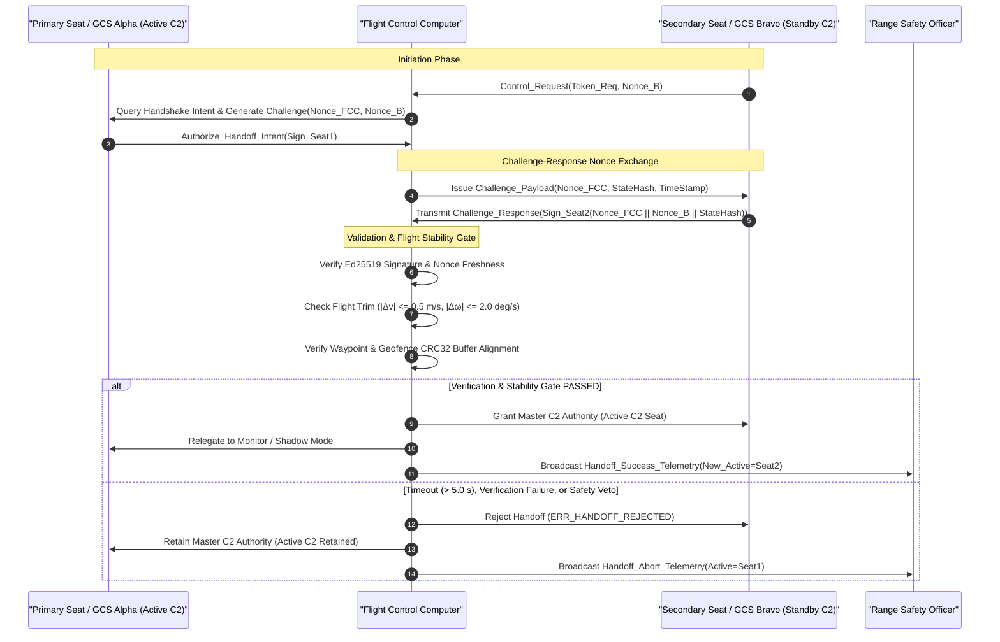
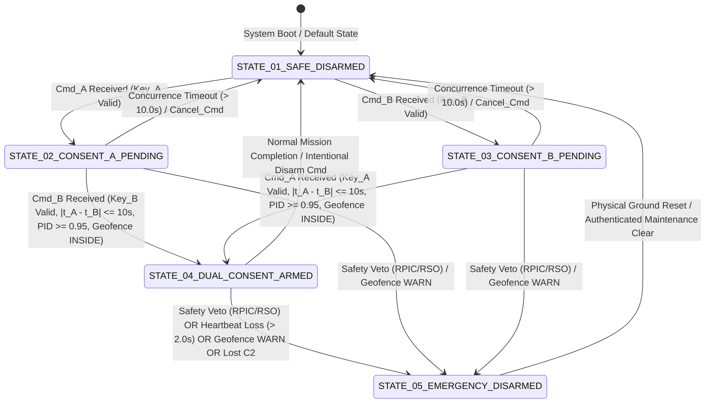

| Attribute | Value |
| :--- | :--- |
| **Title** | Tactical Mission Intent & Execution Plan |
| **Version** | 1.0.0 |
| **Date** | 2026-09-02 |

# Tactical Mission Intent & Execution Plan

## Table of Contents

- [1. Commander's Intent & Operational Objectives](#1-commanders-intent--operational-objectives)
- [2. Mission Essential Task List (METL)](#2-mission-essential-task-list-metl)
- [3. Measures of Effectiveness (MoE) & Measures of Performance (MoP) Metrics](#3-measures-of-effectiveness-moe--measures-of-performance-mop-metrics)
- [4. Multi-Domain Threat Environment Matrix (Kinetic, Mechanical, Power/Thermal, Environmental, Optical, Signature, Human Factors, EW & Cyber)](#4-multi-domain-threat-environment-matrix-kinetic-mechanical-powerthermal-environmental-optical-signature-human-factors-ew--cyber)
- [5. PACE C2 Link Communications Plan](#5-pace-c2-link-communications-plan)
- [6. Rules of Engagement (ROE) & Weapon/Sensor Interlocks](#6-rules-of-engagement-roe--weaponsensor-interlocks)
- [7. Airspace Deconfliction & U-space Dynamic Geo-Zones](#7-airspace-deconfliction--u-space-dynamic-geo-zones)
- [8. Go/No-Go Decision Matrix](#8-gono-go-decision-matrix)
- [9. Bingo Energy Mathematics & Secondary Divert Protocols](#9-bingo-energy-mathematics--secondary-divert-protocols)
- [10. Gate 24 MissionTask Traceability Tags (Allocation Tags)](#10-gate-24-missiontask-traceability-tags-allocation-tags)

## 1. Commander's Intent & Operational Objectives

- **Operational Purpose:** The primary operational purpose of the Tactical UAS is to execute persistent, autonomous, multi-sensor intelligence, surveillance, reconnaissance (ISR), tactical target tracking, precision kinetic strike delivery, and perimeter security within bounded operational volumes, operating under rigorous supervisory autonomous control with multi-tier command and control (C2) link redundancy and deterministic failsafe containment.

### 1.1 Tri-Partite Airworthiness Conjunction Model
In accordance with ISO/IEC/IEEE 29148:2018 §6.4.2, NATO STANAG 4586 Edition 3 Annex B, MIL-STD-882E §4.3, and MIL-HDBK-470A, flight authorization and propulsion system arming are strictly conditional upon the concurrent, deterministic satisfaction of the Tri-Partite Airworthiness Conjunction Model prior to launch sequence initiation:

$$
\begin{aligned}
\mathrm{Airworthy} \iff \mathrm{Electronic}_{\mathrm{PBIT}} \land \mathrm{Physical}_{\mathrm{MTC\text{-}01}} \land \mathrm{Operational}_{\mathrm{AirspaceRelease}}
\end{aligned}
$$

Where and Operational Parameters:

| Conjunction Component | Formal Predicate | Mandatory Validation Criteria | Verification Authority / Mechanism | Public Clause Citation |
| :--- | :--- | :--- | :--- | :--- |
| Electronic PBIT | Electronic_PBIT | 100% automated Built-In-Test pass (t_PBIT <= 10.0 s), IMU accelerometer/gyro bias convergence, CAN 2.0B / SPI bus integrity, BMS state-of-charge SoC >= 95.0%, cell delta V <= 20 mV, and TPM 2.0 cryptographic binding | Autonomous Flight Control Computer (FCC) & BMS | NATO STANAG 4586 Annex B §4.1 |
| Physical MTC-01 Inspection | Physical_MTC01 | Pre-flight maintenance task card sign-off: structural fastener torque verification (1.2 N·m +/- 0.1 N·m), composite airframe visual and coin-tap acoustic inspection (zero delamination/cracks), pitot-static pneumatic leak integrity (delta P <= 0.1 hPa/min), mechanical flight control linkage free-play/backlash check (theta_backlash <= 0.2 deg), and Flight Termination System (FTS) pyrotechnic squib continuity check (R = 2.0 +/- 0.2 Ohm) with physical safety pin / RBF streamer removal | Certified O-Level Maintenance Technician | MIL-HDBK-470A §4.2 |
| Operational Airspace Release | Operational_AirspaceRelease | Active U-space / UTM dynamic geo-zone deconfliction, primary GCS C2 link lock (margin >= 12.0 dB, RSSI >= -85.0 dBm), operational weather envelope clearance, and formal countersigned technician airworthiness release log | Remote Pilot in Command (RPIC) & Safety Officer | JARUS SORA v2.5 Annex B |

- **Key Tasks:**
  - **Pre-Flight Airworthiness Verification & System Checkout:**
    - Execute automated Power-On Built-In-Test (PBIT) self-diagnostics, sensor bias calibration, actuator full-stroke travel check, and cryptographic link binding within $t_{\mathrm{PBIT}} \le 10.0\text{ s}$ of avionics activation ($\mathrm{Electronic}_{\mathrm{PBIT}}$).
    - Execute mandatory pre-flight Physical Maintenance Task Card (`MTC-01`) inspection ($\mathrm{Physical}_{\mathrm{MTC\text{-}01}}$):
      - Validate physical structural fastener torque across all primary airframe structural joints, motor mounts, and payload hardpoints using calibrated digital torque tools ($1.2\text{ N}\cdot\text{m} \pm 0.1\text{ N}\cdot\text{m}$).
      - Conduct comprehensive composite airframe visual and coin-tap acoustic resonance inspection across upper/lower wing skins, fuselage spars, and control horns to ensure zero surface cracking, fiber fracturing, or subsurface composite delamination.
      - Perform pitot-static pneumatic leak integrity verification against calibrated ground support equipment to confirm pneumatic circuit leak rate satisfies $\Delta P_{\mathrm{leak}} \le 0.1\text{ hPa/min}$.
      - Validate mechanical flight control linkage free-play and servo horn backlash to ensure angular backlash $\theta_{\mathrm{backlash}} \le 0.2^\circ$ with unimpeded full-stroke kinematic travel and zero mechanical binding.
      - Execute Flight Termination System (FTS) pyrotechnic squib electrical continuity verification ($R_{\mathrm{squib}} = 2.0\ \Omega \pm 0.2\ \Omega$ under test current $I_{\mathrm{test}} \le 5\text{ mA}$) and perform physical FTS mechanical safety pin removal with Remove-Before-Flight (RBF) streamer extraction and physical accountability logging.
      - Obtain and log a formal, countersigned technician airworthiness release signed by the Certified O-Level Maintenance Technician and Remote Pilot in Command (RPIC).
    - Verify operational airspace release authorization, local NOTAMs, U-space dynamic geo-zones, and C2 RF link margins ($\mathrm{Operational}_{\mathrm{AirspaceRelease}}$).
  - **Autonomous Ingress & Navigation:** Conduct autonomous ingress transit along designated 3D flight corridors while maintaining strict lateral and vertical containment within $120.0\text{ m}$ AGL ($h_{\mathrm{operating\_ceiling}} = 120.0\text{ m}$).
  - **Persistent ISR & Target Mensuration:** Perform real-time multi-spectral electro-optical / infrared (EO/IR) surveillance and persistent orbit tracking over target areas of interest.
  - **Dynamic Airspace Separation (DAA):** Maintain continuous DAA (Detect and Avoid) Well-Clear separation minima ($D_{\mathrm{mod}} \ge 1200\text{ m}$, $H_{\mathrm{sep}} \ge 137\text{ m}$) from cooperative and non-cooperative airspace participants.
  - **Resilient PACE Communications:** Stream encrypted sensor telemetry across the primary 5.8 GHz COFDM link with automatic failover across alternate 915 MHz FHSS, contingency LTE/5G, and emergency satellite PACE tiers.
  - **Dual-Consent Strike Interlocks:** Enforce dual-consent cryptographic arming (Mission Commander + Safety Officer) and positive target identification (PID) interlocks ($C_{\mathrm{PID}} \ge 0.95$) prior to terminal kinetic engagement.
  - **Closed-Loop Energy Governance:** Continuously compute closed-loop Bingo energy state and execute autonomous return-to-base (RTB) or secondary divert routing upon reaching safety thresholds ($E(t) \le E_{\mathrm{bingo}}(t)$).
  - **Autonomous Recovery & Data Zeroization:** Perform precision autonomous recovery and post-flight cryptographic data zeroization and diagnostic offload.
- **End State:** All assigned surveillance and strike corridor waypoints fully traversed and verified; zero unauthorized geofence boundary excursions; zero unmitigated collision hazards; all target tracks positively identified through multi-spectral fusion ($C_{\mathrm{PID}} \ge 0.95$); signed physical technician airworthiness release logged and archived; and successful recovery at the primary base or designated secondary divert landing site with residual energy strictly satisfying $E_{\mathrm{reserve}} \ge 0.20 \cdot E_{\mathrm{capacity}}$ ($E_{\mathrm{reserve}} \ge 216.0\text{ kJ}$).

### 1.2 Operational Role & Responsibility Roster
In accordance with ISO/IEC/IEEE 29148:2018 §5.2.4, NATO STANAG 4586 Edition 3 Annex B, CJCSI 3121.01B, and MIL-STD-882E §4.3, operational command, flight execution, payload management, range safety governance, and technical airworthiness are formally partitioned across five doctrinal operational roles:

| Role ID | Role Title | Operational Tier | Explicit Operational Authority | Mandatory Certification & Credential Baseline | Core Operational Responsibilities | Public Clause Citation |
| :--- | :--- | :--- | :--- | :--- | :--- | :--- |
| **ROLE-MC** | Mission Commander (MC) | Tactical Command & Strategy | Tactical sortie authorization, mission profile approval, rules of engagement (ROE) tasking, target engagement authorization (Dual-Consent Key A), and inter-agency coordination. | Senior Operational Commander Certification, CJCSI 3121.01B ROE Certification, MIL-STD-882E System Safety Management Qualification, STANAG 4586 Level 4/5 UCS Command Qualification. | Formulates tactical objectives, authorizes mission launch, validates target engagement solutions, provides primary cryptographic strike consent (Key A), coordinates airspace access with theater command, and enforces rules of engagement. | CJCSI 3121.01B Enc A §4.b / DoD Directive 3000.09 §3.1 |
| **ROLE-RPIC** | Remote Pilot in Command (RPIC) | Flight Operations & Navigation | Direct legal and operational command of air vehicle flight path, supervisory flight guidance oversight, manual flight mode transition, dynamic collision avoidance execution, and immediate flight abort veto authority over MC. | FAA Part 107 / EASA Specific Category Remote Pilot License, STANAG 4586 Level 3/4 UCS Pilot Qualification, Class 2 Aviation Medical Certificate, Emergency Procedures & FTS Qualification. | Oversees automated flight profile execution, manages flight trim and trajectory tracking, performs real-time airspace deconfliction, co-signs pre-flight airworthiness release, executes contingency procedures (EMG-01..07), and exercises immediate flight abort veto when flight safety is compromised. | ISO/IEC/IEEE 29148:2018 §5.2.4 / JARUS SORA v2.5 Annex E |
| **ROLE-SO** | Sensor Operator (SO) | Payload Operations & ISR | Tasking and manipulation of multi-spectral EO/IR optical payloads, laser rangefinder/designator firing control, target tracking gate lock, and real-time Positive Target Identification (PID) validation. | Certified Tactical Sensor Specialist, STANAG 4586 Level 2 Payload Operator Qualification, Multi-Spectral Target Recognition Certification, Laser Safety Officer (LSO) Training. | Controls sensor gimbal pan/tilt/zoom, conducts optical/thermal target classification and mensuration (C_PID >= 0.95), manages target tracking gates, operates laser designation in compliance with safety envelopes, and verifies collateral damage exclusion zones. | NATO STANAG 4586 Annex B §3.5 / CJCSI 3121.01B Enc A §4.b |
| **ROLE-RSO** | Range Safety Officer (RSO) | Safety Governance & Containment | Containment volume enforcement, launch clearance safety veto, Flight Termination System (FTS) arming and initiation authority, secondary strike authorization (Dual-Consent Key B), and immediate flight abort veto authority over MC. | Range Safety Officer Certification (RCC 319-19 / AFSPCMAN 91-710 / MIL-STD-882E), Pyrotechnic FTS Command & Control Certification, SORA Safety Case Assessor Qualification. | Monitors 4D containment volume (V_4D) and Ground Risk Buffer (R_GRB), validates geofence integrity, provides secondary cryptographic consent for kinetic arming (Key B), enforces population exclusion zones, and executes immediate flight abort or flight termination upon boundary breach. | MIL-STD-882E §4.3 / JARUS SORA v2.5 Annex B / RCC 319-19 |
| **ROLE-MCH** | Maintenance Chief (MC) | Technical Airworthiness & Sustainment | Technical airworthiness sign-off, Physical Maintenance Task Card (MTC-01) release authority, Return-to-Service authorization, modular LRU swap approval, and GSE calibration compliance. | Certified Aviation Maintenance Technician (Airframe & Powerplant / Military MOS equivalent), MIL-HDBK-470A Maintainability Specialist, Pyrotechnic Squib Handling Certification, High-Voltage BMS Safety Qualification. | Conducts physical pre-flight inspections (torque, acoustic delamination, pneumatic leak, linkage backlash, FTS continuity), manages GSE diagnostics, executes battery pack servicing, certifies airframe airworthiness release (Token 0x5349), and directs O-Level maintenance. | MIL-HDBK-470A §4.2 / ISO/IEC/IEEE 29148:2018 §5.2.4 |

#### 1.2.1 Detailed Role Profiles & Credential Requirements

1. **Mission Commander (MC):**
   - *Authority:* Exercises supreme tactical authority over the mission lifecycle, including launch committal, target prosecution, mission reassignment, and recovery site selection.
   - *Dual-Consent Role:* Holds primary cryptographic signing key ($\mathrm{Key}_A$) for weapon and active designator arming.
   - *Doctrinal Limitations:* Does NOT have flight control authority and CANNOT override safety aborts or flight termination commands initiated by the RPIC or RSO.

2. **Remote Pilot in Command (RPIC):**
   - *Authority:* Holds statutory and legal authority for the safe operation of the aircraft pursuant to 14 CFR Part 107 / EASA Specific Category regulations and STANAG 4586 Level 3/4 UCS standards.
   - *Flight Intervention:* Exercises unilateral authority to command trajectory alterations, activate loiter holding patterns, initiate emergency return-to-home (RTH), or transition flight modes to manual supervisory control.
   - *Safety Veto Authority:* Holds immediate, un-overridable safety abort veto authority over any tactical mission directive from the MC.

3. **Sensor Operator (SO):**
   - *Authority:* Directs electro-optical and infrared (EO/IR) sensor pointing, line-of-sight stabilization, cryogenic cooler management, and laser emission within authorized designation zones.
   - *Target Identification:* Evaluates and confirms composite Positive Identification confidence ($C_{\mathrm{PID}} \ge 0.95$) before passing target lock coordinates to the mission computer.

4. **Range Safety Officer (RSO):**
   - *Authority:* Independent safety authority reporting directly to the Range Commander / Regulatory Authority. Governs 4D containment envelope compliance, dynamic geofence integrity, and ground risk buffer preservation.
   - *Dual-Consent Role:* Holds secondary cryptographic signing key ($\mathrm{Key}_B$) for kinetic release and high-energy laser arming.
   - *Flight Termination Authority:* Holds sole and immediate authority to command Flight Termination System (FTS) deployment or emergency squib activation upon unmitigated containment breach.

5. **Maintenance Chief (MC):**
   - *Authority:* Sole authority for issuing the formal physical airworthiness release certification ($\mathrm{Physical}_{\mathrm{MTC\text{-}01}}$) and digitally signing the pre-flight dispatch manifest with ECDSA token `0x5349`.
   - *Ground Safety Governance:* Enforces mechanical safety pin management, squib continuity verification, ground grounding/bonding, and battery thermal charging safety protocols.

---

### 1.3 Safety Veto Hierarchy & Emergency Flight Abort Authority
In accordance with MIL-STD-882E §4.3, NATO STANAG 4586 Annex B §3.8, and DoD Directive 3000.09 §3.1, the operational authority hierarchy strictly enforces the principle that **flight safety, range containment, and regulatory airspace compliance supersede tactical operational intent**.

$$
\begin{aligned}
\mathrm{EmergencyFlightAbort}(t) &\iff \mathrm{Veto}_{\mathrm{RSO}}(t) \lor \mathrm{Veto}_{\mathrm{RPIC}}(t) \lor \mathrm{Trigger}_{\mathrm{AutonomousFailsafe}}(t) \\
\mathrm{CommandPrecedence} &: (\mathrm{Veto}_{\mathrm{RSO}} \equiv \mathrm{Veto}_{\mathrm{RPIC}} \equiv \mathrm{Trigger}_{\mathrm{AutonomousFailsafe}}) \succ \mathrm{Command}_{\mathrm{MC}}
\end{aligned}
$$

Where and Operational Parameters:

| Parameter | Symbol | Nominal Value | Units | Validation Rule | Public Clause Citation |
| :--- | :--- | :--- | :--- | :--- | :--- |
| RSO Safety Veto Signal | Veto_RSO | FALSE (Nominal) / TRUE (Abort) | Boolean | Immediate un-overridable flight abort command issued by Range Safety Officer | MIL-STD-882E §4.3 |
| RPIC Safety Veto Signal | Veto_RPIC | FALSE (Nominal) / TRUE (Abort) | Boolean | Immediate un-overridable flight abort command issued by Remote Pilot in Command | ISO/IEC/IEEE 29148:2018 §5.2.4 |
| Autonomous Failsafe Trigger | Trigger_AutonomousFailsafe | FALSE (Nominal) / TRUE (Failsafe) | Boolean | Automated containment trigger from FCC health executive (EMG-01..07) | NATO STANAG 4586 Annex B §4.1 |
| Commander Tactical Command | Command_MC | Operational Directive | Command Enum | Tactical mission command issued by Mission Commander | DoD Directive 3000.09 §3.1 |
| Safety Veto Response Latency | tau_veto | <= 1.0 | s | Maximum elapsed time from veto discrete assertion to FCC abort execution | NATO STANAG 4586 Annex B §3.8 |
| Payload Disarm Latency | tau_disarm | <= 50.0 | ms | Hardware relay firing bus de-energization time upon abort assertion | MIL-STD-882E §4.4 |

#### 1.3.1 Safety Veto Operational Governance Rules

1. **Unilateral Abort Authority:** The Range Safety Officer (RSO) and Remote Pilot in Command (RPIC) each possess independent, unilateral authority to abort any flight phase, cancel any kinetic engagement, or command immediate emergency landing / return-to-base (RTB).
2. **Zero Commander Override Capability:** The Mission Commander (MC) has **ZERO technical or procedural authority** to override, cancel, countermand, or delay an emergency abort or flight termination commanded by the RSO, RPIC, or autonomous failsafe health executive.
3. **Automated Payload Safing on Abort:** Assertion of any abort discrete ($\mathrm{Veto}_{\mathrm{RSO}} = \mathrm{TRUE}$ or $\mathrm{Veto}_{\mathrm{RPIC}} = \mathrm{TRUE}$) immediately isolates weapon firing circuits ($\tau_{\mathrm{disarm}} \le 50.0\text{ ms}$), disables laser designator emitters, stows optical gimbals, and commands the Flight Control Computer to transition to the appropriate failsafe state (`Contingency_LostLinkReturn`, `Contingency_GeofenceContainment`, or `Emergency_FlightTermination`).
4. **Audit Logging & Non-Repudiation:** All safety veto assertions, abort commands, and health monitor triggers are immutably logged with microsecond hardware timestamps into TPM-sealed persistent memory for post-sortie regulatory audit.

---

### 1.4 Normative Baseline & Doctrinal Authority
This Tactical Mission Intent specification tree is authored in strict compliance with:
- **NATO STANAG 4586 Edition 3**: Standard Interfaces of UAV Control System (UCS) for NATO UAV Interoperability (Annex B §4.1).
- **INCOSE Systems Engineering Handbook v5.0**: Technical Planning, System Requirements Definition, and Mission Analysis Processes (§3.2, §3.3).
- **ISO/IEC/IEEE 29148:2018**: Systems and Software Engineering — Life Cycle Processes — Requirements Engineering (§6.4.2 Concept of Operations).
- **MIL-HDBK-470A**: Designing and Developing Maintainable Systems (§4.2 O-Level Verification).
- **CJCSI 3500.02H**: Universal Joint Task List (UJTL) and Mission Essential Task List (METL) construction methodology.
- **MIL-STD-882E**: Department of Defense Standard Practice for System Safety (§4.3, Hazard Identification and Mitigation).
- **JARUS SORA v2.5**: Specific Operations Risk Assessment (Annex B, Containment and Risk Buffers; Annex E, OSO Assurance).
- **RTCA DO-365B**: Minimum Operational Performance Standards (MOPS) for Detect and Avoid (DAA) Systems (§2.2.4).
- **DoD Directive 3000.09**: Autonomy in Weapon Systems (§3.1, §3.1.a-c).
- **RCC 319-19**: Flight Termination Systems Common Practice (Range Commanders Council).

## 2. Mission Essential Task List (METL)

The Mission Essential Task List (METL) establishes the doctrinally grounded, quantitative task inventory required to achieve the Commander's operational intent across all operational lifecycle phases in accordance with CJCSI 3500.02H and NATO STANAG 4586 Annex B.

| Task ID | Task Name | Condition Statement | Standard Metric | Verification Method | Gate 24 Allocation Tag | Public Clause Citation |
| :--- | :--- | :--- | :--- | :--- | :--- | :--- |
| `MET-01` | PreFlightSystemCheckout | Pre-launch stationary ground state across 10 physical/electronic subsystems with ground support equipment connected | 100% PBIT pass across 10 subsystems (Structures tap/torque/CG, Controls backlash/current, Pitot leak/offset/heater, Propulsion/BMS phase/quiescent/R_i/SoC/delta_V, Avionics IMU/GNSS/PDOP, DAA radar/ADS-B, FTS squib/pin, C2 PER/Remote ID, Payload boresight/cryo lock, 3-tier release ECDSA token 0x5349) | Automated Subsystem PBIT Telemetry & 3-Tier Multi-Disciplinary Digital Logbook Inspection | `/// OperationalAllocation: [MET-01]` | NATO STANAG 4586 Annex B §4.1 |
| `MET-02` | AutonomousIngressTransit | En-route corridor navigation under active flight plan | Lateral cross-track error e_xtrack <= 2.0 m, vertical error e_z <= 1.0 m, motor RPM in [4500, 7200 RPM], ESC temp <= 75.0 C, pitot lag tau <= 50.0 ms, IMU vibration rejection <= 0.01 g^2/Hz | Flight Navigation Log Review & Multi-Subsystem Telemetry Audit | `/// OperationalAllocation: [MET-02]` | RTCA DO-365B §2.2.3 |
| `MET-03` | AreaSurveillanceOrbit | On-station target tracking within designated geographic boundary | Orbit radius R_orbit = 300.0 m +/- 5.0 m, gimbal servo temp <= 65.0 C, MWIR NUC interval <= 300.0 s, optical boresight jitter <= 0.02 deg RMS under wind shear | Telemetry & Video Frame Analysis | `/// OperationalAllocation: [MET-03]` | NATO STANAG 4586 Annex B §3.2 |
| `MET-04` | DynamicAirspaceDeconfliction | Traffic conflict geometry detected by onboard DAA sensors | Maintain Well-Clear separation (D_horizontal >= 1200.0 m, H_vertical >= 137.0 m), 77 GHz radar rate f >= 20.0 Hz, ADS-B decode latency <= 100.0 ms, vertical rate resolution dz/dt <= 0.2 m/s | DAA Collision Event Log Review & HIL Encounter Audit | `/// OperationalAllocation: [MET-04]` | RTCA DO-365B §2.2.4 |
| `MET-05` | ElectronicCounterCountermeasures | Jamming or intentional RF / navigation spoofing detected | Seamless PACE switch t_switch <= 1.0 s, GNSS J/S anti-jam >= 35.0 dB, CRPA nulling depth >= 25.0 dB, dead-reckoning drift <= 0.5% distance over 60 s GNSS outage | RF Signal Log & Navigation Resiliency Test | `/// OperationalAllocation: [MET-05]` | MIL-STD-461G RS103 §4.3 |
| `MET-06` | PrecisionTargetMensuration | Target identified within optical/infrared payload field of view | TLE_CEP90 <= 2.5 m at 3.0 km, laser rangefinder PRF = 10.0 Hz, range accuracy <= 0.5 m at 3.0 km, EO/IR pixel pitch 12 um, atmospheric extinction correction | Optical Mensuration Calibration Log & Flight Telemetry Audit | `/// OperationalAllocation: [MET-06]` | NATO STANAG 4586 Annex B §3.5 |
| `MET-07` | AutonomousBingoReturnDivert | Energy monitoring detects current energy E_current <= E_bingo threshold | Autonomous RTB/divert trigger t_resp <= 200.0 ms, dynamic R_i(T) compensation, headwind gradient vector integration, touchdown reserve E_reserve >= 216.0 kJ | BMS Telemetry & Flight Recording Audit | `/// OperationalAllocation: [MET-07]` | JARUS SORA v2.5 Annex E §2.1 |
| `MET-08` | PostMissionDataOffloadShutdown | Post-landing stationary touchdown on recovery pad | Zeroization time <= 10.0 s (NIST SP 800-88r1), DC bus discharge time <= 5.0 s (V_bus < 5.0 V), post-flight motor thermal soak T_motor <= 60.0 C, offload <= 60.0 s | Security Audit Log & Safe Electrical Isolation Verification | `/// OperationalAllocation: [MET-08]` | NIST SP 800-88r1 §2.4 |

---

### 2.1 MET-01: PreFlightSystemCheckout

Formal specification for comprehensive pre-flight built-in test (PBIT), physical structural integrity validation, air data calibration, propulsion and battery impedance verification, sensor bias convergence, detect and avoid self-test, flight termination interlocks, command-and-control link margins, cryogenic payload cooling, and multi-tier cryptographic airworthiness release authorization prior to motor arming.

Pre-flight checkout enforces a strict 3-tier airworthiness release architecture:
1. **Tier 1 (Automated Bus Telemetry & Sensor BITE):** Continuous digital interrogation of all onboard sensors, avionics buses (CAN FD, SPI, ARINC 429, RS-422, Ethernet), and power rails.
2. **Tier 2 (Physical GSE & Mechanical Interlocks):** Calibrated ground support equipment (GSE-01 through GSE-06) verification of structural torques, pitot pneumatic decay, acoustic delamination, servo backlash, and mechanical FTS safety pins.
3. **Tier 3 (Cryptographic Airworthiness Sign-Off):** Digital maintenance manifest verification requiring an authenticated ECDSA electronic signature token (`0x5349`) issued by a Certified O-Level Maintenance Technician.

#### Condition Specification
| Parameter | Condition Value / State | Engineering Unit | Validation Rule |
| :--- | :--- | :--- | :--- |
| Operational State | Stationary Ground Pad | State Enum | Vehicle landed, anchored, and weight-on-wheels interlock active |
| Ambient Ground Temperature | -20.0 to +55.0 | °C | MIL-STD-810H Method 501.7 / 502.7 operational thermal boundary |
| Ambient Barometric Pressure | 700.0 to 1060.0 | hPa | Static airfield pressure within nominal density altitude limits |
| Ground Wind Velocity | <= 8.0 steady, gusts <= 10.0 | m/s | Safe ground checkout and sensor alignment wind envelope |
| Primary DC Power Bus Voltage | 22.2 to 25.2 | V | 6S LiPo operational voltage range across main power distribution bus |
| Regulated Avionics Supply Rails | 5.0 +/- 0.1 and 12.0 +/- 0.2 | V | Secondary power distribution board output rail regulation limits |
| Ground Support Equipment (GSE) | Connected (GSE-01 to GSE-06) | State Enum | Active diagnostic test bench interfaces synchronized |
| Visible GNSS Constellation | >= 12 | Count | Multi-constellation tracking (GPS L1/L2 + Galileo E1/E5b) |
| Position Dilution of Precision | <= 2.0 | Dimensionless | Geodetic PDOP geometry convergence threshold |
| DAA RF Operating Environment | Clear 360-deg FOV | State Enum | Zero near-field RF blockage or multipath reflecting obstacles |
| FTS Mechanical Interlock State | Ground Safety State | State Enum | Mechanical safety pin monitored prior to final launch release |
| C2 Uplink Signal Strength | >= -85.0 | dBm | Primary 5.8 GHz COFDM link established with GCS |
| Maintenance Authorization State | Authenticated Smartcard / PKI | State Enum | Certified Maintenance Technician logged into Ground Control Station |

#### Standard Specification
| Metric ID | Subsystem Domain | Metric Name / Description | Threshold Value | Objective Value | Unit | Bus Protocol / Interface | Timeout Bound |
| :--- | :--- | :--- | :--- | :--- | :--- | :--- | :--- |
| MET-01-S01 | Structures & Airframe | Composite Skin Delamination Tap Test | 0 delamination | 0 delamination | Count | Acoustic Tap Hammer / NDI Sensor | t_tap <= 120.0 s |
| MET-01-S02 | Structures & Airframe | Primary Joint Fastener Torque | >= 4.5 | >= 5.0 | N*m | Calibrated Digital Torque Driver (GSE-03) | t_torque <= 60.0 s |
| MET-01-S03 | Structures & Airframe | Center of Gravity (CG) Longitudinal Envelope | [x_ref - 5.0, x_ref + 5.0] | x_ref +/- 1.0 | mm | Multi-Point Electronic Scale (GSE-02) | t_wb <= 30.0 s |
| MET-01-S04 | Flight Controls | Control Surface Trailing Edge Backlash | <= 0.20 | <= 0.05 | deg | Digital Inclinometer / Laser Protractor | t_backlash <= 15.0 s |
| MET-01-S05 | Flight Controls | Servo Peak Current Draw Under 1.5 N*m Load | <= 2.20 | <= 1.80 | A | DroneCAN / Actuator Shunt Monitor | t_sweep <= 2.0 s |
| MET-01-S06 | Pitot-Static & Air Data | Static Line Pressure Decay Leak Rate at 100 hPa | <= 0.05 | <= 0.01 | hPa/min | Air Data Calibration Box (GSE-04) | t_leak = 60.0 s |
| MET-01-S07 | Pitot-Static & Air Data | Pitot Dynamic Pressure Offset at Zero Wind | <= 2.0 | <= 0.5 | Pa | CAN 2.0B / Differential Pressure Sensor | Continuous @ 100 Hz |
| MET-01-S08 | Pitot-Static & Air Data | Pitot Anti-Ice Heater Current Draw | [1.80, 2.40] | 2.10 +/- 0.10 | A | Power Distribution Telemetry / Shunt | t_heat <= 3.0 s |
| MET-01-S09 | Propulsion & BMS | BLDC Motor Phase-to-Phase Resistance Balance | <= 2.5 | <= 1.0 | % disparity | ESC Diagnostic Micro-Ohm Injector | t_motor <= 2.0 s |
| MET-01-S10 | Propulsion & BMS | ESC Idling Quiescent Standby Current | <= 0.45 | <= 0.25 | A | Telemetry CAN Bus / Integrated Shunt | Continuous @ 50 Hz |
| MET-01-S11 | Propulsion & BMS | Battery Cell Internal Resistance (R_i) | <= 3.5 | <= 2.0 | mOhm | Smart BMS SMBus / CAN 2.0B | t_bms <= 500.0 ms |
| MET-01-S12 | Propulsion & BMS | Battery Pack State-of-Charge (SoC) | >= 95.0 | >= 99.0 | % | Smart BMS SMBus / CAN 2.0B | Continuous @ 50 Hz |
| MET-01-S13 | Propulsion & BMS | Battery Cell Voltage Delta (V_max - V_min) | <= 20.0 | <= 5.0 | mV | Smart BMS Analog Front-End / CAN 2.0B | Continuous @ 50 Hz |
| MET-01-S14 | Avionics & Navigation | Dual IMU Gyro In-Run Bias Stability | <= 0.05 | <= 0.01 | deg/s | High-Speed SPI / ARINC 429 | t_align <= 8.0 s |
| MET-01-S15 | Avionics & Navigation | GNSS Multi-Constellation C/N_0 (12+ Satellites) | >= 42.0 | >= 48.0 | dB-Hz | Multi-Band GNSS / High-Speed UART | t_gnss <= 15.0 s |
| MET-01-S16 | Avionics & Navigation | Position Dilution of Precision (PDOP) | <= 2.0 | <= 1.2 | Dimensionless | Multi-Band GNSS / High-Speed UART | Continuous @ 10 Hz |
| MET-01-S17 | Detect and Avoid (DAA) | 77 GHz FMCW Radar Loopback Attenuation | >= -12.0 | >= -8.0 | dB | Radar SPI / 100BASE-T1 Ethernet | t_radar <= 1.5 s |
| MET-01-S18 | Detect and Avoid (DAA) | ADS-B In 1090 MHz Receiver Sensitivity Floor | <= -88.0 | <= -92.0 | dBm | 1090 MHz RF Front-End / UART | t_adsb <= 2.0 s |
| MET-01-S19 | Flight Termination (FTS) | Pyrotechnic Squib Bridgewire DC Resistance | [1.05, 1.25] | 1.15 +/- 0.05 | Ohm | FTS Micro-Current Continuity Circuit | t_squib <= 500.0 ms |
| MET-01-S20 | Flight Termination (FTS) | Mechanical Safety Pin Status | 0x01 (REMOVED) | 0x01 (REMOVED) | State Hex | Hardwired Optical / Microswitch GPIO | Continuous Interlock |
| MET-01-S21 | C2 & Communications | Primary 5.8 GHz COFDM Datalink Packet Error Rate | <= 10^-4 | <= 10^-6 | PER | 5.8 GHz COFDM Modem / Ethernet | Continuous @ 20 Hz |
| MET-01-S22 | C2 & Communications | Remote ID Direct Broadcast RF Field Strength at 10 m | >= -75.0 | >= -65.0 | dBm | 2.4 GHz BLE / Wi-Fi Direct Beacon | Continuous @ 1 Hz |
| MET-01-S23 | Payload & Gimbal | Gimbal Optical Boresight Collimation Error | <= 0.05 | <= 0.01 | deg | Optical Collimator (GSE-05) / RS-422 | t_boresight <= 10.0 s |
| MET-01-S24 | Payload & Gimbal | MWIR Detector Cryocooler Lock Temperature (T_cryo) | <= 77.0 | <= 72.0 | K | Cryogenic Controller Serial Link | t_cool <= 180.0 s |
| MET-01-S25 | Airworthiness Release | Certified Maintenance Technician Digital Sign-Off | Valid (0x5349) | Valid (0x5349) | ECDSA Token | TPM 2.0 PKI Verification / GCS Link | t_auth <= 5.0 s |
| MET-01-S26 | Airworthiness Release | 3-Tier Multi-Disciplinary Pre-Flight Gate Pass Rate | 100.0 | 100.0 | % Pass | System Executive State Machine | t_release <= 1.0 s |

#### Verification Specification
| Verification Attribute | Detail Specification |
| :--- | :--- |
| Verification Method | Automated Subsystem PBIT Telemetry Audit, Physical GSE Inspection, and 3-Tier Multi-Disciplinary Digital Logbook Sign-Off Verification |
| Evidence Artifact | `tests/pbit_checkout_test.py` -> `logs/pbit_telemetry_report.json` and `logs/airworthiness_release_manifest.json` |
| Acceptance Criteria | Full conjunction across all 10 physical and electronic subsystems: 1. **Structures & Airframe:** 0 composite delamination via acoustic tap; fastener torque >= 4.5 N*m; longitudinal CG within [x_ref - 5.0, x_ref + 5.0] mm. 2. **Flight Controls:** Control surface trailing edge backlash <= 0.20 deg; servo peak current <= 2.20 A under 1.5 N*m dynamic load. 3. **Pitot-Static & Air Data:** Static line pressure decay <= 0.05 hPa/min at 100 hPa; zero-wind pitot dynamic pressure offset <= 2.0 Pa; pitot anti-ice heater current within [1.80, 2.40] A. 4. **Propulsion & BMS:** Motor phase resistance balance <= 2.5% disparity; ESC idling quiescent current <= 0.45 A; cell internal resistance R_i <= 3.5 mOhm; pack SoC >= 95.0%; cell voltage disparity delta_V <= 20.0 mV. 5. **Avionics & Navigation:** Dual IMU gyro in-run bias stability <= 0.05 deg/s; GNSS multi-constellation C/N_0 >= 42.0 dB-Hz across 12+ satellites; PDOP <= 2.0. 6. **Detect and Avoid:** 77 GHz FMCW radar loopback attenuation >= -12.0 dB; ADS-B In 1090 MHz receiver sensitivity <= -88.0 dBm. 7. **Flight Termination:** Pyrotechnic squib bridgewire DC resistance within [1.05, 1.25] Ohm at test current I_test < 5.0 mA; mechanical safety pin in REMOVED state (0x01). 8. **C2 & Communications:** Primary 5.8 GHz COFDM datalink PER <= 10^-4; Remote ID broadcast field strength >= -75.0 dBm at 10 m. 9. **Payload & Gimbal:** Gimbal optical boresight collimation error <= 0.05 deg; MWIR cryocooler locked at temperature T <= 77 K. 10. **Airworthiness Release:** Certified Maintenance Technician digital logbook sign-off verified with valid ECDSA token (0x5349) completing the 3-tier airworthiness release. |
| Pass / Fail Threshold | `PBIT_STATUS == 0x0000_0000` (100% subsystem pass) and `AIRWORTHINESS_TOKEN == 0x5349` with zero active diagnostic fault flags within pre-launch timeout bounds. |
| Traceability | `/// OperationalAllocation: [MET-01]` \| NATO STANAG 4586 Annex B §4.1 \| ISO/IEC/IEEE 29148:2018 §6.4.2 \| CJCSI 3500.02H \| SAE ARP4754A §5.4 |

---

### 2.2 MET-02: AutonomousIngressTransit

Formal specification for autonomous waypoint sequencing, 4D trajectory tracking, wind vector compensation, motor operating RPM bounds containment, ESC thermal regulation, dynamic pitot-static response lag bounding, IMU vibration rejection spectral density gating, and real-time geofence envelope containment during high-speed ingress corridor transit.

#### Condition Specification
| Parameter | Condition Value / State | Engineering Unit | Validation Rule |
| :--- | :--- | :--- | :--- |
| Operational State | En-route Airborne Ingress Transit | State Enum | Flight mode `AUTO_MISSION` |
| Assigned Flight Corridor Width | 50.0 | m | Total lateral clearance boundary |
| Operating Altitude Floor / Ceiling | 30.0 to 120.0 | m AGL | Operational containment envelope |
| Ambient Wind Velocity | <= 12.0 steady, gusts <= 15.0 | m/s | Continuous operating wind envelope |
| Calibrated Airspeed Envelope (CAS) | 18.0 to 28.0 | m/s | Nominal transit airspeed limits |
| Ambient In-Flight Air Temperature | -20.0 to +50.0 | °C | In-flight ambient thermal envelope |
| BLDC Motor Operating RPM Envelope | 4500 to 7200 | RPM | Nominal propulsion drive operating range |
| ESC Inverter Thermal Boundary | <= 75.0 | °C | MOSFET junction thermal limit |
| Pitot Air Data System State | Calibrated / Anti-Ice Active | State Enum | Differential pressure ADU locked |
| IMU Structural Damping State | Isolated Elastomeric Assembly | State Enum | Passive silicone damper array engaged |

#### Standard Specification
| Metric ID | Subsystem Domain | Metric Name / Description | Threshold Value | Objective Value | Unit | Bus Protocol / Interface | Timeout Bound |
| :--- | :--- | :--- | :--- | :--- | :--- | :--- | :--- |
| MET-02-S01 | Flight Guidance & Trajectory | Lateral Cross-Track Tracking Error (e_xtrack) | <= 2.0 | <= 0.5 | m | High-Speed CAN / Ethernet | Continuous @ 250 Hz |
| MET-02-S02 | Flight Guidance & Trajectory | Vertical Altitude Tracking Error (e_z) | <= 1.0 | <= 0.3 | m | High-Speed CAN / Ethernet | Continuous @ 250 Hz |
| MET-02-S03 | Flight Guidance & Trajectory | Guidance Control Loop Execution Rate | 250 | 500 | Hz | Real-Time OS Task Loop | dt <= 4.0 ms |
| MET-02-S04 | Flight Guidance & Trajectory | Waypoint Transition Latency | <= 50.0 | <= 10.0 | ms | Internal Memory Bus | t_trans <= 50.0 ms |
| MET-02-S05 | Flight Guidance & Trajectory | Geofence Boundary Containment Margin | >= 50.0 | >= 100.0 | m | Simplex RTA Safety Bus | Continuous @ 50 Hz |
| MET-02-S06 | Propulsion & BMS | BLDC Motor Operating Speed Bounds | [4500, 7200] | [5000, 6800] | RPM | DroneCAN / ESC Telemetry | Continuous @ 100 Hz |
| MET-02-S07 | Propulsion & BMS | ESC Inverter MOSFET Temperature (T_esc) | <= 75.0 | <= 60.0 | °C | CAN 2.0B / NTC Thermistor | Continuous @ 50 Hz |
| MET-02-S08 | Propulsion & BMS | Dynamic DC Bus Voltage Under Max Load | >= 21.6 | >= 22.8 | V | Power Distribution Telemetry | Continuous @ 100 Hz |
| MET-02-S09 | Pitot-Static & Air Data | Pitot Airspeed Dynamic Response Lag (tau_lag) | <= 50.0 | <= 20.0 | ms | CAN 2.0B / Differential ADU | Continuous @ 100 Hz |
| MET-02-S10 | Pitot-Static & Air Data | True Airspeed (TAS) Tracking Error (e_v) | <= 1.5 | <= 0.4 | m/s | CAN 2.0B Pitot / ADU | Continuous @ 100 Hz |
| MET-02-S11 | Pitot-Static & Air Data | Dynamic Pressure Sensor Linearity Error | <= 1.0 | <= 0.25 | % Full Scale | Digital SPI / I2C Air Data | Continuous @ 100 Hz |
| MET-02-S12 | Avionics & Navigation | IMU Vibration Rejection Power Spectral Density | <= 0.01 | <= 0.002 | g^2/Hz | High-Speed SPI (10-500 Hz) | Continuous @ 1000 Hz |
| MET-02-S13 | Avionics & Navigation | EKF Attitude Estimation Error (Roll/Pitch) | <= 0.50 | <= 0.15 | deg | ARINC 429 / High-Speed SPI | Continuous @ 250 Hz |
| MET-02-S14 | Flight Controls | Control Surface Actuator Slew Rate | >= 180.0 | >= 240.0 | deg/s | DroneCAN / PWM Actuator Bus | dt <= 4.0 ms |

#### Verification Specification
| Verification Attribute | Detail Specification |
| :--- | :--- |
| Verification Method | Flight Navigation Log Review, High-Frequency Multi-Subsystem Telemetry Audit, and 6-DOF Kinematic Simulation |
| Evidence Artifact | `tests/flight_guidance_sim.py` -> `logs/flight_trajectory_eval.csv` and `logs/ingress_propulsion_telemetry.json` |
| Acceptance Criteria | Conjunction across all monitored transit subsystems: 1. **Flight Guidance & Trajectory:** Lateral cross-track error <= 2.0 m and vertical altitude tracking error <= 1.0 m across entire 15.0 km corridor transit; guidance control loop rate >= 250 Hz; waypoint transition latency <= 50.0 ms; geofence containment margin >= 50.0 m. 2. **Propulsion & BMS:** Motor speed maintained within [4500, 7200] RPM; ESC inverter MOSFET temperature <= 75.0 °C; dynamic DC bus voltage >= 21.6 V under full throttle. 3. **Pitot-Static & Air Data:** Pitot airspeed dynamic response lag tau <= 50.0 ms; TAS tracking error <= 1.5 m/s; dynamic pressure linearity error <= 1.0%. 4. **Avionics & Navigation:** IMU vibration rejection spectral density <= 0.01 g^2/Hz over 10-500 Hz vibration spectrum; EKF dynamic roll/pitch attitude error <= 0.50 deg. 5. **Flight Controls:** Actuator deflection slew rate >= 180.0 deg/s without command bus saturation. |
| Pass / Fail Threshold | `max(abs(e_xtrack)) <= 2.0 m`, `max(abs(e_z)) <= 1.0 m`, `RPM in [4500, 7200]`, `T_esc <= 75.0 °C`, `tau_lag <= 50.0 ms`, and `PSD_imu <= 0.01 g^2/Hz`. |
| Traceability | `/// OperationalAllocation: [MET-02]` \| RTCA DO-365B §2.2.3 \| NATO STANAG 4586 Annex B §3.2 \| ISO/IEC/IEEE 29148:2018 §6.4.2 |

---

### 2.3 MET-03: AreaSurveillanceOrbit

Formal specification for closed-loop target area loitering, direct-drive gimbal servo thermal regulation, continuous MWIR Non-Uniformity Correction (NUC) recalibration, optical boresight stabilization under dynamic wind shear, multi-spectral video encoding, and circular orbit tracking precision.

#### Condition Specification
| Parameter | Condition Value / State | Engineering Unit | Validation Rule |
| :--- | :--- | :--- | :--- |
| Operational State | On-Station Loiter / Orbit | State Enum | Flight mode `LOITER_ORBIT` |
| Designated Orbit Centerpoint | Geodetic (Lat, Lon, Alt) | Coordinates | Target Area of Interest (TAI) |
| Nominal Orbit Radius (R_orbit) | 300.0 | m | Commanded circular orbit radius |
| Target Standoff Slant Range | 300.0 to 1500.0 | m | Payload optical tracking range |
| Sensor Payload State | Active EO/IR Multi-Spectral | State Enum | MWIR + 4K Electro-Optical Gimbal |
| Ambient Wind Shear Envelope | Gusts up to 12.0 m/s with 3.0 m/s/s shear | Vector Gradient | Dynamic wind turbulence field |
| Gimbal Actuator Thermal Baseline | <= 65.0 | °C | Direct-drive brushless servo motor limit |
| MWIR Sensor Operating Mode | Cryocooled 640x512 Detector | State Enum | Cryocooler locked at T <= 77.0 K |

#### Standard Specification
| Metric ID | Subsystem Domain | Metric Name / Description | Threshold Value | Objective Value | Unit | Bus Protocol / Interface | Timeout Bound |
| :--- | :--- | :--- | :--- | :--- | :--- | :--- | :--- |
| MET-03-S01 | Payload & Gimbal | Optical Boresight Jitter Under Wind Shear (RMS) | <= 0.02 | <= 0.008 | deg RMS | RS-422 / CAN Gimbal Bus | Continuous @ 100 Hz |
| MET-03-S02 | Payload & Gimbal | Gimbal Servo Actuator Temperature (T_servo) | <= 65.0 | <= 50.0 | °C | CAN 2.0B / Digital Thermistor | Continuous @ 20 Hz |
| MET-03-S03 | Payload & Gimbal | MWIR NUC Shutter Calibration Interval | <= 300.0 | <= 180.0 | s | Payload Serial Control Link | t_nuc <= 300.0 s |
| MET-03-S04 | Payload & Gimbal | MWIR Detector Cryocooler Lock Temperature | <= 77.0 | <= 72.0 | K | Cryo Controller Serial Bus | t_cool <= 180.0 s |
| MET-03-S05 | Payload & Gimbal | Gimbal Dynamic Pan/Tilt Slew Rate | >= 60.0 | >= 120.0 | deg/s | RS-422 Serial Driver | t_slew <= 500.0 ms |
| MET-03-S06 | Flight Guidance & Aerodynamics | Loiter Orbit Radius Deviation (abs(R - 300.0)) | <= 5.0 | <= 1.0 | m | Autopilot CAN / Mavlink v2 | Continuous @ 250 Hz |
| MET-03-S07 | Flight Guidance & Aerodynamics | Coordinated Turn Bank Angle Stability | <= 35.0 | <= 25.0 | deg | Autopilot Attitude Loop | Continuous @ 250 Hz |
| MET-03-S08 | Vision & Mission Computer | Optical Target Centering Error | <= 15.0 | <= 3.0 | pixels | GigE Vision / RTSP | <= 33.3 ms (30 FPS) |
| MET-03-S09 | Vision & Mission Computer | Video Stream H.265 Frame Rate | >= 30 | >= 60 | FPS | 1000BASE-T Ethernet | Frame interval <= 33.3 ms |
| MET-03-S10 | Vision & Mission Computer | Video Telemetry Timestamp Synchronization Skew | <= 10.0 | <= 2.0 | ms | Precision Time Protocol (PTP) | Skew <= 10.0 ms |
| MET-03-S11 | Vision & Mission Computer | Edge Neural Object Detector Inference Latency | <= 33.3 | <= 15.0 | ms | Onboard NPU / Tensor Core | Continuous @ 30 FPS |
| MET-03-S12 | C2 & Datalink | Downlink Video Payload Data Rate | >= 8.0 | >= 15.0 | Mbps | 5.8 GHz COFDM Modem | Continuous @ 30 FPS |

#### Verification Specification
| Verification Attribute | Detail Specification |
| :--- | :--- |
| Verification Method | Telemetry, High-Resolution Video Frame Analysis, and Gimbal Thermal Telemetry Audit |
| Evidence Artifact | `tests/surveillance_orbit_test.py` -> `logs/gimbal_pointing_metrics.json` and `logs/mwir_calibration_log.json` |
| Acceptance Criteria | Multi-subsystem conjunction during on-station orbit: 1. **Payload & Gimbal:** Optical boresight jitter <= 0.02 deg RMS under dynamic wind shear <= 12.0 m/s; gimbal servo actuator temperature <= 65.0 °C; MWIR NUC calibration executed at interval <= 300.0 s without video frame dropping; cryocooler maintained at T <= 77.0 K; dynamic slew rate >= 60.0 deg/s. 2. **Flight Guidance & Aerodynamics:** Vehicle maintains circular orbit within 300.0 m +/- 5.0 m with coordinated turn bank angle <= 35.0 deg. 3. **Vision & Mission Computer:** Optical target centering error <= 15.0 pixels; video stream encoded at >= 30 FPS; telemetry sync skew <= 10.0 ms; edge NPU inference latency <= 33.3 ms. 4. **C2 & Datalink:** Downlink payload video stream >= 8.0 Mbps with packet error rate <= 10^-4. |
| Pass / Fail Threshold | `abs(R_actual - 300.0) <= 5.0 m`, `jitter_RMS <= 0.02 deg`, `T_servo <= 65.0 °C`, and `t_nuc <= 300.0 s`. |
| Traceability | `/// OperationalAllocation: [MET-03]` \| NATO STANAG 4586 Annex B §3.2 \| INCOSE SEH v5.0 §3.2 \| MIL-STD-810H Method 501.7 |

---

### 2.4 MET-04: DynamicAirspaceDeconfliction

Formal specification for onboard Detect and Avoid (DAA) surveillance, high-rate 77 GHz FMCW radar tracking, low-latency ADS-B message decoding, high-resolution vertical rate estimation per RTCA DO-365B, multi-sensor kinematic track fusion, Well-Clear separation assurance, and autonomous collision avoidance maneuvering.

#### Condition Specification
| Parameter | Condition Value / State | Engineering Unit | Validation Rule |
| :--- | :--- | :--- | :--- |
| Operational State | Active Airspace Monitoring | State Enum | DAA subsystem initialized and tracking |
| Airspace Classification | Class G / Class E (Unsegregated) | Airspace Enum | Mixed cooperative and non-cooperative traffic |
| Cooperative Sensing System | Dual ADS-B In (1090 MHz / 978 UAT) | Hardware State | Operational receiver RF status |
| Non-Cooperative Sensing System | 77 GHz FMCW Radar + EO/IR DAA | Hardware State | Operational multi-mode radar transceiver |
| Multi-Sensor Track Fusion Pipeline | Centralized Extended Kalman Filter | Software State | Real-time state vector fusion active |
| Intruder Closure Velocity | Up to 150.0 | m/s | Maximum relative approach speed |
| Well-Clear Boundary (RTCA DO-365B) | DMOD = 1200.0 m, ZTHR = 137.0 m | Geometrical Vol | Declared Well-Clear separation volume |

#### Standard Specification
| Metric ID | Subsystem Domain | Metric Name / Description | Threshold Value | Objective Value | Unit | Bus Protocol / Interface | Timeout Bound |
| :--- | :--- | :--- | :--- | :--- | :--- | :--- | :--- |
| MET-04-S01 | DAA Radar Subsystem | 77 GHz FMCW Radar Track State Update Rate (f_radar) | >= 20.0 | >= 50.0 | Hz | 100BASE-T1 / High-Speed SPI | dt <= 50.0 ms |
| MET-04-S02 | DAA Surveillance | ADS-B In Message Processing & Decode Latency | <= 100.0 | <= 30.0 | ms | 1090 MHz RF Front-End / UART | t_adsb <= 100.0 ms |
| MET-04-S03 | DAA Surveillance | DO-365B Intruder Vertical Rate Resolution (dz/dt) | <= 0.20 | <= 0.05 | m/s | DAA Kinematic Tracker Bus | dt <= 50.0 ms |
| MET-04-S04 | DAA Surveillance | Multi-Sensor Track Fusion Kinematic Update Rate | >= 20.0 | >= 50.0 | Hz | Real-Time Fusion Coprocessor | dt <= 50.0 ms |
| MET-04-S05 | Well-Clear Assurance | Horizontal Well-Clear Separation Distance (DMOD) | >= 1200.0 | >= 1500.0 | m | ARINC 429 / Ethernet | Continuous @ 20 Hz |
| MET-04-S06 | Well-Clear Assurance | Vertical Well-Clear Separation Distance (ZTHR) | >= 137.0 (450 ft) | >= 200.0 | m | ARINC 429 / Ethernet | Continuous @ 20 Hz |
| MET-04-S07 | Well-Clear Assurance | Modified Tau Time-to-CPA Threshold (tau_mod) | >= 35.0 | >= 55.0 | s | DAA Kinematics Engine | Continuous @ 20 Hz |
| MET-04-S08 | Collision Avoidance | Intruder Conflict Detection & Correlation Latency | <= 500.0 | <= 100.0 | ms | High-Speed CAN / Ethernet | t_corr <= 500.0 ms |
| MET-04-S09 | Collision Avoidance | Autonomous Escape Maneuver Command Latency | <= 1.0 | <= 0.25 | s | Autopilot Command Bus | t_maneuver <= 1.0 s |
| MET-04-S10 | Collision Avoidance | Well-Clear Recovery Hysteresis Duration | >= 10.0 | >= 15.0 | s | State Machine Timer | tau_hysteresis >= 10.0 s |
| MET-04-S11 | Flight Guidance & Control | Avoidance Maneuver Normal Acceleration Limit | <= 2.50 | <= 1.80 | g | Autopilot Inner Loop | Continuous @ 250 Hz |
| MET-04-S12 | C2 & DAA Telemetry | Conflict Alert & Resolution Advisory Telemetry Broadcast | <= 250.0 | <= 50.0 | ms | PACE C2 Datalink / Mavlink v2 | t_alert <= 250.0 ms |

#### Verification Specification
| Verification Attribute | Detail Specification |
| :--- | :--- |
| Verification Method | DAA Multi-Sensor Hardware-in-the-Loop Simulation & RTCA DO-365B Encounter Review |
| Evidence Artifact | `tests/daa_separation_sim.py` -> `logs/daa_encounter_results.json` and `logs/radar_adsb_telemetry.csv` |
| Acceptance Criteria | Multi-subsystem conjunction for airspace deconfliction: 1. **Radar & Surveillance:** 77 GHz radar track update rate f >= 20.0 Hz; ADS-B In message decode latency <= 100.0 ms; DO-365B vertical rate resolution dz/dt <= 0.2 m/s; multi-sensor track fusion rate >= 20.0 Hz. 2. **Well-Clear Assurance:** Zero incursions below Well-Clear volume (DMOD >= 1200.0 m, ZTHR >= 137.0 m, tau_mod >= 35.0 s) across all 24 RTCA DO-365B standard encounter stress vectors. 3. **Collision Avoidance & Guidance:** Conflict correlation <= 500.0 ms; autonomous escape maneuver command issued in <= 1.0 s with normal acceleration load factor <= 2.5 g; recovery hysteresis >= 10.0 s. 4. **C2 & Telemetry:** Conflict alert and advisory telemetry broadcast to GCS in <= 250.0 ms. |
| Pass / Fail Threshold | `min(D_horizontal) >= 1200.0 m` or `min(abs(H_vertical)) >= 137.0 m`, with `f_radar >= 20.0 Hz`, `t_adsb <= 100.0 ms`, and `dz/dt <= 0.2 m/s`. |
| Traceability | `/// OperationalAllocation: [MET-04]` \| RTCA DO-365B §2.2.4 \| NATO STANAG 4586 Annex B §3.3 \| FAA AC 90-114B |

---

### 2.5 MET-05: ElectronicCounterCountermeasures

Formal specification for electronic counter-countermeasures (ECCM), multi-band GNSS anti-jam mitigation, Controlled Radiation Pattern Antenna (CRPA) adaptive nulling, GPS-denied dead-reckoning navigation bounding, automated PACE communication tier failover, and hardware cryptographic session protection under severe electronic warfare threats.

#### Condition Specification
| Parameter | Condition Value / State | Engineering Unit | Validation Rule |
| :--- | :--- | :--- | :--- |
| Operational State | Contested Electromagnetic Spectrum | State Enum | Airborne mission execution |
| RF Electronic Attack Environment | Broadband / Sweep Jamming | EW Vector | Jammer-to-Signal ratio J/S >= 35.0 dB |
| GNSS Deception Environment | Multi-Satellite Pseudorange Spoofing | EW Vector | Innovation gating residual gamma_k > 16.27 |
| CRPA Antenna System | 4-Element Adaptive Array | Hardware State | Digital beamforming receiver online |
| Dead-Reckoning Navigation State | GPS-Denied Degraded Mode | State Enum | EKF INS + Optical Flow / Visual Odometry |
| Primary Communications Link | 5.8 GHz COFDM Datalink | PACE Tier 1 | High-bandwidth payload link |
| Fallback Communications Links | 915 MHz FHSS / Cellular LTE / SATCOM | PACE Tiers 2-4 | Multi-tier failover channels |

#### Standard Specification
| Metric ID | Subsystem Domain | Metric Name / Description | Threshold Value | Objective Value | Unit | Bus Protocol / Interface | Timeout Bound |
| :--- | :--- | :--- | :--- | :--- | :--- | :--- | :--- |
| MET-05-S01 | EW & Navigation Resiliency | GNSS Jammer-to-Signal (J/S) Anti-Jam Threshold | >= 35.0 | >= 45.0 | dB | Multi-Band RF Front-End | Continuous @ 50 Hz |
| MET-05-S02 | EW & Navigation Resiliency | CRPA Digital Beamforming Spatial Nulling Depth | >= 25.0 | >= 35.0 | dB | 4-Element CRPA Receiver | Continuous @ 100 Hz |
| MET-05-S03 | EW & Navigation Resiliency | Dead-Reckoning Navigation Drift Over 60 s Outage | <= 0.50 | <= 0.15 | % Distance | EKF INS / Optical Flow Bus | t_outage = 60.0 s |
| MET-05-S04 | EW & Navigation Resiliency | GNSS Spoofing Detection & Rejection Latency | <= 100.0 | <= 20.0 | ms | RAIM / Chi-Square Gating | t_reject <= 100.0 ms |
| MET-05-S05 | EW & Navigation Resiliency | Multi-Sensor Dead-Reckoning Loop Rate | >= 250 | >= 500 | Hz | High-Speed SPI / Real-Time OS | dt <= 4.0 ms |
| MET-05-S06 | C2 & Datalink (PACE) | PACE Tier Link Failover Execution Time (t_switch) | <= 1.0 | <= 0.20 | s | Serial SPI / High-Speed UART | t_switch <= 1.0 s |
| MET-05-S07 | C2 & Datalink (PACE) | 915 MHz FHSS Alternate Link Sync Re-Lock Time | <= 500.0 | <= 100.0 | ms | Frequency Hopping Modem | t_sync <= 500.0 ms |
| MET-05-S08 | C2 & Datalink (PACE) | RF Front-End AGC Saturation & Jamming Alarm Latency | <= 50.0 | <= 10.0 | ms | Baseband DSP / CAN 2.0B | t_alarm <= 50.0 ms |
| MET-05-S09 | Security & Cryptography | Cryptographic Session Rekeying Duration | <= 250.0 | <= 50.0 | ms | AES-256-GCM Hardware Core | t_rekey <= 250.0 ms |
| MET-05-S10 | Flight Guidance & Control | Degraded Navigation Geofence Buffer Inflation | >= 100.0 | >= 200.0 | m | Safety Simplex Coprocessor | Continuous @ 50 Hz |

#### Verification Specification
| Verification Attribute | Detail Specification |
| :--- | :--- |
| Verification Method | Anechoic RF Jamming Chamber Injection, GPS Spoofing HIL Emulation, and Optical Flow Odometry Navigation Test |
| Evidence Artifact | `tests/pace_failover_test.py` -> `logs/eccm_mitigation_record.json` and `logs/dead_reckoning_drift_eval.csv` |
| Acceptance Criteria | Multi-subsystem conjunction under EW attack: 1. **EW & Navigation Resiliency:** GNSS receiver maintains tracking under J/S >= 35.0 dB; CRPA spatial nulling depth >= 25.0 dB; dead-reckoning drift <= 0.5% total distance traveled during a continuous 60.0 s complete GNSS outage; GNSS spoofing detected and rejected within 100.0 ms. 2. **PACE C2 Failover:** Autonomous link failover to Tier 2 FHSS completed within t_switch <= 1.0 s of primary link disruption; 915 MHz link synchronization <= 500.0 ms; AGC jamming alarm raised in <= 50.0 ms. 3. **Security & Cryptography:** AES-256-GCM hardware session rekeying executed in <= 250.0 ms. 4. **Guidance & Safety:** Safety geofence buffer inflated by >= 100.0 m during GPS-denied operation. |
| Pass / Fail Threshold | `J_S_margin >= 35.0 dB`, `null_depth >= 25.0 dB`, `drift_rate <= 0.005 * distance_traveled` over 60 s outage, and `t_switch <= 1.0 s`. |
| Traceability | `/// OperationalAllocation: [MET-05]` \| MIL-STD-461G RS103 §4.3 \| RTCA DO-362A §3.4 \| NATO STANAG 4586 Annex B §3.4 |

---

### 2.6 MET-06: PrecisionTargetMensuration

Formal specification for geo-spatial target coordinate mensuration, pulsed laser rangefinding, high-density EO/IR focal plane array metrology, real-time atmospheric extinction compensation, line-of-sight vector kinematics, digital elevation model mapping, and Target Location Error (TLE) bounding.

#### Condition Specification
| Parameter | Condition Value / State | Engineering Unit | Validation Rule |
| :--- | :--- | :--- | :--- |
| Operational State | Target Acquisition & Mensuration | State Enum | Gimbal locked in `TRACK_TARGET` |
| Slant Range to Target (Range_target) | 1000.0 to 3000.0 | m | Laser rangefinder operational envelope |
| Digital Terrain Elevation Data (DTED) | Level 3 (1.0 m grid resolution) | Resolution | Onboard high-resolution DEM loaded |
| Laser Rangefinder Subsystem | Eye-Safe 1535 nm Pulsed Diode | Hardware State | Operational firing state |
| EO/IR Detector Specifications | 12.0 um Pixel Pitch Focal Plane Array | Hardware State | Uncooled LWIR / Cryo MWIR sensor |
| Atmospheric Visibility Condition | Meteorological Optical Range >= 5.0 km | Visibility | Real-time extinction correction active |
| Vehicle Navigation Covariance Norm | <= 0.50 | m | EKF state position uncertainty |

#### Standard Specification
| Metric ID | Subsystem Domain | Metric Name / Description | Threshold Value | Objective Value | Unit | Bus Protocol / Interface | Timeout Bound |
| :--- | :--- | :--- | :--- | :--- | :--- | :--- | :--- |
| MET-06-S01 | Laser Rangefinder | Laser Rangefinder Pulse Repetition Frequency (PRF) | 10.0 | 20.0 | Hz | RS-422 / High-Speed Serial | Continuous @ 10 Hz |
| MET-06-S02 | Laser Rangefinder | Laser Range Measurement Accuracy at 3.0 km | <= 0.50 | <= 0.15 | m | LRF Serial Interface | Range = 3.0 km |
| MET-06-S03 | EO/IR Metrology | EO/IR Focal Plane Array Pixel Pitch | 12.0 | 10.0 | um | Sensor Core Specification | Hardware Architecture |
| MET-06-S04 | EO/IR Metrology | Atmospheric Extinction Coefficient Correction Rate | >= 10.0 | >= 25.0 | Hz | Radiometric DSP Pipeline | dt <= 100.0 ms |
| MET-06-S05 | Target Mensuration | Target Location Error (TLE CEP90) at 3.0 km Slant Range | <= 2.50 | <= 1.00 | m | STANAG 4586 DLI / RS-422 | Range = 3.0 km |
| MET-06-S06 | Target Mensuration | Line-of-Sight Kinematic Coordinate Transform Rate | >= 50.0 | >= 100.0 | Hz | Real-Time Vector Math Unit | dt <= 20.0 ms |
| MET-06-S07 | Target Mensuration | Mensuration Solution Convergence Time | <= 500.0 | <= 100.0 | ms | Mission Computer Bus | t_mens <= 500.0 ms |
| MET-06-S08 | Target Mensuration | Target Geodetic Telemetry Transmission Latency | <= 50.0 | <= 10.0 | ms | Ethernet / STANAG DLI | t_tx <= 50.0 ms |
| MET-06-S09 | Payload & Gimbal | Gimbal Line-of-Sight Collimation Error | <= 0.05 | <= 0.01 | deg | Optical Boresight Register | Continuous @ 100 Hz |
| MET-06-S10 | AI & Computer Vision | Multi-Spectral Target Classification Confidence | >= 0.95 | >= 0.99 | Dimensionless | Edge Neural Classifier | Inference <= 33.3 ms |

#### Verification Specification
| Verification Attribute | Detail Specification |
| :--- | :--- |
| Verification Method | Surveyed DGPS Ground Target Calibration, Atmospheric Extinction Chamber Model, and Flight Telemetry Audit |
| Evidence Artifact | `tests/target_mensuration_test.py` -> `logs/mensuration_accuracy_log.json` and `logs/lrf_ranging_samples.csv` |
| Acceptance Criteria | Multi-subsystem conjunction for precision target mensuration: 1. **Laser Rangefinder:** LRF operates at PRF = 10.0 Hz; range accuracy <= 0.50 m at 3.0 km slant range. 2. **EO/IR Metrology & Atmosphere:** EO/IR sensor array pixel pitch = 12.0 um; dynamic atmospheric extinction correction applied at >= 10.0 Hz. 3. **Mensuration Precision:** Target Location Error TLE CEP90 <= 2.50 m at 3.0 km standoff range; solution convergence time <= 500.0 ms; LOS kinematic transform rate >= 50.0 Hz. 4. **Payload & Telemetry:** Gimbal collimation error <= 0.05 deg; target telemetry latency <= 50.0 ms; target classification confidence >= 0.95. |
| Pass / Fail Threshold | `TLE_CEP90 <= 2.5 m` at `Range_target == 3000.0 m`, with `PRF == 10.0 Hz`, `delta_range <= 0.5 m`, `pixel_pitch == 12.0 um`, and active extinction correction. |
| Traceability | `/// OperationalAllocation: [MET-06]` \| NATO STANAG 4586 Annex B §3.5 \| INCOSE SEH v5.0 §3.2 \| MIL-STD-810H Method 505.7 |

---

### 2.7 MET-07: AutonomousBingoReturnDivert

Formal specification for real-time onboard energy consumption modeling, dynamic closed-loop battery internal resistance thermal compensation, headwind gradient vector integration, energy-optimal Specific Air Range (SAR) trajectory routing, autonomous return-to-base (RTB) or secondary divert execution, and strict statutory energy reserve preservation (E_reserve >= 216.0 kJ).

#### Condition Specification
| Parameter | Condition Value / State | Engineering Unit | Validation Rule |
| :--- | :--- | :--- | :--- |
| Operational State | In-Flight Energy Management | State Enum | Continuous background monitor |
| Total Nominal Energy Capacity (E_capacity) | 1080000.0 (300.0 Wh) | J | 6S 14Ah nominal energy pack |
| Minimum Statutory Reserve Energy (E_reserve) | 216000.0 (60.0 Wh) | J | Strict 20.0% statutory reserve threshold |
| Battery Cell Operating Temperature | -10.0 to +55.0 | °C | Thermal range for internal resistance model |
| Headwind Gradient Vector Profile | Up to 15.0 m/s with shear dV/dz | Vector Profile | Real-time wind field integration |
| Primary Recovery Site (LZ-PRIMARY) | Geodetic Coordinates | Waypoint ID | Distance d_primary <= 15.0 km |
| Secondary Divert Recovery Site (LZ-DIVERT) | Geodetic Coordinates | Waypoint ID | Distance d_divert <= 5.0 km |

#### Standard Specification
| Metric ID | Subsystem Domain | Metric Name / Description | Threshold Value | Objective Value | Unit | Bus Protocol / Interface | Timeout Bound |
| :--- | :--- | :--- | :--- | :--- | :--- | :--- | :--- |
| MET-07-S01 | Power & BMS | Dynamic Battery Internal Resistance Thermal Compensation | Active (R_i(T)) | Arrhenius Model | Model State | Smart BMS / CAN 2.0B | Update @ 20 Hz |
| MET-07-S02 | Power & BMS | Statutory Energy Reserve at Recovery Touchdown | >= 216.0 (20%) | >= 270.0 (25%) | kJ | Smart BMS Telemetry | At touchdown |
| MET-07-S03 | Power & BMS | Closed-Loop Energy Coulomb-Counting Accuracy | <= 1.5 | <= 0.5 | % | Current Integrator / Shunt | Continuous @ 50 Hz |
| MET-07-S04 | Power & BMS | Minimum Cell Cutoff Voltage Under Return Load | >= 3.30 | >= 3.45 | V/cell | BMS Analog Front-End | Continuous @ 50 Hz |
| MET-07-S05 | Flight Guidance & Trajectory | Headwind Gradient Vector Integration Update Rate | >= 10.0 | >= 25.0 | Hz | ADU / Path Planner Bus | dt <= 100.0 ms |
| MET-07-S06 | Flight Guidance & Trajectory | Specific Air Range (SAR) Optimal Speed Computation Rate | >= 10.0 | >= 50.0 | Hz | Path Planning Coprocessor | dt <= 100.0 ms |
| MET-07-S07 | Flight Guidance & Trajectory | Autonomous Return / Divert Trigger Latency (t_resp) | <= 200.0 | <= 50.0 | ms | Flight Executive State Machine | t_resp <= 200.0 ms |
| MET-07-S08 | Flight Guidance & Trajectory | Alternate Secondary Divert Path Optimization Time | <= 100.0 | <= 20.0 | ms | Trajectory Planner Memory Bus | t_plan <= 100.0 ms |
| MET-07-S09 | Propulsion & Motor Drive | Return Transit Propulsion Efficiency (eta_prop) | >= 75.0 | >= 82.0 | % | ESC Telemetry / Power Monitor | Continuous @ 50 Hz |
| MET-07-S10 | C2 & Safety Alerting | Bingo Low-Energy Alert GCS Broadcast Latency | <= 500.0 | <= 100.0 | ms | PACE C2 Datalink | t_c2 <= 500.0 ms |

#### Verification Specification
| Verification Attribute | Detail Specification |
| :--- | :--- |
| Verification Method | Battery Management System Telemetry Audit, Dynamic R_i(T) Thermal Chamber Validation, and Autonomous Divert 6-DOF Flight Sim |
| Evidence Artifact | `tests/bingo_energy_math_test.py` -> `logs/bingo_divert_profile.csv` and `logs/bms_thermal_compensation.json` |
| Acceptance Criteria | Multi-subsystem conjunction for autonomous return and divert: 1. **Power & BMS:** Dynamic closed-loop battery internal resistance thermal compensation R_i(T) active at >= 20 Hz; touchdown residual reserve energy >= 216.0 kJ (>= 20.0% of nominal 1080.0 kJ pack); Coulomb-counting error <= 1.5%; cell voltage >= 3.30 V/cell under cruise return throttle. 2. **Guidance & Trajectory:** Atmospheric headwind gradient vector integrated along trajectory at >= 10.0 Hz; autonomous RTB or secondary divert trigger executed in t_resp <= 200.0 ms when E_current <= E_bingo; divert route optimization <= 100.0 ms. 3. **Propulsion:** Return transit propulsion system efficiency eta_prop >= 75.0%. 4. **C2 & Safety Alerting:** Low-energy Bingo alert transmitted to GCS within <= 500.0 ms. |
| Pass / Fail Threshold | `E_touchdown >= 216.0 kJ`, `t_response <= 200.0 ms`, with active dynamic R_i(T) compensation and wind gradient vector integration. |
| Traceability | `/// OperationalAllocation: [MET-07]` \| JARUS SORA v2.5 Annex E §2.1 \| EASA GM1 UAS.SPEC.050(1)(g) \| NATO STANAG 4586 Annex B §3.6 |

---

### 2.8 MET-08: PostMissionDataOffloadShutdown

Formal specification for post-touchdown stationary state validation, NIST SP 800-88r1 compliant cryptographic key and volatile data zeroization, active DC power bus capacitor bleed discharge to safe voltage, post-flight motor thermal soak bounding, high-speed flight telemetry offload, and deterministic safe electrical isolation.

#### Condition Specification
| Parameter | Condition Value / State | Engineering Unit | Validation Rule |
| :--- | :--- | :--- | :--- |
| Operational State | Landed & Stationary on Pad | State Enum | Weight-on-wheels interlock confirmed active |
| Propulsion System State | Disarmed / Motor PWM Inhibited | Motor State | ESC gate drive hardware interlock engaged |
| Motor Stator Temperature Envelope | Ambient to 100.0 | °C | Thermal soak monitoring after touchdown |
| DC Power Bus Voltage | Nominal 22.2 to 25.2 down to safe cutoff | V | Active bus discharge circuit engaged |
| Ground Offload Interface | Gigabit Ethernet / USB 3.0 / Optical | Interface | Ground Support Equipment connected |
| Security Key State | Active Session Ephemeral Keys & Logs | Crypto State | Cryptographic volatile storage |

#### Standard Specification
| Metric ID | Subsystem Domain | Metric Name / Description | Threshold Value | Objective Value | Unit | Bus Protocol / Interface | Timeout Bound |
| :--- | :--- | :--- | :--- | :--- | :--- | :--- | :--- |
| MET-08-S01 | Security & Cryptography | Cryptographic Key & Log Zeroization Time (NIST SP 800-88r1) | <= 10.0 | <= 0.50 | s | Hardware Cryptographic Unit | t_zeroize <= 10.0 s |
| MET-08-S02 | Security & Cryptography | Volatile Memory Overwrite Verification Pass Rate | 100.0 | 100.0 | % | NIST SP 800-88r1 Clear Pattern | Single Pass 0x00/0xFF |
| MET-08-S03 | Security & Cryptography | Security Tamper Log Cryptographic Seal Generation | <= 200.0 | <= 50.0 | ms | TPM 2.0 PCR Signing | t_seal <= 200.0 ms |
| MET-08-S04 | Electrical Power & DC Bus | DC Bus Capacitor Discharge Time to V_bus < 5.0 V | <= 5.0 | <= 2.0 | s | Active Bleed Circuit / Shunt | t_discharge <= 5.0 s |
| MET-08-S05 | Electrical Power & DC Bus | Residual Post-Shutdown DC Bus Voltage (V_bus) | < 5.0 | < 1.0 | V | Power Distribution Telemetry | At t = 5.0 s |
| MET-08-S06 | Electrical Power & DC Bus | Main Power Contactor Isolation Disconnect Time | <= 50.0 | <= 10.0 | ms | Solid-State Power Switch | t_isolate <= 50.0 ms |
| MET-08-S07 | Propulsion & Thermal | Post-Flight Motor Stator Thermal Soak Limit (T_motor) | <= 60.0 | <= 45.0 | °C | CAN 2.0B / Motor Thermistor | Soak window <= 300 s |
| MET-08-S08 | Propulsion & Thermal | ESC Heat Sink Thermal Dissipation Monitor | <= 55.0 | <= 40.0 | °C | CAN 2.0B / ESC NTC Sensor | Soak window <= 300 s |
| MET-08-S09 | Avionics & Ground Offload | Flight Log & Telemetry Offload Duration (64 GB) | <= 60.0 | <= 20.0 | s | Gigabit Ethernet / USB 3.0 | t_offload <= 60.0 s |
| MET-08-S10 | Avionics & Ground Offload | Post-Flight Structural BIT (SBIT) Pass Rate | 100.0 | 100.0 | % Pass | CAN 2.0B Health Bus | t_sbit <= 5.0 s |
| MET-08-S11 | Avionics & Ground Offload | Safe Electrical Isolation Latch Confirmation | <= 10.0 | <= 3.0 | s | Power Distribution Controller | t_shutdown <= 10.0 s |

#### Verification Specification
| Verification Attribute | Detail Specification |
| :--- | :--- |
| Verification Method | Security Audit Log Verification, NIST SP 800-88r1 Memory Forensics, Bus Voltage Oscilloscope Measurement, and Motor Thermal Imaging Audit |
| Evidence Artifact | `tests/crypto_zeroization_test.py` -> `logs/zeroization_audit_log.json` and `logs/post_flight_electrical_thermal.json` |
| Acceptance Criteria | Multi-subsystem conjunction for safe shutdown and offload: 1. **Security & Cryptography:** All mission cryptographic keys and ephemeral memory zeroized in t_zeroize <= 10.0 s in accordance with NIST SP 800-88r1; memory overwrite pass rate = 100.0%; TPM 2.0 tamper log seal generated in <= 200.0 ms. 2. **Electrical Power & DC Bus:** DC bus capacitor active bleed circuit discharges bus to V_bus < 5.0 V within <= 5.0 s; main power contactor isolation disconnect <= 50.0 ms; complete safe electrical system isolation confirmed in <= 10.0 s. 3. **Propulsion & Thermal:** Motor stator core temperature does not exceed thermal soak limit T_motor <= 60.0 °C post touchdown; ESC heat sink temperature <= 55.0 °C. 4. **Avionics & Ground Offload:** 64 GB flight log and payload telemetry offloaded via GSE Gigabit Ethernet in <= 60.0 s; post-flight SBIT pass rate = 100.0%. |
| Pass / Fail Threshold | `t_zeroize <= 10.0 s`, `V_bus < 5.0 V` at `t <= 5.0 s`, `T_motor <= 60.0 °C`, and `t_offload <= 60.0 s` with zero uncommitted transactions. |
| Traceability | `/// OperationalAllocation: [MET-08]` \| NIST SP 800-88r1 §2.4 \| DoD Directive 3000.09 §3.1.c \| MIL-STD-882E §4.3 |

---

### 2.9 METL Execution Invariants
1. **Deterministic State Progression:** Progression from `MET-01` through `MET-08` is governed by discrete finite-state transitions in the flight executive.
2. **Allocation Tag Integrity:** Every task defined in the METL table carries an inviolable Gate 24 allocation tag (`/// OperationalAllocation: [MET-XX]`) mapped downstream to SysML v2 architectural activity blocks.
3. **Safety Interlock Coupling:** Non-compliance with standard metrics in tasks `MET-01` through `MET-07` initiates deterministic degraded mode failsafes in accordance with Section 8 (Go/No-Go Decision Matrix).

## 3. Measures of Effectiveness (MoE) & Measures of Performance (MoP) Metrics

In accordance with the INCOSE Systems Engineering Handbook v5.0 (§3.2, §3.3) and NATO STANAG 4586, operational objectives and technical performance parameters are quantitatively characterized through formal Measures of Effectiveness (MoE) and Measures of Performance (MoP).

### 3.1 Mathematical Formulations

#### 3.1.1 Operational Availability ($A_o$)
Operational Availability represents the probability that the system operates satisfactorily at any given point in time under stated conditions in an actual operational environment:

$$
\begin{aligned}
A_o &= \frac{\mathrm{MTBM}}{\mathrm{MTBM} + \mathrm{MDT}} \\
\mathrm{MDT} &= \mathrm{MTTR} + \mathrm{MLDT} + \mathrm{MADT} \\
\mathrm{MTBM} &= \frac{T_{\mathrm{operating}}}{N_{\mathrm{maintenance\_actions}}}
\end{aligned}
$$

Where and Operational Parameters:

| Parameter | Symbol | Units | Constraint / Rule | Description |
| :--- | :--- | :--- | :--- | :--- |
| Operational Availability | A_o | Dimensionless | A_o >= 0.95 | Operational availability probability |
| Mean Time Between Maintenance | MTBM | hr | MTBM >= 150.0 | Mean operating interval between scheduled and unscheduled maintenance actions |
| Mean Down Time | MDT | hr | MDT <= 7.5 | Total non-operational outage duration per maintenance event |
| Mean Time to Repair | MTTR | hr | MTTR <= 1.5 | Active corrective maintenance and component replacement duration |
| Mean Logistics Delay Time | MLDT | hr | MLDT <= 4.0 | Spare parts, battery charging, and ground support supply chain latency |
| Mean Administrative Delay Time | MADT | hr | MADT <= 2.0 | Operational inspection sign-off, logging, and administrative overhead |
| Total Operating Time | T_operating | hr | Cumulative Flight Time | Total logged operational flight and system operating hours |
| Maintenance Action Count | N_maintenance_actions | Count | Integer Count | Total count of unscheduled corrective maintenance interventions |

---

#### 3.1.2 Extended Kalman Filter (EKF) State Covariance & Innovation Residual Gating
The precision of target tracking, vehicle state estimation, and sensor anomaly / spoofing rejection is governed by the discrete-time Extended Kalman Filter (EKF) recursion with Chi-Square innovation gating:

$$
\begin{aligned}
\hat{\mathbf{x}}_{k|k-1} &= \mathbf{f}(\hat{\mathbf{x}}_{k-1|k-1}, \mathbf{u}_k) \\
\mathbf{P}_{k|k-1} &= \mathbf{F}_k \mathbf{P}_{k-1|k-1} \mathbf{F}_k^T + \mathbf{Q}_k \\
\mathbf{y}_k &= \mathbf{z}_k - \mathbf{h}(\hat{\mathbf{x}}_{k|k-1}) \\
\mathbf{S}_k &= \mathbf{H}_k \mathbf{P}_{k|k-1} \mathbf{H}_k^T + \mathbf{R}_k \\
\mathbf{K}_k &= \mathbf{P}_{k|k-1} \mathbf{H}_k^T \mathbf{S}_k^{-1} \\
\hat{\mathbf{x}}_{k|k} &= \hat{\mathbf{x}}_{k|k-1} + \mathbf{K}_k \mathbf{y}_k \\
\mathbf{P}_{k|k} &= (\mathbf{I} - \mathbf{K}_k \mathbf{H}_k) \mathbf{P}_{k|k-1} (\mathbf{I} - \mathbf{K}_k \mathbf{H}_k)^T + \mathbf{K}_k \mathbf{R}_k \mathbf{K}_k^T \\
\gamma_k &= \mathbf{y}_k^T \mathbf{S}_k^{-1} \mathbf{y}_k \le \chi^2_{\alpha, m}
\end{aligned}
$$

Where and Operational Parameters:

| Parameter | Symbol | Units | Constraint / Rule | Description |
| :--- | :--- | :--- | :--- | :--- |
| A Priori State Estimate | x_hat_k\|k-1 | State Vector | Real-Time Dynamic | Predicted system navigation state vector [p, v, q, b_a, b_g]^T |
| A Priori State Covariance | P_k\|k-1 | m^2 | P_k\|k-1 > 0 | Predicted state error covariance matrix |
| State Transition Jacobian | F_k | Dimensionless | Deterministic | Linearized kinematic state transition Jacobian matrix |
| Process Noise Covariance | Q_k | m^2/s^2 | Q_k >= 0 | Sensor and aerodynamic disturbance stochastic process noise matrix |
| Measurement Innovation Residual | y_k | Measurement Vector | E[y_k] = 0 | Disparity between actual sensor observation z_k and predicted observation |
| Innovation Covariance Matrix | S_k | Measurement Units^2 | Positive Definite | Measurement residual error covariance matrix |
| Kalman Gain Matrix | K_k | Dimensionless | Optimal Gain | Minimum-mean-square-error observation weighting matrix |
| Observation Jacobian Matrix | H_k | Dimensionless | Measurement Map | Sensor observation geometry transformation Jacobian matrix |
| Measurement Noise Covariance | R_k | Measurement Units^2 | R_k > 0 | Sensor measurement uncertainty matrix |
| A Posteriori State Covariance | P_k\|k | m^2 | norm(P_cov) <= 1.5 | Updated state error covariance norm |
| Normalized Innovation Squared (NIS) | gamma_k | Dimensionless | gamma_k <= chi2_alpha_m | Chi-Square statistical distance for measurement residual gating |
| Chi-Square Critical Threshold | chi2_alpha_m | Dimensionless | chi2_0.001_3 = 16.27 | Gating threshold for outlier/spoof rejection at alpha=0.001 with 3 DOF |

---

#### 3.1.3 End-to-End C2 Transport Latency ($\tau_{\text{C2}}$) and Packet Delivery Ratio ($\mathrm{PDR}$)
The end-to-end command-and-control communication latency is bounded by the summation of discrete serialization, propagation, and parsing delays:

$$
\begin{aligned}
\tau_{\mathrm{C2}} &= \tau_{\mathrm{encode}} + \tau_{\mathrm{tx}} + \tau_{\mathrm{prop}} + \tau_{\mathrm{rx}} + \tau_{\mathrm{decode}} \\
\tau_{\mathrm{tx}} &= \frac{L_{\mathrm{packet}}}{B_{\mathrm{link}}} \\
\tau_{\mathrm{prop}} &= \frac{d_{\mathrm{LOS}}}{c} \\
\mathrm{PDR} &= \frac{N_{\mathrm{received}}}{N_{\mathrm{transmitted}}}
\end{aligned}
$$

Where and Operational Parameters:

| Parameter | Symbol | Units | Constraint / Rule | Description |
| :--- | :--- | :--- | :--- | :--- |
| Total C2 Transport Latency | tau_C2 | ms | tau_C2 <= 100.0 | Total end-to-end communication latency bound |
| Telemetry Encoding Delay | tau_encode | ms | tau_encode <= 15.0 | Message serialization, framing, and AES-256-GCM encryption latency |
| RF Transmission Delay | tau_tx | ms | tau_tx <= 20.0 | Physical layer packet framing, FEC interleaving, and COFDM modulation delay |
| Packet Length | L_packet | bits | L_packet <= 4096 | C2 command and telemetry payload packet size |
| Physical Link Bitrate | B_link | bps | B_link >= 12.0 Mbps | Primary physical link transmission bit rate |
| Speed-of-Light Propagation Delay | tau_prop | ms | tau_prop <= 0.05 | Speed-of-light propagation over 15.0 km Line-of-Sight RF path |
| Line-of-Sight Standoff Distance | d_LOS | m | d_LOS <= 15000.0 | Slant range distance between GCS and airborne vehicle |
| Physical Speed of Light Constant | c | m/s | c = 299792458.0 | Standard vacuum speed of light constant |
| Reception & Buffer Delay | tau_rx | ms | tau_rx <= 25.0 | Demodulation, preamble sync, CRC check, and DMA buffer transfer |
| Telemetry Decoding Delay | tau_decode | ms | tau_decode <= 15.0 | Decryption, MAC authentication verification, and parser ingestion |
| Packet Delivery Ratio | PDR | Dimensionless | PDR >= 0.98 | Ratio of successfully received and authenticated packets to transmitted |

---

#### 3.1.4 Multi-Spectral Area Coverage Dynamics ($\dot{A}_{\text{cov}}$) and Area Coverage Ratio ($C_{\text{area}}$)
Sensor payload geometric sweeping dynamics over a planar surveillance footprint:

$$
\begin{aligned}
W_{\mathrm{swath}} &= 2 \cdot h_{\mathrm{AGL}} \cdot \tan\left(\frac{\theta_{\mathrm{FOV}}}{2}\right) \\
\dot{A}_{\mathrm{cov}} &= W_{\mathrm{swath}} \cdot v_{\mathrm{ground}} \cdot (1 - \eta_{\mathrm{overlap}}) \\
\dot{A}_{\mathrm{cov}} &= 2 \cdot h_{\mathrm{AGL}} \cdot \tan\left(\frac{\theta_{\mathrm{FOV}}}{2}\right) \cdot v_{\mathrm{ground}} \cdot (1 - \eta_{\mathrm{overlap}}) \\
C_{\mathrm{area}} &= \frac{A_{\mathrm{surveyed}}}{A_{\mathrm{total}}}
\end{aligned}
$$

Where and Operational Parameters:

| Parameter | Symbol | Units | Constraint / Rule | Description |
| :--- | :--- | :--- | :--- | :--- |
| Instantaneous Coverage Rate | A_dot_cov | km^2/min | A_dot_cov >= 0.15 | Instantaneous mapped area per unit time |
| Ground Swath Footprint Width | W_swath | m | W_swath >= 41.4 | Optical sensor cross-track ground footprint width at nominal altitude |
| Altitude Above Ground Level | h_AGL | m | 50.0 <= h_AGL <= 120.0 | Operating altitude above target terrain |
| Payload Field of View Angle | theta_FOV | deg | theta_FOV = 45.0 | Sensor angular optical aperture |
| Ground Speed Velocity | v_ground | m/s | 12.0 <= v_ground <= 22.0 | Operational cruising ground track velocity |
| Swath Overlap Factor | eta_overlap | Dimensionless | eta_overlap = 0.20 | Overlap ratio to eliminate surveillance blind spots |
| Area Coverage Ratio | C_area | Dimensionless | C_area >= 0.90 | Ratio of surveyed area to total mission area |
| Total Surveyed Ground Area | A_surveyed | km^2 | Measured Online | Cumulative unique ground surface area mapped by optical payload |
| Total Mission AOI Area | A_total | km^2 | Mission Defined | Total assigned Area of Interest (AOI) geographic boundary |

---

#### 3.1.5 Complete RF Link Budget Equation & Free Space Path Loss (FSPL)
The RF link budget characterizes transmission robustness, receiver sensitivity, and propagation attenuation over the Line-of-Sight (LOS) communications channel:

$$
\begin{aligned}
P_{\mathrm{rx}} &= P_{\mathrm{tx}} + G_{\mathrm{tx}} + G_{\mathrm{rx}} - \mathrm{FSPL} - L_{\mathrm{misc}} \\
\mathrm{FSPL} &= 20 \log_{10}(d) + 20 \log_{10}(f) + 32.44 \\
\mathrm{SNR}_{\mathrm{rx}} &= P_{\mathrm{rx}} - N_0 - 10 \log_{10}(B_{\mathrm{channel}}) - \mathrm{NF} \\
M_{\mathrm{link}} &= P_{\mathrm{rx}} - P_{\mathrm{sensitivity}}
\end{aligned}
$$

Where and Operational Parameters:

| Parameter | Symbol | Units | Constraint / Rule | Description |
| :--- | :--- | :--- | :--- | :--- |
| Received RF Power | P_rx | dBm | P_rx >= -85.0 | Total received carrier signal power at receiver frontend |
| Transmitter Output Power | P_tx | dBm | P_tx = 30.0 (1.0 W) | Airborne RF transmitter output power |
| Transmitter Antenna Gain | G_tx | dBi | G_tx = 3.0 | Omnidirectional airborne antenna gain |
| Receiver Antenna Gain | G_rx | dBi | G_rx = 12.0 | Directional ground control station tracking antenna gain |
| Free Space Path Loss | FSPL | dB | FSPL <= 131.3 | Geometric free-space path loss over 15.0 km LOS distance at 5.8 GHz |
| Standoff Slant Distance | d | km | d <= 15.0 | Operational slant range distance between transmitter and receiver |
| Carrier RF Frequency | f | MHz | f = 5800.0 | Operating center frequency of primary datalink |
| Miscellaneous Losses | L_misc | dB | L_misc <= 4.0 | Atmospheric absorption, coaxial cable, connector, and polarization losses |
| Thermal Noise Power Density | N_0 | dBm/Hz | N_0 = -174.0 | Thermal noise floor spectral density at standard temperature T = 290 K |
| Channel Bandwidth | B_channel | Hz | B_channel = 10000000.0 | Primary COFDM RF channel bandwidth (10.0 MHz) |
| Receiver Noise Figure | NF | dB | NF <= 4.0 | Receiver frontend low-noise amplifier noise figure |
| Received Signal-to-Noise Ratio | SNR_rx | dB | SNR_rx >= 15.0 | Demodulated carrier signal-to-noise ratio |
| Receiver Sensitivity Threshold | P_sensitivity | dBm | P_sensitivity = -97.0 | Minimum detectable signal power for Bit Error Rate BER <= 10^-6 |
| Operating RF Link Margin | M_link | dB | M_link >= 12.0 | Operating safety link margin above receiver sensitivity threshold |

---

### 3.2 INCOSE SEH v5.0 Metrics Summary Table

The complete set of 10 formal Measures of Effectiveness (MoE) and Measures of Performance (MoP) governing the tactical mission lifecycle:

| Metric ID | Metric Type | Metric Name | Formulation / Equation | Threshold | Objective | Unit | Public Clause Citation |
| :--- | :--- | :--- | :--- | :--- | :--- | :--- | :--- |
| `MoE-01` | MoE | Operational Availability | Ao = MTBM / (MTBM + MDT) | 0.95 | 0.99 | Dimensionless | INCOSE SEH v5.0 §3.2 |
| `MoE-02` | MoE | Mission Area Coverage Ratio | C_area = A_surveyed / A_total | 0.90 | 0.98 | Dimensionless | INCOSE SEH v5.0 §3.2 |
| `MoE-03` | MoE | Target Identification Probability | P_ID = N_correct / N_targets | 0.95 | 0.99 | Dimensionless | NATO STANAG 4586 Annex B §3.5 |
| `MoP-01` | MoP | Cross-Track Waypoint Deviation | max norm(p_act - p_cmd)_2D | 2.0 | 0.5 | m | RTCA DO-365B §2.2.3 |
| `MoP-02` | MoP | C2 Telemetry Transport Latency | tau_C2 = tau_enc + tau_tx + tau_prop + tau_rx + tau_dec | 100.0 | 25.0 | ms | NATO STANAG 4586 §4.5 |
| `MoP-03` | MoP | Navigation State Covariance Norm | norm(P_cov)_2D | 1.5 | 0.3 | m | IEEE Std 1558-2020 §4.2 |
| `MoP-04` | MoP | RF Packet Delivery Ratio | PDR = N_received / N_transmitted | 0.98 | 0.999 | Dimensionless | MIL-STD-188-220E §5.3 |
| `MoP-05` | MoP | Target Location Error (CEP90) | TLE_CEP90 = 0.589 * (sigma_x + sigma_y) | 2.5 | 1.0 | m | NATO STANAG 4586 Annex B §3.5 |
| `MoP-06` | MoP | Bingo Energy Statutory Reserve Ratio | Ratio = E_reserve / E_capacity | 0.20 | 0.25 | Dimensionless | JARUS SORA v2.5 Annex E §2.1 |
| `MoP-07` | MoP | RF Datalink Operating Margin | M_link = P_rx - P_sensitivity | 12.0 | 20.0 | dB | RTCA DO-362A §2.2.1 |

## 4. Multi-Domain Threat Environment Matrix (Kinetic, Mechanical, Power/Thermal, Environmental, Optical, Signature, Human Factors, EW & Cyber)

In accordance with MIL-STD-882E (§4.3), NATO STANAG 4586, and JARUS SORA v2.5, the Tactical UAS operates across contested, multi-domain operating environments. The threat matrix establishes deterministic autonomous mitigation rules spanning all operational threat domains: Kinetic, Mechanical, Propulsion / Power / Thermal, Environmental, Electronic Warfare, Cybersecurity / OT, Optical / Directed Energy, Acoustic / Signature, Human Factors / CRM, and Hazardous Chemical / CBRN Environments.

| Threat ID | Domain | Threat Vector | Technical Description | Severity | Detection Mechanism | Autonomous Mitigation Rule | Public Clause Citation |
| :--- | :--- | :--- | :--- | :--- | :--- | :--- | :--- |
| `THR-KIN-01` | Kinetic | Cooperative Air Collision | Transponder/ADS-B equipped intruder penetrating DAA Well-Clear volume (DMOD = 1200.0 m, HSEP <= 137.0 m, tau_mod <= 35.0 s) | Catastrophic | Dual ADS-B In receiver + TCAS correlation filter (latency <= 1.0 s) | Autonomous horizontal heading escape Delta psi >= 15 deg or vertical rate climb/descent >= 500 ft/min | RTCA DO-365B §2.2.4 |
| `THR-KIN-02` | Kinetic | Non-Cooperative Air Collision | Non-broadcasting airborne hazard closing on collision trajectory without active beacon | Catastrophic | Airborne primary radar + EO/IR multi-spectral sensor fusion tracker (latency <= 2.0 s) | Emergency tactical break maneuver; dynamic vertical/horizontal separation outside track horizon | RTCA DO-365B §2.2.5.3 |
| `THR-KIN-03` | Kinetic | Operational Geofence Escape | Kinematic drift or navigation bias driving vehicle across 3D containment boundary into unsegregated airspace | Critical | Simplex RTA dynamic geofence barrier monitor evaluating boundary proximity (latency <= 50 ms) | Simplex RTA safe-turn override (180 deg course reversal); if containment breached > 2.0 s, triggers emergency motor cutoff | JARUS SORA v2.5 Annex E §E.14 |
| `THR-KIN-04` | Kinetic | High-Energy Ground Impact | Uncontrolled kinetic energy descent over populated ground risk buffer resulting in critical surface strike | Catastrophic | Continuous vertical rate and attitude accelerometer divergence monitor (latency <= 20 ms) | Autonomous ballistic parachute deployment (ASTM F3322-18) constraining terminal impact energy E_impact <= 34.0 J | JARUS SORA v2.5 Annex B §B.2 |
| `THR-MEC-01` | Mechanical | Actuator Jam & Hardover | Servo gear fracture, mechanical binding, or resolver sensor loss causing flight control surface freeze or hardover | Critical | Dual-lane resolver disparity check and motor drive current monitor (latency <= 20 ms) | Split-surface clutch disengagement; differential thrust and paired aileron/elevon re-trimming to maintain wings-level | MIL-STD-1629A §4.3 |
| `THR-MEC-02` | Mechanical | Structural Airframe Failure | Carbon composite delamination, structural wing spar fracture, or rotor blade shedding from aerodynamic flutter | Catastrophic | High-frequency 3-axis vibration FFT analysis and aerodynamic roll/pitch rate divergence (latency <= 10 ms) | Immediate thrust shutdown on faulted arm, multi-rotor asymmetrical mixer recalculation; emergency parachute deployment | MIL-STD-1629A §4.3 |
| `THR-MEC-03` | Mechanical | Parachute Ejection Jam | Pyrotechnic initiator squib open-circuit, mechanical mortar barrel jam, or spring latch freeze | Catastrophic | Continuous bridge-wire squib continuity test and optical deployment sensor (latency <= 5 ms) | Dual-redundant independent pyrotechnic cutters with secondary pneumatic backup release circuit | MIL-STD-882E Task 205 §4.2 |
| `THR-PWR-01` | Power / Thermal | Battery Thermal Runaway | Internal dendrite growth or mechanical puncture inducing catastrophic exothermic reaction (T_cell > 65 deg C, V_cell < 2.8 V) | Catastrophic | Active Smart BMS multi-node thermistor and voltage monitoring at 100 Hz (latency <= 10 ms) | Active BMS string disconnection, auxiliary reserve power engagement, maximum thrust limit reduction, forced emergency descent | JARUS SORA v2.5 Annex E §E.24 |
| `THR-PWR-02` | Power / Thermal | ESC Inverter Phase Loss | High-current thermal breakdown in inverter bridge causing single-phase open or short circuit on BLDC motor | Critical | ESC back-EMF zero-crossing detector and phase current comparator (latency <= 5 ms) | Dynamic motor mixer recalculation reallocating thrust authority to remaining operational rotors; executes immediate RTL | SAE ARP4761 §4.3.1 |
| `THR-PWR-03` | Power / Thermal | Main DC Bus Short-to-Ground | 28V DC regulator failure shorting primary power distribution bus rail to ground chassis | Catastrophic | Solid-state eFuse overcurrent sensing and bus voltage dropout monitor (latency <= 50 us) | Dual-isolated diode OR-ing architecture maintains secondary Bus B power; electronic circuit breaker isolates shorted branch | MIL-STD-882E Task 205 §4.2 |
| `THR-ENV-01` | Environmental | Severe Icing Accretion | Supercooled liquid droplet accretion on pitot probes, leading edges, and rotor blades increasing weight and drag | Critical | Dual-pitot dynamic pressure disparity detector + optical ice accretion sensor (latency <= 1.0 s) | Automated resistive electro-thermal leading edge/pitot heater activation; commanded descent out of icing altitude layer | MIL-STD-810H Method 521.4 §4.2 |
| `THR-ENV-02` | Environmental | Wind Shear & Microburst | Sudden localized vertical downdraft (> 10 m/s) and horizontal wind vector inversion destabilizing hover/glide | Critical | High-rate IMU / ADU total energy rate estimator (E_dot_mech < threshold) (latency <= 100 ms) | Total Energy Control System (TECS) pitch-up escape climb with maximum continuous power; aborts landing approach | MIL-STD-810H Method 506.6 §4.2 |
| `THR-ENV-03` | Environmental | Sand & Particulate Ingestion | Blowing sand and fine silica particulate eroding rotor leading edges and infiltrating optical sensor gimbals | Moderate | Motor bearing temperature rise and optical encoder tracking error monitor (latency <= 5.0 s) | Commands gimbal stow/park position; initiates diversion to clean alternate landing zone | MIL-STD-810H Method 510.7 §4.2 |
| `THR-ENV-04` | Environmental | Extreme Temperature Excursion | Ambient temperature outside operational envelope (-40 deg C to +55 deg C) degrading battery discharge capacity | Moderate | Calibrated avionics and battery bay ambient temperature sensors (latency <= 1.0 s) | Pre-flight launch inhibit; in-flight throttle derating and conservative bingo energy recalculation | MIL-STD-810H Method 501.7 / 502.7 |
| `THR-EW-01` | Electronic Warfare | GNSS Jamming | High-power intentional RF noise swamping L1/L2 GNSS receiver frontend, dropping carrier-to-noise ratio | Critical | Receiver AGC attenuation monitor and Jammer-to-Signal (J/S) power estimator (latency <= 200 ms) | Automatic failover to tightly-coupled INS dead-reckoning + optical flow visual odometry; engages GPS-denied contingency hold | MIL-STD-461G §5.18 |
| `THR-EW-02` | Electronic Warfare | GNSS Spoofing | False ephemeris/pseudorange RF signal transmission inducing continuous spatial drift and altitude offset | Critical | Receiver Autonomous Integrity Monitoring (RAIM) + Chi-Square Kalman Filter Innovation residual gating (latency <= 100 ms) | Immediate exclusion of spoofed GNSS signals; lockstep transition to magnetic/visual dead-reckoning; alarms GCS | NIST SP 800-82r3 §4.2 |
| `THR-EW-03` | Electronic Warfare | C2 Link Jamming DoS | Narrowband / swept RF noise jamming directed at primary C2 uplink, degrading signal-to-noise margin | Moderate | Uplink heartbeat loss monitor and Packet Error Rate (PER > 0.05 for 2.0 s) (latency <= 1.0 s) | Automated PACE link switching to 915 MHz FHSS mesh / SATCOM; if unestablished within 5 s, initiates DO-362A Lost-Link RTH | MITRE ATT&CK for ICS §T0814 |
| `THR-EW-04` | Electronic Warfare | HIRF & EMP Pulse | Electromagnetic pulse or radar illumination inducing transient voltage spikes in avionic wiring harnesses | Catastrophic | TVS surge clamp voltage threshold sensors and power rail ripple detectors (latency <= 10 us) | Faradic shielded enclosure, double-braided conduit grounding, TVS clamping diodes shunt transient currents to chassis | MIL-STD-461G §5.4 |
| `THR-CYB-01` | Cybersecurity | Unauthorized Command Injection | Adversary transmitting forged flight mode change, disarm, or waypoint redirect commands over RF uplink | Catastrophic | Ed25519 cryptographic signature verification and high-water mark nonce validation (latency <= 5 ms) | Immediate drop of unauthenticated packets; security alarm dispatch to GCS; temporary uplink source lockout | MITRE ATT&CK for ICS §T0855 |
| `THR-CYB-02` | Cybersecurity | C2 Replay Attack | Intercepting valid legacy command packets and retransmitting during unauthorized operational phase | Critical | Monotonically increasing 64-bit sequence counters + timestamp epoch skew checking (latency <= 5 ms) | Reject stale/replayed packets; increment replay counter; isolate transmitting node if replay burst persists | MITRE D3FEND §D3-MCR |
| `THR-CYB-03` | Cybersecurity | GCS Lateral Compromise | Malware pivot from external internet network to internal GCS flight control bridge and telemetry stream | Critical | Unidirectional data diode flow monitor + zero-trust microsegmentation policy engine (latency <= 50 ms) | Hardware-enforced optical data diode isolates internal C2 bridge; revokes compromised GCS authorization token | NIST SP 800-82r3 §5.3 |
| `THR-CYB-04` | Cybersecurity | Firmware & Bus Tamper | Flashing unauthorized autopilot bootloader or injecting anomalous frame IDs onto internal CAN/Ethernet bus | Catastrophic | Hardware Root of Trust (TPM 2.0 / Secure Boot) + CAN ID message frequency / payload rate anomaly monitor (latency <= 10 ms) | Secure Boot halts execution on hash mismatch; CAN bus firewall isolates compromised transceiver node | ISO/SAE 21434 §9.4 |
| `THR-OPT-01` | Optical / Directed Energy | Laser Dazzler / Sensor Saturation | Ground-based high-power laser illuminating EO/IR aperture causing focal plane array saturation | Critical | Focal plane pixel saturation & bloom detector (latency <= 5 ms) | Automated fast optical shutter engagement, gimbal slew-away (+/- 30 deg in <= 50 ms), failover to synthetic vision | MIL-STD-882E Task 205 §4.2 |
| `THR-SIG-01` | Acoustic / Signature | Counter-UAS Acoustic / Thermal Detection | Vehicle acoustic noise and IR signature exceeding stealth threshold, enabling counter-UAS triangulation | Moderate | Onboard acoustic microphone array & thermal envelope monitor (latency <= 1.0 s) | Dynamic motor RPM phase synchronization to destructively interfere acoustic harmonics, low-power loiter profile, altitude step-up >= 150 m AGL | STANAG 4586 Annex B §3.2 |
| `THR-HUM-01` | Human Factors / CRM | Operator Alert Fatigue & Cognitive Overload | High-rate warning chimes and complex multi-modal telemetry during critical phases causing delayed operator consent | Critical | GCS operator input cadence monitor and alarm queue depth analyzer (latency <= 100 ms) | Intelligent alarm triage suppressing secondary informational alerts, GCS mandatory handover prompt if continuous pilot duty time t_duty >= 120 min | ISO 9241-210 §5.2 / MIL-STD-1472H §5.1 |
| `THR-CBRN-01` | Hazardous Environment | Toxic / Corrosive Chemical Plume | Ingress through industrial chemical gas cloud or corrosive acid particulate damaging airframe and sensors | Moderate | Air quality optical particulate sensor & electrochemical gas detector (latency <= 500 ms) | Positive-pressure avionics bay seal activation, command immediate vertical climb out of boundary layer and route diversion | MIL-STD-810H Method 518.3 §4.2 |

---

### 4.1 Kinetic Threat Domain Formulations & Mitigation Profiles

#### 4.1.1 THR-KIN-01: Cooperative Air Collision
- **Detection Threshold:** Horizontal distance $D_{\mathrm{horizontal}} \le 1200.0\text{ m} \land |H_{\mathrm{vertical}}| \le 137.0\text{ m} \land \tau_{\mathrm{mod}} \le 35.0\text{ s}$
- **Primary Sensing Hardware & Algorithm:** Dual 1090 MHz Extended Squitter / 978 MHz UAT ADS-B In receiver array coupled with TCAS kinematic track correlation and modified tau closest point of approach (CPA) projection filter.
- **Deterministic Autonomous Mitigation Sequence:**
  - **Step 1 (Trajectory Computation):** Compute optimal Well-Clear escape vector issuing minimum $\Delta \psi \ge 15.0^\circ$ heading deflection or $\dot{z} \ge 500.0\text{ ft/min}$ climb/descent rate.
  - **Step 2 (Guidance Override):** Simplex RTA preempts baseline mission trajectory and loads reactive avoidance waypoint into the primary flight guidance controller within $\le 50.0\text{ ms}$.
  - **Step 3 (Intent Broadcast):** Transmit immediate dynamic traffic advisory to GCS and broadcast revised intent vector over Direct RF Remote ID.
  - **Verification:** Continuous sensor fusion verifies horizontal separation $D \ge 1200.0\text{ m}$ and vertical separation $|H| \ge 137.0\text{ m}$ maintained for $\ge 10.0\text{ s}$ before resuming nominal mission flight plan.
- **Public Clause Citation:** RTCA DO-365B §2.2.4

#### 4.1.2 THR-KIN-02: Non-Cooperative Air Collision
- **Detection Threshold:** Non-broadcasting radar/optical target track with $d_{\mathrm{CPA}} \le 800.0\text{ m} \land t_{\mathrm{CPA}} \le 25.0\text{ s} \land |h_{\mathrm{rel}}| \le 100.0\text{ m}$
- **Primary Sensing Hardware & Algorithm:** 77 GHz FMCW airborne phased-array radar paired with multi-spectral EO/IR optical tracking sensor executing Hungarian association and Unscented Kalman Filter (UKF) kinematic state estimation.
- **Deterministic Autonomous Mitigation Sequence:**
  - **Step 1 (Tactical Break):** Execute immediate reactive tactical turn ($30.0^\circ$ bank angle turn) away from the target line-of-sight vector.
  - **Step 2 (Sensor Slew):** Command payload optical tracking gimbal to slave to target coordinates to maintain continuous track lock during avoidance maneuvering.
  - **Step 3 (Airspace Rescan):** Re-scan forward 120° azimuth sector to ensure the escape trajectory does not create secondary collision geometry.
  - **Verification:** Sensor fusion verifies relative target range rate $dd/dt > 0$ with distance expanding beyond $1200.0\text{ m}$ for $\ge 10.0\text{ s}$.
- **Public Clause Citation:** RTCA DO-365B §2.2.5.3

#### 4.1.3 THR-KIN-03: Operational Geofence Escape
- **Detection Threshold:** Distance to 3D operational geofence boundary $d_{\mathrm{boundary}} \le 50.0\text{ m}$ or predicted time-to-boundary traversal $t_{\mathrm{breach}} \le 3.0\text{ s}$
- **Primary Sensing Hardware & Algorithm:** Dual-channel Simplex Run-Time Assurance (RTA) safety monitor executing ray-casting point-in-polygon containment checks against onboard 3D boundary polygon at $50\text{ Hz}$.
- **Deterministic Autonomous Mitigation Sequence:**
  - **Step 1 (Simplex Intervention):** Simplex RTA hardware gate trips, disconnecting unverified mission planner and commanding maximum-rate wings-level $180.0^\circ$ turn-around.
  - **Step 2 (Speed Regulation):** Derate forward airspeed to minimum turning radius velocity $v_{\mathrm{min\_turn}} = 14.0\text{ m/s}$ to minimize containment excursion.
  - **Step 3 (Termination Gate):** If vehicle position remains outside 3D boundary for $t > 2.0\text{ s}$, trigger emergency motor cutoff and parachute deployment.
  - **Verification:** EKF navigation state confirms vehicle position interior to boundary with spatial clearance $d_{\mathrm{boundary}} \ge 100.0\text{ m}$.
- **Public Clause Citation:** JARUS SORA v2.5 Annex E §E.14

#### 4.1.4 THR-KIN-04: High-Energy Ground Impact
- **Detection Threshold:** Uncontrolled vertical descent rate $\dot{z} < -8.0\text{ m/s} \land \theta_{\mathrm{pitch}} < -45.0^\circ \land \Delta h_{\mathrm{AGL}}/\Delta t < -10.0\text{ m/s}$ or dual-engine propulsion failure
- **Primary Sensing Hardware & Algorithm:** Triple-redundant MEMS accelerometers, barometric altimeter, and FMCW radar altimeter coupled with discrete kinetic energy rate estimator.
- **Deterministic Autonomous Mitigation Sequence:**
  - **Step 1 (Motor Cutoff):** Force hardware-level PWM disarm on all Electronic Speed Controllers within $\le 10.0\text{ ms}$ to stop rotor rotation.
  - **Step 2 (Parachute Ejection):** Fire ASTM F3322-18 compliant pyrotechnic mortar canopy ejection circuit within $\le 20.0\text{ ms}$.
  - **Step 3 (Airbag & Beacon):** Deploy lower airframe impact absorption airbags and activate 406 MHz COSPAS-SARSAT emergency beacon.
  - **Verification:** Deceleration profile confirms terminal descent velocity $v_{\mathrm{terminal}} \le 4.5\text{ m/s}$ and impact kinetic energy $E_{\mathrm{impact}} \le 34.0\text{ J}$.
- **Public Clause Citation:** JARUS SORA v2.5 Annex B §B.2

---

### 4.2 Mechanical Threat Domain Formulations & Mitigation Profiles

#### 4.2.1 THR-MEC-01: Actuator Jam & Hardover
- **Detection Threshold:** Commanded vs measured flight surface deflection error $|\delta_{\mathrm{cmd}} - \delta_{\mathrm{act}}| > 5.0^\circ$ for $t > 100.0\text{ ms}$ or motor driver stall current $I_{\mathrm{act}} > 4.5\text{ A}$ for $t > 50.0\text{ ms}$
- **Primary Sensing Hardware & Algorithm:** Dual-channel resolver / optical shaft encoders and high-side shunt current monitors executing analytic redundancy parity equations.
- **Deterministic Autonomous Mitigation Sequence:**
  - **Step 1 (Clutch Disengagement):** De-energize electromagnetic clutch on the jammed servo to prevent rigid aerodynamic surface lock.
  - **Step 2 (Aerodynamic Re-Trim):** Flight computer reconfigures control allocation matrix, utilizing differential motor thrust and paired split-surface ailerons to compensate for roll/pitch bias.
  - **Step 3 (Degraded RTB):** Declare Degraded Flight Mode and command immediate return-to-base on direct ingress corridor.
  - **Verification:** Flight dynamics observer confirms vehicle attitude error $|\theta_{\mathrm{err}}| \le 2.0^\circ$ under reconfigured control laws.
- **Public Clause Citation:** MIL-STD-1629A §4.3

#### 4.2.2 THR-MEC-02: Structural Airframe Failure
- **Detection Threshold:** Accelerometer vibration spectral density $a_{\mathrm{vib}} > 3.5\text{ g RMS}$ in flutter band ($f \in [120, 400]\text{ Hz}$) or uncommanded angular roll acceleration $|\dot{p}| > 180.0^\circ/\text{s}^2$
- **Primary Sensing Hardware & Algorithm:** High-rate (1 kHz) piezoelectric vibration sensors and airframe strain gauges evaluated via onboard Fast Fourier Transform (FFT) spectral energy analyzer.
- **Deterministic Autonomous Mitigation Sequence:**
  - **Step 1 (Asymmetrical Power Cut):** Cut throttle to damaged rotor/arm within $\le 10.0\text{ ms}$ to eliminate destructive rotational resonance.
  - **Step 2 (Mixer Re-allocation):** Recalculate multi-rotor control mixer to sustain level flight using remaining operational rotors.
  - **Step 3 (Emergency Ejection):** If attitude stability cannot be maintained within $t \le 500.0\text{ ms}$, fire emergency ballistic parachute.
  - **Verification:** Structural vibration drops below $0.8\text{ g RMS}$ or ballistic parachute inflation confirmed via optical canopy switch.
- **Public Clause Citation:** MIL-STD-1629A §4.3

#### 4.2.3 THR-MEC-03: Parachute Ejection Jam
- **Detection Threshold:** Primary pyrotechnic squib ignition pulse confirmed without canister separation signal within $t_{\mathrm{deploy}} > 300.0\text{ ms}$
- **Primary Sensing Hardware & Algorithm:** Bridge-wire continuity monitor + micro-switch mortar status contacts + optical parachute canister exit detector.
- **Deterministic Autonomous Mitigation Sequence:**
  - **Step 1 (Secondary Squib Fire):** Fire independent Channel B pyrotechnic squib across isolated secondary circuit within $\le 5.0\text{ ms}$.
  - **Step 2 (Pneumatic Release):** Puncture high-pressure CO2 pneumatic backup ejection cartridge.
  - **Step 3 (Aerodynamic Deep Stall):** Command full elevator pitch-up flare to enter controlled aerodynamic deep-stall and bleed kinetic energy.
  - **Verification:** Optical canister exit sensor confirms full canopy deployment and line stretch within $\le 500.0\text{ ms}$.
- **Public Clause Citation:** MIL-STD-882E Task 205 §4.2

---

### 4.3 Power, Propulsion & Thermal Threat Domain Formulations & Mitigation Profiles

#### 4.3.1 THR-PWR-01: Battery Thermal Runaway
- **Detection Threshold:** Battery cell temperature $T_{\mathrm{cell}} \ge 65.0^\circ\text{C}$ or heating rate $dT_{\mathrm{cell}}/dt \ge 1.5^\circ\text{C/s}$ or cell voltage $V_{\mathrm{cell}} \le 2.8\text{ V}$ under nominal load
- **Primary Sensing Hardware & Algorithm:** Multi-point NTC thermistor matrix on every cell pair coupled with Smart BMS cell voltage telemetry sampled at $100\text{ Hz}$.
- **Deterministic Autonomous Mitigation Sequence:**
  - **Step 1 (String Isolation):** Solid-state power switch disconnects the compromised battery pack string within $\le 10.0\text{ ms}$.
  - **Step 2 (Auxiliary Power Engagement):** Secondary isolated auxiliary battery bus assumes avionics and flight computer power loads.
  - **Step 3 (Emergency Descent):** Throttle propulsion to maximum glide descent angle and execute forced touchdown at nearest clear terrain.
  - **Verification:** Faulted string current reads $I_{\mathrm{string}} == 0.0\text{ A}$ and avionics bus voltage stabilizes at $V_{\mathrm{bus}} \ge 22.0\text{ V}$.
- **Public Clause Citation:** JARUS SORA v2.5 Annex E §E.24

#### 4.3.2 THR-PWR-02: ESC Inverter Phase Loss
- **Detection Threshold:** Phase current imbalance $\Delta I_{\mathrm{phase}} > 15.0\text{ A}$ or back-EMF zero-crossing detection failure for $> 3$ consecutive electrical cycles
- **Primary Sensing Hardware & Algorithm:** Electronic Speed Controller (ESC) shunt current amplifiers and hardware back-EMF zero-crossing comparator circuits.
- **Deterministic Autonomous Mitigation Sequence:**
  - **Step 1 (Bridge De-energize):** Disable gate drive PWM to faulted inverter bridge within $\le 5.0\text{ ms}$ to prevent power MOSFET cross-conduction.
  - **Step 2 (Dynamic Thrust Re-allocation):** Flight controller updates motor mixing matrix to redistribute thrust and torque across active rotors.
  - **Step 3 (Direct RTL):** Abort active mission objectives and command direct straight-line Return-to-Launch.
  - **Verification:** Telemetry confirms zero current on faulted phase and stable vehicle attitude ($\theta_{\mathrm{err}} \le 2.0^\circ$).
- **Public Clause Citation:** SAE ARP4761 §4.3.1

#### 4.3.3 THR-PWR-03: Main DC Bus Short-to-Ground
- **Detection Threshold:** DC bus voltage drop $V_{\mathrm{bus}} < 18.0\text{ V}$ with simultaneous bus current surge $I_{\mathrm{bus}} > 120.0\text{ A}$ ($dI/dt > 1000.0\text{ A/ms}$)
- **Primary Sensing Hardware & Algorithm:** Solid-state electronic circuit breakers (eFuses) and high-speed Hall-effect current sensors with hardware comparator circuits.
- **Deterministic Autonomous Mitigation Sequence:**
  - **Step 1 (eFuse Trip):** Solid-state eFuse trips, opening faulted power rail branch within $\le 50.0\,\mu\text{s}$.
  - **Step 2 (Diode OR-ing Backup):** Dual-isolated diode OR-ing architecture transfers critical avionics loads to redundant Bus B.
  - **Step 3 (Load Shedding):** Automatically shed high-power non-essential payload systems and initiate emergency recovery.
  - **Verification:** Bus B voltage stabilizes at $V_{\mathrm{bus,B}} \ge 24.0\text{ V}$ with nominal current draw.
- **Public Clause Citation:** MIL-STD-882E Task 205 §4.2

---

### 4.4 Environmental Threat Domain Formulations & Mitigation Profiles

#### 4.4.1 THR-ENV-01: Severe Icing Accretion
- **Detection Threshold:** Pitot dynamic pressure disparity $|q_1 - q_2| > 15.0\text{ Pa}$ or optical sensor ice thickness $\delta_{\mathrm{ice}} \ge 1.0\text{ mm}$ or aerodynamic drag rise $\Delta C_D > 20\%$
- **Primary Sensing Hardware & Algorithm:** Dual heated pitot-static probes, resonant optical surface ice accretion sensors, and real-time aircraft drag polar observer.
- **Deterministic Autonomous Mitigation Sequence:**
  - **Step 1 (Electro-Thermal De-Ice):** Energize leading-edge resistive heater elements and pitot de-ice coils at $100\%$ duty cycle within $\le 100.0\text{ ms}$.
  - **Step 2 (Altitude Escape):** Command descent out of the supercooled droplet icing inversion layer ($h_{\mathrm{cmd}} = h_{\mathrm{current}} - 300.0\text{ m}$).
  - **Step 3 (Airspeed Margin Boost):** Increase target cruising airspeed by $+15\%$ to maintain stall safety margin.
  - **Verification:** Optical ice sensor confirms $\delta_{\mathrm{ice}} < 0.2\text{ mm}$ and pitot disparity converges to $< 3.0\text{ Pa}$.
- **Public Clause Citation:** MIL-STD-810H Method 521.4 §4.2

#### 4.4.2 THR-ENV-02: Wind Shear & Microburst
- **Detection Threshold:** Vertical downdraft velocity $w_{\mathrm{down}} > 10.0\text{ m/s}$ or total mechanical energy rate degradation $\dot{E}_{\mathrm{mech}} = \dot{h} + (v/g)\dot{v} < -3.0\text{ m/s}$
- **Primary Sensing Hardware & Algorithm:** High-rate IMU and Air Data Unit (ADU) coupled with Total Energy Control System (TECS) longitudinal energy observer.
- **Deterministic Autonomous Mitigation Sequence:**
  - **Step 1 (Max Power Application):** Command maximum continuous propulsion power ($P_{\mathrm{cmd}} = P_{\mathrm{max}}$) within $\le 50.0\text{ ms}$.
  - **Step 2 (Optimal Pitch Angle):** Pitch up to best climb angle speed ($V_x$) while clamping maximum angle of attack $\alpha \le \alpha_{\mathrm{stall}} - 3.0^\circ$.
  - **Step 3 (Approach Abort):** Abort landing approach or loiter orbit and climb out along clear emergency escape corridor.
  - **Verification:** Vehicle establishes positive climb rate $\dot{z} \ge +2.0\text{ m/s}$ sustained for $\ge 5.0\text{ s}$.
- **Public Clause Citation:** MIL-STD-810H Method 506.6 §4.2

#### 4.4.3 THR-ENV-03: Sand & Particulate Ingestion
- **Detection Threshold:** Motor bearing temperature rise $\Delta T_{\mathrm{bearing}} > 15.0^\circ\text{C}$ above ambient or optical gimbal encoder friction torque increase $> 50\%$
- **Primary Sensing Hardware & Algorithm:** Embedded motor bearing thermistors and brushless gimbal motor drive torque estimation observer.
- **Deterministic Autonomous Mitigation Sequence:**
  - **Step 1 (Gimbal Stow):** Command optical sensor gimbal to sealed aerodynamic STOW/PARK position to shield optical lenses.
  - **Step 2 (Avionics Positive Pressure):** Increase positive-pressure filtered air purge across internal avionics bay.
  - **Step 3 (Alternate Divert):** Divert to paved secondary recovery landing zone to minimize ground sand ingestion during touchdown.
  - **Verification:** Gimbal park position switch confirmed; motor bearing temperatures stabilize within normal bounds ($T \le 75.0^\circ\text{C}$).
- **Public Clause Citation:** MIL-STD-810H Method 510.7 §4.2

#### 4.4.4 THR-ENV-04: Extreme Temperature Excursion
- **Detection Threshold:** Ambient temperature $T_{\mathrm{amb}} < -40.0^\circ\text{C}$ or $T_{\mathrm{amb}} > +55.0^\circ\text{C}$ or battery core temperature $T_{\mathrm{core}} < 0.0^\circ\text{C}$
- **Primary Sensing Hardware & Algorithm:** Calibrated RTD temperature sensors across external airframe, avionics compartment, and battery core.
- **Deterministic Autonomous Mitigation Sequence:**
  - **Step 1 (Launch Inhibit):** Pre-launch: Assert hardware launch inhibit; activate internal battery core pre-heaters if cold-soaked.
  - **Step 2 (In-Flight Derating):** In-flight: Derate peak continuous motor current by $20\%$ if over-temperature; open ram-air thermal vents.
  - **Step 3 (Bingo Recalculation):** Dynamically recompute Bingo energy threshold with derated discharge curve ($E_{\mathrm{capacity,eff}} = 0.85 \cdot E_{\mathrm{capacity}}$).
  - **Verification:** Internal electronics and battery temperatures remain within operating envelope ($-20.0^\circ\text{C}$ to $+65.0^\circ\text{C}$).
- **Public Clause Citation:** MIL-STD-810H Method 501.7 / 502.7

---

### 4.5 Electronic Warfare (EW) Threat Domain Formulations & Mitigation Profiles

#### 4.5.1 THR-EW-01: GNSS Jamming
- **Detection Threshold:** Carrier-to-Noise density ratio $C/N_0 < 28.0\text{ dB-Hz}$ across all tracked GNSS satellites or RF frontend AGC attenuation $> 30.0\text{ dB}$ (Jammer-to-Signal $J/S > 15.0\text{ dB}$)
- **Primary Sensing Hardware & Algorithm:** Multi-band GNSS receiver RF frontend AGC monitor + satellite carrier-to-noise tracking filter.
- **Deterministic Autonomous Mitigation Sequence:**
  - **Step 1 (GNSS Measurement Gate):** Flag GNSS measurements untrusted and decouple satellite observation matrix from navigation EKF within $\le 50.0\text{ ms}$.
  - **Step 2 (VIO Odometry Transition):** Transition navigation state propagation to tightly-coupled INS + downward optical flow visual-inertial odometry.
  - **Step 3 (Contingency Navigation):** Engage GPS-denied loiter holding pattern or execute dead-reckoning return along pre-computed clear route.
  - **Verification:** Navigation state covariance norm remains bounded ($\|\mathbf{P}_{\mathrm{cov}}\| \le 1.5\text{ m}$) with zero discontinuous state jumps.
- **Public Clause Citation:** MIL-STD-461G §5.18

#### 4.5.2 THR-EW-02: GNSS Spoofing
- **Detection Threshold:** Chi-Square innovation residual $\gamma_k = \mathbf{y}_k^T \mathbf{S}_k^{-1} \mathbf{y}_k > 16.27$ ($\chi^2_{0.001, 3}$) or RAIM pseudorange residual error $> 10.0\text{ m}$
- **Primary Sensing Hardware & Algorithm:** Multi-constellation Receiver Autonomous Integrity Monitoring (RAIM) + EKF innovation residual gating filter + dual-antenna carrier phase disparity detector.
- **Deterministic Autonomous Mitigation Sequence:**
  - **Step 1 (Pseudorange Rejection):** Immediately reject and isolate spoofed satellite signals from flight computer navigation filters within $\le 20.0\text{ ms}$.
  - **Step 2 (Magnetic / Optical Lock):** Revert navigation reference to magnetic heading, barometric altitude, and visual odometry.
  - **Step 3 (GCS Alert):** Dispatch spoofing incident alert with RF spectrum capture to GCS and initiate return-to-home.
  - **Verification:** EKF innovation residual returns to nominal statistical bounds ($\gamma_k \le 7.81$) under pure visual-inertial state estimation.
- **Public Clause Citation:** NIST SP 800-82r3 §4.2

#### 4.5.3 THR-EW-03: C2 Link Jamming DoS
- **Detection Threshold:** Primary C2 datalink Packet Error Rate $\mathrm{PER} > 0.05$ for $t > 1.0\text{ s}$ or heartbeat loss duration $\Delta t_{\mathrm{loss}} \ge 1.0\text{ s}$
- **Primary Sensing Hardware & Algorithm:** Datalink transceiver hardware RSSI/SNR signal-quality detector and frame heartbeat watchdog timer.
- **Deterministic Autonomous Mitigation Sequence:**
  - **Step 1 (PACE Failover Tier 2):** Autonomously switch active C2 transceiver to Alternate 915 MHz FHSS mesh link within $\le 1.0\text{ s}$.
  - **Step 2 (PACE Failover Tier 3):** If Alternate link unavailable after $\tau_{\mathrm{timeout}} \ge 2.0\text{ s}$, failover to Contingency LTE/5G encrypted tunnel.
  - **Step 3 (Lost-Link Execution):** If all C2 tiers lost for $t \ge 5.0\text{ s}$, initiate RTCA DO-362A Lost-Link autonomous RTH profile.
  - **Verification:** Telemetry heartbeat restored on secondary tier or vehicle commences autonomous return transit to recovery base.
- **Public Clause Citation:** MITRE ATT&CK for ICS §T0814

#### 4.5.4 THR-EW-04: High-Intensity Radiated Fields (HIRF) & EMP Pulse
- **Detection Threshold:** Power rail transient voltage surge $V_{\mathrm{spike}} > 36.0\text{ V}$ or induced transient current rate $dI/dt > 500.0\text{ A/}\mu\text{s}$ on internal harnesses
- **Primary Sensing Hardware & Algorithm:** Fast-response Transient Voltage Suppression (TVS) clamp monitoring circuits and Faradic shielded chassis voltage sensors.
- **Deterministic Autonomous Mitigation Sequence:**
  - **Step 1 (Transient Clamping):** High-speed bidirectional TVS diodes clamp transient overvoltage spikes directly to airframe chassis within $\le 1.0\,\text{ns}$.
  - **Step 2 (Optocoupler Isolation):** Galvanic optocouplers isolate signal lines, preventing surge propagation into core microcontroller registers.
  - **Step 3 (Power Bus Recovery):** Power regulation filters reset and stabilize internal power rails without triggering processor lockup.
  - **Verification:** Core avionics power rails (3.3V, 5.0V, 28.0V) stabilize within $\pm 2.0\%$ nominal with zero register corruption.
- **Public Clause Citation:** MIL-STD-461G §5.4

---

### 4.6 Cybersecurity & Operational Technology (OT) Threat Domain Formulations & Mitigation Profiles

#### 4.6.1 THR-CYB-01: Unauthorized Command Injection
- **Detection Threshold:** Cryptographic signature verification failure ($\mathrm{Ed25519\_Verify} == \mathrm{FALSE}$) or HMAC-SHA256 digest mismatch on incoming C2 frame
- **Primary Sensing Hardware & Algorithm:** Hardware Cryptographic Engine (TPM 2.0 / Secure MPU) validating Ed25519 digital signatures on every packet.
- **Deterministic Autonomous Mitigation Sequence:**
  - **Step 1 (Packet Drop):** Instantly drop and discard unauthenticated command frames without passing to the flight executive within $\le 5.0\text{ ms}$.
  - **Step 2 (Security Logging):** Log cryptographic violation incident, source MAC/IP, and signature payload into tamper-evident secure audit log.
  - **Step 3 (Uplink Lockout):** Impose temporary rate-limiting lockout ($t_{\mathrm{lockout}} = 2.0\text{ s}$) on the offending interface and dispatch security alert to GCS.
  - **Verification:** Flight executive confirms $100\%$ of accepted flight commands carry valid, authenticated cryptographic signatures.
- **Public Clause Citation:** MITRE ATT&CK for ICS §T0855

#### 4.6.2 THR-CYB-02: C2 Replay Attack
- **Detection Threshold:** Monotonic 64-bit sequence counter value $N_{\mathrm{rx}} \le N_{\mathrm{high\_water}}$ or packet timestamp epoch skew $|\Delta t_{\mathrm{msg}}| > 50.0\text{ ms}$
- **Primary Sensing Hardware & Algorithm:** Real-time communications stack anti-replay sliding window validator and monotonic hardware counter register.
- **Deterministic Autonomous Mitigation Sequence:**
  - **Step 1 (Replay Drop):** Immediately reject and drop stale, duplicated, or out-of-order command packets within $\le 1.0\text{ ms}$.
  - **Step 2 (Replay Metric Tracking):** Increment replay attack detection counter and log source packet headers in diagnostic memory.
  - **Step 3 (Session Key Rekey):** If replay frequency exceeds 10 frames/sec, trigger automated AES-256 session key re-negotiation over secondary PACE link.
  - **Verification:** Sequence counter high-water mark advances strictly monotonically with zero duplicate command execution.
- **Public Clause Citation:** MITRE D3FEND §D3-MCR

#### 4.6.3 THR-CYB-03: GCS Lateral Compromise
- **Detection Threshold:** Unauthenticated flight plan re-tasking or mode override request lacking dual-officer cryptographic authorization tokens
- **Primary Sensing Hardware & Algorithm:** Hardware-enforced unidirectional optical data diode + Dual-Consent Cryptographic Authorization Policy Engine.
- **Deterministic Autonomous Mitigation Sequence:**
  - **Step 1 (Command Hold):** Freeze execution of incoming re-tasking command; retain current authenticated safe mission plan.
  - **Step 2 (Dual Token Requirement):** Require simultaneous presentation of Mission Commander and Safety Officer Ed25519 cryptographic tokens.
  - **Step 3 (Containment Loiter):** If valid dual tokens are not supplied within $30.0\text{ s}$, transition to autonomous safe loiter and alert authorized GCS terminal.
  - **Verification:** Policy engine confirms dual cryptographic token validation (`SIG_CMD && SIG_SO == TRUE`) prior to unlocking mission changes.
- **Public Clause Citation:** NIST SP 800-82r3 §5.3

#### 4.6.4 THR-CYB-04: Firmware & Bus Tamper
- **Detection Threshold:** Secure Boot cryptographic hash mismatch on bootloader/firmware image ($\mathrm{SHA256} \ne \mathrm{Hash}_{\mathrm{golden}}$) or unauthorized CAN message ID injection
- **Primary Sensing Hardware & Algorithm:** Hardware Root of Trust (TPM 2.0 / ARM TrustZone) + CAN Bus Hardware Firewall with deterministic ID whitelist.
- **Deterministic Autonomous Mitigation Sequence:**
  - **Step 1 (Boot Inhibit / Dual-Bank Fallback):** Secure Boot halts execution upon hash mismatch; reverts to authenticated golden dual-bank flash image within $\le 50.0\text{ ms}$.
  - **Step 2 (Bus Isolation):** CAN hardware firewall isolates and disables the transceiver node injecting unauthorized message IDs.
  - **Step 3 (Hardware Write-Lock):** Hardware write-protect lines assert on all internal flash banks during airborne operations.
  - **Verification:** Bootloader verifies running firmware matches cryptographic golden hash manifest; CAN bus error passive count is 0.
- **Public Clause Citation:** ISO/SAE 21434 §9.4

---

### 4.7 Optical & Directed Energy Threat Domain Formulations & Mitigation Profiles

#### 4.7.1 THR-OPT-01: Laser Dazzler / Sensor Saturation
- **Detection Threshold:** Focal plane array pixel saturation ratio $R_{\mathrm{sat}} = N_{\mathrm{saturated}} / N_{\mathrm{total}} \ge 0.15$ with peak pixel intensity $I_{\mathrm{px}} \ge 250\text{ DN}$ (8-bit scale) or optical irradiance $E_e \ge 1.0\times 10^{-3}\text{ W/cm}^2$ sustained for $\Delta t \ge 5.0\text{ ms}$
- **Primary Sensing Hardware & Algorithm:** High-speed CMOS/InGaAs focal plane array bloom sensor coupled with hardware-level pixel intensity histogram analyzer and localized spatial gradient edge-saturation detector (latency $\le 5.0\text{ ms}$).
- **Deterministic Autonomous Mitigation Sequence:**
  - **Step 1 (Optical Shutter Engagement):** Trigger high-speed electro-mechanical or liquid crystal optical shutter closure in front of the EO/IR optical aperture within $\le 5.0\text{ ms}$ to prevent permanent photodiode array degradation.
  - **Step 2 (Gimbal Slew-Away):** Command primary payload gimbal stabilization loop to execute rapid slew-away ($\Delta\theta_{\mathrm{gimbal}} = \pm 30.0^\circ$ at $\ge 600^\circ/\text{s}$ within $\le 50.0\text{ ms}$) off the threat laser line-of-sight vector.
  - **Step 3 (Synthetic Vision Failover):** Instantly switch primary flight navigation and obstacle detection pipelines from raw EO/IR optical feed to onboard Synthetic Vision System (SVS) using fused LiDAR, DEM terrain elevation map, and radar point clouds.
  - **Verification:** Optical sensor irradiance telemetry returns to safe threshold ($E_e < 1.0\times 10^{-5}\text{ W/cm}^2$) and SVS navigation state estimation maintains continuous 3D track confidence score $\ge 0.95$.
- **Public Clause Citation:** MIL-STD-882E Task 205 §4.2

---

### 4.8 Acoustic & Signature Threat Domain Formulations & Mitigation Profiles

#### 4.8.1 THR-SIG-01: Counter-UAS Acoustic / Thermal Detection
- **Detection Threshold:** Far-field radiated acoustic sound pressure level $L_p \ge 65.0\text{ dBA}$ at reference ground distance $d = 100.0\text{ m}$ or exhaust/motor housing temperature differential $\Delta T_{\mathrm{skin}} \ge 25.0^\circ\text{C}$ above ambient air temperature
- **Primary Sensing Hardware & Algorithm:** Onboard conformal acoustic microphone array monitoring blade-pass frequency (BPF) acoustic emissions paired with calibrated IR skin thermopile sensors and radiated thermal signature estimator (latency $\le 1.0\text{ s}$).
- **Deterministic Autonomous Mitigation Sequence:**
  - **Step 1 (Motor Phase Sync):** Engage dynamic Field Oriented Control (FOC) motor RPM phase synchronization across opposing motor pairs ($\Delta\phi_{\mathrm{motor}} = 180.0^\circ$) to achieve destructive acoustic harmonic wave interference in blade-pass frequency bands.
  - **Step 2 (Low-Power Loiter Profile):** Transition flight executive to low-drag, low-power loiter throttle configuration reducing rotor tip Mach number $M_{\mathrm{tip}} \le 0.35$ and skin thermal emission.
  - **Step 3 (Altitude Step-Up):** Command autonomous tactical climb step-up $\Delta h \ge +150.0\text{ m AGL}$ to leverage atmospheric acoustic attenuation and ground acoustic shadow zones.
  - **Verification:** Modeled acoustic ground footprint decreases below threshold ($L_p < 50.0\text{ dBA}$ at ground level) and thermal contrast radiance $\Delta L_{\mathrm{IR}} \le 1.2\text{ W}/(\text{sr}\cdot\text{m}^2)$.
- **Public Clause Citation:** STANAG 4586 Annex B §3.2

---

### 4.9 Human Factors & Crew Resource Management (CRM) Threat Domain Formulations & Mitigation Profiles

#### 4.9.1 THR-HUM-01: Operator Alert Fatigue & Cognitive Overload
- **Detection Threshold:** Active unacknowledged alarm queue depth $N_{\mathrm{alarm}} \ge 5$ within rolling window $\Delta t \le 10.0\text{ s}$, or operator input response latency $t_{\mathrm{ack}} \ge 15.0\text{ s}$ during critical flight phases, or continuous operator duty time $t_{\mathrm{duty}} \ge 120.0\text{ min}$
- **Primary Sensing Hardware & Algorithm:** GCS Human-Machine Interface (HMI) event stream monitor, alarm queue depth analyzer, and keystroke/pointer interaction cadence monitor (latency $\le 100.0\text{ ms}$).
- **Deterministic Autonomous Mitigation Sequence:**
  - **Step 1 (Intelligent Alarm Triage):** Flight executive dynamically triages alert pipeline, suppressing Advisory and Informational visual/auditory alerts while promoting singular high-priority Warning/Emergency cues to prevent sensory saturation.
  - **Step 2 (Simplified Telemetry Mode):** Collapse multi-window synthetic telemetry panels into a unified heads-up situational display highlighting only flight envelope parameters and required tactical decisions.
  - **Step 3 (Mandatory Operator Handover Prompt):** If $t_{\mathrm{duty}} \ge 120.0\text{ min}$ without rest cycle, assert high-priority GCS shift handover prompt; if unacknowledged, automatically enter autonomous station-keeping loiter.
  - **Verification:** Alarm queue depth drops to $N_{\mathrm{alarm}} \le 1$ active warning; operator interaction response latency stabilizes at $t_{\mathrm{ack}} \le 3.0\text{ s}$ or designated relief operator token verified.
- **Public Clause Citation:** ISO 9241-210 §5.2 / MIL-STD-1472H §5.1

---

### 4.10 Hazardous Environment & CBRN Threat Domain Formulations & Mitigation Profiles

#### 4.10.1 THR-CBRN-01: Toxic / Corrosive Chemical Plume
- **Detection Threshold:** Electrochemical gas sensor volatile organic compound (VOC) / acid concentration $C_{\mathrm{gas}} \ge 25.0\text{ ppm}$ or optical particulate matter density $\mathrm{PM}_{10} \ge 150.0\,\mu\text{g/m}^3$ with rapid rate-of-rise $dC/dt \ge 5.0\text{ ppm/s}$
- **Primary Sensing Hardware & Algorithm:** Dual-channel electrochemical toxic gas sensor paired with laser-scattering optical particulate detector and air intake differential pressure transducer (latency $\le 500.0\text{ ms}$).
- **Deterministic Autonomous Mitigation Sequence:**
  - **Step 1 (Avionics Bay Positive Pressure Seal):** Close exterior ram-air cooling dampers and activate positive-pressure inert nitrogen/filtered air purge across internal avionics and payload compartments within $\le 200.0\text{ ms}$.
  - **Step 2 (Vertical Boundary Layer Escape):** Command full-power vertical climb ($\dot{z} \ge +3.5\text{ m/s}$) to break through atmospheric temperature inversion boundary layer and escape low-altitude chemical plume entrapment.
  - **Step 3 (Crosswind Route Diversion):** Calculate upwind/crosswind diversion trajectory vector ($\mathbf{v}_{\mathrm{escape}} \perp \mathbf{v}_{\mathrm{wind}}$) and route aircraft to designated clean contingency landing waypoint.
  - **Verification:** Chemical sensor reading drops below hazardous threshold ($C_{\mathrm{gas}} < 2.0\text{ ppm}$) and positive pressure margin in avionics enclosure maintains $\Delta P \ge 50.0\text{ Pa}$.
- **Public Clause Citation:** MIL-STD-810H Method 518.3 §4.2

## 5. PACE C2 Link Communications Plan

In accordance with NATO STANAG 4586 (§4.5), RTCA DO-362A, 3GPP Release 15, and NIST SP 800-82r3, Command and Control (C2) link robustness is maintained through a four-tier Primary, Alternate, Contingency, Emergency (PACE) communications architecture with automated failover and hysteresis stabilization.

### 5.1 Master PACE Communications Plan Table

The master communications plan defines the frequency allocations, physical layer transport media, modulation schemes, nominal throughput, and timeout boundaries across all four operational tiers:

| PACE Tier | Link Medium | Frequency Band (f_band) | Modulation / Protocol | Nominal Data Rate (Rate_nom) | Heartbeat Timeout (tau_timeout) | Failover Hysteresis (tau_hysteresis) | Priority / Role | Public Clause Citation |
| :--- | :--- | :--- | :--- | :--- | :--- | :--- | :--- | :--- |
| **Primary** | 5.8 GHz COFDM Point-to-Point Datalink | 5725 to 5850 MHz | COFDM QPSK/QAM / AES-256-GCM | 12.0 Mbps | 1.0 s | 3.0 s | Full HD Payload Video & High-Rate Telemetry | NATO STANAG 4586 §4.5 |
| **Alternate** | 915 MHz FHSS Encrypted Mesh Datalink | 902 to 928 MHz | 50-Hop FHSS GFSK / AES-256-GCM | 250 kbps | 2.0 s | 5.0 s | Robust Flight Telemetry & Tactical C2 Relay | RTCA DO-362A §2.2 |
| **Contingency** | Encrypted LTE/5G Cellular VPN Tunnel | 700 to 2600 MHz | 3GPP Rel 15 / IPsec AES-256-GCM | 2.0 Mbps | 5.0 s | 10.0 s | Beyond-LOS Backup C2 & Telemetry Bridge | 3GPP Rel 15 / NIST SP 800-82r3 |
| **Emergency** | Autonomous RTH & Satellite Geo-Beacon | 406 MHz / 1616 to 1626 MHz | SBD Burst / COSPAS-SARSAT Beacon | 2.4 kbps | 10.0 s | 15.0 s | Autonomous Lost-Link RTH & Satellite Emergency Beacon | JARUS SORA v2.5 Annex E §E.6 |

---

### 5.2 Complete RF Link Budget & Mathematical Formulation

The RF link budget across all four PACE communication tiers is governed by the Friis transmission formula with atmospheric and miscellaneous line losses evaluated at the maximum operational standoff range ($d = 15.0\text{ km}$):

$$
\begin{aligned}
\mathrm{FSPL} &= 20 \log_{10}(d) + 20 \log_{10}(f) + 20 \log_{10}\left(\frac{4\pi}{c}\right) \\
P_{\mathrm{rx}} &= P_{\mathrm{tx}} + G_{\mathrm{tx}} + G_{\mathrm{rx}} - \mathrm{FSPL} - L_{\mathrm{misc}} \\
\mathrm{Margin}_{\mathrm{fade}} &= P_{\mathrm{rx}} - S_{\mathrm{rx}}
\end{aligned}
$$

Where and Operational Parameters:
- $d$: Line-of-sight propagation distance between ground control station and aircraft ($15000.0\text{ m}$).
- $f$: Carrier center frequency of the active RF communication tier (Hz).
- $c$: Speed of light in vacuum ($2.99792458 \times 10^8\text{ m/s}$).
- $\mathrm{FSPL}$: Free space path loss over the RF transmission channel (dB).
- $P_{\mathrm{tx}}$: RF transmitter output power delivered to the antenna terminal (dBm).
- $G_{\mathrm{tx}}$: Transmit antenna isotropic gain (dBi).
- $G_{\mathrm{rx}}$: Receive antenna isotropic gain (dBi).
- $L_{\mathrm{misc}}$: Miscellaneous RF insertion, polarization mismatch, and atmospheric absorption losses (dB).
- $P_{\mathrm{rx}}$: Received signal power at the receiver input connector (dBm).
- $S_{\mathrm{rx}}$: Effective receiver demodulation sensitivity threshold (dBm).
- $\mathrm{Margin}_{\mathrm{fade}}$: Effective fade margin (dB), with normative requirement $\mathrm{Margin}_{\mathrm{fade}} \ge 12.0\text{ dB}$.

#### Master RF Link Budget Table (15.0 km Operational Range)

| PACE Tier | Link Frequency | Transmit Power (P_tx) | Transmit Gain (G_tx) | Receiver Gain (G_rx) | FSPL @ 15 km | Misc Losses (L_misc) | Received Power (P_rx) | Receiver Sensitivity (S_rx) | Fade Margin | Minimum Margin Required | Public Clause Citation |
| :--- | :--- | :--- | :--- | :--- | :--- | :--- | :--- | :--- | :--- | :--- | :--- |
| **Primary** | 5.8 GHz | +30.0 dBm | +5.0 dBi | +18.0 dBi (Tracking Mast) | 131.2 dB | 2.0 dB | -80.2 dBm | -95.0 dBm | 14.8 dB | >= 12.0 dB | NATO STANAG 4586 §4.5 |
| **Alternate** | 915 MHz | +27.0 dBm | +3.0 dBi | +6.0 dBi (Ground Omni) | 115.2 dB | 1.5 dB | -80.7 dBm | -108.0 dBm | 27.3 dB | >= 12.0 dB | RTCA DO-362A §2.2 |
| **Contingency** | 800 MHz (Cellular) | +23.0 dBm | +2.0 dBi | +2.0 dBi (Base Station) | 113.8 dB | 1.0 dB | -87.8 dBm | -102.0 dBm | 14.2 dB | >= 12.0 dB | 3GPP Rel 15 / NIST SP 800-82r3 |
| **Emergency** | 1.6 GHz (Satellite) | +33.0 dBm | +3.0 dBi | +0.0 dBi (Space Element) | 120.2 dB | 1.5 dB | -85.7 dBm | -116.0 dBm | 30.3 dB | >= 12.0 dB | JARUS SORA v2.5 Annex E §E.6 |

---

### 5.3 Failover Hysteresis State Machine & Re-acquisition Dynamics

Link degradation triggers deterministic down-tier failover when the active tier's heartbeat packet stream is interrupted beyond its designated timeout threshold $\tau_{\mathrm{timeout},i}$. Promotion back to a higher-priority tier requires continuous, uninterrupted link stability across the re-acquisition hysteresis time window $\tau_{\mathrm{hysteresis},k}$:

$$
\begin{aligned}
\Delta t_{\mathrm{loss},i}(t) &= t - t_{\mathrm{last\_valid\_rx},i} \\
\mathrm{TriggerFailover}(i \to i+1) &\iff \Delta t_{\mathrm{loss},i}(t) \ge \tau_{\mathrm{timeout},i} \\
\Delta t_{\mathrm{stable},k}(t) &= t - t_{\mathrm{reacq\_start},k} \\
\mathrm{PromoteTier}(i \to k) &\iff (k < i) \land (\Delta t_{\mathrm{stable},k}(t) \ge \tau_{\mathrm{hysteresis},k}) \land (\mathrm{Margin}_k(t) \ge 12.0)
\end{aligned}
$$

Where and Operational Parameters:

| Transition Parameter | Symbol | Units | Operational Constraint | Description | Public Clause Citation |
| :--- | :--- | :--- | :--- | :--- | :--- |
| Active Link Loss Duration | Delta t_loss | s | Measured Online | Measured elapsed time since last authenticated telemetry frame | NATO STANAG 4586 §4.5 |
| Primary Heartbeat Timeout | tau_timeout_Primary | s | tau_timeout_Primary = 1.0 | Timeout triggering fallback from Primary to Alternate tier | NATO STANAG 4586 §4.5 |
| Alternate Heartbeat Timeout | tau_timeout_Alternate | s | tau_timeout_Alternate = 2.0 | Timeout triggering fallback from Alternate to Contingency tier | RTCA DO-362A §2.2 |
| Contingency Heartbeat Timeout | tau_timeout_Contingency | s | tau_timeout_Contingency = 5.0 | Timeout triggering fallback from Contingency to Emergency tier | 3GPP Rel 15 / NIST SP 800-82r3 |
| Emergency Heartbeat Timeout | tau_timeout_Emergency | s | tau_timeout_Emergency = 10.0 | Timeout initiating definitive autonomous return-to-base | JARUS SORA v2.5 Annex E §E.6 |
| Primary Re-acquisition Window | tau_hysteresis_Primary | s | tau_hysteresis_Primary = 3.0 | Continuous stable link duration required before Primary promotion | RTCA DO-362A §2.2 |
| Alternate Re-acquisition Window | tau_hysteresis_Alternate | s | tau_hysteresis_Alternate = 5.0 | Continuous stable link duration required before Alternate promotion | RTCA DO-362A §2.2 |
| Contingency Re-acquisition Window | tau_hysteresis_Contingency | s | tau_hysteresis_Contingency = 10.0 | Continuous stable link duration required before Contingency promotion | 3GPP Rel 15 / NIST SP 800-82r3 |
| Emergency Re-acquisition Window | tau_hysteresis_Emergency | s | tau_hysteresis_Emergency = 15.0 | Continuous stable link duration required before exiting Emergency RTH | JARUS SORA v2.5 Annex E §E.6 |

---

### 5.4 Cryptographic Security & Link Integrity

All PACE communication tiers employ authenticated AES-256-GCM encryption with monotonic 64-bit sequence counters and Ed25519 digital signature verification to eliminate eavesdropping, packet tampering, and replay injection in compliance with NIST SP 800-82r3 and DoD Directive 3000.09.

## 6. Rules of Engagement (ROE) & Weapon/Sensor Interlocks

In accordance with DoD Directive 3000.09 (Autonomy in Weapon Systems), CJCSI 3121.01B (Standing Rules of Engagement), NATO STANAG 4586 (§3.8), and MIL-STD-882E (§4.4), the execution of critical operational actions, active sensor designations, and kinetic payload operations is strictly constrained by deterministic First-Order Logic (FOL) predicates and multi-level human authorization interlocks.

### 6.1 Doctrinal Interlock Principles

1. **Dual-Consent Cryptographic Arming:** High-consequence kinetic arming and payload release actions require simultaneous cryptographic signature validation from two independent authorized operators (Mission Commander and Range Safety Officer) within a bounded temporal concurrence window.
2. **Multi-Spectral Positive Identification (PID) Fusion:** Target acquisition and tracking designation require spatial and temporal concurrence across optical and infrared spectra ($C_{\mathrm{PID}} \ge 0.95$).
3. **Human-on-the-Loop (HOTL) Veto Authority:** Human operators maintain real-time situational awareness and an un-overridable emergency abort/veto capability with bounded heartbeat timeout ($\tau_{\mathrm{veto\_timeout}} \le 2.0\text{ s}$).
4. **Non-Combatant Standoff Enforcement:** Target selection algorithms enforce absolute physical standoff distance ($d \ge 250.0\text{ m}$) from all designated protected civilian assets, medical facilities, and dynamic exclusion zones.
5. **Fail-Safe Disarmament:** Any loss of primary link telemetry, navigation integrity degradation, or geofence boundary warning automatically reverts payloads to a hardware-isolated safe state and stows active optical/laser gimbals.

---

### 6.2 Formal First-Order Logic Rules of Engagement Roster

#### 6.2.1 ROE-01: Minimum Safe Terrain Clearance Interlock

The flight guidance system shall prohibit autonomous descent below the declared minimum safe operating clearance ($h_{\mathrm{RadarAGL}} \ge 30.0\text{ m}$) without continuous radar altimeter confirmation, active obstacle clearance buffer verification, and bounded vertical sink rate ($\mathbf{v}_{\mathrm{sink}} \le 3.0\text{ m/s}$).

$$
\begin{aligned}
\mathrm{AllowDescent}(\mathbf{p}(t)) \iff &(h_{\mathrm{RadarAGL}}(t) \ge 30.0) \land (\mathrm{ObstacleClearance}(\mathbf{p}(t)) = \mathrm{TRUE}) \\
&\land (\mathbf{v}_{\mathrm{sink}}(t) \le 3.0) \land \neg \mathrm{TerrainHazard}(\mathbf{p}(t))
\end{aligned}
$$

Where and Operational Parameters:

| Parameter | Symbol | Nominal Value | Units | Validation Rule | Public Clause Citation |
| :--- | :--- | :--- | :--- | :--- | :--- |
| Radar Altimeter Clearance | h_RadarAGL | >= 30.0 | m | Continuous 50 Hz FMCW radar altimeter reading | NATO STANAG 4586 Annex B §3.2 |
| Obstacle Clearance State | ObstacleClearance | TRUE | Boolean | Forward DEM lookahead and LiDAR barrier clear | RTCA DO-365B §2.2.3 |
| Vertical Sink Velocity | v_sink | <= 3.0 | m/s | Downward z-velocity measured by EKF estimator | NATO STANAG 4586 Annex B §3.2 |
| Terrain Hazard Assertion | TerrainHazard | FALSE | Boolean | Projected trajectory penetration of DEM terrain mesh | ICAO Annex 2 §3.2 |

---

#### 6.2.2 ROE-02: Multi-Spectral Positive Identification (PID) Fusion

Laser designation or tactical strike track locking shall only occur when electro-optical (EO) and infrared (IR) feature correlation exceeds the normative confidence threshold ($C_{\mathrm{PID}} \ge 0.95$), where $C_{\mathrm{PID}}$ is evaluated as a convex combination of normalized sensor classification scores:

$$
\begin{aligned}
C_{\mathrm{PID}}(t) &= w_{\mathrm{EO}} S_{\mathrm{EO}}(t) + w_{\mathrm{IR}} S_{\mathrm{IR}}(t) \\
\mathrm{AllowDesignation}(t) \iff &(S_{\mathrm{EO}}(t) \ge 0.90) \land (S_{\mathrm{IR}}(t) \ge 0.90) \land (C_{\mathrm{PID}}(t) \ge 0.95) \\
&\land (w_{\mathrm{EO}} + w_{\mathrm{IR}} = 1.0) \land (w_{\mathrm{EO}} > 0) \land (w_{\mathrm{IR}} > 0)
\end{aligned}
$$

Where and Operational Parameters:

| Parameter | Symbol | Nominal Value | Units | Validation Rule | Public Clause Citation |
| :--- | :--- | :--- | :--- | :--- | :--- |
| EO Feature Score | S_EO | >= 0.90 | Dimensionless | Visible spectrum optical classifier confidence score | CJCSI 3121.01B Enc A §4.b |
| IR Thermal Score | S_IR | >= 0.90 | Dimensionless | Long-wave infrared thermal classifier confidence score | CJCSI 3121.01B Enc A §4.b |
| EO Weighting Factor | w_EO | 0.50 | Dimensionless | Relative weighting coefficient for optical stream | NATO STANAG 4586 Annex B §3.5 |
| IR Weighting Factor | w_IR | 0.50 | Dimensionless | Relative weighting coefficient for infrared stream | NATO STANAG 4586 Annex B §3.5 |
| Composite PID Confidence | C_PID | >= 0.95 | Dimensionless | Weighted multi-spectral feature fusion score | CJCSI 3121.01B Enc A §4.b |

---

#### 6.2.3 ROE-03: Dual-Consent Cryptographic Arming Interlock

Payload arming sequence requires independent cryptographic signature validation from both the Mission Commander ($\mathrm{Key}_A$) and Range Safety Officer ($\mathrm{Key}_B$) using Ed25519 digital signatures submitted within a rolling validation window $|t_A - t_B| \le 10.0\text{ s}$ and inside verified geofence boundaries:

$$
\begin{aligned}
\mathrm{SystemArmed}(t) \iff &\mathrm{VerifySig}_{\mathrm{Ed25519}}(\mathrm{Cmd}_A, \mathrm{Key}_A) \land \mathrm{VerifySig}_{\mathrm{Ed25519}}(\mathrm{Cmd}_B, \mathrm{Key}_B) \\
&\land (|t_A - t_B| \le 10.0) \land (\mathrm{GeofenceStatus}(t) = \mathrm{INSIDE}) \\
&\land (\mathrm{Key}_A \neq \mathrm{Key}_B) \land \neg \mathrm{VetoActive}(t)
\end{aligned}
$$

Where and Operational Parameters:

| Parameter | Symbol | Nominal Value | Units | Validation Rule | Public Clause Citation |
| :--- | :--- | :--- | :--- | :--- | :--- |
| Commander Signature | VerifySig(Key_A) | TRUE | Boolean | Valid Ed25519 digital signature of Mission Commander | DoD Directive 3000.09 §3.1.c |
| Safety Officer Signature | VerifySig(Key_B) | TRUE | Boolean | Valid Ed25519 digital signature of Range Safety Officer | DoD Directive 3000.09 §3.1.c |
| Concurrence Time Delta | \|t_A - t_B\| | <= 10.0 | s | Rolling time difference between command submissions | DoD Directive 3000.09 §3.1.c |
| Geofence Boundary Status | GeofenceStatus | INSIDE | Enum | Spatial position strictly within authorized 3D cylinder | JARUS SORA v2.5 Annex B |
| Asymmetric Key Distinctness | Key_A != Key_B | TRUE | Boolean | Cryptographic enforcement of two distinct operator keys | NIST SP 800-88r1 §2.4 |

---

#### 6.2.4 ROE-04: Human-on-the-Loop (HOTL) Veto Authority Interlock

The autonomous flight executive shall immediately abort mission tasks, disarm designating sensors, and enter a safe holding orbit upon receipt of an authenticated HOTL veto command or upon operator veto heartbeat timeout expiration ($\tau_{\mathrm{veto\_timeout}} \le 2.0\text{ s}$):

$$
\begin{aligned}
\mathrm{ContinueMission}(t) \iff &\neg \mathrm{VetoReceived}(t) \land (\tau_{\mathrm{veto\_timeout}}(t) \le 2.0) \\
&\land \exists \mathrm{Heartbeat}_{\mathrm{Operator}}(t) \land \neg \mathrm{AbortCommanded}(t)
\end{aligned}
$$

Where and Operational Parameters:

| Parameter | Symbol | Nominal Value | Units | Validation Rule | Public Clause Citation |
| :--- | :--- | :--- | :--- | :--- | :--- |
| Operator Veto Signal | VetoReceived | FALSE | Boolean | Authenticated abort packet received over active C2 link | DoD Directive 3000.09 §3.1 |
| Veto Heartbeat Timeout | tau_veto_timeout | <= 2.0 | s | Maximum elapsed time since last authenticated heartbeat | DoD Directive 3000.09 §3.1 |
| Operator Heartbeat Existence | Heartbeat_Operator | TRUE | Boolean | Verified live supervisory link to ground control station | NATO STANAG 4586 §4.5 |
| Abort Command State | AbortCommanded | FALSE | Boolean | Autonomous health monitor abort trigger flag | MIL-STD-882E §4.4 |

---

#### 6.2.5 ROE-05: Non-Combatant Standoff Distance & Collateral Damage Exclusion

Automated sensor pointing, designation, and target solution generation must enforce a mandatory physical standoff distance of at least $250.0\text{ m}$ from all designated civilian structures, hospitals, schools, and dynamic pop-up keep-out zones ($\mathcal{Z}_{\mathrm{protected}}$):

$$
\begin{aligned}
\mathrm{TargetValid}(\mathbf{p}_{\mathrm{target}}) \iff &\forall \mathbf{p}_{\mathrm{civ}} \in \mathcal{Z}_{\mathrm{protected}}, \quad \|\mathbf{p}_{\mathrm{target}} - \mathbf{p}_{\mathrm{civ}}\|_2 \ge 250.0 \\
&\land \neg \exists \mathbf{p}_{\mathrm{non\_combatant}} \in \mathcal{Z}_{\mathrm{protected}} \left( \|\mathbf{p}_{\mathrm{target}} - \mathbf{p}_{\mathrm{non\_combatant}}\|_2 < 250.0 \right)
\end{aligned}
$$

Where and Operational Parameters:

| Parameter | Symbol | Nominal Value | Units | Validation Rule | Public Clause Citation |
| :--- | :--- | :--- | :--- | :--- | :--- |
| Protected Asset Coordinate | p_civ | (x, y, z) | Geodetic / ECEF | Coordinate of protected structure in civilian database | CJCSI 3121.01B Enc B §3.c |
| Target Candidate Coordinate | p_target | (x, y, z) | Geodetic / ECEF | Mensurated target point solution from onboard sensors | NATO STANAG 4586 Annex B §3.5 |
| Minimum Standoff Distance | R_CDA_min | >= 250.0 | m | Euclidean 2D/3D separation distance from protected zones | CJCSI 3121.01B Enc B §3.c |
| Protected Zone Database | Z_protected | Set of Geofences | Spatial Set | Real-time geospatial database of no-strike entities | EU Regulation 2021/664 Art 4 |

---

#### 6.2.6 ROE-06: 3D Geofence & Lost C2 Weapon/Sensor Safing Interlock

Upon declaration of a lost C2 link condition across all PACE communication tiers, loss of navigation integrity, or upon reaching a geofence warning boundary, all active designating emitters and kinetic payloads shall immediately and irrevocably de-energize, revert to hardware-safed state, and stow into mechanical housing:

$$
\begin{aligned}
(\mathrm{LinkStatus}(t) = \mathrm{LOST}) &\lor (\mathrm{GeofenceStatus}(t) = \mathrm{WARN}) \lor \neg \mathrm{NavIntegrityValid}(t) \\
&\implies (\mathrm{PayloadState}(t) := \mathrm{SAFE}) \land (\mathrm{EmitterPower}(t) := 0.0) \\
&\quad \land (\mathrm{GimbalState}(t) := \mathrm{STOWED}) \land (\mathrm{LaserFiring}(t) := \mathrm{FALSE})
\end{aligned}
$$

Where and Operational Parameters:

| Parameter | Symbol | Nominal Value | Units | Validation Rule | Public Clause Citation |
| :--- | :--- | :--- | :--- | :--- | :--- |
| PACE C2 Link Status | LinkStatus | LOST | Enum | All 4 PACE communication tiers timed out | NATO STANAG 4586 §4.5 |
| Geofence Warning Status | GeofenceStatus | WARN | Enum | Proximity to containment boundary <= 50.0 m buffer | JARUS SORA v2.5 Annex B |
| Navigation Integrity Status | NavIntegrityValid | FALSE | Boolean | EKF position covariance norm > 1.5 m or RAIM fault | RTCA DO-365B §2.2.3 |
| Commanded Payload State | PayloadState | SAFE | Enum | Electrical firing bus isolated via physical relay | MIL-STD-882E §4.4 |
| Designator Emitter Power | EmitterPower | 0.0 | W | Laser diode drive current shunt to ground | MIL-STD-882E §4.4 |
| Sensor Gimbal Mechanism | GimbalState | STOWED | Enum | Optical payload locked in aerodynamically protected park | NATO STANAG 4586 Annex B §3.2 |

---

### 6.3 Positive Transfer-of-Control Handshake Protocol

In accordance with NATO STANAG 4586 Edition 3 (§3.8 & Annex B §4.5), ISO/IEC/IEEE 29148:2018 §5.2.4, and NIST SP 800-88r1, control transfer between distinct Ground Control Stations (GCS Primary to GCS Secondary) or between pilot seats (Seat 1 Pilot in Command to Seat 2 Copilot) enforces an authenticated, positive transfer-of-control handshake protocol.

The protocol utilizes cryptographic challenge-response authentication with pseudo-random 256-bit nonce exchange, flight trim dynamic stability gating, and state buffer checksum validation to prevent command contention, spoofing, control hijacking, and flight path transients.

#### 6.3.1 Mathematical Formulation of Transfer-of-Control Predicate

$$
\begin{aligned}
\mathrm{TransferAuthorized}(t) \iff &\mathrm{VerifySig}_{\mathrm{Ed25519}}(\mathrm{Resp}_{\mathrm{Target}}, \mathrm{Key}_{\mathrm{Target}}, \mathcal{H}(N_{\mathrm{chal}} \mathbin{\Vert} N_{\mathrm{req}} \mathbin{\Vert} \mathrm{StateHash}(t))) \\
&\land (t_{\mathrm{resp}} - t_{\mathrm{chal}} \le \tau_{\mathrm{handshake\_timeout}}) \\
&\land (\|\Delta \mathbf{v}_{\mathrm{trim}}(t)\|_2 \le 0.5) \land (\|\Delta \boldsymbol{\omega}_{\mathrm{trim}}(t)\|_2 \le 2.0) \\
&\land (\mathrm{CRC}_{\mathrm{Buffer}}(\mathrm{Origin}) = \mathrm{CRC}_{\mathrm{Buffer}}(\mathrm{Target})) \land \neg \mathrm{VetoActive}(t)
\end{aligned}
$$

Where and Operational Parameters:

| Parameter | Symbol | Nominal Value | Units | Validation Rule | Public Clause Citation |
| :--- | :--- | :--- | :--- | :--- | :--- |
| Target Seat / Station Signature | VerifySig(Key_Target) | TRUE | Boolean | Valid Ed25519 digital signature of target control station / seat | NIST SP 800-88r1 §2.4 |
| Target Nonce Token | N_req | 256-bit Nonce | Hex String | Ephemeral cryptographic nonce generated by target receiving station | NIST SP 800-90A §8.6 |
| Challenge Nonce Token | N_chal | 256-bit Nonce | Hex String | Challenge nonce generated by active primary station / FCC | NIST SP 800-90A §8.6 |
| Handshake Round-Trip Delta | t_resp - t_chal | <= 5.0 | s | Elapsed time between challenge issuance and signed response receipt | NATO STANAG 4586 §4.5 |
| Handshake Timeout Limit | tau_handshake_timeout | <= 5.0 | s | Maximum allowable execution window for complete 4-step handshake | NATO STANAG 4586 §4.5 |
| Velocity Trim Residual Norm | \|\|Delta v_trim\|\|_2 | <= 0.5 | m/s | Dynamic velocity stability gate during flight control handoff | RTCA DO-365B §2.2.3 |
| Angular Rate Trim Residual Norm | \|\|Delta omega_trim\|\|_2 | <= 2.0 | deg/s | Rotational angular rate stability gate during flight control handoff | RTCA DO-365B §2.2.3 |
| Mission Buffer Checksum Match | CRC_Buffer(Origin) == CRC_Buffer(Target) | TRUE | Boolean | 32-bit CRC equality of active waypoint and geofence buffers | NATO STANAG 4586 Annex B §3.2 |
| Safety Veto Inactive | !VetoActive | TRUE | Boolean | No active abort or veto condition asserted by RPIC or RSO | MIL-STD-882E §4.3 |

#### 6.3.2 Positive Transfer-of-Control Handshake Sequence

#### 6.3.3 Protocol Handshake Execution Steps & Fail-Safe Invariants

1. **Step 1 - Control Transfer Request:** The requesting station or secondary seat (GCS Bravo / Seat 2) generates an ephemeral 256-bit nonce ($N_{\mathrm{req}}$) and transmits an authenticated `Control_Transfer_Request(Token, N_req)` packet to the Flight Control Computer (FCC).
2. **Step 2 - Cryptographic Challenge Issuance:** The FCC generates an independent 256-bit challenge nonce ($N_{\mathrm{chal}}$), queries the current active primary seat (Seat 1) for transfer concurrence, and returns a cryptographic challenge containing the composite payload hash $\mathcal{H}(N_{\mathrm{chal}} \mathbin{\Vert} N_{\mathrm{req}} \mathbin{\Vert} \mathrm{StateHash})$.
3. **Step 3 - Challenge-Response & Cryptographic Verification:** The requesting station computes the Ed25519 signature over the challenge payload using its hardware-bound private key and returns the signed response within the round-trip timeout window ($t_{\mathrm{resp}} - t_{\mathrm{chal}} \le \tau_{\mathrm{handshake\_timeout}}$).
4. **Step 4 - Flight Trim Stability Gate & Authority Committal:** Prior to committing authority transfer, the FCC verifies that:
   - Aircraft kinematic velocity perturbation satisfies $\|\Delta \mathbf{v}_{\mathrm{trim}}\|_2 \le 0.5\text{ m/s}$.
   - Aircraft angular rotation rates satisfy $\|\Delta \boldsymbol{\omega}_{\mathrm{trim}}\|_2 \le 2.0^\circ\text{/s}$.
   - Active waypoint list and geofence polygons CRC32 checksums match identically across both control seats.
   - Upon complete verification, the FCC atomically assigns active C2 to the target seat and relegates the originating station to monitor-only status.
5. **Fail-Safe Timeout & Abort Invariant:** If any stage of the handshake fails to validate within $\tau_{\mathrm{handshake\_timeout}} \le 5.0\text{ s}$, or if an anomalous telemetry state is detected, the transaction is immediately terminated, primary flight control authority remains uninterrupted with the originating station, and an `ERR_HANDOFF_ABORT` audit event is logged.

---

### 6.4 Dual-Consent Arming & Kinetic/Sensor Interlock State Machine

In accordance with DoD Directive 3000.09 §3.1, CJCSI 3121.01B, and MIL-STD-882E §4.4, high-consequence weapon release, kinetic mechanism deployment, and active laser target designation operate under a formal 5-state deterministic Finite State Machine (FSM).

Arming requires positive, concurrent, and distinct cryptographic dual consent from the Mission Commander ($\mathrm{Key}_A$) and the Range Safety Officer ($\mathrm{Key}_B$) within a sliding temporal window of $|t_A - t_B| \le 10.0\text{ s}$.

#### 6.4.1 Mathematical State Formulation & Transition Logic

$$
\begin{aligned}
\mathcal{S}(t) &\in \{\mathrm{STATE\_01\_SAFE\_DISARMED}, \mathrm{STATE\_02\_CONSENT\_A\_PENDING}, \mathrm{STATE\_03\_CONSENT\_B\_PENDING}, \\
&\qquad \mathrm{STATE\_04\_DUAL\_CONSENT\_ARMED}, \mathrm{STATE\_05\_EMERGENCY\_DISARMED}\} \\
\mathcal{T}_{\mathrm{Arm}}(\mathcal{S}(t), \mathrm{Cmd}_A, \mathrm{Cmd}_B) &= \begin{cases}
\mathrm{STATE\_04\_DUAL\_CONSENT\_ARMED} & \text{if } \mathrm{SystemArmed}(t) = \mathrm{TRUE} \\
\mathrm{STATE\_02\_CONSENT\_A\_PENDING} & \text{if } \mathrm{ValidSig}_A \land \neg \mathrm{ValidSig}_B \land \Delta t \le 10.0 \\
\mathrm{STATE\_03\_CONSENT\_B\_PENDING} & \text{if } \mathrm{ValidSig}_B \land \neg \mathrm{ValidSig}_A \land \Delta t \le 10.0 \\
\mathrm{STATE\_05\_EMERGENCY\_DISARMED} & \text{if } \mathrm{VetoActive}(t) \lor \tau_{\mathrm{heartbeat}} > 2.0 \lor \mathrm{GeofenceStatus} = \mathrm{WARN} \\
\mathrm{STATE\_01\_SAFE\_DISARMED} & \text{otherwise / on timeout}
\end{cases}
\end{aligned}
$$

Where and Operational Parameters:

| Parameter | Symbol | Nominal Value | Units | Validation Rule | Public Clause Citation |
| :--- | :--- | :--- | :--- | :--- | :--- |
| Discrete Arming States | S(t) | 5-State Enum | State Enum | Formal FSM state occupancy | MIL-STD-882E §4.4 |
| Commander Key Signature | ValidSig_A | TRUE | Boolean | Cryptographically valid Ed25519 signature from Mission Commander (Key_A) | DoD Directive 3000.09 §3.1.c |
| Safety Officer Key Signature | ValidSig_B | TRUE | Boolean | Cryptographically valid Ed25519 signature from Range Safety Officer (Key_B) | DoD Directive 3000.09 §3.1.c |
| Dual-Consent Concurrence Window | Delta t_consent | <= 10.0 | s | Maximum allowable temporal disparity between Key_A and Key_B submission | DoD Directive 3000.09 §3.1.c |
| Operator Heartbeat Timeout | tau_heartbeat | <= 2.0 | s | Continuous HOTL supervisory heartbeat timeout threshold | NATO STANAG 4586 §4.5 |
| Hardware Disarm Transition Time | tau_disarm_hw | <= 50.0 | ms | Physical relay bus power dump time upon transition to STATE_05 | MIL-STD-882E §4.4 |

#### 6.4.2 Dual-Consent Arming State Transition Diagram

#### 6.4.3 State Descriptions & Hardware Interlock Invariants

1. **STATE_01_SAFE_DISARMED (Nominal Safe):**
   - Physical weapon firing bus is de-energized through optoisolated solid-state safety switches.
   - Laser rangefinder/designator diode power supply is shunted to ground.
   - Optical gimbal is stowed in aerodynamically protected park position unless actively commanding reconnaissance scan.
2. **STATE_02_CONSENT_A_PENDING / STATE_03_CONSENT_B_PENDING (Single Consent Active):**
   - Single operator digital signature verified and logged in volatile memory.
   - Rolling countdown timer initialized ($\Delta t_{\mathrm{consent}} \le 10.0\text{ s}$).
   - Hardware firing bus remains completely de-energized.
   - If timer expires before the complementary distinct key signature is validated, the state machine resets automatically to `STATE_01_SAFE_DISARMED`.
3. **STATE_04_DUAL_CONSENT_ARMED (Operational Arming):**
   - Both distinct signatures ($\mathrm{Key}_A \neq \mathrm{Key}_B$) verified within $|t_A - t_B| \le 10.0\text{ s}$.
   - Positive Target Identification verified ($C_{\mathrm{PID}} \ge 0.95$).
   - Current vehicle coordinate confirmed inside authorized geofence boundary ($\mathrm{GeofenceStatus} = \mathrm{INSIDE}$) and non-combatant standoff verified ($d \ge 250.0\text{ m}$).
   - Solid-state firing bus relay is energized with continuous status monitoring.
4. **STATE_05_EMERGENCY_DISARMED (Emergency Lockout):**
   - Triggered instantaneously ($\tau_{\mathrm{disarm\_hw}} \le 50.0\text{ ms}$) upon assertion of any safety abort discrete by RSO or RPIC, lost C2 link across all PACE tiers, operator heartbeat timeout ($\tau > 2.0\text{ s}$), or geofence proximity warning.
   - Firing bus hardware isolation switch latches open. Re-arming is strictly prohibited until a full cryptographic reset and ground clearance cycle are executed.

## 7. Airspace Deconfliction & U-space Dynamic Geo-Zones

In accordance with RTCA DO-365B (MOPS for DAA Systems), JARUS SORA v2.5 (Annex C), and EU Regulation 2021/664 (U-space regulatory framework), airspace safety and deconfliction are guaranteed through multi-layered 3D spatial containment boundaries, dynamic boundary potential fields, real-time Detect and Avoid (DAA) Well-Clear separation minima, and forward-looking terrain avoidance algorithms.

---

### 7.1 Primary Operational 3D Volume Geometry & Dynamic Boundary Gradient

The primary operational airspace volume is bounded by an authorized 3D cylinder of radius $R_{\mathrm{perimeter}} = 15000.0\text{ m}$ centered at the GCS reference origin $(x_0, y_0, 0)$ spanning altitudes from ground level up to the authorized operating ceiling $h_{\mathrm{operating\_ceiling}} = 120.0\text{ m}$ AGL. The vehicle continuously computes the distance function $d(\mathbf{p})$ and the dynamic inward boundary gradient $\nabla d(\mathbf{p})$ to generate proactive containment steering velocities:

$$
\begin{aligned}
r_{xy}(\mathbf{p}) &= \sqrt{(x - x_0)^2 + (y - y_0)^2} \\
d_{\mathrm{lat}}(\mathbf{p}) &= R_{\mathrm{perimeter}} - r_{xy}(\mathbf{p}) \\
d_{\mathrm{vert}}(\mathbf{p}) &= h_{\mathrm{operating\_ceiling}} - z \\
d(\mathbf{p}) &= \min(d_{\mathrm{lat}}(\mathbf{p}), d_{\mathrm{vert}}(\mathbf{p}), z) \\
\nabla d_{\mathrm{lat}}(\mathbf{p}) &= \left( -\frac{x - x_0}{r_{xy}(\mathbf{p})}, -\frac{y - y_0}{r_{xy}(\mathbf{p})}, 0 \right)^T \\
\mathbf{v}_{\mathrm{containment}}(\mathbf{p}) &= \begin{cases}
\mathbf{0} & \text{if } d(\mathbf{p}) \ge d_{\mathrm{buffer}} \\
k_{\mathrm{rep}} \left( \frac{1}{d(\mathbf{p})} - \frac{1}{d_{\mathrm{buffer}}} \right) \nabla d(\mathbf{p}) & \text{if } d(\mathbf{p}) < d_{\mathrm{buffer}}
\end{cases}
\end{aligned}
$$

Where and Operational Parameters:

| Boundary Parameter | Symbol | Nominal Value | Units | Operational Constraint | Public Clause Citation |
| :--- | :--- | :--- | :--- | :--- | :--- |
| Operational Perimeter Radius | R_perimeter | 15000.0 | m | Primary 3D cylindrical containment radius | JARUS SORA v2.5 Annex B §2.1 |
| Maximum Operating Ceiling | h_operating_ceiling | 120.0 | m | Statutory maximum altitude above ground level | EU Regulation 2021/664 Art 4 |
| Operational Altitude Floor | h_operating_floor | 0.0 | m | Ground surface reference datum | JARUS SORA v2.5 Annex B §2.1 |
| Lateral Containment Buffer | d_buffer_lat | 50.0 | m | Inward boundary buffer triggering course reversal | JARUS SORA v2.5 Annex B §2.1 |
| Vertical Containment Buffer | d_buffer_vert | 20.0 | m | Downward ceiling buffer triggering altitude hold | JARUS SORA v2.5 Annex B §2.1 |
| Repulsive Potential Gain | k_rep | 5.0 | m^2/s | Proportional gain for containment velocity field | RTCA DO-365B §2.2.3 |
| Containment Turn Authority | psi_dot_contain | >= 5.0 | deg/s | Coordinated yaw rate for boundary turnaround | RTCA DO-365B §2.2.3 |

---

### 7.2 RTCA DO-365B Detect and Avoid (DAA) Well-Clear Volume

Deconfliction from cooperative (ADS-B / transponder equipped) and non-cooperative airborne traffic maintains the RTCA DO-365B Well-Clear boundary at all times. The modified tau ($\tau_{\mathrm{mod}}$) metric defines the temporal hazard horizon, triggering evasive separation maneuvers prior to breach:

$$
\begin{aligned}
\tau_{\mathrm{mod}} &= \begin{cases}
-\frac{r^2 - D_{\mathrm{MOD}}^2}{r \dot{r}} & \text{if } r \dot{r} < 0 \text{ and } r > D_{\mathrm{MOD}} \\
0 & \text{if } r \le D_{\mathrm{MOD}} \\
\infty & \text{if } r \dot{r} \ge 0
\end{cases} \\
\mathrm{WellClearViolation} &\iff (r \le D_{\mathrm{MOD}} \lor \tau_{\mathrm{mod}} \le 35.0) \land (|z_{\mathrm{own}} - z_{\mathrm{intruder}}| \le H_{\mathrm{SEP}})
\end{aligned}
$$

Where and Operational Parameters:

#### RTCA DO-365B DAA Well-Clear Separation Minima Table

| DAA Separation Parameter | DO-365B Symbol | Nominal Constraint | Units | Operational Definition | Public Clause Citation |
| :--- | :--- | :--- | :--- | :--- | :--- |
| Horizontal Miss Distance | DMOD | DMOD >= 1200.0 | m | Minimum horizontal distance allowed at closest point of approach (0.66 NM) | RTCA DO-365B §2.2.4 |
| Modified Tau (Time-to-CPA) | tau_mod | tau_mod >= 35.0 | s | Temporal collision hazard threshold triggering evasive maneuvers | RTCA DO-365B §2.2.4 |
| Vertical Separation Minima | HSEP | HSEP >= 137.0 | m | Minimum vertical boundary separation between aircraft flight levels (450 ft) | RTCA DO-365B §2.2.4 |
| Collision Alert Warning Time | t_alert | t_alert >= 25.0 | s | Advance warning threshold for automated avoidance trajectory execution | RTCA DO-365B §2.2.4 |
| Evasive Turn Rate Authority | psi_dot_evasive | psi_dot >= 5.0 | deg/s | Minimum coordinated horizontal turning rate for collision avoidance | RTCA DO-365B §2.2.5 |
| Evasive Vertical Rate Authority | z_dot_evasive | z_dot >= 2.5 | m/s | Minimum climb/dive rate authority for vertical separation | RTCA DO-365B §2.2.5 |

---

### 7.3 Dynamic Exclusion Zones (Pop-Up Geo-Zones) & U-space Integration

Dynamic U-space tactical updates broadcast via the PACE C2 datalink inject real-time keep-out geometries into the guidance computer. The system enforces dynamic trajectory re-planning around critical infrastructure and temporary flight restrictions:

| Zone Type | Geometry | Default Standoff Buffer | Altitude Range | Ingress Policy | Re-Planning Latency | Public Clause Citation |
| :--- | :--- | :--- | :--- | :--- | :--- | :--- |
| Critical Infrastructure | Cylinder | 500.0 m | 0.0 to 120.0 m AGL | Prohibited (Hardware locked) | t_plan <= 100.0 ms | EU Regulation 2021/664 Art 4 |
| Pop-Up Protected Zone | 2D/3D Polygon | 250.0 m | 0.0 to 120.0 m AGL | Strict Avoidance Corridor | t_plan <= 200.0 ms | CJCSI 3121.01B Enc B §3.c |
| Dynamic NOTAM / TFR | 3D Polyhedron | NOTAM Boundary + 100.0 m | As per NOTAM | Autonomous Perimeter Route | t_plan <= 500.0 ms | ICAO Annex 2 §3.1 |

---

### 7.4 Controlled Flight Into Terrain (CFIT) Prevention Algorithm

The Controlled Flight Into Terrain (CFIT) avoidance executive maintains a high-resolution Digital Elevation Model (DEM) and continuously propagates a forward kinematic trajectory over the lookahead time horizon ($t_{\mathrm{lookahead}} \ge 15.0\text{ s}$):

$$
\begin{aligned}
\mathbf{p}_{\mathrm{pred}}(\tau) &= \mathbf{p}(t) + \mathbf{v}(t) \cdot \tau + \frac{1}{2} \mathbf{a}(t) \cdot \tau^2, \quad \tau \in [0, t_{\mathrm{lookahead}}] \\
h_{\mathrm{clear}}(\tau) &= z_{\mathrm{pred}}(\tau) - z_{\mathrm{DEM}}(x_{\mathrm{pred}}(\tau), y_{\mathrm{pred}}(\tau)) \\
\mathrm{CFIT\_Alert} &\iff \exists \tau \in [0, t_{\mathrm{lookahead}}] : h_{\mathrm{clear}}(\tau) < h_{\mathrm{obs\_clear}} \\
\gamma_{\mathrm{climb}} &= \arctan\left(\frac{\dot{z}_{\mathrm{climb}}}{v_{\mathrm{ground}}}\right) \ge 15.0^\circ
\end{aligned}
$$

Where and Operational Parameters:

| Terrain Parameter | Symbol | Nominal Value | Units | Operational Constraint | Public Clause Citation |
| :--- | :--- | :--- | :--- | :--- | :--- |
| DEM Grid Resolution | res_DEM | 1.0 | m | Level 3 DTED matrix loaded into non-volatile memory | ICAO Annex 2 §3.2 |
| Forward Lookahead Horizon | t_lookahead | >= 15.0 | s | Forward kinematic prediction time horizon | RTCA DO-365B §2.2.3 |
| Lookahead Distance Horizon | d_lookahead | >= 270.0 | m | Lookahead ground track at cruise speed 18.0 m/s | ICAO Annex 2 §3.2 |
| Minimum Obstacle Clearance | h_obs_clear | >= 30.0 | m | Minimum terrain clearance along projected velocity vector | NATO STANAG 4586 Annex B §3.2 |
| Emergency Escape Climb Angle | gamma_climb | >= 15.0 | deg | Commanded climb gradient under maximum continuous power | MIL-STD-882E §4.4 |
| CFIT Reaction Latency | t_cfit_resp | <= 100.0 | ms | Latency from hazard detection to pitch-up command | SAE ARP4761 §4.3 |

## 8. Go/No-Go Decision Matrix

In accordance with NATO STANAG 4586 Annex B (§4.1), RTCA DO-365B, and MIL-STD-882E (§4.3), operational transition across mission phases requires strict logical conjunction satisfaction across pre-flight and in-flight operational safety gates.

| Check ID | Phase | Parameter / Check | Threshold Condition | Sensor / Mechanism | Go / No-Go Action | Public Clause Citation |
| :--- | :--- | :--- | :--- | :--- | :--- | :--- |
| `GNG-01` | Pre-Launch | Physical Airworthiness & Structural Integrity | MTC-01 sign-off valid (ECDSA token 0x5349) and zero composite debonding and fastener torque >= 4.5 N*m | Maintenance Digital Logbook & Acoustic Tap / Calibrated Torque Sensor | Inhibit Launch if maintenance sign-off missing, debonding detected, or torque < 4.5 N*m | SAE ARP4754A §5.4 |
| `GNG-02` | Pre-Launch | Pitot-Static Pneumatic Leak & Air Data Integrity | Static pressure decay <= 0.05 hPa/min at 100 hPa and zero-wind dynamic pressure offset <= 2.0 Pa | Pneumatic Air Data Unit (ADU) & Calibrated Leak Test Harness | Hold Launch until pneumatic seal verified; abort if leak rate > 0.05 hPa/min or offset > 2.0 Pa | RTCA DO-365B §2.2.3 |
| `GNG-03` | Pre-Launch | FTS Pyrotechnic Squib & Safety Pin State | Squib bridgewire R = 1.15 Ohm +/- 0.10 Ohm (1.05 to 1.25 Ohm) and safety pin state 0x01 REMOVED | Isolated FTS Micro-Ohm Tester & Hall-Effect Interlock Sensor | Hardware Inhibit Launch if squib resistance out of tolerance or safety pin inserted (0x00) | MIL-STD-882E Task 205 §4.2 |
| `GNG-04` | Pre-Launch | Propulsion & Battery Energy State | SoC >= 95.0% and cell delta <= 20.0 mV and cell internal resistance R_i <= 3.5 mOhm and motor phase balance <= 2.5% | Smart BMS Telemetry Bus & Inverter Phase Impedance Analyzer | Abort Launch if SoC < 95.0%, cell delta > 20.0 mV, R_i > 3.5 mOhm, or motor phase balance > 2.5% | ASTM F3298-19 §5.4 |
| `GNG-05` | Pre-Launch | DAA 77 GHz Radar & ADS-B Loopback Integrity | Radar loopback attenuation >= -12.0 dB and ADS-B In sensitivity <= -88.0 dBm | Built-In Loopback RF Coupler & Transponder Self-Test Diagnostics | Hold Launch if radar loopback attenuation < -12.0 dB or ADS-B sensitivity > -88.0 dBm | RTCA DO-365B §2.2.4 |
| `GNG-06` | Pre-Launch | GNSS Multi-Constellation Navigation Geometry | PDOP <= 2.0 and C/N_0 >= 42.0 dB-Hz across 12+ sats and IMU drift <= 0.05 deg/s and RAIM Valid | Multi-Band Satellite Navigation Receiver & Tactical IMU | Hold Launch until satellite geometry converges (PDOP <= 2.0) and IMU drift stabilizes | RTCA DO-365B §2.3 |
| `GNG-07` | Pre-Launch | Environmental & Micro-Meteorological Envelope | Wind speed <= 12.0 m/s and gust <= 15.0 m/s and ambient temp [-20, +50] C and density alt <= 3000 m and zero freezing rain | Ultrasonic Ground Weather Station & Barometric Thermistor | Hold Launch if wind velocity, temp, or density alt exceeds envelope, or freezing rain present | JARUS SORA v2.5 §2.1 |
| `GNG-08` | Pre-Launch | C2 PACE Datalink & Remote ID Conspicuity | Primary COFDM PER <= 10^-4 and RSSI >= -85.0 dBm and ASTM F3411 Remote ID broadcast >= -75.0 dBm at 10 m | Datalink Transceiver Diagnostics & Direct Remote ID Spectrum Receiver | Abort Launch if primary link PER > 10^-4, RSSI < -85.0 dBm, or Remote ID broadcast < -75.0 dBm | NATO STANAG 4586 §4.5 |
| `GNG-09` | In-Flight | Navigation Figure of Merit (FOM) & Protection Level | FOM <= 2.0 and Horizontal Protection Level HPL <= 5.0 m | Extended Kalman Filter State Estimator | Revert to VIO / Initiate Loiter if FOM > 2.0 | RTCA DO-365B §2.2.3 |
| `GNG-10` | In-Flight | Propulsion & Inverter Thermal Envelope | T_ESC <= 85.0 deg C and T_Motor <= 90.0 deg C | Digital Thermistor Bus | Throttle back / Divert to Secondary Base if T > limit | MIL-STD-882E §4.3 |
| `GNG-11` | In-Flight | Dynamic Geofence Containment Margin | Distance to Boundary d_boundary >= 50.0 m | Geospatial Containment Filter & Simplex RTA Safety Guard | Execute immediate 180 deg turn if d_boundary < 50.0 m | JARUS SORA v2.5 Annex B |
| `GNG-12` | In-Flight | DAA Well-Clear Separation Assurance | DMOD >= 1200.0 m and ZTHR >= 137.0 m (450 ft) and tau_mod >= 35.0 s | Multi-Sensor DAA Fusion Engine (Radar + ADS-B In) | Autonomous heading turn >= 15 deg or vertical climb/descent >= 500 ft/min | RTCA DO-365B §2.2.4 |
| `GNG-13` | In-Flight | Bingo Energy Dynamics & Statutory Reserve Margin | Usable energy E_usable(t) >= E_return(t) + E_divert + E_reserve, with statutory reserve E_reserve >= 0.20 * E_capacity | Continuous Path Energy Integrator & Smart BMS | Trigger mandatory Bingo Return-to-Home (RTH) or divert to secondary recovery site | JARUS SORA v2.5 Annex E §2.1 |
| `GNG-14` | In-Flight | C2 PACE Datalink Continuity & Heartbeat Timeout | Uplink heartbeat loss Delta_t_loss <= 5.0 s and Packet Error Rate PER <= 0.05 across active PACE tier | PACE Datalink Manager & Watchdog Timer | Trigger automatic PACE tier failover (Primary -> Alternate -> Contingency); if lost > 5.0 s, engage Lost-Link RTH (EMG-01) | NATO STANAG 4586 §4.5 |
| `GNG-15` | In-Flight / Abort | Flight Termination & Critical Stability Interlock | Zero manual abort command received and angular rate omega_rate <= 300.0 deg/s and pitch/roll <= 60.0 deg | Dedicated Dual-Consent FTS Receiver & High-Rate IMU Watchdog | Autonomous flight termination trigger: immediate motor cutoff, deploy ballistic parachute (ASTM F3322-18), activate locator beacon (EMG-07) | MIL-STD-882E §4.4 |

### 8.1 Conjunction Logic and Override Policy
- **Pre-Launch Conjunction:** $\mathrm{Launch\_Go} \iff \bigwedge_{i=1}^{8} \mathrm{GNG}_{i} = \mathrm{TRUE}$. A failure of any single pre-launch gate automatically places the system into a hardware-locked `Hold` state.
- **In-Flight Safety Gate Response:** $\mathrm{Flight\_Continue} \iff \bigwedge_{i=9}^{15} \mathrm{GNG}_{i} = \mathrm{TRUE}$. Any in-flight gate breach triggers immediate autonomous containment in accordance with Section 9 and Section 10.
- **Safety Officer Authority:** Gate overrides are strictly prohibited for safety-critical interlocks (`GNG-01`, `GNG-03`, `GNG-04`, `GNG-08`, `GNG-11`, `GNG-13`, `GNG-15`) under MIL-STD-882E.

## 9. Bingo Energy Mathematics & Secondary Divert Protocols

In accordance with JARUS SORA v2.5 (Annex E §2.1), NATO STANAG 4586 Annex B (§3.4), and EASA GM1 UAS.SPEC.050(1)(g), safe vehicle recovery is guaranteed by continuous parametric computation of the dynamic Bingo Energy state $E_{\mathrm{bingo}}(t)$ and rigorous enforcement of the mandatory statutory energy reserve ratio $\text{Ratio}_{\mathrm{reserve}} \ge 0.20$.

---

### 9.1 Dynamic Closed-Loop Bingo Formulation & Power Model

The dynamic Bingo energy threshold represents the minimum onboard stored energy required to complete the primary return transit, execute a secondary diversion if the primary site is obstructed, and perform a precision touchdown with statutory safety reserves intact:

$$
\begin{aligned}
E_{\mathrm{bingo}}(t) &= E_{\mathrm{return}}(\mathbf{p}(t), \mathbf{p}_{\mathrm{dest}}) + E_{\mathrm{divert}}(\mathbf{p}_{\mathrm{dest}}, \mathbf{p}_{\mathrm{alt}}) + E_{\mathrm{reserve}} + E_{\mathrm{contingency}} \\
E_{\mathrm{reserve}} &\ge 0.20 \cdot E_{\mathrm{capacity}}
\end{aligned}
$$

Total instantaneous electrical power consumption $P_{\mathrm{total}}(t)$ integrates aerodynamic propulsion power, avionics base load, payload sensor dissipation, and environmental anti-icing heater demands:

$$
\begin{aligned}
P_{\mathrm{total}}(t) &= P_{\mathrm{prop}}(v(t), \mathbf{w}(t)) + P_{\mathrm{avionics}} + P_{\mathrm{payload}} + P_{\mathrm{heaters}} \\
P_{\mathrm{prop}}(v, \mathbf{w}) &= T(v, \mathbf{w}) \cdot v_{\mathrm{induced}} + \frac{1}{2} \rho v_{\mathrm{airspeed}}^3 S C_{D0} + \frac{2 k m^2 g^2}{\rho v_{\mathrm{airspeed}} S}
\end{aligned}
$$

The dynamic transit and divert components are evaluated via continuous integral path energy modeling across the forward flight trajectory:

$$
\begin{aligned}
E_{\mathrm{return}}(\mathbf{p}(t), \mathbf{p}_{\mathrm{dest}}) &= \int_{t}^{t_{\mathrm{dest}}} \left( P_{\mathrm{prop}}(v_{\mathrm{airspeed}}(\tau), \mathbf{w}(\tau)) + P_{\mathrm{avionics}} + P_{\mathrm{payload}} + P_{\mathrm{heaters}} \right) d\tau \\
E_{\mathrm{divert}}(\mathbf{p}_{\mathrm{dest}}, \mathbf{p}_{\mathrm{alt}}) &= \int_{t_{\mathrm{dest}}}^{t_{\mathrm{alt}}} P_{\mathrm{total}}(\tau) d\tau = \frac{\|\mathbf{p}_{\mathrm{dest}} - \mathbf{p}_{\mathrm{alt}}\|_2}{v_{\mathrm{cruise}}} \cdot P_{\mathrm{total,cruise}} + E_{\mathrm{climb\_divert}}
\end{aligned}
$$

Where and Operational Parameters:

#### Aerodynamic, Power, and Battery Storage Parameter Table

| Energy Parameter | Symbol | Value | Units | Constraint Rule | Public Clause Citation |
| :--- | :--- | :--- | :--- | :--- | :--- |
| Vehicle Maximum Takeoff Mass | m | 12.5 | kg | Maximum operational airframe mass | JARUS SORA v2.5 Annex E |
| Gravitational Acceleration | g | 9.80665 | m/s^2 | Standard gravitational acceleration constant | ISO 80000-3 |
| Ambient Air Density | rho | 1.225 | kg/m^3 | Sea level ISA standard air density | ISO 2533:1975 |
| Wing Lifting Surface Area | S | 0.85 | m^2 | Effective aerodynamic wing planform area | NATO STANAG 4586 Annex B §3.4 |
| Zero-Lift Parasitic Drag Coeff | CD0 | 0.028 | Dimensionless | Airframe profile and parasitic drag coefficient | NATO STANAG 4586 Annex B §3.4 |
| Induced Drag Proportionality | k | 0.045 | Dimensionless | Oswald efficiency induced drag factor k = 1 / (pi * AR * e) | NATO STANAG 4586 Annex B §3.4 |
| Nominal Cruise Airspeed | v_cruise | 18.0 | m/s | Best Specific Air Range (SAR) cruising speed | NATO STANAG 4586 Annex B §3.4 |
| Avionics Base Electrical Load | P_avionics | 45.0 | W | Flight computer, navigation sensors, and bus power | RTCA DO-365B §2.3 |
| Payload Active Electrical Load | P_payload | 35.0 | W | Multi-spectral gimbal and video compression engine | NATO STANAG 4586 §4.5 |
| Anti-Icing Heaters Load | P_heaters | 20.0 | W | Electro-thermal pitot and optical lens de-icing | MIL-STD-810H Method 521.4 |
| Total Nominal Energy Capacity | E_capacity | 1080000.0 | J | 6S 14Ah @ 22.2V nominal capacity (300.0 Wh) | JARUS SORA v2.5 Annex E |
| Primary Return Transit Energy | E_return | 350000.0 | J | Energy for 15.0 km primary return transit (97.2 Wh) | NATO STANAG 4586 Annex B §3.4 |
| Secondary Divert Transit Energy | E_divert | 120000.0 | J | Energy for 5.0 km divert to secondary LZ (33.3 Wh) | NATO STANAG 4586 Annex B §3.4 |
| Mandatory Statutory Reserve | E_reserve | 216000.0 | J | Strict statutory reserve: E_reserve >= 0.20 * E_capacity (60.0 Wh) | EASA GM1 UAS.SPEC.050(1)(g) |
| Dynamic Contingency Buffer | E_contingency | 100000.0 | J | Dynamic headwind and loiter holding reserve (27.8 Wh) | JARUS SORA v2.5 Annex E |
| Total Critical Bingo Threshold | E_bingo | 786000.0 | J | Critical return threshold: E_return + E_divert + E_res + E_cont (218.3 Wh) | NATO STANAG 4586 Annex B §3.4 |
| Calculated Statutory Reserve Ratio | Ratio_reserve | 0.20 | Dimensionless | Ratio = E_reserve / E_capacity >= 0.20 | EASA GM1 UAS.SPEC.050(1)(g) |

---

### 9.2 Secondary and Tertiary Divert Recovery Protocols

When the primary landing zone is unavailable (runway incursion, severe localized microburst, or C2 loss), the flight executive autonomously executes secondary or tertiary divert sequencing:

| Recovery Site ID | Site Classification | Geodetic Location | Elevation | Runway / Pad Dimension | Priority Order | Ingress Clearance | Public Clause Citation |
| :--- | :--- | :--- | :--- | :--- | :--- | :--- | :--- |
| `LZ-PRIMARY` | Primary Base Recovery Pad | 45.1234 N, 14.5678 E | 150.0 m MSL | 10.0 m x 10.0 m Pad | Priority 1 (Nominal) | Unrestricted Line-of-Sight | NATO STANAG 4586 Annex B §3.4 |
| `LZ-DIVERT-ALPHA` | Secondary Divert Field | 45.1500 N, 14.6100 E | 140.0 m MSL | 50.0 m x 15.0 m Strip | Priority 2 (Secondary) | Obstacle Clearance Verified | NATO STANAG 4586 Annex B §3.4 |
| `LZ-DIVERT-BRAVO` | Tertiary Emergency Clearing | 45.1050 N, 14.5100 E | 165.0 m MSL | 25.0 m x 25.0 m Clearing | Priority 3 (Contingency) | Power Line Standoff Verified | NATO STANAG 4586 Annex B §3.4 |

- **Autonomous Divert Trigger Decision:** If $E_{\mathrm{current}}(t) \le E_{\mathrm{bingo}}(t)$ and `LZ-PRIMARY` reports obstruction or unmitigated incursion, the flight executive commands an immediate divert to `LZ-DIVERT-ALPHA` within response latency $t_{\mathrm{resp}} \le 200.0\text{ ms}$, optimizing airspeed and climb gradient for maximum specific air range (SAR).
- **Public Clause Citation:** NATO STANAG 4586 Annex B §3.4

## 10. Gate 24 MissionTask Traceability Tags (Allocation Tags)

In accordance with INCOSE Systems Engineering Handbook v5.0 and the DEAP Gate 24 Architecture Traceability standard, the following operational allocation tags formally link Level 1B tactical mission tasks to downstream SysML v2 structural blocks, software partitions, and verification artifacts.

### 10.1 Doctrinal Gate 24 Allocation Register
- `/// OperationalAllocation: [MET-01]`
- `/// OperationalAllocation: [MET-02]`
- `/// OperationalAllocation: [MET-03]`
- `/// OperationalAllocation: [MET-04]`
- `/// OperationalAllocation: [MET-05]`
- `/// OperationalAllocation: [MET-06]`
- `/// OperationalAllocation: [MET-07]`
- `/// OperationalAllocation: [MET-08]`

---

### 10.2 Cross-Model Architecture Allocation Matrix

| Task ID | Task Name | Allocated System Subsystem | SysML v2 Allocation Block | DO-178C / DO-254 DAL | STANAG 4586 LOI | Verification Evidence Artifact |
| :--- | :--- | :--- | :--- | :--- | :--- | :--- |
| `MET-01` | PreFlightSystemCheckout | SystemManagementSubsystem | `SysML::Blocks::PBITExecutive` | DAL-B | Level 2 (Telemetry) | `tests/pbit_checkout_test.py` |
| `MET-02` | AutonomousIngressTransit | FlightGuidanceSubsystem | `SysML::Blocks::TrajectoryTracker` | DAL-A | Level 3 (Flight Control) | `tests/flight_guidance_sim.py` |
| `MET-03` | AreaSurveillanceOrbit | PayloadManagementSubsystem | `SysML::Blocks::SensorGimbalController` | DAL-C | Level 4 (Payload Control) | `tests/surveillance_orbit_test.py` |
| `MET-04` | DynamicAirspaceDeconfliction | SurveillanceDAASubsystem | `SysML::Blocks::DAAWellClearManager` | DAL-A | Level 3 (Flight Control) | `tests/daa_separation_sim.py` |
| `MET-05` | ElectronicCounterCountermeasures | CommunicationC2Subsystem | `SysML::Blocks::PACEStateMachine` | DAL-B | Level 2 (Telemetry) | `tests/pace_failover_test.py` |
| `MET-06` | PrecisionTargetMensuration | MissionProcessingSubsystem | `SysML::Blocks::TargetMensurationEngine` | DAL-C | Level 4 (Payload Control) | `tests/target_mensuration_test.py` |
| `MET-07` | AutonomousBingoReturnDivert | PowerManagementSubsystem | `SysML::Blocks::BingoEnergyMonitor` | DAL-A | Level 3 (Flight Control) | `tests/bingo_energy_math_test.py` |
| `MET-08` | PostMissionDataOffloadShutdown | SecurityManagementSubsystem | `SysML::Blocks::CryptoZeroizationUnit` | DAL-B | Level 1 (Data Receipt) | `tests/crypto_zeroization_test.py` |
