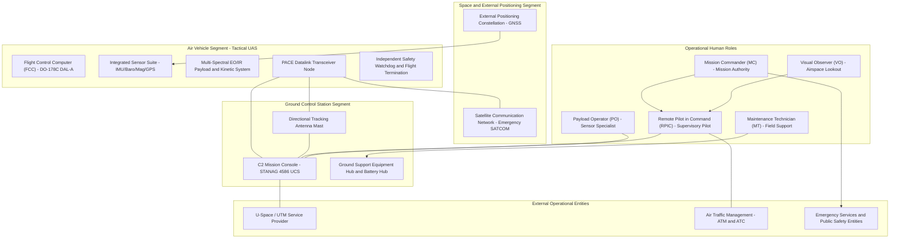

| Attribute | Value |
| :--- | :--- |
| **Title** | Scope, System Identification & Normative Baseline |
| **Version** | 1.0.0 |
| **Date** | 2026-09-02 |

# Concept of Operations (ConOps): Tactical Unmanned Aircraft System (Tactical UAS)

## 1. Scope, System Identification & Normative Baseline

### 1.1 Document Metadata & Formal Governance
This Concept of Operations (ConOps) defines the operational architecture, stakeholder interactions, operational environments, 4D airspace containment boundaries, and deterministic contingency protocols for the Tactical Unmanned Aircraft System (Tactical UAS). This specification is authored in strict accordance with ISO/IEC/IEEE 29148:2018 §5.2.4 & §6.4.2, OMG Unified Architecture Framework (UAF) v1.2/v2.0, NATO STANAG 4586 Edition 4, and JARUS SORA v2.5.

| Attribute | Specification Value |
| :--- | :--- |
| **System Identifier** | TacticalUAS |
| **Document Version** | 1.0.0 |
| **Publication Date** | 2026-09-02 |
| **Security Classification** | Unclassified / Controlled Operational Baseline |
| **Target System Realization** | Tactical Multi-Mission Cyber-Physical UAS |
| **Authoring Organization** | DEAP Tactical UAS Systems Engineering & Safety Architecture Working Group |
| **Regulatory Baseline** | JARUS SORA v2.5 (Specific Category) / EASA Easy Access Rules / FAA Part 107 Waiver Baseline |

### 1.2 System Classification & Operational Purpose
- **System Identifier:** `TacticalUAS`
- **Operational Domain:** `UAF::OperationalDomain::TacticalInfrastructureSafetyAndISR`
- **Primary Operational Mission:** The Tactical UAS is engineered to execute autonomous perimeter surveillance, multi-spectral optical/thermal reconnaissance, automated target tracking, tactical precision strike / kinetic delivery and target engagement, real-time telemetry streaming, and automated dynamic geofence containment in complex, high-reliability civil and defense operational domains.
- **Core Mission Capabilities:**
  1. Autonomous waypoint navigation, corridor traversal, and on-station surveillance orbiting within parameterized performance envelopes.
  2. Multi-sensor data fusion combining multi-constellation satellite navigation receivers, redundant inertial measurement units (IMUs), barometric altimetry, and optical flow odometry.
  3. Real-time high-definition electro-optical / infrared (EO/IR) sensor streaming, automated target classification ($C_{\mathrm{PID}} \ge 0.95$), and edge neural telemetry inference.
  4. Dual-consent cryptographic arming and positive identification gating for precision kinetic payload delivery.
  5. Deterministic failsafe state machine ensuring autonomous containment within the maximum containment response time threshold $\tau_{\mathrm{containment}} \le 200.0\text{ ms}$ upon critical contingency detection.

### 1.3 System Boundary & Physical/Legal Envelopes
The operational system boundary encompasses all physical, logical, communications, and organizational elements required to conduct end-to-end autonomous mission operations:
- **Physical Flight Envelope:** Bounded operational volume extending from ground level ($0.0\text{ m}$ AGL) up to the maximum operating ceiling $120.0\text{ m}$ AGL ($h_{\mathrm{operating\_ceiling}} = 120.0\text{ m}$).
- **Lateral Operating Boundary:** Designated operational perimeter polygon enclosed within a verified Ground Risk Buffer ($R_{\mathrm{GRB}} = 200.0\text{ m}$) containment envelope.
- **C2 RF Datalink Envelope:** Primary line-of-sight command and control (C2) operational radius of $15.0\text{ km}$ ($R_{\mathrm{C2}} = 15.0\text{ km}$) from the Ground Control Station (GCS) node, backed by alternate network links, contingency narrowband radio, and emergency satellite relays.
- **System Mass & Payload Envelope:** Maximum Takeoff Weight (MTOW) of $25.0\text{ kg}$ ($m_{\mathrm{MTOW}} = 25.0\text{ kg}$) with a dedicated mission payload capacity of $5.0\text{ kg}$ ($m_{\mathrm{payload}} = 5.0\text{ kg}$) and nominal mission endurance of $90.0\text{ min}$.
- **Regulatory & Jurisdictional Boundary:** Governed under JARUS SORA v2.5 Specific Category operations (mitigated GRC-2, ARC-b), civil aviation standard scenarios, and national military flight clearances.

### 1.4 Operational Context Diagram
The following Unified Architecture Framework (UAF) operational context diagram defines the external interfaces, performer nodes, and primary interaction channels:

### 1.5 Normative Standards & Regulatory Baseline
The following normative standards and regulatory baselines govern all architectural, operational, safety, and verification artifacts within this Concept of Operations:

| Standard ID | Issuing Body | Title & Baseline Edition | Applicable Clauses & Focus Areas |
| :--- | :--- | :--- | :--- |
| ISO/IEC/IEEE 29148:2018 | ISO / IEC / IEEE | Systems and software engineering — Requirements engineering | §5.2.4 ConOps & §6.4.2 Operational Concepts |
| OMG UAF v1.2 / v2.0 | Object Management Group (OMG) | Unified Architecture Framework (UAF) Specification | Operational Processes (Op-Pr) & Exchanges (Op-Tx) |
| NATO STANAG 4586 | NATO Standardisation Office | Standard Interfaces of UAV Control System (UCS) for NATO UAV Interoperability (Ed. 4) | Data Link Interfaces (DLI) & Command Profiles |
| JARUS SORA v2.5 | JARUS | Specific Operations Risk Assessment (v2.5) | Annex B (Ground Risk Buffer) & Annex E (OSOs) |
| RTCA DO-178C | RTCA / EUROCAE | Software Considerations in Airborne Systems and Equipment Certification | §6.3.1 Software Fault Detection & DAL-A Assurance |
| RTCA DO-254 | RTCA / EUROCAE | Design Assurance Guidance for Airborne Electronic Hardware | Hardware Safety Watchdog & CPLD/FPGA Architecture |
| RTCA DO-365B | RTCA / EUROCAE | MOPS for Detect and Avoid (DAA) Systems | §2.2.4 DAA Well-Clear Separation Volume |
| RTCA DO-362A | RTCA / EUROCAE | Command and Control (C2) Data Link MOPS | §2.2 Link Availability & PACE Fallback Dynamics |
| MIL-STD-882E | U.S. Department of Defense | Department of Defense Standard Practice: System Safety | §4.3 Hazard Identification & Containment Matrix |
| MIL-STD-810H | U.S. Department of Defense | Environmental Engineering Considerations and Laboratory Tests | Climatic Envelopes (Method 501.7 to 521.4) |
| MIL-STD-461G | U.S. Department of Defense | Requirements for the Control of Electromagnetic Interference | Method RS103 Radiated Susceptibility & HIRF |
| DoD Directive 3000.09 | U.S. Department of Defense | Autonomy in Weapon Systems | §3.1 Human Judgement & Dual-Consent Interlocks |
| CJCSI 3121.01B | Chairman of the Joint Chiefs of Staff | Standing Rules of Engagement / Standing Rules for Use of Force | Enclosure A §4.b Positive Identification (PID) |
