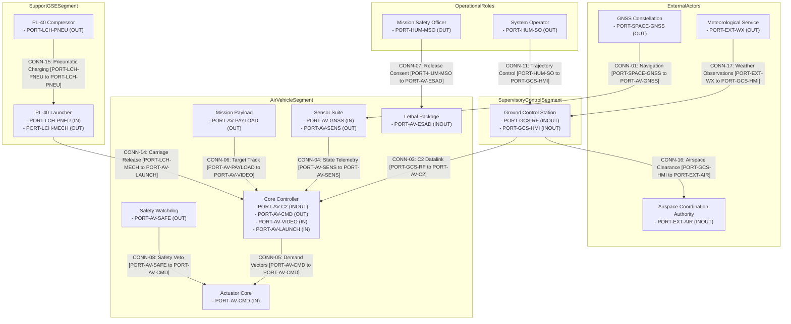

| Attribute | Specification Detail |
| :--- | :--- |
| Title | Scope, System Identification & Normative Baseline |
| Version | 1.0.0 |
| Date | 2026-10-30 |
| issue_id | 117 |
| type | conops |
| generation_mode | worker |
| specification_source | docs/conops/units/conops/01_METADATA_AND_OVERVIEW.md |
| Security Classification | RESTRICTED / DEFENSE-GRADE |

# Concept of Operations (ConOps): Avenger V2.5 Autonomous Loitering Munition UAV & PL-40 Launcher System

## 1. Scope, System Identification & Normative Baseline

### 1.1 Document Metadata & Formal Governance

This Concept of Operations (ConOps) defines the operational architecture, coordinate reference frames, physical and resource limits, stakeholder interactions, operational environments, operational state-space containment boundaries, and deterministic contingency protocols for the Avenger V2.5 Autonomous Loitering Munition UAV and PL-40 Pneumatic Catapult Launcher System. This specification is authored in strict accordance with ISO/IEC/IEEE 29148:2018 Section 5.2.4 and Section 6.4.2, OMG Unified Architecture Framework (UAF) v2.0, INCOSE Systems Engineering Handbook v5.0, MIL-STD-882E, and NATO STANAG 4586 (Refs #117, #123, #128, #121).

| Attribute | Specification Value |
| :--- | :--- |
| **System Identifier** | Avenger V2.5 Loitering Munition System & PL-40 Pneumatic Launcher |
| **Document Version** | 1.0.0 |
| **Publication Date** | 2026-10-30 |
| **Security Classification** | RESTRICTED / DEFENSE-GRADE |
| **Target System Realization** | Avenger V2.5 Fixed-Wing Tactical Loitering Munition with PL-40 Pneumatic Catapult Launcher |
| **Authoring Organization** | Autonomous Systems Engineering Directorate |
| **Issue Tracking Baseline** | Refs #117, #123, #128, #121 |
| **Metamodel Baseline** | ISO/IEC/IEEE 29148:2018 / OMG UAF v2.0 / INCOSE SEH v5.0 / MIL-STD-882E |

### 1.2 System Classification & Operational Purpose

- **System Identifier:** `Avenger V2.5 / PL-40`
- **Operational Domain:** `Air Domain / Tactical Expeditionary Loitering Munition & Catapult Launch`
- **Primary Operational Mission:** Conduct expeditionary forward-deployed reconnaissance, persistent target acquisition, optical tracking, and precision terminal engagement of stationary and maneuvering ground targets through catapult launch and human-authorized loitering strike.
- **Configuration Baseline:** The mission baseline comprises the Avenger V2.5 air vehicle and the PL-40 pneumatic launcher set. The parachute deployment module is a non-mission research and development variant (`configuration: non-mission`; `baseline: false`) and is excluded from all baseline operational analysis. The ESAD is classified as Critical with Design Assurance Level A (DAL-A).

**Core Mission Capabilities:**

- **Pneumatic Rail Launch:** Rapid field deployment using the PL-40 pneumatic rail catapult launcher, an 18 V Makita battery pack (PL-75), and a high-strength pulling rope. Launch pressure is bounded between 13 bar and 14 bar (PL-40, PL-41), and maximum launch velocity is 25 m/s (PL-65).
- **Autonomous Transit & Loiter:** 90 min flight endurance (PL-06), 30 m/s cruise speed (PL-01), and 300 m loiter radius (PL-37). The operational service ceiling is not stated in OEM sources.
- **EO/IR Target Acquisition:** Gimbaled Nighthawk2UZ dual day/thermal camera with 1 to 40 times zoom (PL-27), 1280 x 720 pixels day and thermal resolution (PL-28 through PL-31), pitch coverage from -45 deg to 135 deg (PL-25), and yaw/roll coverage from -165 deg to 165 deg (PL-26). The Trip6 compute module provides automated target detection and tracking.
- **Secure C2 Datalink:** DTC radio transceiver providing 60 km direct radio line-of-sight range (PL-07) and 60 km to 180 km extended radio line-of-sight range (PL-08). The RF band is 4.4 to 5.0 GHz (a5-user-manual-2.md:1273); the airborne transmit level is not stated in OEM sources.
- **Precision Terminal Strike:** ESAD-controlled 5 kg warhead (PL-13) with mandatory Human-in-the-Loop (HITL) consent. Circular Error Probable is not stated in OEM sources.
- **Controlled Recovery & Failsafe:** The parachute deployment module and its dual wire-burning pyrotechnic igniters are a non-mission variant and are excluded from the mission baseline. No baseline recovery performance metric is stated in OEM sources.

### 1.3 System Boundary & Operational State Space

The operational system boundary encompasses all physical, logical, communications, and organizational elements required to conduct end-to-end autonomous mission operations:

- **Operational State Space Envelope:** Operational state space `Omega_state`, a compact subset of `R^n`, bounded by physical, environmental, and operational parameter limits `X_boundary = [x_min, x_max]^T`.
- **Lateral & Spatial Operating Boundary:** The designated operational perimeter is bounded within a containment buffer `R_buffer` whose numeric value is not stated in OEM sources and is derived in Section 5 of the assembled ConOps.
- **Primary Communications Envelope:** Direct C2 range is 60 km (PL-07) and extended C2 range is 60 km to 180 km (PL-08) from the operator control node, backed by alternate network links and contingency communication channels.
- **Normative & Governance Boundary:** Governed under ISO/IEC/IEEE 29148:2018 requirements engineering processes, OMG UAF v2.0 operational architectures, and MIL-STD-882E system safety assurance baselines.
- **Physical Boundary:** The boundary encloses the Avenger V2.5 air vehicle, the PL-40 launcher set, the ground control station, and the external interface board. Ground personnel, airspace authorities, and GNSS service providers are external actors.
- **Legal Boundary:** The legal operating volume is the tactical airspace clearance issued by the airspace coordination authority. Specific coordinates, jurisdictional limits, and diplomatic clearances are not stated in OEM sources.

**Operational State Space Parameter Definitions & Engineering Units:**

| Symbol / Parameter | Domain / Context | Description | Dimension / Limits | Engineering Unit | Normative / Safety Basis |
| :--- | :--- | :--- | :--- | :--- | :--- |
| Omega_state | State Space Domain | Admissible operational state space envelope | Compact subset of R^n | Dimensionless | ISO/IEC/IEEE 29148:2018 Section 6.4.2 |
| X_boundary | State Vector Bounds | Bounding hyper-rectangle of admissible vehicle operational states | [x_min, x_max]^T | Mixed SI units | ASTM F3269-17 Section 5.2 |
| x_min | State Lower Limit | Minimum permissible state vector threshold | [phi_min, lambda_min, h_min, u_min, v_min, w_min]^T | rad, rad, m, m/s | JARUS SORA v2.5 Annex B Section B.2 |
| x_max | State Upper Limit | Maximum permissible state vector threshold | [phi_max, lambda_max, h_max, u_max, v_max, w_max]^T | rad, rad, m, m/s | JARUS SORA v2.5 Annex B Section B.2 |
| R_buffer | Spatial Containment | Verified lateral containment safety buffer radius | Not stated in OEM sources | m | JARUS SORA v2.5 Annex E Section E.4 |
| Range_max(Link_C2) | C2 Comms Margin | Maximum certified C2 data link operational range | 60 km direct (PL-07); 180 km extended (PL-08) | km | RTCA DO-362A Section 2.2.1 |
| tau_containment | Emergency Response | Maximum allowable failsafe containment response time | Not stated in OEM sources | s | ASTM F3269-17 Section 5.3 |

### 1.3.1 Parametric Coordinate Reference Frames Math

The cyber-physical state estimation, guidance, and navigation architecture is mathematically formulated across three standardized, right-handed orthogonal coordinate reference frames:

1. **Primary Global Geodetic Frame (`p_geodetic`):**
   Earth-fixed curvilinear geodetic frame referenced to the WGS-84 reference ellipsoid, defined by geodetic latitude `phi`, geodetic longitude `lambda`, and ellipsoidal height `h_ellips`:

$$
\begin{aligned}
\mathbf{p}_{\mathrm{geodetic}} &= \begin{bmatrix} \phi \\ \lambda \\ h_{\mathrm{ellips}} \end{bmatrix}
\end{aligned}
$$

2. **Local Tangent Plane / Navigation Frame (`p_n` - Local NED):**
   Local Cartesian coordinate frame fixed to an arbitrary local reference origin `(phi_0, lambda_0, h_0)` on the reference ellipsoid, with orthogonal axes oriented along North (`X_n`), East (`Y_n`), and Down (`Z_n`):

$$
\begin{aligned}
\mathbf{p}_n &= \begin{bmatrix} X_n \\ Y_n \\ Z_n \end{bmatrix}_{\mathrm{NED}}
\end{aligned}
$$

3. **Body-Fixed Geometric Frame (`p_b` - Body Frame):**
   Right-handed orthogonal Cartesian frame rigidly attached to the structural frame of the vehicle with origin at the Center of Mass (CG). The axes comprise longitudinal axis `X_b` (forward along the vehicle nominal centerline), lateral axis `Y_b` (starboard/right), and normal axis `Z_b` (downward through the vehicle belly, `Z_b = X_b cross Y_b`).
   - Body translational velocity vector `v_b`:

$$
\begin{aligned}
\mathbf{v}_b &= \begin{bmatrix} u \\ v \\ w \end{bmatrix}^{T}
\end{aligned}
$$

   - Body rotational rate vector `omega_b/n`:

$$
\begin{aligned}
\boldsymbol{\omega}_{b/n} &= \begin{bmatrix} p \\ q \\ r \end{bmatrix}^{T}
\end{aligned}
$$

4. **Kinematic Transformations & Attitude Dynamics:**
   The orientation of the Body-Fixed Frame relative to the Local NED Frame is parameterized by the Euler attitude vector `Theta = [phi_euler, theta_euler, psi_euler]^T` using Direction Cosine Matrix `C_b^n` in SO(3):

$$
\begin{aligned}
\mathbf{v}_n &= \mathbf{C}_b^n \mathbf{v}_b \\
\dot{\mathbf{p}}_n &= \mathbf{C}_b^n \mathbf{v}_b \\
\mathbf{C}_b^n &= \begin{bmatrix}
\cos\theta \cos\psi & \sin\phi \sin\theta \cos\psi - \cos\phi \sin\psi & \cos\phi \sin\theta \cos\psi + \sin\phi \sin\psi \\
\cos\theta \sin\psi & \sin\phi \sin\theta \sin\psi + \cos\phi \cos\psi & \cos\phi \sin\theta \sin\psi - \sin\phi \cos\psi \\
-\sin\theta & \sin\phi \cos\theta & \cos\phi \cos\theta
\end{bmatrix} \\
\dot{\boldsymbol{\Theta}} &= \begin{bmatrix}
1 & \sin\phi \tan\theta & \cos\phi \tan\theta \\
0 & \cos\phi & -\sin\phi \\
0 & \sin\phi \sec\theta & \cos\phi \sec\theta
\end{bmatrix} \boldsymbol{\omega}_{b/n}
\end{aligned}
$$

- Parameter Definitions & Engineering Units:

| Symbol / Variable | Coordinate Frame | Description | Engineering Unit |
| :--- | :--- | :--- | :--- |
| phi | Global Geodetic (WGS-84) | Geodetic Latitude | rad |
| lambda | Global Geodetic (WGS-84) | Geodetic Longitude | rad |
| h_ellips | Global Geodetic (WGS-84) | Ellipsoidal Height above Reference Ellipsoid | m |
| X_n, Y_n, Z_n | Local Tangent Plane (NED) | North, East, Down Position Coordinates | m |
| X_b, Y_b, Z_b | Body-Fixed Frame | Longitudinal (Surge), Lateral (Sway), Normal (Heave) Axes | m |
| v_b = [u, v, w]^T | Body-Fixed Frame | Body Translational Velocity (Surge u, Sway v, Heave w) | m/s |
| omega_b/n = [p, q, r]^T | Body-Fixed Frame | Body Rotational Rates (Roll p, Pitch q, Yaw r) | radians |
| C_b^n | Transformation SO(3) | Direction Cosine Matrix (Body to NED) | Dimensionless |
| Theta = [phi, theta, psi]^T | Attitude Representation | Euler Angles (Roll phi, Pitch theta, Yaw psi) | rad |

### 1.3.2 OEM-Grounded Subsystem Resource Accounting

The OEM bill of materials states a mass only for the warhead (5 kg, PL-13), the PL-40 rail set (68 kg, PL-69), the PL-40 transport case (43 kg, PL-70), the PL-40 compressor case (25 kg, PL-71), and the PL-40 Hook Option A (0.004 kg, oem_bom.md:100). All other onboard subsystem masses and all subsystem electrical draws are not stated in OEM sources and remain unallocated pending detailed design.

| Structural Group (AST Partition) | Representative OEM Components | OEM-Stated Mass | OEM-Stated Electrical Draw | Evidence Status |
| :--- | :--- | :--- | :--- | :--- |
| Top-Level Airframe Structure | Fuselage composite shell, wing panels, Ruddervator (Fins), bulkheads, catapult rail mounts | Not stated in OEM sources | Not stated in OEM sources | oem_bom.md:67; PL-15 wing panel quantity 4 units (a5-user-manual-2.md:337) |
| Avionics & Processing | Cube Orange Plus, Septentrio Asterx-m3 pro, RPI CM5004032, DTC radio, ETH switch | Not stated in OEM sources | Not stated in OEM sources | oem_bom.md:12; oem_bom.md:13; oem_bom.md:14; oem_bom.md:15; oem_bom.md:44 |
| Propulsion & Actuation | AXI outrunner motor, IBEX electronic speed controller, HV-series servo set (PL-18), folding propeller | Not stated in OEM sources | Not stated in OEM sources | PL-18 total servo quantity (avenger_v2_5_sysml_v2_ingestion.md:22); oem_bom.md:71 |
| Energy Storage Subsystem | Li-metal battery pack, current meter, 200 A fuse | Not stated in OEM sources | Not stated in OEM sources | PL-23 minimum 36 V; PL-24 maximum 50.4 V (avenger_v2_5_sysml_v2_ingestion.md:16) |
| Primary Mission Payload | Nighthawk2UZ EO/IR gimbal camera, Trip6 compute module | Not stated in OEM sources | Not stated in OEM sources | PL-28 through PL-31 high-definition day and thermal resolution (a5-user-manual-2.md:325; a5-user-manual-2.md:326) |
| Lethal Package | 5 kg warhead (PL-13), ESAD (Critical, DAL-A) | 5 kg (PL-13) | Not stated in OEM sources | oem_bom.md:52; oem_bom.md:57; ESAD ICD prototype reference |
| Launcher & Ground Support | PL-40 rail set, compressor case, transport case | 68 kg (PL-69), 25 kg (PL-71), 43 kg (PL-70) | Not stated in OEM sources | uav_launcher_pl_40_sysml_v2_ingestion_manual.md:715; uav_launcher_pl_40_sysml_v2_ingestion_manual.md:716; uav_launcher_pl_40_sysml_v2_ingestion_manual.md:717 |
| Total System Integration | Avenger V2.5 air vehicle plus PL-40 launcher set | 17 kg MTOW (PL-12); 68 kg launcher set (PL-69) | Not stated in OEM sources | BOM; PL-12; PL-69 |

### 1.3.3 Master Physical Limits Table

The cyber-physical vehicle operates under bounding physical, aerodynamic and kinematic, and environmental limits grounded in the authoritative parametric limits registry. Every numeric value in this table is traceable to `schema/extracted/parametric_limits.md`. Where the OEM is silent, the cell states "Not stated in OEM sources."

| Parameter ID | Parameter Name | Minimum | Maximum | Engineering Unit | Verification Source |
| :--- | :--- | :--- | :--- | :--- | :--- |
| PL-01 | Cruise speed | 30 m/s | 30 m/s | m/s | a5-user-manual-2.md:307 |
| PL-02 | Maximum horizontal speed | Not stated in OEM sources | 38 m/s | m/s | a5-user-manual-2.md:308 |
| PL-03 | Maximum dive speed | Not stated in OEM sources | 55 m/s | m/s | a5-user-manual-2.md:309 |
| PL-04 | Maximum dive angle | Not stated in OEM sources | 22 deg | deg | a5-user-manual-2.md:310 |
| PL-05 | Minimum flight speed | 26 m/s | Not stated in OEM sources | m/s | a5-user-manual-2.md:311 |
| PL-06 | Flight endurance | 0 min | 90 min | min | avenger-5-spec-sheet-rev3.md:53 |
| PL-07 | RLOS direct range | 0 km | 60 km | km | a5-user-manual-2.md:315 |
| PL-08 | RLOS extended range | 60 km | 180 km | km | a5-user-manual-2.md:315 |
| PL-09 | Wingspan | 1.8 m | 1.8 m | m | a5-user-manual-2.md:287 |
| PL-10 | Assembled UAV length | 1.6 m | 1.6 m | m | a5-user-manual-2.md:288 |
| PL-11 | Assembled UAV height | 1.1 m | 1.1 m | m | a5-user-manual-2.md:289 |
| PL-12 | Maximum take-off weight | Not stated in OEM sources | 17 kg | kg | a5-user-manual-2.md:299 |
| PL-13 | Warhead mass | Not stated in OEM sources | 5 kg | kg | avenger-5-spec-sheet-rev3.md:133 |
| PL-14 | Ruddervator quantity | 4 units | 4 units | units | a5-user-manual-2.md:339 |
| PL-15 | Wing panel quantity | 4 units | 4 units | units | a5-user-manual-2.md:337 |
| PL-16 | Ruddervator servo quantity | 4 units | 4 units | units | avenger_v2_5_sysml_v2_ingestion.md:22 |
| PL-17 | Wing servo quantity | 4 units | 4 units | units | avenger_v2_5_sysml_v2_ingestion.md:28 |
| PL-18 | Total servo quantity | 8 units | 8 units | units | avenger_v2_5_sysml_v2_ingestion.md:22 |
| PL-22 | Servo power rail voltage | 8 V | 8 V | V | avenger_v2_5_sysml_v2_ingestion.md:79 |
| PL-23 | Battery minimum voltage | 36 V | 36 V | V | avenger_v2_5_sysml_v2_ingestion.md:16 |
| PL-24 | Battery maximum voltage | 50.4 V | 50.4 V | V | avenger_v2_5_sysml_v2_ingestion.md:16 |
| PL-36 | Minimum mission waypoint altitude | 50 m | Not stated in OEM sources | m | a5-user-manual-2.md:1195 |
| PL-37 | Avenger 5 loiter radius | 300 m | 300 m | m | a5-user-manual-2.md:1497 |
| PL-39 | Ground radio power | 2 W | 2 W | W | a5-user-manual-2.md:1690 |
| PL-40 | Catapult launch pressure minimum | 13 bar | 13 bar | bar | a5-user-manual-2.md:1329 |
| PL-41 | Catapult launch pressure maximum | 14 bar | 14 bar | bar | a5-user-manual-2.md:1329 |
| PL-42 | Target track duration minimum | 2 s | 2 s | s | a5-user-manual-2.md:2055 |
| PL-43 | Target track duration maximum | 5 s | 5 s | s | a5-user-manual-2.md:2055 |
| PL-44 | Maximum engagement elevation | Not stated in OEM sources | 15 deg | deg | a5-user-manual-2.md:2056 |
| PL-45 | Maximum engagement airspeed | Not stated in OEM sources | 55 m/s | m/s | a5-user-manual-2.md:2061 |
| PL-46 | ESAD power input minimum | 14 V | 14 V | V | esad-icd-excalibur-ab00-0054.md:272 |
| PL-47 | ESAD power input maximum | 32 V | 32 V | V | esad-icd-excalibur-ab00-0054.md:272 |
| PL-48 | ESAD power input nominal | 28 V | 28 V | V | esad-icd-excalibur-ab00-0054.md:272 |
| PL-49 | ESAD umbilical continuity resistance | 0 Ohm | 0.5 Ohm | Ohm | esad-icd-excalibur-ab00-0054.md:284 |
| PL-50 | ESAD umbilical continuity current | 20 mA | 20 mA | mA | esad-icd-excalibur-ab00-0054.md:284 |
| PL-52 | ESAD arm enable high voltage minimum | 2.5 V | 2.5 V | V | esad-icd-excalibur-ab00-0054.md:286 |
| PL-53 | ESAD arm enable high voltage maximum | 3.3 V | 3.3 V | V | esad-icd-excalibur-ab00-0054.md:286 |
| PL-56 | ESAD RS-485 baud rate | 115200 bps | 115200 bps | bps | esad-icd-excalibur-ab00-0054.md:306 |
| PL-57 | ESAD RS-485 command interval | 100 Hz | 100 Hz | Hz | esad-icd-excalibur-ab00-0054.md:307 |
| PL-58 | ESAD response latency | 0 ms | 5 ms | ms | esad-icd-excalibur-ab00-0054.md:330 |
| PL-64 | Maximum launched plane mass | Not stated in OEM sources | 30 kg | kg | uav_launcher_pl_40_sysml_v2_ingestion_manual.md:718 |
| PL-65 | Maximum launch velocity | Not stated in OEM sources | 25 m/s | m/s | uav_launcher_pl_40_sysml_v2_ingestion_manual.md:719 |
| PL-66 | Launcher launch angle | 12 deg | 12 deg | deg | uav_launcher_pl_40_sysml_v2_ingestion_manual.md:712 |
| PL-69 | Launcher set mass | 68 kg | 68 kg | kg | uav_launcher_pl_40_sysml_v2_ingestion_manual.md:715 |
| PL-70 | Launcher case mass | 43 kg | 43 kg | kg | uav_launcher_pl_40_sysml_v2_ingestion_manual.md:716 |
| PL-71 | Compressor case mass | 25 kg | 25 kg | kg | uav_launcher_pl_40_sysml_v2_ingestion_manual.md:717 |
| PL-72 | Launcher setup time | 0 min | 5 min | min | uav_launcher_pl_40_sysml_v2_ingestion_manual.md:722 |
| PL-73 | Launcher working temperature minimum | -20 C | -20 C | C | uav_launcher_pl_40_sysml_v2_ingestion_manual.md:723 |
| PL-74 | Launcher working temperature maximum | 50 C | 50 C | C | uav_launcher_pl_40_sysml_v2_ingestion_manual.md:723 |
| PL-75 | Launcher battery nominal voltage | 18 V | 18 V | V | uav_launcher_pl_40_sysml_v2_ingestion_manual.md:134 |
| PL-76 | Launcher battery capacity | 6.0 Ah | 6.0 Ah | Ah | uav_launcher_pl_40_sysml_v2_ingestion_manual.md:134 (6000 mAh) |
| PL-77 | Battery over-discharge cutoff | Not stated in OEM sources | 14.5 V | V | uav_launcher_pl_40_sysml_v2_ingestion_manual.md:135 |
| PL-78 | Battery over-discharge recovery | 16 V | Not stated in OEM sources | V | uav_launcher_pl_40_sysml_v2_ingestion_manual.md:136 |
| PL-79 | Battery recovery delay | 5 s | 5 s | s | uav_launcher_pl_40_sysml_v2_ingestion_manual.md:136 |
| PL-80 | Pulling rope replacement interval | 100 cycles | 100 cycles | cycles | uav_launcher_pl_40_sysml_v2_ingestion_manual.md:138 (100 launches) |
| PL-93 | Launcher rail length assembled | 5 m | 5 m | m | uav_launcher_pl_40_sysml_v2_ingestion_manual.md:713 |
| PL-94 | Launcher rail length disassembled | 1.28 m | 1.28 m | m | uav_launcher_pl_40_sysml_v2_ingestion_manual.md:714 |

### 1.4 Abstract UAF Context Diagram

The following Unified Architecture Framework (UAF) operational context diagram defines the external interfaces, performer nodes, and primary interaction channels across six operational segments: Space and Orbital, Air Vehicle, Supervisory and Control, Support and Ground Support Equipment, Operational Roles, and External Authorities. The diagram is a Level 1B operational context view; detailed wire-level interfaces are registered in the Level 1C Interface Control Documents.

```mermaid
flowchart TB
    subgraph SpaceSegment["SpaceOrbitalSegment"]
        direction TB
        GNSSConstellation["GNSS Satellite Constellation<br/>- PORT-SPACE-GNSS (OUT)"]
        SatcomRelay["Tactical Relay Aircraft or SATCOM<br/>- PORT-SPACE-RELAY (INOUT)"]
    end

    subgraph VehicleSegment["AirVehicleSegment"]
        direction TB
        CoreController["Autopilot Stack ASTK A5 V2.5<br/>- PORT-AV-C2 (INOUT)<br/>- PORT-AV-SENS (IN)<br/>- PORT-AV-CMD (OUT)<br/>- PORT-AV-VIDEO (IN)<br/>- PORT-AV-LAUNCH (IN)"]
        SensorSuite["Airframe Sensors Suite<br/>- PORT-AV-GNSS (IN)<br/>- PORT-AV-SENS (OUT)"]
        ActuatorSubsystem["Propulsion and Servo Core<br/>- PORT-AV-CMD (IN)<br/>- PORT-AV-VETO (IN)"]
        PayloadSubsystem["Seeker and Vision Payload<br/>- PORT-AV-PAYLOAD (OUT)"]
        LethalSubsystem["Lethal Package<br/>- PORT-AV-ESAD (INOUT)"]
        VehicleComms["DTC Transceiver Module<br/>- PORT-AV-C2 (INOUT)"]
        SafetyWatchdog["ESAD and Parachute Interlock<br/>- PORT-AV-SAFE (OUT)"]
    end

    subgraph ControlSegment["SupervisoryControlSegment"]
        direction TB
        OperatorConsole["GCS Panasonic Toughbook FZ-G2<br/>- PORT-GCS-HMI (INOUT)<br/>- PORT-GCS-LAN (OUT)"]
        GroundCommsArray["MARS Directional Tracking Antenna<br/>- PORT-GCS-RF (INOUT)"]
        InfrastructureHub["ODU Tactical LAN and Fiber Spool<br/>- PORT-GCS-LAN (IN)"]
    end

    subgraph SupportSegment["SupportGSESegment"]
        direction TB
        PneumaticLauncher["PL-40 Pneumatic Launcher Rail<br/>- PORT-LCH-PNEU (IN)<br/>- PORT-LCH-MECH (OUT)"]
        CompressorUnit["PL-40 Compressor Station<br/>- PORT-LCH-PNEU (OUT)"]
        MaintenanceTerminal["External Interface Board<br/>- PORT-GSE-DIAG (INOUT)"]
    end

    subgraph OperationalRoles["OperationalRoles"]
        direction TB
        SystemOperator["System Operator (SO)<br/>- PORT-HUM-SO (OUT)"]
        PayloadSpecialist["Payload Specialist (PS)<br/>- PORT-HUM-PS (OUT)"]
        SafetySupervisor["Mission Safety Officer (MSO)<br/>- PORT-HUM-MSO (OUT)"]
        MaintenanceTechnician["Field Technician (MT)<br/>- PORT-HUM-MT (OUT)"]
    end

    subgraph ExternalAuthorities["ExternalAuthorities"]
        direction TB
        AirspaceAuthority["Tactical Airspace Coordination<br/>- PORT-EXT-AIR (INOUT)"]
        WeatherDataService["Meteorological Service<br/>- PORT-EXT-WX (OUT)"]
    end

    GNSSConstellation -->|"CONN-01: L-Band RF Navigation [PORT-SPACE-GNSS to PORT-AV-GNSS]"| SensorSuite
    SatcomRelay -->|"CONN-02: Extended RLOS Relay [PORT-SPACE-RELAY to PORT-AV-C2]"| VehicleComms
    VehicleComms -->|"CONN-03: Primary C2 Datalink [PORT-AV-C2 to PORT-GCS-RF]"| GroundCommsArray
    SensorSuite -->|"CONN-04: DroneCAN State Telemetry [PORT-AV-SENS to PORT-AV-SENS]"| CoreController
    CoreController -->|"CONN-05: Demand Vectors [PORT-AV-CMD to PORT-AV-CMD]"| ActuatorSubsystem
    PayloadSubsystem -->|"CONN-06: Target Track Frames [PORT-AV-PAYLOAD to PORT-AV-VIDEO]"| CoreController
    SafetySupervisor -->|"CONN-07: Weapon Release Consent [PORT-HUM-MSO to PORT-AV-ESAD]"| LethalSubsystem
    SafetyWatchdog -->|"CONN-08: Hardware Safety Veto [PORT-AV-SAFE to PORT-AV-VETO]"| ActuatorSubsystem
    GroundCommsArray -->|"CONN-09: Downlink RF and Telemetry [PORT-GCS-RF to PORT-GCS-HMI]"| OperatorConsole
    OperatorConsole -->|"CONN-10: Mission Archiving [PORT-GCS-LAN to PORT-GCS-LAN]"| InfrastructureHub
    SystemOperator -->|"CONN-11: Supervisory Trajectory Control [PORT-HUM-SO to PORT-GCS-HMI]"| OperatorConsole
    PayloadSpecialist -->|"CONN-12: Gimbal and Target Lock [PORT-HUM-PS to PORT-GCS-HMI]"| OperatorConsole
    MaintenanceTechnician -->|"CONN-13: Diagnostic Check and Flash [PORT-HUM-MT to PORT-GSE-DIAG]"| MaintenanceTerminal
    PneumaticLauncher -->|"CONN-14: Catapult Carriage Sled [PORT-LCH-MECH to PORT-AV-LAUNCH]"| CoreController
    CompressorUnit -->|"CONN-15: Pneumatic Charging [PORT-LCH-PNEU to PORT-LCH-PNEU]"| PneumaticLauncher
    OperatorConsole -->|"CONN-16: Airspace Clearance [PORT-GCS-HMI to PORT-EXT-AIR]"| AirspaceAuthority
    WeatherDataService -->|"CONN-17: Field Weather Observations [PORT-EXT-WX to PORT-GCS-HMI]"| OperatorConsole
```

### 1.5 Normative Standards & Regulatory Baseline

The following normative standards and regulatory baselines govern all architectural, operational, safety, and verification artifacts within this Concept of Operations:

| Standard ID | Issuing Body | Title & Baseline Edition | Applicable Clauses & Focus Areas |
| :--- | :--- | :--- | :--- |
| ISO/IEC/IEEE 29148:2018 | ISO / IEC / IEEE | Systems and Software Engineering -- Life Cycle Processes -- Requirements Engineering | Section 5.2.4 ConOps Development Process, Section 6.4.2 Concept of Operations Baseline Specification, Section 6.4.3 Operational Concept Document Structure |
| ISO/IEC/IEEE 15288:2023 | ISO / IEC / IEEE | Systems and Software Engineering -- System Life Cycle Processes | Section 6.4.2 Stakeholder Needs and Requirements Definition, Section 6.4.3 Architecture Definition Process |
| INCOSE SEH v5.0 | INCOSE | Systems Engineering Handbook (5th Edition) | Section 3.3.1 Life Cycle Stages and Concept Definition, Section 4.3 Architecture Definition, Section 4.6 System Analysis and Multi-Domain Threat Assessment, Section 5.4 System Verification and Validation Traceability |
| OMG UAF v2.0 | OMG | Unified Architecture Framework Specification | Operational Domain Views (Op-Pr, Op-Tx, Op-Is) |
| DoD Directive 3000.09 | US Department of Defense | Autonomy in Weapon Systems | Section 3.1 Human Judgement in Force, Section 3.1.a Autonomous Engagement, Section 3.1.b Fail-Safe Interlocks, Section 3.1.c Cyber Safeguards |
| CJCSI 3121.01B | Chairman of the Joint Chiefs of Staff | Standing Rules of Engagement / Standing Rules for Use of Force for U.S. Forces | Enclosure A Section 2.a Self-Defense Determination, Enclosure A Section 4.b Positive Identification, Enclosure B Section 3.c Collateral Damage Mitigation, Enclosure E Section 2.d Escalation of Force Interlocks |
| NATO STANAG 4586 | NATO Standardisation Office | Standard Interfaces of UAV Control System (UCS) for NATO UAV Interoperability | Section 4.2 UCS Architectural Framework, Section 4.2.2 Interoperability Levels 1-5, Section 5.1 Data Link Interface Profiles, Section 5.1.4 C2 Link Handover |
| NIST SP 800-82r3 | NIST | Guide to Operational Technology (OT) Security | Section 4.2 OT Threat Sources, Section 5.3 OT Defense-in-Depth Architecture, Section 6.2 Wireless and RF C2 Security Controls, Section 6.4 Incident Response and Containment |
| ISO/SAE 21434 | ISO / SAE International | Road Vehicles -- Cybersecurity Engineering | Section 5.3 Cybersecurity Management, Section 6.4 Threat Analysis and Risk Assessment, Section 9.4 Vulnerability Analysis, Section 10.4 Incident Verification and Validation |
| MIL-STD-461G | US Department of Defense | Requirements for the Control of Electromagnetic Interference Characteristics of Subsystems and Equipment | Section 5.4 Conducted Susceptibility CS114-CS116, Section 5.18 Radiated Susceptibility RS103, Section 5.19 Magnetic Fields RS101, Section 5.20 Conducted Emissions CE102 |
| MIL-STD-882E | US Department of Defense | Department of Defense Standard Practice: System Safety | Task 106 Section 4.2 Hazard Mitigation, Task 201 Section 4.2 Preliminary Hazard Analysis, Task 204 Section 4.2 Probability Levels, Task 205 Section 4.2 System Hazard Analysis, Task 208 Section 4.2 Functional Thread Isolation |
| MIL-STD-1629A | US Department of Defense | Procedures for Performing a Failure Mode, Effects and Criticality Analysis | Section 4.3 Severity Classification, Section 4.4 Failure Probability, Section 4.5 Failure Detection, Section 4.6 Criticality Analysis |
| SAE ARP4761 | SAE International | Guidelines and Methods for Conducting the Safety Assessment Process on Civil Airborne Systems and Equipment | Section 4.3.1 Functional Hazard Assessment, Section 4.3.3 FMECA Process, App. L Failure Probability Allocation, App. M Common Cause Analysis |
| RTCA DO-178C | RTCA / EUROCAE | Software Considerations in Airborne Systems and Equipment Certification | Section 6.3.1 Software Fault Detection, Section 6.3.2 Software Partitioning, Section 6.4.3 Redundancy Management, Section 6.4.4 Structural Coverage |
| RTCA DO-362A | RTCA / EUROCAE | Command and Control (C2) Data Link MOPS | Section 2.2 Link Availability and Continuity, Section 2.2.1 Terrestrial LOS Link Allocation, Section 2.2.4 Satellite C2 Link Handover, Section 3.4 Lost Link Fallback Switching |
| JARUS SORA v2.5 | JARUS | Specific Operations Risk Assessment | Annex B Section B.2 Ground Risk Mitigations M1-M3, Annex C Section C.3 Strategic Air Risk Mitigations, Annex D Section D.2 Tactical Mitigation Standards, Annex E Section E.4 Containment Objectives |
| JARUS SORA v2.5 Annex E | JARUS | SORA Specific Category Airworthiness Objectives (OSO-01 to OSO-24) | Section E.1 Airworthiness through Section E.24 Lithium Fire |
| ASTM F3269-17 | ASTM International | Standard Practice for Methods to Safely Bound Flight Behavior of UAS Containing Complex Functions | Section 5.1 RTA Simplex Architecture, Section 5.2 Attitude, Speed and Geofence Monitors, Section 5.3 Deterministic State Switching, Section 5.4 SLDV Invariant Proof Slots |
| MIL-STD-810H | US Department of Defense | Environmental Engineering Considerations and Laboratory Tests | High Temperature Method Section 4.2, Low Temperature Method Section 4.2, Rain and Wind Method Section 4.2, Icing and Freezing Rain Method Section 4.2 |

### 1.6 Stakeholder Roster, User Classes & Authority Boundaries

**Stakeholder Roster:**

| Stakeholder ID | Stakeholder | Primary Interest | Influence on Operations | Acceptance Criterion |
| :--- | :--- | :--- | :--- | :--- |
| STK-01 | System Operator (SO) | Safe launch, transit, loiter, and recovery | Directs all vehicle trajectory commands | Mission completed within declared flight limits |
| STK-02 | Payload Specialist (PS) | Target detection, identification, and track quality | Commands gimbal pointing and target lock | Target track remains stable through engagement window |
| STK-03 | Mission Safety Officer (MSO) | Weapon release safety and abort authority | Grants or withholds lethal release consent | No unauthorized lethal actuation occurs |
| STK-04 | Field Technician (MT) | Launcher charging, RBF removal, and arming | Prepares and arms the launcher and ESAD | All interlocks verified before launch |
| STK-05 | Tactical Airspace Coordination Authority | Airspace deconfliction and clearance | Approves or denies operating volume | Mission remains inside cleared airspace |
| STK-06 | Meteorological Service | Environmental awareness | Provides field weather observations | Launch and flight conducted within declared limits |
| STK-07 | System Assurance Authority | Safety and configuration integrity | Audits hazard controls and evidence | All Critical hazards carry verified controls |
| STK-08 | Logistics and Support Command | Sustainment and spares availability | Allocates launcher and air vehicle spares | Mission availability sustained across sorties |

**User Classes:**

| User Class ID | User Class | Operational Role | Primary Responsibilities | Authority Boundary |
| :--- | :--- | :--- | :--- | :--- |
| UCL-01 | System Operator (SO) | Direct pilot and mission supervisor | Launch authorization, trajectory monitoring, recovery initiation | May abort mission at any time; may not authorize lethal release |
| UCL-02 | Payload Specialist (PS) | Targeting specialist | Gimbal control, target designation, track confirmation | May designate targets; may not release weapons |
| UCL-03 | Mission Safety Officer (MSO) | Weapon release authority | Validates target identification and grants release consent | Sole authority for lethal release consent |
| UCL-04 | Field Technician (MT) | Launcher and arming technician | Launcher setup, pneumatic charging, RBF removal, ESAD arming | May arm only after MSO and SO confirmation |
| UCL-05 | Range Safety Officer (RSO) | Range containment authority | Monitors containment boundary and flight termination readiness | May direct flight termination for containment violation |
| UCL-06 | Airspace Coordination Authority | External airspace authority | Issues and revokes airspace clearance | May deny or terminate operations in controlled airspace |

### 1.7 Operational Assumptions and Constraints

- The Avenger V2.5 air vehicle and PL-40 launcher are operated as an integrated mission system; the launcher is not an airborne element.
- The ESAD is a Critical (DAL-A) safety item; no lethal actuation may occur without a time-ordered Human-in-the-Loop consent token from the Mission Safety Officer.
- The `Ruddervator` is the canonical term for the four tail control surfaces. The terms `Fins` and `tail stabiliser` are accepted only as parenthetical synonyms from the OEM drawing and preparation sources.
- The parachute deployment module is a non-mission variant (`configuration: non-mission`; `baseline: false`) and is excluded from baseline operational, safety, and sustainment analysis.
- All numeric operational limits are traceable to `schema/extracted/parametric_limits.md`; any parameter absent from that registry is marked "Not stated in OEM sources."
- The system operates under positive airspace clearance and does not self-authorize entry into controlled or contested airspace.

### 4.1 Super-System Operational Architecture and Segment Boundaries

The super-system operational architecture partitions the capability across five operational segments and one external-actor group. The Air Vehicle Segment is the system under design; the PL-40 launcher is a support-segment element; the Space and Orbital Segment, Supervisory and Control Segment, Operational Roles, and External Authorities are external to the air vehicle boundary. This architecture view is governed by IEEE Std 1362-1998 Section 5.3 (Operational Environment and System Architecture) and DoDAF v2.02 SV-1 (Systems Interface Description). The Level 1B port and connection bindings in Figure 1.4 use discrete port identifiers and traceable connection identifiers that map 1:1 to the Level 1C System Interface Matrix.

| Operational Segment | Constituent Elements | Boundary Role |
| :--- | :--- | :--- |
| Space and Orbital Segment | GNSS constellation, tactical relay aircraft or SATCOM service | Provides navigation and beyond-line-of-sight relay services |
| Air Vehicle Segment | Avenger V2.5 airframe, avionics, propulsion, payload, lethal package, datalink | System under design; bounded by onboard subsystem interfaces and external RBF keys |
| Supervisory and Control Segment | GCS tablet, ground radio box, MARS antenna, rotator, tactical LAN | Commands, monitors, and authorizes mission execution |
| Support and GSE Segment | PL-40 rail set, compressor station, trigger handle, external interface board | Launches, charges, and maintains the air vehicle |
| Operational Roles | System Operator, Payload Specialist, Mission Safety Officer, Field Technician, Range Safety Officer | Human authority and consent boundary |
| External Authorities | Airspace coordination authority, meteorological service, assurance authority | Regulatory and environmental boundary |

**Figure 4.1: Super-System Port and Connection Binding View**

### 4.3 Subsystem Architecture (100% AST Part Coverage)

The complete AST part taxonomy is declared in `.pipeline/schema.sysml` and elaborated in the System Architecture ConOps unit. This overview binds the six top-level structural partitions used throughout the document. The AST part identities in the OEM bill of materials are authoritative for subsystem naming.

| AST Structural Partition | Representative AST Part Definitions | Operational Function |
| :--- | :--- | :--- |
| Airframe and Control Surfaces | Airframe Fuselage, Wings, Wing Panels, Ruddervator | Aerodynamic lift, stability, and control |
| Avionics and Computing | Autopilot Stack Module ASTK A5 V2.5, Autopilot Computing Board Cube Orange Plus, RPI CM5004032, GNSS Module | Navigation, guidance, mission management, and computing |
| Propulsion and Actuation | `Propulsion`, `Battery_12S2P_Li_Metal_BEI`, `ESC_IBEX160`, `Motor_AXI_5345_16_HD_GOLD_LINE_V3`, `EPS_Servo_Power_8V_Rail` | Thrust generation and control-surface actuation |
| Mission Payload | Gimbal Nighthawk2UZ, Camera Compute Module Trip6 | Electro-optical and infrared sensing and target tracking |
| Lethal Package | Lethal Package, ESAD, ESAD Sensor Board, ESAD Detonator, Warhead | Safety and arming, terminal initiation |
| Launch and Ground Support | PL-40 Rail, PL-40 Compressor Unit, PL-40 Trigger Handle, GCS Radio Box, GCS MARS Antenna | Launch, command and control, and sustainment |

### 4.4 System Interface Topology and Port Taxonomy

The Level 1B interface topology uses directional port identifiers with an explicit direction (`IN`, `OUT`, or `INOUT`). Detailed pinouts, serial framing, opcodes, register bitmasks, and checksum equations are deferred to the Level 1C Interface Control Documents.

| Port Identifier | Direction | Connected Segments | Protocol Family | Operational Payload |
| :--- | :--- | :--- | :--- | :--- |
| PORT-AV-C2 | INOUT | Air Vehicle to Supervisory and Control | RF datalink | Supervisory commands, telemetry, video, state telemetry |
| PORT-AV-GNSS | IN | Space and Orbital to Air Vehicle | Coaxial RF and UART serial | GNSS position, velocity, and time |
| PORT-AV-ACT | OUT | Air Vehicle internal | CAN bus DroneCAN and DC power | Servo demand vectors and actuation power |
| PORT-AV-PAYLOAD | INOUT | Air Vehicle internal | Ethernet and HDMI | Video frames and target track data |
| PORT-AV-ESAD | INOUT | Air Vehicle internal | RS-485 and discrete GPIO | Arm enable, continuity, and initiation authorization |
| PORT-GCS-RF | INOUT | Supervisory and Control external | RF datalink | Command uplink and telemetry downlink |
| PORT-LCH-PNEU | IN | Support and GSE to Air Vehicle | Pneumatic | Launch pressure and carriage propulsion |
| PORT-LCH-TRIG | IN | Support and GSE to Air Vehicle | Electrical discrete | Dual-switch launch command |

## Source References

| Reference ID | Source Artifact | Scope | Access Path |
| :--- | :--- | :--- | :--- |
| SRC-01 | SysML v2 Level 0 schema | AST part, port, attribute, and constraint definitions | [.pipeline/schema.sysml](.pipeline/schema.sysml) |
| SRC-02 | OEM bill of materials extraction | Component identity, stated mass, interface, and configuration status | [schema/extracted/oem_bom.md](schema/extracted/oem_bom.md) |
| SRC-03 | System interface extraction | Port direction, protocol, data type, and refresh rate | [schema/extracted/interface_table.md](schema/extracted/interface_table.md) |
| SRC-04 | Parametric limits registry | All numeric limits, units, and verification sources | [schema/extracted/parametric_limits.md](schema/extracted/parametric_limits.md) |
| SRC-05 | This ConOps unit | Scope, system identification, and normative baseline | [docs/conops/units/conops/01_METADATA_AND_OVERVIEW.md](docs/conops/units/conops/01_METADATA_AND_OVERVIEW.md) |
| SRC-06 | Cited research inventory | Public clause citations and normative baseline allocations | [docs/research/RESEARCH_INVENTORY.md](docs/research/RESEARCH_INVENTORY.md) |

Normative clause anchors:
- ISO/IEC/IEEE 29148:2018 Section 5.2.4 and Section 6.4.2 (stakeholder needs and ConOps baseline).
- ISO/IEC/IEEE 15288:2023 Section 6.4.2 and Section 6.4.3 (stakeholder needs and architecture definition).
- IEEE Std 1362-1998 Section 5.3 (system architecture and operational environment).
- DoDAF v2.02 SV-1 (systems interface description).
- MIL-STD-882E Task 202 and Task 205 (operational hazard analysis and system hazard analysis).
- JARUS SORA v2.5 Annex B Section B.2 and Annex E Section E.14 (containment and ground risk mitigation).

All numeric values in this unit are traceable to SRC-04. Values absent from the OEM sources are explicitly marked "Not stated in OEM sources." The configuration status of the parachute deployment module is traceable to SRC-02 (`configuration: non-mission`; `baseline: false`).
