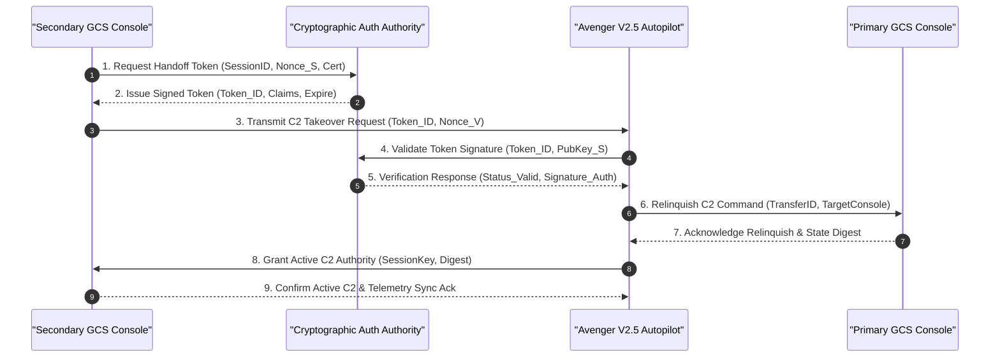
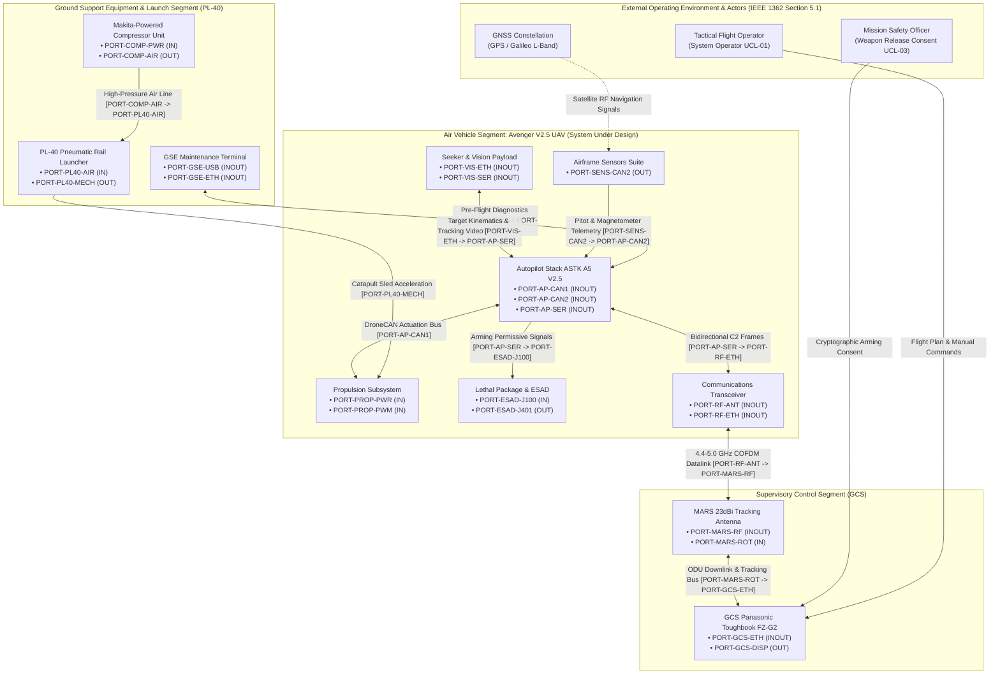

| Attribute | Value |
| :--- | :--- |
| **Title** | System Architecture, User Classes, Stakeholder Taxonomy & Subsystem Allocation |
| **Version** | 1.0.0 |
| **Date** | 2026-10-30 |
| **Traceability References** | Fixes #120, #119 |

## 4. System Operational Architecture, User Classes & Subsystem Decomposition

### 4.1 Stakeholder Roster & User Class Taxonomy
In accordance with ISO/IEC/IEEE 29148:2018 Section 5.2.4 and DoDAF v2.02 SV-1, the operational lifecycle of the Avenger V2.5 Loitering Munition UAV and PL-40 Pneumatic Launcher involves multiple organizational and external stakeholders:
- **System Governance & Safety Authorities:** Regulatory and military certification authorities responsible for validating system safety cases, approving range containment profiles, and certifying ESAD compliance.
- **Operational Safety Authority & Supervisors:** Operational commanders governing airspace corridor allocations, validating dynamic exclusion zones, and authorizing weapons release consent.
- **System Owner & Operations Management:** Tactical unit command directing mission requirements, target tasking, and resource allocation.
- **Support & Logistics Organization:** Maintenance depot personnel, supply chain operators, and field arming specialists.

The operational user classes are formalized using the standard `UCL-xx` prefix:

| User Class ID | Title | Player or Operator | Interfacing Stakeholder | Characteristics & Responsibilities | Training & Qualification | Constraint Source |
| :--- | :--- | :--- | :--- | :--- | :--- | :--- |
| **UCL-01** | System Operator (SO) | Direct Operator | Mission Safety Officer / Tactical Command | Primary operational responsibility for catapult launch sequence, trajectory monitoring, corridor compliance, and failsafe abort execution. | Certified UAV Tactical Pilot with Type Rating and Catapult Launch Certification | ISO/IEC/IEEE 29148:2018 Section 5.2.4 |
| **UCL-02** | Payload Specialist (PS) | Direct Operator | Tactical Intelligence / Strike Cell | Responsible for Nighthawk2UZ EO/IR sensor tasking, 40X optical zoom tracking, Trip6 AI feature lock, and target coordinate extraction. | Certified Sensor Payload Specialist & EO/IR Target Acquisition Qualification | ISO/IEC/IEEE 29148:2018 Section 5.2.4 |
| **UCL-03** | Mission Safety Officer (MSO) | Supervisor / Approver | Operational Commander / Joint Air Cell | Holds cryptographic weapon release keys; authorizes final terminal dive and ESAD arming sequence under strict Rules of Engagement (RoE). | Senior Tactical Safety Officer & Weapon Release Authority Certification | MIL-STD-882E Task 102 |
| **UCL-04** | Field Maintenance Technician (MT) | Support Operator | Maintenance Logistics Officer | Conducts PL-40 pneumatic rail assembly, compressor pressure charging, carriage rope inspection, pre-flight PBIT checks, and battery hot-swaps. | Certified Field GSE Hardware Specialist & Catapult Maintenance Qualification | ISO/IEC/IEEE 29148:2018 Section 5.2.4 |
| **UCL-05** | Range Safety Observer (RSO) | Field Support | Local Airspace Safety Staff | Maintains continuous monitoring of surrounding launch perimeter, launcher clear zones, and visual airspace deconfliction. | Certified Range Safety Observer Training & Tactical Radio Protocol Qualification | MIL-STD-882E Section 4.3 |

### 4.2 Operator Workload Constraints (NASA-TLX) & Shift Protocols
In accordance with ISO/IEC/IEEE 29148:2018 Section 5.2.4 and MIL-STD-1472H, human operators maintain situational awareness without cognitive saturation. Operator workload is assessed across the 6 NASA Task Load Index (NASA-TLX) dimensions:

$$
\begin{aligned}
\text{TLX}_{\mathrm{composite}} &= \sum_{i=1}^{6} w_i \cdot S_i \\
\sum_{i=1}^{6} w_i &= 1.0
\end{aligned}
$$

- Parameter Definitions & Engineering Units:
- TLX_composite: Overall weighted composite cognitive workload score on a [0, 100] scale.
- w_i: Normalized weighting coefficient for dimension i (sum of all w_i equals 1.0).
- S_i: Raw subjective workload rating score for dimension i on a scale of [0, 100].
- TLX_nominal_max: Maximum allowable composite workload under nominal operations (TLX_nominal_max <= 35).
- TLX_contingency_max: Maximum allowable composite workload under contingency operations (TLX_contingency_max <= 55).

| Dimension ID | Dimension Name | Description & Evaluation Focus | Weight (w_i) | Nominal Threshold | Contingency Threshold | Scale Range |
| :--- | :--- | :--- | :--- | :--- | :--- | :--- |
| **TLX-01** | Mental Demand | Tactical situation assessment, target classification, and terminal dive clearance calculations | 0.25 | Score <= 35 | Score <= 55 | 0 - 100 |
| **TLX-02** | Physical Demand | Console manipulation, touchpad input, and field launcher toggle clamp engagement | 0.10 | Score <= 35 | Score <= 55 | 0 - 100 |
| **TLX-03** | Temporal Demand | Time pressure during terminal engagement windows and high-speed dive guidance | 0.20 | Score <= 35 | Score <= 55 | 0 - 100 |
| **TLX-04** | Performance | Perceived operator success in target neutralization and containment compliance | 0.15 | Score <= 35 | Score <= 55 | 0 - 100 |
| **TLX-05** | Effort | Aggregate mental and physical exertion required to maintain tracking stability | 0.15 | Score <= 35 | Score <= 55 | 0 - 100 |
| **TLX-06** | Frustration | Operational friction, datalink attenuation, or degraded optical visibility stress | 0.15 | Score <= 35 | Score <= 55 | 0 - 100 |
| **Composite** | Overall Weighted TLX | Weighted aggregate cognitive workload index across all supervisory duties | 1.00 | Score <= 35 | Score <= 55 | 0 - 100 |

#### 4.2.1 Operational Shift Rotation Protocol
To mitigate operator fatigue and sustain continuous vigilance during loitering missions, console duty is governed by strict mathematical limits:

$$
\begin{aligned}
t_{\mathrm{shift}} &\le t_{\text{shift\_max}} = 4.0 \\
t_{\mathrm{rest}} &\ge t_{\text{rest\_min}} = 0.5 \\
t_{\mathrm{daily}} &\le t_{\text{daily\_max}} = 8.0
\end{aligned}
$$

- Parameter Definitions & Engineering Units:
- t_shift: Continuous supervisory console duty duration per shift (t_shift <= 4.0 hr).
- t_rest: Mandatory non-operational rest interval between consecutive shifts (t_rest >= 30.0 min).
- t_daily: Cumulative console operational duty duration within a rolling 24-hour cycle (t_daily <= 8.0 hr).
- t_overlap: Mandatory structured handover briefing interval (t_overlap >= 15.0 min).

### 4.3 Authority Handoff Chains & Cryptographic Control Transfer
Handoff of command and control (C2) authority between GCS consoles follows a strict cryptographic 4-way handshake bounded by t_handoff <= tau_handoff_max = 5.0 s:

#### Deterministic Rejection Safety Criteria:
- **REJ-01:** Cryptographic Token Invalidation (digital signature failure, expired timestamp, or revoked cert).
- **REJ-02:** Telemetry State Desynchronization (state disparity exceeds acceptable thresholds).
- **REJ-03:** Active Emergency or Terminal Dive State (in-progress EMG-01..07 response or terminal kinetic dive inhibits transfer).
- **REJ-04:** Datalink Attenuation (packet loss exceeds 1.0% or round-trip latency exceeds 100 ms).

### 4.4 Operational Lifecycle Stages ($\Phi_{\mathrm{lifecycle}}$)
The Avenger V2.5 / PL-40 system executes across six mutually exclusive lifecycle stages:
1. **Phase_Startup:** PL-40 pneumatic rail assembly, compressor pressure charge, PBIT diagnostics, GNSS lock, and RBF key verification.
2. **Phase_CatapultLaunch:** Carriage safety lock pin removal, dual trigger actuation, pneumatic piston pull, carriage sled release, and climb-out.
3. **Phase_NominalTransit:** High-altitude cruise, corridor following, waypoint navigation, and continuous telemetry monitoring.
4. **Phase_LoiterAndTargeting:** Tactical loitering, Nighthawk2UZ EO/IR panning, 40X optical zoom tracking, and Trip6 target identification.
5. **Phase_TerminalStrike:** Positive Human-in-the-Loop (HITL) weapon release authorization, ESAD high-voltage arming, and terminal kinetic dive.
6. **Phase_RecoveryOrContainment:** Parachute pyrotechnic deployment for test recovery, or autonomous flight termination into designated safety zones.

---

### 4.5 System Operational Architecture (DoDAF SV-1 / IEEE 1362 Section 5.3)
The Super-System Architecture decomposes into three primary operational segments: Air Vehicle Segment (Avenger V2.5 UAV), Launch Segment (PL-40 Pneumatic Catapult Launcher), and Control Segment (Ground Control System).

#### Figure 4.1: Canonical ConOps SV-1 Primary System Architecture Diagram (Option 3: Compact Blocks & Vertical Tiers)

---

### 4.6 Super-System Segment Allocation Matrix (Table 4.2)
Physical subsystems, computational nodes, and support equipment are formally allocated across operational segments in accordance with IEEE 1362 Section 5.3 and DoDAF SV-1:

| Subsystem Part | Operational Segment | SSOT Ground Truth Source & Citation | Primary Functional Role |
| :--- | :--- | :--- | :--- |
| **Top_Level_Airframe** | Air Vehicle Segment (UAV) | [schema/avenger-5-spec-sheet-rev3.md](schema/avenger-5-spec-sheet-rev3.md) ("Structural Details") \| SysML v2: `part def Top_Level_Airframe` | Aerodynamic structure, fuselage composite shell, wing panels, ruddervator fins, and catapult rail interfaces. |
| **Autopilot_Stack_ASTK_A5_V2_5** | Air Vehicle Segment (UAV) | [schema/avenger_v2_5_sysml_v2_ingestion.md](schema/avenger_v2_5_sysml_v2_ingestion.md) ("Autopilot stack module") \| SysML v2: `part def Autopilot_Stack_ASTK_A5_V2_5` | Core computational avionics, Cube Orange+ flight controller, RPI CM5 companion computer, Ethernet switch, and EPS power module. |
| **Propulsion** | Air Vehicle Segment (UAV) | [schema/avenger_v2_5_sysml_v2_ingestion.md](schema/avenger_v2_5_sysml_v2_ingestion.md) ("Propulsion") \| SysML v2: `part def Propulsion` | Thrust generation using AXI 5345/16 motor, IBEX160 ESC, folding propeller, 12S2P battery, and 200A fuse. |
| **Fins** | Air Vehicle Segment (UAV) | [schema/avenger_v2_5_sysml_v2_ingestion.md](schema/avenger_v2_5_sysml_v2_ingestion.md) ("Fins") \| SysML v2: `part def Fins` | Tail empennage aerodynamic control surfaces actuated by 4x HV6160-DroneCAN pitch and yaw servos. |
| **Wings** | Air Vehicle Segment (UAV) | [schema/avenger_v2_5_sysml_v2_ingestion.md](schema/avenger_v2_5_sysml_v2_ingestion.md) ("Wings") \| SysML v2: `part def Wings` | Main aerodynamic lifting surfaces housing 4x HV6160-DroneCAN roll stabilization servos and CAN power splitter PCB. |
| **Airframe_Sensors** | Air Vehicle Segment (UAV) | [schema/avenger_v2_5_sysml_v2_ingestion.md](schema/avenger_v2_5_sysml_v2_ingestion.md) ("Airframe Sensors") \| SysML v2: `part def Airframe_Sensors` | Atmospheric and magnetic state estimation using CUAV SKYE2 pitot tube and dual mRo RM3100 magnetometers. |
| **Seeker_Vision_Payload** | Air Vehicle Segment (UAV) | [schema/avenger_v2_5_sysml_v2_ingestion.md](schema/avenger_v2_5_sysml_v2_ingestion.md) ("Gimbal & Camera compute") \| SysML v2: `part def Seeker_Vision_Payload` | Target reconnaissance, 40X optical zoom tracking, and video feed using Nighthawk2UZ gimbal and Trip6 compute module. |
| **Communications** | Air Vehicle Segment (UAV) | [schema/avenger-5-spec-sheet-rev3.md](schema/avenger-5-spec-sheet-rev3.md) ("Communication") \| SysML v2: `part def Communications` | Command and control transport and video streaming using DTC 4.4-5.0 GHz 2x1W radio and dual MPSL4400 antennas. |
| **Lethal_Package** | Air Vehicle Segment (UAV) | [schema/esad-icd-excalibur-ab00-0054.md](schema/esad-icd-excalibur-ab00-0054.md) ("ESAD ICD") \| SysML v2: `part def Lethal_Package` | Safe-and-arm fuzing, proximity target sensing, and precision terminal blast neutralization using 5.0 kg warhead and ESAD. |
| **Parachute_Deployment** | Air Vehicle Segment (UAV) | [schema/avenger_v2_5_sysml_v2_ingestion.md](schema/avenger_v2_5_sysml_v2_ingestion.md) ("Parachute deployment") \| SysML v2: `part def Parachute_Deployment` | Controlled flight termination and test airframe recovery using dual wire-burning pyrotechnic igniters. |
| **Safety_Interlocks** | Air Vehicle Segment (UAV) | [schema/a5-prep-and-safety-rev7.md](schema/a5-prep-and-safety-rev7.md) ("Safety Interlocks") \| SysML v2: `part def Safety_Interlocks` | Physical and electrical safety guarantees using UAV RBF key, ESAD RBF pin, and pitot protective cover devices. |
| **Ground_Support_Equipment** | Launch & Support Segment | [schema/uav_launcher_pl_40_sysml_v2_ingestion_manual.md](schema/uav_launcher_pl_40_sysml_v2_ingestion_manual.md) ("PL-40 Launcher") \| SysML v2: `part def Ground_Support_Equipment` | Expeditionary catapult launching using PL-40 3-piece rail set, carriage sled, pulling rope, compressor unit, and ground anchors. |
| **Ground_Control_System** | Supervisory Control Segment | [schema/avenger-5-spec-sheet-rev3.md](schema/avenger-5-spec-sheet-rev3.md) ("Ground Station Control") \| SysML v2: `part def Ground_Control_System` | Supervisory command, target tracking display, and datalink tracking using Panasonic Toughbook FZ-G2, MARS 23 dBi antenna, and Gitzo tripod. |
| **Interface_Table_System** | System Integration Architecture | [schema/extracted/interface_table.md](schema/extracted/interface_table.md) ("System Interface Table") \| SysML v2: `part def Interface_Table_System` | Master electrical, serial, discrete, bus, and RF interface definition across all platform subsystems. |
| **Parametric_Limits_Table_System** | System Engineering Constraints | [schema/extracted/parametric_limits.md](schema/extracted/parametric_limits.md) ("Parametric Limits Table") \| SysML v2: `part def Parametric_Limits_Table_System` | Authoritative performance, mass, airspeed, environmental, and endurance boundaries governing operations. |
| **Anchor** | Launch & Support Segment | [schema/uav_launcher_pl_40_sysml_v2_ingestion_manual.md](schema/uav_launcher_pl_40_sysml_v2_ingestion_manual.md) ("Ground anchors") \| SysML v2: `part def Anchor` | Ground anchors and anchor disk driven into soil to secure the rear launcher module. |
| **Automotive** | Air Vehicle Segment (UAV) | [schema/avenger_v2_5_sysml_v2_ingestion.md](schema/avenger_v2_5_sysml_v2_ingestion.md) ("Automotive fuse 200A") \| SysML v2: `part def Automotive` | 200A automotive fuse protecting high-current battery line from propulsion short circuits. |
| **Hammer** | Launch & Support Segment | [schema/uav_launcher_pl_40_sysml_v2_ingestion_manual.md](schema/uav_launcher_pl_40_sysml_v2_ingestion_manual.md) ("Hammer") \| SysML v2: `part def Hammer` | Sledge hammer tool utilized to drive ground anchors into terrain during launcher setup. |
| **Middle** | Launch & Support Segment | [schema/uav_launcher_pl_40_sysml_v2_ingestion_manual.md](schema/uav_launcher_pl_40_sysml_v2_ingestion_manual.md) ("Middle part of the rail") \| SysML v2: `part def Middle` | Middle pneumatic cylinder rail module (RAIL 2) connecting rear and front sections. |
| **Ohm** | Air Vehicle Segment (UAV) | [schema/esad-icd-excalibur-ab00-0054.md](schema/esad-icd-excalibur-ab00-0054.md) ("Detonator Interface") \| SysML v2: `part def Ohm` | Electrical bridgewire continuity and squib resistance standard for ESAD safe-and-arm. |
| **Propeller** | Air Vehicle Segment (UAV) | [schema/avenger_v2_5_sysml_v2_ingestion.md](schema/avenger_v2_5_sysml_v2_ingestion.md) ("Folding Propeller") \| SysML v2: `part def Propeller` | Folding carbon-fiber propeller mounted to AXI motor shaft for aerodynamic thrust. |
| **Rear** | Launch & Support Segment | [schema/uav_launcher_pl_40_sysml_v2_ingestion_manual.md](schema/uav_launcher_pl_40_sysml_v2_ingestion_manual.md) ("Rear part of the rail") \| SysML v2: `part def Rear` | Rear rail module (RAIL 1) housing the carriage initial launch latch and safety pin. |
| **Roller** | Launch & Support Segment | [schema/uav_launcher_pl_40_sysml_v2_ingestion_manual.md](schema/uav_launcher_pl_40_sysml_v2_ingestion_manual.md) ("Roller block") \| SysML v2: `part def Roller` | Dual-pulley roller block redirecting the pulling rope 180 degrees at front rail. |
| **Ruddervator** | Air Vehicle Segment (UAV) | [schema/avenger-5-spec-sheet-rev3.md](schema/avenger-5-spec-sheet-rev3.md) ("Structural Details") \| SysML v2: `part def Ruddervator` | Inverted-V tail aerodynamic surfaces providing combined pitch and yaw flight control. |
| **SET** | Launch & Support Segment | [schema/uav_launcher_pl_40_sysml_v2_ingestion_manual.md](schema/uav_launcher_pl_40_sysml_v2_ingestion_manual.md) ("PL-40 Rail Set") \| SysML v2: `part def SET` | Modular 3-module rail set assembly providing linear catapult acceleration path. |
| **Tank** | Launch & Support Segment | [schema/uav_launcher_pl_40_sysml_v2_ingestion_manual.md](schema/uav_launcher_pl_40_sysml_v2_ingestion_manual.md) ("Compressor unit / Air reservoir") \| SysML v2: `part def Tank` | High-pressure pneumatic air storage reservoir and cylinder on compressor unit. |

---

### 4.7 Subsystem Architecture & AST Part Allocation (100% AST Part Coverage)
In accordance with IEEE 1362 Section 5.3, DoDAF SV-1, and Check 26, formal operational specifications are defined below for all 97 declared SysML AST part def nodes in `.pipeline/schema.sysml`, in AST declaration order. The AST parametric unit annotations also reference the chars, bytes, and percent dimension tokens, which are resolved inside the parametric limits part below rather than as standalone parts.

#### 4.7.1 Air_Vehicle_Avenger_V2_5 Subsystem Architecture
- **Functional Purpose & Scope:** Implements the AST-declared component role: Top-level air vehicle boundary enclosing all onboard subsystems. Its declared interface scope covers Onboard subsystem boundaries; external RBF keys; external interface board.
- **Physical & Logical Interface / Port Allocations:** AST interface items: Onboard subsystem boundaries; external RBF keys; external interface board. No ports declared in AST.
- **Power, Mass & Resource Envelopes:** Mass: Not stated in OEM sources. Power: Not stated in OEM sources.
- **Operational Role & Statechart Integration:** Serves as Top-level air vehicle boundary enclosing all onboard subsystems within the declared system boundary. No dedicated statechart in AST.
- **Safety Invariants, Containment Interlocks & FMECA Linkage:** Top-level containment boundary: the part encloses all onboard subsystems and exposes the external RBF key interfaces, so internal energetic or propulsion failures remain inside the declared air vehicle envelope. No standalone hazard identifier is introduced here.
- **SSOT Ground Truth Mapping:** [schema/avenger_v2_5_sysml_v2_ingestion.md](schema/avenger_v2_5_sysml_v2_ingestion.md):7 | SysML v2: `part def Air_Vehicle_Avenger_V2_5`

#### 4.7.2 Airframe_Fuselage Subsystem Architecture
- **Functional Purpose & Scope:** Implements the AST-declared component role: Fuselage assembly with hatches closed and vertical stabilizer attached; battery included. Its declared interface scope covers Payload bay; wing mounting brackets; ruddervator mounting shafts; RBF sockets.
- **Physical & Logical Interface / Port Allocations:** AST interface items: Payload bay; wing mounting brackets; ruddervator mounting shafts; RBF sockets. No ports declared in AST.
- **Power, Mass & Resource Envelopes:** Mass: Not stated in OEM sources. Power: Not stated in OEM sources.
- **Operational Role & Statechart Integration:** Serves as Fuselage assembly with hatches closed and vertical stabilizer attached; battery included within the declared system boundary. No dedicated statechart in AST.
- **Safety Invariants, Containment Interlocks & FMECA Linkage:** Structural and battery containment boundary: the fuselage carries the battery and the RBF sockets, and the closed hatches plus RBF access are the declared containment features.
- **SSOT Ground Truth Mapping:** [schema/a5-user-manual-2.md](schema/a5-user-manual-2.md):336 | SysML v2: `part def Airframe_Fuselage`

#### 4.7.3 Airframe_Payload_Bay Subsystem Architecture
- **Functional Purpose & Scope:** Implements the AST-declared component role: Payload bay with hatch, mounting brackets and retaining rings. Its declared interface scope covers Warhead mounting brackets; ESAD payload cables; hatch lock.
- **Physical & Logical Interface / Port Allocations:** AST interface items: Warhead mounting brackets; ESAD payload cables; hatch lock. No ports declared in AST.
- **Power, Mass & Resource Envelopes:** Mass: Not stated in OEM sources. Power: Not stated in OEM sources.
- **Operational Role & Statechart Integration:** Serves as Payload bay with hatch, mounting brackets and retaining rings within the declared system boundary. No dedicated statechart in AST.
- **Safety Invariants, Containment Interlocks & FMECA Linkage:** Payload containment boundary: the bay houses the warhead mounting brackets and ESAD payload cables behind a hatch lock, providing physical separation between the lethal package and the rest of the airframe.
- **SSOT Ground Truth Mapping:** [schema/a5-prep-and-safety-rev7.md](schema/a5-prep-and-safety-rev7.md):102 | SysML v2: `part def Airframe_Payload_Bay`

#### 4.7.4 Automotive_Fuse_200A Subsystem Architecture
- **Functional Purpose & Scope:** Implements the AST-declared component role: 200 A automotive main power fuse. Its declared interface scope covers Battery to power meter main power line.
- **Physical & Logical Interface / Port Allocations:** AST interface items: Battery to power meter main power line. No ports declared in AST.
- **Power, Mass & Resource Envelopes:** Mass: Not stated in OEM sources. Power: Not stated in OEM sources.
- **Operational Role & Statechart Integration:** Serves as 200 A automotive main power fuse within the declared system boundary. No dedicated statechart in AST.
- **Safety Invariants, Containment Interlocks & FMECA Linkage:** Overcurrent failure containment: the 200 A fuse is the declared series element between the battery and the power meter, isolating a main-power short from the propulsion and avionics buses.
- **SSOT Ground Truth Mapping:** [schema/avenger_v2_5_sysml_v2_ingestion.md](schema/avenger_v2_5_sysml_v2_ingestion.md):17 | SysML v2: `part def Automotive_Fuse_200A`

#### 4.7.5 Autopilot_Computing_Board_Cube_Orange_Plus Subsystem Architecture
- **Functional Purpose & Scope:** Implements the AST-declared component role: Autopilot computing board and sensor fusion controller. Its declared interface scope covers CAN 1; CAN 2; serial links; USB; ETH.
- **Physical & Logical Interface / Port Allocations:** AST interface items: CAN 1; CAN 2; serial links; USB; ETH. No ports declared in AST.
- **Power, Mass & Resource Envelopes:** Mass: Not stated in OEM sources. Power: Not stated in OEM sources.
- **Operational Role & Statechart Integration:** Serves as Autopilot computing board and sensor fusion controller within the declared system boundary. No dedicated statechart in AST.
- **Safety Invariants, Containment Interlocks & FMECA Linkage:** No dedicated interlock is declared; flight-control computation is separated from the energetic chain, and the AST interface set does not give this board a direct ESAD firing path.
- **SSOT Ground Truth Mapping:** [schema/avenger_v2_5_sysml_v2_ingestion.md](schema/avenger_v2_5_sysml_v2_ingestion.md):10 | SysML v2: `part def Autopilot_Computing_Board_Cube_Orange_Plus`

#### 4.7.6 Autopilot_Stack_Module_ASTK_A5_V2_5 Subsystem Architecture
- **Functional Purpose & Scope:** Implements the AST-declared component role: Autopilot stack module boundary. Its declared interface scope covers EPS module; autopilot computing board; ETH switch; RPI; GNSS module.
- **Physical & Logical Interface / Port Allocations:** AST interface items: EPS module; autopilot computing board; ETH switch; RPI; GNSS module. No ports declared in AST.
- **Power, Mass & Resource Envelopes:** Mass: Not stated in OEM sources. Power: Not stated in OEM sources.
- **Operational Role & Statechart Integration:** Serves as Autopilot stack module boundary within the declared system boundary. No dedicated statechart in AST.
- **Safety Invariants, Containment Interlocks & FMECA Linkage:** No dedicated interlock is declared; the stack boundary groups avionics only, keeping ESAD firing and RBF functions outside the computational boundary.
- **SSOT Ground Truth Mapping:** [schema/avenger_v2_5_sysml_v2_ingestion.md](schema/avenger_v2_5_sysml_v2_ingestion.md):8 | SysML v2: `part def Autopilot_Stack_Module_ASTK_A5_V2_5`

#### 4.7.7 Battery_12S2P_Li_Metal_BEI Subsystem Architecture
- **Functional Purpose & Scope:** Implements the AST-declared component role: Removable 12S2P Li metal battery with maximus20 cells. Its declared interface scope covers 36 to 50.4 V DC main power; retaining strap; locking connector.
- **Physical & Logical Interface / Port Allocations:** AST interface items: 36 to 50.4 V DC main power; retaining strap; locking connector. No ports declared in AST.
- **Power, Mass & Resource Envelopes:** Mass: Not stated in OEM sources. Power: Not stated in OEM sources.
- **Operational Role & Statechart Integration:** Serves as Removable 12S2P Li metal battery with maximus20 cells within the declared system boundary. No dedicated statechart in AST.
- **Safety Invariants, Containment Interlocks & FMECA Linkage:** Stored-energy containment: the 12S2P Li-metal pack feeds the main DC bus through the 200 A fuse and power meter, while the UAV RBF key removes the power-meter enable path.
- **SSOT Ground Truth Mapping:** [schema/avenger_v2_5_sysml_v2_ingestion.md](schema/avenger_v2_5_sysml_v2_ingestion.md):16 | SysML v2: `part def Battery_12S2P_Li_Metal_BEI`

#### 4.7.8 CAN_1_Autopilot_EPS_Junction_Node Subsystem Architecture
- **Functional Purpose & Scope:** Implements the AST-declared component role: CAN 1 junction linking autopilot, EPS and CAN 1 trunk. Its declared interface scope covers CAN 1 trunk; EPS tap; autopilot tap.
- **Physical & Logical Interface / Port Allocations:** AST interface items: CAN 1 trunk; EPS tap; autopilot tap. No ports declared in AST.
- **Power, Mass & Resource Envelopes:** Mass: Not stated in OEM sources. Power: Not stated in OEM sources.
- **Operational Role & Statechart Integration:** Serves as CAN 1 junction linking autopilot, EPS and CAN 1 trunk within the declared system boundary. No dedicated statechart in AST.
- **Safety Invariants, Containment Interlocks & FMECA Linkage:** No dedicated interlock; the junction is a passive CAN 1 connectivity element.
- **SSOT Ground Truth Mapping:** [schema/avenger_v2_5_sysml_v2_ingestion.md](schema/avenger_v2_5_sysml_v2_ingestion.md):50 | SysML v2: `part def CAN_1_Autopilot_EPS_Junction_Node`

#### 4.7.9 CAN_1_Power_Meter_Junction_Node Subsystem Architecture
- **Functional Purpose & Scope:** Implements the AST-declared component role: CAN 1 junction below the power meter. Its declared interface scope covers CAN 1 970 cm trunk; power meter; CAN 1 150 cm branch.
- **Physical & Logical Interface / Port Allocations:** AST interface items: CAN 1 970 cm trunk; power meter; CAN 1 150 cm branch. No ports declared in AST.
- **Power, Mass & Resource Envelopes:** Mass: Not stated in OEM sources. Power: Not stated in OEM sources.
- **Operational Role & Statechart Integration:** Serves as CAN 1 junction below the power meter within the declared system boundary. No dedicated statechart in AST.
- **Safety Invariants, Containment Interlocks & FMECA Linkage:** No dedicated interlock; the junction is a passive CAN 1 connectivity element below the power meter.
- **SSOT Ground Truth Mapping:** [schema/avenger_v2_5_sysml_v2_ingestion.md](schema/avenger_v2_5_sysml_v2_ingestion.md):51 | SysML v2: `part def CAN_1_Power_Meter_Junction_Node`

#### 4.7.10 CAN_1_Ruddervator_Splitter_Junction_Node Subsystem Architecture
- **Functional Purpose & Scope:** Implements the AST-declared component role: CAN 1 hub splitting the 150 cm branch into four 120 cm servo stubs. Its declared interface scope covers Four CAN 1 120 cm branches to Ruddervator Servos #1 to #4.
- **Physical & Logical Interface / Port Allocations:** AST interface items: Four CAN 1 120 cm branches to Ruddervator Servos #1 to #4. No ports declared in AST.
- **Power, Mass & Resource Envelopes:** Mass: Not stated in OEM sources. Power: Not stated in OEM sources.
- **Operational Role & Statechart Integration:** Serves as CAN 1 hub splitting the 150 cm branch into four 120 cm servo stubs within the declared system boundary. No dedicated statechart in AST.
- **Safety Invariants, Containment Interlocks & FMECA Linkage:** No dedicated interlock; the hub distributes CAN 1 actuation commands to four independent ruddervator servo branches, so one stub failure does not remove the remaining branches from the bus.
- **SSOT Ground Truth Mapping:** [schema/avenger_v2_5_sysml_v2_ingestion.md](schema/avenger_v2_5_sysml_v2_ingestion.md):52 | SysML v2: `part def CAN_1_Ruddervator_Splitter_Junction_Node`

#### 4.7.11 CAN_2_Servo_5_Series_Junction_Node Subsystem Architecture
- **Functional Purpose & Scope:** Implements the AST-declared component role: CAN 2 series junction at Wing Servo #5. Its declared interface scope covers Splitter PCB; Wing Servo #5; next series segment.
- **Physical & Logical Interface / Port Allocations:** AST interface items: Splitter PCB; Wing Servo #5; next series segment. No ports declared in AST.
- **Power, Mass & Resource Envelopes:** Mass: Not stated in OEM sources. Power: Not stated in OEM sources.
- **Operational Role & Statechart Integration:** Serves as CAN 2 series junction at Wing Servo #5 within the declared system boundary. No dedicated statechart in AST.
- **Safety Invariants, Containment Interlocks & FMECA Linkage:** No dedicated interlock; the series pass-through preserves the CAN 2 daisy chain to the remaining wing servos if one segment is interrupted.
- **SSOT Ground Truth Mapping:** [schema/avenger_v2_5_sysml_v2_ingestion.md](schema/avenger_v2_5_sysml_v2_ingestion.md):53 | SysML v2: `part def CAN_2_Servo_5_Series_Junction_Node`

#### 4.7.12 CAN_2_Servo_6_Series_Junction_Node Subsystem Architecture
- **Functional Purpose & Scope:** Implements the AST-declared component role: CAN 2 series junction at Wing Servo #6. Its declared interface scope covers Splitter PCB; Wing Servo #6; next series segment.
- **Physical & Logical Interface / Port Allocations:** AST interface items: Splitter PCB; Wing Servo #6; next series segment. No ports declared in AST.
- **Power, Mass & Resource Envelopes:** Mass: Not stated in OEM sources. Power: Not stated in OEM sources.
- **Operational Role & Statechart Integration:** Serves as CAN 2 series junction at Wing Servo #6 within the declared system boundary. No dedicated statechart in AST.
- **Safety Invariants, Containment Interlocks & FMECA Linkage:** No dedicated interlock; the series pass-through preserves the CAN 2 daisy chain to the remaining wing servos if one segment is interrupted.
- **SSOT Ground Truth Mapping:** [schema/avenger_v2_5_sysml_v2_ingestion.md](schema/avenger_v2_5_sysml_v2_ingestion.md):54 | SysML v2: `part def CAN_2_Servo_6_Series_Junction_Node`

#### 4.7.13 CAN_2_Servo_7_Series_Junction_Node Subsystem Architecture
- **Functional Purpose & Scope:** Implements the AST-declared component role: CAN 2 series junction at Wing Servo #7. Its declared interface scope covers Splitter PCB; Wing Servo #7; next series segment.
- **Physical & Logical Interface / Port Allocations:** AST interface items: Splitter PCB; Wing Servo #7; next series segment. No ports declared in AST.
- **Power, Mass & Resource Envelopes:** Mass: Not stated in OEM sources. Power: Not stated in OEM sources.
- **Operational Role & Statechart Integration:** Serves as CAN 2 series junction at Wing Servo #7 within the declared system boundary. No dedicated statechart in AST.
- **Safety Invariants, Containment Interlocks & FMECA Linkage:** No dedicated interlock; the series pass-through preserves the CAN 2 daisy chain to the remaining wing servos if one segment is interrupted.
- **SSOT Ground Truth Mapping:** [schema/avenger_v2_5_sysml_v2_ingestion.md](schema/avenger_v2_5_sysml_v2_ingestion.md):55 | SysML v2: `part def CAN_2_Servo_7_Series_Junction_Node`

#### 4.7.14 CAN_power_splitter_PCB Subsystem Architecture
- **Functional Purpose & Scope:** Implements the AST-declared component role: Servo power splitter and CAN 2 series pass-through board. Its declared interface scope covers Four 8 V inputs from EPS; CAN 2 input from autopilot; series CAN 2 daisy chain to Servos #5 to #8.
- **Physical & Logical Interface / Port Allocations:** AST interface items: Four 8 V inputs from EPS; CAN 2 input from autopilot; series CAN 2 daisy chain to Servos #5 to #8. No ports declared in AST.
- **Power, Mass & Resource Envelopes:** Mass: Not stated in OEM sources. Power: Not stated in OEM sources.
- **Operational Role & Statechart Integration:** Serves as Servo power splitter and CAN 2 series pass-through board within the declared system boundary. No dedicated statechart in AST.
- **Safety Invariants, Containment Interlocks & FMECA Linkage:** No dedicated interlock; the board separates the four 8 V servo feeds and the CAN 2 series chain, limiting a single servo-rail fault to its branch.
- **SSOT Ground Truth Mapping:** [schema/avenger_v2_5_sysml_v2_ingestion.md](schema/avenger_v2_5_sysml_v2_ingestion.md):26 | SysML v2: `part def CAN_power_splitter_PCB`

#### 4.7.15 Camera_Compute_Module_Trip6 Subsystem Architecture
- **Functional Purpose & Scope:** Implements the AST-declared component role: Gimbal control, video and target tracking computer. Its declared interface scope covers ETH; serial from autopilot; power and HDMI to gimbal.
- **Physical & Logical Interface / Port Allocations:** AST interface items: ETH; serial from autopilot; power and HDMI to gimbal. No ports declared in AST.
- **Power, Mass & Resource Envelopes:** Mass: Not stated in OEM sources. Power: Not stated in OEM sources.
- **Operational Role & Statechart Integration:** Serves as Gimbal control, video and target tracking computer within the declared system boundary. No dedicated statechart in AST.
- **Safety Invariants, Containment Interlocks & FMECA Linkage:** No dedicated interlock is declared; the camera compute module stays outside the ESAD command path declared in the AST.
- **SSOT Ground Truth Mapping:** [schema/avenger_v2_5_sysml_v2_ingestion.md](schema/avenger_v2_5_sysml_v2_ingestion.md):36 | SysML v2: `part def Camera_Compute_Module_Trip6`

#### 4.7.16 EPS_Module Subsystem Architecture
- **Functional Purpose & Scope:** Implements the AST-declared component role: Electronic power system module with DC/DC converters, load switches and MCU. Its declared interface scope covers 8 V servo rails; 12 V radio; 14 V ESAD; 50 V igniters; pitot and magnetometer power.
- **Physical & Logical Interface / Port Allocations:** AST interface items: 8 V servo rails; 12 V radio; 14 V ESAD; 50 V igniters; pitot and magnetometer power. No ports declared in AST.
- **Power, Mass & Resource Envelopes:** Mass: Not stated in OEM sources. Power: Not stated in OEM sources.
- **Operational Role & Statechart Integration:** Serves as Electronic power system module with DC/DC converters, load switches and MCU within the declared system boundary. No dedicated statechart in AST.
- **Safety Invariants, Containment Interlocks & FMECA Linkage:** Power-source containment: the EPS distributes the 8 V servo, 12 V radio, 14 V ESAD and 50 V igniter rails, and its load switches plus the UAV power interlock isolate these rails from the battery.
- **SSOT Ground Truth Mapping:** [schema/avenger_v2_5_sysml_v2_ingestion.md](schema/avenger_v2_5_sysml_v2_ingestion.md):9 | SysML v2: `part def EPS_Module`

#### 4.7.17 EPS_Servo_Power_8V_Rail Subsystem Architecture
- **Functional Purpose & Scope:** Implements the AST-declared component role: Regulated 8 V servo power distribution with four ruddervator branches and four splitter inputs. Its declared interface scope covers 8 V DC to Servos #1 to #8 through direct branches and the CAN/power splitter PCB.
- **Physical & Logical Interface / Port Allocations:** AST interface items: 8 V DC to Servos #1 to #8 through direct branches and the CAN/power splitter PCB. No ports declared in AST.
- **Power, Mass & Resource Envelopes:** Mass: Not stated in OEM sources. Power: Not stated in OEM sources.
- **Operational Role & Statechart Integration:** Serves as Regulated 8 V servo power distribution with four ruddervator branches and four splitter inputs within the declared system boundary. No dedicated statechart in AST.
- **Safety Invariants, Containment Interlocks & FMECA Linkage:** Servo-power containment: four independent 8 V branches plus four splitter inputs limit a single rail fault to one servo group.
- **SSOT Ground Truth Mapping:** [schema/avenger_v2_5_sysml_v2_ingestion.md](schema/avenger_v2_5_sysml_v2_ingestion.md):79 | SysML v2: `part def EPS_Servo_Power_8V_Rail`

#### 4.7.18 ESAD Subsystem Architecture
- **Functional Purpose & Scope:** Implements the AST-declared component role: Electronic Safe and Arm Device, Critical / DAL-A, all-electronic safety and arming device. Its declared interface scope covers J100 system; J102 sensor board; J401 detonator; RS-485; DSC_IN1 arm enable; UMB continuity.
- **Physical & Logical Interface / Port Allocations:** AST interface items: J100 system; J102 sensor board; J401 detonator; RS-485; DSC_IN1 arm enable; UMB continuity. No ports declared in AST.
- **Power, Mass & Resource Envelopes:** Mass: Not stated in OEM sources. Power: Not stated in OEM sources.
- **Operational Role & Statechart Integration:** Serves as Electronic Safe and Arm Device, Critical / DAL-A, all-electronic safety and arming device within the declared system boundary. No dedicated statechart in AST.
- **Safety Invariants, Containment Interlocks & FMECA Linkage:** Safety-critical DAL-A arming chain: firing requires the J100 DSC_IN1 arm-enable signal, umbilical continuity, and the ESAD safe/arm interlock, while the ESAD RBF key holds the device in the safe state.
- **SSOT Ground Truth Mapping:** [schema/avenger_v2_5_sysml_v2_ingestion.md](schema/avenger_v2_5_sysml_v2_ingestion.md):45 | SysML v2: `part def ESAD`

#### 4.7.19 ESAD_Detonator Subsystem Architecture
- **Functional Purpose & Scope:** Implements the AST-declared component role: LEEFI or EFI detonator. Its declared interface scope covers ESAD J401 HV_OUT and HV_GND.
- **Physical & Logical Interface / Port Allocations:** AST interface items: ESAD J401 HV_OUT and HV_GND. No ports declared in AST.
- **Power, Mass & Resource Envelopes:** Mass: Not stated in OEM sources. Power: Not stated in OEM sources.
- **Operational Role & Statechart Integration:** Serves as LEEFI or EFI detonator within the declared system boundary. No dedicated statechart in AST.
- **Safety Invariants, Containment Interlocks & FMECA Linkage:** Final firing element: the detonator receives only the ESAD J401 high-voltage output, and no independent arming path is declared, so initiation remains gated by the ESAD.
- **SSOT Ground Truth Mapping:** [schema/esad-icd-excalibur-ab00-0054.md](schema/esad-icd-excalibur-ab00-0054.md):108 | SysML v2: `part def ESAD_Detonator`

#### 4.7.20 ESAD_Harness Subsystem Architecture
- **Functional Purpose & Scope:** Implements the AST-declared component role: ESAD board and sensor board mating connectors and crimps. Its declared interface scope covers J100; J102; sensor board J1.
- **Physical & Logical Interface / Port Allocations:** AST interface items: J100; J102; sensor board J1. No ports declared in AST.
- **Power, Mass & Resource Envelopes:** Mass: Not stated in OEM sources. Power: Not stated in OEM sources.
- **Operational Role & Statechart Integration:** Serves as ESAD board and sensor board mating connectors and crimps within the declared system boundary. No dedicated statechart in AST.
- **Safety Invariants, Containment Interlocks & FMECA Linkage:** Arm/fire wiring confinement: the J100, J102 and sensor-board J1 harnesses carry only ESAD-defined signals and form the physical boundary for stray-energy control.
- **SSOT Ground Truth Mapping:** [schema/esad-icd-excalibur-ab00-0054.md](schema/esad-icd-excalibur-ab00-0054.md):167 | SysML v2: `part def ESAD_Harness`

#### 4.7.21 ESAD_RBF_Key Subsystem Architecture
- **Functional Purpose & Scope:** Implements the AST-declared component role: ESAD arming sequence Remove Before Flight key. Its declared interface scope covers ESAD discrete interlock.
- **Physical & Logical Interface / Port Allocations:** AST interface items: ESAD discrete interlock. No ports declared in AST.
- **Power, Mass & Resource Envelopes:** Mass: Not stated in OEM sources. Power: Not stated in OEM sources.
- **Operational Role & Statechart Integration:** Serves as ESAD arming sequence Remove Before Flight key within the declared system boundary. No dedicated statechart in AST.
- **Safety Invariants, Containment Interlocks & FMECA Linkage:** Direct safety interlock: the ESAD arming-sequence Remove Before Flight key provides the discrete safe/arm interlock that prevents ESAD arming until it is removed.
- **SSOT Ground Truth Mapping:** [schema/avenger_v2_5_sysml_v2_ingestion.md](schema/avenger_v2_5_sysml_v2_ingestion.md):49 | SysML v2: `part def ESAD_RBF_Key`

#### 4.7.22 ESAD_Sensor_Board Subsystem Architecture
- **Functional Purpose & Scope:** Implements the AST-declared component role: Proximity and impact sensor board with UART, IRQ_L and 5 V interface. Its declared interface scope covers J1 cable to ESAD J102; 5 V power; UART; IRQ_L trigger.
- **Physical & Logical Interface / Port Allocations:** AST interface items: J1 cable to ESAD J102; 5 V power; UART; IRQ_L trigger. No ports declared in AST.
- **Power, Mass & Resource Envelopes:** Mass: Not stated in OEM sources. Power: Not stated in OEM sources.
- **Operational Role & Statechart Integration:** Serves as Proximity and impact sensor board with UART, IRQ_L and 5 V interface within the declared system boundary. No dedicated statechart in AST.
- **Safety Invariants, Containment Interlocks & FMECA Linkage:** Trigger-chain containment: the board supplies the IRQ_L trigger and UART data to the ESAD, is powered from the ESAD 5 V rail, and cannot initiate firing without the ESAD arm state.
- **SSOT Ground Truth Mapping:** [schema/esad-icd-excalibur-ab00-0054.md](schema/esad-icd-excalibur-ab00-0054.md):159 | SysML v2: `part def ESAD_Sensor_Board`

#### 4.7.23 ESAD_Umbilical Subsystem Architecture
- **Functional Purpose & Scope:** Implements the AST-declared component role: Umbilical continuity connection. Its declared interface scope covers ESAD J100 UMB and UMB_RTN continuity line.
- **Physical & Logical Interface / Port Allocations:** AST interface items: ESAD J100 UMB and UMB_RTN continuity line. No ports declared in AST.
- **Power, Mass & Resource Envelopes:** Mass: Not stated in OEM sources. Power: Not stated in OEM sources.
- **Operational Role & Statechart Integration:** Serves as Umbilical continuity connection within the declared system boundary. No dedicated statechart in AST.
- **Safety Invariants, Containment Interlocks & FMECA Linkage:** Continuity interlock: the J100 UMB and UMB_RTN loop is the dedicated umbilical-continuity input evaluated by the ESAD before arming.
- **SSOT Ground Truth Mapping:** [schema/esad-icd-excalibur-ab00-0054.md](schema/esad-icd-excalibur-ab00-0054.md):112 | SysML v2: `part def ESAD_Umbilical`

#### 4.7.24 ESC_IBEX160 Subsystem Architecture
- **Functional Purpose & Scope:** Implements the AST-declared component role: Electronic speed controller. Its declared interface scope covers Three-phase motor drive; PWM throttle; UART telemetry.
- **Physical & Logical Interface / Port Allocations:** AST interface items: Three-phase motor drive; PWM throttle; UART telemetry. No ports declared in AST.
- **Power, Mass & Resource Envelopes:** Mass: Not stated in OEM sources. Power: Not stated in OEM sources.
- **Operational Role & Statechart Integration:** Serves as Electronic speed controller within the declared system boundary. No dedicated statechart in AST.
- **Safety Invariants, Containment Interlocks & FMECA Linkage:** Propulsion-energy containment: the ESC drives the three-phase motor from the switched main bus, so removal of the UAV RBF key and power-meter enable removes its supply.
- **SSOT Ground Truth Mapping:** [schema/avenger_v2_5_sysml_v2_ingestion.md](schema/avenger_v2_5_sysml_v2_ingestion.md):19 | SysML v2: `part def ESC_IBEX160`

#### 4.7.25 ESD_Grounding_Point Subsystem Architecture
- **Functional Purpose & Scope:** Implements the AST-declared component role: ESD grounding point marked by a yellow label. Its declared interface scope covers Operator electrostatic discharge equalization point.
- **Physical & Logical Interface / Port Allocations:** AST interface items: Operator electrostatic discharge equalization point. No ports declared in AST.
- **Power, Mass & Resource Envelopes:** Mass: Not stated in OEM sources. Power: Not stated in OEM sources.
- **Operational Role & Statechart Integration:** Serves as ESD grounding point marked by a yellow label within the declared system boundary. No dedicated statechart in AST.
- **Safety Invariants, Containment Interlocks & FMECA Linkage:** Electrostatic-discharge protection: the yellow-labeled grounding point equalizes operator charge before handling, protecting ESAD and avionics from ESD-induced upset.
- **SSOT Ground Truth Mapping:** [schema/a5-prep-and-safety-rev7.md](schema/a5-prep-and-safety-rev7.md):94 | SysML v2: `part def ESD_Grounding_Point`

#### 4.7.26 ETH_Switch Subsystem Architecture
- **Functional Purpose & Scope:** Implements the AST-declared component role: IP network switch for onboard systems. Its declared interface scope covers ETH to RPI, camera compute module, radio module and external interface board.
- **Physical & Logical Interface / Port Allocations:** AST interface items: ETH to RPI, camera compute module, radio module and external interface board. No ports declared in AST.
- **Power, Mass & Resource Envelopes:** Mass: Not stated in OEM sources. Power: Not stated in OEM sources.
- **Operational Role & Statechart Integration:** Serves as IP network switch for onboard systems within the declared system boundary. No dedicated statechart in AST.
- **Safety Invariants, Containment Interlocks & FMECA Linkage:** No dedicated interlock; the switch provides network isolation only.
- **SSOT Ground Truth Mapping:** [schema/avenger_v2_5_sysml_v2_ingestion.md](schema/avenger_v2_5_sysml_v2_ingestion.md):11 | SysML v2: `part def ETH_Switch`

#### 4.7.27 External_Interface_Board_USB_ETH Subsystem Architecture
- **Functional Purpose & Scope:** Implements the AST-declared component role: External USB and ETH interface board. Its declared interface scope covers USB from autopilot; ETH from ETH switch.
- **Physical & Logical Interface / Port Allocations:** AST interface items: USB from autopilot; ETH from ETH switch. No ports declared in AST.
- **Power, Mass & Resource Envelopes:** Mass: Not stated in OEM sources. Power: Not stated in OEM sources.
- **Operational Role & Statechart Integration:** Serves as External USB and ETH interface board within the declared system boundary. No dedicated statechart in AST.
- **Safety Invariants, Containment Interlocks & FMECA Linkage:** No dedicated interlock; external USB and ETH access is separated from the ESAD firing chain.
- **SSOT Ground Truth Mapping:** [schema/avenger_v2_5_sysml_v2_ingestion.md](schema/avenger_v2_5_sysml_v2_ingestion.md):47 | SysML v2: `part def External_Interface_Board_USB_ETH`

#### 4.7.28 GCS_Battery Subsystem Architecture
- **Functional Purpose & Scope:** Implements the AST-declared component role: Ground control station battery, quantity 2. Its declared interface scope covers GCS DC power.
- **Physical & Logical Interface / Port Allocations:** AST interface items: GCS DC power. No ports declared in AST.
- **Power, Mass & Resource Envelopes:** Mass: Not stated in OEM sources. Power: Not stated in OEM sources.
- **Operational Role & Statechart Integration:** Serves as Ground control station battery, quantity 2 within the declared system boundary. No dedicated statechart in AST.
- **Safety Invariants, Containment Interlocks & FMECA Linkage:** No dedicated interlock; the part is a GCS DC source only.
- **SSOT Ground Truth Mapping:** [schema/a5-user-manual-2.md](schema/a5-user-manual-2.md):350 | SysML v2: `part def GCS_Battery`

#### 4.7.29 GCS_Cabling Subsystem Architecture
- **Functional Purpose & Scope:** Implements the AST-declared component role: Power, Ethernet, antenna and LAN cables with ODU and N-type connectors. Its declared interface scope covers ODU connector; N-type connector; Ethernet.
- **Physical & Logical Interface / Port Allocations:** AST interface items: ODU connector; N-type connector; Ethernet. No ports declared in AST.
- **Power, Mass & Resource Envelopes:** Mass: Not stated in OEM sources. Power: Not stated in OEM sources.
- **Operational Role & Statechart Integration:** Serves as Power, Ethernet, antenna and LAN cables with ODU and N-type connectors within the declared system boundary. No dedicated statechart in AST.
- **Safety Invariants, Containment Interlocks & FMECA Linkage:** No dedicated interlock; cable shielding and connector keying provide interface separation.
- **SSOT Ground Truth Mapping:** [schema/a5-user-manual-2.md](schema/a5-user-manual-2.md):354 | SysML v2: `part def GCS_Cabling`

#### 4.7.30 GCS_Ground_Box Subsystem Architecture
- **Functional Purpose & Scope:** Implements the AST-declared component role: Ground control station network and power box. Its declared interface scope covers Radio and antenna connections; DC power.
- **Physical & Logical Interface / Port Allocations:** AST interface items: Radio and antenna connections; DC power. No ports declared in AST.
- **Power, Mass & Resource Envelopes:** Mass: Not stated in OEM sources. Power: Not stated in OEM sources.
- **Operational Role & Statechart Integration:** Serves as Ground control station network and power box within the declared system boundary. No dedicated statechart in AST.
- **Safety Invariants, Containment Interlocks & FMECA Linkage:** No dedicated interlock; the box provides network and power distribution only.
- **SSOT Ground Truth Mapping:** [schema/a5-user-manual-2.md](schema/a5-user-manual-2.md):347 | SysML v2: `part def GCS_Ground_Box`

#### 4.7.31 GCS_MARS_Antenna Subsystem Architecture
- **Functional Purpose & Scope:** Implements the AST-declared component role: MARS 23 dBi antenna. Its declared interface scope covers N-type connector; RF link.
- **Physical & Logical Interface / Port Allocations:** AST interface items: N-type connector; RF link. No ports declared in AST.
- **Power, Mass & Resource Envelopes:** Mass: Not stated in OEM sources. Power: Not stated in OEM sources.
- **Operational Role & Statechart Integration:** Serves as MARS 23 dBi antenna within the declared system boundary. No dedicated statechart in AST.
- **Safety Invariants, Containment Interlocks & FMECA Linkage:** No dedicated interlock; the antenna is an RF link element only.
- **SSOT Ground Truth Mapping:** [schema/a5-user-manual-2.md](schema/a5-user-manual-2.md):353 | SysML v2: `part def GCS_MARS_Antenna`

#### 4.7.32 GCS_Radio_Box Subsystem Architecture
- **Functional Purpose & Scope:** Implements the AST-declared component role: Ground control station radio box. Its declared interface scope covers RF link; Ethernet; DC power.
- **Physical & Logical Interface / Port Allocations:** AST interface items: RF link; Ethernet; DC power. No ports declared in AST.
- **Power, Mass & Resource Envelopes:** Mass: Not stated in OEM sources. Power: Not stated in OEM sources.
- **Operational Role & Statechart Integration:** Serves as Ground control station radio box within the declared system boundary. No dedicated statechart in AST.
- **Safety Invariants, Containment Interlocks & FMECA Linkage:** No dedicated interlock; the radio box is a C2 RF path element only.
- **SSOT Ground Truth Mapping:** [schema/a5-user-manual-2.md](schema/a5-user-manual-2.md):346 | SysML v2: `part def GCS_Radio_Box`

#### 4.7.33 GCS_Rotator Subsystem Architecture
- **Functional Purpose & Scope:** Implements the AST-declared component role: Antenna rotator. Its declared interface scope covers Antenna mount; rotator control; direction feedback.
- **Physical & Logical Interface / Port Allocations:** AST interface items: Antenna mount; rotator control; direction feedback. No ports declared in AST.
- **Power, Mass & Resource Envelopes:** Mass: Not stated in OEM sources. Power: Not stated in OEM sources.
- **Operational Role & Statechart Integration:** Serves as Antenna rotator within the declared system boundary. No dedicated statechart in AST.
- **Safety Invariants, Containment Interlocks & FMECA Linkage:** No dedicated interlock; the rotator provides antenna pointing only.
- **SSOT Ground Truth Mapping:** [schema/a5-user-manual-2.md](schema/a5-user-manual-2.md):348 | SysML v2: `part def GCS_Rotator`

#### 4.7.34 GCS_Tablet_FZ_G2 Subsystem Architecture
- **Functional Purpose & Scope:** Implements the AST-declared component role: Panasonic FZ-G2 tablet, quantity 2. Its declared interface scope covers Wi-Fi or Ethernet to ground station; Swarm C2 application.
- **Physical & Logical Interface / Port Allocations:** AST interface items: Wi-Fi or Ethernet to ground station; Swarm C2 application. No ports declared in AST.
- **Power, Mass & Resource Envelopes:** Mass: Not stated in OEM sources. Power: Not stated in OEM sources.
- **Operational Role & Statechart Integration:** Serves as Panasonic FZ-G2 tablet, quantity 2 within the declared system boundary. No dedicated statechart in AST.
- **Safety Invariants, Containment Interlocks & FMECA Linkage:** No dedicated interlock; the tablet is an operator display and Swarm C2 interface only.
- **SSOT Ground Truth Mapping:** [schema/a5-user-manual-2.md](schema/a5-user-manual-2.md):351 | SysML v2: `part def GCS_Tablet_FZ_G2`

#### 4.7.35 GCS_Tripod Subsystem Architecture
- **Functional Purpose & Scope:** Implements the AST-declared component role: Gitzo tripod with head. Its declared interface scope covers Antenna and rotator mount.
- **Physical & Logical Interface / Port Allocations:** AST interface items: Antenna and rotator mount. No ports declared in AST.
- **Power, Mass & Resource Envelopes:** Mass: Not stated in OEM sources. Power: Not stated in OEM sources.
- **Operational Role & Statechart Integration:** Serves as Gitzo tripod with head within the declared system boundary. No dedicated statechart in AST.
- **Safety Invariants, Containment Interlocks & FMECA Linkage:** No dedicated interlock; the tripod provides mechanical antenna support only.
- **SSOT Ground Truth Mapping:** [schema/a5-user-manual-2.md](schema/a5-user-manual-2.md):349 | SysML v2: `part def GCS_Tripod`

#### 4.7.36 GNSS_Antenna_Talysman_TW3972EXF Subsystem Architecture
- **Functional Purpose & Scope:** Implements the AST-declared component role: GNSS receive antenna. Its declared interface scope covers Coaxial RF feed from GNSS module.
- **Physical & Logical Interface / Port Allocations:** AST interface items: Coaxial RF feed from GNSS module. No ports declared in AST.
- **Power, Mass & Resource Envelopes:** Mass: Not stated in OEM sources. Power: Not stated in OEM sources.
- **Operational Role & Statechart Integration:** Serves as GNSS receive antenna within the declared system boundary. No dedicated statechart in AST.
- **Safety Invariants, Containment Interlocks & FMECA Linkage:** No dedicated interlock; the antenna is a passive RF receive path only.
- **SSOT Ground Truth Mapping:** [schema/avenger_v2_5_sysml_v2_ingestion.md](schema/avenger_v2_5_sysml_v2_ingestion.md):14 | SysML v2: `part def GNSS_Antenna_Talysman_TW3972EXF`

#### 4.7.37 GNSS_Module_Septentrio_Asterx_m3_pro Subsystem Architecture
- **Functional Purpose & Scope:** Implements the AST-declared component role: Absolute position and velocity receiver. Its declared interface scope covers Serial from autopilot; RF to GNSS antenna.
- **Physical & Logical Interface / Port Allocations:** AST interface items: Serial from autopilot; RF to GNSS antenna. No ports declared in AST.
- **Power, Mass & Resource Envelopes:** Mass: Not stated in OEM sources. Power: Not stated in OEM sources.
- **Operational Role & Statechart Integration:** Serves as Absolute position and velocity receiver within the declared system boundary. No dedicated statechart in AST.
- **Safety Invariants, Containment Interlocks & FMECA Linkage:** No dedicated interlock; the module is a navigation receiver only.
- **SSOT Ground Truth Mapping:** [schema/avenger_v2_5_sysml_v2_ingestion.md](schema/avenger_v2_5_sysml_v2_ingestion.md):13 | SysML v2: `part def GNSS_Module_Septentrio_Asterx_m3_pro`

#### 4.7.38 Gimbal_Nighthawk2UZ Subsystem Architecture
- **Functional Purpose & Scope:** Implements the AST-declared component role: IR and RGB camera gimbal payload. Its declared interface scope covers Power and HDMI data from camera compute module. The AST parametric limits bound its video channels at 1280x720 pixels.
- **Physical & Logical Interface / Port Allocations:** AST interface items: Power and HDMI data from camera compute module. No ports declared in AST.
- **Power, Mass & Resource Envelopes:** Mass: Not stated in OEM sources. Power: Not stated in OEM sources.
- **Operational Role & Statechart Integration:** Serves as IR and RGB camera gimbal payload within the declared system boundary. No dedicated statechart in AST.
- **Safety Invariants, Containment Interlocks & FMECA Linkage:** No dedicated interlock; the gimbal is an optical payload only.
- **SSOT Ground Truth Mapping:** [schema/avenger_v2_5_sysml_v2_ingestion.md](schema/avenger_v2_5_sysml_v2_ingestion.md):35 | SysML v2: `part def Gimbal_Nighthawk2UZ`

#### 4.7.39 Interface_Table_System Subsystem Architecture
- **Functional Purpose & Scope:** Synthesized system component aggregating all AST-declared electrical, serial, bus, RF and pneumatic interface contracts into one integration surface for the Avenger V2.5 / PL-40 system.
- **Physical & Logical Interface / Port Allocations:** AST ports by direction: inout - `CAN_1_Trunk_970_cm`, `CAN_1_EPS_Tap`, `CAN_1_Branch_150_cm`, `CAN_1_Ruddervator_Servo_1_Branch_120_cm`, `CAN_1_Ruddervator_Servo_2_Branch_120_cm`, `CAN_1_Ruddervator_Servo_3_Branch_120_cm`, `CAN_1_Ruddervator_Servo_4_Branch_120_cm`, `CAN_2_Daisy_Chain_Segment_5_to_6`, `CAN_2_Daisy_Chain_Segment_6_to_7`, `CAN_2_Daisy_Chain_Segment_7_to_8`, `CAN_2_Magnetometer_Continuation`, `ETH_Backbone`, `Camera_Module_ETH`, `RPI_ETH`, `External_ETH`, `Autopilot_RPI_Serial`, `ESAD_Sensor_Board_UART`, `GCS_UAV_Telemetry_Link`, `GCS_Antenna_RF`, `GCS_Tablet_Network`; out - `Servo_Power_8V_Ruddervator_Servo_1`, `Servo_Power_8V_Ruddervator_Servo_2`, `Servo_Power_8V_Ruddervator_Servo_3`, `Servo_Power_8V_Ruddervator_Servo_4`, `Servo_Power_8V_Splitter_Input_1`, `Servo_Power_8V_Splitter_Input_2`, `Servo_Power_8V_Splitter_Input_3`, `Servo_Power_8V_Splitter_Input_4`, `Servo_Power_8V_Wing_Servo_5`, `Servo_Power_8V_Wing_Servo_6`, `Servo_Power_8V_Wing_Servo_7`, `Servo_Power_8V_Wing_Servo_8`, `CAN_2_Splitter_Input`, `Autopilot_Camera_Serial`, `Autopilot_GNSS_Serial`, `GNSS_RF_Feed`, `Autopilot_Radio_Serial`, `Radio_RF_Feed_Upper`, `Radio_RF_Feed_Lower`, `External_USB`, `RPI_ESAD_RS_485`, `RPI_ESAD_Analog_Trigger`, `Proximity_Sensor_Trigger`, `ESAD_Warhead_Initiation`, `ESAD_Sensor_Board_Power_5V`, `ESAD_Detonator_High_Voltage`, `Payload_Bay_Cable`, `Launcher_Pneumatic_Supply`, `Launcher_Trigger_Command`, `Launcher_Trigger_Power`, `GCS_Rotator_Control`, `GCS_Ground_Radio_Power`; in - `ESAD_Power_Input_J100`, `ESAD_Arm_Enable_DSC_IN1`, `ESAD_Umbilical_Continuity`, `ESAD_Sensor_IRQ`, `ESAD_Safe_Arm_Interlock`, `UAV_Power_Interlock`, `Warhead_RBF_Interlock`.
- **Power, Mass & Resource Envelopes:** Mass: Not stated in OEM sources. Power: Not stated in OEM sources.
- **Operational Role & Statechart Integration:** Serves as the canonical interface contract for every declared subsystem boundary. It is integrated with the synthesized `Interface_Table_LifecycleState`.
- **Safety Invariants, Containment Interlocks & FMECA Linkage:** Interface-level safety containment: the table declares the UAV_Power_Interlock, Warhead_RBF_Interlock and ESAD_Safe_Arm_Interlock inputs plus the ESAD arm-enable, umbilical-continuity and detonator high-voltage ports, so the arm/fire chain is explicit at the integration boundary.
- **SSOT Ground Truth Mapping:** [schema/extracted/interface_table.md](schema/extracted/interface_table.md):1 | SysML v2: `part def Interface_Table_System`

#### 4.7.40 Lethal_Package Subsystem Architecture
- **Functional Purpose & Scope:** Implements the AST-declared component role: Lethal package boundary enclosing ESAD and warhead. Its declared interface scope covers ESAD interfaces; warhead initiation train.
- **Physical & Logical Interface / Port Allocations:** AST interface items: ESAD interfaces; warhead initiation train. No ports declared in AST.
- **Power, Mass & Resource Envelopes:** Mass: Not stated in OEM sources. Power: Not stated in OEM sources.
- **Operational Role & Statechart Integration:** Serves as Lethal package boundary enclosing ESAD and warhead within the declared system boundary. No dedicated statechart in AST.
- **Safety Invariants, Containment Interlocks & FMECA Linkage:** Lethal-package containment: the boundary encloses the ESAD and warhead and exposes only the ESAD interfaces and warhead initiation train, with initiation gated by the warhead RBF interlock and the ESAD safe/arm chain.
- **SSOT Ground Truth Mapping:** [schema/avenger_v2_5_sysml_v2_ingestion.md](schema/avenger_v2_5_sysml_v2_ingestion.md):44 | SysML v2: `part def Lethal_Package`

#### 4.7.41 Magnetometer_mRo_RM3100_Lower Subsystem Architecture
- **Functional Purpose & Scope:** Implements the AST-declared component role: Lower heading and barometric sensor unit. Its declared interface scope covers CAN 2 continuation; Mag Power from EPS.
- **Physical & Logical Interface / Port Allocations:** AST interface items: CAN 2 continuation; Mag Power from EPS. No ports declared in AST.
- **Power, Mass & Resource Envelopes:** Mass: Not stated in OEM sources. Power: Not stated in OEM sources.
- **Operational Role & Statechart Integration:** Serves as Lower heading and barometric sensor unit within the declared system boundary. No dedicated statechart in AST.
- **Safety Invariants, Containment Interlocks & FMECA Linkage:** No dedicated interlock; the unit is a heading and barometric sensor only.
- **SSOT Ground Truth Mapping:** [schema/avenger_v2_5_sysml_v2_ingestion.md](schema/avenger_v2_5_sysml_v2_ingestion.md):34 | SysML v2: `part def Magnetometer_mRo_RM3100_Lower`

#### 4.7.42 Magnetometer_mRo_RM3100_Upper Subsystem Architecture
- **Functional Purpose & Scope:** Implements the AST-declared component role: Upper heading and barometric sensor unit. Its declared interface scope covers CAN 2 continuation; Mag Power from EPS.
- **Physical & Logical Interface / Port Allocations:** AST interface items: CAN 2 continuation; Mag Power from EPS. No ports declared in AST.
- **Power, Mass & Resource Envelopes:** Mass: Not stated in OEM sources. Power: Not stated in OEM sources.
- **Operational Role & Statechart Integration:** Serves as Upper heading and barometric sensor unit within the declared system boundary. No dedicated statechart in AST.
- **Safety Invariants, Containment Interlocks & FMECA Linkage:** No dedicated interlock; the unit is a heading and barometric sensor only.
- **SSOT Ground Truth Mapping:** [schema/avenger_v2_5_sysml_v2_ingestion.md](schema/avenger_v2_5_sysml_v2_ingestion.md):33 | SysML v2: `part def Magnetometer_mRo_RM3100_Upper`

#### 4.7.43 Motor_AXI_5345_16_HD_GOLD_LINE_V3 Subsystem Architecture
- **Functional Purpose & Scope:** Implements the AST-declared component role: Electric propulsion motor. Its declared interface scope covers Three-phase drive from ESC; propeller shaft; temperature telemetry.
- **Physical & Logical Interface / Port Allocations:** AST interface items: Three-phase drive from ESC; propeller shaft; temperature telemetry. No ports declared in AST.
- **Power, Mass & Resource Envelopes:** Mass: Not stated in OEM sources. Power: Not stated in OEM sources.
- **Operational Role & Statechart Integration:** Serves as Electric propulsion motor within the declared system boundary. No dedicated statechart in AST.
- **Safety Invariants, Containment Interlocks & FMECA Linkage:** Propulsion-energy containment: the motor is driven only by the ESC three-phase output and has no independent enable path in the AST.
- **SSOT Ground Truth Mapping:** [schema/avenger_v2_5_sysml_v2_ingestion.md](schema/avenger_v2_5_sysml_v2_ingestion.md):20 | SysML v2: `part def Motor_AXI_5345_16_HD_GOLD_LINE_V3`

#### 4.7.44 PL_40_Battery Subsystem Architecture
- **Functional Purpose & Scope:** Implements the AST-declared component role: Makita 18 V Li-Ion 6000 mAh battery, quantity 2. Its declared interface scope covers 18 V DC to compressor unit and trigger handle.
- **Physical & Logical Interface / Port Allocations:** AST interface items: 18 V DC to compressor unit and trigger handle. No ports declared in AST.
- **Power, Mass & Resource Envelopes:** Mass: Not stated in OEM sources. Power: Not stated in OEM sources.
- **Operational Role & Statechart Integration:** Serves as Makita 18 V Li-Ion 6000 mAh battery, quantity 2 within the declared system boundary. No dedicated statechart in AST.
- **Safety Invariants, Containment Interlocks & FMECA Linkage:** Stored-energy containment: the two 18 V Makita packs feed the compressor unit and trigger handle, with the battery dock as the declared isolation point.
- **SSOT Ground Truth Mapping:** [schema/uav_launcher_pl_40_sysml_v2_ingestion_manual.md](schema/uav_launcher_pl_40_sysml_v2_ingestion_manual.md):39 | SysML v2: `part def PL_40_Battery`

#### 4.7.45 PL_40_Carriage Subsystem Architecture
- **Functional Purpose & Scope:** Implements the AST-declared component role: Rolling carriage with four support levers. Its declared interface scope covers UAV connection hooks; pulling rope; rail track; safety lock pin.
- **Physical & Logical Interface / Port Allocations:** AST interface items: UAV connection hooks; pulling rope; rail track; safety lock pin. No ports declared in AST.
- **Power, Mass & Resource Envelopes:** Mass: Not stated in OEM sources. Power: Not stated in OEM sources.
- **Operational Role & Statechart Integration:** Serves as Rolling carriage with four support levers within the declared system boundary. No dedicated statechart in AST.
- **Safety Invariants, Containment Interlocks & FMECA Linkage:** Launch-energy containment: the carriage is held by the safety lock pin and connected to the pulling rope, and remains captive on the rail track until release.
- **SSOT Ground Truth Mapping:** [schema/uav_launcher_pl_40_sysml_v2_ingestion_manual.md](schema/uav_launcher_pl_40_sysml_v2_ingestion_manual.md):14 | SysML v2: `part def PL_40_Carriage`

#### 4.7.46 PL_40_Carriage_Safety_Lock_Pin Subsystem Architecture
- **Functional Purpose & Scope:** Implements the AST-declared component role: Red-handled carriage safety pin. Its declared interface scope covers Rear launch position lock; removed only before launch.
- **Physical & Logical Interface / Port Allocations:** AST interface items: Rear launch position lock; removed only before launch. No ports declared in AST.
- **Power, Mass & Resource Envelopes:** Mass: Not stated in OEM sources. Power: Not stated in OEM sources.
- **Operational Role & Statechart Integration:** Serves as Red-handled carriage safety pin within the declared system boundary. No dedicated statechart in AST.
- **Safety Invariants, Containment Interlocks & FMECA Linkage:** Direct launch interlock: the red-handled pin locks the carriage in the rear launch position and is removed only immediately before launch.
- **SSOT Ground Truth Mapping:** [schema/uav_launcher_pl_40_sysml_v2_ingestion_manual.md](schema/uav_launcher_pl_40_sysml_v2_ingestion_manual.md):16 | SysML v2: `part def PL_40_Carriage_Safety_Lock_Pin`

#### 4.7.47 PL_40_Compressor Subsystem Architecture
- **Functional Purpose & Scope:** Implements the AST-declared component role: 18 V DC air compressor. Its declared interface scope covers Main tank; battery dock; controller.
- **Physical & Logical Interface / Port Allocations:** AST interface items: Main tank; battery dock; controller. No ports declared in AST.
- **Power, Mass & Resource Envelopes:** Mass: Not stated in OEM sources. Power: Not stated in OEM sources.
- **Operational Role & Statechart Integration:** Serves as 18 V DC air compressor within the declared system boundary. No dedicated statechart in AST.
- **Safety Invariants, Containment Interlocks & FMECA Linkage:** Pneumatic-energy containment: the 18 V compressor charges the main tank through the controller, and the tank and release valve bound the stored pressure.
- **SSOT Ground Truth Mapping:** [schema/uav_launcher_pl_40_sysml_v2_ingestion_manual.md](schema/uav_launcher_pl_40_sysml_v2_ingestion_manual.md):33 | SysML v2: `part def PL_40_Compressor`

#### 4.7.48 PL_40_Compressor_Unit Subsystem Architecture
- **Functional Purpose & Scope:** Implements the AST-declared component role: Wheeled compressor case with compressor, tank, controller and valves. Its declared interface scope covers 18 V battery dock; pneumatic outlet; pressure sensor; trigger cable.
- **Physical & Logical Interface / Port Allocations:** AST interface items: 18 V battery dock; pneumatic outlet; pressure sensor; trigger cable. No ports declared in AST.
- **Power, Mass & Resource Envelopes:** Mass: 25 kg (AST value). Power: Not stated in OEM sources.
- **Operational Role & Statechart Integration:** Serves as Wheeled compressor case with compressor, tank, controller and valves within the declared system boundary. No dedicated statechart in AST.
- **Safety Invariants, Containment Interlocks & FMECA Linkage:** Pneumatic-energy containment: the wheeled case groups compressor, tank, controller and valves, with the pressure sensor and outlet valve bounding the stored air energy.
- **SSOT Ground Truth Mapping:** [schema/uav_launcher_pl_40_sysml_v2_ingestion_manual.md](schema/uav_launcher_pl_40_sysml_v2_ingestion_manual.md):32 | SysML v2: `part def PL_40_Compressor_Unit`

#### 4.7.49 PL_40_Connection_Hose Subsystem Architecture
- **Functional Purpose & Scope:** Implements the AST-declared component role: High-pressure hose with cam-lock couplings and securing ring. Its declared interface scope covers Tank-side connector; launcher inlet.
- **Physical & Logical Interface / Port Allocations:** AST interface items: Tank-side connector; launcher inlet. No ports declared in AST.
- **Power, Mass & Resource Envelopes:** Mass: Not stated in OEM sources. Power: Not stated in OEM sources.
- **Operational Role & Statechart Integration:** Serves as High-pressure hose with cam-lock couplings and securing ring within the declared system boundary. No dedicated statechart in AST.
- **Safety Invariants, Containment Interlocks & FMECA Linkage:** Pressure-boundary containment: the high-pressure hose and cam-lock couplings form the tank-to-launcher pressure boundary.
- **SSOT Ground Truth Mapping:** [schema/uav_launcher_pl_40_sysml_v2_ingestion_manual.md](schema/uav_launcher_pl_40_sysml_v2_ingestion_manual.md):45 | SysML v2: `part def PL_40_Connection_Hose`

#### 4.7.50 PL_40_Ground_Anchors Subsystem Architecture
- **Functional Purpose & Scope:** Implements the AST-declared component role: Three serrated ground anchors with anchor disk and hammer. Its declared interface scope covers Rear support leg; soil anchoring.
- **Physical & Logical Interface / Port Allocations:** AST interface items: Rear support leg; soil anchoring. No ports declared in AST.
- **Power, Mass & Resource Envelopes:** Mass: Not stated in OEM sources. Power: Not stated in OEM sources.
- **Operational Role & Statechart Integration:** Serves as Three serrated ground anchors with anchor disk and hammer within the declared system boundary. No dedicated statechart in AST.
- **Safety Invariants, Containment Interlocks & FMECA Linkage:** Recoil containment: the three serrated anchors and anchor disk secure the rear support leg against launch reaction loads.
- **SSOT Ground Truth Mapping:** [schema/uav_launcher_pl_40_sysml_v2_ingestion_manual.md](schema/uav_launcher_pl_40_sysml_v2_ingestion_manual.md):28 | SysML v2: `part def PL_40_Ground_Anchors`

#### 4.7.51 PL_40_Hook_Option_A Subsystem Architecture
- **Functional Purpose & Scope:** Implements the AST-declared component role: Front and rear hook brackets, Aluminum 6061-T6. Its declared interface scope covers Carriage support levers.
- **Physical & Logical Interface / Port Allocations:** AST interface items: Carriage support levers. No ports declared in AST.
- **Power, Mass & Resource Envelopes:** Mass: 0.004 kg (AST value). Power: Not stated in OEM sources.
- **Operational Role & Statechart Integration:** Serves as Front and rear hook brackets, Aluminum 6061-T6 within the declared system boundary. No dedicated statechart in AST.
- **Safety Invariants, Containment Interlocks & FMECA Linkage:** No dedicated interlock; the hook brackets are carriage support hardware.
- **SSOT Ground Truth Mapping:** [schema/uav_launcher_pl_40_sysml_v2_ingestion_manual.md](schema/uav_launcher_pl_40_sysml_v2_ingestion_manual.md):57 | SysML v2: `part def PL_40_Hook_Option_A`

#### 4.7.52 PL_40_Hook_Option_B Subsystem Architecture
- **Functional Purpose & Scope:** Implements the AST-declared component role: Single-piece longitudinal hook bar with dual notches. Its declared interface scope covers Carriage support levers.
- **Physical & Logical Interface / Port Allocations:** AST interface items: Carriage support levers. No ports declared in AST.
- **Power, Mass & Resource Envelopes:** Mass: Not stated in OEM sources. Power: Not stated in OEM sources.
- **Operational Role & Statechart Integration:** Serves as Single-piece longitudinal hook bar with dual notches within the declared system boundary. No dedicated statechart in AST.
- **Safety Invariants, Containment Interlocks & FMECA Linkage:** No dedicated interlock; the hook bar is carriage support hardware.
- **SSOT Ground Truth Mapping:** [schema/uav_launcher_pl_40_sysml_v2_ingestion_manual.md](schema/uav_launcher_pl_40_sysml_v2_ingestion_manual.md):58 | SysML v2: `part def PL_40_Hook_Option_B`

#### 4.7.53 PL_40_Hook_Option_C Subsystem Architecture
- **Functional Purpose & Scope:** Implements the AST-declared component role: Threaded M8 flanged launch lugs in AISI 304. Its declared interface scope covers Carriage support levers.
- **Physical & Logical Interface / Port Allocations:** AST interface items: Carriage support levers. No ports declared in AST.
- **Power, Mass & Resource Envelopes:** Mass: Not stated in OEM sources. Power: Not stated in OEM sources.
- **Operational Role & Statechart Integration:** Serves as Threaded M8 flanged launch lugs in AISI 304 within the declared system boundary. No dedicated statechart in AST.
- **Safety Invariants, Containment Interlocks & FMECA Linkage:** No dedicated interlock; the launch lugs are carriage support hardware.
- **SSOT Ground Truth Mapping:** [schema/uav_launcher_pl_40_sysml_v2_ingestion_manual.md](schema/uav_launcher_pl_40_sysml_v2_ingestion_manual.md):59 | SysML v2: `part def PL_40_Hook_Option_C`

#### 4.7.54 PL_40_Main_Tank Subsystem Architecture
- **Functional Purpose & Scope:** Implements the AST-declared component role: Compressed air reservoir. Its declared interface scope covers Compressor; outlet valve; release valve; pressure gauge.
- **Physical & Logical Interface / Port Allocations:** AST interface items: Compressor; outlet valve; release valve; pressure gauge. No ports declared in AST.
- **Power, Mass & Resource Envelopes:** Mass: Not stated in OEM sources. Power: Not stated in OEM sources.
- **Operational Role & Statechart Integration:** Serves as Compressed air reservoir within the declared system boundary. No dedicated statechart in AST.
- **Safety Invariants, Containment Interlocks & FMECA Linkage:** Pressure-vessel containment: the compressed-air reservoir is the primary stored-energy volume and is bounded by the outlet and release valves.
- **SSOT Ground Truth Mapping:** [schema/uav_launcher_pl_40_sysml_v2_ingestion_manual.md](schema/uav_launcher_pl_40_sysml_v2_ingestion_manual.md):38 | SysML v2: `part def PL_40_Main_Tank`

#### 4.7.55 PL_40_Maintenance_Kits Subsystem Architecture
- **Functional Purpose & Scope:** Implements the AST-declared component role: Pulling rope replacement kit and carriage wheel bearing replacement kit. Its declared interface scope covers Maintenance only.
- **Physical & Logical Interface / Port Allocations:** AST interface items: Maintenance only. No ports declared in AST.
- **Power, Mass & Resource Envelopes:** Mass: Not stated in OEM sources. Power: Not stated in OEM sources.
- **Operational Role & Statechart Integration:** Serves as Pulling rope replacement kit and carriage wheel bearing replacement kit within the declared system boundary. No dedicated statechart in AST.
- **Safety Invariants, Containment Interlocks & FMECA Linkage:** No dedicated interlock; the kits are maintenance-only spares.
- **SSOT Ground Truth Mapping:** [schema/uav_launcher_pl_40_sysml_v2_ingestion_manual.md](schema/uav_launcher_pl_40_sysml_v2_ingestion_manual.md):53 | SysML v2: `part def PL_40_Maintenance_Kits`

#### 4.7.56 PL_40_Power_Switching_Circuit Subsystem Architecture
- **Functional Purpose & Scope:** Implements the AST-declared component role: Electronic controller with pressure and battery protection. Its declared interface scope covers Pressure sensor; valves; battery; SET and PWR LEDs.
- **Physical & Logical Interface / Port Allocations:** AST interface items: Pressure sensor; valves; battery; SET and PWR LEDs. No ports declared in AST.
- **Power, Mass & Resource Envelopes:** Mass: Not stated in OEM sources. Power: Not stated in OEM sources.
- **Operational Role & Statechart Integration:** Serves as Electronic controller with pressure and battery protection within the declared system boundary. No dedicated statechart in AST.
- **Safety Invariants, Containment Interlocks & FMECA Linkage:** Electrical and pressure protection: the controller provides pressure and battery protection and drives the valves and status LEDs.
- **SSOT Ground Truth Mapping:** [schema/uav_launcher_pl_40_sysml_v2_ingestion_manual.md](schema/uav_launcher_pl_40_sysml_v2_ingestion_manual.md):43 | SysML v2: `part def PL_40_Power_Switching_Circuit`

#### 4.7.57 PL_40_Pressure_Gauge Subsystem Architecture
- **Functional Purpose & Scope:** Implements the AST-declared component role: Analog pressure manometer. Its declared interface scope covers Main tank pressure indication.
- **Physical & Logical Interface / Port Allocations:** AST interface items: Main tank pressure indication. No ports declared in AST.
- **Power, Mass & Resource Envelopes:** Mass: Not stated in OEM sources. Power: Not stated in OEM sources.
- **Operational Role & Statechart Integration:** Serves as Analog pressure manometer within the declared system boundary. No dedicated statechart in AST.
- **Safety Invariants, Containment Interlocks & FMECA Linkage:** Pressure-state indication: the analog manometer exposes main-tank pressure for pre-launch verification.
- **SSOT Ground Truth Mapping:** [schema/uav_launcher_pl_40_sysml_v2_ingestion_manual.md](schema/uav_launcher_pl_40_sysml_v2_ingestion_manual.md):40 | SysML v2: `part def PL_40_Pressure_Gauge`

#### 4.7.58 PL_40_Pulling_Rope Subsystem Architecture
- **Functional Purpose & Scope:** Implements the AST-declared component role: High-strength pulling rope from piston to carriage. Its declared interface scope covers Internal piston; roller block; carriage; replaced every 100 launches.
- **Physical & Logical Interface / Port Allocations:** AST interface items: Internal piston; roller block; carriage; replaced every 100 launches. No ports declared in AST.
- **Power, Mass & Resource Envelopes:** Mass: Not stated in OEM sources. Power: Not stated in OEM sources.
- **Operational Role & Statechart Integration:** Serves as High-strength pulling rope from piston to carriage within the declared system boundary. No dedicated statechart in AST.
- **Safety Invariants, Containment Interlocks & FMECA Linkage:** Launch-energy containment: the high-strength rope transfers piston force to the carriage and is scheduled for replacement every 100 launches.
- **SSOT Ground Truth Mapping:** [schema/uav_launcher_pl_40_sysml_v2_ingestion_manual.md](schema/uav_launcher_pl_40_sysml_v2_ingestion_manual.md):13 | SysML v2: `part def PL_40_Pulling_Rope`

#### 4.7.59 PL_40_Rail Subsystem Architecture
- **Functional Purpose & Scope:** Implements the AST-declared component role: UAV pneumatic launcher rail assembly. Its declared interface scope covers Pneumatic inlet; rail clamps; carriage track; front and rear support legs.
- **Physical & Logical Interface / Port Allocations:** AST interface items: Pneumatic inlet; rail clamps; carriage track; front and rear support legs. No ports declared in AST.
- **Power, Mass & Resource Envelopes:** Mass: 68 kg (AST value). Power: Not stated in OEM sources.
- **Operational Role & Statechart Integration:** Serves as UAV pneumatic launcher rail assembly within the declared system boundary. No dedicated statechart in AST.
- **Safety Invariants, Containment Interlocks & FMECA Linkage:** Launch structural containment: the rail assembly carries the pneumatic inlet, clamps, carriage track and support legs, bounding the piston and carriage stroke.
- **SSOT Ground Truth Mapping:** [schema/uav_launcher_pl_40_sysml_v2_ingestion_manual.md](schema/uav_launcher_pl_40_sysml_v2_ingestion_manual.md):7 | SysML v2: `part def PL_40_Rail`

#### 4.7.60 PL_40_Rail_Module_RAIL_1 Subsystem Architecture
- **Functional Purpose & Scope:** Implements the AST-declared component role: Rear rail module. Its declared interface scope covers Carriage initial position; safety lock; rear support leg.
- **Physical & Logical Interface / Port Allocations:** AST interface items: Carriage initial position; safety lock; rear support leg. No ports declared in AST.
- **Power, Mass & Resource Envelopes:** Mass: Not stated in OEM sources. Power: Not stated in OEM sources.
- **Operational Role & Statechart Integration:** Serves as Rear rail module within the declared system boundary. No dedicated statechart in AST.
- **Safety Invariants, Containment Interlocks & FMECA Linkage:** Rear launch-position containment: the rear module holds the carriage initial position, safety lock and rear support leg.
- **SSOT Ground Truth Mapping:** [schema/uav_launcher_pl_40_sysml_v2_ingestion_manual.md](schema/uav_launcher_pl_40_sysml_v2_ingestion_manual.md):8 | SysML v2: `part def PL_40_Rail_Module_RAIL_1`

#### 4.7.61 PL_40_Rail_Module_RAIL_2 Subsystem Architecture
- **Functional Purpose & Scope:** Implements the AST-declared component role: Middle rail module. Its declared interface scope covers Toggle clamps; O-ring seals; end plates.
- **Physical & Logical Interface / Port Allocations:** AST interface items: Toggle clamps; O-ring seals; end plates. No ports declared in AST.
- **Power, Mass & Resource Envelopes:** Mass: Not stated in OEM sources. Power: Not stated in OEM sources.
- **Operational Role & Statechart Integration:** Serves as Middle rail module within the declared system boundary. No dedicated statechart in AST.
- **Safety Invariants, Containment Interlocks & FMECA Linkage:** Pressure and alignment containment: toggle clamps and O-ring seals keep the middle module pressure-tight and aligned.
- **SSOT Ground Truth Mapping:** [schema/uav_launcher_pl_40_sysml_v2_ingestion_manual.md](schema/uav_launcher_pl_40_sysml_v2_ingestion_manual.md):10 | SysML v2: `part def PL_40_Rail_Module_RAIL_2`

#### 4.7.62 PL_40_Rail_Module_RAIL_3 Subsystem Architecture
- **Functional Purpose & Scope:** Implements the AST-declared component role: Front rail module with internal piston and inlet port. Its declared interface scope covers Piston; pulling rope; roller block; front legs; air inlet.
- **Physical & Logical Interface / Port Allocations:** AST interface items: Piston; pulling rope; roller block; front legs; air inlet. No ports declared in AST.
- **Power, Mass & Resource Envelopes:** Mass: Not stated in OEM sources. Power: Not stated in OEM sources.
- **Operational Role & Statechart Integration:** Serves as Front rail module with internal piston and inlet port within the declared system boundary. No dedicated statechart in AST.
- **Safety Invariants, Containment Interlocks & FMECA Linkage:** Piston containment: the front module houses the internal piston and inlet port and routes the pulling rope and roller block.
- **SSOT Ground Truth Mapping:** [schema/uav_launcher_pl_40_sysml_v2_ingestion_manual.md](schema/uav_launcher_pl_40_sysml_v2_ingestion_manual.md):11 | SysML v2: `part def PL_40_Rail_Module_RAIL_3`

#### 4.7.63 PL_40_Remote_Release_Valve Subsystem Architecture
- **Functional Purpose & Scope:** Implements the AST-declared component role: Main launch release valve. Its declared interface scope covers Main tank; launcher inlet; trigger handle.
- **Physical & Logical Interface / Port Allocations:** AST interface items: Main tank; launcher inlet; trigger handle. No ports declared in AST.
- **Power, Mass & Resource Envelopes:** Mass: Not stated in OEM sources. Power: Not stated in OEM sources.
- **Operational Role & Statechart Integration:** Serves as Main launch release valve within the declared system boundary. No dedicated statechart in AST.
- **Safety Invariants, Containment Interlocks & FMECA Linkage:** Launch-release containment: the valve is the controlled boundary between main tank, launcher inlet and trigger handle.
- **SSOT Ground Truth Mapping:** [schema/uav_launcher_pl_40_sysml_v2_ingestion_manual.md](schema/uav_launcher_pl_40_sysml_v2_ingestion_manual.md):35 | SysML v2: `part def PL_40_Remote_Release_Valve`

#### 4.7.64 PL_40_Transport_Case Subsystem Architecture
- **Functional Purpose & Scope:** Implements the AST-declared component role: Wheeled hard case for the rail set. Its declared interface scope covers Loaded rail transport. The source specification also places the Bag for ground anchors and hammer (11) inside this case.
- **Physical & Logical Interface / Port Allocations:** AST interface items: Loaded rail transport. No ports declared in AST.
- **Power, Mass & Resource Envelopes:** Mass: 43 kg (AST value). Power: Not stated in OEM sources.
- **Operational Role & Statechart Integration:** Serves as Wheeled hard case for the rail set within the declared system boundary. No dedicated statechart in AST.
- **Safety Invariants, Containment Interlocks & FMECA Linkage:** No dedicated interlock; the case is transport-only hardware.
- **SSOT Ground Truth Mapping:** [schema/uav_launcher_pl_40_sysml_v2_ingestion_manual.md](schema/uav_launcher_pl_40_sysml_v2_ingestion_manual.md):52 | SysML v2: `part def PL_40_Transport_Case`

#### 4.7.65 PL_40_Trigger_Handle Subsystem Architecture
- **Functional Purpose & Scope:** Implements the AST-declared component role: Handheld remote launch controller with two switches and safety levers. Its declared interface scope covers 18 V battery dock; control cable; remote release valve.
- **Physical & Logical Interface / Port Allocations:** AST interface items: 18 V battery dock; control cable; remote release valve. No ports declared in AST.
- **Power, Mass & Resource Envelopes:** Mass: Not stated in OEM sources. Power: Not stated in OEM sources.
- **Operational Role & Statechart Integration:** Serves as Handheld remote launch controller with two switches and safety levers within the declared system boundary. No dedicated statechart in AST.
- **Safety Invariants, Containment Interlocks & FMECA Linkage:** Launch-command interlock: the handheld controller uses two switches and safety levers and connects to the remote release valve.
- **SSOT Ground Truth Mapping:** [schema/uav_launcher_pl_40_sysml_v2_ingestion_manual.md](schema/uav_launcher_pl_40_sysml_v2_ingestion_manual.md):47 | SysML v2: `part def PL_40_Trigger_Handle`

#### 4.7.66 Parachute_Deployment_Non_Mission Subsystem Architecture
- **Functional Purpose & Scope:** Implements the AST-declared component role: Parachute deployment module, non-mission R&D variant, configuration: non-mission; baseline: false. Its declared interface scope covers Two 50 V igniter outputs; excluded from mission baseline analysis.
- **Physical & Logical Interface / Port Allocations:** AST interface items: Two 50 V igniter outputs; excluded from mission baseline analysis. No ports declared in AST.
- **Power, Mass & Resource Envelopes:** Mass: Not stated in OEM sources. Power: Not stated in OEM sources.
- **Operational Role & Statechart Integration:** Serves as Parachute deployment module, non-mission R&D variant, configuration: non-mission; baseline: false within the declared system boundary. No dedicated statechart in AST.
- **Safety Invariants, Containment Interlocks & FMECA Linkage:** Pyrotechnic containment: the non-mission module exposes two 50 V igniter outputs and is excluded from the mission baseline, so no mission interlock is claimed.
- **SSOT Ground Truth Mapping:** [schema/avenger_v2_5_sysml_v2_ingestion.md](schema/avenger_v2_5_sysml_v2_ingestion.md):40 | SysML v2: `part def Parachute_Deployment_Non_Mission`

#### 4.7.67 Parachute_Igniter_1 Subsystem Architecture
- **Functional Purpose & Scope:** Implements the AST-declared component role: Upper pyrotechnic igniter for payload bay cover retention wire. Its declared interface scope covers 50 V power from EPS.
- **Physical & Logical Interface / Port Allocations:** AST interface items: 50 V power from EPS. No ports declared in AST.
- **Power, Mass & Resource Envelopes:** Mass: Not stated in OEM sources. Power: Not stated in OEM sources.
- **Operational Role & Statechart Integration:** Serves as Upper pyrotechnic igniter for payload bay cover retention wire within the declared system boundary. No dedicated statechart in AST.
- **Safety Invariants, Containment Interlocks & FMECA Linkage:** Pyrotechnic firing element: the igniter receives 50 V from the EPS, and initiation is confined to the payload-bay cover retention wire.
- **SSOT Ground Truth Mapping:** [schema/avenger_v2_5_sysml_v2_ingestion.md](schema/avenger_v2_5_sysml_v2_ingestion.md):41 | SysML v2: `part def Parachute_Igniter_1`

#### 4.7.68 Parachute_Igniter_2 Subsystem Architecture
- **Functional Purpose & Scope:** Implements the AST-declared component role: Lower pyrotechnic igniter for payload bay cover retention wire. Its declared interface scope covers 50 V power from EPS.
- **Physical & Logical Interface / Port Allocations:** AST interface items: 50 V power from EPS. No ports declared in AST.
- **Power, Mass & Resource Envelopes:** Mass: Not stated in OEM sources. Power: Not stated in OEM sources.
- **Operational Role & Statechart Integration:** Serves as Lower pyrotechnic igniter for payload bay cover retention wire within the declared system boundary. No dedicated statechart in AST.
- **Safety Invariants, Containment Interlocks & FMECA Linkage:** Pyrotechnic firing element: the igniter receives 50 V from the EPS, and initiation is confined to the payload-bay cover retention wire.
- **SSOT Ground Truth Mapping:** [schema/avenger_v2_5_sysml_v2_ingestion.md](schema/avenger_v2_5_sysml_v2_ingestion.md):42 | SysML v2: `part def Parachute_Igniter_2`

#### 4.7.69 Parametric_Limits_Table_System Subsystem Architecture
- **Functional Purpose & Scope:** Synthesized system component binding the PL-01 through PL-94 parametric attributes and their assert constraints into deterministic envelope checks; AST unit annotations include chars, bytes, and percent dimensions.
- **Physical & Logical Interface / Port Allocations:** No ports declared in AST; the part exposes PL-01 through PL-94 attributes and matching assert constraints instead.
- **Power, Mass & Resource Envelopes:** Mass: Not stated in OEM sources. Power: Not stated in OEM sources.
- **Operational Role & Statechart Integration:** Serves as the runtime envelope-checking contract for all declared parametric limits. It is integrated with the synthesized `Parametric_Limits_Table_LifecycleState`.
- **Safety Invariants, Containment Interlocks & FMECA Linkage:** Envelope protection: the PL-01 through PL-94 assert constraints bound mass, power, pressure, voltage, timing and environmental parameters, so exceeding a bound is a safety-relevant state.
- **SSOT Ground Truth Mapping:** [schema/extracted/parametric_limits.md](schema/extracted/parametric_limits.md):1 | SysML v2: `part def Parametric_Limits_Table_System`

#### 4.7.70 Pitot_Tube_CUAV_SKYE2 Subsystem Architecture
- **Functional Purpose & Scope:** Implements the AST-declared component role: Heated and drained airspeed sensor. Its declared interface scope covers Pneumatic pressure port; pitot power from EPS; CAN 2 continuation.
- **Physical & Logical Interface / Port Allocations:** AST interface items: Pneumatic pressure port; pitot power from EPS; CAN 2 continuation. No ports declared in AST.
- **Power, Mass & Resource Envelopes:** Mass: Not stated in OEM sources. Power: Not stated in OEM sources.
- **Operational Role & Statechart Integration:** Serves as Heated and drained airspeed sensor within the declared system boundary. No dedicated statechart in AST.
- **Safety Invariants, Containment Interlocks & FMECA Linkage:** No dedicated interlock; the unit is a heated airspeed sensor only.
- **SSOT Ground Truth Mapping:** [schema/avenger_v2_5_sysml_v2_ingestion.md](schema/avenger_v2_5_sysml_v2_ingestion.md):32 | SysML v2: `part def Pitot_Tube_CUAV_SKYE2`

#### 4.7.71 Power_Meter Subsystem Architecture
- **Functional Purpose & Scope:** Implements the AST-declared component role: Voltage and current sensor with main power switch. Its declared interface scope covers Battery power input; switched power to ESC; CAN 1; UAV RBF key.
- **Physical & Logical Interface / Port Allocations:** AST interface items: Battery power input; switched power to ESC; CAN 1; UAV RBF key. No ports declared in AST.
- **Power, Mass & Resource Envelopes:** Mass: Not stated in OEM sources. Power: Not stated in OEM sources.
- **Operational Role & Statechart Integration:** Serves as Voltage and current sensor with main power switch within the declared system boundary. No dedicated statechart in AST.
- **Safety Invariants, Containment Interlocks & FMECA Linkage:** Main power interlock: the meter switches battery power to the ESC and exposes the UAV RBF key ON/OFF interlock.
- **SSOT Ground Truth Mapping:** [schema/avenger_v2_5_sysml_v2_ingestion.md](schema/avenger_v2_5_sysml_v2_ingestion.md):18 | SysML v2: `part def Power_Meter`

#### 4.7.72 Propulsion Subsystem Architecture
- **Functional Purpose & Scope:** Implements the AST-declared component role: Propulsion subsystem boundary enclosing fuse, power meter, ESC and motor. Its declared interface scope covers Battery main power; three-phase motor drive; ESC telemetry.
- **Physical & Logical Interface / Port Allocations:** AST interface items: Battery main power; three-phase motor drive; ESC telemetry. No ports declared in AST.
- **Power, Mass & Resource Envelopes:** Mass: Not stated in OEM sources. Power: Not stated in OEM sources.
- **Operational Role & Statechart Integration:** Serves as Propulsion subsystem boundary enclosing fuse, power meter, ESC and motor within the declared system boundary. No dedicated statechart in AST.
- **Safety Invariants, Containment Interlocks & FMECA Linkage:** Propulsion-energy containment: the boundary encloses the fuse, power meter, ESC and motor, with the 200 A fuse and UAV RBF key as the declared isolation elements.
- **SSOT Ground Truth Mapping:** [schema/avenger_v2_5_sysml_v2_ingestion.md](schema/avenger_v2_5_sysml_v2_ingestion.md):15 | SysML v2: `part def Propulsion`

#### 4.7.73 Propulsion_Folding_Propeller Subsystem Architecture
- **Functional Purpose & Scope:** Implements the AST-declared component role: Folding propeller assembly with two blades. Its declared interface scope covers Motor shaft; blades fold rearward toward the tail.
- **Physical & Logical Interface / Port Allocations:** AST interface items: Motor shaft; blades fold rearward toward the tail. No ports declared in AST.
- **Power, Mass & Resource Envelopes:** Mass: Not stated in OEM sources. Power: Not stated in OEM sources.
- **Operational Role & Statechart Integration:** Serves as Folding propeller assembly with two blades within the declared system boundary. No dedicated statechart in AST.
- **Safety Invariants, Containment Interlocks & FMECA Linkage:** No dedicated interlock; the folding blades reduce ground-contact exposure and are driven only by the motor shaft.
- **SSOT Ground Truth Mapping:** [schema/a5-user-manual-2.md](schema/a5-user-manual-2.md):274 | SysML v2: `part def Propulsion_Folding_Propeller`

#### 4.7.74 Proximity_Sensor Subsystem Architecture
- **Functional Purpose & Scope:** Implements the AST-declared component role: Impact and proximity trigger sensor. Its declared interface scope covers Discrete trigger to ESAD; sensor board powered from ESAD.
- **Physical & Logical Interface / Port Allocations:** AST interface items: Discrete trigger to ESAD; sensor board powered from ESAD. No ports declared in AST.
- **Power, Mass & Resource Envelopes:** Mass: Not stated in OEM sources. Power: Not stated in OEM sources.
- **Operational Role & Statechart Integration:** Serves as Impact and proximity trigger sensor within the declared system boundary. No dedicated statechart in AST.
- **Safety Invariants, Containment Interlocks & FMECA Linkage:** Trigger-chain containment: the sensor provides a discrete trigger to the ESAD and is powered from the ESAD sensor-board rail.
- **SSOT Ground Truth Mapping:** [schema/avenger_v2_5_sysml_v2_ingestion.md](schema/avenger_v2_5_sysml_v2_ingestion.md):43 | SysML v2: `part def Proximity_Sensor`

#### 4.7.75 RPI_CM5004032 Subsystem Architecture
- **Functional Purpose & Scope:** Implements the AST-declared component role: Raspberry Pi compute module for SC2 command and control interfacing. Its declared interface scope covers ETH; serial to autopilot; RS-485 to ESAD; GPIO trigger to ESAD.
- **Physical & Logical Interface / Port Allocations:** AST interface items: ETH; serial to autopilot; RS-485 to ESAD; GPIO trigger to ESAD. No ports declared in AST.
- **Power, Mass & Resource Envelopes:** Mass: Not stated in OEM sources. Power: Not stated in OEM sources.
- **Operational Role & Statechart Integration:** Serves as Raspberry Pi compute module for SC2 command and control interfacing within the declared system boundary. No dedicated statechart in AST.
- **Safety Invariants, Containment Interlocks & FMECA Linkage:** Command-path containment: the RPI connects to the ESAD by RS-485 and a GPIO trigger, but does not carry the ESAD arm-enable or umbilical-continuity interlocks.
- **SSOT Ground Truth Mapping:** [schema/avenger_v2_5_sysml_v2_ingestion.md](schema/avenger_v2_5_sysml_v2_ingestion.md):12 | SysML v2: `part def RPI_CM5004032`

#### 4.7.76 Radio_Antenna_MPSL4400_Lower Subsystem Architecture
- **Functional Purpose & Scope:** Implements the AST-declared component role: Lower radio antenna. Its declared interface scope covers Coaxial RF feed from radio module.
- **Physical & Logical Interface / Port Allocations:** AST interface items: Coaxial RF feed from radio module. No ports declared in AST.
- **Power, Mass & Resource Envelopes:** Mass: Not stated in OEM sources. Power: Not stated in OEM sources.
- **Operational Role & Statechart Integration:** Serves as Lower radio antenna within the declared system boundary. No dedicated statechart in AST.
- **Safety Invariants, Containment Interlocks & FMECA Linkage:** No dedicated interlock; the antenna is an RF radiating element only.
- **SSOT Ground Truth Mapping:** [schema/avenger_v2_5_sysml_v2_ingestion.md](schema/avenger_v2_5_sysml_v2_ingestion.md):39 | SysML v2: `part def Radio_Antenna_MPSL4400_Lower`

#### 4.7.77 Radio_Antenna_MPSL4400_Upper Subsystem Architecture
- **Functional Purpose & Scope:** Implements the AST-declared component role: Upper radio antenna. Its declared interface scope covers Coaxial RF feed from radio module.
- **Physical & Logical Interface / Port Allocations:** AST interface items: Coaxial RF feed from radio module. No ports declared in AST.
- **Power, Mass & Resource Envelopes:** Mass: Not stated in OEM sources. Power: Not stated in OEM sources.
- **Operational Role & Statechart Integration:** Serves as Upper radio antenna within the declared system boundary. No dedicated statechart in AST.
- **Safety Invariants, Containment Interlocks & FMECA Linkage:** No dedicated interlock; the antenna is an RF radiating element only.
- **SSOT Ground Truth Mapping:** [schema/avenger_v2_5_sysml_v2_ingestion.md](schema/avenger_v2_5_sysml_v2_ingestion.md):38 | SysML v2: `part def Radio_Antenna_MPSL4400_Upper`

#### 4.7.78 Radio_Module_DTC Subsystem Architecture
- **Functional Purpose & Scope:** Implements the AST-declared component role: Command and control radio transceiver. Its declared interface scope covers ETH; serial from autopilot; 12 V radio power; two RF antenna feeds.
- **Physical & Logical Interface / Port Allocations:** AST interface items: ETH; serial from autopilot; 12 V radio power; two RF antenna feeds. No ports declared in AST.
- **Power, Mass & Resource Envelopes:** Mass: Not stated in OEM sources. Power: Not stated in OEM sources.
- **Operational Role & Statechart Integration:** Serves as Command and control radio transceiver within the declared system boundary. No dedicated statechart in AST.
- **Safety Invariants, Containment Interlocks & FMECA Linkage:** No dedicated interlock; the module is a C2 transceiver only.
- **SSOT Ground Truth Mapping:** [schema/avenger_v2_5_sysml_v2_ingestion.md](schema/avenger_v2_5_sysml_v2_ingestion.md):37 | SysML v2: `part def Radio_Module_DTC`

#### 4.7.79 Ruddervator Subsystem Architecture
- **Functional Purpose & Scope:** Implements the AST-declared component role: Canonical tail control surface assembly, quantity 4; drawing synonym Fins; preparation synonym tail stabiliser. Its declared interface scope covers Four tail mounting shafts; control horns; threaded retaining pins; Servos #1 to #4 on CAN 1.
- **Physical & Logical Interface / Port Allocations:** AST interface items: Four tail mounting shafts; control horns; threaded retaining pins; Servos #1 to #4 on CAN 1. No ports declared in AST.
- **Power, Mass & Resource Envelopes:** Mass: Not stated in OEM sources. Power: Not stated in OEM sources.
- **Operational Role & Statechart Integration:** Serves as Canonical tail control surface assembly, quantity 4; drawing synonym Fins; preparation synonym tail stabiliser within the declared system boundary. No dedicated statechart in AST.
- **Safety Invariants, Containment Interlocks & FMECA Linkage:** Flight-control failure containment: four tail control surfaces are driven by four independent CAN 1 servos and retained by control horns and threaded pins, so a single servo or linkage failure does not remove all pitch and yaw authority.
- **SSOT Ground Truth Mapping:** [schema/avenger_v2_5_sysml_v2_ingestion.md](schema/avenger_v2_5_sysml_v2_ingestion.md):21 | SysML v2: `part def Ruddervator`

#### 4.7.80 Ruddervator_Servo_1 Subsystem Architecture
- **Functional Purpose & Scope:** Implements the AST-declared component role: Left-up tail servo, HV6160-DroneCAN, pitch and yaw mixing. Its declared interface scope covers CAN 1 120 cm branch; Servo power 8 V.
- **Physical & Logical Interface / Port Allocations:** AST interface items: CAN 1 120 cm branch; Servo power 8 V. No ports declared in AST.
- **Power, Mass & Resource Envelopes:** Mass: Not stated in OEM sources. Power: Not stated in OEM sources.
- **Operational Role & Statechart Integration:** Serves as Left-up tail servo, HV6160-DroneCAN, pitch and yaw mixing within the declared system boundary. No dedicated statechart in AST.
- **Safety Invariants, Containment Interlocks & FMECA Linkage:** Flight-control failure containment: the servo is one CAN 1 branch with its own 8 V feed, and the remaining three servos retain pitch and yaw authority after a single branch failure.
- **SSOT Ground Truth Mapping:** [schema/avenger_v2_5_sysml_v2_ingestion.md](schema/avenger_v2_5_sysml_v2_ingestion.md):22 | SysML v2: `part def Ruddervator_Servo_1`

#### 4.7.81 Ruddervator_Servo_2 Subsystem Architecture
- **Functional Purpose & Scope:** Implements the AST-declared component role: Right-up tail servo, HV6160-DroneCAN, pitch and yaw mixing. Its declared interface scope covers CAN 1 120 cm branch; Servo power 8 V.
- **Physical & Logical Interface / Port Allocations:** AST interface items: CAN 1 120 cm branch; Servo power 8 V. No ports declared in AST.
- **Power, Mass & Resource Envelopes:** Mass: Not stated in OEM sources. Power: Not stated in OEM sources.
- **Operational Role & Statechart Integration:** Serves as Right-up tail servo, HV6160-DroneCAN, pitch and yaw mixing within the declared system boundary. No dedicated statechart in AST.
- **Safety Invariants, Containment Interlocks & FMECA Linkage:** Flight-control failure containment: the servo is one CAN 1 branch with its own 8 V feed, and the remaining three servos retain pitch and yaw authority after a single branch failure.
- **SSOT Ground Truth Mapping:** [schema/avenger_v2_5_sysml_v2_ingestion.md](schema/avenger_v2_5_sysml_v2_ingestion.md):23 | SysML v2: `part def Ruddervator_Servo_2`

#### 4.7.82 Ruddervator_Servo_3 Subsystem Architecture
- **Functional Purpose & Scope:** Implements the AST-declared component role: Right-down tail servo, HV6160-DroneCAN, pitch and yaw mixing. Its declared interface scope covers CAN 1 120 cm branch; Servo power 8 V.
- **Physical & Logical Interface / Port Allocations:** AST interface items: CAN 1 120 cm branch; Servo power 8 V. No ports declared in AST.
- **Power, Mass & Resource Envelopes:** Mass: Not stated in OEM sources. Power: Not stated in OEM sources.
- **Operational Role & Statechart Integration:** Serves as Right-down tail servo, HV6160-DroneCAN, pitch and yaw mixing within the declared system boundary. No dedicated statechart in AST.
- **Safety Invariants, Containment Interlocks & FMECA Linkage:** Flight-control failure containment: the servo is one CAN 1 branch with its own 8 V feed, and the remaining three servos retain pitch and yaw authority after a single branch failure.
- **SSOT Ground Truth Mapping:** [schema/avenger_v2_5_sysml_v2_ingestion.md](schema/avenger_v2_5_sysml_v2_ingestion.md):24 | SysML v2: `part def Ruddervator_Servo_3`

#### 4.7.83 Ruddervator_Servo_4 Subsystem Architecture
- **Functional Purpose & Scope:** Implements the AST-declared component role: Left-down tail servo, HV6160-DroneCAN, pitch and yaw mixing. Its declared interface scope covers CAN 1 120 cm branch; Servo power 8 V.
- **Physical & Logical Interface / Port Allocations:** AST interface items: CAN 1 120 cm branch; Servo power 8 V. No ports declared in AST.
- **Power, Mass & Resource Envelopes:** Mass: Not stated in OEM sources. Power: Not stated in OEM sources.
- **Operational Role & Statechart Integration:** Serves as Left-down tail servo, HV6160-DroneCAN, pitch and yaw mixing within the declared system boundary. No dedicated statechart in AST.
- **Safety Invariants, Containment Interlocks & FMECA Linkage:** Flight-control failure containment: the servo is one CAN 1 branch with its own 8 V feed, and the remaining three servos retain pitch and yaw authority after a single branch failure.
- **SSOT Ground Truth Mapping:** [schema/avenger_v2_5_sysml_v2_ingestion.md](schema/avenger_v2_5_sysml_v2_ingestion.md):25 | SysML v2: `part def Ruddervator_Servo_4`

#### 4.7.84 Safety_RBF_Devices Subsystem Architecture
- **Functional Purpose & Scope:** Implements the AST-declared component role: Remove Before Flight flags, pitot cover, sensor cover, gimbal strap, power RBF and warhead RBF number 3. Its declared interface scope covers Mechanical and electrical safety interlocks.
- **Physical & Logical Interface / Port Allocations:** AST interface items: Mechanical and electrical safety interlocks. No ports declared in AST.
- **Power, Mass & Resource Envelopes:** Mass: Not stated in OEM sources. Power: Not stated in OEM sources.
- **Operational Role & Statechart Integration:** Serves as Remove Before Flight flags, pitot cover, sensor cover, gimbal strap, power RBF and warhead RBF number 3 within the declared system boundary. No dedicated statechart in AST.
- **Safety Invariants, Containment Interlocks & FMECA Linkage:** Direct safety interlocks: the RBF flags, pitot and sensor covers, gimbal strap, power RBF and warhead RBF number 3 provide mechanical and electrical safe-state enforcement before launch.
- **SSOT Ground Truth Mapping:** [schema/a5-user-manual-2.md](schema/a5-user-manual-2.md):340 | SysML v2: `part def Safety_RBF_Devices`

#### 4.7.85 Support_Spare_Propeller Subsystem Architecture
- **Functional Purpose & Scope:** Implements the AST-declared component role: Spare propeller blades, quantity 2, and propeller assembly, quantity 1. Its declared interface scope covers Propeller assembly.
- **Physical & Logical Interface / Port Allocations:** AST interface items: Propeller assembly. No ports declared in AST.
- **Power, Mass & Resource Envelopes:** Mass: Not stated in OEM sources. Power: Not stated in OEM sources.
- **Operational Role & Statechart Integration:** Serves as Spare propeller blades, quantity 2, and propeller assembly, quantity 1 within the declared system boundary. No dedicated statechart in AST.
- **Safety Invariants, Containment Interlocks & FMECA Linkage:** No dedicated interlock; the item is a support spare only.
- **SSOT Ground Truth Mapping:** [schema/a5-user-manual-2.md](schema/a5-user-manual-2.md):366 | SysML v2: `part def Support_Spare_Propeller`

#### 4.7.86 Support_Tools Subsystem Architecture
- **Functional Purpose & Scope:** Implements the AST-declared component role: Set of tools and 30 spare attachment bolts. Its declared interface scope covers Maintenance.
- **Physical & Logical Interface / Port Allocations:** AST interface items: Maintenance. No ports declared in AST.
- **Power, Mass & Resource Envelopes:** Mass: Not stated in OEM sources. Power: Not stated in OEM sources.
- **Operational Role & Statechart Integration:** Serves as Set of tools and 30 spare attachment bolts within the declared system boundary. No dedicated statechart in AST.
- **Safety Invariants, Containment Interlocks & FMECA Linkage:** No dedicated interlock; the item is maintenance tooling only.
- **SSOT Ground Truth Mapping:** [schema/a5-user-manual-2.md](schema/a5-user-manual-2.md):365 | SysML v2: `part def Support_Tools`

#### 4.7.87 UAV_RBF_Key Subsystem Architecture
- **Functional Purpose & Scope:** Implements the AST-declared component role: UAV power Remove Before Flight key. Its declared interface scope covers Power meter ON/OFF interlock.
- **Physical & Logical Interface / Port Allocations:** AST interface items: Power meter ON/OFF interlock. No ports declared in AST.
- **Power, Mass & Resource Envelopes:** Mass: Not stated in OEM sources. Power: Not stated in OEM sources.
- **Operational Role & Statechart Integration:** Serves as UAV power Remove Before Flight key within the declared system boundary. No dedicated statechart in AST.
- **Safety Invariants, Containment Interlocks & FMECA Linkage:** Direct power interlock: the UAV power Remove Before Flight key controls the power-meter ON/OFF interlock and removes main power from the propulsion bus.
- **SSOT Ground Truth Mapping:** [schema/avenger_v2_5_sysml_v2_ingestion.md](schema/avenger_v2_5_sysml_v2_ingestion.md):48 | SysML v2: `part def UAV_RBF_Key`

#### 4.7.88 Warhead Subsystem Architecture
- **Functional Purpose & Scope:** Implements the AST-declared component role: Modular warhead with HE, HEAT and thermobaric options. Its declared interface scope covers ESAD payload cable; 1.5 mm HEX screw terminals; mounting brackets and retaining rings.
- **Physical & Logical Interface / Port Allocations:** AST interface items: ESAD payload cable; 1.5 mm HEX screw terminals; mounting brackets and retaining rings. No ports declared in AST.
- **Power, Mass & Resource Envelopes:** Mass: 5 kg (AST value). Power: Not stated in OEM sources.
- **Operational Role & Statechart Integration:** Serves as Modular warhead with HE, HEAT and thermobaric options within the declared system boundary. No dedicated statechart in AST.
- **Safety Invariants, Containment Interlocks & FMECA Linkage:** Lethal-effect containment: the modular HE, HEAT or thermobaric warhead is initiated only through the ESAD payload cable and in-line train, with the warhead RBF number 3 interlock and ESAD safe/arm chain gating initiation.
- **SSOT Ground Truth Mapping:** [schema/avenger-5-spec-sheet-rev3.md](schema/avenger-5-spec-sheet-rev3.md):31 | SysML v2: `part def Warhead`

#### 4.7.89 Wing_Panel_Left_Lower Subsystem Architecture
- **Functional Purpose & Scope:** Implements the AST-declared component role: Left lower wing panel. Its declared interface scope covers Wing mounting bracket; M6 x 30 mm bolts; RF cable routing around hinge.
- **Physical & Logical Interface / Port Allocations:** AST interface items: Wing mounting bracket; M6 x 30 mm bolts; RF cable routing around hinge. No ports declared in AST.
- **Power, Mass & Resource Envelopes:** Mass: Not stated in OEM sources. Power: Not stated in OEM sources.
- **Operational Role & Statechart Integration:** Serves as Left lower wing panel within the declared system boundary. No dedicated statechart in AST.
- **Safety Invariants, Containment Interlocks & FMECA Linkage:** Flight-control structural containment: the panel is bolted to the wing mounting bracket and routes the RF cable around the hinge, so panel loss is bounded by the remaining wing structure.
- **SSOT Ground Truth Mapping:** [schema/a5-user-manual-2.md](schema/a5-user-manual-2.md):272 | SysML v2: `part def Wing_Panel_Left_Lower`

#### 4.7.90 Wing_Panel_Left_Upper Subsystem Architecture
- **Functional Purpose & Scope:** Implements the AST-declared component role: Left upper wing panel. Its declared interface scope covers Wing mounting bracket; M6 x 30 mm bolts; RF cable routing around hinge.
- **Physical & Logical Interface / Port Allocations:** AST interface items: Wing mounting bracket; M6 x 30 mm bolts; RF cable routing around hinge. No ports declared in AST.
- **Power, Mass & Resource Envelopes:** Mass: Not stated in OEM sources. Power: Not stated in OEM sources.
- **Operational Role & Statechart Integration:** Serves as Left upper wing panel within the declared system boundary. No dedicated statechart in AST.
- **Safety Invariants, Containment Interlocks & FMECA Linkage:** Flight-control structural containment: the panel is bolted to the wing mounting bracket and routes the RF cable around the hinge, so panel loss is bounded by the remaining wing structure.
- **SSOT Ground Truth Mapping:** [schema/a5-user-manual-2.md](schema/a5-user-manual-2.md):272 | SysML v2: `part def Wing_Panel_Left_Upper`

#### 4.7.91 Wing_Panel_Right_Lower Subsystem Architecture
- **Functional Purpose & Scope:** Implements the AST-declared component role: Right lower wing panel. Its declared interface scope covers Wing mounting bracket; M6 x 30 mm bolts; RF cable routing around hinge.
- **Physical & Logical Interface / Port Allocations:** AST interface items: Wing mounting bracket; M6 x 30 mm bolts; RF cable routing around hinge. No ports declared in AST.
- **Power, Mass & Resource Envelopes:** Mass: Not stated in OEM sources. Power: Not stated in OEM sources.
- **Operational Role & Statechart Integration:** Serves as Right lower wing panel within the declared system boundary. No dedicated statechart in AST.
- **Safety Invariants, Containment Interlocks & FMECA Linkage:** Flight-control structural containment: the panel is bolted to the wing mounting bracket and routes the RF cable around the hinge, so panel loss is bounded by the remaining wing structure.
- **SSOT Ground Truth Mapping:** [schema/a5-user-manual-2.md](schema/a5-user-manual-2.md):272 | SysML v2: `part def Wing_Panel_Right_Lower`

#### 4.7.92 Wing_Panel_Right_Upper Subsystem Architecture
- **Functional Purpose & Scope:** Implements the AST-declared component role: Right upper wing panel. Its declared interface scope covers Wing mounting bracket; M6 x 30 mm bolts; RF cable routing around hinge.
- **Physical & Logical Interface / Port Allocations:** AST interface items: Wing mounting bracket; M6 x 30 mm bolts; RF cable routing around hinge. No ports declared in AST.
- **Power, Mass & Resource Envelopes:** Mass: Not stated in OEM sources. Power: Not stated in OEM sources.
- **Operational Role & Statechart Integration:** Serves as Right upper wing panel within the declared system boundary. No dedicated statechart in AST.
- **Safety Invariants, Containment Interlocks & FMECA Linkage:** Flight-control structural containment: the panel is bolted to the wing mounting bracket and routes the RF cable around the hinge, so panel loss is bounded by the remaining wing structure.
- **SSOT Ground Truth Mapping:** [schema/a5-user-manual-2.md](schema/a5-user-manual-2.md):272 | SysML v2: `part def Wing_Panel_Right_Upper`

#### 4.7.93 Wing_Servo_5 Subsystem Architecture
- **Functional Purpose & Scope:** Implements the AST-declared component role: Left-up wing servo, HV6160-DroneCAN, roll stabilization. Its declared interface scope covers CAN 2 series daisy chain through splitter PCB; Servo power 8 V.
- **Physical & Logical Interface / Port Allocations:** AST interface items: CAN 2 series daisy chain through splitter PCB; Servo power 8 V. No ports declared in AST.
- **Power, Mass & Resource Envelopes:** Mass: Not stated in OEM sources. Power: Not stated in OEM sources.
- **Operational Role & Statechart Integration:** Serves as Left-up wing servo, HV6160-DroneCAN, roll stabilization within the declared system boundary. No dedicated statechart in AST.
- **Safety Invariants, Containment Interlocks & FMECA Linkage:** Roll-control failure containment: the servo is one CAN 2 series segment with an 8 V feed, and the remaining servos preserve roll authority after a single segment failure.
- **SSOT Ground Truth Mapping:** [schema/avenger_v2_5_sysml_v2_ingestion.md](schema/avenger_v2_5_sysml_v2_ingestion.md):28 | SysML v2: `part def Wing_Servo_5`

#### 4.7.94 Wing_Servo_6 Subsystem Architecture
- **Functional Purpose & Scope:** Implements the AST-declared component role: Right-up wing servo, HV6160-DroneCAN, roll stabilization. Its declared interface scope covers CAN 2 series daisy chain through splitter PCB; Servo power 8 V.
- **Physical & Logical Interface / Port Allocations:** AST interface items: CAN 2 series daisy chain through splitter PCB; Servo power 8 V. No ports declared in AST.
- **Power, Mass & Resource Envelopes:** Mass: Not stated in OEM sources. Power: Not stated in OEM sources.
- **Operational Role & Statechart Integration:** Serves as Right-up wing servo, HV6160-DroneCAN, roll stabilization within the declared system boundary. No dedicated statechart in AST.
- **Safety Invariants, Containment Interlocks & FMECA Linkage:** Roll-control failure containment: the servo is one CAN 2 series segment with an 8 V feed, and the remaining servos preserve roll authority after a single segment failure.
- **SSOT Ground Truth Mapping:** [schema/avenger_v2_5_sysml_v2_ingestion.md](schema/avenger_v2_5_sysml_v2_ingestion.md):29 | SysML v2: `part def Wing_Servo_6`

#### 4.7.95 Wing_Servo_7 Subsystem Architecture
- **Functional Purpose & Scope:** Implements the AST-declared component role: Right-down wing servo, HV6160-DroneCAN, roll stabilization. Its declared interface scope covers CAN 2 series daisy chain through splitter PCB; Servo power 8 V.
- **Physical & Logical Interface / Port Allocations:** AST interface items: CAN 2 series daisy chain through splitter PCB; Servo power 8 V. No ports declared in AST.
- **Power, Mass & Resource Envelopes:** Mass: Not stated in OEM sources. Power: Not stated in OEM sources.
- **Operational Role & Statechart Integration:** Serves as Right-down wing servo, HV6160-DroneCAN, roll stabilization within the declared system boundary. No dedicated statechart in AST.
- **Safety Invariants, Containment Interlocks & FMECA Linkage:** Roll-control failure containment: the servo is one CAN 2 series segment with an 8 V feed, and the remaining servos preserve roll authority after a single segment failure.
- **SSOT Ground Truth Mapping:** [schema/avenger_v2_5_sysml_v2_ingestion.md](schema/avenger_v2_5_sysml_v2_ingestion.md):30 | SysML v2: `part def Wing_Servo_7`

#### 4.7.96 Wing_Servo_8 Subsystem Architecture
- **Functional Purpose & Scope:** Implements the AST-declared component role: Left-down wing servo, HV6160-DroneCAN, roll stabilization. Its declared interface scope covers CAN 2 series daisy chain through splitter PCB; Servo power 8 V.
- **Physical & Logical Interface / Port Allocations:** AST interface items: CAN 2 series daisy chain through splitter PCB; Servo power 8 V. No ports declared in AST.
- **Power, Mass & Resource Envelopes:** Mass: Not stated in OEM sources. Power: Not stated in OEM sources.
- **Operational Role & Statechart Integration:** Serves as Left-down wing servo, HV6160-DroneCAN, roll stabilization within the declared system boundary. No dedicated statechart in AST.
- **Safety Invariants, Containment Interlocks & FMECA Linkage:** Roll-control failure containment: the servo is one CAN 2 series segment with an 8 V feed, and the remaining servos preserve roll authority after a single segment failure.
- **SSOT Ground Truth Mapping:** [schema/avenger_v2_5_sysml_v2_ingestion.md](schema/avenger_v2_5_sysml_v2_ingestion.md):31 | SysML v2: `part def Wing_Servo_8`

#### 4.7.97 Wings Subsystem Architecture
- **Functional Purpose & Scope:** Implements the AST-declared component role: Wing assembly boundary with four wing panels and Servos #5 to #8. Its declared interface scope covers Wing mounting brackets; four panels; CAN 2 series chain; Servo power 8 V.
- **Physical & Logical Interface / Port Allocations:** AST interface items: Wing mounting brackets; four panels; CAN 2 series chain; Servo power 8 V. No ports declared in AST.
- **Power, Mass & Resource Envelopes:** Mass: Not stated in OEM sources. Power: Not stated in OEM sources.
- **Operational Role & Statechart Integration:** Serves as Wing assembly boundary with four wing panels and Servos #5 to #8 within the declared system boundary. No dedicated statechart in AST.
- **Safety Invariants, Containment Interlocks & FMECA Linkage:** Flight-control containment: the wing boundary groups four panels and Servos #5 to #8 on a series CAN 2 chain, so one panel or servo failure does not remove all roll authority.
- **SSOT Ground Truth Mapping:** [schema/avenger_v2_5_sysml_v2_ingestion.md](schema/avenger_v2_5_sysml_v2_ingestion.md):27 | SysML v2: `part def Wings`

