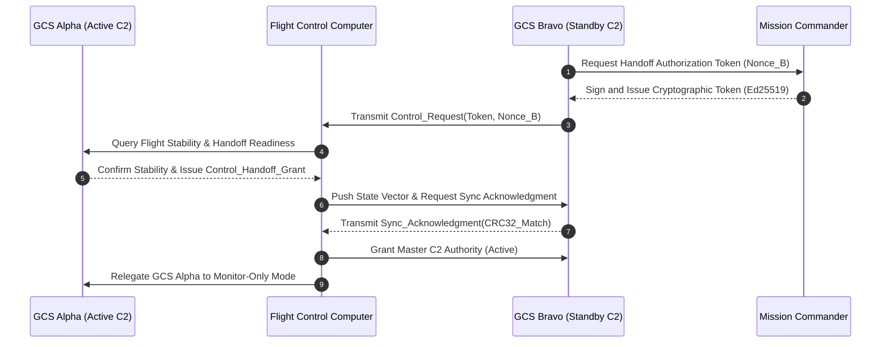

| Attribute | Value |
| :--- | :--- |
| **Title** | User Classes, Stakeholder Taxonomy & Operational Lifecycle Modes |
| **Version** | 1.0.0 |
| **Date** | 2026-09-02 |

## 4. User Classes, Stakeholder Taxonomy & Operational Lifecycle Modes

### 4.1 Stakeholder Roster
The operational lifecycle involves multiple organizational and external stakeholders who interact directly or indirectly with the autonomous system:
- **Civil & Military Aviation Authorities (Aviation Regulators):** Regulatory bodies responsible for issuing operational authorizations, validating SORA safety cases, and monitoring airspace compliance.
- **Range Safety Officer (RSO) & Air Traffic Management (ATM/ATC):** Operational authorities governing flight corridors, approving dynamic airspace activations, and coordinating emergency airspace deconfliction.
- **Procurement & Operations Authority:** Defense, homeland security, or enterprise entities directing mission requirements, security doctrine, and asset allocation.
- **Support & Logistics Organization:** Depot-level maintenance facilities, supply chain managers, and calibration laboratories.

### 4.2 User Class Taxonomy
In accordance with ISO/IEC/IEEE 29148:2018 §5.2.4 and the JSON Schema data contract, the operational user classes are defined as follows:

| User Class ID | Title | Player or Operator | Interfacing Stakeholder | Characteristics & Responsibilities | Training & Qualification | Constraint Source |
| :--- | :--- | :--- | :--- | :--- | :--- | :--- |
| **UC-01** | Remote Pilot in Command (RPIC) | Direct Operator | Civil Aviation Authority (CAA) / Range Safety Officer (RSO) | Holds ultimate legal and operational responsibility for flight safety, supervisory flight guidance oversight, airspace deconfliction, and manual failsafe override initiation. | Certified Remote Pilot with System Type Rating and Level 3/4 STANAG 4586 UCS Qualification | ISO/IEC/IEEE 29148:2018 §5.2.4 / JARUS SORA v2.5 Annex E |
| **UC-02** | Payload Operator (PO) | Direct Operator | Security Operations Center (SOC) / Intelligence Staff | Responsible for multi-spectral sensor tasking, laser rangefinder/designation activation, tracking zone definition, real-time target identification, and video exploitation. | Certified Tactical Sensor Specialist & STANAG 4586 Level 2 Payload Operator Qualification | NATO STANAG 4586 Edition 4 DLI / CCI |
| **UC-03** | Mission Commander (MC) | Supervisor / Player | Theater Command / Enterprise Operations Director | Establishes Rules of Engagement (ROE), authorizes sortie launch and abort commands, manages multi-vehicle allocations, and interfaces directly with range command. | Senior Operational Commander Qualification & MIL-STD-882E System Safety Management Certification | MIL-STD-882E Task 102 / DoDI 5000.02 |
| **UC-04** | Maintenance Technician (MT) | Support Operator | Depot Maintenance / Quality Assurance Office | Conducts Organizational (O-Level) pre-flight inspections, energy module replacements, structural integrity checks, sensor boresight calibration, and modular LRU swaps. | Certified Maintenance Technician / Field Repair Specialist | ISO/IEC/IEEE 29148:2018 §5.2.4 |
| **UC-05** | Visual Observer (VO) | Field Support | Local Airspace Users / Local ATM | Maintains continuous visual/instrument surveillance of surrounding airspace to detect non-cooperative traffic and ground hazards within the operational volume. | Certified Visual Observer Airspace Lookout Training & Tactical Radio Voice Protocol Qualification | JARUS SORA v2.5 Tactical Mitigation M1 |

### 4.3 Skill Prerequisites & Minimum Qualifications
1. **Remote Pilot in Command (RPIC):** Minimum 100 accredited supervisory flight hours; current aviation medical certificate; validated proficiency in emergency decision matrix (`EMG-01`..`EMG-07`) execution under simulated degraded navigation conditions.
2. **Payload Operator (PO):** Validated proficiency in thermal image interpretation, optical tracking locks, target coordinate extraction, and secure video dissemination protocols.
3. **Mission Commander (MC):** Validated proficiency in rules of engagement enforcement, dual-consent cryptographic key handling, and airspace coordination.
4. **Maintenance Technician (MT):** Formal electro-mechanical certification, electronic assembly inspection qualification, and authorized digital maintenance logbook endorsement.
5. **Visual Observer (VO):** Certified visual observer airspace lookout training and tactical radio voice protocol qualification.

### 4.4 Workload Constraints & Human Factors Considerations
To prevent operator fatigue, maintain situational awareness, and guarantee human-in-the-loop safety during complex multi-vehicle operations, human factors engineering conforms to MIL-STD-1472H and ISO 9241-210:
- **Dual-Operator Architecture:** Primary flight safety oversight (RPIC) and sensor payload analysis (PO) are decoupled across distinct physical workstations to prevent cognitive bottlenecking and cross-task operational interference.
- **Cognitive Workload Thresholds:** The Ground Control Station human-machine interface (HMI) shall be engineered to maintain the composite NASA-Task Load Index (NASA-TLX) workload score strictly within acceptable physiological envelopes:
  - Nominal Flight Phase Composite Score: $\text{TLX}_{\mathrm{nominal}} \le 35$
  - Degraded / Contingency Flight Phase Composite Score: $\text{TLX}_{\mathrm{contingency}} \le 55$

The quantitative NASA-TLX 6-dimensional evaluation matrix is defined as follows:

| TLX Dimension ID | Workload Dimension | Evaluation Question & Operator Assessment | Scale Range | Weighting Factor | Nominal Limit (Score <= 35) | Contingency Limit (Score <= 55) |
| :--- | :--- | :--- | :--- | :--- | :--- | :--- |
| **TLX-01** | Mental Demand (MD) | How much mental and perceptual activity was required (thinking, deciding, calculating, remembering, looking, searching)? | 0 - 100 | 0.25 | <= 30 | <= 60 |
| **TLX-02** | Physical Demand (PD) | How much physical activity was required (pushing, pulling, turning, controlling, activating)? | 0 - 100 | 0.05 | <= 15 | <= 25 |
| **TLX-03** | Temporal Demand (TD) | How much time pressure was felt due to the rate or pace at which the tasks or task elements occurred? | 0 - 100 | 0.20 | <= 35 | <= 65 |
| **TLX-04** | Performance (OP) | How successful was the operator in achieving the goals of the task set by the experimenter or commander? (0 = Good, 100 = Poor) | 0 - 100 | 0.20 | <= 20 | <= 45 |
| **TLX-05** | Effort (EF) | How hard did the operator have to work (mentally and physically) to accomplish their level of performance? | 0 - 100 | 0.15 | <= 35 | <= 60 |
| **TLX-06** | Frustration (FR) | How insecure, discouraged, irritated, stressed, and annoyed versus secure, gratified, content, and relaxed did the operator feel? | 0 - 100 | 0.15 | <= 25 | <= 50 |
| **TLX-TOTAL** | **Weighted Composite Score** | Composite = sum(w_i * Score_i) | 0 - 100 | 1.00 | **<= 35.0** | **<= 55.0** |

#### 4.4.1 Operational Shift Rotation Protocol
To mitigate vigilance degradation and circadian desynchronization:
1. **Maximum Continuous Shift Duration ($t_{\mathrm{shift}}$):** Continuous supervisory console time for an RPIC or PO shall not exceed $t_{\mathrm{shift}} \le 4.0\text{ hr}$ ($240.0\text{ min}$).
2. **Mandatory Rest Interval ($t_{\mathrm{rest}}$):** A mandatory non-operational rest interval of $t_{\mathrm{rest}} \ge 30.0\text{ min}$ is enforced between consecutive console shifts.
3. **Maximum Daily Cumulative Console Time ($t_{\mathrm{daily\_max}}$):** Total cumulative flight control / supervisory time shall not exceed $t_{\mathrm{daily\_max}} \le 8.0\text{ hr}$ within any sliding 24-hour operational window.
4. **Shift Handover Overlap:** A structured $15.0\text{ min}$ operational overlap period is conducted prior to shift relief, encompassing verbal briefing, flight telemetry review, weather/NOTAM verification, and co-signing of the digital flight logbook.

### 4.5 Authority Handoff Chains & Control Transfer Protocols
Handoff of command and control between Ground Control Stations (e.g., GCS Alpha to GCS Bravo) or between RPIC and autonomous flight modes follows a strict cryptographic 4-way handshake with handoff completion time bounded by $t_{\mathrm{handoff}} \le 5.0\text{ s}$.

#### 4.5.1 Cryptographic 4-Way Handoff State Machine
The 4-way handoff protocol ensures seamless, deterministic control transfer without flight path discontinuity:
1. **State 1 - Initiation (Token Request):** Receiving station (GCS Bravo) transmits an encrypted and signed `Control_Request(Token, Hash, Nonce_B)` token to the Mission Commander and active Flight Control Computer (FCC) over the authenticated C2 link using Curve25519 / Ed25519 asymmetric cryptography.
2. **State 2 - Authorization & Stability Gate:** Active station (GCS Alpha) and Mission Commander authenticate the cryptographic token, verify that the air vehicle is in a stable dynamic flight trim ($\|\Delta \mathbf{v}\| \le 0.5\text{ m/s}$, $\|\Delta \boldsymbol{\omega}\| \le 2.0^\circ\text{/s}$), and issue a signed `Control_Handoff_Grant(Signature_A, Token_Hash)`.
3. **State 3 - Telemetry & Buffer Synchronization:** GCS Bravo receives the grant, verifies exact alignment of the onboard waypoint buffer, active geofence polygons, and sensor payload states, and transmits a signed `Sync_Acknowledgment(CRC32_Match, State_Confirmed)`.
4. **State 4 - Committal & Mode Relegation:** Flight Control Computer commits primary C2 authority to GCS Bravo, transmits `Handoff_Complete(Active_C2=Bravo)`, and automatically relegates GCS Alpha to Monitor-Only (shadow) mode.

#### 4.5.2 Timeout Recovery & Rejection Protocols
To guarantee fail-safe determinism under communication disruptions or corrupted handoffs:
- **Timeout Recovery Protocol ($\tau_{\mathrm{timeout}} = 5.0\text{ s}$):** If any handshake phase fails to receive a cryptographically valid response within the timeout threshold $\tau_{\mathrm{timeout}} \le 5.0\text{ s}$, the FCC automatically terminates the handoff transaction, issues an `ERR_HANDOFF_TIMEOUT` alert, maintains active C2 control exclusively with GCS Alpha, and resets GCS Bravo to Standby / Disconnected status.
- **Handoff Rejection Protocol:** The FCC or Mission Commander shall immediately reject and abort the handoff sequence under any of the following rejection conditions:
  1. *Cryptographic Validation Failure:* Invalid signature, expired certificate, or replayed nonce detected (`ERR_AUTH_INVALID`).
  2. *Flight Trim Instability:* Air vehicle engaged in active emergency containment maneuver (`EMG-01`..`EMG-07`) or exceeding rotational rate thresholds (`ERR_VEHICLE_UNSTABLE`).
  3. *Mission State Mismatch:* Waypoint buffer checksum or geofence CRC32 mismatch between GCS Bravo and FCC (`ERR_BUFFER_DESYNC`).
  4. *Manual Commander Veto:* Mission Commander transmits an explicit `ABORT_HANDOFF` discrete.
  Upon rejection, the system instantly logs a formal security audit event, broadcasts the rejection diagnostic code, and retains uninterrupted flight guidance under GCS Alpha.

### 4.6 Operational Lifecycle Stages ($\Phi_{\mathrm{lifecycle}}$)
The system operates across six mutually exclusive, deterministic lifecycle stages:
- **Phase_Startup:** Power-on Built-In-Test (PBIT), sensor alignment, navigation filter initialization, cryptographic key injection, and pre-arm interlock validation.
- **Phase_NominalExecution:** Autonomous launch, transit along designated flight corridor, perimeter surveillance orbit, tactical engagement sequence, and real-time telemetry streaming.
- **Phase_DegradedMode:** Non-critical sensor failover, reversion to dead reckoning upon navigation signal loss, PACE datalink fallback switch, and degraded velocity limits.
- **Phase_ContingencyFailsafe:** Autonomous execution of Return-to-Home (RTH), transition to secondary emergency divert waypoint, or controlled hover/containment.
- **Phase_SecureShutdown:** Autonomous precision recovery, touchdown, motor cutoff, mechanical brake lock, cryptographic memory zeroization, and diagnostic log archival.
- **Phase_MaintenanceMode:** Diagnostic telemetry offload, actuator calibration, firmware flashing, and depot-level structural inspection.
