| Attribute | Specification Detail |
| :--- | :--- |
| Title | OMG UAF Operational Activity Taxonomy |
| Version | 1.0.0 |
| Date | 2026-10-31 |
| issue_id | 117 |
| type | conops |
| generation_mode | worker |
| specification_source | docs/conops/units/conops/06_UAF_OPERATIONAL_ACTIVITIES.md |
| Security Classification | RESTRICTED / DEFENSE-GRADE |

## 6. OMG UAF Operational Activity Taxonomy

### 6.1 Scope, Taxonomy and Decomposition Method

This unit defines the open-ended operational activity taxonomy for the Avenger V2.5 Autonomous Loitering Munition UAV and the PL-40 Pneumatic Catapult Launcher System. It follows OMG Unified Architecture Framework (UAF) v2.0 Operational Processes (Op-Pr) and Operational Taxonomy (Op-Tx), DoDAF v2.02 OV-5a and SV-5a, ISO/IEC/IEEE 29148:2018 Section 6.4.2, ISO/IEC/IEEE 15288:2023 Section 6.4.3, and INCOSE Systems Engineering Handbook v5.0 Section 4.3. The roster is an open-ended collection with N >= 1; new activities may be appended without renumbering or deleting existing identifiers.

The taxonomy separates operational intent from physical implementation. Each activity is allocated to a performer node or resource declared in the SysML v2 schema and the OEM extraction, and each activity carries the Gate 24 allocation tag required for downstream traceability. Detailed wire-level framing, opcodes, and register maps remain in the Level 1C Interface Control Documents and are not repeated here.

#### 6.1.1 UAF Operational Activity Taxonomy Categories

| Taxonomy ID | UAF Taxonomy Category | Operational Purpose | Allocated Activities | Normative Anchor |
| :--- | :--- | :--- | :--- | :--- |
| T-01 | Mission Preparation and Safety Assurance | Establish launch readiness and verify safety interlocks | OA-01 | FAA 14 CFR 107.49(c); JARUS SORA v2.5 Annex E E.11 |
| T-02 | Launch and Kinematic Execution | Accelerate, release, and fly the planned corridor | OA-02 | JARUS SORA v2.5 Annex E E.11; MIL-STD-882E System Hazard Analysis |
| T-03 | Sense, Decide, and Target | Detect, classify, track, and navigate | OA-03, OA-09 | CJCSI 3121.01B Enclosure A Section 4.b; RTCA DO-365B Section 2.2.5.3 |
| T-04 | Command, Control, and Information Exchange | Exchange supervisory commands, telemetry, and video | OA-04, OA-10 | RTCA DO-362A Section 2.2 and Section 3.4; NIST SP 800-82r3 Section 6.2 |
| T-05 | Effects and Weapon Consent | Authorize and execute terminal effects | OA-05 | DoD Directive 3000.09 Section 3.1; CJCSI 3121.01B Enclosure E Section 2.d |
| T-06 | Energy and Resource Management | Preserve energy margin and manage return thresholds | OA-06 | MIL-STD-882E System Hazard Analysis; JARUS SORA v2.5 Annex E E.24 |
| T-07 | Contingency, Containment, and Failsafe | Detect anomalies and contain the vehicle | OA-07, OA-11 | MIL-STD-882E Task 208 Section 4.2; JARUS SORA v2.5 Annex E E.14 and E.18 |
| T-08 | Recovery, Diagnostics, and Sustainment | Recover, safe, inspect, and archive | OA-08, OA-12 | EASA AMC1 UAS.SPEC.050 Section 4.4; JARUS SORA v2.5 Annex E E.20 |

#### 6.1.2 UAF Operational Activity Decomposition Tree

The following tree presents the top-down decomposition from mission operations to taxonomy categories and to the canonical operational activities. The tree is intentionally open-ended and can be extended with additional activity nodes.

```mermaid
flowchart TD
    Mission["Avenger V2.5 and PL-40<br/>Mission Operations"]

    T01["T-01 Preparation and<br/>Safety Assurance"]
    T02["T-02 Launch and<br/>Kinematic Execution"]
    T03["T-03 Sense, Decide,<br/>and Target"]
    T04["T-04 Command, Control,<br/>and Information Exchange"]
    T05["T-05 Effects and<br/>Weapon Consent"]
    T06["T-06 Energy and<br/>Resource Management"]
    T07["T-07 Contingency, Containment,<br/>and Failsafe"]
    T08["T-08 Recovery, Diagnostics,<br/>and Sustainment"]

    OA01["OA-01 Pre-Launch PBIT<br/>and Launcher Setup"]
    OA02["OA-02 Catapult Launch<br/>and Transit Execution"]
    OA03["OA-03 EO/IR Targeting<br/>and Vision Tracking"]
    OA04["OA-04 Secure C2 Telemetry<br/>and Video Exchange"]
    OA05["OA-05 Precision Terminal Strike<br/>and Weapon Consent"]
    OA06["OA-06 Energy and Dynamic<br/>Bingo Management"]
    OA07["OA-07 Contingency Containment<br/>and Parachute Deployment"]
    OA08["OA-08 Post-Operation Diagnostics<br/>and Archival"]
    OA09["OA-09 GNSS-Denied Navigation<br/>and Sensor Fusion"]
    OA10["OA-10 Lost C2 Link Recovery<br/>and Autonomous Return"]
    OA11["OA-11 Boundary Containment<br/>and Failsafe"]
    OA12["OA-12 Launcher Recovery<br/>and Sustainment"]

    Mission --> T01
    Mission --> T02
    Mission --> T03
    Mission --> T04
    Mission --> T05
    Mission --> T06
    Mission --> T07
    Mission --> T08

    T01 --> OA01
    T02 --> OA02
    T03 --> OA03
    T03 --> OA09
    T04 --> OA04
    T04 --> OA10
    T05 --> OA05
    T06 --> OA06
    T07 --> OA07
    T07 --> OA11
    T08 --> OA08
    T08 --> OA12
```

#### 6.1.3 Open-Ended Operational Activity Roster

Every row below is a canonical operational activity. The Gate 24 allocation tag is the machine-verifiable binding used by downstream SysML v2 blocks, state machines, and requirement units. The roster may be extended with new identifiers; existing identifiers are stable.

| Activity ID | Taxonomy ID | Activity Name | Allocated Performer Node and Resource | Operational Description | Gate 24 Allocation Tag | Traceability and Source |
| :--- | :--- | :--- | :--- | :--- | :--- | :--- |
| **OA-01** | T-01 | `PreLaunchPBITAndLauncherSetup` | Autopilot Stack ASTK A5 V2.5; PL-40 Compressor Unit; GCS Tablet FZ-G2 | Conducts power-on PBIT, verifies the PL-32 and PL-33 pre-flight battery voltage window, confirms the PL-35 pitot blow-test airspeed, verifies the UAV and ESAD RBF keys, and pressurizes the PL-40 pneumatic launcher to the launch-pressure parameters PL-40 and PL-41 with the PL-75 and PL-76 compressor battery. Launcher setup is bounded by PL-72. | `/// OperationalAllocation: [OA-01]` `/// Realises: [UAF-ACT-01]` | SRC-01, SRC-02, SRC-03, SRC-04; FAA preflight inspection requirements; JARUS SORA v2.5 Annex E E.11 |
| **OA-02** | T-02 | `CatapultLaunchAndTransitExecution` | PL-40 Rail; PL-40 Carriage; Autopilot Stack ASTK A5 V2.5 | Accelerates the air vehicle along the PL-93 assembled rail at the PL-66 launch angle to the PL-65 maximum launch velocity, releases the carriage, and transitions to the PL-01 cruise condition. The PL-05 minimum flight speed, PL-02 maximum horizontal speed, PL-12 maximum take-off weight, PL-64 maximum launched mass, and PL-88 trigger hold time bound the activity. OEM sources do not state a reconciliation between PL-65 and PL-05. | `/// OperationalAllocation: [OA-02]` `/// Realises: [UAF-ACT-02]` | SRC-01, SRC-02, SRC-04; JARUS SORA v2.5 Annex E E.11; MIL-STD-882E System Hazard Analysis |
| **OA-03** | T-03 | `EOIRTargetingAndVisionTracking` | Seeker and Vision Payload; Nighthawk2UZ Gimbal; Trip6 Compute Module | Points the gimbal across the PL-25 pitch range and PL-26 yaw and roll range, applies the PL-27 zoom factor, and uses the Trip6 compute module for target detection and tracking. The PL-28 to PL-31 camera resolutions, PL-42 and PL-43 target track duration, and PL-44 maximum engagement elevation bound the activity. | `/// OperationalAllocation: [OA-03]` `/// Realises: [UAF-ACT-03]` | SRC-01, SRC-02, SRC-03, SRC-04; CJCSI 3121.01B Enclosure A Section 4.b; RTCA DO-365B Section 2.2.5.3 |
| **OA-04** | T-04 | `SecureC2TelemetryAndVideoExchange` | Radio Module DTC; Radio Antenna MPSL4400 Upper and Lower; GCS Radio Box; GCS MARS Antenna; GCS Tablet FZ-G2 | Exchanges telemetry and command frames with the Panasonic FZ-G2 GCS over the RF link recorded in the interface extraction, using the DTC radio module, the MPSL4400 antennas, the GCS radio box, and the MARS 23dBi antenna. The PL-07 direct range, PL-08 extended range, PL-36 minimum waypoint altitude, PL-37 loiter radius, and PL-39 ground radio power bound the activity. | `/// OperationalAllocation: [OA-04]` `/// Realises: [UAF-ACT-04]` | SRC-01, SRC-02, SRC-03, SRC-04; RTCA DO-362A Section 2.2; NIST SP 800-82r3 Section 6.2 |
| **OA-05** | T-05 | `PrecisionTerminalStrikeAndWeaponConsent` | Lethal Package; ESAD (Critical / DAL-A); Warhead; GCS Tablet FZ-G2 | Executes terminal guidance within the PL-03 maximum dive speed, PL-04 maximum dive angle, PL-45 maximum engagement airspeed, and PL-13 warhead mass. The ESAD (Critical / DAL-A) requires explicit human authorization before arm enable and detonator firing. The activity is bounded by the PL-46 to PL-48 ESAD power window, PL-49 and PL-50 umbilical continuity, PL-54 and PL-55 arm-enable waveform, PL-56 and PL-57 RS-485 rates, and PL-60 detonator high-voltage measurement range. | `/// OperationalAllocation: [OA-05]` `/// Realises: [UAF-ACT-05]` | SRC-01, SRC-02, SRC-03, SRC-04; DoD human judgement policy; CJCSI 3121.01B Enclosure E Section 2.d |
| **OA-06** | T-06 | `EnergyAndDynamicBingoManagement` | Battery 12S2P Li Metal BEI; Power Meter; EPS Module | Monitors the PL-23 and PL-24 battery voltage window and current through the Power Meter, estimates state of charge, and evaluates the Bingo return threshold. The Bingo threshold algorithm and statutory reserve ratio are Not stated in OEM sources. The PL-06 flight endurance bounds the activity. | `/// OperationalAllocation: [OA-06]` `/// Realises: [UAF-ACT-06]` | SRC-01, SRC-02, SRC-03, SRC-04; MIL-STD-882E System Hazard Analysis; JARUS SORA v2.5 Annex E E.24 |
| **OA-07** | T-07 | `ContingencyContainmentAndParachuteDeploy` | Parachute Deployment Non-Mission; Autopilot Stack ASTK A5 V2.5; EPS Module | Detects the canonical contingency triggers defined in the ConOps contingency matrix, clamps propulsion, and on the non-mission R&D variant commands the pyrotechnic igniters to deploy the parachute. The parachute deployment module is configuration: non-mission and baseline: false. Deployment response time is Not stated in OEM sources. | `/// OperationalAllocation: [OA-07]` `/// Realises: [UAF-ACT-07]` | SRC-01, SRC-02, SRC-04; MIL-STD-882E Task 208 Section 4.2; JARUS SORA v2.5 Annex E E.18; ASTM F3269-17 Section 5.3 |
| **OA-08** | T-08 | `PostOperationDiagnosticsAndArchival` | Autopilot Stack ASTK A5 V2.5; RPI CM5004032; External Interface Board USB ETH | Secures the air vehicle after recovery, dumps diagnostic flight logs through the External Interface Board USB and Ethernet ports, records pulling-rope usage against the PL-80 replacement interval, and verifies safe mechanical state. Post-operation diagnostic duration is Not stated in OEM sources. | `/// OperationalAllocation: [OA-08]` `/// Realises: [UAF-ACT-08]` | SRC-01, SRC-02, SRC-03, SRC-04; EASA AMC1 UAS.SPEC.050 Section 4.4; JARUS SORA v2.5 Annex E E.20 |
| **OA-09** | T-03 | `GNSSDeniedNavigationAndSensorFusion` | GNSS Module Septentrio Asterx-m3 pro; Magnetometer mRo RM3100 Upper and Lower; Pitot Tube CUAV SKYE2; Autopilot Computing Board Cube Orange Plus | Maintains navigation when GNSS is degraded or unavailable by fusing the GNSS receiver, the upper and lower magnetometers, the pitot tube, and inertial state estimates over the DroneCAN CAN 2 bus. The PL-34 pitot static airspeed limit and PL-35 pitot blow-test airspeed bound the activity. GNSS-denied navigation performance bounds are Not stated in OEM sources. | `/// OperationalAllocation: [OA-09]` `/// Realises: [UAF-ACT-09]` | SRC-01, SRC-02, SRC-03, SRC-04; JARUS SORA v2.5 Annex E E.13; RTCA DO-365B Section 2.2.5.3 |
| **OA-10** | T-04 | `LostC2LinkRecoveryAndAutonomousReturn` | Radio Module DTC; Autopilot Stack ASTK A5 V2.5; GCS Radio Box | Detects loss of the primary C2 link, holds or returns autonomously, and restores the link using the available RF path. Link-loss timeout, hold duration, and reacquisition hysteresis are Not stated in OEM sources. The activity is bounded by RTCA DO-362A lost-link fallback requirements and DoD fail-safe interlock policy. | `/// OperationalAllocation: [OA-10]` `/// Realises: [UAF-ACT-10]` | SRC-01, SRC-02, SRC-03; RTCA DO-362A lost-link fallback requirements; DoD fail-safe interlock policy |
| **OA-11** | T-07 | `BoundaryContainmentAndFailsafe` | Autopilot Stack ASTK A5 V2.5; EPS Module; Parachute Deployment Non-Mission | Monitors containment boundary proximity and the canonical contingency triggers defined in the ConOps contingency matrix, and commands the deterministic failsafe state. On the non-mission R&D variant, containment may include the pyrotechnic parachute igniters; on the mission baseline the parachute is excluded. Boundary excursion distance and termination timing are Not stated in OEM sources. | `/// OperationalAllocation: [OA-11]` `/// Realises: [UAF-ACT-11]` | SRC-01, SRC-02, SRC-04; JARUS SORA v2.5 Annex E E.14; ASTM F3269-17 Section 5.2 |
| **OA-12** | T-08 | `LauncherRecoveryAndSustainment` | PL-40 Rail; PL-40 Carriage; PL-40 Pulling Rope; PL-40 Battery; PL-40 Transport Case; PL-40 Compressor Unit | Recovers the PL-40 launcher after launch, inspects the carriage, rail, and pulling rope, replaces the rope at the PL-80 interval, recharges the PL-75 and PL-76 batteries within the PL-89 and PL-90 charger windows and the PL-91 and PL-92 charging temperature window, and returns the PL-69 launcher set, PL-70 transport case, and PL-71 compressor case to service. The PL-94 disassembled rail length and PL-79 battery recovery delay bound transport and recovery. | `/// OperationalAllocation: [OA-12]` `/// Realises: [UAF-ACT-12]` | SRC-01, SRC-02, SRC-04; JARUS SORA v2.5 Annex E E.11 and E.20; EASA AMC1 UAS.SPEC.050 Section 4.4 |

### 6.2 Operational-to-Resource Allocation Matrix

The following DoDAF SV-5a and OMG UAF Op-to-Res matrix allocates every canonical activity to a system performer node, physical subsystem or partition, operational function, and interface binding. The ESAD is identified as Critical / DAL-A. The parachute deployment module is identified as non-mission and is excluded from the mission baseline.

| Activity ID | Activity Name | System Performer Node | Physical Subsystem or Partition | Allocated Operational Function | Interface or Bus Binding | Criticality and Safety Level |
| :--- | :--- | :--- | :--- | :--- | :--- | :--- |
| **OA-01** | `PreLaunchPBITAndLauncherSetup` | Autopilot Stack ASTK A5 V2.5; PL-40 Compressor Unit; GCS Tablet FZ-G2 | Autopilot Computing Board Cube Orange Plus; PL-40 Compressor Unit; Safety RBF Devices | Pre-launch diagnostics and interlock verification | External USB and Ethernet; discrete interlocks; pneumatic supply | Criticality: High (Safety-Critical) |
| **OA-02** | `CatapultLaunchAndTransitExecution` | PL-40 Rail; Autopilot Stack ASTK A5 V2.5 | PL-40 Rail; PL-40 Carriage; Ruddervator; Wings; Propulsion | Launch release and trajectory guidance | DroneCAN CAN 1 and CAN 2 buses; servo 8 V rail; pneumatic supply | Criticality: High (Safety-Critical) |
| **OA-03** | `EOIRTargetingAndVisionTracking` | Seeker and Vision Payload | Gimbal Nighthawk2UZ; Camera Compute Module Trip6 | Gimbal pointing and target tracking | Ethernet; UART serial; HDMI | Criticality: Medium (Mission-Critical) |
| **OA-04** | `SecureC2TelemetryAndVideoExchange` | Radio Module DTC; GCS Radio Box; GCS Tablet FZ-G2 | Radio Module DTC; Radio Antenna MPSL4400 Upper and Lower; GCS MARS Antenna | Telemetry and command exchange | RF 4.4-5.0 GHz; Ethernet; UART serial | Criticality: High (Safety-Critical) |
| **OA-05** | `PrecisionTerminalStrikeAndWeaponConsent` | Lethal Package; GCS Tablet FZ-G2 | ESAD (Critical / DAL-A); Warhead; ESAD Sensor Board; ESAD Detonator | Human-authorized arm and initiation | RS-485 half duplex; discrete arm enable; detonator high voltage | Criticality: Catastrophic (Lethal-Critical) |
| **OA-06** | `EnergyAndDynamicBingoManagement` | Energy and Propulsion Subsystem | Battery 12S2P Li Metal BEI; Power Meter; EPS Module | State-of-charge and Bingo evaluation | Main DC bus; DroneCAN CAN channel one | Criticality: High (Safety-Critical) |
| **OA-07** | `ContingencyContainmentAndParachuteDeploy` | Parachute Deployment Non-Mission; Autopilot Stack ASTK A5 V2.5 | Parachute Deployment Non-Mission; Parachute Igniter 1 and Parachute Igniter 2 | Contingency containment and recovery deployment | 50 V igniter outputs; discrete triggers | Criticality: High (Non-Mission) |
| **OA-08** | `PostOperationDiagnosticsAndArchival` | Autopilot Stack ASTK A5 V2.5; External Interface Board USB ETH | Autopilot Computing Board Cube Orange Plus; RPI CM5004032; External Interface Board USB ETH | Log archival and post-operation safing | USB; Ethernet | Criticality: Low (Administrative) |
| **OA-09** | `GNSSDeniedNavigationAndSensorFusion` | Autopilot Stack ASTK A5 V2.5; Sensor Suite | GNSS Module Septentrio Asterx-m3 pro; GNSS Antenna Talysman TW3972EXF; Magnetometer mRo RM3100 Upper and Lower; Pitot Tube CUAV SKYE2 | GNSS-denied navigation and sensor fusion | UART serial; coaxial RF; DroneCAN CAN 2 bus | Criticality: High (Safety-Critical) |
| **OA-10** | `LostC2LinkRecoveryAndAutonomousReturn` | Radio Module DTC; Autopilot Stack ASTK A5 V2.5; GCS Radio Box | Radio Module DTC; Radio Antenna MPSL4400 Upper and Lower; GCS MARS Antenna | Lost-link recovery and autonomous return | RF 4.4-5.0 GHz; UART serial | Criticality: High (Safety-Critical) |
| **OA-11** | `BoundaryContainmentAndFailsafe` | Autopilot Stack ASTK A5 V2.5; EPS Module | Autopilot Computing Board Cube Orange Plus; EPS Module; Parachute Deployment Non-Mission | Boundary containment and deterministic failsafe | Discrete interlocks; 50 V igniter outputs | Criticality: Catastrophic (Containment-Critical) |
| **OA-12** | `LauncherRecoveryAndSustainment` | PL-40 Rail; PL-40 Compressor Unit; GSE | PL-40 Carriage; PL-40 Pulling Rope; PL-40 Battery; PL-40 Transport Case | Launcher recovery and sustainment | Pneumatic; electrical discrete; 18 V DC | Criticality: Medium (Sustainment) |

### 6.3 Grounded Activity Parameter Register

Every numeric value used by the activity roster is listed below with its unit and its Level 0 source. Values absent from the OEM sources are recorded in Section 6.4 rather than invented here. Parameter identifiers match the parametric limits registry.

| Activity ID | Parameter ID | Parameter | Grounded Reference | Source |
| :--- | :--- | :--- | :--- | :--- |
| OA-01 | PL-32 / PL-33 | Pre-flight battery voltage window | PL-32/PL-33 | parametric_limits.md:38-39 |
| OA-01 | PL-35 | Pitot blow-test airspeed | PL-35 | parametric_limits.md:41 |
| OA-01 | PL-40 / PL-41 | Catapult launch pressure window | PL-40/PL-41 | parametric_limits.md:46-47 |
| OA-01 | PL-67 | Maximum compressor working pressure | PL-67 | parametric_limits.md:73 |
| OA-01 | PL-68 | Auxiliary filling pressure | PL-68 | parametric_limits.md:74 |
| OA-01 | PL-72 | Launcher setup time | PL-72 | parametric_limits.md:78 |
| OA-01 | PL-73 / PL-74 | Launcher operating thermal window | PL-73/PL-74 | parametric_limits.md:79-80 |
| OA-01 | PL-75 / PL-76 | Compressor battery | PL-75/PL-76 | parametric_limits.md:81-82 |
| OA-02 | PL-01 | Cruise speed | PL-01 | parametric_limits.md:7 |
| OA-02 | PL-02 | Maximum horizontal speed | PL-02 | parametric_limits.md:8 |
| OA-02 | PL-05 | Minimum flight speed | PL-05 | parametric_limits.md:11 |
| OA-02 | PL-12 | Maximum take-off weight | PL-12 | parametric_limits.md:18 |
| OA-02 | PL-64 | Maximum launched plane mass | PL-64 | parametric_limits.md:70 |
| OA-02 | PL-65 | Maximum launch velocity | PL-65 | parametric_limits.md:71 |
| OA-02 | PL-66 | Launcher launch angle | PL-66 | parametric_limits.md:72 |
| OA-02 | PL-88 | Trigger hold time | PL-88 | parametric_limits.md:94 |
| OA-02 | PL-93 | Rail length assembled | PL-93 | parametric_limits.md:99 |
| OA-03 | PL-25 | Seeker pitch angle | PL-25 | parametric_limits.md:31 |
| OA-03 | PL-26 | Seeker yaw and roll angle | PL-26 | parametric_limits.md:32 |
| OA-03 | PL-27 | Seeker zoom factor | PL-27 | parametric_limits.md:33 |
| OA-03 | PL-28 / PL-29 | Day camera resolution | PL-28/PL-29 | parametric_limits.md:34-35 |
| OA-03 | PL-30 / PL-31 | Thermal camera resolution | PL-30/PL-31 | parametric_limits.md:36-37 |
| OA-03 | PL-42 / PL-43 | Target track duration | PL-42/PL-43 | parametric_limits.md:48-49 |
| OA-03 | PL-44 | Maximum engagement elevation | PL-44 | parametric_limits.md:50 |
| OA-04 | PL-07 | Direct radio line-of-sight range | PL-07 | parametric_limits.md:13 |
| OA-04 | PL-08 | Extended radio line-of-sight range | PL-08 | parametric_limits.md:14 |
| OA-04 | PL-36 | Minimum mission waypoint altitude | PL-36 | parametric_limits.md:42 |
| OA-04 | PL-37 | Loiter radius | PL-37 | parametric_limits.md:43 |
| OA-04 | PL-39 | Ground radio power | PL-39 | parametric_limits.md:45 |
| OA-04 | IF-RF-01 | GCS to UAV RF link | IF-RF-01 | interface_table.md:63-64 |
| OA-05 | PL-03 | Maximum dive speed | PL-03 | parametric_limits.md:9 |
| OA-05 | PL-04 | Maximum dive angle | PL-04 | parametric_limits.md:10 |
| OA-05 | PL-13 | Warhead mass | PL-13 | parametric_limits.md:19 |
| OA-05 | PL-45 | Maximum engagement airspeed | PL-45 | parametric_limits.md:51 |
| OA-05 | PL-46 / PL-47 / PL-48 | ESAD power input | PL-46/PL-47/PL-48 | parametric_limits.md:52-54 |
| OA-05 | PL-49 / PL-50 | ESAD umbilical continuity | PL-49/PL-50 | parametric_limits.md:55-56 |
| OA-05 | PL-54 / PL-55 | ESAD arm-enable waveform | PL-54/PL-55 | parametric_limits.md:60-61 |
| OA-05 | PL-56 / PL-57 | ESAD RS-485 rates | PL-56/PL-57 | parametric_limits.md:62-63 |
| OA-05 | PL-60 | ESAD high-voltage measurement range | PL-60 | parametric_limits.md:66 |
| OA-06 | PL-06 | Flight endurance | PL-06 | parametric_limits.md:12 |
| OA-06 | PL-23 / PL-24 | Battery pack voltage window | PL-23/PL-24 | parametric_limits.md:29-30 |
| OA-07 | OEM-PAR-01 | Parachute igniter supply | OEM-PAR-01 | oem_bom.md:48-49 |
| OA-08 | PL-80 | Pulling-rope replacement interval | PL-80 | parametric_limits.md:86 |
| OA-09 | PL-34 | Pitot static airspeed limit | PL-34 | parametric_limits.md:40 |
| OA-09 | PL-35 | Pitot blow-test airspeed | PL-35 | parametric_limits.md:41 |
| OA-11 | OEM-PAR-02 | Parachute configuration | OEM-PAR-02 | oem_bom.md:47 |
| OA-12 | PL-69 | Launcher set mass | PL-69 | parametric_limits.md:75 |
| OA-12 | PL-70 | Launcher case mass | PL-70 | parametric_limits.md:76 |
| OA-12 | PL-71 | Compressor case mass | PL-71 | parametric_limits.md:77 |
| OA-12 | PL-79 | Battery recovery delay | PL-79 | parametric_limits.md:85 |
| OA-12 | PL-80 | Pulling-rope replacement interval | PL-80 | parametric_limits.md:86 |
| OA-12 | PL-89 | DC18RC charger time | PL-89 | parametric_limits.md:95 |
| OA-12 | PL-90 | DC18SD charger time | PL-90 | parametric_limits.md:96 |
| OA-12 | PL-91 / PL-92 | Battery charging thermal window | PL-91/PL-92 | parametric_limits.md:97-98 |
| OA-12 | PL-94 | Rail length disassembled | PL-94 | parametric_limits.md:100 |

### 6.4 OEM Silence Register

The following fields are operationally relevant but are not stated in the OEM sources. They are recorded as declared unknowns and must be resolved by downstream derived allocation, analysis, or test evidence. No numeric value is invented for these fields.

| Field | Activity ID | Status | Downstream Impact |
| :--- | :--- | :--- | :--- |
| PBIT pass and fail time limit | OA-01 | Not stated in OEM sources | Pre-launch verification timing cannot be bounded from OEM data |
| Bingo threshold algorithm and statutory reserve ratio | OA-06 | Not stated in OEM sources | Energy-return logic requires derived allocation |
| Parachute deployment response time | OA-07 | Not stated in OEM sources | Non-mission recovery timing requires test evidence |
| Link-loss timeout, hold duration, and reacquisition hysteresis | OA-10 | Not stated in OEM sources | Lost-link state machine timing requires derived allocation |
| GNSS-denied navigation performance bounds | OA-09 | Not stated in OEM sources | Navigation degradation envelope requires analysis |
| Encryption algorithm and key length | OA-04 | Not stated in OEM sources | Cyber protection profile requires derived allocation |
| Video codec and container | OA-04 | Not stated in OEM sources | Video pipeline format requires derived allocation |
| Air vehicle subsystem mass and power | OA-01, OA-02 | Not stated in OEM sources | Resource budgets require derived allocation |
| ESAD mass and power | OA-05 | Not stated in OEM sources | Lethal package resource budget requires derived allocation |
| Warhead power draw | OA-05 | Not stated in OEM sources | Electrical load budget requires derived allocation |
| Parachute module mass and power | OA-07 | Not stated in OEM sources | Non-mission recovery resource budget requires derived allocation |
| Reconciliation of PL-65 maximum launch velocity and PL-05 minimum flight speed | OA-02 | Not stated in OEM sources | Launch-to-flight speed transition requires verification |
| Air vehicle operating temperature | OA-01, OA-09 | Not stated in OEM sources | Environmental envelope requires derived allocation; launcher temperature is PL-73 and PL-74 |
| Relay range beyond the PL-08 extended range | OA-04 | Not stated in OEM sources | Extended communications range requires derived allocation |
| Post-operation diagnostic duration | OA-08 | Not stated in OEM sources | Maintenance timeline requires derived allocation |

### 6.5 Operational Activity Traceability Invariant

Per DEAP governance rule `rules/conops-mission-intent-integrity.md`, every downstream SysML v2 architectural block, state machine behavioral chart, and software requirement unit must carry direct traceability back to a canonical operational activity using the formal allocation syntax. The complete Gate 24 allocation tag set for this unit is:

- `/// OperationalAllocation: [OA-01]`
- `/// OperationalAllocation: [OA-02]`
- `/// OperationalAllocation: [OA-03]`
- `/// OperationalAllocation: [OA-04]`
- `/// OperationalAllocation: [OA-05]`
- `/// OperationalAllocation: [OA-06]`
- `/// OperationalAllocation: [OA-07]`
- `/// OperationalAllocation: [OA-08]`
- `/// OperationalAllocation: [OA-09]`
- `/// OperationalAllocation: [OA-10]`
- `/// OperationalAllocation: [OA-11]`
- `/// OperationalAllocation: [OA-12]`

Traceability rules:

1. Each activity maps to exactly one UAF taxonomy category in Table 6.1.1 and to one or more downstream Level 2 items.
2. Each activity is allocated to a performer node and physical resource in Table 6.2. The ESAD remains Critical / DAL-A. The parachute deployment module remains non-mission and excluded from the mission baseline.
3. Each numeric bound used by an activity is listed in Table 6.3 with its source. Any field absent from the OEM sources is listed in Table 6.4 and is not replaced by an invented value.
4. New activities may be appended after OA-12 without renumbering existing identifiers. Every appended activity must carry a unique `/// OperationalAllocation: [OA-XX]` tag and a taxonomy category.

### 6.6 Contingency Trigger Traceability

The canonical contingency trigger roster is defined in the ConOps contingency decision matrix. The table below records the activity allocation and failsafe state for each trigger without duplicating the full decision matrix. The trigger identifiers are the stable cross-reference keys used by the safety and mission intent units.

| Trigger ID | Contingency Trigger Event | Activity Allocation | Failsafe State | Authority Role |
| :--- | :--- | :--- | :--- | :--- |
| **EMG-01** | Communications timeout | OA-10; `/// OperationalAllocation: [OA-10]` | Lost-link fallback | Supervisory operator |
| **EMG-02** | Sensor integrity fault | OA-09; `/// OperationalAllocation: [OA-09]` | Sensor fallback | Supervisory operator |
| **EMG-03** | Critical resource depletion | OA-06; `/// OperationalAllocation: [OA-06]` | Resource divert | Informed operator |
| **EMG-04** | Controller processing fault | OA-01; `/// OperationalAllocation: [OA-01]` | Degraded controller failsafe | Supervisory operator |
| **EMG-05** | Operational boundary excursion | OA-11; `/// OperationalAllocation: [OA-11]` | Boundary containment | Supervisory operator |
| **EMG-06** | Collision or interference hazard | OA-11; `/// OperationalAllocation: [OA-11]` | Evasive maneuver | Supervisory operator |
| **EMG-07** | Structural or actuator failure | OA-07; `/// OperationalAllocation: [OA-07]` | Safe-state termination | Dual-consent authority |

## Source References

| Reference ID | Source Artifact | Scope | Access Path |
| :--- | :--- | :--- | :--- |
| SRC-01 | SysML v2 Level 0 schema | AST part, port, attribute, and constraint definitions | [.pipeline/schema.sysml](.pipeline/schema.sysml) |
| SRC-02 | OEM bill of materials extraction | Component identity, stated mass, interface, and configuration status | [schema/extracted/oem_bom.md](schema/extracted/oem_bom.md) |
| SRC-03 | System interface extraction | Port direction, protocol, data type, and refresh rate | [schema/extracted/interface_table.md](schema/extracted/interface_table.md) |
| SRC-04 | Parametric limits registry | All numeric limits, units, and verification sources | [schema/extracted/parametric_limits.md](schema/extracted/parametric_limits.md) |
| SRC-05 | This ConOps unit | Operational activity taxonomy, roster, and Gate 24 tags | [docs/conops/units/conops/06_UAF_OPERATIONAL_ACTIVITIES.md](docs/conops/units/conops/06_UAF_OPERATIONAL_ACTIVITIES.md) |
| SRC-06 | Cited research inventory | Public clause citations and normative baseline allocations | [docs/research/RESEARCH_INVENTORY.md](docs/research/RESEARCH_INVENTORY.md) |

Normative clause anchors:

- OMG UAF v2.0 Operational Processes (Op-Pr) and Operational Taxonomy (Op-Tx).
- DoDAF v2.02 OV-5a and SV-5a.
- ISO/IEC/IEEE 29148:2018 Section 6.4.2.
- ISO/IEC/IEEE 15288:2023 Section 6.4.3.
- INCOSE Systems Engineering Handbook v5.0 Section 4.3.
- MIL-STD-882E Task 205 Section 4.2 and Task 208 Section 4.2.
- JARUS SORA v2.5 Annex E E.11, E.13, E.14, E.18, E.20, and E.24.

All numeric values in this unit are traceable to SRC-04 or SRC-02. Values absent from the OEM sources are explicitly marked "Not stated in OEM sources" in Table 6.4. The ESAD is identified as Critical / DAL-A. The parachute deployment module is identified as non-mission with baseline false. The Ruddervator is the canonical tail control surface assembly; the drawing synonym Fins and the preparation synonym tail stabiliser are recorded only parenthetically in SRC-02.
