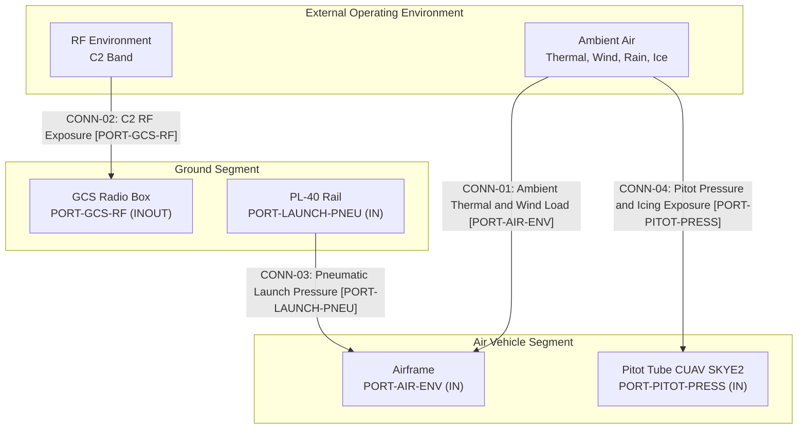

| Attribute | Specification Detail |
| :--- | :--- |
| **Title** | Environmental Operating Limits & MIL-STD-810H Stress Qualification |
| **Version** | 1.0.0 |
| **Date** | 2026-10-31 |
| **Issue ID** | CONOPS-08 |
| **Type** | ConOps Unit |
| **Generation Mode** | Deterministic specification synthesis from Level 0 extracts |
| **Specification Source** | .pipeline/schema.sysml; schema/extracted/parametric_limits.md; schema/extracted/oem_bom.md; schema/extracted/interface_table.md |

## 8. Operational Environments & MIL-STD-810H Environmental Stress Qualification

This unit records only environmental limits that are stated in the Level 0 extracts. Where the OEM sources are silent, the limit is recorded as "Not stated in OEM sources" instead of being inferred. The Ruddervator (drawing synonym: Fins; preparation synonym: tail stabiliser) is the canonical tail control surface assembly. The ESAD is Critical (DAL-A). The parachute deployment module is non-mission and is excluded from the mission environmental baseline.

The environmental state vector is bounded by the following envelope relation:

$$
\begin{aligned}
\mathbf{E}_{\mathrm{env}} &\in [\mathbf{E}_{\mathrm{min}}, \mathbf{E}_{\mathrm{max}}] \\
T_{\mathrm{amb,min}} &\le T_{\mathrm{amb}} \le T_{\mathrm{amb,max}}
\end{aligned}
$$

| Symbol | Parameter | Grounded Value | Grounding Source |
| :--- | :--- | :--- | :--- |
| T_amb,min | Minimum ambient working temperature (launcher) | 20 C below zero | parametric_limits.md PL-73; uav_launcher_pl_40_sysml_v2_ingestion_manual.md:723 |
| T_amb,max | Maximum ambient working temperature (launcher) | 50 C | parametric_limits.md PL-74; uav_launcher_pl_40_sysml_v2_ingestion_manual.md:723 |
| T_charge,min | Minimum battery charging temperature | 10 C | parametric_limits.md PL-91; uav_launcher_pl_40_sysml_v2_ingestion_manual.md:137 |
| T_charge,max | Maximum battery charging temperature | 40 C | parametric_limits.md PL-92; uav_launcher_pl_40_sysml_v2_ingestion_manual.md:137 |
| E_min, E_max | Air vehicle ambient operating envelope | Not stated in OEM sources | None |

### 8.1 Super-System Operational Architecture and Segment Boundaries

Environmental qualification is partitioned across the operational segments in accordance with IEEE Std 1362-1998 Section 5.3 and DoDAF v2.02 SV-1. The boundary diagram identifies the external environment, ground segment, and air vehicle segment with discrete ports and traceable connections.

| Segment | Boundary Element | Environmental Exposure | Grounding Source |
| :--- | :--- | :--- | :--- |
| External Environment | Ambient air | Temperature, wind, rain, icing | parametric_limits.md PL-73, PL-74 |
| External Environment | RF environment | C2 band 4.4 GHz to 5.0 GHz | interface_table.md GCS UAV Telemetry Link; a5-user-manual-2.md:1273 |
| Ground Segment | PL-40 Rail | Pneumatic pressure 13 bar to 14 bar | parametric_limits.md PL-40, PL-41; a5-user-manual-2.md:1329 |
| Ground Segment | GCS Radio Box | Output power 2 W | parametric_limits.md PL-39; a5-user-manual-2.md:1690 |
| Air Vehicle Segment | Airframe | Airborne ambient exposure | Not stated in OEM sources |
| Air Vehicle Segment | Pitot Tube CUAV SKYE2 | Heated and drained airspeed sensing | oem_bom.md; avenger_v2_5_sysml_v2_ingestion.md:32 |

### 8.2 Grounded Environmental Operating Limits

| Parameter | Grounded Limit | Grounding Source | OEM Status |
| :--- | :--- | :--- | :--- |
| Minimum ambient working temperature (launcher) | 20 C below zero | parametric_limits.md PL-73; uav_launcher_pl_40_sysml_v2_ingestion_manual.md:723 | Stated |
| Maximum ambient working temperature (launcher) | 50 C | parametric_limits.md PL-74; uav_launcher_pl_40_sysml_v2_ingestion_manual.md:723 | Stated |
| Air vehicle ambient operating temperature | Not stated in OEM sources | None | Silent |
| Storage and transit temperature | Not stated in OEM sources | None | Silent |
| Minimum battery charging temperature | 10 C | parametric_limits.md PL-91; uav_launcher_pl_40_sysml_v2_ingestion_manual.md:137 | Stated |
| Maximum battery charging temperature | 40 C | parametric_limits.md PL-92; uav_launcher_pl_40_sysml_v2_ingestion_manual.md:137 | Stated |
| Minimum mission waypoint altitude | 50 m | parametric_limits.md PL-36; a5-user-manual-2.md:1195 | Stated |
| Service ceiling | Not stated in OEM sources | None | Silent |
| Maximum operating wind | Not stated in OEM sources | None | Silent |
| Cruise speed | 30 m/s | parametric_limits.md PL-01; a5-user-manual-2.md:307 | Stated |
| Maximum horizontal speed | 38 m/s | parametric_limits.md PL-02; a5-user-manual-2.md:308 | Stated |
| Maximum dive speed | 55 m/s | parametric_limits.md PL-03; a5-user-manual-2.md:309 | Stated |
| Maximum dive angle | 22 deg | parametric_limits.md PL-04; a5-user-manual-2.md:310 | Stated |
| Minimum flight speed | 26 m/s | parametric_limits.md PL-05; a5-user-manual-2.md:311 | Stated |
| Flight endurance | 90 min | parametric_limits.md PL-06; avenger-5-spec-sheet-rev3.md:53 | Stated |
| Ingress protection rating | Not stated in OEM sources | None | Silent |
| Radiated susceptibility field strength | Not stated in OEM sources | None | Silent |
| C2 RF band | 4.4 GHz to 5.0 GHz | interface_table.md GCS UAV Telemetry Link; a5-user-manual-2.md:1273 | Stated |
| Ground radio output power | 2 W | parametric_limits.md PL-39; a5-user-manual-2.md:1690 | Stated |

### 8.3 MIL-STD-810H Method Applicability and OEM Silence

| MIL-STD-810H Method | Environmental Stress | Grounded Limit or OEM Status | Grounding Source | Inventory Obligation |
| :--- | :--- | :--- | :--- | :--- |
| High Temperature | Ambient thermal soak | 50 C maximum working temperature (launcher); air vehicle limit Not stated in OEM sources | parametric_limits.md PL-74; uav_launcher_pl_40_sysml_v2_ingestion_manual.md:723 | OBL-MIL810H-01 |
| Low Temperature | Cold soak and cold start | 20 C below zero minimum working temperature (launcher); air vehicle limit Not stated in OEM sources | parametric_limits.md PL-73; uav_launcher_pl_40_sysml_v2_ingestion_manual.md:723 | OBL-MIL810H-02 |
| Rain and Blowing Rain | Liquid precipitation and wind | Not stated in OEM sources | None | OBL-MIL810H-03 |
| Icing and Freezing Rain | Ice accretion | Not stated in OEM sources | None | OBL-MIL810H-04 |
| Low Pressure | Altitude and atmospheric pressure | Service ceiling Not stated in OEM sources; minimum mission waypoint altitude 50 m | parametric_limits.md PL-36; a5-user-manual-2.md:1195 | No inventory obligation |
| Temperature Shock | Rapid thermal transition | Not stated in OEM sources | None | No inventory obligation |
| Solar Radiation | Solar irradiance | Not stated in OEM sources | None | No inventory obligation |
| Humidity | Cyclic humidity | Not stated in OEM sources | None | No inventory obligation |
| Salt Fog | Salt aerosol | Not stated in OEM sources | None | No inventory obligation |
| Sand and Dust | Particulate | Not stated in OEM sources | None | No inventory obligation |
| Vibration | Random vibration | Not stated in OEM sources | None | No inventory obligation |
| Mechanical Shock | Shock and drop | Not stated in OEM sources | None | No inventory obligation |

### 8.4 Electromagnetic/RF Environment, System Interface Topology and Port Taxonomy

The grounded C2 RF environment is the 4.4 GHz to 5.0 GHz band (interface_table.md GCS UAV Telemetry Link; a5-user-manual-2.md:1273) with a ground radio output power of 2 W (parametric_limits.md PL-39; a5-user-manual-2.md:1690). The research inventory declares MIL-STD-461G conducted susceptibility CS114, CS115, and CS116, radiated susceptibility RS103 and RS101, and conducted emissions CE102. Numeric qualification levels for those methods are Not stated in OEM sources.

| Port | Direction | Interface | Grounding Source |
| :--- | :--- | :--- | :--- |
| PORT-GCS-RF | INOUT | C2 link 4.4 GHz to 5.0 GHz | interface_table.md GCS UAV Telemetry Link; a5-user-manual-2.md:1273 |
| PORT-GNSS-RF | IN | GNSS RF feed | interface_table.md GNSS RF Feed; avenger_v2_5_sysml_v2_ingestion.md:121 |
| PORT-RADIO-RF-UPPER | OUT | Radio RF feed upper | interface_table.md Radio RF Feed Upper; avenger_v2_5_sysml_v2_ingestion.md:125 |
| PORT-RADIO-RF-LOWER | OUT | Radio RF feed lower | interface_table.md Radio RF Feed Lower; avenger_v2_5_sysml_v2_ingestion.md:126 |
| PORT-ESAD-RS485 | OUT | RS-485 half duplex, 100 Hz | interface_table.md RPI ESAD RS-485; esad-icd-excalibur-ab00-0054.md:306 |
| PORT-CAN1-TRUNK | INOUT | CAN 1 trunk 970 cm | interface_table.md CAN 1 Trunk 970 cm; avenger_v2_5_sysml_v2_ingestion.md:171 |
| PORT-CAN2-DAISY | INOUT | CAN 2 daisy chain | interface_table.md CAN 2 Daisy Chain Segment 5 to 6; avenger_v2_5_sysml_v2_ingestion.md:92 |
| PORT-ETH-BACKBONE | INOUT | Ethernet backbone | interface_table.md ETH Backbone; avenger_v2_5_sysml_v2_ingestion.md:114 |
| PORT-LAUNCH-PNEU | IN | Pneumatic supply 14 bar maximum | interface_table.md Launcher Pneumatic Supply; uav_launcher_pl_40_sysml_v2_ingestion_manual.md:132 |
| PORT-SERVO-PWR-8V | OUT | Servo power 8 V DC | interface_table.md Servo Power 8V Ruddervator Servo #1; avenger_v2_5_sysml_v2_ingestion.md:155 |

### 8.5 Ingress Protection and Environmental Sealing

No numeric ingress protection rating is stated in the OEM sources, so no IP class is claimed. The only grounded environmental protection features are the heated and drained Pitot Tube CUAV SKYE2 (oem_bom.md; avenger_v2_5_sysml_v2_ingestion.md:32) and the Safety RBF Devices that include the pitot cover and sensor cover (oem_bom.md; a5-user-manual-2.md:340; a5-prep-and-safety-rev7.md:321). Enclosure gaskets, breather vents, and liquid ingress ratings are Not stated in OEM sources.

### 8.6 Physical Spatial Constraints and Clearance Envelopes

| Parameter | Grounded Value | Grounding Source |
| :--- | :--- | :--- |
| Wingspan | 1.8 m | parametric_limits.md PL-09; a5-user-manual-2.md:287 |
| Assembled UAV length | 1.6 m | parametric_limits.md PL-10; a5-user-manual-2.md:288 |
| Assembled UAV height | 1.1 m | parametric_limits.md PL-11; a5-user-manual-2.md:289 |
| Maximum take-off mass | 17 kg | parametric_limits.md PL-12; a5-user-manual-2.md:299 |
| Launcher rail length assembled | 5.0 m | parametric_limits.md PL-93; uav_launcher_pl_40_sysml_v2_ingestion_manual.md:713 |
| Launcher rail length disassembled | 1.28 m | parametric_limits.md PL-94; uav_launcher_pl_40_sysml_v2_ingestion_manual.md:714 |
| Launcher overall height | 1115 mm | parametric_limits.md PL-86; uav_launcher_pl_40_sysml_v2_ingestion_manual.md:143 |
| Front bipod stance width | 602 mm | parametric_limits.md PL-87; uav_launcher_pl_40_sysml_v2_ingestion_manual.md:143 |
| Carriage overall length | 271 mm | parametric_limits.md PL-81; uav_launcher_pl_40_sysml_v2_ingestion_manual.md:142 |
| Carriage lever tip span | 206.5 mm | parametric_limits.md PL-82; uav_launcher_pl_40_sysml_v2_ingestion_manual.md:142 |
| Carriage overall height | 232.5 mm | parametric_limits.md PL-83; uav_launcher_pl_40_sysml_v2_ingestion_manual.md:142 |
| Center of mass longitudinal envelope | 0 mm to 200 mm | parametric_limits.md PL-84; uav_launcher_pl_40_sysml_v2_ingestion_manual.md:144 |
| Center of mass normal envelope | 0 mm to 100 mm | parametric_limits.md PL-85; uav_launcher_pl_40_sysml_v2_ingestion_manual.md:144 |
| Maximum launched plane mass | 30 kg | parametric_limits.md PL-64; uav_launcher_pl_40_sysml_v2_ingestion_manual.md:718 |
| Maximum launch velocity | 25 m/s | parametric_limits.md PL-65; uav_launcher_pl_40_sysml_v2_ingestion_manual.md:719 |
| Launch angle | 12 deg | parametric_limits.md PL-66; uav_launcher_pl_40_sysml_v2_ingestion_manual.md:712 |
| Catapult launch pressure | 13 bar to 14 bar | parametric_limits.md PL-40, PL-41; a5-user-manual-2.md:1329 |
| Launcher set mass | 68 kg | parametric_limits.md PL-69; uav_launcher_pl_40_sysml_v2_ingestion_manual.md:715 |
| PL-40 Rail Transportation Case mass | 43 kg | parametric_limits.md PL-70; uav_launcher_pl_40_sysml_v2_ingestion_manual.md:716 |
| Compressor case mass | 25 kg | parametric_limits.md PL-71; uav_launcher_pl_40_sysml_v2_ingestion_manual.md:717 |
| Launcher setup time | 5 min | parametric_limits.md PL-72; uav_launcher_pl_40_sysml_v2_ingestion_manual.md:722 |

Minimum cleared staging area and operator safety radius are Not stated in OEM sources. The assembled UAV bounding envelope is 1.8 m span by 1.6 m length by 1.1 m height (parametric_limits.md PL-09, PL-10, PL-11; a5-user-manual-2.md:287; a5-user-manual-2.md:288; a5-user-manual-2.md:289).

### 8.7 Safety-Critical Environmental Qualification Priorities

- **ESAD:** Critical (DAL-A), all-electronic safety and arming device; environmental stress qualification must preserve safe and armed state integrity (oem_bom.md; avenger_v2_5_sysml_v2_ingestion.md:45; a5-user-manual-2.md:1984; esad-icd-excalibur-ab00-0054.md:105).
- **Ruddervator (drawing synonym: Fins; preparation synonym: tail stabiliser):** Canonical tail control surface assembly, quantity 4; no component-specific environmental limit is stated in OEM sources (parametric_limits.md PL-14; oem_bom.md; avenger_v2_5_sysml_v2_ingestion.md:21; a5-user-manual-2.md:273; a5-prep-and-safety-rev7.md:242).
- **Parachute Deployment Non-Mission:** Non-mission configuration with baseline false; excluded from the mission environmental qualification baseline (oem_bom.md; avenger_v2_5_sysml_v2_ingestion.md:40; a5-user-manual-2.md:262; a5-user-manual-2.md:314).

## Source References

Source: schema/extracted/parametric_limits.md line 5

Source: schema/extracted/oem_bom.md line 9

Source: schema/extracted/interface_table.md line 9

Source: docs/research/RESEARCH_INVENTORY.md line 39

Source: .pipeline/schema.sysml line 506

Source: MIL-STD-810H Methods 501.7, 502.7, 506.6, 521.4

Source: MIL-STD-461G CS114, CS115, CS116, RS101, RS103, CE102

Source: IEEE Std 1362-1998 Section 5.3

Source: DoDAF v2.02 SV-1
