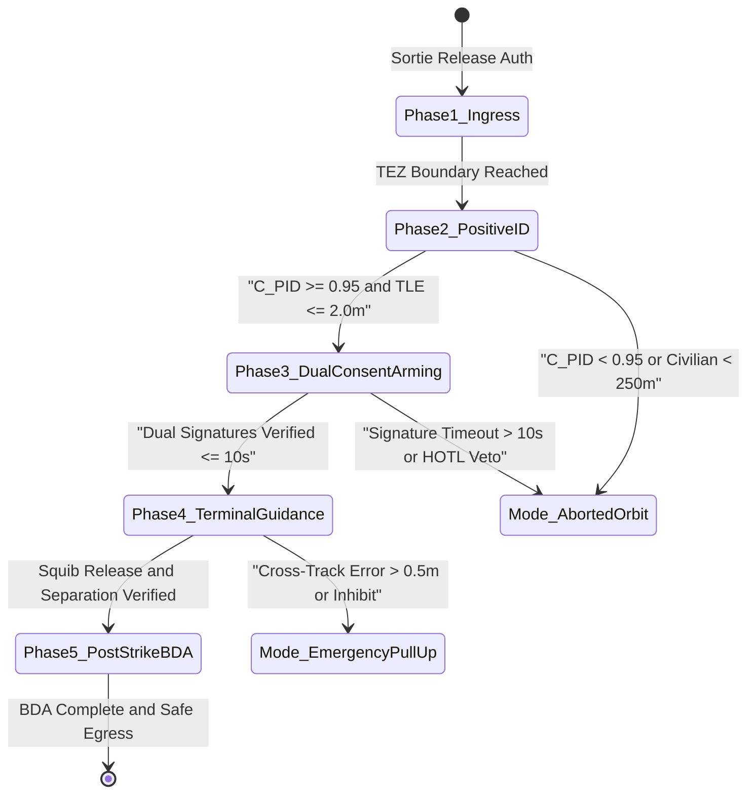

| Attribute | Value |
| :--- | :--- |
| **Title** | Multi-Threaded Operational Scenarios & Mission Timelines |
| **Version** | 1.0.0 |
| **Date** | 2026-09-02 |

## 9. Multi-Threaded Operational Scenarios & Mission Timelines

In accordance with ISO/IEC/IEEE 29148:2018 §6.4.2, NATO STANAG 4586 Edition 4, and MIL-STD-882E §4.3, the Tactical UAS executes multi-threaded operational scenarios governed by deterministic state transitions, hard timing bounds, and fail-safe exception branches. The evolution of vehicle operational state vectors across discrete mission timelines is governed by the state transition dynamic relation:

$$
\begin{aligned}
\mathbf{x}(t_{k+1}) &= \mathbf{f}(\mathbf{x}(t_k), \mathbf{u}(t_k), \mathbf{w}(t_k), \Delta t_k) \\
t_{k+1} &= t_k + \Delta t_k
\end{aligned}
$$

Where and Operational Parameters:
- $\mathbf{x}(t_k)$: Operational state vector at discrete time step $t_k$, comprising vehicle 3D position $\mathbf{p} = [p_x, p_y, p_z]^T$, velocity vector $\mathbf{v} = [v_x, v_y, v_z]^T$, attitude quaternion $\mathbf{q}$, remaining energy $E(t)$, and system operational mode $M(t)$.
- $\mathbf{u}(t_k)$: Actuation and command control vector issued by the flight guidance core or operator interface.
- $\mathbf{w}(t_k)$: Stochastic environmental disturbances (wind gust vector, barometric gradient, RF interference).
- $\Delta t_k$: Discrete scenario transition time interval.

---

### 9.1 Scenario SCN-01: Nominal Perimeter Surveillance Sortie
Scenario `SCN-01` describes an end-to-end nominal surveillance mission from ground staging through autonomous survey corridor execution, on-station perimeter loiter, and precision optical fiducial recovery.

| Step Number | Elapsed Time (T+) | Stimulus / Trigger | Actor / Performer | Action Executed | Observed Telemetry / System State | Decision Gate / Verification | Fail-Safe Exception Branch | Exit Criterion |
| :--- | :--- | :--- | :--- | :--- | :--- | :--- | :--- | :--- |
| **1** | T0 + 00:00 (T+0s) | Operator powers on GCS and connects flight energy module | Maintenance Technician (MT) & GCS | Executes automated Pre-Flight Built-In-Test (PBIT) routine MTC-01; tests CAN FD buses, IMUs, barometers, and battery health | PBIT Status: 100% PASS; IMU bias drift < 0.01 deg/s; Battery SoC >= 95.0% (Cell delta V <= 10 mV); Link SNR >= 24.0 dB | All PBIT flags green; Battery temp >= 15.0 °C; Pre-Arm interlocks unlocked | If PBIT fails on any sensor channel, lock FCC in Mode: Maintenance_Hold and log diagnostic fault code | PBIT verification flag logged in GCS; Pre-Arm interlocks confirmed green |
| **2** | T0 + 02:30 (T+150s) | Mission Commander issues authenticated Sortie Release Token | Remote Pilot in Command (RPIC) & FCC | Uploads cryptographically signed mission plan (STANAG 4586 DLI), validates geofence polygon (R_GRB = 200.0 m), verifies UTM airspace clearance token | FCC Mode: Armed_Standby; 42 Waypoints verified; Geofence checksum verified; UTM Token: Valid (Authorization Window: 120 min) | Digital signature matches PKI root; Geofence boundary fully within authorized airspace | If signature or geofence validation fails, reject plan and revert to Mode: Disarmed_Standby | FCC confirms plan cryptographic checksum; Range Safety Officer grants launch clearance |
| **3** | T0 + 05:00 (T+300s) | RPIC depresses hardware Dual-Action Launch Switch on GCS | Autopilot Guidance Core & Electric Propulsion | Executes autonomous vertical liftoff, accelerates, and climbs along departure corridor to cruise altitude 100.0 m AGL at climb rate 3.0 m/s, forward speed 18.0 m/s | Altitude: 100.0 m AGL; Groundspeed: 18.0 m/s; Roll/Pitch <= 5.0 deg; Motor Current: 28.5 A (within 45.0 A limit); Vibration < 0.8 g RMS | Rate of climb >= 2.5 m/s; No motor current disparity; GNSS Fix: RTK Fixed (HDOP <= 0.8) | If motor RPM drops or vibration > 3.0 g during takeoff, execute immediate vertical abort touchdown (EMG-03/06) | Cruise altitude 100.0 m AGL reached; Transition from departure corridor to transit corridor |
| **4** | T0 + 10:00 (T+600s) | Arrival at departure corridor exit waypoint WP_04 | Navigation Filter & Flight Guidance Core | Navigates transit corridor at 100.0 m AGL, 18.0 m/s; enables terrain avoidance radar; monitors dynamic airspace traffic (ADS-B In / FLARM) | Distance along corridor: 6.2 km; Cross-track error e_xtrack <= 1.2 m; Traffic status: CLEAR; Primary RF SNR: 22.5 dB | Obstacle clearance buffer >= 50.0 m; Remaining energy E(t) > E_bingo(t) + 300 kJ | If intruder aircraft detected within 500 m separation buffer, execute autonomous horizontal deconfliction turn | Arrival at patrol entry waypoint WP_station (12.0 km from base) |
| **5** | T0 + 15:00 (T+900s) | Waypoint WP_station reached; perimeter patrol activated | Navigation Subsystem, Payload Operator (PO), Optical Gimbal | Enters racetrack perimeter patrol pattern at altitude 120.0 m AGL; un-stows multi-spectral EO/IR gimbal; streams H.265 telemetry and video at 8.0 Mbps | Altitude: 120.0 m AGL; Groundspeed: 15.0 m/s; Video Downlink: 8.0 Mbps (Latency <= 120 ms); Gimbal Boresight: Track corridor; SoC = 82.0% | Video SNR >= 18.0 dB; Battery discharge temperature <= 45.0 °C | If video downlink degrades below 2.0 Mbps, throttle video resolution and prioritize STANAG 4586 C2 telemetry | 60 minutes on-station perimeter patrol completed; SOC issues Mission Complete acknowledgment |
| **6** | T0 + 75:00 (T+4500s) | Mission Commander authorizes Sortie Recovery Token; survey complete | Flight Guidance Core & Bingo Energy Subsystem | Stows optical gimbal; computes optimal wind-compensated return trajectory; initiates return transit at 18.0 m/s, begins staged descent from 120.0 m to 50.0 m AGL | Distance to Base: 12.0 km; Energy SoC = 38.5% (E_current = 1420 kJ > E_bingo = 786 kJ); Descent rate: 1.5 m/s | Energy reserve E(t) - E_bingo(t) >= 200 kJ; Recovery pad weather within limits (Wind <= 12.0 m/s) | If headwind increases energy demand above remaining margin, trigger SCN-04 Secondary Divert protocol | Arrival at initial approach fix (IAF) over recovery site at 50.0 m AGL |
| **7** | T0 + 87:30 (T+5250s) | Arrival at Initial Approach Fix; recovery pad optical beacon acquired | Precision Landing Guidance & Downward Optical Flow / Lidar | Aligns heading into prevailing wind; acquires infrared fiducial landing marker on recovery pad; descends along 3-degree glidepath; initiates terminal flare at 2.0 m AGL | Vertical descent velocity: 0.6 m/s; Groundspeed: 1.2 m/s; Optical tracking residual <= 0.05 m; Lidar AGL: 0.1 m | Pad clear of ground obstacles; Touchdown dispersion error e_pos <= 0.30 m | If landing pad obstructed or optical fiducial lost below 5.0 m, execute autonomous go-around climb to 30.0 m AGL | Ground weight-on-wheels micro-switches triggered; Main propulsion motor cutoff committed within 50 ms |
| **8** | T0 + 89:00 (T+5340s) | Touchdown confirmed; propulsion motors electrically safed and locked | Maintenance Technician & FCC | Disarms FCC; offloads encrypted black-box telemetry and raw sensor logs via wired GigE umbilical; disconnects depleted battery | Motor Inverters: DISARMED / 0V; Telemetry Offload: 100% COMPLETE (32.4 GB transfer, SHA-256 verified); Mode: Phase_SecureShutdown | Cryptographic signature on offloaded logs verified; Battery terminal voltage >= 21.0 V (no cell reversal) | If thermal warning detected post-landing, transfer battery module to GSE-01 fire-suppression containment chamber | Airframe secured in transit cradle; Maintenance log updated with flight hours and battery cycle count |

---

### 9.2 Scenario SCN-02: Multi-Spectral Target Classification & Tracking Sortie
Scenario `SCN-02` details the multi-threaded execution when automated edge vision detection triggers high-resolution EO/IR payload tasking, precision laser rangefinding, coordinate extraction, and coordinated orbital tracking.

| Step Number | Elapsed Time (T+) | Stimulus / Trigger | Actor / Performer | Action Executed | Observed Telemetry / System State | Decision Gate / Verification | Fail-Safe Exception Branch | Exit Criterion |
| :--- | :--- | :--- | :--- | :--- | :--- | :--- | :--- | :--- |
| **1** | T0 + 25:00 (T+1500s) | Wide-angle infrared payload detects localized thermal contrast hotspot | Onboard Edge Neural Inference Processor (NVIDIA Jetson Orin NX) | Ingests 60 fps LWIR thermal video stream; executes neural detection model; extracts region of interest (ROI) bounding box | Thermal Delta T: +12.4 °C; Inference Latency: 14.2 ms; Detected Class: Ground Vehicle; Neural Confidence Score: C_raw = 0.96 | Confidence score exceeds detection threshold (C_raw >= 0.85); ROI within legal surveillance sector | If false alarm filter rejects signature (static heat source match), resume wide-angle scan | Target bounding box extracted; Preliminary Track Candidate TC-042 generated |
| **2** | T0 + 25:02 (T+1502s) | Candidate TC-042 handed to Multi-Spectral Sensor Fusion Engine | Sensor Fusion Core & STANAG 4586 Payload Server | Fuses high-definition electro-optical (EO) visual channel with LWIR thermal channel; computes spatial-temporal correlation matrix per ROE-02 | Score_EO: 0.94; Score_IR: 0.98; Multi-Spectral Confidence: C_PID = 0.96 >= 0.95; Track ID assigned: TRK-STANAG-8841 | ROE-02 satisfied (Score_EO >= 0.90, Score_IR >= 0.90, C_PID >= 0.95); Target outside civilian buffer zone (ROE-05) | If C_PID < 0.95, downgrade to Unconfirmed Contact, flag for manual operator review, do not lock gimbal | Target Track TRK-STANAG-8841 confirmed; OpTx-05 payload metadata packet emitted |
| **3** | T0 + 25:04 (T+1504s) | Target Track TRK-STANAG-8841 published on internal CAN FD / Ethernet bus | 2-Axis Stabilized Gimbal Controller & Optical Tracking Loop | Slews narrow-field-of-view (NFOV) optical camera onto target coordinates at 60 deg/s slew rate; engages optical centroid tracking loop | Gimbal Azimuth: +42.3 deg; Elevation: -38.6 deg; Tracking Mode: Centroid_Lock; Jitter <= 15.0 microrad RMS | Optical centroid error e_track <= 5 pixels; Optical line-of-sight uninhibited by airframe shadow | If optical contrast lost due to obscurants, automatically switch tracking loop to IR edge centroid mode | Gimbal closed-loop centroid lock verified; Optical crosshair centered on target |
| **4** | T0 + 25:07 (T+1507s) | Payload Operator confirms target lock on GCS payload console | Payload Operator (PO) & Eye-Safe Laser Rangefinder (LRF 1550 nm) | Emits 10 Hz eye-safe laser rangefinder pulses; measures slant range; computes 3D target coordinates (Lat, Lon, Alt) via WGS-84 coordinate transform and DEM fusion | Slant Range: 842.6 m +/- 0.2 m; Target Location Error: TLE90 = 1.8 m <= 2.0 m; Target Elevation: 142.3 m MSL; KLV MISB 0601 metadata injected | TLE90 <= 2.0 m; Laser return signal SNR >= 15.0 dB; No civilian exclusion intersection (ROE-05 >= 250.0 m) | If LRF return multi-path detected or TLE > 5.0 m, fall back to passive stereoscopic / DEM elevation intersection | Precision target telemetry broadcast to GCS and SOC via STANAG 4586 DLI message stream |
| **5** | T0 + 25:30 (T+1530s) | Mission Commander authorizes continuous target monitoring | Remote Pilot in Command & Autopilot Guidance Subsystem | Commands autopilot to establish coordinated circle orbit around target location (Radius R_orbit = 300.0 m, Altitude = 120.0 m AGL, Groundspeed = 16.0 m/s); maintains continuous gimbal LOS | Orbital Radius: 300.0 m +/- 3.5 m; Bank Angle: 18.2 deg; Gimbal Depression Angle: 21.8 deg; Continuous LOS: 100% | Orbit perimeter fully contained within approved operational airspace and geofence (R_GRB margin >= 100 m) | If target approaches geofence boundary, autopilot automatically expands or shifts orbit to prevent geofence breach (EMG-05) | Continuous 20-minute persistent surveillance track maintained; full telemetry and video archived |
| **6** | T0 + 45:00 (T+2700s) | Target exits monitored infrastructure perimeter | Mission Commander & Payload Operator | Disengages optical centroid lock; slews gimbal to aerodynamic stowed boresight position; resumes nominal perimeter corridor waypoint sequence | Gimbal Mode: STOWED_LOCKED; Video Bitrate: 4.0 Mbps; Vehicle Mode: Nominal_Corridor_Navigation; Waypoint: WP_08 loaded | Gimbal stow micro-switch engaged; Flight corridor path deconflicted with local airspace | If gimbal fails to lock in stow position, verify aerodynamic drag margin and continue sortie at reduced speed (14.0 m/s) | Resumed pre-programmed survey waypoint sequence; Target track summary report generated |

---

### 9.3 Scenario SCN-03: Degraded C2 Lost-Link & Autonomous RTH Sortie
Scenario `SCN-03` defines the autonomous handling of primary RF datalink failure, execution of PACE communications failover, and fallback to lost-link return protocols.

| Step Number | Elapsed Time (T+) | Stimulus / Trigger | Actor / Performer | Action Executed | Observed Telemetry / System State | Decision Gate / Verification | Fail-Safe Exception Branch | Exit Criterion |
| :--- | :--- | :--- | :--- | :--- | :--- | :--- | :--- | :--- |
| **1** | T0 + 35:00 (T+2100s) | Localized RF multipath or Fresnel zone occlusion degrades primary 5.8 GHz ISM datalink | PACE Communications Management Node & Watchdog | Detects primary link SNR falling below 6.0 dB; monitors consecutive lost heartbeat packets; starts loss timer t_loss | Primary SNR: 4.2 dB (< 6.0 dB threshold); Packet Loss Rate: 48%; Heartbeat Timer: t_loss = 0.5 s / 1.0 s; Link Status: PRIMARY_DEGRADED | t_loss > 1.0 s triggers PACE failover tier 2 (Alternate medium) | If primary link recovers within 1.0 s (SNR > 12.0 dB), reset loss timer and maintain primary routing | Loss timer t_loss exceeds 1.0 s threshold; PACE Tier-2 failover command issued |
| **2** | T0 + 35:02 (T+2102s) | PACE controller declares Primary medium failure | PACE Datalink Router & Software Switch | Re-routes C2 telemetry and essential commands to 915 MHz Frequency Hopping Spread Spectrum (FHSS) encrypted mesh modem; throttles video downlink | Active Medium: Alternate_915MHz_FHSS; Link SNR: 26.4 dB; Latency: 65.0 ms (<= 80.0 ms limit); Downlink Bitrate: 250 kbps; Heartbeat: RESTORED | Bidirectional telemetry verified; GCS receives authenticated vehicle state vector within 100 ms | If 915 MHz modem fails to establish handshake within 2.0 s, advance immediately to Tier-3 (Contingency LTE/5G) | Bidirectional C2 link re-established; GCS displays PACE Tier-2 Active status indicator |
| **3** | T0 + 40:00 (T+2400s) | High-power wideband Electronic Warfare (EW) jamming blankets 900 MHz and 2.4/5.8 GHz ISM bands | PACE Datalink Router & Cellular Network Gateway | Detects simultaneous loss of primary and alternate RF carriers; initiates IPsec encrypted VPN tunnel over commercial LTE/5G dual-SIM modem | ISM RSSI: -115 dBm (JAMMED); LTE RSRP: -82 dBm; IPsec Tunnel: UP; C2 Packet Latency: 92.0 ms; Essential C2 telemetry active | Encrypted tunnel handshake verified; GCS C2 console maintains HOTL supervisory authority | If LTE base station unreachable or cellular jamming active, prepare Tier-4 Emergency Satellite / Autonomy transition | Essential C2 commands and heartbeat successfully operating over Tier-3 encrypted cellular tunnel |
| **4** | T0 + 42:00 (T+2520s) | Total RF loss across all terrestrial communications media lasting duration tau_timeout = 5.0 s | Hardware Safety Watchdog & Failsafe State Machine | Deterministic safety watchdog expires (tau_timeout >= 5.0 s); fires Emergency Trigger EMG-01; transitions flight mode to Mode: Contingency_LostLinkReturn; begins 30.0 s autonomous lost-link loiter | Link Status: TOTAL_LOST_LINK; Failsafe Mode: Contingency_LostLinkReturn; Response Latency: t_resp = 18.2 ms (<= 200.0 ms); Loiter Timer: 0 / 30.0 s | Hardware watchdog interlock locked; Kinetic payloads disarmed and stowed per ROE-06 | If any PACE medium recovers during 30.0 s loiter, require 5.0 s stable heartbeat before allowing GCS to resume mission | 30.0 s lost-link loiter expires without link restoration; Autonomous Return-to-Home trajectory engaged |
| **5** | T0 + 42:30 (T+2550s) | Lost-link loiter timer expired (30.0 s) | Autonomous Flight Guidance Core & Navigation Subsystem | Climbs to pre-programmed obstacle clearance altitude 100.0 m AGL; turns onto direct Return-to-Home trajectory; accelerates to optimal cruise speed 18.0 m/s; broadcasts IFF squawk 7600 | Altitude: 100.0 m AGL; Groundspeed: 18.0 m/s; Heading: 245 deg (Direct Home); Transponder Squawk: 7600 (Lost Comm); Energy SoC: 46.2% | Altitude clears highest obstacle along return path by >= 30.0 m; Geofence containment verified | If GNSS jamming also detected during RTH transit (EMG-02), engage visual-inertial dead reckoning to nearest cleared recovery site | Arrival at Home Recovery Waypoint overhead (WP_HOME, 50.0 m AGL) |
| **6** | T0 + 51:30 (T+3090s) | Vehicle reaches WP_HOME overhead at 50.0 m AGL | Autonomous Precision Landing System & Recovery Beacon | Executes autonomous spiraling descent to 10.0 m AGL; locks onto recovery pad optical/ultrasonic beacon; aligns into wind; executes automated flare and touchdown | Touchdown Velocity: 0.7 m/s; Lateral Landing Error: 0.18 m; Motor Inverters: SHUTDOWN; Emergency Locator Transmitter (ELT): ACTIVE | Weight-on-wheels switches closed; Zero motor current | If primary recovery pad occupied or blocked, divert to secondary unpaved run-off zone within ground risk buffer | Safe autonomous landing completed; Airframe in secure disarmed state; Emergency recovery team notified |

---

### 9.4 Scenario SCN-04: In-Flight Environmental Stress & Emergency Diversion Sortie
Scenario `SCN-04` covers the handling of dynamic environmental degradation (severe turbulence, wind gust increase exceeding operational limits with storm cell ingress) demanding secondary divert execution.

| Step Number | Elapsed Time (T+) | Stimulus / Trigger | Actor / Performer | Action Executed | Observed Telemetry / System State | Decision Gate / Verification | Fail-Safe Exception Branch | Exit Criterion |
| :--- | :--- | :--- | :--- | :--- | :--- | :--- | :--- | :--- |
| **1** | T0 + 50:00 (T+3000s) | Sudden convective gust front causes severe airframe turbulence and airspeed fluctuation | Heated Pitot-Static Probe, IMU Array, Navigation EKF | Measures sustained horizontal wind speed v_wind = 18.5 m/s with peak gusts v_gust = 22.8 m/s (exceeding v_limit = 15.0 m/s steady / 20.0 m/s gust limit); IMU registers RMS vibration 3.8 g | Wind Speed: 18.5 m/s (Gust: 22.8 m/s); Airspeed Disparity: 4.2 m/s; Attitude Disturbance: Roll +/- 16.5 deg; Environmental Alert: WIND_EXCEEDANCE_ACTIVE | Sustained wind > 15.0 m/s for > 10.0 s confirms environmental exceedance; Triggers mandatory flight corridor re-evaluation | If turbulence causes attitude rate omega > 120 deg/s, auto-level flight controller limits bank angle to 15 deg and reduces throttle | Environmental Warning Alert transmitted to GCS; System initiates emergency divert evaluation |
| **2** | T0 + 50:15 (T+3015s) | Environmental exceedance alert raised; vehicle located 14.5 km upwind of primary home base | Onboard Bingo Energy Subsystem & Trajectory Predictor | Computes required energy to penetrate 22.8 m/s headwind along direct primary return path: E_required_home = 1850 kJ; checks remaining battery energy E_current = 1380 kJ; detects E_current < E_bingo_primary | E_current: 1380 kJ; E_required_home: 1850 kJ; Energy Deficit: -470 kJ; Bingo Status: BINGO_PRIMARY_UNREACHABLE | Mathematical invariant E_current >= E_bingo_primary violated; Immediate secondary divert site selection mandatory per ConOps §11.3 | If no divert sites available, configure maximum-endurance unpowered glide profile toward open agricultural terrain | Secondary Divert Decision Gate tripped; Autopilot initiates pre-cleared divert catalog query |
| **3** | T0 + 50:30 (T+3030s) | Bingo deficit confirmed; Divert catalog queried | Flight Guidance Core & Navigation Subsystem | Evaluates pre-cleared divert landing zones in downwind direction; selects LZ-DIVERT-ALPHA (4.2 km downwind, bearing 065 deg, paved agricultural strip); calculates divert energy E_divert = 280 kJ with tailwind | Selected Site: LZ-DIVERT-ALPHA; Distance: 4.2 km; E_required_divert: 280 kJ; Remaining Reserve at Landing: E_reserve = 1100 kJ (> 20% capacity = 648 kJ); Clearance: GREEN | LZ-DIVERT-ALPHA terrain clearance >= 50 m; Airspace corridor clear; Reserve energy >= 20% | If LZ-DIVERT-ALPHA weather sensors report ground obstacles, switch to alternate LZ-DIVERT-BRAVO (6.8 km crosswind) | Divert flight path synthesized; Divert proposal transmitted to GCS for pilot confirmation |
| **4** | T0 + 50:45 (T+3045s) | Divert proposal displayed on GCS console with telemetry overlay | Remote Pilot in Command (RPIC) & Mission Commander (MC) | RPIC and MC review energy projection and downwind weather radar; depress authenticated Execute Divert switch; FCC switches to Mode: Contingency_SecondaryDivert | Mode: Contingency_SecondaryDivert; Heading: 065 deg (Aligned with downwind divert corridor); Groundspeed: 24.5 m/s (with tailwind assist); Motor Power: 180 W (reduced) | Cryptographic command authenticated; Transponder squawk updated to 7700 (Emergency) / 7600 if degraded | If pilot fails to respond within 15.0 s timeout, autonomous flight manager executes divert autonomously under SORA safety mandate | Vehicle enters downwind divert corridor; ATC emergency advisory transmitted |
| **5** | T0 + 54:30 (T+3270s) | Arrival at Initial Approach Fix for LZ-DIVERT-ALPHA | Precision Landing Guidance & Forward Optical Obstacle Detection | Executes continuous descent from 100.0 m to 15.0 m AGL along 5-degree glidepath; performs forward optical scan for ground personnel/vehicles on landing surface | Altitude: 15.0 m AGL; Groundspeed: 12.0 m/s; Surface Clear Status: 100% CONFIRMED; Cross-Track Error: 0.22 m; Energy Remaining: 1180 kJ | Landing strip verified clear of obstacles by onboard vision node; Surface wind vector verified within crosswind limit (<= 8.0 m/s) | If runway obstructed by dynamic vehicle, shift landing touchdown point 50 m down the strip | Final flare altitude 2.5 m AGL reached over touchdown zone |
| **6** | T0 + 56:15 (T+3375s) | Touchdown sensor contact on landing gear | Autonomous Flight Controller & Mobile Recovery Unit | Cuts propulsion power within 20 ms; deploys mechanical wheel brakes; engages emergency locator beacon; transmits final landing coordinates to GCS | Landing Coordinates: LZ-DIVERT-ALPHA (Pad Center +0.25 m); Residual Energy: 1140 kJ (35.2% capacity); Inverters: DISARMED; Beacon: 406 MHz ACTIVE | System in verified safe/disarmed state; No battery thermal warning (Pack Temp = 28.4 °C) | If battery cell temperature rises > 60.0 °C post-landing, activate fire-suppression warning buzzer | Secondary divert complete; Mobile ground recovery vehicle dispatched; Incident report logged |

---

### 9.5 Scenario SCN-05: Tactical Precision Strike / Kinetic Delivery & Target Engagement Sortie
Scenario `SCN-05` defines the multi-phase execution of a tactical strike / kinetic payload release sortie governed by positive identification (PID), dual-consent cryptographic authorization, terminal guidance, and battle damage assessment (BDA).

#### 9.5.1 Phase 1: Ingress (Δt_1 = 480 s / T0 + 10:00 to T0 + 18:00)

| Step Number | Elapsed Time (T+) | Stimulus / Trigger | Actor / Performer | Action Executed | Observed Telemetry / System State | Decision Gate / Verification | Fail-Safe Exception Branch | Exit Criterion |
| :--- | :--- | :--- | :--- | :--- | :--- | :--- | :--- | :--- |
| **1.1** | T0 + 10:00 (T+600s) | Sortie release authorization received from Mission Commander | Guidance Subsystem / FCC | Ascends to tactical transit altitude 120.0 m AGL, accelerates to cruise speed 20.0 m/s along ingress corridor, activates Emissions Control (EMCON) profile | Altitude: 120.0 m AGL; Velocity: 20.0 m/s; EMCON: Active (RF silent, directional telemetry only); Geofence status: INSIDE | Pre-strike operational volume clear; Ingress corridor clearance token validated | If RF emission leak detected during EMCON, disable auxiliary transmitters and retain optical C2 | Tactical transit altitude 120.0 m AGL and speed 20.0 m/s established |
| **1.2** | T0 + 14:00 (T+840s) | Mid-corridor waypoint WP_INGRESS_03 reached | Navigation Subsystem & Radar Altimeter | Performs continuous terrain clearance check (h_rad ≥ 30.0 m per ROE-01) and geofence boundary distance check (d_bound ≥ 500.0 m) | Radar AGL: 120.0 m (≥ 30.0 m limit); Boundary Distance: 850.0 m; Flight dynamics nominal | ROE-01 terrain clearance satisfied; Boundary margin ≥ 500.0 m | If terrain clearance falls < 30.0 m AGL, initiate autonomous immediate climb to safe clearance ceiling | Standoff navigation across mid-ingress sector verified |
| **1.3** | T0 + 17:30 (T+1050s) | Tactical Engagement Zone (TEZ) perimeter waypoint reached | Payload Controller & Guidance Subsystem | Enters TEZ perimeter; un-stows multi-spectral EO/IR optical gimbal; activates wide-area target acquisition scan | TEZ Status: ENTERED; Gimbal: Un-stowed / Scan_Active; Optical Sensor Rails: Powered; Altitude: 120.0 m AGL | Target area boundary entered; Sensor payload un-stowed; Target search initiated | If gimbal fails to un-stow within 5.0 s, abort TEZ ingress and enter safe holding orbit | TEZ boundary confirmed; Transition to Phase 2 (Positive ID) |

#### 9.5.2 Phase 2: Multi-Spectral Positive Identification (Δt_2 = 60 s / T0 + 18:00 to T0 + 19:00)

| Step Number | Elapsed Time (T+) | Stimulus / Trigger | Actor / Performer | Action Executed | Observed Telemetry / System State | Decision Gate / Verification | Fail-Safe Exception Branch | Exit Criterion |
| :--- | :--- | :--- | :--- | :--- | :--- | :--- | :--- | :--- |
| **2.1** | T0 + 18:00 (T+1080s) | Target signature detected in multi-spectral optical/infrared sensor footprint | Edge Vision Processor & Sensor Fusion Engine | Ingests simultaneous high-definition EO video and LWIR thermal frames; extracts spatial features, thermal gradient, and kinematic track | EO Sharpness Score: 0.95; Thermal Contrast Delta T: +14.2 °C; Candidate Track: TC-9012; Inference Rate: 60 fps | Target within sensor field of view; Bounding box tracking stable | If target obscured by cloud or smoke, activate IR edge enhancement filter | Multi-spectral candidate features extracted |
| **2.2** | T0 + 18:15 (T+1095s) | Neural feature matching completed against doctrinal target library | Multi-Spectral Sensor Fusion Engine | Evaluates multi-spectral correlation matrix; computes individual sensor scores Score_EO = 0.96 ≥ 0.90 and Score_IR = 0.97 ≥ 0.90; confirms composite confidence C_PID = 0.97 ≥ 0.95 per ROE-02 | Multi-spectral correlation valid; Score_EO: 0.96; Score_IR: 0.97; Confidence: C_PID = 0.97 ≥ 0.95; Target Class: Verified | ROE-02 satisfied (Score_EO ≥ 0.90, Score_IR ≥ 0.90, C_PID ≥ 0.95) | If C_PID < 0.95, prohibit weapon arming; downgrade to surveillance track and enter holding orbit | Positive identification (PID) confirmed per ROE-02 |
| **2.3** | T0 + 18:35 (T+1115s) | PID confirmed; Target track locked | 2-Axis Gimbal Controller & Eye-Safe LRF | Slews optical crosshairs onto target centroid; emits 10 Hz laser pulses; computes Target Location Error TLE ≤ 2.0 m; assigns STANAG 4586 Target Track ID | Gimbal Mode: Centroid_Lock; Slant Range: 720.0 m; TLE90: 1.4 m (≤ 2.0 m limit); Target Track ID: TRK-STRIKE-9012 | TLE90 ≤ 2.0 m; STANAG 4586 track ID locked; Continuous laser return valid | If LRF multi-path occurs, re-pulse LRF or compute passive DEM elevation intersection | STANAG 4586 target track ID locked; TLE ≤ 2.0 m verified |
| **2.4** | T0 + 18:50 (T+1130s) | STANAG 4586 track ID locked; civilian buffer verification initiated | Autonomous Safety Interlock Engine | Queries digital terrain elevation database and designated civilian structure catalog; computes distance to nearest protected zone | Target Coordinates: Lat 34.1284° N, Lon 117.8921° W; Standoff to Nearest Protected Structure: d_civilian = 480.0 m (≥ 250.0 m limit) | ROE-05 Non-Combatant Exclusion verified (d_civilian ≥ 250.0 m) | If d_civilian < 250.0 m, trip ROE-05 interlock, disallow arming, and abort strike profile | ROE-05 confirmed green; Transition to Phase 3 (Dual-Consent Arming) |

#### 9.5.3 Phase 3: Dual-Consent Cryptographic Arming (Δt_3 = 60 s / T0 + 19:00 to T0 + 20:00)

| Step Number | Elapsed Time (T+) | Stimulus / Trigger | Actor / Performer | Action Executed | Observed Telemetry / System State | Decision Gate / Verification | Fail-Safe Exception Branch | Exit Criterion |
| :--- | :--- | :--- | :--- | :--- | :--- | :--- | :--- | :--- |
| **3.1** | T0 + 19:00 (T+1140s) | Positive ID and ROE compliance presented on GCS strike console | Mission Commander (MC) & Range Safety Officer (RSO) | Review target telemetry, video feed, TLE confidence, and civilian exclusion buffer on dual independent consoles | Target Track: TRK-STRIKE-9012; C_PID = 0.97; TLE = 1.4 m; d_civilian = 480.0 m; Arming Gate: PENDING_DUAL_AUTH | Both operators confirm PID and airspace safety | If either operator flags anomaly, withhold authorization and maintain standoff orbit | Strike authorization approved by MC and RSO |
| **3.2** | T0 + 19:05 (T+1145s) | MC and RSO initiate dual cryptographic arming sequence | Mission Commander (Key A) & Range Safety Officer (Key B) | Insert physical cryptographic security keys; enter PINs; submit digital signature tokens (ECDSA-P384) to FCC over encrypted C2 link | Key A Signature: SUBMITTED; Key B Signature: SUBMITTED; Timestamp Delta: abs(t_A - t_B) = 1.4 s; Arming Timer: Running | Signatures generated by authorized PKI keys; Rolling window delta_t_arm ≤ 10.0 s per ROE-03 | If either key fails cryptographic signature verification, abort arming and lock payload in SAFE state | Dual cryptographic tokens transmitted to FCC |
| **3.3** | T0 + 19:12 (T+1152s) | FCC Hardware Security Module receives dual signature tokens | FCC Hardware Security Module & Safety Interlock | Cryptographically validates Key A and Key B signatures; verifies rolling time delta delta_t_arm = 7.0 s ≤ 10.0 s per ROE-03; confirms geofence INSIDE | Signature A: VALID; Signature B: VALID; Verification Time: 12.5 ms; Geofence: INSIDE; Interlock Relay: ENERGIZED | ROE-03 satisfied; Dual consent validated; Payload interlock energized | If time delta exceeds 10.0 s (delta_t_arm > 10.0 s), invalidate tokens and require fresh authorization | FCC unlocks payload release safety interlock relay |
| **3.4** | T0 + 19:30 (T+1170s) | Safety interlock relay energized; payload electronics armed | Payload Release Controller & Power Distribution | Charges high-voltage release capacitor bank to 300V; retracts mechanical secondary safety pin; arms release squib driver | Payload State: Armed_Ready; Release Capacitor Voltage: 300.0 V; Safety Pin: RETRACTED; HOTL Heartbeat: 10 Hz (tau ≤ 2.0 s) | Payload State: Armed_Ready; Capacitor voltage ≥ 290.0 V; HOTL veto timer running (ROE-04) | If HOTL heartbeat lost for > 2.0 s or operator depresses Veto Abort switch, instantly safe payload (ROE-04/06) | Payload confirmed Armed_Ready; Transition to Phase 4 (Terminal Guidance) |

#### 9.5.4 Phase 4: Terminal Guidance & Kinetic Delivery (Δt_4 = 60 s / T0 + 20:00 to T0 + 21:00)

| Step Number | Elapsed Time (T+) | Stimulus / Trigger | Actor / Performer | Action Executed | Observed Telemetry / System State | Decision Gate / Verification | Fail-Safe Exception Branch | Exit Criterion |
| :--- | :--- | :--- | :--- | :--- | :--- | :--- | :--- | :--- |
| **4.1** | T0 + 20:00 (T+1200s) | Terminal engagement release window reached | Flight Guidance Core & Autopilot | Initiates 35-degree terminal dive profile; increases speed to 28.0 m/s; aligns vehicle longitudinal axis with target line-of-sight vector | Pitch: -35.0 deg; Airspeed: 28.0 m/s; Terminal Guidance Mode: ACTIVE; Line-of-sight rate: < 0.05 deg/s | Terminal dive trajectory within aerodynamic limits; Target tracking lock solid | If vehicle attitude rate or cross-track error diverges, abort dive and initiate max-rate pull-up | Terminal dive trajectory established |
| **4.2** | T0 + 20:25 (T+1225s) | Vehicle reaches terminal release altitude window (h_release = 65.0 m AGL) | Flight Guidance Core & Trajectory Estimator | Minimizes cross-track error (e_xtrack ≤ 0.5 m); computes dynamic release point; evaluates release gate interlocks | Cross-Track Error: e_xtrack = 0.18 m (≤ 0.5 m limit); Altitude: 65.0 m AGL; Release Gate: OPEN | e_xtrack ≤ 0.5 m; Altitude within release gate; No veto signal active | If e_xtrack > 0.5 m at release gate, inhibit squib firing and execute immediate climb to safe orbit | Release gate open; All delivery constraints satisfied |
| **4.3** | T0 + 20:30.000 (T+1230.000s) | Optimal release instantaneous point reached | Solid-State Release Driver & Pyrotechnic Squib | Discharges release capacitor bank into pyrotechnic release squib; completes actuation within delta_t_release ≤ 50 ms | Firing Current: 15.2 A; Actuation Time: delta_t_release = 18.5 ms (≤ 50.0 ms limit); Mechanical Release: FIRED | Squib current pulse verified; Mechanical release latch open | If squib fails to fire (zero current), flag Misfire Anomaly, safe payload rail, and abort profile | Release squib actuated in ≤ 50 ms; Kinetic payload mechanically released |
| **4.4** | T0 + 20:30.200 (T+1230.200s) | Kinetic payload mechanical separation initiated | Separation Sensor Array & Flight Guidance Core | Physical micro-switches and optical break-beam verify physical payload separation within 200 ms; FCC initiates immediate maximum-g symmetric pull-up (a_z = +2.5g) | Separation Micro-Switches: OPEN (Separation Confirmed); Pull-Up Acceleration: +2.5 g; Altitude climbing to 100.0 m AGL | Payload separation verified; Pull-up trajectory clears fragmentation envelope | If separation sensor indicates partial hang-up, execute straight climbout and notify RSO | Physical separation verified; Vehicle climbing to safe standoff altitude |

#### 9.5.5 Phase 5: Post-Strike Battle Damage Assessment & Egress (Δt_5 = 120 s / T0 + 21:00 to T0 + 23:00)

| Step Number | Elapsed Time (T+) | Stimulus / Trigger | Actor / Performer | Action Executed | Observed Telemetry / System State | Decision Gate / Verification | Fail-Safe Exception Branch | Exit Criterion |
| :--- | :--- | :--- | :--- | :--- | :--- | :--- | :--- | :--- |
| **5.1** | T0 + 21:00 (T+1260s) | Post-release separation confirmed; climbout complete | Autopilot Guidance & Navigation Subsystem | Transitions to coordinated standoff orbit at radius R_BDA = 500.0 m, altitude 120.0 m AGL around target coordinates | Orbital Radius: R_BDA = 500.0 m +/- 4.0 m; Altitude: 120.0 m AGL; Groundspeed: 16.0 m/s; Mode: BDA_Orbit | Standoff radius R_BDA = 500.0 m maintained; Airspace clearance verified | If ground fire or hostile threat detected, expand standoff radius to R_BDA = 1000.0 m | Standoff vantage orbit established at R_BDA = 500.0 m |
| **5.2** | T0 + 21:15 (T+1275s) | Standoff orbit established; target impact point in sensor FOV | Multi-Spectral Gimbal & Video Downlink Subsystem | Slews 2-axis gimbal onto impact point; captures high-resolution EO and LWIR thermal video of strike outcome; streams BDA video to SOC and GCS | Gimbal LOS: Impact Point; Video Downlink: 8.0 Mbps H.265; Thermal Signature: Impact Confirmed; BDA Log: Recording | Multi-spectral BDA video stream active; Video SNR ≥ 20.0 dB | If video downlink throttled, store full-resolution 4K BDA footage locally on NVMe drive for post-mission retrieval | Multi-spectral BDA imagery collected and streamed to SOC |
| **5.3** | T0 + 22:15 (T+1335s) | BDA imagery collected; Mission Commander issues Egress Order | Bingo Energy Calculator & Trajectory Planner | Evaluates remaining battery energy E(t) ≥ E_bingo(t); computes optimal egress trajectory along pre-cleared corridor; stows optical payload | Remaining Energy: E(t) = 980 kJ > E_bingo(t) = 640 kJ; Energy Margin: +340 kJ; Egress Waypoints: Loaded; Gimbal: Boresight Stow | Bingo energy check verified (E(t) ≥ E_bingo(t)); Egress path deconflicted | If energy E(t) < E_bingo(t), execute SCN-04 emergency divert to closest cleared recovery field | Bingo energy check passed; Egress corridor activated |
| **5.4** | T0 + 23:00 (T+1380s) | Vehicle reaches TEZ exit boundary | Guidance Subsystem & Flight Control Computer | Exits Tactical Engagement Zone at 20.0 m/s, 120.0 m AGL; re-enables standard navigation transponder; routes direct return to primary recovery site | TEZ Status: EXITED; Groundspeed: 20.0 m/s; Transponder: Active; Heading: 270 deg (Return Base); Mode: Nominal_Corridor_Navigation | TEZ exit verified; All weapon circuits locked in SAFE state | If RF link lost during egress, autonomously execute SCN-03 Lost-Link RTH | Strike sortie successfully completed; Vehicle inbound to nominal recovery pad |
