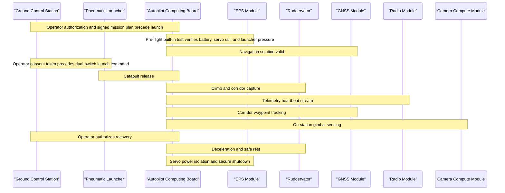
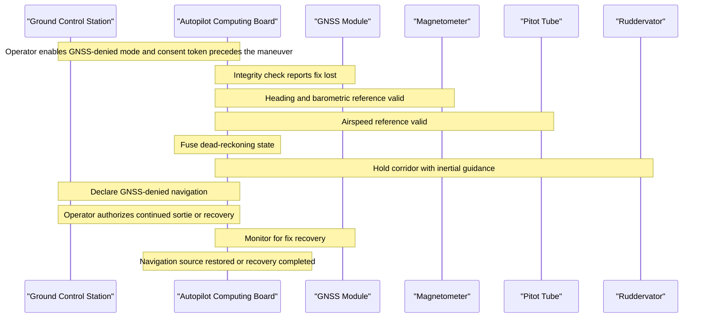
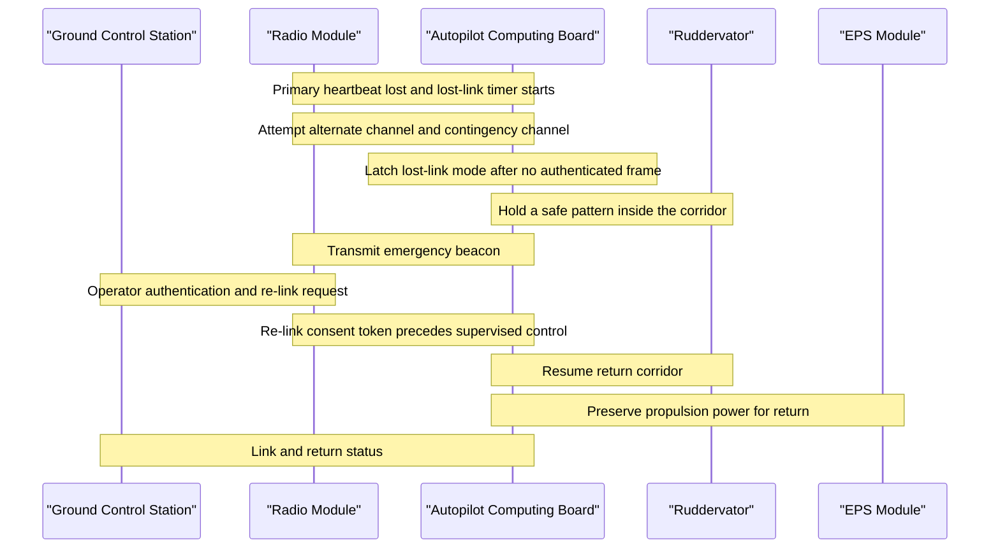
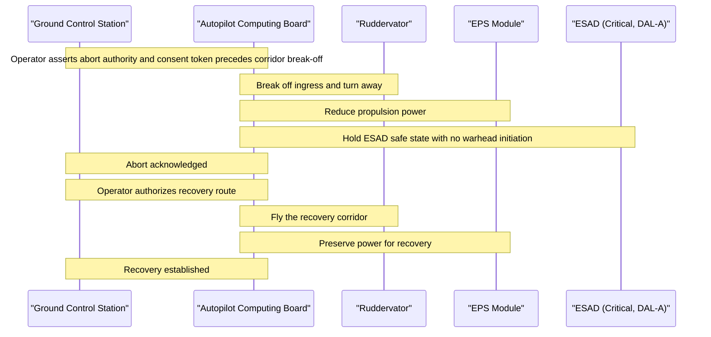
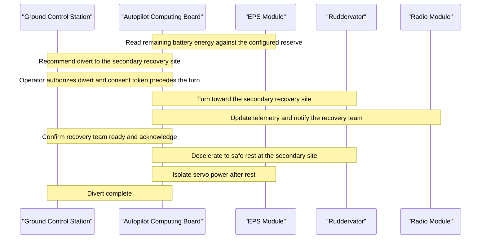
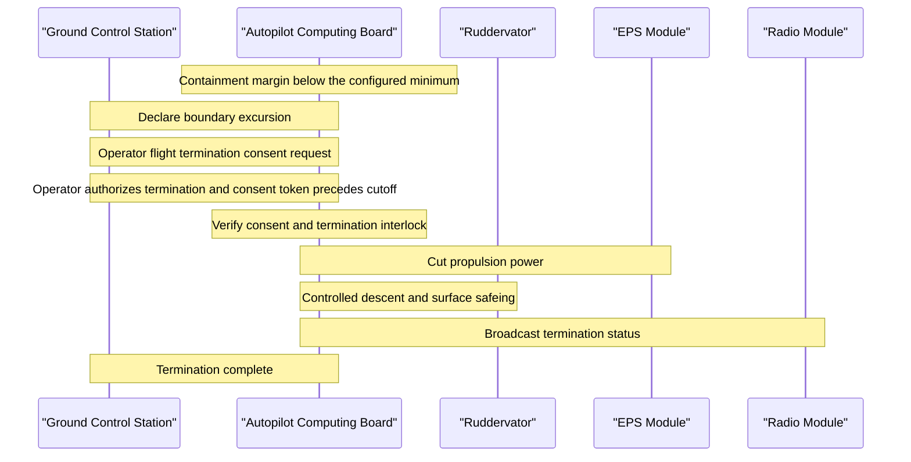

| Attribute | Specification Detail |
| :--- | :--- |
| **Title** | Multi-Threaded Operational Scenarios & System Timelines |
| **Version** | 1.0.0 |
| **Date** | 2026-10-31 |
| **issue_id** | CONOPS-09 |
| **type** | conops |
| **generation_mode** | worker |
| **specification_source** | `.pipeline/schema.sysml`; `schema/extracted/interface_table.md`; `schema/extracted/parametric_limits.md`; `schema/extracted/oem_bom.md` |

## 9. Multi-Threaded Operational Scenarios & System Timelines

In accordance with ISO/IEC/IEEE 29148:2018 Section 6.4.2, OMG UAF v2.0 Operational Processes (Op-Pr), and MIL-STD-882E Section 4.3, this section defines the operational scenario threads, their actor timelines, and deterministic exit criteria. The scenarios are grounded only in the SysML AST and the Level 0 OEM extracts. Values that the OEM sources do not state are recorded as "Not stated in OEM sources" rather than inferred.

The Ruddervator (drawing synonym Fins; preparation synonym tail stabiliser) is the canonical tail control surface assembly. The ESAD is Critical (DAL-A). The parachute deployment module is non-mission and is excluded from the mission baseline. Human-in-the-loop consent precedes every hazardous or irreversible actuation shown in the diagrams.

### 9.1 Scenario SCN-01: Nominal Sortie

Scenario `SCN-01` covers pre-flight staging, catapult release, corridor transit, on-station sensing, recovery, and secure shutdown. The scenario uses the battery pre-flight window (PL-32, PL-33), the servo power rail (PL-22), the catapult pressure window (PL-40, PL-41), the cruise speed limit (PL-01), and the endurance limit (PL-06). The launcher pneumatic and trigger interfaces follow `schema/extracted/interface_table.md`.

| Timeline Point | Trigger | Performer | Action | Evidence and Constraint | Exit Criterion |
| :--- | :--- | :--- | :--- | :--- | :--- |
| Pre-flight | Operator connects the battery and enables the ground station | Ground Control Station / Autopilot | Execute built-in test and verify the battery pre-flight window, servo rail, and launcher pressure | PL-32, PL-33, PL-22, PL-40, PL-41; CAN bus and Ethernet backbone from `schema/extracted/interface_table.md` | Pre-flight pass recorded |
| Launch | Operator authenticates the plan and authorizes release | Mission Operator / Pneumatic Launcher | Send the dual-switch launch command only after the consent token | Launcher trigger command and pneumatic supply from `schema/extracted/interface_table.md` | Air vehicle released |
| Climb | Launcher release confirmed | Autopilot / Ruddervator | Capture the ingress corridor and hold cruise speed within the stated limit | Ruddervator servo branches on the CAN bus; PL-01 | Ingress corridor captured |
| Transit | Corridor waypoint reached | Autopilot / GNSS Module | Track waypoints and monitor the GNSS serial and RF feeds | GNSS module and antenna interfaces from `schema/extracted/interface_table.md` | On-station perimeter reached |
| On-station | Station boundary crossed | Autopilot / Camera Compute Module | Activate gimbal sensing and telemetry while monitoring endurance | Camera module Ethernet interface; PL-06 | Mission data captured |
| Egress | Operator authorizes recovery | Mission Operator / Autopilot | Return along the planned corridor while endurance remains available | PL-06 | Recovery perimeter reached |
| Recovery | Recovery perimeter reached | Autopilot / Ruddervator | Execute controlled deceleration to safe rest and isolate servo power | Ruddervator servos and 8 V rail; PL-22 | Vehicle at rest |
| Shutdown | Rest confirmed | Autopilot / EPS Module | Secure the telemetry log and remove payload and servo power | EPS load switches from `schema/extracted/oem_bom.md` | Safe shutdown complete |

**Exit criteria:** the air vehicle is at rest, servo power is isolated, the mission log is secured, and no boundary, link, or over-limit condition remains active.

### 9.2 Scenario SCN-02: GNSS-Denied Navigation

Scenario `SCN-02` covers loss of the GNSS solution during corridor transit. The autopilot continues with inertial, magnetometer, and pitot references available through the CAN bus and serial interfaces. The OEM sources state the GNSS receiver and antenna interfaces but do not state a numeric GNSS denial threshold; the loss-of-fix declaration is therefore qualitative and operator-visible.

| Timeline Point | Trigger | Performer | Action | Evidence and Constraint | Exit Criterion |
| :--- | :--- | :--- | :--- | :--- | :--- |
| Contingency entry | Operator enables GNSS-denied mode | Mission Operator / Ground Control Station | Deliver the contingency consent token to the autopilot | Operator consent precedes the contingency maneuver | Contingency mode armed |
| Fix loss | GNSS integrity check fails | GNSS Module / Autopilot | Declare loss of fix and inhibit GNSS as the primary navigation source | GNSS serial and RF interfaces from `schema/extracted/interface_table.md` | GNSS-denied navigation declared |
| Fallback | Fix loss confirmed | Autopilot / Magnetometer / Pitot Tube | Fuse heading, altitude, and airspeed references into a dead-reckoning state | CAN bus sensor continuation from `schema/extracted/interface_table.md`; GNSS denial threshold is Not stated in OEM sources | Dead-reckoning state valid |
| Corridor hold | Fallback state valid | Autopilot / Ruddervator | Hold the corridor with inertial guidance and a bounded control response | Ruddervator servo command and status frames | Corridor held without a boundary breach |
| Decision | Operator receives the degraded navigation status | Mission Operator / Ground Control Station | Authorize continued sortie or recovery and deliver the consent token | Operator consent precedes continued flight or recovery | Mission disposition recorded |
| Recovery | GNSS fix restored or recovery completed | Autopilot / GNSS Module | Restore GNSS as the primary source or complete recovery under dead reckoning | GNSS module and antenna interfaces | Navigation source restored or vehicle recovered |

**Exit criteria:** the GNSS fix is restored, or the air vehicle is recovered under dead reckoning with no corridor breach and no uncommanded actuation.

### 9.3 Scenario SCN-03: Lost C2 Link

Scenario `SCN-03` covers loss of the command-and-control link. The radio module, upper and lower radio antennas, and ground station radio box operate in the RF band recorded in `schema/extracted/interface_table.md`. The OEM sources do not state heartbeat timeout values or a numeric re-link threshold; the lost-link timers remain operator-configured and are not fabricated here.

| Timeline Point | Trigger | Performer | Action | Evidence and Constraint | Exit Criterion |
| :--- | :--- | :--- | :--- | :--- | :--- |
| Link loss | Primary heartbeat absent | Radio Module / Autopilot | Start the lost-link timer and attempt the alternate channel | Radio module and antenna interfaces from `schema/extracted/interface_table.md`; timeout is Not stated in OEM sources | Lost-link timer active |
| Failover | Alternate handshake fails | Radio Module / Autopilot | Attempt the contingency channel and preserve essential telemetry | RF link band from `schema/extracted/interface_table.md` | Contingency channel attempted |
| Lost-link latch | No authenticated frame on any tier | Autopilot / Safety Watchdog | Latch lost-link mode and hold a safe pattern inside the corridor | Ruddervator authority and containment boundary | Safe pattern established |
| Beacon | Lost-link mode latched | Radio Module / Autopilot | Transmit the emergency beacon and retain state telemetry | Radio antenna feeds from `schema/extracted/interface_table.md` | Beacon active |
| Re-link | Operator authenticates a re-link request | Mission Operator / Ground Control Station | Deliver the re-link consent token before supervised control resumes | Operator consent precedes resumed control | Re-link authorized |
| Resolution | Re-link accepted or return completed | Autopilot / Ruddervator | Resume supervised control or execute the pre-planned return and recovery | Return corridor and propulsion power available | Supervised control restored or vehicle recovered |

**Exit criteria:** the authenticated link is restored with operator consent, or the air vehicle completes the pre-planned return and reaches safe rest without a boundary breach.

### 9.4 Scenario SCN-04: Tactical Abort

Scenario `SCN-04` covers an operator-directed tactical abort during ingress. The abort is a high-consequence flight maneuver, so the operator asserts abort authority and the ground station delivers a consent token before the autopilot breaks off the corridor. The ESAD remains Critical (DAL-A) and in the safe state; this scenario does not command warhead initiation or any irreversible payload actuation.

| Timeline Point | Trigger | Performer | Action | Evidence and Constraint | Exit Criterion |
| :--- | :--- | :--- | :--- | :--- | :--- |
| Abort request | Operator asserts tactical abort | Mission Operator / Ground Control Station | Record abort authority and prepare the consent token | Operator consent precedes the abort maneuver | Abort request accepted |
| Consent | Abort request accepted | Ground Control Station / Autopilot | Deliver the authenticated abort consent token | Operator consent precedes corridor break-off | Consent token verified |
| Break-off | Consent token verified | Autopilot / Ruddervator | Turn away from the ingress corridor and reduce propulsion power | Ruddervator servo authority; EPS load switches from `schema/extracted/oem_bom.md` | Corridor break-off complete |
| Payload safety | Break-off complete | Autopilot / ESAD | Hold the ESAD in the safe state and confirm the interlock | ESAD is Critical (DAL-A); safe-arm interlock from `schema/extracted/interface_table.md` | ESAD safe state confirmed |
| Recovery authorization | Abort acknowledged | Mission Operator / Ground Control Station | Authorize the recovery route and deliver the return consent token | Operator consent precedes the recovery transit | Recovery route authorized |
| Recovery | Recovery corridor entered | Autopilot / Ruddervator | Fly the recovery corridor and preserve power for safe rest | EPS load switches; Ruddervator actuation | Vehicle recovered at the recovery site |

**Exit criteria:** the abort is acknowledged, the ESAD remains in the safe state, the air vehicle reaches safe rest on the recovery route, and no irreversible payload actuation has occurred.

### 9.5 Scenario SCN-05: Critical Resource Divert

Scenario `SCN-05` covers a critical resource condition during egress. The autopilot compares remaining battery energy against the operator-configured reserve policy and recommends a divert when the primary recovery site is no longer favored. The scenario uses the endurance limit (PL-06), the direct and extended range limits (PL-07, PL-08), and the battery voltage window (PL-23, PL-24). The OEM sources do not state a numeric reserve ratio, so no reserve percentage is fabricated.

| Timeline Point | Trigger | Performer | Action | Evidence and Constraint | Exit Criterion |
| :--- | :--- | :--- | :--- | :--- | :--- |
| Resource check | Egress corridor entered | Autopilot / EPS Module | Read remaining battery energy and compare it with the configured reserve | Battery voltage window PL-23 and PL-24; reserve ratio is Not stated in OEM sources | Resource state known |
| Divert recommendation | Remaining energy below the configured reserve | Autopilot / Ground Control Station | Recommend the secondary recovery site and present the energy state | Endurance PL-06; range PL-07 and PL-08 | Divert recommendation presented |
| Authorization | Recommendation presented | Mission Operator / Ground Control Station | Authorize the divert and deliver the consent token | Operator consent precedes the divert maneuver | Divert authorized |
| Divert transit | Consent token verified | Autopilot / Ruddervator | Turn toward the secondary recovery site and update telemetry | Ruddervator servo authority; radio module interface | Secondary corridor entered |
| Recovery coordination | Divert transit established | Mission Operator / Ground Control Station | Confirm the recovery team is ready and relay acknowledgement | Ground station radio and tablet interfaces from `schema/extracted/interface_table.md` | Recovery team ready |
| Safe rest | Secondary site reached | Autopilot / Ruddervator / EPS Module | Decelerate to safe rest and isolate servo power | Ruddervator servos and 8 V rail; EPS load switches | Vehicle at rest at the secondary site |

**Exit criteria:** the air vehicle reaches safe rest at the secondary recovery site, servo power is isolated, the recovery team is notified, and the battery reserve policy has not been violated.

### 9.6 Scenario SCN-06: Boundary Containment and Flight Termination

Scenario `SCN-06` covers a containment margin violation that cannot be restored by guidance. The safety watchdog evaluates the containment margin against the configured minimum while the air vehicle remains inside the authorized boundary. Flight termination is irreversible, so the operator authorization and consent token precede propulsion cutoff and control-surface safeing. The parachute deployment module is non-mission and is not commanded.

| Timeline Point | Trigger | Performer | Action | Evidence and Constraint | Exit Criterion |
| :--- | :--- | :--- | :--- | :--- | :--- |
| Excursion detection | Containment margin below the configured minimum | Safety Watchdog / Autopilot | Declare the boundary excursion and hold the containment response | Operational containment boundary; guidance restoration already attempted | Excursion declared |
| Consent request | Excursion declared | Ground Control Station / Mission Operator | Request flight termination consent and display the containment state | Operator consent precedes termination | Consent requested |
| Consent | Operator authorizes termination | Mission Operator / Ground Control Station | Deliver the termination consent token to the autopilot | Consent token precedes propulsion cutoff | Consent token verified |
| Interlock check | Consent token received | Autopilot / Safety Watchdog | Verify consent and the termination interlock before actuation | Safety watchdog interlock; ESAD remains Critical (DAL-A) and safe | Interlock verified |
| Termination | Interlock verified | Autopilot / EPS Module / Ruddervator | Cut propulsion power and command controlled descent with surface safeing | EPS load switches; Ruddervator servo authority | Propulsion cut and descent commanded |
| Status | Termination commanded | Radio Module / Autopilot | Broadcast termination status and retain the event log | Radio module and antenna interfaces; parachute deployment module is non-mission and not commanded | Termination status broadcast |

**Exit criteria:** the air vehicle is contained within the authorized boundary, propulsion power is cut, control surfaces are safed, the parachute deployment module is not commanded, and the termination event is logged for recovery.

## Source References

Source: .pipeline/schema.sysml

Source: schema/extracted/interface_table.md

Source: schema/extracted/parametric_limits.md

Source: schema/extracted/oem_bom.md

Clause: ISO/IEC/IEEE 29148:2018 Section 6.4.2

Clause: MIL-STD-882E Section 4.3

Viewpoint: OMG UAF v2.0 Operational Processes (Op-Pr)
