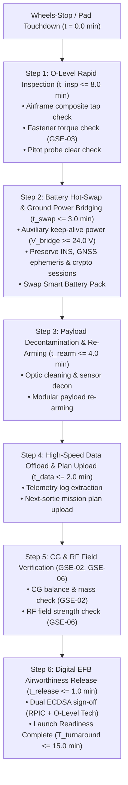
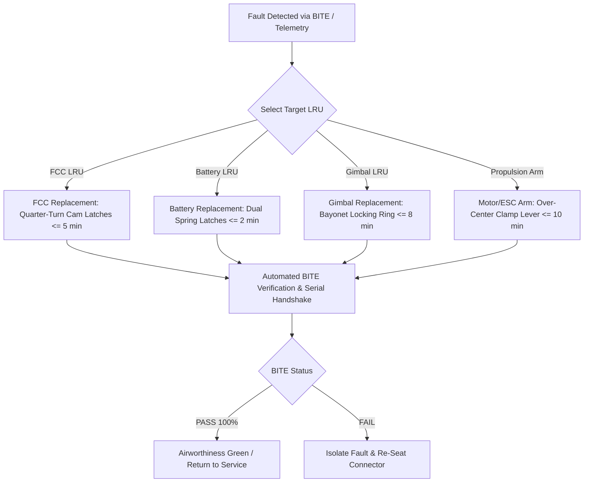

| Attribute | Value |
| :--- | :--- |
| **Title** | Maintenance & Ground Support Equipment (GSE) Concepts |
| **Version** | 1.0.0 |
| **Date** | 2026-09-02 |

## 10. Maintenance & Ground Support Equipment (GSE) Concepts

In accordance with ISO/IEC/IEEE 29148:2018 §5.2.4, NATO STANAG 4586 Edition 4, MIL-HDBK-470A (Designing and Developing Maintainable Systems), EASA Part-ML (Annex Vb to Regulation (EU) No 1321/2014), and EASA Part-66 aircraft maintenance licensing regulations, the Tactical UAS lifecycle support architecture is structured around rapid field turnarounds, tool-less modular Line Replaceable Unit (LRU) swaps, standardized Ground Support Equipment (GSE), and deterministic preventative maintenance intervals.

System operational availability and field turnaround times are governed by the Mean Time To Restore System ($MTTRS$) and Operational Availability ($A_o$) dynamic formulations:

$$
\begin{aligned}
MTTRS &= \bar{t}_{\mathrm{diag}} + \sum_{k=1}^{N_{\mathrm{LRU}}} P_k \cdot t_{\mathrm{swap},k} + \bar{t}_{\mathrm{BITE}} \\
A_o &= \frac{MTBF}{MTBF + MTTRS + MTBM}
\end{aligned}
$$

| Parameter | Symbol | Nominal Value | Units | Description & Constraint |
| :--- | :--- | :--- | :--- | :--- |
| Mean Time To Restore System | MTTRS | 14.5 | min | Expected time to restore system to mission-ready status |
| Mean Diagnostic Isolation Time | t_diag_bar | 1.5 | min | Diagnostic fault localization duration via BITE telemetry |
| Conditional Swap Probability | P_k | Variable | - | Probability of replacing LRU k during maintenance action |
| LRU Swap Duration | t_swap_k | 2.0 to 10.0 | min | Physical replacement duration for specific LRU k |
| Post-Installation BITE Verification | t_BITE_bar | 0.5 | min | Automated post-installation handshake and functional check |
| Operational Availability Target | A_o | 0.988 | - | Operational availability metric target (A_o >= 0.985) |
| Mean Time Between Failures | MTBF | 500.0 | hr | Mean operating flight hours between unscheduled failures |
| Mean Time Between Maintenance | MTBM | 50.0 | hr | Scheduled preventative maintenance interval |
| LRU Count | N_LRU | 4 | - | Total number of tool-less field-replaceable LRUs |

---

### 10.1 Three-Tier Maintenance Model (O-Level, I-Level, D-Level)
The maintenance and sustainment concept is organized into three discrete, formalized tiers adhering to military and civil aerospace maintenance doctrines:

| Maintenance Tier | Operational Location & Facility | Target Turnaround Time | Primary Maintenance Activities & Scope | Authorized Personnel & Certification Level |
| :--- | :--- | :--- | :--- | :--- |
| **O-Level (Organizational)** | Forward Operating Base (FOB) / Field Staging Point | <= 15.0 min | Pre/post-flight inspections; smart battery module hot-swaps (<= 2 min); tool-less LRU replacements; automated PBIT diagnostics; propeller blade checks; CG balance and gross weight verification | EASA Part-ML / Part-66 Category L or Certified UAS Remote Pilot / O-Level Technician |
| **I-Level (Intermediate)** | Regional Mobile Maintenance Shelter / Field Workshop | <= 4.0 hr | Multi-axis optical gimbal collimation; actuator servo dynamic load testing; differential pitot-static pressure calibration; RF field strength and spectrum sniffing; CAN FD/SPI/Ethernet bus protocol analysis; parachute squib resistance checks | EASA Part-66 Category B1.3 / B2 Lead UAS Maintenance Specialist |
| **D-Level (Depot / Factory)** | Centralized Factory Overhaul Facility | <= 14.0 days | Phased-array ultrasonic composite structural NDI; propulsion motor stator rewinding and rotor dynamic balancing; PCB X-ray inspection; environmental stress screening (ESS); DO-178C / DO-254 software/firmware recertification | EASA Part-66 Category C / Part-145 Depot Aerospace Systems Engineer & QA Inspector |

---

#### 10.1.1 Standard Maintenance Task Cards (MTC-01 through MTC-05, including MTC-01A)
To ensure repeatable maintenance quality, airworthiness compliance, and metrological traceability, maintenance actions are executed using standardized maintenance task cards specifying exact inspection limits, Ground Support Equipment (GSE) callouts, technician certification levels, task durations, and digital signature sign-off requirements.

| Task Card ID | Task Card Nomenclature | Applicable Tier & Frequency | Task Duration | Ground Support Equipment (GSE) Mapping | Scope of Inspection & Maintenance Procedures | Inspection Limits & Passing Criteria | Technician Certification Level | Digital Signature & Sign-Off Requirement |
| :--- | :--- | :--- | :--- | :--- | :--- | :--- | :--- | :--- |
| **MTC-01** | Pre-Flight & Turnaround Airworthiness Inspection Card | O-Level / Prior to every flight sortie and post-flight turnaround | <= 12.0 min | **GSE-02** (CG Balance & Scale), **GSE-03** (Torque Driver), **GSE-06** (RF Field Sniffer) | Visual airframe structural check; propeller leading edge and root inspection; pitot probe clearance; battery terminal impedance check; fastener torque verification; 3-point CG and takeoff mass measurement; RF C2 telemetry field strength check; automated PBIT diagnostic execution | Zero composite cracks; Prop nick depth < 0.20 mm; Fastener torque 1.20 N*m +/- 0.05 N*m (GSE-03); AUW mass <= 25.0 kg and CG within +/- 3.0 mm of datum (GSE-02); RF signal RSSI >= -65 dBm at 10 m (GSE-06); Battery delta V <= 10 mV; PBIT 100% PASS | EASA Part-ML / Part-66 Category L or Certified Remote Pilot / O-Level Technician | Single cryptographic Ed25519 digital signature in Electronic Flight Bag (EFB) Maintenance Logbook |
| **MTC-01A** | Rapid Sortie Turnaround Inspection Card | O-Level / Between consecutive operational sortie waves (Platform Regeneration) | <= 15.0 min (SLA) | **GSE-02** (CG Balance & Scale), **GSE-03** (Torque Driver), **GSE-06** (RF Field Sniffer) | Rapid post-flight composite tap, fastener torque check, and pitot clear check; hot-swap propulsion battery replacement with auxiliary keep-alive ground power bridging (V_bridge >= 24.0 V) preserving avionics navigation state, GNSS ephemeris, and crypto sessions; payload sensor decontamination, optic cleaning, and modular re-arming; high-speed telemetry log extraction and next-sortie mission plan upload; automated PBIT & health check | Zero composite delamination; Fastener torques 1.20 N*m +/- 0.05 N*m (GSE-03); AUW mass <= 25.0 kg and CG within +/- 3.0 mm (GSE-02); RF signal RSSI >= -65 dBm at 10 m (GSE-06); Keep-alive bridge voltage V_bridge >= 24.0 V continuous; Total turnaround duration T_turnaround <= 15.0 min SLA | EASA Part-ML / Part-66 Category L or Certified Remote Pilot / O-Level Technician | Dual cryptographic Ed25519 digital signature (RPIC + O-Level Technician) in Electronic Flight Bag (EFB) Maintenance Logbook |
| **MTC-02** | 50-Flight-Hour Scheduled Periodic Air Data & Mechanical Service Card | O/I-Level / Every 50 flight hours or 120 sorties | <= 45.0 min | **GSE-04** (Differential Pitot-Static Test Set), **GSE-03** (Torque Driver), **GSE-01** (Avionics Breakout Box) | Pitot-static pneumatic line leak decay test; dynamic pressure sensor calibration across 0 to 200 hPa; static barometric pressure zero check; motor mount fastener torque verification; CAN FD bus error frame audit; control surface pushrod and horn backlash check | Pneumatic leak rate <= 0.010 hPa/min at 150 hPa (GSE-04); Airspeed calibration error <= 0.20 m/s; Fastener torques 4.50 N*m +/- 0.10 N*m (GSE-03); CAN bus error frame count = 0 over 60 s, bus termination 60.0 Ω +/- 1.0 Ω (GSE-01); Control surface backlash <= 0.15 deg | EASA Part-66 Category B1.3 / B2 or Certified I-Level UAS Maintenance Technician | Dual digital signature (Technician + Quality Airworthiness Inspector) via PKI-authenticated digital maintenance logbook |
| **MTC-03** | 100-Flight-Hour Avionics, RF Datalink & Optical Gimbal Recalibration Card | I-Level / Every 100 flight hours or 250 landings | <= 2.5 hr | **GSE-01** (Avionics Breakout Box), **GSE-05** (Optical Boresight Collimator), **GSE-06** (RF Field Sniffer), **GSE-02** (CG Balance Jig) | Multi-bus avionics signal integrity, timing jitter, and bus load audit (CAN FD, SPI, 100BASE-T1); multi-spectral EO/IR optical gimbal boresight collimation and angular offset correction; RF datalink transmitter power, harmonic suppression, and antenna VSWR check; payload reconfiguration and precise 3-axis CG re-balancing; smart battery 1C capacity discharge and cell impedance cycle test | Optical boresight alignment error <= 0.02 deg (GSE-05); RF transmitter EIRP 30.0 dBm +/- 0.5 dBm, ACLR >= 35 dBc, VSWR <= 1.35:1 (GSE-06); Bus timing jitter <= 15 ns, bit error rate < 10^-9 (GSE-01); CG offset shift <= 1.0 mm from nominal (GSE-02); Battery usable capacity >= 92.0% nominal | EASA Part-66 Category B2 (Avionics) or I-Level Master Avionics Technician | Digital cryptographic certificate sign-off (X.509 token) logged to Centralized Maintenance Management System (CMMS) |
| **MTC-04** | 150-Flight-Hour Actuator, Propulsion & Parachute Pyrotechnic Recertification Card | I-Level / Every 150 flight hours or 12 calendar months | <= 4.0 hr | **GSE-01** (Avionics Breakout Box / Actuator Exerciser), **GSE-03** (Torque Driver), **GSE-02** (Electronic Scale), Low-Current Squib Tester (< 5 mA) | Flight control actuator dynamic load response, full-stroke slew rate, torque saturation, and stall current testing; brushless motor bearing axial/radial runout, stator winding resistance balance, and dynamic vibration analysis; ballistic parachute canopy inspection, deployment line integrity, and pyrotechnic squib bridge resistance verification; complete airframe structural fastener replacement and re-torque | Actuator full-travel slew time <= 45 ms, stall torque >= 2.5 N*m, backlash <= 0.10 deg (GSE-01); Motor axial runout <= 0.03 mm, radial play <= 0.02 mm, ESC phase resistance balance <= 1.5%; Squib circuit bridge resistance 2.00 Ω +/- 0.15 Ω with test current < 2.0 mA; Structural fastener torques within +/- 2.0% of nominal rating (GSE-03) | EASA Part-66 Category B1.3 / B2 Lead UAS Technician & Certified Ordnance Specialist | Tripartite digital sign-off (Technician, Pyrotechnic Inspector, Lead Quality Engineer) with CMMS timestamp |
| **MTC-05** | Annual Depot Overhaul, Structural NDI & Factory Recertification Card | D-Level / Every 300 flight hours or 24 calendar months | <= 24.0 hr (<= 14 days) | **GSE-01** through **GSE-06**, PAUT Ultrasonic Rig, ESS Environmental Chamber, Rotor Balancing Rig, X-Ray PCB Station, HIL Master Test Bench | Complete vehicle teardown to bare carbon monocoque fuselage; phased-array ultrasonic structural non-destructive inspection (NDI) for internal composite delamination or resin micro-cracking; motor rotor dynamic balancing; PCB solder joint X-ray inspection; environmental stress screening (thermal cycling -40 °C to +55 °C and random vibration per MIL-STD-810H Method 514.8); complete pitot-static and air data computer recalibration (GSE-04); full multi-bus communication recertification (GSE-01); precision optical bench re-alignment (GSE-05); complete RF spectrum characterization (GSE-06); full mass properties and 3D moment of inertia determination (GSE-02); RTCA DO-178C DAL-A flight software hash verification and DO-254 firmware reload | Zero composite delamination (PAUT acoustic attenuation < 2.0 dB); Rotor residual unbalance <= 0.20 mg*mm; Zero solder micro-cracks / voiding; Master oscillator clock drift <= 0.5 ppm; 100% compliance with factory new-build acceptance specifications; HIL closed-loop regression test 100% PASS (zero anomalies over 10-hour automated test matrix) | EASA Part-66 Category C / Part-145 Depot Aerospace Systems Engineer & QA Inspector | Factory Certificate of Airworthiness (EASA Form 1 / FAA Form 8130-3 equivalent) digitally signed with HSM-backed corporate private key |

---

#### 10.1.2 Rapid Sortie Turnaround Inspection Procedure (MTC-01A)
To support sustained high-tempo operational sorties and immediate platform regeneration between waves, procedure MTC-01A executes an expedited, tool-less 15-minute turnaround Service Level Agreement (SLA) adhering to NATO STANAG 4586 Annex B §4.1, MIL-HDBK-470A, and EASA Part-ML:

##### Step-by-Step Execution Sequence:
1. **Touchdown & Safe Ingress ($t \le 1.0\text{ min}$):** Following nominal touchdown, the RPIC confirms disarmed motor state and weight-on-wheels interlock. The O-Level technician establishes perimeter safety and connects auxiliary ground power bridging ($V_{\mathrm{bridge}} \ge 24.0\text{ V}$).
2. **O-Level Rapid Post-Flight Inspection ($t_{\mathrm{insp}} \le 8.0\text{ min}$):**
   - Perform rapid composite tap test across wing leading edges and fuselage monocoque to confirm zero delamination.
   - Execute critical joint fastener torque verification with Calibrated Digital Torque Driver (**GSE-03**) at $1.20\text{ N}\cdot\text{m} \pm 0.05\text{ N}\cdot\text{m}$.
   - Verify pitot-static probe and drain ports are unobstructed and clear of environmental fouling.
3. **Hot-Swap Propulsion Battery Replacement ($t_{\mathrm{swap}} \le 3.0\text{ min}$):**
   - With auxiliary keep-alive power actively maintaining $V_{\mathrm{bridge}} \ge 24.0\text{ V}$ on the avionics rail (preserving IMU alignment, GNSS ephemeris, and active cryptographic session keys), release the dual spring latches and slide out the depleted battery pack.
   - Insert a fully charged Smart Battery Pack ($\text{SoC} \ge 95.0\%$, $\Delta V_{\mathrm{cell}} \le 10\text{ mV}$) along keyed tracks until latches lock.
   - Verify BMS bus handshake and disconnect auxiliary keep-alive ground power bridging without triggering an avionics cold reboot.
4. **Payload Sensor Decontamination & Modular Re-Arming ($t_{\mathrm{rearm}} \le 4.0\text{ min}$):**
   - Clean EO/IR optical apertures with approved optical solvent wipes and inspect protective sapphire window.
   - Execute modular sensor/payload re-arming and confirm gimbal boresight collimation.
5. **High-Speed Telemetry Offload & Mission Plan Upload ($t_{\mathrm{data}} \le 2.0\text{ min}$):**
   - Connect high-speed ground data umbilical (Gigabit Ethernet / USB 3.0).
   - Extract post-flight telemetry logs and upload cryptographic flight plan coordinates for the subsequent sortie wave.
6. **Mass Properties & RF Check (**GSE-02**, **GSE-06**):**
   - Validate all-up takeoff mass $\le 25.0\text{ kg}$ and Center of Gravity within $\pm 3.0\text{ mm}$ of datum using Electronic Scale (**GSE-02**).
   - Verify C2 telemetry uplink/downlink field strength $\text{RSSI} \ge -65\text{ dBm}$ at $10\text{ m}$ using RF Field Sniffer (**GSE-06**).
7. **EFB Airworthiness Release Authorization ($t_{\mathrm{release}} \le 1.0\text{ min}$):**
   - Automated PBIT confirms 100% PASS across all subsystems.
   - RPIC and Certified O-Level Maintenance Technician countersign the digital airworthiness release via authenticated ECDSA tokens in the Electronic Flight Bag (EFB), completing platform regeneration within the total turnaround SLA limit ($T_{\mathrm{turnaround}} \le 15.0\text{ min}$).

---

#### 10.1.3 Tool-Less Modular LRU Replacement Step-by-Step Procedures
The Tactical UAS airframe incorporates tool-less quick-disconnect mechanical latches, keyed guide rails, and self-aligning blind-mate electrical connectors allowing rapid field replacement of all primary Line Replaceable Units (LRUs):

##### (a) Flight Control Computer (FCC) LRU Replacement ($t_{\mathrm{swap}} \le 5.0\text{ min}$)
- **Tool Requirements:** Tool-less operation (dual captive quarter-turn quick-release cam-latches; integrated blind-mate MIL-DTL-83513 micro-D connector block).
- **Step-by-Step Procedure:**
  1. *De-energize System:* Disconnect primary power module; confirm FCC rail status LED is de-energized.
  2. *Open Avionics Bay:* Depress the dual spring-loaded safety interlock tabs on the upper fuselage avionics hatch and swing the hinged cover open $110^\circ$.
  3. *Disengage Cam-Latches:* Rotate the dual quarter-turn captive cam-latches $90^\circ$ counter-clockwise until the red release indicators pop up.
  4. *Extract Module:* Grasp the ergonomic extraction handle and slide the FCC chassis straight outward along the precision anodized aluminum guide rails, un-mating the blind-mate connector block.
  5. *Insert Replacement LRU:* Align the replacement FCC unit with the guide rails and slide inward until the blind-mate connector block seats firmly against the backplane.
  6. *Lock Chassis:* Press the dual cam-latches inward and rotate $90^\circ$ clockwise until the green locking indicators snap flush with the housing.
  7. *Close Bay Cover:* Swing the avionics bay hatch closed until the dual perimeter latches click into place, ensuring continuous IP67 seal compression.
  8. *Automated BITE Verification:* Connect power; the GCS automatically executes an Automated LRU Handshake and BITE test within $t_{\mathrm{BITE}} \le 30.0\text{ s}$, validating cryptographic hardware serial numbers, firmware checksums, and sensor bus communication.

##### (b) Smart Battery Pack LRU Replacement ($t_{\mathrm{swap}} \le 2.0\text{ min}$)
- **Tool Requirements:** Tool-less operation (dual spring-loaded lateral squeeze latches; keyed composite retention tracks; high-current blind-mate power and CAN bus connector).
- **Step-by-Step Procedure:**
  1. *Verify Safe State:* Confirm the vehicle status LED indicates disarmed motor state.
  2. *Release Latches:* Squeeze the dual spring-loaded release latches located on the lateral handles of the installed battery pack.
  3. *Extract Battery:* Slide the depleted battery pack rearward along the low-friction composite retention tracks and lift it vertically out of the battery compartment.
  4. *Inspect Bay:* Perform a rapid visual check of the battery bay blind-mate terminals to ensure no foreign object debris (FOD) or moisture is present.
  5. *Seat Replacement Pack:* Align the fully charged Smart Battery Pack into the keyed retention tracks.
  6. *Engage Locking Mechanism:* Slide the battery pack firmly forward until the dual lateral latches engage with a positive audible and tactile click.
  7. *BMS Initialization:* The integrated Battery Management System (BMS) automatically performs an internal self-test within $t \le 2.0\text{ s}$; the status LED transitions to solid blue, confirming CAN bus synchronization, cell voltage balance ($\Delta V_{\mathrm{cell}} \le 10\text{ mV}$), and SoC $\ge 95.0\%$.

##### (c) Multi-Spectral Optical Gimbal LRU Replacement ($t_{\mathrm{swap}} \le 8.0\text{ min}$)
- **Tool Requirements:** Tool-less operation (rotary bayonet locking ring with spring-loaded detent safety pin; blind-mate concentric slip-ring electrical interface for GigE video, 24V power, and RS-422 control).
- **Step-by-Step Procedure:**
  1. *Isolate Payload Power:* Disable payload rail power via the GCS payload control switch.
  2. *Disengage Safety Detent:* Depress the spring-loaded detent safety pin on the payload nose bayonet locking collar.
  3. *Unlock Bayonet Ring:* Rotate the knurled bayonet collar $45^\circ$ counter-clockwise to the unlocked position.
  4. *Lower Gimbal Assembly:* Lower the multi-spectral gimbal vertically downward from the nose cavity, disengaging the concentric blind-mate electrical interface.
  5. *Prepare Replacement Unit:* Remove the protective optical cover and connector dust cap from the replacement gimbal LRU.
  6. *Align Index Marks:* Align the red optical registration index mark on the replacement gimbal chassis with the vehicle nose alignment notch.
  7. *Lock Bayonet Mount:* Push the gimbal assembly vertically into the bayonet socket and rotate the locking collar $45^\circ$ clockwise until the spring-loaded detent safety pin snaps into the locked position.
  8. *Boresight BITE Routine:* Power on the payload rail; the onboard vision processor automatically initiates an optical boresight zeroing and communication self-test within $t_{\mathrm{cal}} \le 60.0\text{ s}$, streaming calibrated test video to the GCS.

##### (d) Propulsion Motor/ESC Arm Assembly Replacement ($t_{\mathrm{swap}} \le 10.0\text{ min}$)
- **Tool Requirements:** Tool-less operation (over-center quick-clamping structural collar with secondary push-button safety catch; high-current blind-mate DC power bus and CAN FD pins embedded in structural arm root socket).
- **Step-by-Step Procedure:**
  1. *Verify Disarm & Discharge:* Ensure vehicle battery is disconnected and internal inverter bus capacitors are fully discharged.
  2. *Release Safety Catch:* Depress the secondary push-button safety catch on the motor arm root clamping collar.
  3. *Open Clamping Lever:* Pull the ergonomic over-center clamping lever open $180^\circ$, releasing structural compression on the tapered carbon-fiber socket.
  4. *Slide Out Arm Assembly:* Slide the motor/ESC arm assembly axially outward from the fuselage structural socket, un-mating the embedded blind-mate power and CAN FD connectors.
  5. *Inspect Structural Socket:* Inspect the carbon socket sleeve and gold-plated blind-mate terminals for foreign debris or mechanical wear.
  6. *Align Arm Keyway:* Align the structural indexing keyway of the replacement motor/ESC arm assembly with the fuselage socket guide groove.
  7. *Insert Arm Assembly:* Push the arm assembly axially into the socket until the structural shoulder seats completely flush against the fuselage bulkhead.
  8. *Lock Clamping Lever:* Close the over-center clamping lever firmly until the secondary push-button safety catch engages with a positive snap.
  9. *Commutation & Phase BITE:* Connect power; the flight control computer executes an automated ESC commutation check and phase resistance test within $t_{\mathrm{comm\_test}} \le 20.0\text{ s}$, spinning the motor at low idle RPM (500 RPM) for 2 seconds to confirm nominal phase balance.

---

### 10.2 Ground Support Equipment (GSE) Taxonomy
The standardized Ground Support Equipment (GSE) suite provides all electrical, mechanical, pneumatic, optical, RF, and calibration interfaces required for rapid field deployment and depot maintenance:

| GSE Identifier | GSE Nomenclature | Functional Purpose & Metrological Capabilities | Operating Constraints & Environmental Ratings |
| :--- | :--- | :--- | :--- |
| **GSE-01** | Multi-Bus Avionics Breakout Box & CAN/SPI/Ethernet Protocol Analyzer | Hardware-in-the-loop signal breakout, non-intrusive bus tapping, frame sniffing, jitter analysis, and protocol decoding for CAN FD (ISO 11898-1/2), SPI, RS-422, and 100BASE-T1 Ethernet avionics buses. | Operating Temp: -20 °C to +55 °C; Bus Tolerant: 3.3V / 5V / 12V / 24V; Rating: IP54 |
| **GSE-02** | Multi-Point Electronic CG Balance Jig & Digital Scale (+/- 0.5 g) | Multi-point 3-pad electronic load-cell fixture measuring total all-up vehicle mass and calculating longitudinal (X_cg), lateral (Y_cg), and vertical (Z_cg) Center of Gravity offsets relative to leading-edge datum. | Mass Range: 0.0 to 40.0 kg; Accuracy: +/- 0.5 g; CG Resolution: +/- 0.2 mm; Rating: IP65 |
| **GSE-03** | Calibrated Digital Torque Driver (0.5 to 10.0 N*m, ISO 6789-1:2017) | Precision digital torque application and logging driver for structural fasteners, motor arm clamps, propeller collets, and avionics chassis screws with audible/haptic cutoff and digital cycle logging. | Torque Range: 0.50 to 10.00 N*m; Accuracy: +/- 1.0%; Overload: 15.0 N*m; Rating: ESD Safe (< 10^6 Ω) |
| **GSE-04** | Differential Pitot-Static Calibration Test Set (0 to 200 hPa, leak resolution 0.005 hPa) | Automated dual-channel pneumatic pressure generator for differential dynamic pressure (0 to 200 hPa) airspeed simulation and static pressure barometric altimetry verification with automated pneumatic leak decay detection. | Dynamic Range: 0 to 200 hPa; Static Range: 300 to 1100 hPa; Pressure Accuracy: +/- 0.02 hPa; Leak Resolution: 0.005 hPa/min; Rating: IP67 (in transit) |
| **GSE-05** | Optical Boresight Collimator & Target Reticle Alignment Optical Bench | Precision infinity-focus optical collimation bench with motorized target reticle and laser projection for aligning multi-spectral (EO/IR) gimbal sensor optical axes against airframe inertial reference datum (X_b, Y_b, Z_b). | Angular Precision: <= 0.01 deg (36 arcsec); Reticle Orthogonality: <= 0.005 deg; Focal Length: 1000 mm; Thermal Drift: < 0.001 deg/°C |
| **GSE-06** | Calibrated 2.4 GHz / 5.8 GHz RF Field Strength Sniffer & Spectrum Sniffer | Handheld calibrated wideband RF spectrum analyzer and field strength sniffer for evaluating EIRP, harmonic distortion, adjacent-channel leakage ratio (ACLR), antenna VSWR, and receiver sensitivity across 2.4 GHz and 5.8 GHz C2/video bands. | Freq Bands: 2.400–2.4835 GHz / 5.725–5.875 GHz; Freq Accuracy: +/- 0.5 ppm; Power Accuracy: +/- 0.5 dBm; Noise Floor: -120 dBm @ 10 kHz RBW; Rating: IP54 |

---

#### 10.2.1 Ground Support Equipment Calibration Matrix
All Ground Support Equipment and precision maintenance tooling are subject to mandatory periodic calibration schedules adhering to ISO/IEC 17025, ANSI/NCSL Z540-1, ISO 6789-1:2017, and MIL-STD-45662A metrology standards.

| GSE Identifier | GSE Nomenclature | Calibration Interval | Reference Standard / Normative Baseline | Parameter / Metrological Test Scope | Tolerance Limit / Calibration Accuracy | Calibration Facility Tier | Metrology Certificate Requirement |
| :--- | :--- | :--- | :--- | :--- | :--- | :--- | :--- |
| **GSE-01** | Multi-Bus Avionics Breakout Box & Protocol Analyzer | 180 Days | ISO/IEC 17025 / NIST Traceable Digital Timebase & Logic Analyzer Master | Timing jitter, protocol frame timing, bus termination resistance, logic voltage thresholds | Timing Jitter: <= 5 ns; Voltage Threshold: +/- 10 mV; Bus Termination: 60.0 Ω +/- 0.5 Ω | I-Level / Certified Avionics Metrology Lab | ISO/IEC 17025 Accredited Calibration Certificate with NIST Traceability |
| **GSE-02** | Multi-Point Electronic CG Balance Jig & Digital Scale | 90 Days | OIML R76 Class II / NIST Handbook 44 Class II Standard Weights | Multi-pad mass measurement linearity, corner-load repeatability, CG calculation algorithm | Mass Accuracy: +/- 0.5 g across 0–40.0 kg range; CG Resolution: +/- 0.2 mm | I-Level / Mass & Weight Metrology Crib | OIML Class II Verification Certificate & Calibration Report |
| **GSE-03** | Calibrated Digital Torque Driver (0.5 to 10.0 N*m) | 30 Days (or 5000 cycles) | ISO 6789-1:2017 / ISO 6789-2:2017 Type I Class C Calibration Bench | Clockwise and counter-clockwise torque accuracy across 0.50 to 10.00 N*m range | Torque Accuracy: +/- 1.0% of indicated reading; Resolution: 0.01 N*m | O-Level / Base Tool Metrology Crib | ISO 6789 Conformance Certificate & Calibration Log |
| **GSE-04** | Differential Pitot-Static Calibration Test Set | 90 Days | ISO/IEC 17025 / NIST Traceable Primary Deadweight Barometric Standard | Differential dynamic pressure (0–200 hPa), absolute static pressure (300–1100 hPa), pneumatic leak rate | Differential Pressure: +/- 0.02 hPa; Airspeed Simulation: +/- 0.10 m/s; Leak Resolution: 0.005 hPa/min | I-Level / Pneumatic Metrology Calibration Lab | ISO/IEC 17025 Pneumatic Calibration Certificate |
| **GSE-05** | Optical Boresight Collimator & Target Reticle Bench | 180 Days | ISO 10110 / MIL-STD-810H / Master Autocollimator Standard | Collimator optical axis parallelism, crosshair reticle orthogonality, laser zero offset | Angular Alignment: <= 0.01 deg (36 arcsec); Reticle Orthogonality: <= 0.005 deg | Depot / Factory Precision Optical Metrology Facility | Factory Optical Metrology Certificate & Interferometric Report |
| **GSE-06** | Calibrated 2.4 GHz / 5.8 GHz RF Field Strength Sniffer | 1 Year | IEEE 802.11 / ETSI EN 300 328 / ETSI EN 301 893 / ISO/IEC 17025 | RF power measurement accuracy, frequency stability, spectrum resolution, noise floor | Freq Accuracy: +/- 0.5 ppm; Power Measurement: +/- 0.5 dBm; Noise Floor: -120 dBm @ 10 kHz RBW | Certified RF Metrology Center / Depot Lab | ISO/IEC 17025 RF Calibration Certificate & Spectral Purity Test Sheet |

---

### 10.3 Calibration Fixtures & Sensor Alignment Rigs
- **Multi-Axis Inertial Calibration Fixture:** Used during I-Level maintenance to verify gyroscopic scale factors, accelerometer bias drift, and thermal compensation polynomials over $-40^\circ\text{C}$ to $+55^\circ\text{C}$.
- **Magnetic Heading Calibration Base:** Non-magnetic designated field circle utilized to calibrate vehicle soft-iron and hard-iron magnetometer calibration vectors.
- **Optical Collimation Bench (GSE-05):** High-precision optical collimator bench for verifying payload boresight zero offsets against the airframe longitudinal datum.
- **Dynamic Propeller & Rotor Balancing Bench:** Micro-dynamic balancing stand ensuring propeller and motor rotor residual unbalance remains below $0.20\text{ mg}\cdot\text{mm}$.

---

### 10.4 Ruggedized Transit Cases & Environmental Storage
- All system elements are enclosed in high-impact transit cases meeting MIL-STD-810H Method 514.8 (Vibration) and Method 516.8 (Shock) with automated pressure equalization valves and custom closed-cell polyethylene foam inserts.
- Built-in humidity indicator cards and desiccant ports ensure relative humidity inside storage containers remains strictly below $40\%$ during transport and long-term storage.

---

### 10.5 Field Maintenance Tooling & Spares Provisioning
- **Standard Field Tool Kit (FTK-01):** Includes calibrated digital torque drivers (**GSE-03**, $0.5\text{ N}\cdot\text{m}$ to $10.0\text{ N}\cdot\text{m}$), ESD-grounding wrist straps, connector pin extraction tools, and diagnostic bus analyzer dongles (**GSE-01**).
- **Authorized Field Spares Kit (FSK-01):** Pre-packaged spares allocation supporting $100.0\text{ hr}$ of autonomous operations (includes matched propeller sets, motor/ESC modules, pitot probes, replacement silicone seals, and spare structural fasteners).
- **Depot Maintenance Support Package (DSP-01):** Comprehensive depot overhaul inventory including bare carbon fuselage frames, replacement wing spar sets, PCB replacement kits, and master wiring harnesses.

---

### 10.6 Digital Maintenance Tracking & Airworthiness Recordkeeping
In accordance with EASA Part-ML.A.305 and Part-M.A.305 (Continuing Airworthiness Record System):
- **Electronic Maintenance Logbook (ELOG):** Every maintenance action, component swap, inspection task card (MTC-01 through MTC-05), and GSE calibration record is logged digitally with PKI cryptographic digital signatures (Ed25519 / X.509 certificates).
- **Component Life Tracking:** All serialized LRUs (FCC, battery modules, ESCs, motors, optical gimbals, parachute squibs) maintain automated operating hour counters, cycle counters, and environmental exposure metrics synchronized via GCS telemetry to the Centralized Maintenance Management System (CMMS).
- **Tamper-Evident Audit Ledger:** Maintenance sign-offs and airworthiness releases are chained via SHA-256 cryptographic hashes, guaranteeing full traceability for civil and military airworthiness authorities.
