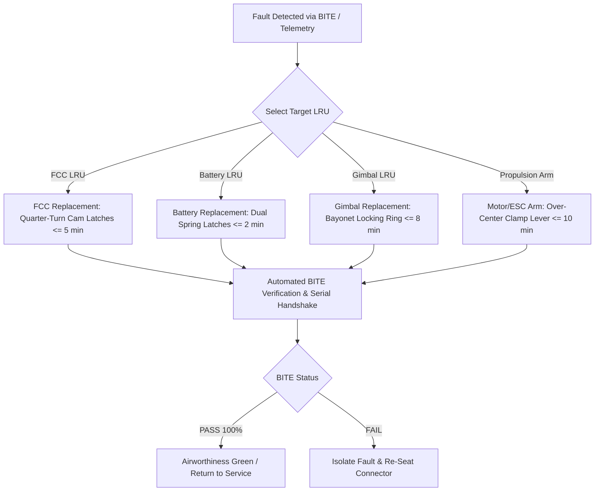

| Attribute | Value |
| :--- | :--- |
| **Title** | Maintenance & Ground Support Equipment (GSE) Concepts |
| **Version** | 1.0.0 |
| **Date** | 2026-09-02 |

## 10. Maintenance & Ground Support Equipment (GSE) Concepts

In accordance with ISO/IEC/IEEE 29148:2018 §5.2.4, NATO STANAG 4586 Edition 4, and MIL-HDBK-470A (Designing and Developing Maintainable Systems), the Tactical UAS lifecycle support architecture is structured around rapid field turnarounds, tool-less modular Line Replaceable Unit (LRU) swaps, and deterministic preventative maintenance intervals.

System availability and operational turnaround times are governed by the Mean Time To Restore System ($MTTRS$) dynamic formulation:

$$
\begin{aligned}
MTTRS &= \bar{t}_{\mathrm{diag}} + \sum_{k=1}^{N_{\mathrm{LRU}}} P_k \cdot t_{\mathrm{swap},k} + \bar{t}_{\mathrm{BITE}} \\
A_o &= \frac{MTBF}{MTBF + MTTRS + MTBM}
\end{aligned}
$$

Where and Operational Parameters:
- $MTTRS$: Mean Time To Restore System to fully mission-capable status following component fault or scheduled swap.
- $\bar{t}_{\mathrm{diag}}$: Mean diagnostic isolation time via automated Built-In-Test (BITE) diagnostics.
- $P_k$: Conditional replacement probability for Line Replaceable Unit (LRU) $k$.
- $t_{\mathrm{swap},k}$: Tool-less physical replacement duration for LRU $k$.
- $\bar{t}_{\mathrm{BITE}}$: Automated post-installation verification and sensor handshake duration.
- $A_o$: Operational availability metric target ($A_o \ge 0.985$).
- $MTBF$: Mean Time Between Failures ($MTBF \ge 500.0\text{ flight hours}$).
- $MTBM$: Mean Time Between Maintenance intervals.

---

### 10.1 Three-Tier Maintenance Model (O-Level, I-Level, D-Level)
The maintenance and sustainment concept is organized into three discrete, formalized tiers adhering to military and civil aerospace maintenance doctrines:

| Maintenance Tier | Operational Location & Facility | Target Turnaround Time | Primary Maintenance Activities & Scope | Authorized Personnel |
| :--- | :--- | :--- | :--- | :--- |
| **O-Level (Organizational)** | Forward Operating Base (FOB) / Field Staging Point | <= 15.0 min | Pre/post-flight inspections; smart battery module hot-swaps (<= 2 min); tool-less LRU replacements; automated PBIT diagnostics; propeller blade checks | Certified Maintenance Technician (MT) / Remote Pilot in Command |
| **I-Level (Intermediate)** | Regional Mobile Maintenance Shelter / Field Workshop | <= 4.0 hr | Multi-axis optical gimbal collimation; actuator servo rigging and dynamic load testing; sensor calibration; RF transceiver module repairs; firmware cryptographic rollovers | Lead Avionics / Propulsion Maintenance Specialist |
| **D-Level (Depot / Factory)** | Centralized Factory Overhaul Facility | <= 14.0 days | Phased-array ultrasonic composite structural NDI; propulsion motor stator rewinding and rotor dynamic balancing; PCB X-ray inspection; environmental stress screening (ESS) | Certified Aerospace Depot Engineers & Quality Assurance Inspectors |

#### 10.1.1 Standard Maintenance Task Cards (MTC-01 through MTC-04)
To ensure repeatable maintenance quality and airworthiness compliance, maintenance actions are executed using standardized maintenance task cards specifying exact inspection limits, tool callouts, and passing criteria.

| Task Card ID | Task Card Nomenclature | Applicable Maintenance Tier & Frequency | Scope of Inspection & Required Operations | Exact Tool Callouts & Equipment | Inspection Limits & Passing Criteria | Sign-off Authority Role |
| :--- | :--- | :--- | :--- | :--- | :--- | :--- |
| **MTC-01** | Pre-Flight & Daily Airworthiness Inspection Card | O-Level / Prior to every flight sortie (or daily) | Visual airframe structural check; propeller leading edge inspection; pitot probe port clearing; battery terminal inspection; automated PBIT diagnostic execution | Calibrated Digital Torque Driver (0.5–2.5 N·m); Optical Magnifier (10x); Multimeter (Fluke 87V); ESD Grounding Strap (1 MΩ) | Zero composite skin cracks; Propeller nick depth < 0.2 mm; Fastener torque 1.2 N·m +/- 0.1 N·m; Battery delta V <= 10 mV; PBIT 100% PASS | Certified O-Level Maintenance Technician |
| **MTC-02** | 50-Flight-Hour Periodic Service Task Card | I-Level / Every 50 flight hours or 100 landings | Propulsion motor bearing axial/radial play check; ESC phase resistance check; servo linkage backlash and rigging; barometric altimeter pressure zeroing against GSE-04; parachute squib continuity check | Dial Test Indicator & Magnetic Base (0.01 mm); Digital Milliohm Meter; GSE-04 Air Data Pressure Test Box; Low-Current Squib Tester (< 5 mA) | Motor axial runout <= 0.05 mm, radial play <= 0.03 mm; ESC phase balance <= 2%; Servo backlash <= 0.2 deg; Altimeter error <= 0.1 hPa; Squib R = 2.0 Ω +/- 0.2 Ω | Certified I-Level Lead Technician |
| **MTC-03** | 100-Flight-Hour Avionics & Sensor Recalibration Card | I-Level / Every 100 flight hours or 250 landings | Full CAN FD bus health and termination check; optical gimbal multi-axis boresight alignment using GSE-05; smart battery 1C dynamic capacity discharge test; composite spar ultrasonic spot scan; pyrotechnic squib calendar life verification | CAN Bus Protocol Analyzer; GSE-05 Optical Boresight Collimator; GSE-01 Intelligent Energy Hub; Portable Ultrasonic Flaw Detector (Olympus Epoch 650) | Optical alignment error <= 0.05 deg; Bus termination 60 Ω +/- 2 Ω; Zero bus error frames; Battery capacity >= 90% nominal; Zero internal composite delamination | Lead Avionics & Sensor Inspector |
| **MTC-04** | Annual Depot Overhaul & Recertification Card | D-Level / Every 300 flight hours or 12 calendar months | Complete airframe teardown; phased-array ultrasonic structural scan; motor stator rewinding and rotor dynamic balancing; PCB solder joint X-ray inspection; thermal cycling (-40 °C to +55 °C); vibration screening (MIL-STD-810H Method 514.8) | Phased-Array Ultrasonic Testing (PAUT) Rig; Micro Dynamic Balancing Machine; Thermal-Vibration Environmental Chamber; X-Ray PCB Inspection Station; HIL Master Test Bench | 100% compliance with factory acceptance parameters; Rotor residual unbalance <= 0.5 mg·mm; Clock drift <= 1.0 ppm; Zero solder micro-cracks; Full DO-178C DAL-A re-verification | Depot Chief Engineer & QA Manager |

---

#### 10.1.2 Tool-Less Modular LRU Replacement Step-by-Step Procedures
The Tactical UAS airframe incorporates tool-less quick-disconnect mechanical latches, keyed guide rails, and self-aligning blind-mate electrical connectors allowing rapid field replacement of all primary Line Replaceable Units (LRUs):

##### (a) Flight Control Computer (FCC) LRU Replacement ($t_{\mathrm{swap}} \le 5.0\text{ min}$)
- **Tool Requirements:** Tool-less operation (dual captive quarter-turn quick-release cam-latches; integrated blind-mate MIL-DTL-83513 micro-D connector block).
- **Step-by-Step Procedure:**
  1. *De-energize System:* Disconnect primary power module; confirm FCC rail status LED is de-energized.
  2. *Open Avionics Bay:* Depress the dual spring-loaded safety interlock tabs on the upper fuselage avionics hatch and swing the hinged cover open $110^\circ$.
  3. *Disengage Cam-Latches:* Rotate the dual quarter-turn captive cam-latches $90^\circ$ counter-clockwise until the red release indicators pop up.
  4. *Extract Module:* Grasp the ergonomic extraction handle and slide the FCC chassis straight outward along the precision anodized aluminum guide rails, un-mating the blind-mate connector block.
  5. *Insert Replacement LRU:* Align the replacement FCC unit with the guide rails and slide inward until the blind-mate connector block seats firmly against the backplane.
  6. *Lock Chassis:* Press the dual cam-latches inward and rotate $90^\circ$ clockwise until the green locking indicators snap flush with the housing.
  7. *Close Bay Cover:* Swing the avionics bay hatch closed until the dual perimeter latches click into place, ensuring continuous IP67 seal compression.
  8. *Automated BITE Verification:* Connect power; the GCS automatically executes an Automated LRU Handshake and BITE test within $t_{\mathrm{BITE}} \le 30.0\text{ s}$, validating cryptographic hardware serial numbers, firmware checksums, and sensor bus communication.

##### (b) Smart Battery Pack LRU Replacement ($t_{\mathrm{swap}} \le 2.0\text{ min}$)
- **Tool Requirements:** Tool-less operation (dual spring-loaded lateral squeeze latches; keyed composite retention tracks; high-current blind-mate power and CAN bus connector).
- **Step-by-Step Procedure:**
  1. *Verify Safe State:* Confirm the vehicle status LED indicates disarmed motor state.
  2. *Release Latches:* Squeeze the dual spring-loaded release latches located on the lateral handles of the installed battery pack.
  3. *Extract Battery:* Slide the depleted battery pack rearward along the low-friction composite retention tracks and lift it vertically out of the battery compartment.
  4. *Inspect Bay:* Perform a rapid visual check of the battery bay blind-mate terminals to ensure no foreign object debris (FOD) or moisture is present.
  5. *Seat Replacement Pack:* Align the fully charged Smart Battery Pack into the keyed retention tracks.
  6. *Engage Locking Mechanism:* Slide the battery pack firmly forward until the dual lateral latches engage with a positive audible and tactile click.
  7. *BMS Initialization:* The integrated Battery Management System (BMS) automatically performs an internal self-test within $t \le 2.0\text{ s}$; the status LED transitions to solid blue, confirming CAN bus synchronization, cell voltage balance ($\Delta V_{\mathrm{cell}} \le 10\text{ mV}$), and SoC $\ge 95.0\%$.

##### (c) Multi-Spectral Optical Gimbal LRU Replacement ($t_{\mathrm{swap}} \le 8.0\text{ min}$)
- **Tool Requirements:** Tool-less operation (rotary bayonet locking ring with spring-loaded detent safety pin; blind-mate concentric slip-ring electrical interface for GigE video, 24V power, and RS-422 control).
- **Step-by-Step Procedure:**
  1. *Isolate Payload Power:* Disable payload rail power via the GCS payload control switch.
  2. *Disengage Safety Detent:* Depress the spring-loaded detent safety pin on the payload nose bayonet locking collar.
  3. *Unlock Bayonet Ring:* Rotate the knurled bayonet collar $45^\circ$ counter-clockwise to the unlocked position.
  4. *Lower Gimbal Assembly:* Lower the multi-spectral gimbal vertically downward from the nose cavity, disengaging the concentric blind-mate electrical interface.
  5. *Prepare Replacement Unit:* Remove the protective optical cover and connector dust cap from the replacement gimbal LRU.
  6. *Align Index Marks:* Align the red optical registration index mark on the replacement gimbal chassis with the vehicle nose alignment notch.
  7. *Lock Bayonet Mount:* Push the gimbal assembly vertically into the bayonet socket and rotate the locking collar $45^\circ$ clockwise until the spring-loaded detent safety pin snaps into the locked position.
  8. *Boresight BITE Routine:* Power on the payload rail; the onboard vision processor automatically initiates an optical boresight zeroing and communication self-test within $t_{\mathrm{cal}} \le 60.0\text{ s}$, streaming calibrated test video to the GCS.

##### (d) Propulsion Motor/ESC Arm Assembly Replacement ($t_{\mathrm{swap}} \le 10.0\text{ min}$)
- **Tool Requirements:** Tool-less operation (over-center quick-clamping structural collar with secondary push-button safety catch; high-current blind-mate DC power bus and CAN FD pins embedded in structural arm root socket).
- **Step-by-Step Procedure:**
  1. *Verify Disarm & Discharge:* Ensure vehicle battery is disconnected and internal inverter bus capacitors are fully discharged.
  2. *Release Safety Catch:* Depress the secondary push-button safety catch on the motor arm root clamping collar.
  3. *Open Clamping Lever:* Pull the ergonomic over-center clamping lever open $180^\circ$, releasing structural compression on the tapered carbon-fiber socket.
  4. *Slide Out Arm Assembly:* Slide the motor/ESC arm assembly axially outward from the fuselage structural socket, un-mating the embedded blind-mate power and CAN FD connectors.
  5. *Inspect Structural Socket:* Inspect the carbon socket sleeve and gold-plated blind-mate terminals for foreign debris or mechanical wear.
  6. *Align Arm Keyway:* Align the structural indexing keyway of the replacement motor/ESC arm assembly with the fuselage socket guide groove.
  7. *Insert Arm Assembly:* Push the arm assembly axially into the socket until the structural shoulder seats completely flush against the fuselage bulkhead.
  8. *Lock Clamping Lever:* Close the over-center clamping lever firmly until the secondary push-button safety catch engages with a positive snap.
  9. *Commutation & Phase BITE:* Connect power; the flight control computer executes an automated ESC commutation check and phase resistance test within $t_{\mathrm{comm\_test}} \le 20.0\text{ s}$, spinning the motor at low idle RPM (500 RPM) for 2 seconds to confirm nominal phase balance.

---

### 10.2 Ground Support Equipment (GSE) Taxonomy
The Ground Support Equipment (GSE) suite provides all electrical, mechanical, and calibration interfaces required for rapid field deployment:

| GSE Identifier | GSE Nomenclature | Functional Purpose & Capabilities | Operating Constraints & Ratings |
| :--- | :--- | :--- | :--- |
| **GSE-01** | Multi-Bay Intelligent Energy Management & Charging Hub | Simultaneously balances and charges up to 6 smart energy modules at 2C charge rate; incorporates fire-suppressed containment chamber. | Input: 100-240V AC / 12-28V DC; Charge Time: <= 35 min; Rating: IP54 |
| **GSE-02** | Ruggedized Field Control Terminal | Dual-screen daylight-readable (1500 nits) terminal executing STANAG 4586 C2 and video display software. | Operating Temp: -40 °C to +55 °C; Battery Life: >= 6.0 hr; Rating: IP67 |
| **GSE-03** | Telescoping Antenna Mast & Tracker | 6.0 m pneumatic deployable mast with 2-axis motorized antenna tracking positioner for 5.8 GHz directional datalinks. | Height: 6.0 m; Deployment Time: <= 3.0 min; Wind Limit: 20.0 m/s; 360 deg Azimuth |
| **GSE-04** | Air Data Calibration & Pressure Test Box | Precision pneumatic pressure generator used to verify airspeed sensor calibration, static ports, and leak integrity. | Accuracy: +/- 0.1 hPa; Pressure Range: 300 to 1100 hPa; Portable rugged case |
| **GSE-05** | Precision Optical Boresight Rig | Optical collimator and laser alignment fixture for zeroing payload optical gimbal axes against airframe inertial reference axes. | Angular Precision: <= 0.05 deg; Field portable carbon frame |

#### 10.2.1 Ground Support Equipment Calibration Matrix
All Ground Support Equipment and precision maintenance tooling are subject to mandatory periodic calibration schedules adhering to ISO/IEC 17025, ANSI/NCSL Z540-1, and MIL-STD-45662A metrology standards.

| GSE Identifier | GSE Nomenclature | Calibration Interval | Reference Standard / Normative Baseline | Parameter / Test Scope | Tolerance Limit / Calibration Accuracy | Calibration Facility Tier |
| :--- | :--- | :--- | :--- | :--- | :--- | :--- |
| **GSE-01** | Intelligent Energy Management Hub | 90 Days | ISO/IEC 17025 / NIST Calibrated Shunt | Voltage measurement accuracy, current regulation (up to 40A), over-temperature cutoff threshold | Voltage: +/- 10 mV; Current: +/- 0.1 A; Temp cutoff: +/- 1.0 °C | I-Level / Certified Electronics Lab |
| **GSE-02** | Ruggedized Field Control Terminal | 1 Year | IEEE 802.11 / MIL-STD-810H | RF transmitter output power, display luminance calibration, internal battery capacity | RF Power: +/- 0.5 dBm; Luminance: >= 1400 nits; Capacity: >= 85% | Factory Depot / Metrology Facility |
| **GSE-03** | Telescoping Antenna Mast & Tracker | 180 Days | ANSI/TIA-222-H / STANAG 4586 | 2-axis positioner angular accuracy, backlash, mast verticality under wind load | Azimuth / Elevation: +/- 0.2 deg; Mast verticality: <= 0.5 deg | I-Level / Field Calibration Bench |
| **GSE-04** | Air Data Pressure Test Box | 90 Days | NIST Traceable Primary Barometric Standard | Pitot dynamic pressure generation, static pressure accuracy, pneumatic seal leak rate | Pressure: +/- 0.1 hPa; Airspeed simulation: +/- 0.2 m/s; Leak: <= 0.05 hPa/min | I-Level / Pneumatic Metrology Lab |
| **GSE-05** | Precision Optical Boresight Rig | 180 Days | ISO 10110 / MIL-STD-810H | Collimator optical axis alignment, crosshair reticle orthogonality, laser zeroing | Collimator alignment: <= 0.02 deg; Reticle orthogonality: <= 0.01 deg | Depot / Precision Optics Lab |
| **GSE-06** | Calibrated Digital Torque Drivers | 30 Days | ISO 6789-1:2017 | Torque measurement accuracy across 0.5 N·m to 5.0 N·m range | Torque accuracy: +/- 4.0% of indicated reading | O-Level / Base Tool Metrology Crib |
| **GSE-07** | Squib Continuity Safe Test Meter | 90 Days | MIL-STD-1576 / DoD 4145.26-M | Maximum test current clamping (< 5 mA), resistance measurement accuracy | Test current: <= 5.0 mA max; Resistance: +/- 0.05 Ω | I-Level / Certified Armory Facility |
| **GSE-08** | Digital Multimeter & Bus Analyzer | 1 Year | ISO/IEC 17025 / Fluke Calibrated Master | DC/AC voltage, four-wire Kelvin resistance, CAN bus waveform timing | DC Voltage: +/- 0.05%; Resistance: +/- 0.1%; Timing: +/- 10 ns | Certified Metrology Calibration Center |

---

### 10.3 Calibration Fixtures & Sensor Alignment Rigs
- **Multi-Axis Inertial Calibration Fixture:** Used during I-Level maintenance to verify gyroscopic scale factors, accelerometer bias drift, and thermal compensation polynomials over $-40^\circ\text{C}$ to $+55^\circ\text{C}$.
- **Magnetic Heading Calibration Base:** Non-magnetic designated field circle utilized to calibrate vehicle soft-iron and hard-iron magnetometer calibration vectors.
- **Optical Collimation Bench:** High-precision optical collimator bench for verifying payload boresight zero offsets against the airframe longitudinal datum.

---

### 10.4 Ruggedized Transit Cases & Environmental Storage
- All system elements are enclosed in high-impact transit cases with pressure equalization valves and custom closed-cell foam inserts.
- Built-in humidity indicator cards and desiccant ports ensure relative humidity inside storage containers remains strictly below $40\%$ during transport and long-term storage.

---

### 10.5 Field Maintenance Tooling & Spares Provisioning
- **Standard Field Tool Kit (FTK-01):** Includes calibrated torque limiters ($0.5\text{ N}\cdot\text{m}$ to $5.0\text{ N}\cdot\text{m}$), ESD-grounding wrist straps, connector pin extraction tools, and diagnostic bus analyzer dongles.
- **Authorized Field Spares Kit (FSK-01):** Pre-packaged spares allocation supporting $100.0\text{ hr}$ of autonomous operations (includes matched propeller sets, motor/ESC modules, pitot probes, replacement silicone seals, and spare structural fasteners).
- **Depot Maintenance Support Package (DSP-01):** Comprehensive depot overhaul inventory including bare carbon fuselage frames, replacement wing spar sets, PCB replacement kits, and master wiring harnesses.
