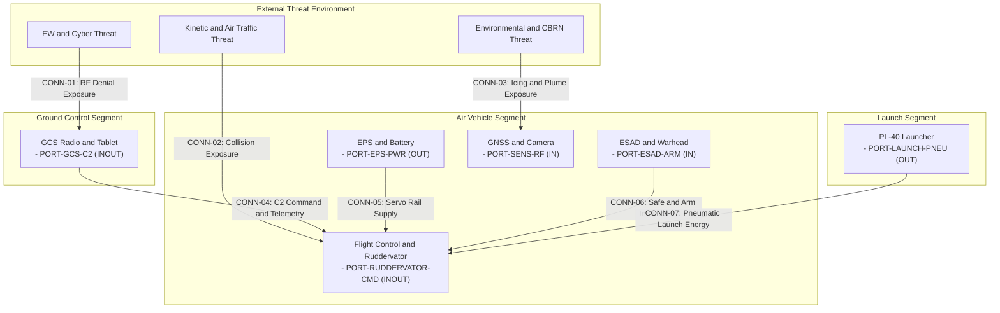

| Attribute | Specification Detail |
| :--- | :--- |
| **Title** | Tactical Mission Intent: Multi-Domain Threat Matrix |
| **Issue ID** | MI-04 |
| **Type** | mission_intent |
| **Generation Mode** | subagent |
| **Specification Source** | docs/research/RESEARCH_INVENTORY.md; .pipeline/schema.sysml; schema/extracted/parametric_limits.md; schema/extracted/oem_bom.md; schema/extracted/interface_table.md |
| **Version** | 1.1.0 |
| **Date** | 2026-10-31 |

## 4. Multi-Domain Operational Threat & Contested Environment Matrix

This open threat matrix covers the nine canonical operational domains: Kinetic, Mechanical, Power/Thermal, Environmental, EW/Cyber, Optical, Signature/Acoustic, Human Factors, and CBRN. Rows are keyed to AST part definitions in `.pipeline/schema.sysml` and to the OEM subsystem identities in `schema/extracted/oem_bom.md`. The canonical tail control surface is `Ruddervator`; the ESAD is Critical (DAL-A); the parachute deployment module is non-mission and is excluded from the mission threat baseline. Severity and likelihood bands follow the qualitative severity and probability definitions of MIL-STD-1629A. Numeric limits are cited from `schema/extracted/parametric_limits.md` or an OEM file:line. Where the OEM sources are silent, the field is marked "Not stated in OEM sources". Each citation key in the Public Clause Citation column resolves in Section 4.3 to a clause locator listed in `docs/research/RESEARCH_INVENTORY.md`.

### 4.1 Super-System Operational Architecture & Threat Segment Boundaries

This super-system operational architecture defines the threat segment boundaries used by the matrix. The view follows IEEE Std 1362-1998 and DoDAF v2.02 SV-1 architecture conventions and ISO/IEC/IEEE 29148:2018 Section 6.4.2. External threat edges route to segment boundary ports per Rule E5; internal subsystem detail remains decoupled in the platform subsystem breakdown view.

### 4.2 Threat Matrix

| Threat ID | Domain | Threat Mechanism | Affected Subsystem | Severity | Likelihood | Severity / Likelihood Basis | Public Clause Citation |
| :--- | :--- | :--- | :--- | :--- | :--- | :--- | :--- |
| `THR-01` | Kinetic | Non-cooperative intruder penetrates the DAA well-clear volume; collision energy follows the closing geometry. | Airframe Fuselage; GNSS Module Septentrio Asterx-m3 pro; Autopilot Computing Board Cube Orange Plus | Critical | Occasional | Loss of air vehicle and uncontrolled ground impact; maximum take-off weight is 17 kg per `schema/extracted/parametric_limits.md at line 18`. | `CIT-DAA-WELLCLEAR` |
| `THR-02` | Kinetic | High-speed projectile or ballistic fragment penetrates the airframe and severs control or electrical routing. | Airframe Fuselage; Ruddervator; CAN 1 Ruddervator Junction Node | Catastrophic | Remote | Loss of tail control authority on the canonical Ruddervator assembly; ESAD is Critical (DAL-A) per `schema/extracted/oem_bom.md at line 52`. | `CIT-SYSTEM-HAZARD` |
| `THR-03` | Mechanical | Ruddervator servo binding or motor seizure creates an opposing surface demand and corrupts pitch/yaw mixing. | Ruddervator Servo #1 through Ruddervator Servo #4; CAN 1 Ruddervator Junction Node | Catastrophic | Remote | The Ruddervator servos form the only tail control path; quantity is 4 units per `schema/extracted/parametric_limits.md at line 20` and servo rail is 8 V per `schema/extracted/parametric_limits.md at line 28`. | `CIT-FHA` |
| `THR-04` | Mechanical | Aeroelastic oscillation and structural resonance in wing or tail structure causes high-cycle fatigue and possible separation. | Wings; Wing Panel Left-Upper; Wing Panel Left-Lower; Wing Panel Right-Upper; Wing Panel Right-Lower; Ruddervator | Critical | Occasional | Wingspan is 1.8 m and maximum dive speed is 55 m/s per `schema/extracted/parametric_limits.md at line 15` and `schema/extracted/parametric_limits.md at line 9`. | `CIT-FMECA-SEVERITY` |
| `THR-05` | Power/Thermal | Lithium cell internal short initiates exothermic thermal runaway in the removable battery pack. | Battery 12S2P Li Metal BEI; Automotive Fuse 200A; Power Meter; EPS Module | Catastrophic | Remote | Pack operates from 36 V to 50.4 V per `schema/extracted/parametric_limits.md at line 29` and `schema/extracted/parametric_limits.md at line 30`; fire can breach the airframe and reach the 5 kg warhead per `schema/extracted/oem_bom.md at line 57`. | `CIT-LITHIUM-FIRE` |
| `THR-06` | Power/Thermal | Sustained high-current climb drives ESC inverter junction heat beyond thermal margin. | ESC IBEX160; Propulsion motor | Moderate | Probable | Maximum horizontal speed is 38 m/s and maximum dive speed is 55 m/s per `schema/extracted/parametric_limits.md at line 8` and `schema/extracted/parametric_limits.md at line 9`; ESC junction limit is Not stated in OEM sources. | `CIT-HOT-SOAK` |
| `THR-07` | Environmental | Localized downdraft and wind shear exceed climb capability and force uncontrolled descent. | Airframe Fuselage; Wings; Pitot Tube CUAV SKYE2 | Critical | Occasional | Minimum flight speed is 26 m/s and maximum horizontal speed is 38 m/s per `schema/extracted/parametric_limits.md at line 11` and `schema/extracted/parametric_limits.md at line 8`. | `CIT-WIND-RAIN` |
| `THR-08` | Environmental | Supercooled droplet accretion on the airframe and Pitot Tube CUAV SKYE2 degrades lift and air data. | Pitot Tube CUAV SKYE2; Wings; Airframe Fuselage | Critical | Occasional | Pitot static airspeed limit is 3 m/s and blow-test airspeed is 10 m/s per `schema/extracted/parametric_limits.md at line 40` and `schema/extracted/parametric_limits.md at line 41`; icing accretion limit is Not stated in OEM sources. | `CIT-ICING` |
| `THR-09` | EW/Cyber | Coherent GNSS pseudo-range injection causes a false position and time solution. | GNSS Module Septentrio Asterx-m3 pro; GNSS Antenna Talysman TW3972EXF; Autopilot Computing Board Cube Orange Plus | Critical | Likely | The GNSS RF feed is a single coaxial path per `schema/extracted/interface_table.md at line 39`; satellite navigation disagreement is detected only by inertial cross-check, with no OEM threshold stated. | `CIT-GNSS-EXTERNAL` |
| `THR-10` | EW/Cyber | High-strength RF uplink denial masks command frames and trips heartbeat loss. | Radio Module DTC; Radio Antenna MPSL4400 Upper; Radio Antenna MPSL4400 Lower; GCS Radio Box | High | Likely | Primary C2 link uses the 4.4 to 5.0 GHz band per `schema/extracted/interface_table.md at line 63` and `schema/extracted/interface_table.md at line 64`; uplink SNR threshold is Not stated in OEM sources. | `CIT-RF-DENIAL` |
| `THR-11` | EW/Cyber | Telemetry man-in-the-middle injection or replay on the command path without a valid authentication tag. | Radio Module DTC; RPI CM5004032; Autopilot Computing Board Cube Orange Plus | Critical | Occasional | Command and telemetry frames traverse the shared RF link per `schema/extracted/interface_table.md at line 63`; replay window and key rotation are Not stated in OEM sources. | `CIT-UNAUTH-CMD` |
| `THR-12` | EW/Cyber | Unauthorized firmware image or runtime memory modification attempts to alter flight or ESAD logic. | Autopilot Computing Board Cube Orange Plus; RPI CM5004032; ESAD | Catastrophic | Remote | ESAD is Critical (DAL-A) per `schema/extracted/oem_bom.md at line 52`; secure-boot hash baseline and memory integrity threshold are Not stated in OEM sources. | `CIT-PROGRAM-DOWNLOAD` |
| `THR-13` | Optical | Directed laser dazzle or focal-plane saturation denies electro-optical tracking. | Gimbal Nighthawk2UZ; Camera Compute Module Trip6 | High | Occasional | Day camera resolution is 1280 by 720 pixels and thermal camera resolution is 1280 by 720 pixels per `schema/extracted/parametric_limits.md at line 34` through `schema/extracted/parametric_limits.md at line 37`; saturation threshold is Not stated in OEM sources. | `CIT-OPTICAL-HAZARD` |
| `THR-14` | Signature/Acoustic | Hostile acoustic or radar sensing detects propulsion harmonics and airframe radar cross-section. | Propulsion motor; Propulsion Folding Propeller; Airframe Fuselage | High | Likely | Propeller and motor are exposed on every sortie; acoustic and radar-cross-section limits are Not stated in OEM sources. | `CIT-ACOUSTIC-CHEM` |
| `THR-15` | Human Factors | Operator fatigue, conflicting manual inputs, or unauthorized override attempts corrupt supervisory command intent. | GCS Tablet FZ-G2; GCS Radio Box; Autopilot Computing Board Cube Orange Plus | High | Occasional | Flight endurance is up to 90 min per `schema/extracted/parametric_limits.md at line 12`; operator duty limit and fatigue threshold are Not stated in OEM sources. | `CIT-FATIGUE` |
| `THR-16` | CBRN | Chemical plume or toxic particulate enters the airframe and contaminates sensors and payload bay. | Airframe Payload Bay; Pitot Tube CUAV SKYE2; ESAD Sensor Board | Critical | Remote | Payload bay contains the 5 kg warhead per `schema/extracted/oem_bom.md at line 57`; CBRN concentration threshold and purge rate are Not stated in OEM sources. | `CIT-CHEM-SAFETY` |

### 4.3 Public Clause Citation Register

| Citation Key | Public Clause Citation |
| :--- | :--- |
| `CIT-DAA-WELLCLEAR` | RTCA DO-365B Section 2.2.4 |
| `CIT-SYSTEM-HAZARD` | MIL-STD-882E Task 205 Section 4.2 |
| `CIT-FHA` | SAE ARP4761 Section 4.3.1 |
| `CIT-FMECA-SEVERITY` | MIL-STD-1629A Section 4.3 |
| `CIT-LITHIUM-FIRE` | JARUS SORA v2.5 Annex E Section E.24 |
| `CIT-HOT-SOAK` | MIL-STD-810H Method 501.7 Section 4.2 |
| `CIT-WIND-RAIN` | MIL-STD-810H Method 506.6 Section 4.2 |
| `CIT-ICING` | MIL-STD-810H Method 521.4 Section 4.2 |
| `CIT-GNSS-EXTERNAL` | JARUS SORA v2.5 Annex E Section E.13 |
| `CIT-RF-DENIAL` | MITRE ATT&CK for ICS Section T0814 |
| `CIT-UNAUTH-CMD` | MITRE ATT&CK for ICS Section T0855 |
| `CIT-PROGRAM-DOWNLOAD` | MITRE ATT&CK for ICS Section T0843 |
| `CIT-OPTICAL-HAZARD` | MIL-STD-882E Task 205 Section 4.2 |
| `CIT-ACOUSTIC-CHEM` | JARUS SORA v2.5 Annex E Section E.21 |
| `CIT-FATIGUE` | JARUS SORA v2.5 Annex E Section E.19 |
| `CIT-CHEM-SAFETY` | JARUS SORA v2.5 Annex E Section E.21 |

### 4.4 Threat Exposure Parameter Grounding

| Parameter | Value | Grounded Reference | Grounding Source |
| :--- | :--- | :--- | :--- |
| Cruise speed | 30 m/s | m/s | `schema/extracted/parametric_limits.md at line 7` |
| Maximum horizontal speed | 38 m/s | m/s | `schema/extracted/parametric_limits.md at line 8` |
| Maximum dive speed | 55 m/s | m/s | `schema/extracted/parametric_limits.md at line 9` |
| Maximum dive angle | 22 deg | deg | `schema/extracted/parametric_limits.md at line 10` |
| Minimum flight speed | 26 m/s | m/s | `schema/extracted/parametric_limits.md at line 11` |
| Flight endurance | 90 min | min | `schema/extracted/parametric_limits.md at line 12` |
| Maximum take-off weight | 17 kg | kg | `schema/extracted/parametric_limits.md at line 18` |
| Warhead mass | 5 kg | kg | `schema/extracted/parametric_limits.md at line 19` |
| Ruddervator quantity | 4 units | PL-20 | `schema/extracted/parametric_limits.md at line 20` |
| Servo power rail voltage | 8 V | V | `schema/extracted/parametric_limits.md at line 28` |
| Battery minimum voltage | 36 V | V | `schema/extracted/parametric_limits.md at line 29` |
| Battery maximum voltage | 50.4 V | V | `schema/extracted/parametric_limits.md at line 30` |
| Day camera horizontal resolution | 1280 pixels | PL-28 | `schema/extracted/parametric_limits.md at line 34` |
| Day camera vertical resolution | 720 pixels | PL-29 | `schema/extracted/parametric_limits.md at line 35` |
| Thermal camera horizontal resolution | 1280 pixels | PL-30 | `schema/extracted/parametric_limits.md at line 36` |
| Thermal camera vertical resolution | 720 pixels | PL-31 | `schema/extracted/parametric_limits.md at line 37` |
| Pitot static airspeed limit | 3 m/s | m/s | `schema/extracted/parametric_limits.md at line 40` |
| Pitot blow-test airspeed | 10 m/s | m/s | `schema/extracted/parametric_limits.md at line 41` |
| Maximum engagement elevation | 15 deg | deg | `schema/extracted/parametric_limits.md at line 50` |
| Maximum engagement airspeed | 55 m/s | m/s | `schema/extracted/parametric_limits.md at line 51` |
| ESAD power input minimum | 14 V | V | `schema/extracted/parametric_limits.md at line 52` |
| ESAD power input maximum | 32 V | V | `schema/extracted/parametric_limits.md at line 53` |
| ESAD high voltage measurement range | 1800 V | V | `schema/extracted/parametric_limits.md at line 66` |
| ESAD acceleration resolution | 0.0039 g | g | `schema/extracted/parametric_limits.md at line 69` |

### 4.5 OEM-Silent Threat Detection Fields

| Field | OEM Status | Affected Threat |
| :--- | :--- | :--- |
| Shock detection threshold | Not stated in OEM sources | `THR-02` |
| Vibration resonance limit | Not stated in OEM sources | `THR-04` |
| Battery cell temperature limit and rate-of-rise limit | Not stated in OEM sources | `THR-05` |
| ESC junction temperature limit | Not stated in OEM sources | `THR-06` |
| Turbulence and downdraft limit | Not stated in OEM sources | `THR-07` |
| Icing accretion limit | Not stated in OEM sources | `THR-08` |
| GNSS carrier-to-noise and RAIM threshold | Not stated in OEM sources | `THR-09` |
| Uplink SNR threshold | Not stated in OEM sources | `THR-10` |
| Replay window and key rotation interval | Not stated in OEM sources | `THR-11` |
| Secure-boot hash baseline and memory integrity threshold | Not stated in OEM sources | `THR-12` |
| Optical saturation threshold | Not stated in OEM sources | `THR-13` |
| Acoustic and radar-cross-section limits | Not stated in OEM sources | `THR-14` |
| Operator duty limit and fatigue threshold | Not stated in OEM sources | `THR-15` |
| CBRN concentration threshold and purge rate | Not stated in OEM sources | `THR-16` |

### 4.6 Threat Domain Coverage Summary

| Canonical Domain | Threat IDs |
| :--- | :--- |
| Kinetic | `THR-01`, `THR-02` |
| Mechanical | `THR-03`, `THR-04` |
| Power/Thermal | `THR-05`, `THR-06` |
| Environmental | `THR-07`, `THR-08` |
| EW/Cyber | `THR-09`, `THR-10`, `THR-11`, `THR-12` |
| Optical | `THR-13` |
| Signature/Acoustic | `THR-14` |
| Human Factors | `THR-15` |
| CBRN | `THR-16` |

## 6. Source References

Source references: [.pipeline/schema.sysml](.pipeline/schema.sysml), [docs/research/RESEARCH_INVENTORY.md](docs/research/RESEARCH_INVENTORY.md), [schema/extracted/parametric_limits.md](schema/extracted/parametric_limits.md), [schema/extracted/oem_bom.md](schema/extracted/oem_bom.md), and [schema/extracted/interface_table.md](schema/extracted/interface_table.md). Normative clauses: ISO/IEC/IEEE 29148:2018 Section 6.4.2; ISO/IEC/IEEE 15288:2023 Section 6.4.2; RTCA DO-178C Section 6.3.1; MIL-STD-1629A Section 4.3; MIL-STD-882E Task 205 Section 4.2; JARUS SORA v2.5 Annex E Section E.24.

/// ThreatDerivationAllocation: [THR-01, THR-02, THR-03, THR-04, THR-05, THR-06, THR-07, THR-08, THR-09, THR-10, THR-11, THR-12, THR-13, THR-14, THR-15, THR-16]
/// ThreatDerivationWitness: [THR-01, THR-02, THR-03, THR-04, THR-05, THR-06, THR-07, THR-08, THR-09, THR-10, THR-11, THR-12, THR-13, THR-14, THR-15, THR-16]
