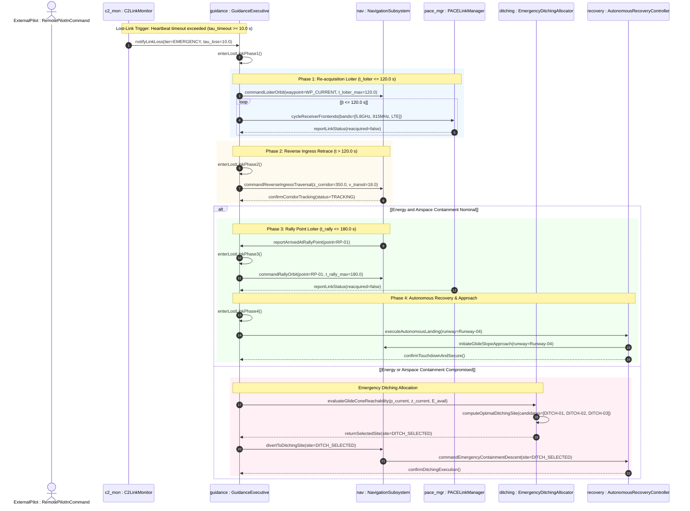
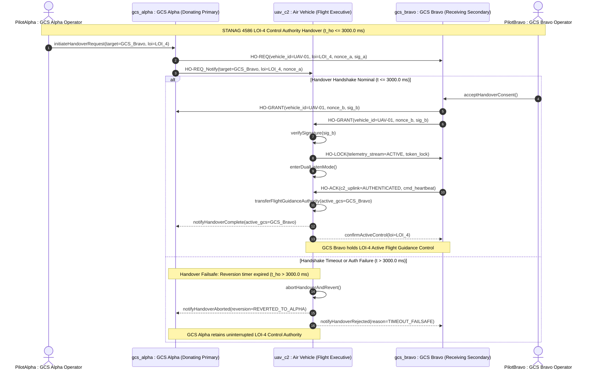

| Attribute | Value |
| :--- | :--- |
| **Title** | Tactical Mission Intent: PACE C2 Communications Plan |
| **Version** | 1.0.0 |
| **Date** | 2026-09-02 |

## 5. PACE C2 Link Communications Plan

In accordance with NATO STANAG 4586 (§4.5), RTCA DO-362A, 3GPP Release 15, and NIST SP 800-82r3, Command and Control (C2) link robustness is maintained through a four-tier Primary, Alternate, Contingency, Emergency (PACE) communications architecture with automated failover and hysteresis stabilization.

### 5.1 Master PACE Communications Plan Table

The master communications plan defines the frequency allocations, physical layer transport media, modulation schemes, nominal throughput, and timeout boundaries across all four operational tiers:

| PACE Tier | Link Medium | Frequency Band (f_band) | Modulation / Protocol | Nominal Data Rate (Rate_nom) | Heartbeat Timeout (tau_timeout) | Failover Hysteresis (tau_hysteresis) | Priority / Role | Public Clause Citation |
| :--- | :--- | :--- | :--- | :--- | :--- | :--- | :--- | :--- |
| **Primary** | 5.8 GHz COFDM Point-to-Point Datalink | 5725 to 5850 MHz | COFDM QPSK/QAM / AES-256-GCM | 12.0 Mbps | 1.0 s | 3.0 s | Full HD Payload Video & High-Rate Telemetry | NATO STANAG 4586 §4.5 |
| **Alternate** | 915 MHz FHSS Encrypted Mesh Datalink | 902 to 928 MHz | 50-Hop FHSS GFSK / AES-256-GCM | 250 kbps | 2.0 s | 5.0 s | Robust Flight Telemetry & Tactical C2 Relay | RTCA DO-362A §2.2 |
| **Contingency** | Encrypted LTE/5G Cellular VPN Tunnel | 700 to 2600 MHz | 3GPP Rel 15 / IPsec AES-256-GCM | 2.0 Mbps | 5.0 s | 10.0 s | Beyond-LOS Backup C2 & Telemetry Bridge | 3GPP Rel 15 / NIST SP 800-82r3 |
| **Emergency** | Autonomous RTH & Satellite Geo-Beacon | 406 MHz / 1616 to 1626 MHz | SBD Burst / COSPAS-SARSAT Beacon | 2.4 kbps | 10.0 s | 15.0 s | Autonomous Lost-Link RTH & Satellite Emergency Beacon | JARUS SORA v2.5 Annex E §E.6 |

---

### 5.2 Complete RF Link Budget & Mathematical Formulation

The RF link budget across all four PACE communication tiers is governed by the Friis transmission formula with atmospheric and miscellaneous line losses evaluated at the maximum operational standoff range ($d = 15.0\text{ km}$):

$$
\begin{aligned}
\mathrm{FSPL} &= 20 \log_{10}(d) + 20 \log_{10}(f) + 20 \log_{10}\left(\frac{4\pi}{c}\right) \\
P_{\mathrm{rx}} &= P_{\mathrm{tx}} + G_{\mathrm{tx}} + G_{\mathrm{rx}} - \mathrm{FSPL} - L_{\mathrm{misc}} \\
\mathrm{Margin}_{\mathrm{fade}} &= P_{\mathrm{rx}} - S_{\mathrm{rx}}
\end{aligned}
$$

Where and Operational Parameters:
- $d$: Line-of-sight propagation distance between ground control station and aircraft ($15000.0\text{ m}$).
- $f$: Carrier center frequency of the active RF communication tier (Hz).
- $c$: Speed of light in vacuum ($2.99792458 \times 10^8\text{ m/s}$).
- $\mathrm{FSPL}$: Free space path loss over the RF transmission channel (dB).
- $P_{\mathrm{tx}}$: RF transmitter output power delivered to the antenna terminal (dBm).
- $G_{\mathrm{tx}}$: Transmit antenna isotropic gain (dBi).
- $G_{\mathrm{rx}}$: Receive antenna isotropic gain (dBi).
- $L_{\mathrm{misc}}$: Miscellaneous RF insertion, polarization mismatch, and atmospheric absorption losses (dB).
- $P_{\mathrm{rx}}$: Received signal power at the receiver input connector (dBm).
- $S_{\mathrm{rx}}$: Effective receiver demodulation sensitivity threshold (dBm).
- $\mathrm{Margin}_{\mathrm{fade}}$: Effective fade margin (dB), with normative requirement $\mathrm{Margin}_{\mathrm{fade}} \ge 12.0\text{ dB}$.

#### Master RF Link Budget Table (15.0 km Operational Range)

| PACE Tier | Link Frequency | Transmit Power (P_tx) | Transmit Gain (G_tx) | Receiver Gain (G_rx) | FSPL @ 15 km | Misc Losses (L_misc) | Received Power (P_rx) | Receiver Sensitivity (S_rx) | Fade Margin | Minimum Margin Required | Public Clause Citation |
| :--- | :--- | :--- | :--- | :--- | :--- | :--- | :--- | :--- | :--- | :--- | :--- |
| **Primary** | 5.8 GHz | +30.0 dBm | +5.0 dBi | +18.0 dBi (Tracking Mast) | 131.2 dB | 2.0 dB | -80.2 dBm | -95.0 dBm | 14.8 dB | >= 12.0 dB | NATO STANAG 4586 §4.5 |
| **Alternate** | 915 MHz | +27.0 dBm | +3.0 dBi | +6.0 dBi (Ground Omni) | 115.2 dB | 1.5 dB | -80.7 dBm | -108.0 dBm | 27.3 dB | >= 12.0 dB | RTCA DO-362A §2.2 |
| **Contingency** | 800 MHz (Cellular) | +23.0 dBm | +2.0 dBi | +2.0 dBi (Base Station) | 113.8 dB | 1.0 dB | -87.8 dBm | -102.0 dBm | 14.2 dB | >= 12.0 dB | 3GPP Rel 15 / NIST SP 800-82r3 |
| **Emergency** | 1.6 GHz (Satellite) | +33.0 dBm | +3.0 dBi | +0.0 dBi (Space Element) | 120.2 dB | 1.5 dB | -85.7 dBm | -116.0 dBm | 30.3 dB | >= 12.0 dB | JARUS SORA v2.5 Annex E §E.6 |

---

### 5.3 Deterministic In-Flight Lost-Link Guidance Protocol & Emergency Routing Ladder

In accordance with NATO STANAG 4586 (§4.5 & Annex B §3.4), RTCA DO-362A (§2.2), JARUS SORA v2.5 (Annex E §E.6), and ICAO Annex 2 (§3.1), complete loss of Command and Control telemetry across all PACE communications tiers initiates a deterministic, four-phase hierarchical lost-link routing ladder with autonomous emergency ditching fallback:

1. **Lost-Link Phase 1 (Re-acquisition Loiter):** Upon expiration of the Emergency tier heartbeat timeout ($\Delta t_{\mathrm{loss}} \ge \tau_{\mathrm{timeout,Emergency}} = 10.0\text{ s}$), the flight guidance executive commands the aircraft to enter a stable right-hand circular orbit centered on its current waypoint coordinate at assigned altitude. The vehicle maintains this loiter pattern for a maximum duration $t_{\mathrm{loiter}} \le 120.0\text{ s}$ while the RF frontend manager sequentially cycles receiver frontends across Primary (5.8 GHz COFDM), Alternate (915 MHz FHSS), and Contingency (LTE/5G VPN) transceivers at 5.0 s intervals to re-establish an authenticated C2 uplink.
2. **Lost-Link Phase 2 (Reverse Ingress Retrace):** If authenticated C2 heartbeat telemetry is not re-acquired within $t_{\mathrm{loiter}} = 120.0\text{ s}$, the aircraft autonomously exits the loiter orbit, climbs or descends to the published deconfliction corridor floor altitude ($z_{\mathrm{corridor}} = 350.0\text{ m}$ AGL), and initiates deterministic reverse waypoint traversal along the published ingress corridor (`LL-CORRIDOR-01`) at nominal transit airspeed ($v_{\mathrm{transit}} = 18.0\text{ m/s}$).
3. **Lost-Link Phase 3 (Rally Point Loiter):** Upon completing reverse corridor retrace, the vehicle transitions into a designated holding orbit at Rally Point `RP-01` ($45.1280^\circ\text{ N}, 14.5720^\circ\text{ E}$) at holding altitude $z = 350.0\text{ m}$ AGL. The vehicle orbits at `RP-01` for $t_{\mathrm{rally}} \le 180.0\text{ s}$ awaiting C2 heartbeat recovery or ground base station line-of-sight acquisition.
4. **Lost-Link Phase 4 (Autonomous Recovery & Approach):** If C2 communications remain unestablished upon expiration of the rally loiter timer ($t_{\mathrm{rally}} = 180.0\text{ s}$), the flight executive autonomously sequences the final approach glide path, aligns with primary recovery runway `Runway-04` ($042^\circ\text{ True}$, $150.0\text{ m}$ MSL), and executes an autonomous flare, touchdown, and motor shutdown sequence.
5. **Secondary Emergency Ditching Allocation:** If during any lost-link phase the onboard power monitor determines remaining stored energy is insufficient for runway recovery ($E_{\mathrm{avail}}(t) < E_{\mathrm{return}}$) or if lateral airspace containment is compromised by severe meteorological disturbances, the guidance executive executes optimal autonomous emergency ditching site allocation across pre-surveyed unpopulated containment sites (`DITCH-01`, `DITCH-02`, `DITCH-03`) evaluated against aerodynamic glide reachability and SORA ground risk containment.

#### Lost-Link Sequence and Emergency Routing Ladder Interaction Flow

#### KaTeX Emergency Ditching Reachability & Site Selection Mathematics

The unpowered or degraded glide reachability envelope and optimal emergency ditching site selection are governed by 3D glide cone kinematics and SORA Ground Risk Class (GRC) minimization:

$$
\begin{aligned}
d_{xy,k}(\mathbf{p}(t)) &= \sqrt{(x(t) - x_{\mathrm{ditch},k})^2 + (y(t) - y_{\mathrm{ditch},k})^2} \\
R_{\mathrm{reach},k}(z(t)) &= (z(t) - z_{\mathrm{ditch},k}) \cdot \left(\frac{L}{D}\right)_{\mathrm{eff}} \cdot \left(1 - \frac{\mathbf{v}_{\mathrm{wind}} \cdot (\mathbf{p}_{\mathrm{ditch},xy,k} - \mathbf{p}_{xy}(t))}{\|\mathbf{v}_{\mathrm{wind}}\| \cdot \|\mathbf{p}_{\mathrm{ditch},xy,k} - \mathbf{p}_{xy}(t)\|} \cdot \frac{\|\mathbf{v}_{\mathrm{wind}}\|}{v_{\mathrm{glide}}}\right) \\
\mathcal{K}_{\mathrm{reachable}}(t) &= \left\{ k \in \{1, 2, 3\} \;\middle|\; d_{xy,k}(\mathbf{p}(t)) + R_{\mathrm{GRB},k} \le R_{\mathrm{reach},k}(z(t)) \right\} \\
J_{\mathrm{ditch}}(k, t) &= w_1 \cdot \frac{d_{xy,k}(\mathbf{p}(t))}{R_{\mathrm{reach},k}(z(t))} + w_2 \cdot \mathrm{GRC}_k + w_3 \cdot \frac{E_{\mathrm{req},k}}{E_{\mathrm{avail}}(t)} \\
k^*(t) &= \arg\min_{k \in \mathcal{K}_{\mathrm{reachable}}(t)} J_{\mathrm{ditch}}(k, t)
\end{aligned}
$$

Where and Operational Parameters:
- $\mathbf{p}(t) = (x(t), y(t), z(t))$: Instantaneous aircraft 3D position vector in local NED coordinate frame (m).
- $(x_{\mathrm{ditch},k}, y_{\mathrm{ditch},k}, z_{\mathrm{ditch},k})$: 3D origin and elevation datum of emergency ditching site $k$ (m).
- $d_{xy,k}(\mathbf{p}(t))$: Planar horizontal range from aircraft to candidate ditching site $k$ (m).
- $R_{\mathrm{reach},k}(z(t))$: Wind-corrected reachable glide distance from current altitude $z(t)$ to ditching site $k$ (m).
- $(L/D)_{\mathrm{eff}}$: Effective aerodynamic lift-to-drag glide ratio in unpowered/degraded configuration.
- $\mathbf{v}_{\mathrm{wind}}$: Estimated horizontal ambient wind velocity vector (m/s).
- $v_{\mathrm{glide}}$: Nominal best-glide calibrated airspeed ($15.0\text{ m/s}$).
- $R_{\mathrm{GRB},k}$: SORA Ground Risk Buffer radius around ditching site $k$ (m).
- $\mathcal{K}_{\mathrm{reachable}}(t)$: Set of kinematically reachable ditching sites satisfying containment margin.
- $\mathrm{GRC}_k$: SORA Ground Risk Class index for candidate site $k$ ($\mathrm{GRC}_k = 1$ for all unpopulated sites).
- $E_{\mathrm{req},k}$: Estimated electrical/kinetic energy required for trajectory execution to site $k$ (J).
- $E_{\mathrm{avail}}(t)$: Instantaneous usable onboard battery stored energy (J).
- $w_1, w_2, w_3$: Optimization weighting coefficients ($w_1 = 0.40, w_2 = 0.35, w_3 = 0.25$).
- $k^*(t)$: Optimal selected emergency ditching site index.

#### Lost-Link Guidance Protocol & Ditching Parameters Table

| Parameter / Protocol Element | Symbol | Nominal Value | Units | Operational Constraint | Public Clause Citation |
| :--- | :--- | :--- | :--- | :--- | :--- |
| Phase 1 Loiter Orbit Duration | t_loiter | <= 120.0 | s | Maximum re-acquisition holding time at current waypoint | NATO STANAG 4586 §4.5 |
| Phase 2 Deconfliction Corridor Floor | z_corridor | 350.0 | m | Altitude floor AGL during reverse ingress transit | JARUS SORA v2.5 Annex C §3.2 |
| Phase 2 Reverse Transit Airspeed | v_transit | 18.0 | m/s | Best endurance transit speed along ingress track | NATO STANAG 4586 Annex B §3.4 |
| Phase 3 Rally Point Loiter Duration | t_rally | <= 180.0 | s | Maximum holding pattern duration at Rally Point RP-01 | RTCA DO-362A §2.2 |
| Phase 4 Primary Recovery Runway | Runway_ID | Runway-04 | Dimensionless | Primary base recovery strip (Heading 042 deg True) | NATO STANAG 4586 §4.5 |
| Emergency Ditching Allocation Pool | Ditch_Sites | DITCH-01..03 | Dimensionless | Pre-surveyed unpopulated containment zones | JARUS SORA v2.5 Annex B §2.1 |
| Best Glide Aerodynamic Ratio | L_over_D_eff | 12.0 | Dimensionless | Clean configuration best glide efficiency | NATO STANAG 4586 Annex B §3.4 |
| Best Glide Airspeed | v_glide | 15.0 | m/s | Calibrated airspeed for minimum descent gradient | NATO STANAG 4586 Annex B §3.4 |
| Ditching Standoff Weight Factor | w_1 | 0.40 | Dimensionless | Weight factor for normalized distance | MIL-STD-882E §4.3 |
| SORA Ground Risk Weight Factor | w_2 | 0.35 | Dimensionless | Weight factor for ground risk class (GRC-1) | JARUS SORA v2.5 Annex B §2.1 |
| Energy Consumption Weight Factor | w_3 | 0.25 | Dimensionless | Weight factor for energy requirement ratio | EASA GM1 UAS.SPEC.050(1)(g) |

---

### 5.4 Failover Hysteresis State Machine & Re-acquisition Dynamics

Link degradation triggers deterministic down-tier failover when the active tier's heartbeat packet stream is interrupted beyond its designated timeout threshold $\tau_{\mathrm{timeout},i}$. Promotion back to a higher-priority tier requires continuous, uninterrupted link stability across the re-acquisition hysteresis time window $\tau_{\mathrm{hysteresis},k}$:

$$
\begin{aligned}
\Delta t_{\mathrm{loss},i}(t) &= t - t_{\mathrm{last,rx},i} \\
\mathrm{TriggerFailover}(i \to i+1) &\iff \Delta t_{\mathrm{loss},i}(t) \ge \tau_{\mathrm{timeout},i} \\
\Delta t_{\mathrm{stable},k}(t) &= t - t_{\mathrm{reacq},k} \\
\mathrm{PromoteTier}(i \to k) &\iff (k < i) \land (\Delta t_{\mathrm{stable},k}(t) \ge \tau_{\mathrm{hysteresis},k}) \land (\mathrm{Margin}_k(t) \ge 12.0)
\end{aligned}
$$

Where and Operational Parameters:

| Transition Parameter | Symbol | Units | Operational Constraint | Description | Public Clause Citation |
| :--- | :--- | :--- | :--- | :--- | :--- |
| Active Link Loss Duration | Delta t_loss | s | Measured Online | Measured elapsed time since last authenticated telemetry frame | NATO STANAG 4586 §4.5 |
| Primary Heartbeat Timeout | tau_timeout_Primary | s | tau_timeout_Primary = 1.0 | Timeout triggering fallback from Primary to Alternate tier | NATO STANAG 4586 §4.5 |
| Alternate Heartbeat Timeout | tau_timeout_Alternate | s | tau_timeout_Alternate = 2.0 | Timeout triggering fallback from Alternate to Contingency tier | RTCA DO-362A §2.2 |
| Contingency Heartbeat Timeout | tau_timeout_Contingency | s | tau_timeout_Contingency = 5.0 | Timeout triggering fallback from Contingency to Emergency tier | 3GPP Rel 15 / NIST SP 800-82r3 |
| Emergency Heartbeat Timeout | tau_timeout_Emergency | s | tau_timeout_Emergency = 10.0 | Timeout initiating definitive autonomous return-to-base | JARUS SORA v2.5 Annex E §E.6 |
| Primary Re-acquisition Window | tau_hysteresis_Primary | s | tau_hysteresis_Primary = 3.0 | Continuous stable link duration required before Primary promotion | RTCA DO-362A §2.2 |
| Alternate Re-acquisition Window | tau_hysteresis_Alternate | s | tau_hysteresis_Alternate = 5.0 | Continuous stable link duration required before Alternate promotion | RTCA DO-362A §2.2 |
| Contingency Re-acquisition Window | tau_hysteresis_Contingency | s | tau_hysteresis_Contingency = 10.0 | Continuous stable link duration required before Contingency promotion | 3GPP Rel 15 / NIST SP 800-82r3 |
| Emergency Re-acquisition Window | tau_hysteresis_Emergency | s | tau_hysteresis_Emergency = 15.0 | Continuous stable link duration required before exiting Emergency RTH | JARUS SORA v2.5 Annex E §E.6 |

---

### 5.5 Cryptographic Security & Link Integrity

All PACE communication tiers employ authenticated AES-256-GCM encryption with monotonic 64-bit sequence counters and Ed25519 digital signature verification to eliminate eavesdropping, packet tampering, and replay injection in compliance with NIST SP 800-82r3 and DoD Directive 3000.09.

---

### 5.6 GCS-to-GCS Control Authority Handover & STANAG 4586 Levels of Interoperability (LOI 1-5)

In accordance with NATO STANAG 4586 (§3.2, §4.2.2, §5.1.4) and RTCA DO-362A (§2.2.4), seamless Ground Control Station (GCS) control authority handover and multi-station interoperability are structured across five standardized Levels of Interoperability (LOI 1 through LOI 5). Control authority transfer between Ground Control Stations is executed via a deterministic, cryptographically signed 4-way handshake protocol with automated timeout and reversion failsafes.

#### Master STANAG 4586 Levels of Interoperability (LOI 1-5) Matrix

| Level of Interoperability (LOI) | Interoperability Scope & Functionality | Control Authority Boundary | Payload / Vehicle Access | Public Clause Citation |
| :--- | :--- | :--- | :--- | :--- |
| **LOI 1** | Indirect Payload Receipt | Dissemination of secondary sensor imagery and telemetry via ground network relay | Read-only indirect receipt of processed telemetry and video feeds | NATO STANAG 4586 §4.2.2 |
| **LOI 2** | Direct Payload Receipt | Direct reception of raw telemetry and sensor payload data from Air Vehicle datalink | Direct downlink monitoring without sensor steering authority | NATO STANAG 4586 §4.2.2 |
| **LOI 3** | Direct Payload Control | Control and operation of airborne payload and sensors without vehicle flight control | Active sensor pointing, zoom, and gimbal steering authority | NATO STANAG 4586 §4.2.2 |
| **LOI 4** | Vehicle Flight Guidance Control | En-route waypoint navigation, flight plan modification, and flight guidance control | Dynamic waypoint steering without launch and recovery authority | NATO STANAG 4586 §4.2.2 |
| **LOI 5** | Full Launch & Recovery Control | Complete system authority including takeoff, flight guidance, landing, and post-flight recovery | Full operational command across all flight phases and emergency triggers | NATO STANAG 4586 §4.2.2 |

#### Cryptographic 4-Way Handshake Protocol & Mathematical Timeout Formulation

The GCS-to-GCS handover protocol enforces mutual authentication and non-repudiation using Ed25519 asymmetric signatures and monotonic sequence nonces across four sequential protocol frames:
1. **HO-REQ (Handover Request):** Donating GCS (GCS Alpha) initiates handover by transmitting an authenticated `HO-REQ` token declaring target LOI level (e.g. LOI-4), Air Vehicle GUID, cryptographic session nonce, and donating GCS signature to Receiving GCS (GCS Bravo) and the Air Vehicle.
2. **HO-GRANT (Handover Grant):** Receiving GCS (GCS Bravo) verifies operator qualification and telemetry integrity, signs an authorization token, and transmits `HO-GRANT` back to GCS Alpha and the Air Vehicle within $t \le 1000.0\text{ ms}$.
3. **HO-LOCK (Telemetry Lock):** Air Vehicle verifies GCS Bravo credentials against authorized key stores, establishes primary downlink encryption lock with GCS Bravo, transmits `HO-LOCK` confirmation token, and enters dual-listen command uplink mode.
4. **HO-ACK (Command Uplink Ack):** Receiving GCS Bravo issues the initial authenticated command heartbeat frame (`HO-ACK`) to the Air Vehicle. Upon valid receipt and verification, the Air Vehicle transfers active C2 flight guidance authority (LOI-4) to GCS Bravo and broadcasts a definitive transfer completion status to GCS Alpha.
5. **Timeout & Reversion Failsafe:** If receiving GCS Bravo fails to acknowledge within $t_{\mathrm{ho}} \le 3000.0\text{ ms}$ ($\tau_{\mathrm{ho,max}} = 3.0\text{ s}$), or if cryptographic verification fails at any stage, control authority immediately and deterministically reverts to donating GCS Alpha.

$$
\begin{aligned}
\Delta t_{\mathrm{ho}}(t) &= t - t_{\mathrm{HO\text{-}REQ}} \\
\mathrm{HandoverStatus}(t) &= \begin{cases}
\mathrm{Committed} & \text{if } \mathrm{Ack}_{\mathrm{HO\text{-}ACK}} = \mathrm{True} \land \Delta t_{\mathrm{ho}}(t) \le t_{\mathrm{ho,max}} \\
\mathrm{Reverted} & \text{if } \Delta t_{\mathrm{ho}}(t) > t_{\mathrm{ho,max}} \lor \mathrm{AuthError} = \mathrm{True}
\end{cases}
\end{aligned}
$$

Where and Operational Parameters:

| Handover Parameter | Symbol | Nominal Value | Units | Operational Constraint | Public Clause Citation |
| :--- | :--- | :--- | :--- | :--- | :--- |
| Handover Timeout Horizon | t_ho_max | 3000.0 | ms | Maximum elapsed time allowed for 4-way token completion (t_ho <= 3000.0 ms) | NATO STANAG 4586 §5.1.4 |
| HO-GRANT Response Limit | t_grant_max | 1000.0 | ms | Maximum allowed latency for receiving GCS grant transmission | NATO STANAG 4586 §5.1.4 |
| Dual-Listen Window | t_dual_listen | <= 1500.0 | ms | Overlap interval where vehicle monitors both donating and receiving uplinks | RTCA DO-362A §2.2.4 |
| Cryptographic Signature Algorithm | Algo_sig | Ed25519 | Dimensionless | Elliptic curve digital signature algorithm for handshake message frames | NIST SP 800-82r3 §6.2 |
| Handover Reversion Latency | t_revert | <= 100.0 | ms | Maximum latency to re-instate full donating GCS authority upon timeout | NATO STANAG 4586 §5.1.4 |

#### GCS-to-GCS LOI-4 Handover Sequence Diagram

