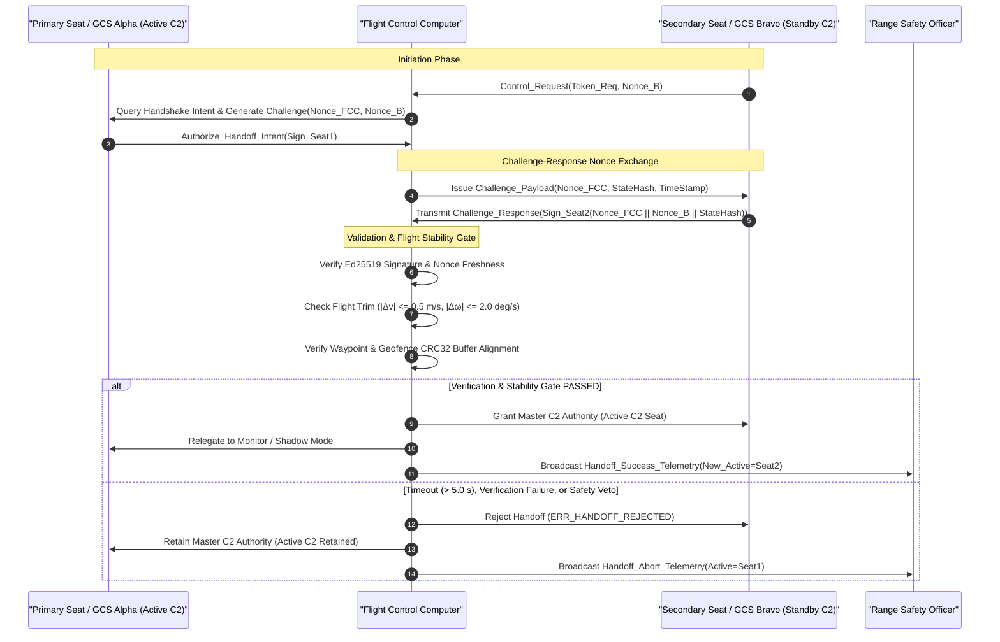
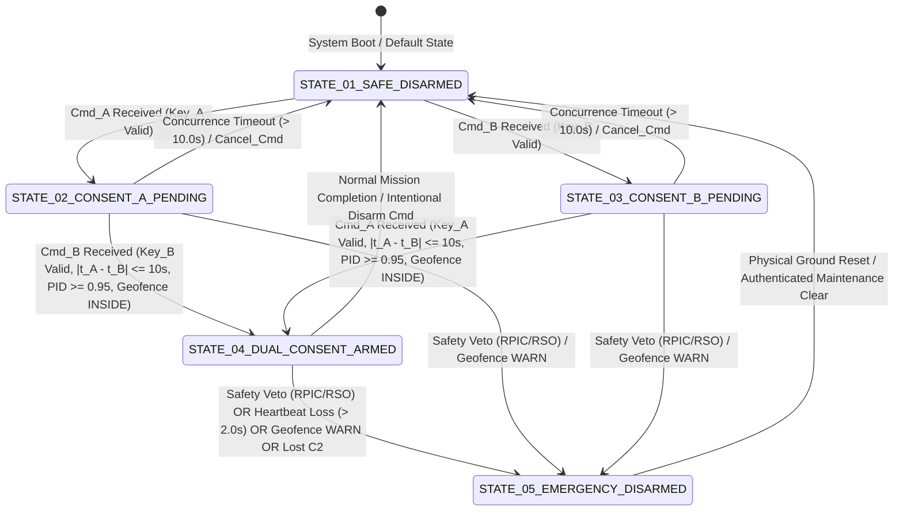

| Attribute | Value |
| :--- | :--- |
| **Title** | Tactical Mission Intent: Rules of Engagement & Interlocks |
| **Version** | 1.0.0 |
| **Date** | 2026-09-03 |

## 6. Rules of Engagement (ROE) & Weapon/Sensor Interlocks

In accordance with DoD Directive 3000.09 (Autonomy in Weapon Systems), CJCSI 3121.01B (Standing Rules of Engagement), NATO STANAG 4586 (§3.8), and MIL-STD-882E (§4.4), the execution of critical operational actions, active sensor designations, and kinetic payload operations is strictly constrained by deterministic First-Order Logic (FOL) predicates and multi-level human authorization interlocks.

### 6.1 Doctrinal Interlock Principles

1. **Dual-Consent Cryptographic Arming:** High-consequence kinetic arming and payload release actions require simultaneous cryptographic signature validation from two independent authorized operators (Mission Commander and Range Safety Officer) within a bounded temporal concurrence window.
2. **Multi-Spectral Positive Identification (PID) Fusion:** Target acquisition and tracking designation require spatial and temporal concurrence across optical and infrared spectra ($C_{\mathrm{PID}} \ge 0.95$).
3. **Human-on-the-Loop (HOTL) Veto Authority:** Human operators maintain real-time situational awareness and an un-overridable emergency abort/veto capability with bounded heartbeat timeout ($\tau_{\mathrm{veto\_timeout}} \le 2.0\text{ s}$).
4. **Non-Combatant Standoff Enforcement:** Target selection algorithms enforce absolute physical standoff distance ($d \ge 250.0\text{ m}$) from all designated protected civilian assets, medical facilities, and dynamic exclusion zones.
5. **Fail-Safe Disarmament:** Any loss of primary link telemetry, navigation integrity degradation, or geofence boundary warning automatically reverts payloads to a hardware-isolated safe state and stows active optical/laser gimbals.

---

### 6.2 Formal First-Order Logic Rules of Engagement Roster

#### 6.2.1 ROE-01: Minimum Safe Terrain Clearance Interlock

The flight guidance system shall prohibit autonomous descent below the declared minimum safe operating clearance ($h_{\mathrm{RadarAGL}} \ge 30.0\text{ m}$) without continuous radar altimeter confirmation, active obstacle clearance buffer verification, and bounded vertical sink rate ($\mathbf{v}_{\mathrm{sink}} \le 3.0\text{ m/s}$).

$$
\begin{aligned}
\mathrm{AllowDescent}(\mathbf{p}(t)) \iff &(h_{\mathrm{RadarAGL}}(t) \ge 30.0) \land (\mathrm{ObstacleClearance}(\mathbf{p}(t)) = \mathrm{TRUE}) \\
&\land (\mathbf{v}_{\mathrm{sink}}(t) \le 3.0) \land \neg \mathrm{TerrainHazard}(\mathbf{p}(t))
\end{aligned}
$$

Where and Operational Parameters:

| Parameter | Symbol | Nominal Value | Units | Validation Rule | Public Clause Citation |
| :--- | :--- | :--- | :--- | :--- | :--- |
| Radar Altimeter Clearance | h_RadarAGL | >= 30.0 | m | Continuous 50 Hz FMCW radar altimeter reading | NATO STANAG 4586 Annex B §3.2 |
| Obstacle Clearance State | ObstacleClearance | TRUE | Boolean | Forward DEM lookahead and LiDAR barrier clear | RTCA DO-365B §2.2.3 |
| Vertical Sink Velocity | v_sink | <= 3.0 | m/s | Downward z-velocity measured by EKF estimator | NATO STANAG 4586 Annex B §3.2 |
| Terrain Hazard Assertion | TerrainHazard | FALSE | Boolean | Projected trajectory penetration of DEM terrain mesh | ICAO Annex 2 §3.2 |

---

#### 6.2.2 ROE-02: Multi-Spectral Positive Identification (PID) Fusion

Laser designation or tactical strike track locking shall only occur when electro-optical (EO) and infrared (IR) feature correlation exceeds the normative confidence threshold ($C_{\mathrm{PID}} \ge 0.95$), where $C_{\mathrm{PID}}$ is evaluated as a convex combination of normalized sensor classification scores:

$$
\begin{aligned}
C_{\mathrm{PID}}(t) &= w_{\mathrm{EO}} S_{\mathrm{EO}}(t) + w_{\mathrm{IR}} S_{\mathrm{IR}}(t) \\
\mathrm{AllowDesignation}(t) \iff &(S_{\mathrm{EO}}(t) \ge 0.90) \land (S_{\mathrm{IR}}(t) \ge 0.90) \land (C_{\mathrm{PID}}(t) \ge 0.95) \\
&\land (w_{\mathrm{EO}} + w_{\mathrm{IR}} = 1.0) \land (w_{\mathrm{EO}} > 0) \land (w_{\mathrm{IR}} > 0)
\end{aligned}
$$

Where and Operational Parameters:

| Parameter | Symbol | Nominal Value | Units | Validation Rule | Public Clause Citation |
| :--- | :--- | :--- | :--- | :--- | :--- |
| EO Feature Score | S_EO | >= 0.90 | Dimensionless | Visible spectrum optical classifier confidence score | CJCSI 3121.01B Enc A §4.b |
| IR Thermal Score | S_IR | >= 0.90 | Dimensionless | Long-wave infrared thermal classifier confidence score | CJCSI 3121.01B Enc A §4.b |
| EO Weighting Factor | w_EO | 0.50 | Dimensionless | Relative weighting coefficient for optical stream | NATO STANAG 4586 Annex B §3.5 |
| IR Weighting Factor | w_IR | 0.50 | Dimensionless | Relative weighting coefficient for infrared stream | NATO STANAG 4586 Annex B §3.5 |
| Composite PID Confidence | C_PID | >= 0.95 | Dimensionless | Weighted multi-spectral feature fusion score | CJCSI 3121.01B Enc A §4.b |

---

#### 6.2.3 ROE-03: Dual-Consent Cryptographic Arming Interlock

Payload arming sequence requires independent cryptographic signature validation from both the Mission Commander ($\mathrm{Key}_A$) and Range Safety Officer ($\mathrm{Key}_B$) using Ed25519 digital signatures submitted within a rolling validation window $|t_A - t_B| \le 10.0\text{ s}$ and inside verified geofence boundaries:

$$
\begin{aligned}
\mathrm{SystemArmed}(t) \iff &\mathrm{VerifySig}_{\mathrm{Ed25519}}(\mathrm{Cmd}_A, \mathrm{Key}_A) \land \mathrm{VerifySig}_{\mathrm{Ed25519}}(\mathrm{Cmd}_B, \mathrm{Key}_B) \\
&\land (|t_A - t_B| \le 10.0) \land (\mathrm{GeofenceStatus}(t) = \mathrm{INSIDE}) \\
&\land (\mathrm{Key}_A \neq \mathrm{Key}_B) \land \neg \mathrm{VetoActive}(t)
\end{aligned}
$$

Where and Operational Parameters:

| Parameter | Symbol | Nominal Value | Units | Validation Rule | Public Clause Citation |
| :--- | :--- | :--- | :--- | :--- | :--- |
| Commander Signature | VerifySig(Key_A) | TRUE | Boolean | Valid Ed25519 digital signature of Mission Commander | DoD Directive 3000.09 §3.1.c |
| Safety Officer Signature | VerifySig(Key_B) | TRUE | Boolean | Valid Ed25519 digital signature of Range Safety Officer | DoD Directive 3000.09 §3.1.c |
| Concurrence Time Delta | \|t_A - t_B\| | <= 10.0 | s | Rolling time difference between command submissions | DoD Directive 3000.09 §3.1.c |
| Geofence Boundary Status | GeofenceStatus | INSIDE | Enum | Spatial position strictly within authorized 3D cylinder | JARUS SORA v2.5 Annex B |
| Asymmetric Key Distinctness | Key_A != Key_B | TRUE | Boolean | Cryptographic enforcement of two distinct operator keys | NIST SP 800-88r1 §2.4 |

---

#### 6.2.4 ROE-04: Human-on-the-Loop (HOTL) Veto Authority Interlock

The autonomous flight executive shall immediately abort mission tasks, disarm designating sensors, and enter a safe holding orbit upon receipt of an authenticated HOTL veto command or upon operator veto heartbeat timeout expiration ($\tau_{\mathrm{veto\_timeout}} \le 2.0\text{ s}$):

$$
\begin{aligned}
\mathrm{ContinueMission}(t) \iff &\neg \mathrm{VetoReceived}(t) \land (\tau_{\mathrm{veto\_timeout}}(t) \le 2.0) \\
&\land \exists \mathrm{Heartbeat}_{\mathrm{Operator}}(t) \land \neg \mathrm{AbortCommanded}(t)
\end{aligned}
$$

Where and Operational Parameters:

| Parameter | Symbol | Nominal Value | Units | Validation Rule | Public Clause Citation |
| :--- | :--- | :--- | :--- | :--- | :--- |
| Operator Veto Signal | VetoReceived | FALSE | Boolean | Authenticated abort packet received over active C2 link | DoD Directive 3000.09 §3.1 |
| Veto Heartbeat Timeout | tau_veto_timeout | <= 2.0 | s | Maximum elapsed time since last authenticated heartbeat | DoD Directive 3000.09 §3.1 |
| Operator Heartbeat Existence | Heartbeat_Operator | TRUE | Boolean | Verified live supervisory link to ground control station | NATO STANAG 4586 §4.5 |
| Abort Command State | AbortCommanded | FALSE | Boolean | Autonomous health monitor abort trigger flag | MIL-STD-882E §4.4 |

---

#### 6.2.5 ROE-05: Non-Combatant Standoff Distance & Collateral Damage Exclusion

Automated sensor pointing, designation, and target solution generation must enforce a mandatory physical standoff distance of at least $250.0\text{ m}$ from all designated civilian structures, hospitals, schools, and dynamic pop-up keep-out zones ($\mathcal{Z}_{\mathrm{protected}}$):

$$
\begin{aligned}
\mathrm{TargetValid}(\mathbf{p}_{\mathrm{target}}) \iff &\forall \mathbf{p}_{\mathrm{civ}} \in \mathcal{Z}_{\mathrm{protected}}, \quad \|\mathbf{p}_{\mathrm{target}} - \mathbf{p}_{\mathrm{civ}}\|_2 \ge 250.0 \\
&\land \neg \exists \mathbf{p}_{\mathrm{non\_combatant}} \in \mathcal{Z}_{\mathrm{protected}} \left( \|\mathbf{p}_{\mathrm{target}} - \mathbf{p}_{\mathrm{non\_combatant}}\|_2 < 250.0 \right)
\end{aligned}
$$

Where and Operational Parameters:

| Parameter | Symbol | Nominal Value | Units | Validation Rule | Public Clause Citation |
| :--- | :--- | :--- | :--- | :--- | :--- |
| Protected Asset Coordinate | p_civ | (x, y, z) | Geodetic / ECEF | Coordinate of protected structure in civilian database | CJCSI 3121.01B Enc B §3.c |
| Target Candidate Coordinate | p_target | (x, y, z) | Geodetic / ECEF | Mensurated target point solution from onboard sensors | NATO STANAG 4586 Annex B §3.5 |
| Minimum Standoff Distance | R_CDA_min | >= 250.0 | m | Euclidean 2D/3D separation distance from protected zones | CJCSI 3121.01B Enc B §3.c |
| Protected Zone Database | Z_protected | Set of Geofences | Spatial Set | Real-time geospatial database of no-strike entities | EU Regulation 2021/664 Art 4 |

---

#### 6.2.6 ROE-06: 3D Geofence & Lost C2 Weapon/Sensor Safing Interlock

Upon declaration of a lost C2 link condition across all PACE communication tiers, loss of navigation integrity, or upon reaching a geofence warning boundary, all active designating emitters and kinetic payloads shall immediately and irrevocably de-energize, revert to hardware-safed state, and stow into mechanical housing:

$$
\begin{aligned}
(\mathrm{LinkStatus}(t) = \mathrm{LOST}) &\lor (\mathrm{GeofenceStatus}(t) = \mathrm{WARN}) \lor \neg \mathrm{NavIntegrityValid}(t) \\
&\implies (\mathrm{PayloadState}(t) := \mathrm{SAFE}) \land (\mathrm{EmitterPower}(t) := 0.0) \\
&\quad \land (\mathrm{GimbalState}(t) := \mathrm{STOWED}) \land (\mathrm{LaserFiring}(t) := \mathrm{FALSE})
\end{aligned}
$$

Where and Operational Parameters:

| Parameter | Symbol | Nominal Value | Units | Validation Rule | Public Clause Citation |
| :--- | :--- | :--- | :--- | :--- | :--- |
| PACE C2 Link Status | LinkStatus | LOST | Enum | All 4 PACE communication tiers timed out | NATO STANAG 4586 §4.5 |
| Geofence Warning Status | GeofenceStatus | WARN | Enum | Proximity to containment boundary <= 50.0 m buffer | JARUS SORA v2.5 Annex B |
| Navigation Integrity Status | NavIntegrityValid | FALSE | Boolean | EKF position covariance norm > 1.5 m or RAIM fault | RTCA DO-365B §2.2.3 |
| Commanded Payload State | PayloadState | SAFE | Enum | Electrical firing bus isolated via physical relay | MIL-STD-882E §4.4 |
| Designator Emitter Power | EmitterPower | 0.0 | W | Laser diode drive current shunt to ground | MIL-STD-882E §4.4 |
| Sensor Gimbal Mechanism | GimbalState | STOWED | Enum | Optical payload locked in aerodynamically protected park | NATO STANAG 4586 Annex B §3.2 |

---

### 6.3 Positive Transfer-of-Control Handshake Protocol

In accordance with NATO STANAG 4586 Edition 3 (§3.8 & Annex B §4.5), ISO/IEC/IEEE 29148:2018 §5.2.4, and NIST SP 800-88r1, control transfer between distinct Ground Control Stations (GCS Primary to GCS Secondary) or between pilot seats (Seat 1 Pilot in Command to Seat 2 Copilot) enforces an authenticated, positive transfer-of-control handshake protocol.

The protocol utilizes cryptographic challenge-response authentication with pseudo-random 256-bit nonce exchange, flight trim dynamic stability gating, and state buffer checksum validation to prevent command contention, spoofing, control hijacking, and flight path transients.

#### 6.3.1 Mathematical Formulation of Transfer-of-Control Predicate

$$
\begin{aligned}
\mathrm{TransferAuthorized}(t) \iff &\mathrm{VerifySig}_{\mathrm{Ed25519}}(\mathrm{Resp}_{\mathrm{Target}}, \mathrm{Key}_{\mathrm{Target}}, \mathcal{H}(N_{\mathrm{chal}} \mathbin{\Vert} N_{\mathrm{req}} \mathbin{\Vert} \mathrm{StateHash}(t))) \\
&\land (t_{\mathrm{resp}} - t_{\mathrm{chal}} \le \tau_{\mathrm{handshake\_timeout}}) \\
&\land (\|\Delta \mathbf{v}_{\mathrm{trim}}(t)\|_2 \le 0.5) \land (\|\Delta \boldsymbol{\omega}_{\mathrm{trim}}(t)\|_2 \le 2.0) \\
&\land (\mathrm{CRC}_{\mathrm{Buffer}}(\mathrm{Origin}) = \mathrm{CRC}_{\mathrm{Buffer}}(\mathrm{Target})) \land \neg \mathrm{VetoActive}(t)
\end{aligned}
$$

Where and Operational Parameters:

| Parameter | Symbol | Nominal Value | Units | Validation Rule | Public Clause Citation |
| :--- | :--- | :--- | :--- | :--- | :--- |
| Target Seat / Station Signature | VerifySig(Key_Target) | TRUE | Boolean | Valid Ed25519 digital signature of target control station / seat | NIST SP 800-88r1 §2.4 |
| Target Nonce Token | N_req | 256-bit Nonce | Hex String | Ephemeral cryptographic nonce generated by target receiving station | NIST SP 800-90A §8.6 |
| Challenge Nonce Token | N_chal | 256-bit Nonce | Hex String | Challenge nonce generated by active primary station / FCC | NIST SP 800-90A §8.6 |
| Handshake Round-Trip Delta | t_resp - t_chal | <= 5.0 | s | Elapsed time between challenge issuance and signed response receipt | NATO STANAG 4586 §4.5 |
| Handshake Timeout Limit | tau_handshake_timeout | <= 5.0 | s | Maximum allowable execution window for complete 4-step handshake | NATO STANAG 4586 §4.5 |
| Velocity Trim Residual Norm | \|\|Delta v_trim\|\|_2 | <= 0.5 | m/s | Dynamic velocity stability gate during flight control handoff | RTCA DO-365B §2.2.3 |
| Angular Rate Trim Residual Norm | \|\|Delta omega_trim\|\|_2 | <= 2.0 | deg/s | Rotational angular rate stability gate during flight control handoff | RTCA DO-365B §2.2.3 |
| Mission Buffer Checksum Match | CRC_Buffer(Origin) == CRC_Buffer(Target) | TRUE | Boolean | 32-bit CRC equality of active waypoint and geofence buffers | NATO STANAG 4586 Annex B §3.2 |
| Safety Veto Inactive | !VetoActive | TRUE | Boolean | No active abort or veto condition asserted by RPIC or RSO | MIL-STD-882E §4.3 |

#### 6.3.2 Positive Transfer-of-Control Handshake Sequence

#### 6.3.3 Protocol Handshake Execution Steps & Fail-Safe Invariants

1. **Step 1 - Control Transfer Request:** The requesting station or secondary seat (GCS Bravo / Seat 2) generates an ephemeral 256-bit nonce ($N_{\mathrm{req}}$) and transmits an authenticated `Control_Transfer_Request(Token, N_req)` packet to the Flight Control Computer (FCC).
2. **Step 2 - Cryptographic Challenge Issuance:** The FCC generates an independent 256-bit challenge nonce ($N_{\mathrm{chal}}$), queries the current active primary seat (Seat 1) for transfer concurrence, and returns a cryptographic challenge containing the composite payload hash $\mathcal{H}(N_{\mathrm{chal}} \mathbin{\Vert} N_{\mathrm{req}} \mathbin{\Vert} \mathrm{StateHash})$.
3. **Step 3 - Challenge-Response & Cryptographic Verification:** The requesting station computes the Ed25519 signature over the challenge payload using its hardware-bound private key and returns the signed response within the round-trip timeout window ($t_{\mathrm{resp}} - t_{\mathrm{chal}} \le \tau_{\mathrm{handshake\_timeout}}$).
4. **Step 4 - Flight Trim Stability Gate & Authority Committal:** Prior to committing authority transfer, the FCC verifies that:
   - Aircraft kinematic velocity perturbation satisfies $\|\Delta \mathbf{v}_{\mathrm{trim}}\|_2 \le 0.5\text{ m/s}$.
   - Aircraft angular rotation rates satisfy $\|\Delta \boldsymbol{\omega}_{\mathrm{trim}}\|_2 \le 2.0^\circ\text{/s}$.
   - Active waypoint list and geofence polygons CRC32 checksums match identically across both control seats.
   - Upon complete verification, the FCC atomically assigns active C2 to the target seat and relegates the originating station to monitor-only status.
5. **Fail-Safe Timeout & Abort Invariant:** If any stage of the handshake fails to validate within $\tau_{\mathrm{handshake\_timeout}} \le 5.0\text{ s}$, or if an anomalous telemetry state is detected, the transaction is immediately terminated, primary flight control authority remains uninterrupted with the originating station, and an `ERR_HANDOFF_ABORT` audit event is logged.

---

### 6.4 Dual-Consent Arming & Kinetic/Sensor Interlock State Machine

In accordance with DoD Directive 3000.09 §3.1, CJCSI 3121.01B, and MIL-STD-882E §4.4, high-consequence weapon release, kinetic mechanism deployment, and active laser target designation operate under a formal 5-state deterministic Finite State Machine (FSM).

Arming requires positive, concurrent, and distinct cryptographic dual consent from the Mission Commander ($\mathrm{Key}_A$) and the Range Safety Officer ($\mathrm{Key}_B$) within a sliding temporal window of $|t_A - t_B| \le 10.0\text{ s}$.

#### 6.4.1 Mathematical State Formulation & Transition Logic

$$
\begin{aligned}
\mathcal{S}(t) &\in \{\mathrm{STATE\_01\_SAFE\_DISARMED}, \mathrm{STATE\_02\_CONSENT\_A\_PENDING}, \mathrm{STATE\_03\_CONSENT\_B\_PENDING}, \\
&\qquad \mathrm{STATE\_04\_DUAL\_CONSENT\_ARMED}, \mathrm{STATE\_05\_EMERGENCY\_DISARMED}\} \\
\mathcal{T}_{\mathrm{Arm}}(\mathcal{S}(t), \mathrm{Cmd}_A, \mathrm{Cmd}_B) &= \begin{cases}
\mathrm{STATE\_04\_DUAL\_CONSENT\_ARMED} & \text{if } \mathrm{SystemArmed}(t) = \mathrm{TRUE} \\
\mathrm{STATE\_02\_CONSENT\_A\_PENDING} & \text{if } \mathrm{ValidSig}_A \land \neg \mathrm{ValidSig}_B \land \Delta t \le 10.0 \\
\mathrm{STATE\_03\_CONSENT\_B\_PENDING} & \text{if } \mathrm{ValidSig}_B \land \neg \mathrm{ValidSig}_A \land \Delta t \le 10.0 \\
\mathrm{STATE\_05\_EMERGENCY\_DISARMED} & \text{if } \mathrm{VetoActive}(t) \lor \tau_{\mathrm{heartbeat}} > 2.0 \lor \mathrm{GeofenceStatus} = \mathrm{WARN} \\
\mathrm{STATE\_01\_SAFE\_DISARMED} & \text{otherwise / on timeout}
\end{cases}
\end{aligned}
$$

Where and Operational Parameters:

| Parameter | Symbol | Nominal Value | Units | Validation Rule | Public Clause Citation |
| :--- | :--- | :--- | :--- | :--- | :--- |
| Discrete Arming States | S(t) | 5-State Enum | State Enum | Formal FSM state occupancy | MIL-STD-882E §4.4 |
| Commander Key Signature | ValidSig_A | TRUE | Boolean | Cryptographically valid Ed25519 signature from Mission Commander (Key_A) | DoD Directive 3000.09 §3.1.c |
| Safety Officer Key Signature | ValidSig_B | TRUE | Boolean | Cryptographically valid Ed25519 signature from Range Safety Officer (Key_B) | DoD Directive 3000.09 §3.1.c |
| Dual-Consent Concurrence Window | Delta t_consent | <= 10.0 | s | Maximum allowable temporal disparity between Key_A and Key_B submission | DoD Directive 3000.09 §3.1.c |
| Operator Heartbeat Timeout | tau_heartbeat | <= 2.0 | s | Continuous HOTL supervisory heartbeat timeout threshold | NATO STANAG 4586 §4.5 |
| Hardware Disarm Transition Time | tau_disarm_hw | <= 50.0 | ms | Physical relay bus power dump time upon transition to STATE_05 | MIL-STD-882E §4.4 |

#### 6.4.2 Dual-Consent Arming State Transition Diagram

#### 6.4.3 State Descriptions & Hardware Interlock Invariants

1. **STATE_01_SAFE_DISARMED (Nominal Safe):**
   - Physical weapon firing bus is de-energized through optoisolated solid-state safety switches.
   - Laser rangefinder/designator diode power supply is shunted to ground.
   - Optical gimbal is stowed in aerodynamically protected park position unless actively commanding reconnaissance scan.
2. **STATE_02_CONSENT_A_PENDING / STATE_03_CONSENT_B_PENDING (Single Consent Active):**
   - Single operator digital signature verified and logged in volatile memory.
   - Rolling countdown timer initialized ($\Delta t_{\mathrm{consent}} \le 10.0\text{ s}$).
   - Hardware firing bus remains completely de-energized.
   - If timer expires before the complementary distinct key signature is validated, the state machine resets automatically to `STATE_01_SAFE_DISARMED`.
3. **STATE_04_DUAL_CONSENT_ARMED (Operational Arming):**
   - Both distinct signatures ($\mathrm{Key}_A \neq \mathrm{Key}_B$) verified within $|t_A - t_B| \le 10.0\text{ s}$.
   - Positive Target Identification verified ($C_{\mathrm{PID}} \ge 0.95$).
   - Current vehicle coordinate confirmed inside authorized geofence boundary ($\mathrm{GeofenceStatus} = \mathrm{INSIDE}$) and non-combatant standoff verified ($d \ge 250.0\text{ m}$).
   - Solid-state firing bus relay is energized with continuous status monitoring.
4. **STATE_05_EMERGENCY_DISARMED (Emergency Lockout):**
   - Triggered instantaneously ($\tau_{\mathrm{disarm\_hw}} \le 50.0\text{ ms}$) upon assertion of any safety abort discrete by RSO or RPIC, lost C2 link across all PACE tiers, operator heartbeat timeout ($\tau > 2.0\text{ s}$), or geofence proximity warning.
   - Firing bus hardware isolation switch latches open. Re-arming is strictly prohibited until a full cryptographic reset and ground clearance cycle are executed.

