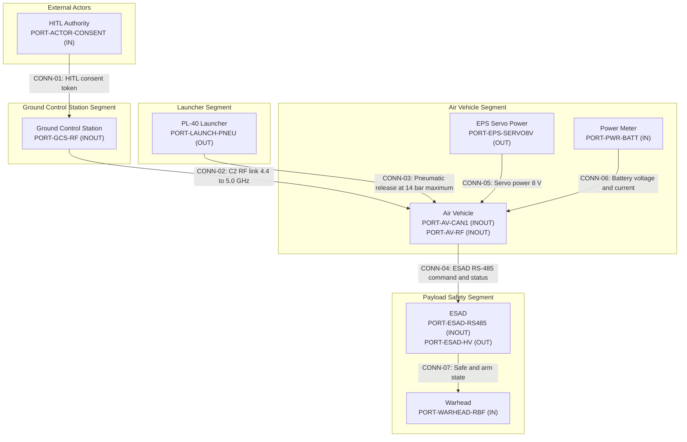

| Attribute | Specification Detail |
| :--- | :--- |
| **Issue ID** | MI-08 |
| **Title** | Tactical Mission Intent: Go/No-Go Decision Matrix |
| **Type** | Mission Intent |
| **Generation Mode** | subagent-drafted |
| **Specification Source** | .pipeline/schema.sysml; schema/extracted/parametric_limits.md; schema/extracted/oem_bom.md; schema/extracted/interface_table.md |
| **Version** | 1.0.0 |
| **Date** | 2026-10-31 |

## 8. Go/No-Go Decision Matrix

This unit defines deterministic phase-gate checks for pre-operation, in-operation, and recovery phases. Every gate is a boolean conjunction term: a phase may proceed only when all of its gates evaluate TRUE. Numeric thresholds are bounded by the OEM parametric extraction set. Where the OEM sources are silent, the gate is marked as operator-configured or omitted, and no synthetic numeric threshold is introduced.

### 8.1 Super-System Operational Architecture and Segment Boundaries

The super-system operational architecture partitions the mission into the air vehicle segment, the ground control station segment, the launcher segment, the payload safety segment, and external actors. Segment boundaries and connections follow the standards governance below.

Standards governance: IEEE Std 1362-1998 Section 5.3 and DoDAF SV-1. The diagram is a compact operational context view; internal wire pinouts remain in the Level 1C interface control documents.

### 8.2 Gate Conjunction and HITL Authority Policy

A phase transition is permitted only when every gate in that phase is TRUE.

$$
\begin{aligned}
\mathrm{Go}_{\mathrm{pre}} &\iff \bigwedge_{c \in \mathcal{C}_{\mathrm{pre}}} c = \mathrm{TRUE} \\
\mathrm{Go}_{\mathrm{in}} &\iff \bigwedge_{c \in \mathcal{C}_{\mathrm{in}}} c = \mathrm{TRUE} \\
\mathrm{Go}_{\mathrm{rec}} &\iff \bigwedge_{c \in \mathcal{C}_{\mathrm{rec}}} c = \mathrm{TRUE}
\end{aligned}
$$

| Parameter | Symbol | Units | Constraint / Rule | Description |
| :--- | :--- | :--- | :--- | :--- |
| Pre-operation gate set | C_pre | dimensionless | Contains every pre-operation gate | Conjunction set that authorizes launch commit |
| In-operation gate set | C_in | dimensionless | Contains every in-operation gate | Conjunction set that authorizes mission continuation |
| Recovery gate set | C_rec | dimensionless | Contains every recovery gate | Conjunction set that authorizes safe shutdown |
| Gate truth value | c | dimensionless | TRUE or FALSE | Deterministic boolean result of one GNG check |

HITL authority is mandatory for launch commit, payload arming, engagement, and recovery shutdown. The Mission Commander authorizes launch commit and mission continuation changes. The Safety Supervisor holds veto authority over ESAD arming, warhead initiation, and any recovery action that could release hazardous material. The GCS Operator executes link, route, and airspeed changes under Mission Commander direction. No autonomous software path may bypass a HITL consent token for a high-consequence actuation.

Governing authority: DoD Directive 3000.09 Section 3.1 and Section 3.1.b and CJCSI 3121.01B Enclosure E Section 2.d. Gate overrides are prohibited for ESAD, warhead, and launch-release gates; only the Safety Supervisor may reset a latched No-Go after the underlying condition is cleared and re-verified.

### 8.3 Subsystem Architecture (100% AST Part Coverage)

The subsystem architecture for gate sensing and actuation uses the SSOT ground truth bindings below. Each subsystem part has a functional purpose tied to at least one gate.

| Subsystem Part | Functional Purpose | SSOT Ground Truth |
| :--- | :--- | :--- |
| `Battery_12S2P_Li_Metal_BEI` | Main DC source; pack voltage window for pre-flight and in-operation power gates | [oem_bom.md:18](schema/extracted/oem_bom.md#L18), [parametric_limits.md:29](schema/extracted/parametric_limits.md#L29) |
| `Power_Meter` | Voltage and current sensing; UAV RBF power interlock | [oem_bom.md:20](schema/extracted/oem_bom.md#L20) |
| `EPS_Servo_Power_8V_Rail` | Regulated 8 V rail for all eight servos | [oem_bom.md:28](schema/extracted/oem_bom.md#L28), [parametric_limits.md:28](schema/extracted/parametric_limits.md#L28) |
| `Ruddervator` | Canonical tail control surface assembly, quantity 4 | [oem_bom.md:23](schema/extracted/oem_bom.md#L23), [parametric_limits.md:20](schema/extracted/parametric_limits.md#L20) |
| `Ruddervator_Servo_1` | Left-up tail servo, pitch and yaw mixing | [oem_bom.md:24](schema/extracted/oem_bom.md#L24) |
| `Ruddervator_Servo_2` | Right-up tail servo, pitch and yaw mixing | [oem_bom.md:25](schema/extracted/oem_bom.md#L25) |
| `Ruddervator_Servo_3` | Right-down tail servo, pitch and yaw mixing | [oem_bom.md:26](schema/extracted/oem_bom.md#L26) |
| `Ruddervator_Servo_4` | Left-down tail servo, pitch and yaw mixing | [oem_bom.md:27](schema/extracted/oem_bom.md#L27) |
| `Autopilot_Computing_Board_Cube_Orange_Plus` | State estimation, CAN 1 and CAN 2 management, gate arbitration | [oem_bom.md:12](schema/extracted/oem_bom.md#L12) |
| `GNSS_Module_Septentrio_Asterx_m3_pro` | Absolute position and velocity receiver for navigation gates | [oem_bom.md:15](schema/extracted/oem_bom.md#L15) |
| `Pitot_Tube_CUAV_SKYE2` | Heated and drained airspeed sensor for airspeed gates | [oem_bom.md:39](schema/extracted/oem_bom.md#L39) |
| `Radio_Module_DTC` | Command and control radio transceiver in the 4.4 to 5.0 GHz band | [oem_bom.md:44](schema/extracted/oem_bom.md#L44) |
| `GCS_Radio_Box` | Ground control station radio, 2 W output setting | [oem_bom.md:72](schema/extracted/oem_bom.md#L72), [parametric_limits.md:45](schema/extracted/parametric_limits.md#L45) |
| `ESAD` | Electronic Safe and Arm Device, Critical / DAL-A | [oem_bom.md:52](schema/extracted/oem_bom.md#L52) |
| `Warhead` | Modular warhead, 5 kg | [oem_bom.md:57](schema/extracted/oem_bom.md#L57), [parametric_limits.md:19](schema/extracted/parametric_limits.md#L19) |
| `PL_40_Rail` | Pneumatic launcher rail and pressure boundary | [oem_bom.md:82](schema/extracted/oem_bom.md#L82) |
| `PL_40_Compressor_Unit` | Launcher air compressor and pressure source | [oem_bom.md:89](schema/extracted/oem_bom.md#L89) |
| `PL_40_Trigger_Handle` | Handheld launch controller with dual switches | [oem_bom.md:95](schema/extracted/oem_bom.md#L95) |
| `Gimbal_Nighthawk2UZ` | IR and RGB camera gimbal payload for target tracking | [oem_bom.md:42](schema/extracted/oem_bom.md#L42) |
| `Camera_Compute_Module_Trip6` | Gimbal control, video, and target tracking computer | [oem_bom.md:43](schema/extracted/oem_bom.md#L43) |

### 8.4 System Interface Topology and Port Taxonomy

The port taxonomy below binds every gate sensor and mechanism to a declared interface. Port directions follow the interface table and the consolidated SysML AST.

| Port | Direction | Peer | Protocol | Gate Binding | SSOT Ground Truth |
| :--- | :--- | :--- | :--- | :--- | :--- |
| `PORT-AV-CAN1` | INOUT | Autopilot and ruddervator servos | CAN bus DroneCAN | GNG-16 | [interface_table.md:9](schema/extracted/interface_table.md#L9) |
| `PORT-EPS-SERVO8V` | OUT | Ruddervator servos and wing servos | DC power 8 V | GNG-02, GNG-16 | [interface_table.md:16](schema/extracted/interface_table.md#L16) |
| `PORT-PWR-BATT` | IN | Battery main power | DC power 36 V to 50.4 V | GNG-01, GNG-17 | [oem_bom.md:18](schema/extracted/oem_bom.md#L18) |
| `PORT-ESAD-RS485` | OUT | ESAD command and status | RS-485 half duplex, 115200 bps | GNG-07, GNG-15 | [interface_table.md:45](schema/extracted/interface_table.md#L45) |
| `PORT-ESAD-ARM` | IN | ESAD arm enable DSC_IN1 | Discrete PWM, 1 ms period, 50 percent duty | GNG-07 | [interface_table.md:50](schema/extracted/interface_table.md#L50) |
| `PORT-ESAD-UMB` | IN | ESAD umbilical continuity | Analog continuity, 0.5 Ohm maximum at 20 mA | GNG-07 | [interface_table.md:51](schema/extracted/interface_table.md#L51) |
| `PORT-ESAD-HV` | OUT | ESAD detonator high voltage | High voltage, firing pulse up to 1800 V | GNG-15 | [interface_table.md:55](schema/extracted/interface_table.md#L55) |
| `PORT-UAV-RBF` | IN | UAV power interlock | Discrete interlock, power ON or OFF | GNG-01 | [interface_table.md:57](schema/extracted/interface_table.md#L57) |
| `PORT-WARHEAD-RBF` | IN | Warhead RBF interlock | Discrete interlock, safe or armed | GNG-08 | [interface_table.md:58](schema/extracted/interface_table.md#L58) |
| `PORT-GCS-RF` | INOUT | GCS MARS antenna and air vehicle radio | RF 4.4 to 5.0 GHz | GNG-09 | [interface_table.md:63](schema/extracted/interface_table.md#L63) |
| `PORT-LAUNCH-PNEU` | OUT | PL-40 rail inlet | Pneumatic, 14 bar maximum | GNG-03 | [interface_table.md:60](schema/extracted/interface_table.md#L60) |
| `PORT-LAUNCH-TRIG` | OUT | PL-40 trigger handle | Electrical discrete, dual-switch launch command | GNG-05, GNG-06 | [interface_table.md:61](schema/extracted/interface_table.md#L61) |
| `PORT-PITOT` | IN | Pitot tube CUAV SKYE2 | Pneumatic pressure port for airspeed sensing | GNG-11 | [oem_bom.md:39](schema/extracted/oem_bom.md#L39) |

### 8.5 Pre-Operation Phase Gates

| Check ID | Phase | Parameter / Check | Threshold Condition | Sensor / Mechanism | Go Action | No-Go Action | HITL Authority | OEM / Parametric Source |
| :--- | :--- | :--- | :--- | :--- | :--- | :--- | :--- | :--- |
| `GNG-01` | Pre-Operation | UAV battery pre-flight voltage | V_pack >= 49 V and V_pack <= 50 V | Power Meter voltage sensor and UAV RBF key | Authorize power-on and built-in test | Hold; do not remove UAV RBF key | Mission Commander and Ground Crew Lead | [parametric_limits.md:38](schema/extracted/parametric_limits.md#L38), [oem_bom.md:20](schema/extracted/oem_bom.md#L20) |
| `GNG-02` | Pre-Operation | Servo power rail and ruddervator complement | V_servo = 8 V and all four ruddervator surfaces and all four ruddervator servos valid | EPS 8 V rail monitor and CAN1 DroneCAN servo status | Enable 8 V rail and verify all four ruddervator servos | Inhibit launch; keep 8 V rail off | Flight Crew Lead | [parametric_limits.md:20](schema/extracted/parametric_limits.md#L20), [parametric_limits.md:22](schema/extracted/parametric_limits.md#L22), [parametric_limits.md:28](schema/extracted/parametric_limits.md#L28) |
| `GNG-03` | Pre-Operation | PL-40 catapult launch pressure | P_launch >= 13 bar and P_launch <= 14 bar | PL-40 pressure gauge and power switching circuit | Remove carriage safety lock pin and arm trigger | Inhibit launch; adjust pressure to the stated window | Launch Crew Lead | [parametric_limits.md:46](schema/extracted/parametric_limits.md#L46), [parametric_limits.md:47](schema/extracted/parametric_limits.md#L47), [oem_bom.md:93](schema/extracted/oem_bom.md#L93) |
| `GNG-04` | Pre-Operation | Launcher working temperature | T_launch >= -20 deg C and T_launch <= 50 deg C | Ambient thermometer and PL-40 visual inspection | Proceed with launcher setup | Hold; shelter or reschedule launch | Launch Crew Lead and Safety Supervisor | [parametric_limits.md:79](schema/extracted/parametric_limits.md#L79), [parametric_limits.md:80](schema/extracted/parametric_limits.md#L80) |
| `GNG-05` | Pre-Operation | PL-40 battery state | V_batt >= 16 V and V_batt nominal 18 V and capacity 6000 mAh and cutoff 14.5 V | PL-40 battery dock and power switching circuit | Enable trigger power | Replace or charge battery; hold | Launch Crew Lead | [parametric_limits.md:81](schema/extracted/parametric_limits.md#L81), [parametric_limits.md:82](schema/extracted/parametric_limits.md#L82), [parametric_limits.md:83](schema/extracted/parametric_limits.md#L83), [parametric_limits.md:84](schema/extracted/parametric_limits.md#L84) |
| `GNG-06` | Pre-Operation | Launch mass and velocity envelope | m_launched <= 30 kg and m_takeoff <= 17 kg and v_launch <= 25 m/s and theta_launch = 12 deg | Mass verification record, launcher rail angle, and rail length | Release safety lock and authorize launch | Reconfigure or re-ballast; hold | Mission Commander and Launch Crew Lead | [parametric_limits.md:18](schema/extracted/parametric_limits.md#L18), [parametric_limits.md:70](schema/extracted/parametric_limits.md#L70), [parametric_limits.md:71](schema/extracted/parametric_limits.md#L71), [parametric_limits.md:72](schema/extracted/parametric_limits.md#L72) |
| `GNG-07` | Pre-Operation | ESAD safe and arm interlock | ESAD safe and R_umb <= 0.5 Ohm at 20 mA and arm enable low <= 0.7 VDC until consent | ESAD RBF key, umbilical continuity monitor, and DSC_IN1 arm enable | Keep ESAD safe; authorize armed state only with HITL consent | Keep ESAD RBF key installed; inhibit arming | Safety Supervisor and Mission Commander | [interface_table.md:49](schema/extracted/interface_table.md#L49), [interface_table.md:50](schema/extracted/interface_table.md#L50), [interface_table.md:51](schema/extracted/interface_table.md#L51), [oem_bom.md:52](schema/extracted/oem_bom.md#L52) |
| `GNG-08` | Pre-Operation | Warhead RBF interlock | Warhead_RBF = SAFE | Warhead RBF key and discrete interlock | Permit ESAD arming only after HITL consent | Hold payload arming | Safety Supervisor | [interface_table.md:58](schema/extracted/interface_table.md#L58), [oem_bom.md:57](schema/extracted/oem_bom.md#L57) |
| `GNG-09` | Pre-Operation | Primary C2 link band and ground radio power | 4.4 GHz <= f_C2 <= 5.0 GHz and P_ground_radio = 2 W | DTC transceiver diagnostics and GCS radio power setting | Proceed to launch commit | Hold; restore link and radio setting | GCS Operator and Mission Commander | [interface_table.md:63](schema/extracted/interface_table.md#L63), [parametric_limits.md:45](schema/extracted/parametric_limits.md#L45) |

### 8.6 In-Operation Phase Gates

| Check ID | Phase | Parameter / Check | Threshold Condition | Sensor / Mechanism | Go Action | No-Go Action | HITL Authority | OEM / Parametric Source |
| :--- | :--- | :--- | :--- | :--- | :--- | :--- | :--- | :--- |
| `GNG-10` | In-Operation | GNSS fix validity | GNSS fix valid; no numeric PDOP or satellite-count threshold is stated in OEM sources | GNSS Module Septentrio Asterx-m3 pro | Continue navigation | Hold or execute operator-authorized dead reckoning | GCS Operator | [oem_bom.md:15](schema/extracted/oem_bom.md#L15) |
| `GNG-11` | In-Operation | Airspeed and dive envelope | V_air >= 26 m/s and V_air <= 38 m/s and V_dive <= 55 m/s and dive angle <= 22 deg | Pitot Tube CUAV SKYE2 and GNSS state estimate | Continue mission | Reduce speed, recover dive, or abort | GCS Operator | [parametric_limits.md:7](schema/extracted/parametric_limits.md#L7), [parametric_limits.md:8](schema/extracted/parametric_limits.md#L8), [parametric_limits.md:9](schema/extracted/parametric_limits.md#L9), [parametric_limits.md:10](schema/extracted/parametric_limits.md#L10) |
| `GNG-12` | In-Operation | Altitude floor and loiter radius | h >= 50 m and R_loiter = 300 m | GNSS and barometric altitude, autopilot loiter controller | Continue mission | Climb to or above the floor and re-enter the loiter geometry | GCS Operator | [parametric_limits.md:42](schema/extracted/parametric_limits.md#L42), [parametric_limits.md:43](schema/extracted/parametric_limits.md#L43) |
| `GNG-13` | In-Operation | Flight endurance | t_flight <= 90 min | Autopilot mission timer and battery telemetry | Continue mission | Return to recovery area or divert | Mission Commander | [parametric_limits.md:12](schema/extracted/parametric_limits.md#L12) |
| `GNG-14` | In-Operation | Target track and engagement envelope | t_track >= 2 s and t_track <= 5 s and elevation <= 15 deg and V_air <= 55 m/s | Gimbal Nighthawk2UZ, Camera Compute Module Trip6, and GNSS | Present engagement solution to HITL authority | Wave off; no engagement authorization | Mission Commander and Safety Supervisor | [parametric_limits.md:48](schema/extracted/parametric_limits.md#L48), [parametric_limits.md:49](schema/extracted/parametric_limits.md#L49), [parametric_limits.md:50](schema/extracted/parametric_limits.md#L50), [parametric_limits.md:51](schema/extracted/parametric_limits.md#L51) |
| `GNG-15` | In-Operation | ESAD high-voltage monitor | 0 V <= V_HV <= 1800 V and firing pulse <= 1800 V | ESAD high-voltage monitor | Keep safe; release firing only with HITL consent token | Inhibit firing; keep ESAD safe | Mission Commander and Safety Supervisor | [parametric_limits.md:66](schema/extracted/parametric_limits.md#L66), [interface_table.md:55](schema/extracted/interface_table.md#L55) |
| `GNG-16` | In-Operation | Ruddervator control authority | N_ruddervator = 4 and N_ruddervator_servo = 4 and V_servo = 8 V and all four servo status frames valid | CAN 1 DroneCAN servo status and EPS 8 V rail monitor | Continue mission | Revert to direct control or abort | GCS Operator | [parametric_limits.md:20](schema/extracted/parametric_limits.md#L20), [parametric_limits.md:22](schema/extracted/parametric_limits.md#L22), [parametric_limits.md:28](schema/extracted/parametric_limits.md#L28), [interface_table.md:9](schema/extracted/interface_table.md#L9) |
| `GNG-17` | In-Operation | In-flight battery voltage window | V_pack >= 36 V and V_pack <= 50.4 V | Power Meter voltage sensor | Continue mission | Land or divert before the lower limit is reached | Mission Commander | [parametric_limits.md:29](schema/extracted/parametric_limits.md#L29), [parametric_limits.md:30](schema/extracted/parametric_limits.md#L30) |

### 8.7 Recovery and Post-Operation Phase Gates

| Check ID | Phase | Parameter / Check | Threshold Condition | Sensor / Mechanism | Go Action | No-Go Action | HITL Authority | OEM / Parametric Source |
| :--- | :--- | :--- | :--- | :--- | :--- | :--- | :--- | :--- |
| `GNG-18` | Recovery | Payload safe state after recovery | ESAD safe and Warhead_RBF = SAFE and 0 V <= V_HV <= 1800 V | ESAD high-voltage monitor, ESAD RBF key, and warhead RBF key | Authorize recovery shutdown | Hold at safe state; keep RBF keys installed | Safety Supervisor | [interface_table.md:56](schema/extracted/interface_table.md#L56), [interface_table.md:58](schema/extracted/interface_table.md#L58), [parametric_limits.md:66](schema/extracted/parametric_limits.md#L66) |
| `GNG-19` | Post-Operation | Post-flight battery and launcher battery state | 36 V <= V_pack <= 50.4 V and V_launcher_batt >= 16 V | Power Meter voltage sensor and PL-40 battery dock | Authorize post-flight inspection and recharge | Quarantine battery and inspect before recharge | Ground Crew Lead | [parametric_limits.md:29](schema/extracted/parametric_limits.md#L29), [parametric_limits.md:30](schema/extracted/parametric_limits.md#L30), [parametric_limits.md:84](schema/extracted/parametric_limits.md#L84) |

### 8.8 OEM-Silent Gate Parameters

The OEM sources are silent on the following parameters. They are not assigned synthetic numeric thresholds in this unit.

| OEM-Silent Parameter | Disposition |
| :--- | :--- |
| GNSS PDOP and minimum visible satellite count | Not stated in OEM sources; use a valid-fix boolean and operator procedure |
| C2 link margin and received signal strength | Not stated in OEM sources; use the grounded RF band and radio power checks |
| State-estimation figure of merit and position error bound | Not stated in OEM sources; no numeric gate is defined |
| ESC, motor, and battery temperature limits | Not stated in OEM sources; no numeric in-operation thermal gate is defined |
| Spatial containment distance to boundary | Not stated in OEM sources; containment geometry belongs to the airspace geozone unit |
| Battery state of charge percentage and cell imbalance | Not stated in OEM sources; use the grounded pack voltage window |
| Surface wind, gust, and crosswind limits | Not stated in OEM sources; no numeric wind gate is defined |
| Parachute deployment as a mission recovery means | Parachute is non-mission in the OEM BOM; not used as a mission gate or credit |

### 8.9 Public Clause Traceability

| Check ID | Governing public clause |
| :--- | :--- |
| `GNG-01` through `GNG-06` | FAA 14 CFR Section 107.49(a), Section 107.49(b), Section 107.49(c); AMC1 UAS.SPEC.050 Section 3.2; INCOSE SEH v5.0 Section 3.3.1 |
| `GNG-03` through `GNG-05` | MIL-STD-810H Method 501.7 Section 4.2 and Method 502.7 Section 4.2 |
| `GNG-07` and `GNG-08` | DoD Directive 3000.09 Section 3.1 and Section 3.1.b; CJCSI 3121.01B Enclosure E Section 2.d |
| `GNG-09` and `GNG-10` | RTCA DO-362A Section 2.2 and Section 3.4; NATO STANAG 4586 Section 5.1 |
| `GNG-11` through `GNG-17` | ASTM F3269-17 Section 5.2 and Section 5.3; MIL-STD-882E Task 204 Section 4.2 and Task 205 Section 4.2 |
| `GNG-14` and `GNG-15` | CJCSI 3121.01B Enclosure A Section 4.b and Enclosure E Section 2.d; DoD Directive 3000.09 Section 3.1 |
| `GNG-16` | RTCA DO-178C Section 6.3.1; MIL-STD-1629A Section 4.5; SAE ARP4761 Section 4.3.3 |
| `GNG-18` and `GNG-19` | MIL-STD-882E Task 106 Section 4.2; JARUS SORA v2.5 Annex E Section E.14 |

## Source References

All numeric thresholds in this unit are cited from the OEM extraction set. The controlling references are [parametric_limits.md:7](schema/extracted/parametric_limits.md#L7), [oem_bom.md:9](schema/extracted/oem_bom.md#L9), and [interface_table.md:9](schema/extracted/interface_table.md#L9). Public clause obligations are cited from [RESEARCH_INVENTORY.md:25](docs/research/RESEARCH_INVENTORY.md#L25).

- [S1] `schema/extracted/parametric_limits.md at line 7` - OEM numeric limits with source line citations.
- [S2] `schema/extracted/oem_bom.md at line 9` - OEM component identity, criticality, and mission baseline status.
- [S3] `schema/extracted/interface_table.md at line 9` - OEM interface, protocol, and link characteristics.
- [S4] `.pipeline/schema.sysml:4` - AST parameter nodes PL-01 through PL-94 and part definitions.
- [S5] `docs/research/RESEARCH_INVENTORY.md at line 25` - normative public clause baseline for FAA, EASA, RTCA, ASTMs, MIL-STD, and SORA obligations.
