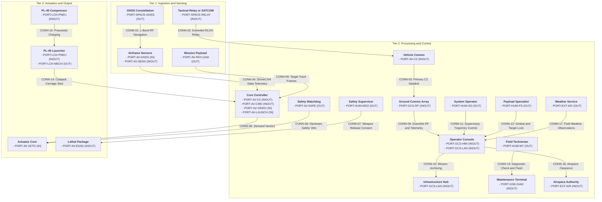

| Attribute | Specification Detail |
| :--- | :--- |
| **Issue ID** | #Not assigned |
| **Title** | System Interface Matrix and Topological Connectivity |
| **Type** | icd |
| **Interface Level** | Level 1C Logical Interface |
| **Generation Mode** | subagent |
| **Specification Source** | [.pipeline/schema.sysml](../../.pipeline/schema.sysml) |

# Level 1C: System Interface Matrix and Topological Connectivity

## 1. Executive Summary and Interface Scope

This Level 1C System Interface Matrix is the logical bridge between the Level 1B operational architecture declared in the ConOps SV-1 diagram and the downstream Level 2 specifications. It registers 24 directional logical ports and 17 logical connections (CONN-01 through CONN-17), exactly matching the connection set declared by the ConOps SV-1 view. All port identifiers and connection identifiers are logical abstractions; no physical connectors, pinouts, harness gauges, or transport framing are declared here.

The system boundary partitions the Avenger V2.5 air vehicle, the PL-40 launcher and ground support equipment, the supervisory and control segment, operational roles, and external authorities. Every port below is traceable to the Level 0 interface extraction (`schema/extracted/interface_table.md`) or to the normative ConOps operational context. Where a bound or rating is absent from the OEM sources, the cell states "Not stated in OEM sources".

## 2. Subsystem Topological Connectivity Graph

## 3. Canonical N^2 Subsystem Interface Matrix

Rows identify transmitting subsystems; columns identify receiving subsystems. The main diagonal records intra-segment connections. Cells list connection identifiers and conveyed signal counts.

| Subsystem | 1. Space and Orbital | 2. Air Vehicle | 3. Supervisory and Control | 4. Support and GSE | 5. Operational Roles | 6. External Authorities |
| :--- | :--- | :--- | :--- | :--- | :--- | :--- |
| **1. Space and Orbital** | **[ Space and Orbital ]** | CONN-01 (2 Signals), CONN-02 (1 Signal) | -- | -- | -- | -- |
| **2. Air Vehicle** | -- | **[ Air Vehicle ]** Internal: CONN-04 (2 Signals), CONN-05 (2 Signals), CONN-06 (2 Signals), CONN-08 (1 Signal) | CONN-03 (3 Signals) | -- | -- | -- |
| **3. Supervisory and Control** | -- | -- | **[ Supervisory and Control ]** Internal: CONN-09 (2 Signals), CONN-10 (1 Signal) | -- | -- | CONN-16 (1 Signal) |
| **4. Support and GSE** | -- | CONN-14 (1 Signal) | -- | **[ Support and GSE ]** Internal: CONN-15 (2 Signals) | -- | -- |
| **5. Operational Roles** | -- | CONN-07 (2 Signals) | CONN-11 (1 Signal), CONN-12 (2 Signals) | CONN-13 (2 Signals) | **[ Operational Roles ]** | -- |
| **6. External Authorities** | -- | -- | CONN-17 (1 Signal) | -- | -- | **[ External Authorities ]** |

## 4. Port Definition Roster Table

| Port ID | Subsystem | Port Name | Direction | Port Type | Multiplicity | Protocol Profile |
| :--- | :--- | :--- | :--- | :--- | :--- | :--- |
| `PORT-SPACE-GNSS` | GNSS Constellation | GnssNavigationSignalOut | OUT | DataPort | 1 | RealTimeSync |
| `PORT-AV-GNSS` | Airframe Sensors Suite | GnssNavigationSignalIn | IN | DataPort | 1 | RealTimeSync |
| `PORT-SPACE-RELAY` | Tactical Relay or SATCOM | RelayLinkPort | INOUT | DataPort | 1 | AsyncEvent |
| `PORT-AV-C2` | Autopilot Stack ASTK A5 V2.5 | CommandAndControlPort | INOUT | DataPort | 1 | PeriodicStream |
| `PORT-AV-SENS` | Airframe Sensors Suite | SensorStateTelemetryPort | INOUT | TelemetryPort | 1 | PeriodicStream |
| `PORT-AV-CMD` | Autopilot Stack ASTK A5 V2.5 | ActuationDemandPort | INOUT | CommandPort | 1 | PeriodicStream |
| `PORT-AV-PAYLOAD` | Mission Payload | TargetTrackDataOut | OUT | DataPort | 1 | PeriodicStream |
| `PORT-AV-VIDEO` | Autopilot Stack ASTK A5 V2.5 | TargetTrackVideoIn | IN | DataPort | 1 | PeriodicStream |
| `PORT-HUM-MSO` | Mission Safety Officer | WeaponReleaseConsentOut | OUT | CommandPort | 1 | AsyncEvent |
| `PORT-AV-ESAD` | Lethal Package | SafeAndArmControlPort | INOUT | EventPort | 1 | AsyncEvent |
| `PORT-AV-SAFE` | Safety Watchdog | HardwareSafetyVetoOut | OUT | EventPort | 1 | RealTimeSync |
| `PORT-AV-VETO` | Actuator Core | HardwareSafetyVetoIn | IN | EventPort | 1 | RealTimeSync |
| `PORT-GCS-RF` | GCS Radio Box and MARS Antenna | GroundRadioLinkPort | INOUT | DataPort | 1 | PeriodicStream |
| `PORT-GCS-HMI` | GCS Tablet FZ-G2 | OperatorConsoleHmiPort | INOUT | CommandPort | 1 | AsyncEvent |
| `PORT-GCS-LAN` | GCS Tablet FZ-G2 | GroundNetworkPort | INOUT | DataPort | 1 | AsyncEvent |
| `PORT-HUM-SO` | System Operator | SupervisoryTrajectoryControlOut | OUT | CommandPort | 1 | AsyncEvent |
| `PORT-HUM-PS` | Payload Specialist | GimbalAndTargetControlOut | OUT | CommandPort | 1 | AsyncEvent |
| `PORT-HUM-MT` | Field Technician | DiagnosticControlOut | OUT | CommandPort | 1 | AsyncEvent |
| `PORT-GSE-DIAG` | External Interface Board | DiagnosticCheckAndFlashPort | INOUT | CommandPort | 1 | AsyncEvent |
| `PORT-LCH-MECH` | PL-40 Launcher | CarriageReleasePort | OUT | CommandPort | 1 | AsyncEvent |
| `PORT-AV-LAUNCH` | Autopilot Stack ASTK A5 V2.5 | LaunchReleaseIn | IN | CommandPort | 1 | AsyncEvent |
| `PORT-LCH-PNEU` | PL-40 Launcher | PneumaticSupplyPort | INOUT | DataPort | 1 | PeriodicStream |
| `PORT-EXT-AIR` | Airspace Coordination Authority | AirspaceClearancePort | INOUT | CommandPort | 1 | AsyncEvent |
| `PORT-EXT-WX` | Meteorological Service | FieldWeatherObservationOut | OUT | DataPort | 1 | AsyncEvent |

## 5. Connection Binding Roster Table

| Connection ID | Source Port | Dest Port | Flow Behavior | Latency Max ms | Reliability Req | Item Flows Conveyed |
| :--- | :--- | :--- | :--- | :--- | :--- | :--- |
| `CONN-01` | `PORT-SPACE-GNSS` (GNSS_Constellation.gnssNavigationSignalOut) | `PORT-AV-GNSS` (Airframe_Sensors_Suite.gnssNavigationSignalIn) | Continuous RF navigation | Not stated in OEM sources | Not stated in OEM sources | GnssPositionFix, GnssVelocityFix |
| `CONN-02` | `PORT-SPACE-RELAY` (Tactical_Relay_SATCOM.relayLinkPort) | `PORT-AV-C2` (Autopilot_Stack_ASTK_A5_V2_5.commandAndControlPort) | Aperiodic relay command | Not stated in OEM sources | Not stated in OEM sources | RelayCommandFrame |
| `CONN-03` | `PORT-AV-C2` (Autopilot_Stack_ASTK_A5_V2_5.commandAndControlPort) | `PORT-GCS-RF` (GCS_Radio_Box_MARS_Antenna.groundRadioLinkPort) | Continuous command telemetry and video RF | Not stated in OEM sources | Not stated in OEM sources | SupervisoryCommandFrame, TelemetryDownlinkFrame, VideoDownlinkFrame |
| `CONN-04` | `PORT-AV-SENS` | `PORT-AV-SENS` | Periodic DroneCAN state telemetry | Not stated in OEM sources | Not stated in OEM sources | Can1VehicleStateFrame, Can2ActuatorStatusFrame |
| `CONN-05` | `PORT-AV-CMD` (Autopilot_Stack_ASTK_A5_V2_5.actuationDemandPort) | `PORT-AV-CMD` (Autopilot_Stack_ASTK_A5_V2_5.actuationDemandPort) | Periodic actuation demand | Not stated in OEM sources | Not stated in OEM sources | ServoPositionDemand, ServoPowerEnable |
| `CONN-06` | `PORT-AV-PAYLOAD` (Mission_Payload.targetTrackDataOut) | `PORT-AV-VIDEO` (Autopilot_Stack_ASTK_A5_V2_5.targetTrackVideoIn) | Periodic target track frames | Not stated in OEM sources | Not stated in OEM sources | TargetTrackFrame, GimbalAttitudeFrame |
| `CONN-07` | `PORT-HUM-MSO` (Mission_Safety_Officer.weaponReleaseConsentOut) | `PORT-AV-ESAD` (Lethal_Package.safeAndArmControlPort) | Event-driven release consent | Not stated in OEM sources | Not stated in OEM sources | WeaponReleaseConsent, ReleaseConsentToken |
| `CONN-08` | `PORT-AV-SAFE` (Safety_Watchdog.hardwareSafetyVetoOut) | `PORT-AV-VETO` (Actuator_Core.hardwareSafetyVetoIn) | Continuous safety veto | Not stated in OEM sources | Not stated in OEM sources | SafetyVeto |
| `CONN-09` | `PORT-GCS-RF` (GCS_Radio_Box_MARS_Antenna.groundRadioLinkPort) | `PORT-GCS-HMI` (GCS_Tablet_FZ_G2.operatorConsoleHmiPort) | Continuous downlink RF and telemetry | Not stated in OEM sources | Not stated in OEM sources | DownlinkTelemetryFrame, DownlinkVideoFrame |
| `CONN-10` | `PORT-GCS-LAN` | `PORT-GCS-LAN` | Event-driven mission archiving | Not stated in OEM sources | Not stated in OEM sources | MissionArchivePacket |
| `CONN-11` | `PORT-HUM-SO` (System_Operator.supervisoryTrajectoryControlOut) | `PORT-GCS-HMI` (GCS_Tablet_FZ_G2.operatorConsoleHmiPort) | Event-driven supervisory trajectory control | Not stated in OEM sources | Not stated in OEM sources | TrajectoryCommandFrame |
| `CONN-12` | `PORT-HUM-PS` (Payload_Specialist.gimbalAndTargetControlOut) | `PORT-GCS-HMI` (GCS_Tablet_FZ_G2.operatorConsoleHmiPort) | Event-driven gimbal and target lock | Not stated in OEM sources | Not stated in OEM sources | GimbalPointingCommand, TargetLockCommand |
| `CONN-13` | `PORT-HUM-MT` (Field_Technician.diagnosticControlOut) | `PORT-GSE-DIAG` (External_Interface_Board.diagnosticCheckAndFlashPort) | Event-driven diagnostic check and flash | Not stated in OEM sources | Not stated in OEM sources | DiagnosticCommandFrame, DiagnosticResponseFrame |
| `CONN-14` | `PORT-LCH-MECH` (PL-40_Launcher.carriageReleasePort) | `PORT-AV-LAUNCH` (Autopilot_Stack_ASTK_A5_V2_5.launchReleaseIn) | Event-driven catapult carriage release | Not stated in OEM sources | Not stated in OEM sources | LaunchReleaseDiscrete |
| `CONN-15` | `PORT-LCH-PNEU` | `PORT-LCH-PNEU` | Continuous pneumatic charging | Not stated in OEM sources | Not stated in OEM sources | PneumaticSupplyPressure, LauncherTriggerPower |
| `CONN-16` | `PORT-GCS-HMI` (GCS_Tablet_FZ_G2.operatorConsoleHmiPort) | `PORT-EXT-AIR` (Airspace_Coordination_Authority.airspaceClearancePort) | Event-driven airspace clearance | Not stated in OEM sources | Not stated in OEM sources | AirspaceClearanceState |
| `CONN-17` | `PORT-EXT-WX` (Meteorological_Service.fieldWeatherObservationOut) | `PORT-GCS-HMI` (GCS_Tablet_FZ_G2.operatorConsoleHmiPort) | Aperiodic field weather observation | Not stated in OEM sources | Not stated in OEM sources | FieldWeatherObservation |

## 6. Source References

- Structural Schema: [.pipeline/schema.sysml](../../.pipeline/schema.sysml)
- Interface Extraction: [schema/extracted/interface_table.md](../../schema/extracted/interface_table.md)
- OEM Bill of Materials: [schema/extracted/oem_bom.md](../../schema/extracted/oem_bom.md)
- Parametric Limits: [schema/extracted/parametric_limits.md](../../schema/extracted/parametric_limits.md)
- Normative ConOps: [docs/conops/CONOPS.md](../conops/CONOPS.md)
