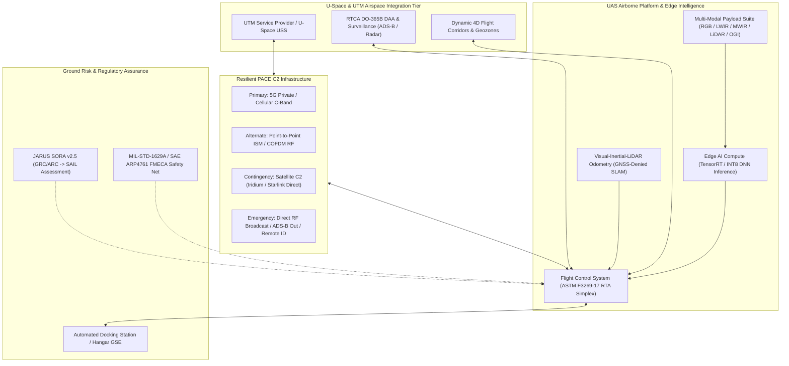
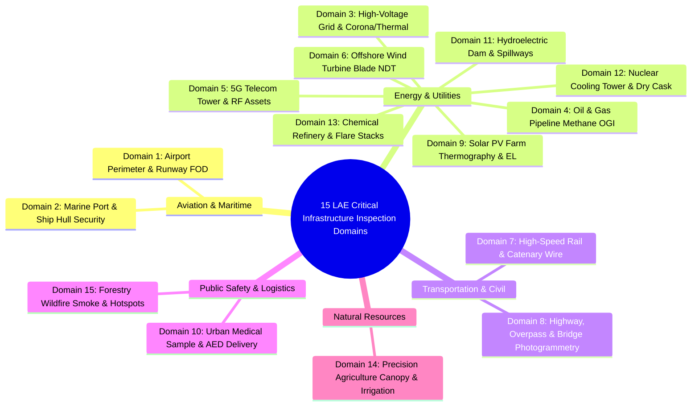
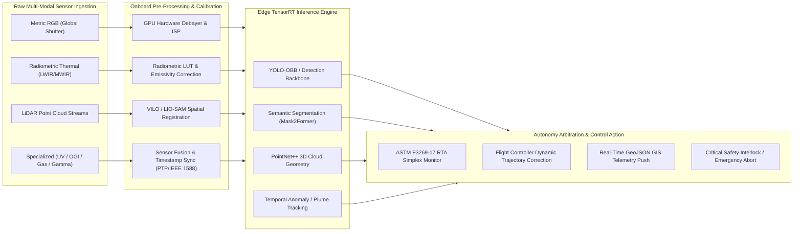

| Attribute | Value |
| :--- | :--- |
| **Title** | Low-Altitude Economy Critical Infrastructure Inspection Domains: Systems Engineering Architecture, Payloads, SORA Risk Assurance & Autonomy Pipelines |
| **Document ID** | DEAP-RES-LAE-001 |
| **Version** | 1.0.0 |
| **Date** | 2026-09-03 |
| **Author** | Systems Engineering & Autonomy Architecture Team |
| **Classification** | Technical Application & Systems Architecture Paper |

# Low-Altitude Economy Critical Infrastructure Inspection Domains: Systems Engineering Architecture, Payloads, SORA Risk Assurance & Autonomy Pipelines

---

## 1. Executive Summary & Systems Engineering Framework

The Low-Altitude Economy (LAE) encompasses autonomous and semi-autonomous unmanned aircraft system (UAS) operations within very low-level (VLL) and low-altitude airspace (surface to 150 m / 500 ft AGL, extending to 600 m AGL for specialized corridor and aerial missions). Industrial critical infrastructure inspection forms the technological vanguard and economic backbone of the LAE. Transitioning from manual, dangerous, and intermittent human inspections to autonomous, continuous, and multi-modal robotic aerial surveillance requires an integrated Systems Engineering framework.

In accordance with **INCOSE SEH v5.0**, **JARUS SORA v2.5**, **FAA 14 CFR Part 107/108**, **EASA Easy Access Rules for UAS (Regulation (EU) 2019/947 / 2019/945)**, **RTCA DO-365B**, and **ASTM F3269-17**, this paper establishes the foundational operational architectures, sensor payloads, optical/physical formulations, risk mitigation profiles, edge artificial intelligence (AI) pipelines, and failsafe execution trees across all 15 canonical LAE critical infrastructure inspection domains.

---

## 2. Core Physics & Sensor Mathematical Formulations

To ensure rigorous optical, thermal, chemical, and kinematic performance across all 15 domains, the following unified physics formulations govern payload selection, flight envelopes, and sampling dynamics.

### 2.1 Optical Ground Sample Distance (GSD) & Sensor Geometry

Ground Sample Distance ($\mathrm{GSD}$) defines the physical distance between adjacent pixel centers projected onto the target surface.

$$
\begin{aligned}
\mathrm{GSD}_{\mathrm{horizontal}} &= \frac{h \cdot S_{\mathrm{sensor,w}}}{f \cdot N_{\mathrm{pixel,w}}} = \frac{h \cdot p_{\mathrm{pixel}}}{f} \\
\mathrm{GSD}_{\mathrm{vertical}} &= \frac{h \cdot S_{\mathrm{sensor,h}}}{f \cdot N_{\mathrm{pixel,h}}} = \frac{h \cdot p_{\mathrm{pixel}}}{f}
\end{aligned}
$$

Where and Operational Parameters:
- $\mathrm{GSD}_{\mathrm{horizontal}}$: Horizontal Ground Sample Distance on target surface.
- $\mathrm{GSD}_{\mathrm{vertical}}$: Vertical Ground Sample Distance on target surface.
- $h$: Standoff distance or altitude above target surface (m).
- $S_{\mathrm{sensor,w}}$: Physical width of the image sensor active area (mm).
- $S_{\mathrm{sensor,h}}$: Physical height of the image sensor active area (mm).
- $N_{\mathrm{pixel,w}}$: Number of horizontal active pixels on sensor.
- $N_{\mathrm{pixel,h}}$: Number of vertical active pixels on sensor.
- $p_{\mathrm{pixel}}$: Physical sensor pixel pitch ($\mu\text{m}$).
- $f$: Lens focal length (mm).

### 2.2 Motion Blur & Shutter Speed Bounds

To prevent pixel smear during continuous airborne motion, exposure duration $t_{\mathrm{exposure}}$ is bounded by ground velocity $v_{\mathrm{ground}}$ and maximum tolerable blur fraction $k_{\mathrm{blur}}$.

$$
\begin{aligned}
\Delta x_{\mathrm{motion}} &= v_{\mathrm{ground}} \cdot t_{\mathrm{exposure}} \le k_{\mathrm{blur}} \cdot \mathrm{GSD} \\
t_{\mathrm{exposure,max}} &= \frac{k_{\mathrm{blur}} \cdot \mathrm{GSD}}{v_{\mathrm{ground}}}
\end{aligned}
$$

Where and Operational Parameters:
- $\Delta x_{\mathrm{motion}}$: Linear displacement of image frame during exposure (m).
- $v_{\mathrm{ground}}$: UAS horizontal velocity relative to target (m/s).
- $t_{\mathrm{exposure}}$: Sensor shutter duration (s).
- $k_{\mathrm{blur}}$: Motion blur tolerance coefficient (typically $0.33 \le k_{\mathrm{blur}} \le 0.50$).
- $t_{\mathrm{exposure,max}}$: Maximum permissible exposure time before blur threshold is exceeded (s).

### 2.3 Radiometric Thermal Signal-to-Noise Ratio & NETD

For thermal infrared (LWIR/MWIR) radiometric diagnostics, defect resolvability is governed by target thermal contrast $\Delta T$, atmospheric transmittance $\tau_{\mathrm{atm}}$, target emissivity $\varepsilon$, and sensor Noise Equivalent Temperature Difference ($\mathrm{NETD}$).

$$
\begin{aligned}
\mathrm{SNR}_{\mathrm{thermal}} &= \frac{\Delta T \cdot \tau_{\mathrm{atm}} \cdot \varepsilon}{\mathrm{NETD}} \cdot \sqrt{\frac{f_{\mathrm{sensor}}}{f_{\mathrm{sampling}}}}
\end{aligned}
$$

Where and Operational Parameters:
- $\mathrm{SNR}_{\mathrm{thermal}}$: Radiometric thermal signal-to-noise ratio.
- $\Delta T$: Differential temperature between anomaly and ambient baseline (K).
- $\tau_{\mathrm{atm}}$: Atmospheric transmission coefficient in infrared passband ($0.85 \le \tau_{\mathrm{atm}} \le 0.98$).
- $\varepsilon$: Surface emissivity of inspected material ($0.10 \le \varepsilon \le 0.98$).
- $\mathrm{NETD}$: Thermal sensor Noise Equivalent Temperature Difference (mK).
- $f_{\mathrm{sensor}}$: Detector intrinsic frame rate (Hz).
- $f_{\mathrm{sampling}}$: Downstream temporal averaging filter rate (Hz).

### 2.4 Methane Column Absorption (Beer-Lambert Formulation for OGI/TDLAS)

Optical Gas Imaging (OGI) and Tunable Diode Laser Absorption Spectroscopy (TDLAS) measure gas plume absorption via the integrated Beer-Lambert law across the double-pass absorption path $2L$.

$$
\begin{aligned}
I(\lambda) &= I_0(\lambda) \cdot \exp\left( -\int_0^{2 L} \sigma(\lambda, T, P) \cdot C_{\mathrm{CH_4}}(s) \, ds \right) \\
\mathrm{CL}_{\mathrm{CH_4}} &= \int_0^{2 L} C_{\mathrm{CH_4}}(s) \, ds = \frac{1}{\sigma(\lambda_0)} \cdot \ln\left( \frac{I_0(\lambda_0)}{I(\lambda_0)} \right)
\end{aligned}
$$

Where and Operational Parameters:
- $I(\lambda)$: Received optical intensity at wavelength $\lambda$ ($\text{W/m}^2$).
- $I_0(\lambda)$: Reference baseline optical intensity without gas absorption ($\text{W/m}^2$).
- $L$: Distance from UAS sensor to reflecting ground surface (m).
- $\sigma(\lambda, T, P)$: Spectral absorption cross-section of methane at temperature $T$ and pressure $P$ ($\text{cm}^2/\text{molecule}$).
- $C_{\mathrm{CH_4}}(s)$: Spatial concentration of methane along optical path ($\text{ppm}$ or $\text{molecules/cm}^3$).
- $\mathrm{CL}_{\mathrm{CH_4}}$: Path-integrated methane column density ($\text{ppm}\cdot\text{m}$).
- $\lambda_0$: Centerline absorption wavelength ($\lambda_0 = 1.653\,\mu\text{m}$ for TDLAS, $3.2 - 3.4\,\mu\text{m}$ for MWIR OGI).

### 2.5 LiDAR Point Density Formulation

Point density $\rho_{\mathrm{LiDAR}}$ governs surface feature resolution for catenary wires, bridge structures, and terrain elevation models.

$$
\begin{aligned}
\rho_{\mathrm{LiDAR}} &= \frac{f_{\mathrm{pulse}} \cdot \eta_{\mathrm{scan}}}{2 \cdot h \cdot \tan\left(\frac{\theta_{\mathrm{FOV}}}{2}\right) \cdot v_{\mathrm{ground}} \cdot (1 - \mu_{\mathrm{overlap}})}
\end{aligned}
$$

Where and Operational Parameters:
- $\rho_{\mathrm{LiDAR}}$: Effective point cloud density on target surface ($\text{points/m}^2$).
- $f_{\mathrm{pulse}}$: Laser pulse repetition frequency (PRF, Hz).
- $\eta_{\mathrm{scan}}$: Optical scanning efficiency factor ($0.70 \le \eta_{\mathrm{scan}} \le 0.95$).
- $h$: Standoff altitude or distance above surface (m).
- $\theta_{\mathrm{FOV}}$: LiDAR scan field of view angle (rad).
- $v_{\mathrm{ground}}$: Aircraft flight velocity (m/s).
- $\mu_{\mathrm{overlap}}$: Lateral swath overlap ratio ($0.0 \le \mu_{\mathrm{overlap}} < 1.0$).

### 2.6 SORA 4D Ground Risk Buffer Formulation

Under JARUS SORA v2.5 Annex B, the Ground Risk Buffer ($\mathrm{GRB}$) radius $R_{\mathrm{GRB}}$ guarantees external ground risk containment with 1-to-1 integrity.

$$
\begin{aligned}
V_{\mathrm{4D}} &= V_{\mathrm{FlightGeography}} \cup V_{\mathrm{ContingencyVolume}} \cup V_{\mathrm{GRB}} \\
R_{\mathrm{GRB}} &= h_{\mathrm{max}} \cdot \tan(\theta_{\mathrm{impact}}) + v_{\mathrm{wind,max}} \cdot \sqrt{\frac{2 h_{\mathrm{max}}}{g}} + d_{\mathrm{glide,max}}
\end{aligned}
$$

Where and Operational Parameters:
- $V_{\mathrm{4D}}$: Total four-dimensional bounded airspace volume.
- $R_{\mathrm{GRB}}$: Required ground risk buffer expansion radius (m).
- $h_{\mathrm{max}}$: Maximum operating altitude above terrain (m).
- $\theta_{\mathrm{impact}}$: Worst-case kinetic vehicle ballistic impact trajectory angle (rad).
- $v_{\mathrm{wind,max}}$: Maximum declared environmental wind limit (m/s).
- $g$: Standard gravitational acceleration ($9.80665\,\text{m/s}^2$).
- $d_{\mathrm{glide,max}}$: Maximum unpowered kinetic roll/glide distance after motor cutoff (m).

---

## 3. Exhaustive Analysis of the 15 Infrastructure Inspection Domains

---

### Domain 1: Airport Perimeter & Runway Foreign Object Debris (FOD) Automated Inspection

#### 1. Operational Mission Statement & Concept of Operations (ConOps)
Automated detection, geolocating, and classification of Foreign Object Debris (FOD) on active runways, taxiways, and airport perimeter fences. Operations execute during night-time maintenance windows (01:00-04:00 local time) and dynamic 180-second inter-arrival runway gaps. Autonomous hangared UAS launch from a perimeter docking station, execute high-speed runway centerline raster sweeps at $12\,\text{m/s}$ and $15\,\text{m}$ AGL, and transmit verified hazard telemetry directly to the Airport Operations Center (AOC) and Air Traffic Control (ATC).

#### 2. Sensor & Payload Architecture
- **Primary RGB**: 61 MP Full-Frame Global Shutter (Sony ILX-LR1 / Phase One iXM-100), $3.76\,\mu\text{m}$ pixel pitch, $35\,\text{mm}$ calibrated metric lens, $10\,\text{fps}$ capture.
- **Secondary Thermal**: Radiometric LWIR $640 \times 512$, $8 - 14\,\mu\text{m}$, $\mathrm{NETD} < 25\,\text{mK}$, $30\,\text{Hz}$.
- **Active Ranging**: 77 GHz mmWave FMCW radar array combined with solid-state Flash LiDAR ($100\,\text{k pts/s}$).
- **SWaP-C**: Mass: $1250\,\text{g}$, Power: $28\,\text{W}$, Gimbal: 3-axis gyro-stabilized ($\pm 0.005^\circ$ pointing accuracy).

#### 3. Operational Flight Envelope & Corridor Geometry
- **Altitude**: $10 - 20\,\text{m}$ AGL over runway surface; $30\,\text{m}$ AGL along perimeter boundary fence.
- **Flight Velocity**: $10 - 14\,\text{m/s}$ survey sweep; $2\,\text{m/s}$ hover verification mode.
- **Standoff Distance**: $10\,\text{m}$ vertical to pavement; $5\,\text{m}$ lateral standoff to edge light fixtures.
- **Overlap & GSD**: Forward overlap $80\%$, lateral overlap $70\%$; target optical $\mathrm{GSD} \le 1.6\,\text{mm/pixel}$.
- **Wind Envelope**: Maximum sustained $12\,\text{m/s}$, maximum gust $15\,\text{m/s}$.

#### 4. SORA Risk Determination (JARUS SORA v2.5)
- **Intrinsic GRC**: iGRC 3 (Controlled airport airside ground area, $D \le 1.5\,\text{m}$, kinetic energy $< 34\,\text{kJ}$).
- **Ground Mitigations**: M1 Strategic Ground Control ($-1$, restricted airport operations area); M2 Parachute Impact Reduction ($-1$, ASTM F3322-18 compliant parachute).
- **Final GRC**: **GRC 1**.
- **Air Risk Class**: Controlled airport surface airspace = Initial **ARC-d**.
- **Strategic Air Mitigations**: Dedicated ATC digital runway occupancy booking, ADS-B 1090 MHz Mode S Out, A-SMGCS integration $\rightarrow$ Residual **ARC-b**.
- **Assurance Level**: **SAIL II**.

#### 5. Autonomy & Edge AI Computer Vision Pipeline
- **Edge Compute Hardware**: NVIDIA Jetson AGX Orin Industrial ($275\,\text{TOPS}$, $40\,\text{W}$ profile, $-40^\circ\text{C}$ to $+85^\circ\text{C}$).
- **Model Architecture**: YOLOv10-OBB (Oriented Bounding Boxes) + ESRGAN-Lite patch super-resolution for sub-pixel feature extraction.
- **Target Classes**: Metal fasteners (bolts, rivets, safety wire), tire tread rubber, wildlife/bird carcasses, hand tools, spalled asphalt, failed joint sealants.
- **Precision & Throughput**: TensorRT INT8 quantization; inference latency $18\,\text{ms/frame}$; processing throughput $30\,\text{fps}$.

#### 6. Normative Regulatory Baseline & Industry Standards
- **FAA**: 14 CFR Part 139 §139.305 (Paved areas), §139.327 (Inspections); AC 150/5220-24 (Foreign Object Debris Detection Equipment); AC 150/5200-18C.
- **ICAO**: Annex 14 Vol I (Aerodrome Design and Operations) §10.2; Doc 9137 Part 2.
- **EASA**: Easy Access Rules for UAS (Regulation (EU) 2019/947 UAS.SPEC.050); ADR.OPS.B.016.
- **Airworthiness & System Safety**: ASTM F3269-17 (Run-Time Assurance), RTCA DO-365B (DAA), ASTM F3411-22a (Remote ID).

#### 7. Emergency Divert & Failsafe Return Protocols
- **Immediate Runway Vacate (EMG-01)**: On receiving ATC priority flight cancel or direct ADS-B in-cursion alert, UAS executes emergency climb and lateral abort to pre-designated Runway End Safety Area (RESA) grass turf within $\le 6.0\,\text{seconds}$.
- **Lost C2 Link (EMG-02)**: Autonomous switch from Primary (Private 5G mmWave) to Alternate (915 MHz FHSS); if unrecovered in $10\,\text{s}$, direct autonomous return along parallel taxiway buffer at $25\,\text{m}$ AGL.
- **GNSS Denial (EMG-03)**: Instantaneous failover to Stereo Visual-Inertial Odometry (VIO) cross-referenced with Runway Pavement Feature Map.

---

### Domain 2: Marine Port & Container Terminal Berth / Ship Hull Security & Monitoring

#### 1. Operational Mission Statement & Concept of Operations (ConOps)
Automated perimeter waterside security, vessel hull waterline security scanning, container yard stack deformation monitoring, and quayside container crane (STS) structural integrity inspection across commercial marine terminals. Missions operate 24/7 in harsh maritime salt-spray environments, executing autonomous patrols along berth lines, ship hull moorings, and container stack corridors.

#### 2. Sensor & Payload Architecture
- **Primary RGB**: 4K $3840 \times 2160$ 60 fps EO Camera with $30\times$ Optical Zoom, mechanical global shutter, defogging optical coating.
- **Thermal Radiometric**: Dual-channel LWIR $640 \times 512$, $30\,\text{Hz}$, sensitivity $\mathrm{NETD} \le 30\,\text{mK}$, spectral band $8 - 14\,\mu\text{m}$.
- **Active Sonar / LiDAR**: Multi-beam Solid-State Topside LiDAR ($300\,\text{k pts/s}$) + AIS (Automatic Identification System) receiver payload.
- **SWaP-C**: Mass: $1850\,\text{g}$, Power: $35\,\text{W}$, Enclosure: IP67 salt-fog corrosion resistant (MIL-STD-810H Method 509.7).

#### 3. Operational Flight Envelope & Corridor Geometry
- **Altitude**: $10 - 45\,\text{m}$ Above Water Level (AWL) for hull and berth patrol; $60 - 90\,\text{m}$ AGL for container yard overview.
- **Flight Velocity**: $6 - 10\,\text{m/s}$ transit; $1.5 - 3\,\text{m/s}$ close-range hull scan.
- **Standoff Distance**: $8.0\,\text{m}$ from ship hulls and crane superstructures; $15\,\text{m}$ from container stacks.
- **Wind Envelope**: Maximum sustained wind $14\,\text{m/s}$, maximum maritime gusts $18\,\text{m/s}$.

#### 4. SORA Risk Determination (JARUS SORA v2.5)
- **Intrinsic GRC**: iGRC 3 (Industrial marine port with controlled access, over-water transit).
- **Ground Mitigations**: M1 ($-1$, maritime security zone exclusion); M2 ($-1$, emergency buoyant airbag flotation system).
- **Final GRC**: **GRC 1**.
- **Air Risk Class**: Initial **ARC-c** (Coastal waterway adjacent to marine vessel traffic).
- **Strategic Air Mitigations**: Port UTM geofencing, dynamic AIS vessel tracking, radar coordination $\rightarrow$ Residual **ARC-b**.
- **Assurance Level**: **SAIL II**.

#### 5. Autonomy & Edge AI Computer Vision Pipeline
- **Edge Compute Hardware**: NVIDIA Jetson Orin NX ($100\,\text{TOPS}$, $25\,\text{W}$).
- **Model Architecture**: YOLOv8-Maritime + DeepSORT multi-target tracking + Mask R-CNN for hull biofouling/corrosion segmentation.
- **Target Classes**: Unauthorized watercraft/swimmers, damaged container locks/tamper seals, structural crane fatigue cracks, hull corrosion, oil sheen slicks.
- **Precision & Throughput**: TensorRT FP16; latency $24\,\text{ms/frame}$; frame throughput $40\,\text{fps}$.

#### 6. Normative Regulatory Baseline & Industry Standards
- **Maritime Security**: IMO International Ship and Port Facility Security (ISPS) Code Part A/B; SOLAS Chapter XI-2.
- **Aviation Regulations**: FAA Part 107/108 BVLOS; EASA AMC1 UAS.SPEC.050; IMO MSC.1/Circ.1405.
- **Environmental & Quality**: IEC 60945 (Maritime navigation and radiocommunication equipment); ISO 28000 (Supply chain security).

#### 7. Emergency Divert & Failsafe Return Protocols
- **Water Ditching with Floatation (EMG-01)**: In unrecoverable dual motor failure, trigger pyrotechnic ballistic parachute and deploy CO2-inflated marine buoyancy pontoons to preserve payload and avoid sinking.
- **Quay Crane Collision Avoidance (EMG-02)**: Active LiDAR $360^\circ$ spatial bubble ($d_{\mathrm{bubble}} = 5.0\,\text{m}$) executes deterministic reverse vector if cranes move unexpectedly.
- **PACE C2 Handover**: Primary 5G Port Private Network $\rightarrow$ Alternate 2.4/5.8 GHz COFDM $\rightarrow$ Contingency Iridium Satellite link.

---

### Domain 3: High-Voltage Power Grid Transmission Line & Substation Corona/Thermal Inspection

#### 1. Operational Mission Statement & Concept of Operations (ConOps)
Autonomous linear inspection of high-voltage (110 kV - 765 kV) overhead power transmission lines, catenary conductors, suspension insulators, transmission towers, and substation switchgear. The system measures conductor catenary sag, pinpoints high-temperature splice hotspots, detects partial electric discharge / corona via solar-blind ultraviolet imaging, and monitors vegetation encroachment within the Right-of-Way (ROW).

#### 2. Sensor & Payload Architecture
- **Solar-Blind UV Corona Sensor**: Spectral passband $240 - 280\,\text{nm}$ (UV-C, solar blind), photon detection sensitivity $3 \times 10^{-18}\,\text{W/cm}^2$, $100\,\text{Hz}$ photon counting pulse rate.
- **Radiometric Thermal MWIR/LWIR**: $640 \times 512$, sensitivity $\mathrm{NETD} \le 20\,\text{mK}$, temperature measurement range $-40^\circ\text{C}$ to $+650^\circ\text{C}$, calibrated accuracy $\pm 1.0^\circ\text{C}$.
- **High-Resolution Visual**: 45 MP Global Shutter RGB, $70\,\text{mm}$ telephoto lens, motorized focus.
- **Corridor LiDAR**: RIEGL VUX-120 UAV, $1.5\,\text{MHz}$ PRF, up to 32 target echoes per pulse for canopy penetration.
- **SWaP-C**: Mass: $2400\,\text{g}$, Power: $48\,\text{W}$, Shielding: Electrostatic Faraday shielding against $100\,\text{kV/m}$ electric fields.

#### 3. Operational Flight Envelope & Corridor Geometry
- **Altitude**: $5 - 15\,\text{m}$ above shield wire/phase conductors ($35 - 80\,\text{m}$ AGL).
- **Flight Velocity**: $5 - 8\,\text{m/s}$ for multi-sensor survey; $1.5\,\text{m/s}$ for detailed insulator hover.
- **Minimum Approach Distance (MAD)**: Governed by **IEEE 516** and **IEC 60071**:

$$
\begin{aligned}
D_{\mathrm{MAD}} &= \frac{V_{\mathrm{peak}} \cdot k_{\mathrm{gap}}}{E_{\mathrm{crit}}} \cdot \delta_{\mathrm{rel}} + d_{\mathrm{dynamic}}
\end{aligned}
$$

Where and Operational Parameters:
- $D_{\mathrm{MAD}}$: Safe Minimum Approach Distance (m).
- $V_{\mathrm{peak}}$: Peak operational phase-to-ground voltage ($\text{kV}$).
- $k_{\mathrm{gap}}$: Electrode gap geometry factor ($1.2 \le k_{\mathrm{gap}} \le 1.6$).
- $E_{\mathrm{crit}}$: Critical electrical breakdown strength of air ($30\,\text{kV/cm}$ dry).
- $\delta_{\mathrm{rel}}$: Relative air density correction factor.
- $d_{\mathrm{dynamic}}$: In-flight aerodynamic buffer and gust margin ($d_{\mathrm{dynamic}} \ge 2.5\,\text{m}$).
*(Nominal limits: $\ge 3.0\,\text{m}$ for 230 kV; $\ge 5.0\,\text{m}$ for 500 kV; $\ge 7.5\,\text{m}$ for 765 kV).*

#### 4. SORA Risk Determination (JARUS SORA v2.5)
- **Intrinsic GRC**: iGRC 4 (Linear infrastructure corridor spanning rural to suburban zones, MTOM $< 25\,\text{kg}$).
- **Ground Mitigations**: M1 ($-1$, utility ROW easement containment); M2 ($-1$, ASTM F3322 parachute).
- **Final GRC**: **GRC 2**.
- **Air Risk Class**: Uncontrolled rural airspace below $120\,\text{m}$ AGL = Initial **ARC-b**.
- **Residual Air Risk**: **ARC-b** (Tactical DAA visual/acoustic sensor fusion).
- **Assurance Level**: **SAIL II**.

#### 5. Autonomy & Edge AI Computer Vision Pipeline
- **Edge Compute Hardware**: NVIDIA Jetson AGX Orin ($200\,\text{TOPS}$).
- **Model Architecture**: DeepLabV3+ for catenary wire extraction + YOLOv11-OBB for hardware defect recognition + 3D LiDAR Catenary Curve Fitting (hyperbolic cosine $y = a \cdot \cosh(x/a)$).
- **Target Classes**: Insulator flashover burn, cracked porcelain/glass discs, broken vibration dampers, corroded splice sleeves, corona photon discharge clusters, bird streamers.
- **Precision & Throughput**: TensorRT INT8; latency $22\,\text{ms/frame}$; throughput $45\,\text{fps}$.

#### 6. Normative Regulatory Baseline & Industry Standards
- **Electrical Standards**: IEEE 516 (Guide for Maintenance Methods on Energized Power Lines); IEEE 1584 (Arc Flash Safety); IEC 60071 (Insulation Co-ordination); IEC 60815.
- **Aviation & Safety**: FAA Part 108 BVLOS; EASA AMC1 UAS.SPEC.050; JARUS SORA v2.5 Annex E (OSO-01..24).
- **Electromagnetic Resilience**: MIL-STD-461G (RS103 radiated field susceptibility up to $200\,\text{V/m}$, RS101 magnetic fields).

#### 7. Emergency Divert & Failsafe Return Protocols
- **High EMI / Magnetic Compass Disruption (EMG-01)**: On detecting magnetometer flux deviation $> 45\,\mu\text{T}$ near energized conductors, FCS instantly transitions to Dual-Antenna GNSS Heading + Optical Flow and executes a vertical climb escape vector $+15\,\text{m}$ clear of conductors.
- **Phase Conductor Proximity Breach (EMG-02)**: Active LiDAR proximity trigger ($d \le D_{\mathrm{MAD}}$) initiates instantaneous counter-thrust away from the conductor axis.
- **C2 Loss**: Autonomous backtrack along safe high-altitude transit plane ($20\,\text{m}$ above highest tower structure).

---

### Domain 4: Oil & Gas Pipeline Linear Corridor Methane Leak Detection (OGI) & Encroachment

#### 1. Operational Mission Statement & Concept of Operations (ConOps)
Long-range beyond-visual-line-of-sight (BVLOS) autonomous linear inspection of hydrocarbon transmission pipelines ($50 - 200\,\text{km}$ corridor segments). Key operational objectives include Optical Gas Imaging (OGI) of fugitive methane ($\text{CH}_4$) and VOC emissions, quantification of mass emission rates ($\text{kg/h}$), detection of unauthorized mechanical excavation equipment / right-of-way (ROW) encroachment, and monitoring geohazard erosion/slope subsidence along pipeline paths.

#### 2. Sensor & Payload Architecture
- **Cooled MWIR Optical Gas Imaging (OGI)**: InSb focal plane array, $640 \times 512$, spectral bandpass filter $3.2 - 3.4\,\mu\text{m}$ (hydrocarbon $\text{C-H}$ stretch band), stirling cooled to $77\,\text{K}$, $\mathrm{NETD} \le 15\,\text{mK}$.
- **TDLAS Active Methane Laser**: Tunable Diode Laser Absorption Spectrometer, center wavelength $1653.7\,\text{nm}$, measurement range $0 - 50,000\,\text{ppm}\cdot\text{m}$, detection threshold $1.0\,\text{ppm}\cdot\text{m}$, sampling frequency $100\,\text{Hz}$.
- **Orthophoto RGB**: 61 MP Global Shutter RGB, $35\,\text{mm}$ lens, for ROW surface photogrammetry and machinery detection.
- **SWaP-C**: Mass: $3200\,\text{g}$, Power: $65\,\text{W}$ (including cryocooler).

#### 3. Operational Flight Envelope & Corridor Geometry
- **Platform Type**: Long-Endurance Hybrid VTOL Fixed-Wing (MTOM $22\,\text{kg}$, cruise endurance $4.5\,\text{hours}$).
- **Altitude**: $40 - 75\,\text{m}$ AGL along pipeline centerline corridor.
- **Flight Velocity**: $16 - 22\,\text{m/s}$ ($60 - 80\,\text{km/h}$) in linear cruise; $5\,\text{m/s}$ in VTOL hover over compressor stations.
- **Corridor Swath**: $\pm 50\,\text{m}$ pipeline buffer; optical $\mathrm{GSD} \le 2.0\,\text{cm/pixel}$.
- **Wind Envelope**: Cruise operational limit $15\,\text{m/s}$, headwind penetration limit $20\,\text{m/s}$.

#### 4. SORA Risk Determination (JARUS SORA v2.5)
- **Intrinsic GRC**: iGRC 3 (Sparsely populated rural linear corridor, $D \approx 3.0\,\text{m}$, fixed-wing $v > 15\,\text{m/s}$).
- **Ground Mitigations**: M1 ($-1$, dedicated pipeline right-of-way isolation); M2 ($-1$, autonomous parachute recovery).
- **Final GRC**: **GRC 1**.
- **Air Risk Class**: Initial **ARC-b** (Rural low-altitude airspace below $100\,\text{m}$ AGL).
- **Residual Air Risk**: **ARC-b** (ADS-B In/Out + RTCA DO-365B Class DAA-2 low-power radar).
- **Assurance Level**: **SAIL II** (extending to **SAIL III** for long BVLOS segments).

#### 5. Autonomy & Edge AI Computer Vision Pipeline
- **Edge Compute Hardware**: Dual NVIDIA Jetson Orin NX ($200\,\text{TOPS}$ aggregate).
- **Model Architecture**: Spatial-Temporal 3D-CNN for optical gas plume segmentation + TDLAS time-series Kalman anomaly detector + YOLOv9 for construction vehicle encroachment.
- **Target Classes**: Methane plume contours, heavy excavators, backhoes, trenching machines, soil slip/erosion scars, exposed pipeline spans.
- **Precision & Throughput**: TensorRT FP16; plume detection latency $30\,\text{ms}$; pipeline telemetry alert push $\le 1.0\,\text{s}$ via SATCOM.

#### 6. Normative Regulatory Baseline & Industry Standards
- **Environmental & Pipeline**: EPA 40 CFR Part 60 OOOOa (Quad-Oa) Methane/VOC Fugitive Emissions; EPA Method 21; API RP 1175 (Pipeline Leak Detection); ASME B31.8 / B31.4; PHMSA 49 CFR Part 192/195.
- **Aviation Regulations**: FAA Part 108 BVLOS Rulemaking; EASA Easy Access Rules UAS.SPEC.050; ISO 21434.

#### 7. Emergency Divert & Failsafe Return Protocols
- **Engine / Propulsion Failure**: Dynamic Glide Optimization to pre-mapped soft-ditching emergency waypoints along the ROW easement, away from high-pressure pipeline valves.
- **PACE C2 Loss**: Dual Starlink Direct-to-Cell / Iridium SATCOM backup link; autonomous continuation along surveyed corridor if air risk buffer remains clear, else immediate loiter and return-to-dock.

---

### Domain 5: Cellular / 5G Mobile Telecom Tower & RF Infrastructure Inspection

#### 1. Operational Mission Statement & Concept of Operations (ConOps)
Automated vertical 3D helical scanning of cellular lattice towers, guyed masts, and monopoles (heights $30 - 120\,\text{m}$). Objectives include verifying antenna azimuth, mechanical/electrical downtilt angles, structural bolt tightness, radome physical damage, coaxial jumper thermal stress, and mapping high-power RF electromagnetic field (EMF) radiation contours.

#### 2. Sensor & Payload Architecture
- **Metric RGB Inspection**: 48 MP Global Shutter CMOS, $50\,\text{mm}$ calibrated lens, high dynamic range ($> 85\,\text{dB}$).
- **Precision Laser Profiler**: 1D Laser Rangefinder ($100\,\text{Hz}$, range accuracy $\pm 1\,\text{mm}$) + Dual Stereo Vision for mm-level standoff maintenance.
- **Thermal Radiometric**: LWIR $640 \times 512$, $30\,\text{Hz}$, sensitivity $\mathrm{NETD} < 30\,\text{mK}$, for RF connector resistance heating.
- **RF Dosimeter Probe**: High-frequency isotropic electric field sensor probe ($10\,\text{MHz} - 40\,\text{GHz}$) for RF radiation safety verification.
- **SWaP-C**: Mass: $1100\,\text{g}$, Power: $22\,\text{W}$, Shielding: RF-immune enclosure against $200\,\text{V/m}$ near-field 5G beamforming arrays.

#### 3. Operational Flight Envelope & Corridor Geometry
- **Trajectory Profile**: Autonomous 3D Cylinder / Helical Ascent and Descent around tower structure.
- **Altitude**: $5 - 130\,\text{m}$ AGL.
- **Horizontal Standoff Distance**: $3.0 - 5.5\,\text{m}$ from outer antenna faces.
- **Vertical Climb Velocity**: $1.0 - 2.0\,\text{m/s}$; yaw rotation synchronized to circular orbit rate.
- **Wind Envelope**: Maximum sustained $10\,\text{m/s}$ (bounded by turbulent vortex shedding behind tower steel lattice).

#### 4. SORA Risk Determination (JARUS SORA v2.5)
- **Intrinsic GRC**: iGRC 3 (Controlled telecom compound ground area with perimeter security fence).
- **Ground Mitigations**: M1 ($-1$, compound fence exclusion of non-participants); M2 ($-1$, lightweight airframe MTOM $< 4.5\,\text{kg}$ with full prop-guards).
- **Final GRC**: **GRC 1**.
- **Air Risk Class**: Suburban/urban obstacle-adjacent low altitude = Initial **ARC-b**.
- **Residual Air Risk**: **ARC-b** (operation locked inside surveyed obstacle boundary).
- **Assurance Level**: **SAIL I** to **SAIL II**.

#### 5. Autonomy & Edge AI Computer Vision Pipeline
- **Edge Compute Hardware**: Ambarella CV2FS / NVIDIA Jetson Orin Nano ($40\,\text{TOPS}$).
- **Model Architecture**: Mesh R-CNN / PointNet++ for 3D antenna pose estimation + U-Net for structural rust/corrosion segmentation.
- **Target Classes**: Panel antennas, massive MIMO 5G active antenna units (AAUs), microwave dishes, azimuth/tilt deviation, missing mount bolts, cable jacket cracks.
- **Measurement Accuracy**: Azimuth angle $\pm 0.5^\circ$, mechanical tilt $\pm 0.3^\circ$, height $\pm 0.05\,\text{m}$.
- **Inference Latency**: $20\,\text{ms/frame}$ at $30\,\text{fps}$.

#### 6. Normative Regulatory Baseline & Industry Standards
- **Structural & Telecom**: TIA-222-H (Structural Standard for Antenna Supporting Structures); ANSI/ASSP A10.48 (Telecommunications Structure Work Safety); FCC OET Bulletin 65 (RF Exposure Limits).
- **Aviation & Safety**: FAA Part 107/108; EASA AMC1 UAS.SPEC.050; ASTM F3269-17 (RTA).

#### 7. Emergency Divert & Failsafe Return Protocols
- **RF Saturation / GPS Glitch (EMG-01)**: When passing high-gain 5G millimeter arrays, if GNSS carrier-to-noise ratio drops below $25\,\text{dB-Hz}$, FCS locks to LiDAR/Optical Flow station-keeping and executes a horizontal retreat vector ($\Delta r = +5.0\,\text{m}$).
- **Tower Proximity Buffer Breach (EMG-02)**: Real-time 360° laser safety bubble ($d_{\mathrm{min}} = 2.0\,\text{m}$) commands instant emergency braking within $\le 0.3\,\text{s}$.

---

### Domain 6: Offshore Wind Turbine Blade & Marine Renewable Platform Structural NDT

#### 1. Operational Mission Statement & Concept of Operations (ConOps)
Autonomous non-destructive testing (NDT) and multi-spectral structural inspection of offshore wind turbine blades (lengths $70 - 115\,\text{m}$, tip heights up to $260\,\text{m}$ AWL), nacelles, towers, and floating foundation structures. The UAS inspects locked rotor blades in "Y" or "bunny ears" configuration, capturing sub-millimeter surface photogrammetry of leading-edge erosion, internal structural delamination, and lightning receptor integrity.

#### 2. Sensor & Payload Architecture
- **Ultra-High Resolution RGB**: Phase One iXM-100 (100 MP, $11664 \times 8750$, medium format, $3.76\,\mu\text{m}$ pixel pitch, $80\,\text{mm}$ lens), capturing $\mathrm{GSD} < 0.5\,\text{mm/pixel}$ at $8\,\text{m}$ standoff.
- **Topside 3D LiDAR**: Hesai XT32 / RIEGL miniVUX-3UAV ($600\,\text{k pts/s}$) for blade curvature tracking and real-time surface normal alignment.
- **Active Radiometric Thermal**: Radiometric LWIR $640 \times 512$, $30\,\text{Hz}$, $\mathrm{NETD} < 20\,\text{mK}$, with lock-in solar thermography for subsurface composite delamination detection.
- **SWaP-C**: Mass: $2900\,\text{g}$, Power: $55\,\text{W}$, Enclosure: IP67 maritime waterproof with active lens hydrophobic purging.

#### 3. Operational Flight Envelope & Corridor Geometry
- **Altitude**: $10 - 270\,\text{m}$ Above Water Level (AWL).
- **Flight Velocity**: $1.5 - 3.0\,\text{m/s}$ along blade span; vertical climb/descent $1.5\,\text{m/s}$.
- **Standoff Distance**: $6.0 - 9.0\,\text{m}$ maintained normal to the blade chord plane.
- **Wind Envelope**: Maximum operational offshore wind speed $12\,\text{m/s}$, offshore gusts $16\,\text{m/s}$.

#### 4. SORA Risk Determination (JARUS SORA v2.5)
- **Intrinsic GRC**: iGRC 1 (Over open sea/offshore wind farm, zero ground non-participants).
- **Ground Mitigations**: M1 ($0$, baseline zero-risk terrain); M2 ($-1$, buoyancy collar system).
- **Final GRC**: **GRC 1**.
- **Air Risk Class**: Offshore low-altitude airspace outside TMA = Initial **ARC-a** to **ARC-b**.
- **Residual Air Risk**: **ARC-a** (Dynamic exclusion zone around offshore wind farm).
- **Assurance Level**: **SAIL I** to **SAIL II**.

#### 5. Autonomy & Edge AI Computer Vision Pipeline
- **Edge Compute Hardware**: NVIDIA Jetson AGX Orin Industrial ($275\,\text{TOPS}$).
- **Model Architecture**: Transformer-based Defect Detection (Swin-Transformer + YOLOv10-OBB) + Real-Time Surface Normal Vector Follower.
- **Target Classes**: Leading-edge erosion (IEC Category 1 through 5), lightning strike receptor burns, trailing edge cracks, laminate wrinkles, gelcoat blisters.
- **Precision & Throughput**: TensorRT FP16; latency $28\,\text{ms/frame}$; throughput $35\,\text{fps}$.

#### 6. Normative Regulatory Baseline & Industry Standards
- **Wind Turbine & NDT**: IEC 61400-1 / IEC 61400-24 (Lightning Protection); DNV-ST-0376 (Rotor Blades); DNVGL-SE-0023.
- **Aviation & Safety**: FAA Part 107/108; EASA AMC1 UAS.SPEC.050; ASTM F3269-17.

#### 7. Emergency Divert & Failsafe Return Protocols
- **Vessel Recovery & Heave Compensation (EMG-01)**: Autonomous return-to-vessel landing on moving Service Operations Vessel (SOV) flight deck utilizing RTK-GNSS + AprilTag optical relative pose estimation with active wave-heave prediction.
- **Loss of Link (EMG-02)**: Immediate climb $+20\,\text{m}$ above highest vertical blade tip, holding orbit at safe radius ($r = 30\,\text{m}$) before initiating return-to-vessel.

---

### Domain 7: High-Speed Rail Corridor, Catenary Wire & Track Health Inspection

#### 1. Operational Mission Statement & Concept of Operations (ConOps)
Rapid automated linear inspection of high-speed rail (HSR) rights-of-way, 25 kV AC overhead catenary systems (OCS), contact wire height and stagger, dropper wire fatigue, rail track gauge, sleeper fasteners, and vegetation clearance. The UAS synchronizes operations with centralized train dispatching to execute sweeps during scheduled maintenance windows or dynamic inter-train headway intervals.

#### 2. Sensor & Payload Architecture
- **Catenary Profiling Laser Scanner**: High-frequency 2D/3D Laser Profiler ($1.0\,\text{MHz}$, $250\,\text{profiles/s}$, measurement accuracy $\pm 0.5\,\text{mm}$).
- **High-Speed Global Shutter RGB**: Dual 45 MP RGB cameras with polarized optical filters to eliminate rail metallic reflections.
- **Radiometric LWIR Thermal**: $640 \times 512$, $60\,\text{Hz}$, $\mathrm{NETD} < 25\,\text{mK}$, calibrated for OCS electrical splice resistance overheating.
- **SWaP-C**: Mass: $2100\,\text{g}$, Power: $42\,\text{W}$, Hardening: High AC magnetic field resilience ($25\,\text{kV}$ AC $50/60\,\text{Hz}$).

#### 3. Operational Flight Envelope & Corridor Geometry
- **Altitude**: $12 - 25\,\text{m}$ AGL directly above track centerline.
- **Flight Velocity**: $12 - 18\,\text{m/s}$ linear sweep mode; $2.5\,\text{m/s}$ catenary splice focus mode.
- **Standoff Distance**: $3.0 - 5.0\,\text{m}$ vertical clearance above energized contact wire ($25\,\text{kV}$ safe clearance).
- **Wind Envelope**: Maximum sustained $12\,\text{m/s}$, maximum crosswind $8\,\text{m/s}$.

#### 4. SORA Risk Determination (JARUS SORA v2.5)
- **Intrinsic GRC**: iGRC 3 (Fenced rail corridor, restricted public access).
- **Ground Mitigations**: M1 ($-1$, rail corridor security perimeter fence); M2 ($-1$, ballistic parachute).
- **Final GRC**: **GRC 1**.
- **Air Risk Class**: Initial **ARC-b** (Rural/suburban linear rail corridor).
- **Residual Air Risk**: **ARC-b** (Direct railway operations integration, ADS-B In).
- **Assurance Level**: **SAIL II**.

#### 5. Autonomy & Edge AI Computer Vision Pipeline
- **Edge Compute Hardware**: NVIDIA Jetson Orin NX ($100\,\text{TOPS}$).
- **Model Architecture**: Fast-SCNN for semantic rail/ballast segmentation + 1D Kalman tracking of catenary height and stagger ($z, y$) + YOLOv8-Fastener for clip detection.
- **Target Classes**: Missing/broken Pandrol rail clips, ballast fouling/churn, catenary wire thickness wear ($< 15\%$ cross-section limit), damaged ceramic droppers, hot-spot feeder clamps.
- **Latency & Precision**: TensorRT INT8; inference latency $16\,\text{ms/frame}$; throughput $60\,\text{fps}$.

#### 6. Normative Regulatory Baseline & Industry Standards
- **Railway Infrastructure**: EN 50119 / EN 50149 (Railway applications - Fixed installations - Contact wires); EN 13848 (Track geometry quality); UIC 720; AREMA C&S Manual.
- **Aviation & Safety**: FAA Part 108 BVLOS; EASA AMC1 UAS.SPEC.050; RTCA DO-362A (C2 Link).

#### 7. Emergency Divert & Failsafe Return Protocols
- **Approaching High-Speed Train Conflict (EMG-01)**: Ground acoustic sensor or rail dispatch radio triggers immediate lateral escape maneuver: UAS translates $\Delta y = 15\,\text{m}$ into trackside safety easement within $\le 2.5\,\text{seconds}$.
- **25 kV Electromagnetic Interference (EMG-02)**: On detecting high harmonic induction spikes on avionics buses, system initiates emergency climb to $35\,\text{m}$ AGL and returns via parallel utility easement.

---

### Domain 8: Civil Highway, Overpass & Suspension Bridge Structural Photogrammetry

#### 1. Operational Mission Statement & Concept of Operations (ConOps)
Centimeter- and sub-millimeter-accurate 3D photogrammetric reconstruction, concrete crack mapping, and structural deformation monitoring of civil highway overpasses, suspension bridges, and viaduct piers. The system operates in both open-sky and severe **GNSS-denied environments** directly beneath concrete and steel bridge decks.

#### 2. Sensor & Payload Architecture
- **Dual-Orientation Metric RGB**: Dual 61 MP Sony ILX-LR1 (one top-mounted for under-deck ceiling inspection, one bottom-mounted on 3-axis gimbal), $24\,\text{mm}$ and $50\,\text{mm}$ metric lenses.
- **Spherical Solid-State LiDAR**: Ouster OS1-64 / Livox Mid-360 ($1.2\,\text{M pts/s}$, $360^\circ \times 90^\circ$ FOV).
- **Auxiliary Lighting**: Synchronized high-intensity LED strobe array ($12,000\,\text{lumens}$) for under-deck illumination.
- **SWaP-C**: Mass: $2700\,\text{g}$, Power: $60\,\text{W}$ (including LED lighting).

#### 3. Operational Flight Envelope & Corridor Geometry
- **Altitude / Span**: $5 - 160\,\text{m}$ (water level/terrain to suspension pylon tops).
- **Flight Velocity**: $1.0 - 2.5\,\text{m/s}$ in structural photogrammetry scan mode.
- **Standoff Distance**: $1.5 - 3.5\,\text{m}$ from concrete piers and steel truss members.
- **GNSS Availability**: $100\%$ open sky on pylons; $0\%$ (fully denied) under bridge deck superstructure.
- **Wind Envelope**: Maximum sustained $9\,\text{m/s}$, with canyon/river valley gust allowance up to $13\,\text{m/s}$.

#### 4. SORA Risk Determination (JARUS SORA v2.5)
- **Intrinsic GRC**: iGRC 4 (Inspection over or adjacent to highway traffic and waterways).
- **Ground Mitigations**: M1 ($-1$, lane closure / traffic isolation protocols); M2 ($-1$, parachute or captive physical tether option).
- **Final GRC**: **GRC 2**.
- **Air Risk Class**: Initial **ARC-b** (Below bridge infrastructure clearance plane).
- **Residual Air Risk**: **ARC-b** (Contained local flight geography).
- **Assurance Level**: **SAIL II** to **SAIL III**.

#### 5. Autonomy & Edge AI Computer Vision Pipeline
- **Edge Compute Hardware**: NVIDIA Jetson AGX Orin ($275\,\text{TOPS}$).
- **SLAM Architecture**: Visual-Inertial-LiDAR Odometry (VILO / LIO-SAM) maintaining $\le 2.0\,\text{cm}$ drift in total GNSS denial.
- **Defect Segmentation**: Mask2Former / HRNet for sub-millimeter concrete crack detection, spalling area calculation, and exposed rebar corrosion volume estimation.
- **Measurement Precision**: Crack width resolution down to $0.15\,\text{mm}$; point cloud accuracy $\pm 1.0\,\text{mm}$.
- **Inference Latency**: $25\,\text{ms/frame}$.

#### 6. Normative Regulatory Baseline & Industry Standards
- **Bridge Inspection**: AASHTO Manual for Bridge Evaluation (MBE); FHWA Bridge Inspector's Reference Manual (BIRM); ASTM C823 (Examination of Concrete); ISO 2394.
- **Aviation & Safety**: FAA Part 107/108; EASA Easy Access Rules UAS.SPEC.050; ASTM F3269-17 (RTA).

#### 7. Emergency Divert & Failsafe Return Protocols
- **VILO SLAM Divergence (EMG-01)**: If SLAM feature count drops below critical threshold ($N_{\mathrm{features}} < 30$), FCS immediately halts forward motion, activates auxiliary LED arrays, and commands an automated horizontal retreat along the exact entry trajectory into open sky.
- **Motor Failure under Deck (EMG-02)**: Hexacopter / Octocopter redundant rotor architecture maintains positive thrust margin to clear bridge perimeter before controlled descent.

---

### Domain 9: Utility-Scale Solar PV Farm Radiometric Thermography & EL Inspection

#### 1. Operational Mission Statement & Concept of Operations (ConOps)
Automated radiometric thermal and optical inspection of utility-scale photovoltaic (PV) solar farms ($50\,\text{MW}$ to $> 1\,\text{GW}$ capacity, spanning 100 to 2000 hectares). Missions detect string outages, defective bypass diodes, single-cell hotspots, PID (Potential Induced Degradation), and micro-cracking via daytime thermal and nighttime/daytime Electroluminescence (EL) imaging.

#### 2. Sensor & Payload Architecture
- **Dual Thermal/RGB Payload**: Radiometric LWIR $640 \times 512$, $30\,\text{Hz}$, thermal sensitivity $\mathrm{NETD} \le 25\,\text{mK}$, radiometric measurement accuracy $\pm 1.0^\circ\text{C}$ or $\pm 1.0\%$; co-aligned with 48 MP RGB camera.
- **Specialized Day/Night EL Camera**: Modified InGaAs SWIR / NIR sensor ($900 - 1700\,\text{nm}$) for solar panel electroluminescence photon emission analysis.
- **SWaP-C**: Mass: $950\,\text{g}$, Power: $18\,\text{W}$, Gimbal: 3-axis with automated solar angle-of-incidence glint compensation.

#### 3. Operational Flight Envelope & Corridor Geometry
- **Altitude**: $25 - 45\,\text{m}$ AGL (optimized for thermal $\mathrm{GSD} \le 3.0\,\text{cm/pixel}$, RGB $\mathrm{GSD} \le 0.6\,\text{cm/pixel}$).
- **Flight Velocity**: $6 - 10\,\text{m/s}$ continuous mapping.
- **Camera Standoff Angle**: $15^\circ - 25^\circ$ off-nadir to eliminate thermal reflectance of cold sky / UAS thermal shadow.
- **Overlap**: Forward overlap $80\%$, lateral overlap $75\%$.
- **Wind Envelope**: Maximum sustained $11\,\text{m/s}$, gusts $14\,\text{m/s}$.

#### 4. SORA Risk Determination (JARUS SORA v2.5)
- **Intrinsic GRC**: iGRC 2 (Fenced, private industrial solar facility, zero public ground occupancy).
- **Ground Mitigations**: M1 ($-1$, site access control); M2 ($0$).
- **Final GRC**: **GRC 1**.
- **Air Risk Class**: Initial **ARC-b** (Rural low-altitude airspace).
- **Residual Air Risk**: **ARC-a** to **ARC-b**.
- **Assurance Level**: **SAIL I** to **SAIL II**.

#### 5. Autonomy & Edge AI Computer Vision Pipeline
- **Edge Compute Hardware**: NVIDIA Jetson Orin Nano ($40\,\text{TOPS}$).
- **Model Architecture**: SolarNet (Customized YOLOv8-Thermal) + Automated Table/String Geotagging Engine referencing plant CAD schematics.
- **Target Classes**: Bypass diode failure (sub-string heating), single cell hotspot ($\Delta T \ge 10\,\text{K}$), module open-circuit, PID pattern, soiling/vegetation shadow, snail trails.
- **Normative Thermal Categorization**: Automatic classification per **IEC 62446-3** into Level 1, 2, and 3 severity anomalies.
- **Inference Latency**: $15\,\text{ms/frame}$; throughput $60\,\text{fps}$.

#### 6. Normative Regulatory Baseline & Industry Standards
- **Solar PV Standards**: IEC 62446-3 (Photovoltaic systems - Outdoor infrared thermography and electroluminescence); IEC 61215; ASTM E2847.
- **Aviation & Safety**: FAA Part 107/108; EASA Easy Access Rules UAS.SPEC.050.

#### 7. Emergency Divert & Failsafe Return Protocols
- **Low Battery / High Wind Ingress (EMG-01)**: Continuous calculation of Bingo Energy $E_{\mathrm{bingo}}(t)$; triggers direct-line return to autonomous docking station along designated central access roads.
- **Solar Inverter Grid Loss**: Autonomous orbit and land at localized docking bay.

---

### Domain 10: Urban Medical Sample & Emergency AED Rapid Delivery

#### 1. Operational Mission Statement & Concept of Operations (ConOps)
Rapid BVLOS point-to-point transport of biological specimens, blood products, organs, vaccines, and Automated External Defibrillators (AED) in densely populated urban and suburban environments. The system delivers life-critical payloads between hospitals, laboratories, and out-of-hospital cardiac arrest (OHCA) emergency scenes with an operational dispatch-to-drop latency of $< 8.0\,\text{minutes}$ across a $15\,\text{km}$ radius.

#### 2. Sensor & Payload Architecture
- **Detect and Avoid (DAA) Suite**: 4-camera panoramic EO/IR array ($360^\circ$ azimuth coverage) + 77 GHz airborne DAA radar (detection range $\ge 2.5\,\text{km}$ on non-cooperative aircraft) per **RTCA DO-365B**.
- **Precision Landing & Tether Winch**: Downward-facing LiDAR / Time-of-Flight (ToF) array + 4K landing zone safety camera + active motorized smart tether winch with emergency mechanical cut-knife.
- **Payload Bay**: Actively temperature-controlled smart medical container ($+2^\circ\text{C}$ to $+8^\circ\text{C}$ / $-20^\circ\text{C}$) with real-time temperature/shock telemetry logging.
- **SWaP-C**: Airframe MTOM: $18.5\,\text{kg}$, Medical Payload Capacity: $3.5\,\text{kg}$, Range: $45\,\text{km}$.

#### 3. Operational Flight Envelope & Corridor Geometry
- **Transit Altitude**: $80 - 120\,\text{m}$ AGL along pre-approved U-Space / UTM urban flight corridors.
- **Cruise Velocity**: $25 - 35\,\text{m/s}$ ($90 - 125\,\text{km/h}$) using hybrid tiltrotor/VTOL.
- **Delivery Descent**: Hover at $10\,\text{m}$ AGL for tether winch delivery or touchdown in verified $5\,\text{m} \times 5\,\text{m}$ clearance zone.
- **Wind Envelope**: Cruise limit $15\,\text{m/s}$, maximum gust $20\,\text{m/s}$; all-weather IP55 rain tolerance.

#### 4. SORA Risk Determination (JARUS SORA v2.5)
- **Intrinsic GRC**: iGRC 6 (Populated urban environment, high-speed cruise $v > 25\,\text{m/s}$, kinetic impact energy $> 15\,\text{kJ}$).
- **Ground Mitigations**: M1 ($-2$, strategic dynamic routing over low-density waterways/transportation corridors + UTM population density heatmaps); M2 ($-1$, ASTM F3322-18 certified ballistic parachute with impact energy $\le 65\,\text{J}$).
- **Final GRC**: **GRC 3**.
- **Air Risk Class**: Initial **ARC-d** (Controlled urban Class B/C airspace).
- **Tactical Air Mitigations**: RTCA DO-365B Class DAA-1 system + ADS-B 1090 MHz Out/In + Direct U-Space network integration $\rightarrow$ Residual **ARC-b**.
- **Assurance Level**: **SAIL IV** to **SAIL V** (Requires High Integrity OSO-01..24 and DO-178C / DO-254 software/hardware verification).

#### 5. Autonomy & Edge AI Computer Vision Pipeline
- **Edge Compute Hardware**: Dual Heterogeneous NVIDIA Jetson AGX Orin + Safety Microcontroller (Infineon AURIX TC397) for Simplex Run-Time Assurance (**ASTM F3269-17**).
- **DAA Tracking Pipeline**: Multi-Sensor Kalman Track Fusion combining Radar, ADS-B In, and Vision-based intruder classification.
- **Landing Zone Safety Engine**: Real-time Semantic Segmentation (SegNet / YOLOv10) evaluating drop-zone terrain, detecting non-participating humans, pets, vehicles, overhead powerlines, and low tree branches.
- **Inference Latency**: DAA loop $12\,\text{ms}$; Landing safety evaluation $20\,\text{ms}$.

#### 6. Normative Regulatory Baseline & Industry Standards
- **Aviation Regulations**: FAA 14 CFR Part 135 (Air Carrier Certification); FAA Part 108; EASA Regulation (EU) 2019/947 Certified/Specific Category; SORA v2.5 SAIL IV/V.
- **Avionics & DAA**: RTCA DO-365B (DAA MOPS); RTCA DO-362A (C2 MOPS); ASTM F3411-22a (Remote ID); ASTM F3269-17 (RTA).
- **Medical Transport**: UN 3373 (Biological Substance Category B); WHO Guidelines for Medical Sample Transport; ISO 15189.

#### 7. Emergency Divert & Failsafe Return Protocols
- **Loss of Both C2 Links (EMG-01)**: Autonomous execution of pre-filed deterministic contingency flight path; automatic landing at pre-surveyed emergency hospital helipads if link is unrecovered after $60\,\text{s}$.
- **Rotor/Propulsion Unit Loss (EMG-02)**: Simplex RTA switches flight controller to degraded hex-rotor attitude stabilization; if sink rate exceeds $3.0\,\text{m/s}$, ballistic parachute deploys pyrotechnically within $\le 0.25\,\text{s}$, disarming all motor ESCs.

---

### Domain 11: Hydroelectric Dam & Spillway Structural Crack Monitoring

#### 1. Operational Mission Statement & Concept of Operations (ConOps)
High-precision structural photogrammetry, crest deformation measurement, and seepage monitoring across hydroelectric concrete gravity/arch dams, spillway spill chutes, penstocks, and tailrace rock slopes. Inspections identify structural joint displacements, concrete leaching/efflorescence, freeze-thaw spalling, and sub-millimeter hydraulic face cracks under extreme canyon wind conditions.

#### 2. Sensor & Payload Architecture
- **Ultra-High Resolution Visual**: Phase One iXM-100 (100 MP, $80\,\text{mm}$ calibrated metric lens), yielding $\mathrm{GSD} \le 0.4\,\text{mm/pixel}$ at $10\,\text{m}$ standoff distance.
- **Long-Range Terrestrial/UAV LiDAR**: RIEGL miniVUX-3UAV ($300\,\text{kHz}$, range up to $250\,\text{m}$) for full dam wall 3D mesh modeling.
- **Radiometric Thermal**: LWIR $640 \times 512$, $30\,\text{Hz}$, $\mathrm{NETD} < 20\,\text{mK}$, for detecting water seepage through thermal gradient signatures on downstream dam faces.
- **SWaP-C**: Mass: $3100\,\text{g}$, Power: $58\,\text{W}$.

#### 3. Operational Flight Envelope & Corridor Geometry
- **Altitude**: $10 - 220\,\text{m}$ (spanning from tailrace foundation to dam crest).
- **Flight Velocity**: $1.5 - 3.0\,\text{m/s}$ vertical and horizontal rastering.
- **Standoff Distance**: $6.0 - 15.0\,\text{m}$ perpendicular to concrete face.
- **Wind Envelope**: Maximum sustained $10\,\text{m/s}$, with canyon turbulent shear margin up to $14\,\text{m/s}$.

#### 4. SORA Risk Determination (JARUS SORA v2.5)
- **Intrinsic GRC**: iGRC 3 (Industrial energy critical infrastructure, controlled valley ground area).
- **Ground Mitigations**: M1 ($-1$, total facility access control); M2 ($-1$, parachute).
- **Final GRC**: **GRC 1**.
- **Air Risk Class**: Initial **ARC-b** (Isolated canyon airspace).
- **Residual Air Risk**: **ARC-b**.
- **Assurance Level**: **SAIL II**.

#### 5. Autonomy & Edge AI Computer Vision Pipeline
- **Edge Compute Hardware**: NVIDIA Jetson AGX Orin ($200\,\text{TOPS}$).
- **Model Architecture**: Iterative Closest Point (ICP) point-cloud real-time alignment with dam baseline CAD model + Swin-Transformer for micro-crack segmentation.
- **Target Classes**: Tensile cracks ($> 0.2\,\text{mm}$), efflorescence lime staining, joint seal expansion, spalled concrete patches, water seepage paths.
- **Precision**: Crack width measurement accuracy $\pm 0.1\,\text{mm}$; point cloud displacement accuracy $\pm 3.0\,\text{mm}$.
- **Inference Latency**: $30\,\text{ms/frame}$.

#### 6. Normative Regulatory Baseline & Industry Standards
- **Dam Safety**: FERC (Federal Energy Regulatory Commission) Dam Safety Guidelines; USACE EM 1110-2-1002; ICOLD Bulletin 138.
- **Aviation & Safety**: FAA Part 107/108; EASA AMC1 UAS.SPEC.050.

#### 7. Emergency Divert & Failsafe Return Protocols
- **Severe Canyon Updraft / Downdraft (EMG-01)**: If vertical gust acceleration exceeds $\pm 1.5g$, FCS commands an immediate abort vector: $90^\circ$ horizontal pull-back away from the dam concrete face into open canyon airspace.
- **Multipath GNSS Loss**: Immediate failover to LiDAR-Inertial Odometry (LIO).

---

### Domain 12: Nuclear Power Plant Cooling Tower & Dry Cask Storage Radiometric/Visual Inspection

#### 1. Operational Mission Statement & Concept of Operations (ConOps)
Automated non-contact structural and radiological inspection of nuclear power plant (NPP) natural draft cooling towers (heights $120 - 180\,\text{m}$), containment domes, and Independent Spent Fuel Storage Installation (ISFSI) dry storage casks. Missions quantify concrete carbonation spallation, verify dry cask convective airflow and thermal dissipation, and survey gamma radiation dosimetric fields without exposing human personnel.

#### 2. Sensor & Payload Architecture
- **Dual Visual / Radiometric Thermal**: 61 MP RGB ($50\,\text{mm}$ lens) + Radiometric LWIR $640 \times 512$, $\mathrm{NETD} \le 20\,\text{mK}$, absolute calibration range $0^\circ\text{C}$ to $+150^\circ\text{C}$ for dry cask surface heat dissipation.
- **Gamma Radiation Dosimetry Payload**: Solid-State Cadmium Zinc Telluride (CZT) / Scintillator detector, measurement range $0.01\,\mu\text{Sv/h}$ to $100\,\text{mSv/h}$, real-time gamma isotope energy spectroscopy ($20\,\text{keV} - 3.0\,\text{MeV}$).
- **LiDAR Ranging**: 3D Solid-State LiDAR for precision standoff from hyperbolic cooling tower curved shells.
- **SWaP-C**: Mass: $2600\,\text{g}$, Power: $45\,\text{W}$, Radiation Hardening: Total Ionizing Dose (TID) resilience up to $50\,\text{Gy}$.

#### 3. Operational Flight Envelope & Corridor Geometry
- **Altitude**: $10 - 200\,\text{m}$ AGL.
- **Flight Velocity**: $1.5 - 3.5\,\text{m/s}$.
- **Standoff Distance**: $6.0 - 10.0\,\text{m}$ from cooling tower shells; $4.0 - 6.0\,\text{m}$ from dry casks.
- **Wind Envelope**: Maximum sustained $8\,\text{m/s}$, gusts $11\,\text{m/s}$.

#### 4. SORA Risk Determination (JARUS SORA v2.5)
- **Intrinsic GRC**: iGRC 3 (High-security critical infrastructure perimeter, zero non-participant presence).
- **Ground Mitigations**: M1 ($-1$, nuclear security exclusion zone); M2 ($-1$, parachute).
- **Final GRC**: **GRC 1**.
- **Air Risk Class**: Nuclear Facility Prohibited/Restricted Airspace (FAA P-Zone / National Security Geofence) = Initial **ARC-b** (under plant security authorization).
- **Residual Air Risk**: **ARC-b**.
- **Assurance Level**: **SAIL II** to **SAIL III**.

#### 5. Autonomy & Edge AI Computer Vision Pipeline
- **Edge Compute Hardware**: NVIDIA Jetson Orin Industrial ($275\,\text{TOPS}$).
- **Model Architecture**: ConvNeXt Concrete Crack & Delamination Detector + 3D Gamma Radiation Iso-Flux Mapping Engine.
- **Target Classes**: Concrete micro-cracks, rebar rust blooming, cooling tower shell thinning, dry cask vent blockage, anomalous gamma radiation flux hotspots.
- **Inference Latency**: $22\,\text{ms/frame}$.

#### 6. Normative Regulatory Baseline & Industry Standards
- **Nuclear Standards**: NRC 10 CFR Part 50 / Part 72 (Spent Fuel Storage Licensing); IAEA Safety Standards Series SSG-48; ASME Section XI (Inservice Inspection of Nuclear Power Plant Components).
- **Aviation & Security**: FAA Part 107/108 (with NRC/TSA Site Security Interlocks); EASA Easy Access Rules UAS.SPEC.050.

#### 7. Emergency Divert & Failsafe Return Protocols
- **Geofence Boundary Breach Interlock (EMG-01)**: If flight trajectory deviates within $\le 5.0\,\text{m}$ of security boundary, hardcoded Simplex RTA cuts motors or activates parachute to prevent un-authorized physical plant overflight.
- **High Radiation Alarm**: On detecting $> 50\,\text{mSv/h}$, UAS logs coordinates and executes automated tactical climb and retreat.

---

### Domain 13: Chemical Plant & Industrial Refinery Flare Stack & Corrosive Gas Plume Monitoring

#### 1. Operational Mission Statement & Concept of Operations (ConOps)
Close-range automated visual and infrared inspection of operating chemical refinery flare stack tips ($50 - 120\,\text{m}$ heights, flame temperatures $> 1200^\circ\text{C}$), flare combustion efficiency, steam nozzle integrity, pilot burner health, storage tank floating roof seals, and sniff-sampling corrosive toxic gas plumes ($\text{SO}_2$, $\text{H}_2\text{S}$, $\text{NO}_x$, VOCs) in potentially explosive (ATEX Zone 1/2) environments.

#### 2. Sensor & Payload Architecture
- **High-Temperature Radiometric MWIR**: Cooled $640 \times 512$, spectral band $3.8 - 4.1\,\mu\text{m}$ (optimized for high-temperature flame penetration and flare tip thermography), calibrated up to $+1500^\circ\text{C}$.
- **Explosive / Toxic Gas Sniffer Array**: Electrochemical and Photoionization Detectors (PID) measuring $\text{H}_2\text{S}$ ($0 - 100\,\text{ppm}$), $\text{SO}_2$ ($0 - 50\,\text{ppm}$), VOCs ($0 - 2000\,\text{ppm}$), and Lower Explosive Limit (LEL $0 - 100\%$).
- **Visual Telephoto**: 4K RGB with $30\times$ optical zoom to maintain large physical standoff from flame radiation.
- **SWaP-C**: Mass: $2500\,\text{g}$, Power: $50\,\text{W}$, ATEX Rating: Zone 2 certified non-sparking brushless motors and sealed pressurized avionics bay.

#### 3. Operational Flight Envelope & Corridor Geometry
- **Altitude**: $40 - 140\,\text{m}$ AGL.
- **Flight Velocity**: $1.0 - 3.0\,\text{m/s}$ in inspection hover; $6\,\text{m/s}$ transit.
- **Standoff Distance**: Determined by thermal radiant heat flux limit on UAS composite structure:

$$
\begin{aligned}
q_{\mathrm{rad}} &= \frac{\eta_{\mathrm{rad}} \cdot Q_{\mathrm{flare}}}{4 \pi \cdot R_{\mathrm{standoff}}^2} \le q_{\mathrm{max}} \\
R_{\mathrm{standoff,min}} &= \sqrt{\frac{\eta_{\mathrm{rad}} \cdot Q_{\mathrm{flare}}}{4 \pi \cdot q_{\mathrm{max}}}}
\end{aligned}
$$

Where and Operational Parameters:
- $q_{\mathrm{rad}}$: Incident radiant heat flux ($\text{kW/m}^2$).
- $\eta_{\mathrm{rad}}$: Radiant heat fraction of flare combustion ($0.15 \le \eta_{\mathrm{rad}} \le 0.35$).
- $Q_{\mathrm{flare}}$: Total flare heat release rate ($\text{kW}$).
- $R_{\mathrm{standoff}}$: Radial distance from flame center (m).
- $q_{\mathrm{max}}$: Maximum permissible airframe continuous thermal flux ($q_{\mathrm{max}} \le 1.5\,\text{kW/m}^2$).
*(Nominal limits: $15 - 30\,\text{m}$ upwind/crosswind; downwind flight directly above active flame strictly prohibited).*

#### 4. SORA Risk Determination (JARUS SORA v2.5)
- **Intrinsic GRC**: iGRC 3 (Industrial chemical refinery complex).
- **Ground Mitigations**: M1 ($-1$, plant safety zoning and evacuation procedures); M2 ($-1$, parachute).
- **Final GRC**: **GRC 1**.
- **Air Risk Class**: Initial **ARC-b** (Restricted industrial plant airspace).
- **Residual Air Risk**: **ARC-b**.
- **Assurance Level**: **SAIL II**.

#### 5. Autonomy & Edge AI Computer Vision Pipeline
- **Edge Compute Hardware**: NVIDIA Jetson Orin NX ($100\,\text{TOPS}$).
- **Model Architecture**: Real-time Flare Combustion Volume & Soot Index Analyzer (Deep CNN) + Gaussian Plume Gas Dispersion Back-Calculator.
- **Target Classes**: Pilot flame extinguishment, flare tip metal distortion/burn-through, steam injection imbalance, tank seal vapor leaks, corrosive gas plumes.
- **Inference Latency**: $20\,\text{ms/frame}$.

#### 6. Normative Regulatory Baseline & Industry Standards
- **Chemical & ATEX**: ATEX Directive 2014/34/EU (Equipment for explosive atmospheres); IECEx Ex ic IIC T4 Gc; NFPA 70 (NEC Class I Div 2); API 537 (Flare Details for Refineries); EPA Method 22 (Visible emissions).
- **Aviation Regulations**: FAA Part 107/108; EASA AMC1 UAS.SPEC.050.

#### 7. Emergency Divert & Failsafe Return Protocols
- **LEL Exceedance Trigger (EMG-01)**: If airborne gas detector measures $> 10\%\,\text{LEL}$, FCS triggers instant emergency climb and crosswind escape trajectory to prevent entering explosive combustible clouds.
- **Thermal Heat-Flux Alarm (EMG-02)**: Onboard airframe skin thermocouple $> 75^\circ\text{C}$ commands instant full-reverse thrust away from flare stack.

---

### Domain 14: Precision Agriculture Multispectral Canopy Health & Variable-Rate Irrigation Mapping

#### 1. Operational Mission Statement & Concept of Operations (ConOps)
Broad-acre autonomous multispectral and radiometric thermal mapping of agricultural crops (grains, corn, vineyards, orchards) covering $500 - 3000\,\text{hectares/day}$. Objectives include calculating calibrated vegetation reflectance indices (NDVI, NDRE, MSAVI), measuring crop water stress index (CWSI) via stomatal thermal conductance, detecting localized weed patches, and exporting variable-rate prescription maps directly to tractor ISOBUS systems.

#### 2. Sensor & Payload Architecture
- **Synchronized 5-Band / 10-Band Multispectral**: Global Shutter, bands: Blue ($450\,\text{nm}$), Green ($560\,\text{nm}$), Red ($650\,\text{nm}$), RedEdge ($705\,\text{nm}$), Near-IR ($840\,\text{nm}$); $3.2\,\text{MP}$ per band; with real-time Downwelling Light Sensor (DLS-2) solar irradiance calibration.
- **Radiometric Thermal LWIR**: $640 \times 512$, $30\,\text{Hz}$, $\mathrm{NETD} \le 30\,\text{mK}$, for crop canopy transpiration temperature monitoring.
- **SWaP-C**: Mass: $650\,\text{g}$, Power: $12\,\text{W}$.

#### 3. Operational Flight Envelope & Corridor Geometry
- **Platform Type**: Fixed-Wing / Long-Endurance eVTOL (MTOM $8.5\,\text{kg}$, flight time $2.5\,\text{hours}$).
- **Altitude**: $60 - 120\,\text{m}$ AGL (multispectral $\mathrm{GSD} \le 4.5\,\text{cm/pixel}$, thermal $\mathrm{GSD} \le 12\,\text{cm/pixel}$).
- **Flight Velocity**: $15 - 22\,\text{m/s}$ survey cruise.
- **Overlap**: Forward overlap $75\%$, side overlap $70\%$.
- **Wind Envelope**: Maximum operational wind $12\,\text{m/s}$, gusts $15\,\text{m/s}$.

#### 4. SORA Risk Determination (JARUS SORA v2.5)
- **Intrinsic GRC**: iGRC 1 (Atypical sparsely populated agricultural farmland).
- **Ground Mitigations**: M1 ($0$, baseline minimal risk); M2 ($0$).
- **Final GRC**: **GRC 1**.
- **Air Risk Class**: Initial **ARC-a** to **ARC-b** (Uncontrolled rural Class G airspace below $120\,\text{m}$ AGL).
- **Residual Air Risk**: **ARC-a**.
- **Assurance Level**: **SAIL I**.

#### 5. Autonomy & Edge AI Computer Vision Pipeline
- **Edge Compute Hardware**: Hailo-8 M.2 AI Acceleration Module ($26\,\text{TOPS}$, $2.5\,\text{W}$).
- **Model Architecture**: Real-time Radiometric Normalization ($R_\lambda = \pi L_\lambda / E_{\mathrm{solar},\lambda}$) + NDVI/CWSI Tile Generator + SegNet for weed clustering.
- **Target Classes**: Nitrogen deficiency chlorosis, water stress, fungal blight outbreaks, weed patches (broadleaf vs. grass), irrigation line leaks/clogs.
- **Throughput**: Onboard near-real-time tile generation at $10\,\text{hectares/minute}$.

#### 6. Normative Regulatory Baseline & Industry Standards
- **Agricultural Standards**: ISO 11783 (ISOBUS Tractor and Implement Bus); ASABE S608 (Canopy Spectral Reflectance); USDA NRCS Standards.
- **Aviation Regulations**: FAA Part 107/108; EASA Open Category A3 / Specific Category UAS.SPEC.050.

#### 7. Emergency Divert & Failsafe Return Protocols
- **Headwind Battery Depletion**: Autonomous recalculation of return energy; if wind reduces ground speed below $8\,\text{m/s}$, system diverts to nearest surveyed field border landing strip.
- **Lost C2 Link**: Complete pre-programmed grid survey and return to home dock autonomously.

---

### Domain 15: Forestry Wildfire Early Smoke Detection & Thermal Firebreak Hotspot Mapping

#### 1. Operational Mission Statement & Concept of Operations (ConOps)
Persistent wide-area beyond-visual-line-of-sight (BVLOS) forestry patrol for early pyrocumulus smoke plume detection, real-time fire front perimeter vectorization, and post-containment smoldering hotspot mapping along firebreaks. Operating across vast forest reserves ($> 1000\,\text{km}^2$), long-endurance UAS provide continuous thermal intelligence and tactical vector feeds directly to incident command centers during day and night wildfire operations.

#### 2. Sensor & Payload Architecture
- **Dual-Band MWIR/LWIR High-Dynamic-Range Thermal**: $640 \times 512$, $30\,\text{Hz}$, dual-gain calibration ($0^\circ\text{C}$ to $+1200^\circ\text{C}$), $\mathrm{NETD} < 25\,\text{mK}$, with specialized optical smoke-penetrating filters.
- **4K Optical Plume Reconnaissance**: $3840 \times 2160$ with $40\times$ continuous optical zoom and haze-penetrating NIR optical pass filter.
- **Tactical Mesh / SATCOM Uplink**: Direct tactical UHF/VHF and broadband satellite link streaming georeferenced GeoJSON fire polygons.
- **SWaP-C**: Mass: $3800\,\text{g}$, Power: $70\,\text{W}$.

#### 3. Operational Flight Envelope & Corridor Geometry
- **Platform Type**: Long-Endurance Hybrid Gas-Electric / Fuel Cell VTOL (MTOM $25 - 45\,\text{kg}$, endurance $8 - 14\,\text{hours}$).
- **Altitude**: $150 - 600\,\text{m}$ AGL ($500 - 2000\,\text{ft}$ AGL) for broad-area coverage; descent to $80\,\text{m}$ AGL for detailed hotspot mapping.
- **Flight Velocity**: $22 - 32\,\text{m/s}$ ($80 - 115\,\text{km/h}$).
- **Coverage Swath**: Up to $5\,\text{km}$ optical smoke detection radius per orbit.
- **Wind & Turbulence Envelope**: Airframe structural rating $+4.0g / -2.0g$; operational in convective fire updrafts and $18\,\text{m/s}$ winds.

#### 4. SORA Risk Determination (JARUS SORA v2.5)
- **Intrinsic GRC**: iGRC 2 (Unpopulated forestry/wilderness terrain, large fixed-wing UAS).
- **Ground Mitigations**: M1 ($0$); M2 ($-1$, ballistic parachute).
- **Final GRC**: **GRC 1**.
- **Air Risk Class**: Initial **ARC-c** to **ARC-d** (Wildfire Temporary Flight Restriction - TFR airspace with manned aerial firefighting tankers and water bombers).
- **Tactical Air Mitigations**: Full RTCA DO-365B Class DAA-1 system + ADS-B 1090 MHz In/Out + Direct VHF Air-Band radio beacon coordination $\rightarrow$ Residual **ARC-b**.
- **Assurance Level**: **SAIL II** to **SAIL III**.

#### 5. Autonomy & Edge AI Computer Vision Pipeline
- **Edge Compute Hardware**: NVIDIA Jetson AGX Orin ($275\,\text{TOPS}$).
- **Model Architecture**: Vision Transformer (ViT-Smoke) for early thin smoke column detection at distances $\ge 8.0\,\text{km}$ + Radiometric Hotspot Cluster Segmentor for smoldering embers ($T \ge 80^\circ\text{C}$ hidden beneath forest duff).
- **Target Classes**: Pyrocumulus smoke columns, active flame lines, smoldering root embers, firebreak breaches, fire crew vehicles.
- **Latency & Reporting**: Smoke detection latency $\le 2.0\,\text{s}$; automated GIS perimeter shapefile push within $\le 5.0\,\text{s}$.

#### 6. Normative Regulatory Baseline & Industry Standards
- **Wildland Fire Standards**: NFPA 1143 (Standard for Wildland Fire Management); NWCG (National Wildfire Coordinating Group) Aerial Operations Standards; FAA 14 CFR §91.137 (TFR in Disaster Areas).
- **Aviation Regulations**: FAA Part 108 BVLOS; EASA Regulation (EU) 2019/947 Specific Category; SORA v2.5 Annex D/E.

#### 7. Emergency Divert & Failsafe Return Protocols
- **Manned Air Tanker Conflict (EMG-01)**: On receiving ADS-B In proximity alert of low-flying air tanker / lead plane within $3.0\,\text{nmi}$, UAS executes instantaneous vertical dive to emergency terrain-hugging floor ($50\,\text{m}$ AGL) and holds lateral orbit outside the fire retardant drop corridor.
- **Severe Pyrocumulus Convective Stall (EMG-02)**: Flight controller detects extreme sink rate; initiates full engine boost, $45^\circ$ bank turn away from plume thermal updraft column.

---

## 4. Cross-Domain Comparative Systems Synthesis

The comprehensive engineering characteristics across all 15 infrastructure inspection domains are synthesized below in the master Systems Engineering comparison matrix.

| Domain ID & Title | Primary Sensor & Spectral Passband | Target Standoff & Nominal Altitude | GSD / Point Density Resolution | Intrinsic & Final GRC | Initial & Residual ARC | SORA SAIL Level | Edge Compute Platform | Regulatory Baseline |
| :--- | :--- | :--- | :--- | :--- | :--- | :--- | :--- | :--- |
| **D01 Airport Perimeter & Runway FOD** | 61 MP RGB (Visible) + 77 GHz Radar | 10 - 20 m AGL | GSD <= 1.6 mm/pixel | iGRC 3 -> GRC 1 | ARC-d -> ARC-b | SAIL II | Jetson AGX Orin | FAA Part 139 / ICAO Annex 14 |
| **D02 Port & Ship Hull Security** | 4K 30x Zoom + LWIR (8-14 um) + LiDAR | 10 - 45 m AWL | GSD <= 4.0 mm / 300k pts/s | iGRC 3 -> GRC 1 | ARC-c -> ARC-b | SAIL II | Jetson Orin NX | IMO ISPS Code / SOLAS XI-2 |
| **D03 High-Voltage Grid Corona/Thermal** | Solar-Blind UV (240-280 nm) + MWIR + LiDAR | 5 - 15 m from lines (35-80 m AGL) | GSD <= 2.0 mm / 1.5M pts/s | iGRC 4 -> GRC 2 | ARC-b -> ARC-b | SAIL II | Jetson AGX Orin | IEEE 516 / IEC 60071 / SORA E |
| **D04 Oil & Gas Pipeline Methane OGI** | Cooled MWIR (3.2-3.4 um) + TDLAS (1.65 um) | 40 - 75 m AGL | 1.0 ppm·m / GSD 2.0 cm | iGRC 3 -> GRC 1 | ARC-b -> ARC-b | SAIL II / III | Dual Orin NX | EPA Quad-Oa / API RP 1175 |
| **D05 5G Telecom Tower & RF** | 48 MP RGB + 1D Laser + EMF Probe | 3.0 - 5.5 m standoff (5-130 m AGL)| GSD <= 0.8 mm / +/-0.5 deg | iGRC 3 -> GRC 1 | ARC-b -> ARC-b | SAIL I / II | Ambarella CV2FS | TIA-222-H / FCC OET 65 |
| **D06 Offshore Wind Turbine NDT** | 100 MP RGB + 3D LiDAR + Radiometric LWIR | 6.0 - 9.0 m standoff (10-270 m AWL)| GSD <= 0.5 mm / 600k pts/s | iGRC 1 -> GRC 1 | ARC-b -> ARC-a | SAIL I / II | Jetson AGX Orin | IEC 61400-1 / DNV-ST-0376 |
| **D07 High-Speed Rail & Catenary** | 1.0 MHz Laser Profiler + Dual 45 MP RGB | 12 - 25 m AGL | Wire Stagger +/-0.5 mm | iGRC 3 -> GRC 1 | ARC-b -> ARC-b | SAIL II | Jetson Orin NX | EN 50119 / EN 13848 |
| **D08 Bridge & Overpass Photogrammetry** | Dual 61 MP RGB + OS1-64 LiDAR + LEDs | 1.5 - 3.5 m standoff (GNSS-denied) | Crack <= 0.15 mm / 1.2M pts/s | iGRC 4 -> GRC 2 | ARC-b -> ARC-b | SAIL II / III | Jetson AGX Orin | AASHTO MBE / ASTM C823 |
| **D09 Solar PV Farm Thermography** | Radiometric LWIR (8-14 um) + 48 MP RGB | 25 - 45 m AGL | GSD <= 3.0 cm Thermal | iGRC 2 -> GRC 1 | ARC-b -> ARC-a | SAIL I / II | Jetson Orin Nano | IEC 62446-3 / ASTM E2847 |
| **D10 Urban Medical & AED Delivery** | DAA Radar + 360 Vision + Tether Winch | 80 - 120 m AGL (Transit) | DO-365B DAA / Safe Landing | iGRC 6 -> GRC 3 | ARC-d -> ARC-b | SAIL IV / V | Dual AGX Orin + AURIX | FAA Part 135 / RTCA DO-365B |
| **D11 Hydroelectric Dam & Spillways** | 100 MP RGB + miniVUX-3 LiDAR + LWIR | 6.0 - 15 m standoff (10-220 m AGL)| GSD <= 0.4 mm / +/-3.0 mm | iGRC 3 -> GRC 1 | ARC-b -> ARC-b | SAIL II | Jetson AGX Orin | FERC / USACE EM 1110-2-1002 |
| **D12 Nuclear Cooling Tower & Casks** | 61 MP RGB + CZT Gamma Scintillator + LWIR | 4.0 - 10 m standoff (10-200 m AGL)| 0.01 uSv/h / GSD 1.0 mm | iGRC 3 -> GRC 1 | ARC-b -> ARC-b | SAIL II / III | Jetson Orin Ind. | NRC 10 CFR 50 / ASME Sec XI |
| **D13 Chemical Refinery & Flare Stack** | High-Temp MWIR (3.9 um) + ATEX Sniffer | 15 - 30 m standoff (40-140 m AGL)| Temp to 1500 C / LEL % | iGRC 3 -> GRC 1 | ARC-b -> ARC-b | SAIL II | Jetson Orin NX | ATEX 2014/34/EU / API 537 |
| **D14 Precision Agriculture Canopy** | 10-Band Multispectral + DLS-2 + LWIR | 60 - 120 m AGL | GSD <= 4.5 cm Multi | iGRC 1 -> GRC 1 | ARC-b -> ARC-a | SAIL I | Hailo-8 M.2 | ISO 11783 / ASABE S608 |
| **D15 Forestry Wildfire Patrol** | Dual MWIR/LWIR (0-1200 C) + 40x Optical | 150 - 600 m AGL | Smoke Range >= 8.0 km | iGRC 2 -> GRC 1 | ARC-d -> ARC-b | SAIL II / III | Jetson AGX Orin | NFPA 1143 / FAA 14 CFR 91.137|

---

## 5. Unified Autonomy & Edge-to-Cloud AI Architecture

Across all 15 domains, the Edge AI Computer Vision pipeline operates on a standardized, real-time sensor processing and safety interlock architecture.

---

## 6. Regulatory Trajectory & Industry Standards Roadmap

The deployment of autonomous Low-Altitude Economy inspection platforms is converging under an international regulatory harmonisation matrix:

1. **FAA Part 108 BVLOS Rulemaking**: Establishing standardized BVLOS airworthiness, operator certification, and automated DAA requirements without individual waiver requirements.
2. **EASA U-Space Implementation (Regulations (EU) 2021/664, 2021/665, 2021/666)**: Mandating mandatory digital services for airspace authorization, dynamic geofencing, traffic information, and tracking within designated U-Space airspaces.
3. **JARUS SORA v2.5 Global Standardisation**: Standardizing quantitative Ground Risk Class (GRC), Air Risk Class (ARC), and the 24 Operational Safety Objectives (OSO-01 through OSO-24) to ensure uniform safety cases across jurisdictions.
4. **Autonomous Run-Time Assurance (ASTM F3269-17 & RTCA DO-178C / DO-254)**: Implementing dual-channel Simplex architectures that isolate complex AI-driven vision and navigation algorithms from deterministic, DO-178C certified safety-net flight control logic.

---

## 7. References & Normative Citations

1. **INCOSE SEH v5.0**: International Council on Systems Engineering, *Systems Engineering Handbook: A Guide for System Life Cycle Processes and Activities*, 5th ed., Wiley, 2023.
2. **JARUS SORA v2.5**: Joint Authorities for Rulemaking on Unmanned Systems, *Specific Operations Risk Assessment (SORA) Guidelines, Version 2.5*, 2024.
3. **FAA 14 CFR Part 107 / Part 108**: Federal Aviation Administration, *Small Unmanned Aircraft Systems* and *Beyond Visual Line of Sight Operations Rulemaking*, 2026.
4. **EASA Easy Access Rules for UAS**: European Union Aviation Safety Agency, *Regulations (EU) 2019/947 and 2019/945 on rules and procedures for the operation of unmanned aircraft*, 2024.
5. **RTCA DO-365B / EUROCAE ED-258A**: RTCA, *Minimum Operational Performance Standards (MOPS) for Detect and Avoid (DAA) Systems*, 2021.
6. **RTCA DO-362A**: RTCA, *Command and Control (C2) Data Link MOPS for UAS*, 2022.
7. **ASTM F3269-17**: ASTM International, *Standard Practice for Methods to Safely Bound Flight Behavior of UAS Containing Complex Functions*, 2017.
8. **ASTM F3411-22a**: ASTM International, *Standard Specification for Remote ID and Tracking*, 2022.
9. **ASTM F3322-18**: ASTM International, *Standard Specification for Small Unmanned Aircraft System (sUAS) Parachutes*, 2018.
10. **IEEE 516-2021**: IEEE, *Guide for Maintenance Methods on Energized Power Lines*, IEEE Power and Energy Society, 2021.
11. **IEC 62446-3:2017**: International Electrotechnical Commission, *Photovoltaic systems - Part 3: Photovoltaic modules and plants - Outdoor infrared thermography and electroluminescence*, 2017.
12. **EPA 40 CFR Part 60 OOOOa**: U.S. Environmental Protection Agency, *Standards of Performance for Crude Oil and Natural Gas Facilities*, 2020.
13. **MIL-STD-1629A / SAE ARP4761**: U.S. Department of Defense / SAE International, *Procedures for Performing a Failure Mode, Effects and Criticality Analysis / Safety Assessment Process on Civil Airborne Systems*.
14. **MIL-STD-461G / MIL-STD-810H**: U.S. Department of Defense, *Requirements for the Control of Electromagnetic Interference / Environmental Engineering Considerations and Laboratory Tests*.
