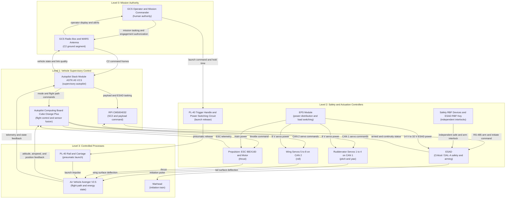

| Attribute | Specification Detail |
| :--- | :--- |
| **Document ID** | `SAFETY-01` |
| **Issue ID** | `SAFETY-01` |
| **Type** | `System Safety Analysis` |
| **Generation Mode** | `Agent-Assisted` |
| **Specification Source** | `docs/research/RESEARCH_INVENTORY.md; schema/extracted/oem_bom.md; schema/extracted/interface_table.md; schema/extracted/parametric_limits.md; .pipeline/schema.sysml` |
| **Version** | `1.0.0` |
| **Date** | `2026-10-31` |

# System Losses, Hazards & Control Structure Topology

## System Losses

Losses are curated at the mission and system boundary, not one per AST part. The FMECA matrix in `docs/safety/05_FMECA_MATRIX.md` enforces 100 percent AST part coverage; this unit does not. The parachute deployment module is a non-mission R&D variant with `configuration: non-mission` and `baseline: false` and is excluded from baseline losses and hazards (schema/extracted/oem_bom.md).

| Loss ID | Description | Mission-Level Consequence | Primary Assets | Grounding |
| :--- | :--- | :--- | :--- | :--- |
| L-1 | Loss of the air vehicle | Unrecoverable loss of the Avenger V2.5 airframe after launch, including crash or unrecoverable departure from controlled flight | Air_Vehicle_Avenger_V2_5; Airframe_Fuselage; Airframe_Payload_Bay | schema/extracted/oem_bom.md; schema/extracted/parametric_limits.md PL-12 |
| L-2 | Loss of vehicle control | Loss of flight path, attitude, or energy authority such that the operator cannot recover the vehicle | Autopilot_Computing_Board_Cube_Orange_Plus; Ruddervator; Wings | schema/extracted/oem_bom.md; schema/extracted/parametric_limits.md PL-05; PL-14 to PL-18 |
| L-3 | Loss of command and control | Loss, corruption, or unacceptable latency of the C2 link that removes operator authority or delivers stale commands | GCS_Radio_Box; GCS_MARS_Antenna; Radio_Module_DTC; Autopilot_Stack_Module_ASTK_A5_V2_5 | schema/extracted/oem_bom.md; schema/extracted/interface_table.md; schema/extracted/parametric_limits.md PL-07; PL-08; PL-39 |
| L-4 | Loss of payload and arming safety | Uncommanded, premature, or unauthorized warhead initiation, or failure to preserve the safe state through launch and flight | ESAD; ESAD_Detonator; ESAD_Umbilical; Warhead; Safety_RBF_Devices | schema/extracted/oem_bom.md; schema/extracted/parametric_limits.md PL-46 to PL-63 |
| L-5 | Loss of containment | Air vehicle exits the authorized operating volume or impacts outside the designated area, endangering non-participants or protected assets | Air_Vehicle_Avenger_V2_5; Autopilot_Stack_Module_ASTK_A5_V2_5 | schema/extracted/parametric_limits.md PL-07; PL-08; PL-36; PL-37 |
| L-6 | Loss of launcher or ground support equipment integrity | Catapult pressure vessel, carriage, compressor, or GCS failure that destroys ground equipment or prevents a safe launch | PL_40_Rail; PL_40_Main_Tank; PL_40_Carriage; PL_40_Compressor_Unit; GCS_Ground_Box | schema/extracted/oem_bom.md; schema/extracted/parametric_limits.md PL-40; PL-41; PL-64 to PL-68 |
| L-7 | Loss of ground personnel or non-participant safety | Injury or death during assembly, arming, launch, recovery, or inadvertent energetic release | Airframe_Payload_Bay; Warhead; PL_40_Rail; PL_40_Trigger_Handle | schema/extracted/oem_bom.md; schema/extracted/parametric_limits.md PL-13; PL-40; PL-41 |
| L-8 | Loss of mission | Mission abort or failure to complete the assigned objective without necessarily losing the vehicle | Air_Vehicle_Avenger_V2_5; Gimbal_Nighthawk2UZ; Camera_Compute_Module_Trip6 | schema/extracted/parametric_limits.md PL-06; mission-abort thresholds Not stated in OEM sources |

### Loss Grounding Register

| Loss ID | OEM Source Lines | Parametric Limits |
| :--- | :--- | :--- |
| L-1 | schema/extracted/oem_bom.md at line 9; schema/extracted/oem_bom.md at lines 67-68 | PL-12 |
| L-2 | schema/extracted/oem_bom.md at line 10; schema/extracted/oem_bom.md at lines 21-38 | PL-05; PL-14 to PL-18 |
| L-3 | schema/extracted/oem_bom.md at lines 44-46; schema/extracted/interface_table.md at lines 63-64 | PL-07; PL-08; PL-39 |
| L-4 | schema/extracted/oem_bom.md at lines 52-57 | PL-46 to PL-63 |
| L-5 | schema/extracted/parametric_limits.md at lines 13-14; schema/extracted/parametric_limits.md at line 42; schema/extracted/parametric_limits.md at line 43 | PL-07; PL-08; PL-36; PL-37 |
| L-6 | schema/extracted/oem_bom.md at lines 82-102 | PL-40; PL-41; PL-64 to PL-68 |
| L-7 | schema/extracted/oem_bom.md at line 57; schema/extracted/oem_bom.md at lines 68-70 | PL-13; PL-40; PL-41 |
| L-8 | Mission-abort threshold Not stated in OEM sources | PL-06 |

## System Hazards

Hazards are hazardous system states, not component failure modes. Each hazard is assigned to the controller that can cause or fail to prevent it. ESAD is the safety-critical arming controller and is treated as Critical / DAL-A (schema/extracted/oem_bom.md).

| Hazard ID | Associated Control Action | Controller | Hazardous System State | Related Losses | Integrity and Grounding |
| :--- | :--- | :--- | :--- | :--- | :--- |
| H-1 | Arm enable and initiation | ESAD (Critical / DAL-A) | ESAD arms or initiates without valid dual authorization and independent interlock consent | L-4; L-7 | schema/extracted/oem_bom.md; schema/extracted/interface_table.md; schema/extracted/parametric_limits.md PL-51 to PL-55 |
| H-2 | Safe-state inhibit and continuity monitor | ESAD (Critical / DAL-A) | ESAD fails to inhibit initiation when the safe state is commanded or when umbilical continuity is open | L-4; L-7 | schema/extracted/oem_bom.md; schema/extracted/interface_table.md; schema/extracted/parametric_limits.md PL-49; PL-50 |
| H-3 | CAN 1 and CAN 2 servo commands | Autopilot_Computing_Board_Cube_Orange_Plus commanding Ruddervator and Wings | Ruddervator or wing servo commands drive control surfaces beyond the flight envelope or produce conflicting surface motion | L-1; L-2; L-5 | schema/extracted/oem_bom.md; schema/extracted/interface_table.md; schema/extracted/parametric_limits.md PL-14 to PL-22 |
| H-4 | Throttle and main power | Propulsion (ESC and motor assembly) and Battery 12S2P Li Metal BEI | Propulsion delivers uncontrolled thrust or the battery exceeds its voltage or thermal limits | L-1; L-2; L-7 | schema/extracted/oem_bom.md; schema/extracted/parametric_limits.md PL-23; PL-24; PL-32; PL-33 |
| H-5 | C2 command and telemetry exchange | GCS_Radio_Box; Radio_Module_DTC; Autopilot_Stack_Module_ASTK_A5_V2_5 | C2 link loss, corruption, or latency removes operator authority or delivers stale commands | L-3; L-5 | schema/extracted/oem_bom.md; schema/extracted/interface_table.md; schema/extracted/parametric_limits.md PL-07; PL-08; PL-39 |
| H-6 | Flight path and geofence containment | Autopilot_Stack_Module_ASTK_A5_V2_5 and GCS Operator | Air vehicle exits the authorized operating volume or loses containment | L-5; L-7 | schema/extracted/parametric_limits.md PL-07; PL-08; PL-36; PL-37 |
| H-7 | Launch release and pressure control | PL_40_Trigger_Handle and PL_40_Power_Switching_Circuit | Launcher releases the vehicle outside its pressure, mass, velocity, or angle envelope, or the carriage releases prematurely | L-1; L-6; L-7 | schema/extracted/oem_bom.md; schema/extracted/parametric_limits.md PL-40; PL-41; PL-64 to PL-68; PL-88 |
| H-8 | 8 V servo, 12 V radio, and 14 V ESAD power distribution | EPS_Module | Loss of electrical power distribution or avionics causes simultaneous loss of control and C2 | L-1; L-2; L-3 | schema/extracted/oem_bom.md; schema/extracted/parametric_limits.md PL-22; PL-23; PL-24 |
| H-9 | Payload retention and independent RBF interlock | Airframe_Payload_Bay and Safety_RBF_Devices | Payload bay retention or warhead mounting fails, causing inadvertent release or damage to the initiation train | L-4; L-7 | schema/extracted/oem_bom.md |
| H-10 | RBF removal sequence and ESD equalization | Safety_RBF_Devices and ESD_Grounding_Point | Ground handling or arming exposes personnel to energetic material or electrostatic discharge | L-4; L-7 | schema/extracted/oem_bom.md |
| H-11 | Sensor fusion and flight path command | Autopilot_Computing_Board_Cube_Orange_Plus with GNSS, pitot, and magnetometer sensors | Invalid air data, attitude, or position estimate causes the autopilot to command a divergent flight path | L-1; L-2; L-5 | schema/extracted/oem_bom.md; schema/extracted/parametric_limits.md PL-34; PL-35 |

### Hazard Grounding Register

| Hazard ID | OEM Source Lines | Parametric Limits |
| :--- | :--- | :--- |
| H-1 | schema/extracted/oem_bom.md at line 52; schema/extracted/interface_table.md at lines 49-56 | PL-51 to PL-55 |
| H-2 | schema/extracted/oem_bom.md at line 52; schema/extracted/interface_table.md at lines 49-56 | PL-49; PL-50 |
| H-3 | schema/extracted/oem_bom.md at lines 21-38; schema/extracted/interface_table.md at lines 9-31 | PL-14 to PL-22 |
| H-4 | schema/extracted/oem_bom.md at lines 18-22 | PL-23; PL-24; PL-32; PL-33 |
| H-5 | schema/extracted/oem_bom.md at lines 44-46; schema/extracted/interface_table.md at lines 63-64 | PL-07; PL-08; PL-39 |
| H-6 | schema/extracted/parametric_limits.md at lines 13-14; schema/extracted/parametric_limits.md at line 42; schema/extracted/parametric_limits.md at line 43 | PL-07; PL-08; PL-36; PL-37 |
| H-7 | schema/extracted/oem_bom.md at lines 82-102; schema/extracted/parametric_limits.md at lines 46-47; schema/extracted/parametric_limits.md at lines 70-74; schema/extracted/parametric_limits.md at line 94 | PL-40; PL-41; PL-64 to PL-68; PL-88 |
| H-8 | schema/extracted/oem_bom.md at line 11; schema/extracted/oem_bom.md at line 28 | PL-22; PL-23; PL-24 |
| H-9 | schema/extracted/oem_bom.md at line 57; schema/extracted/oem_bom.md at line 68; schema/extracted/oem_bom.md at line 70 | Not applicable |
| H-10 | schema/extracted/oem_bom.md at lines 69-70; schema/extracted/oem_bom.md at line 57 | Not applicable |
| H-11 | schema/extracted/oem_bom.md at lines 13-16; schema/extracted/oem_bom.md at lines 39-42 | PL-34; PL-35 |

## Hierarchical Control Structure Topology

The control structure separates mission authority, vehicle supervisory control, safety and actuation controllers, and controlled processes. Ruddervator is the canonical tail control surface assembly (drawing synonym Fins; preparation synonym tail stabiliser; schema/extracted/oem_bom.md). Controller timing budgets, C2 latency limits, and independence evidence are Not stated in OEM sources.

## Source References

| Reference ID | Source Artifact | Scope | Access Path |
| :--- | :--- | :--- | :--- |
| SRC-01 | SysML v2 Level 0 schema | AST part, port, attribute, and constraint definitions | [.pipeline/schema.sysml](.pipeline/schema.sysml) |
| SRC-02 | OEM bill of materials extraction | Component identity, stated mass, interface, and configuration status | [schema/extracted/oem_bom.md](schema/extracted/oem_bom.md) |
| SRC-03 | System interface extraction | Port direction, protocol, data type, and refresh rate | [schema/extracted/interface_table.md](schema/extracted/interface_table.md) |
| SRC-04 | Parametric limits registry | All numeric limits, units, and verification sources | [schema/extracted/parametric_limits.md](schema/extracted/parametric_limits.md) |
| SRC-05 | Cited research inventory | Public clause citations and normative baseline allocations | [docs/research/RESEARCH_INVENTORY.md](docs/research/RESEARCH_INVENTORY.md) |
| SRC-06 | STPA master projection | Losses, hazards, and topology kept in sync with this unit | [docs/safety/STPA_MATRIX.md](docs/safety/STPA_MATRIX.md) |

Normative clause anchors:
- MIL-STD-882E Task 201 and Task 205 (preliminary hazard analysis and system hazard analysis).
- SAE ARP4761 Section 4.3.1 and Section 4.3.3 (functional hazard assessment and FMECA).
- JARUS SORA v2.5 Annex E Section E.14 and Section E.17 (containment and payload failure).
- RTCA DO-178C Section 6.3.1 (software fault detection for the Critical / DAL-A ESAD chain).

All numeric values in this unit are traceable to SRC-04. Values absent from the OEM sources are explicitly marked "Not stated in OEM sources". The parachute deployment module is excluded from the baseline because its configuration is non-mission and its baseline flag is false (schema/extracted/oem_bom.md).

