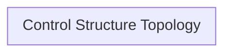

# System Losses, Hazards & Control Structure Topology

## System Losses

| Loss ID | Description |
| :--- | :--- |

## System Hazards

| Hazard ID | Associated Control Action | Controller |
| :--- | :--- | :--- |

## Hierarchical Control Structure Topology

