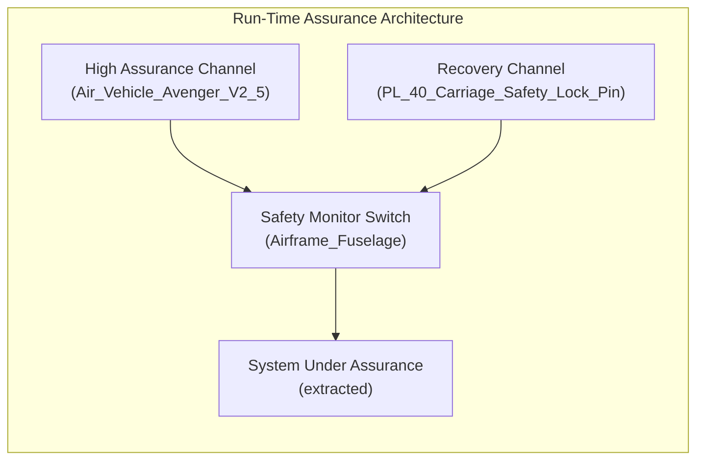

# Run-Time Assurance Architecture & Formal Proof Suite

## Simplex Run-Time Assurance Topology



## Formal Proof Suite

## Theorem T-01 -- assert_PL_01_range

### Formal Theorem Statement

$$
\begin{aligned}
    \mathrm{assert\_PL\_01\_range} &: \mathrm{PL\_01} \ge 30 \land \mathrm{PL\_01} \le 30
\end{aligned}
$$

### Symbolic Derivation

$$
\begin{aligned}
    \mathrm{assert\_PL\_01\_range} &\iff \mathrm{PL\_01} \ge 30 \land \mathrm{PL\_01} \le 30 \\
\end{aligned}
$$

### Parameter Definitions & Engineering Units Table

| Symbol | Description | Value | Engineering Unit |
| :--- | :--- | :--- | :--- |
| `assert_PL_01_range` | AST Constraint Invariant | `PL_01 >= 30 and PL_01 <= 30` | boolean |

### Step-by-Step Numerical Proof Evaluation

$$
\begin{aligned}
    \mathrm{assert\_PL\_01\_range} &\implies \mathrm{PL\_01} \ge 30 \land \mathrm{PL\_01} \le 30 \\
\end{aligned}
$$

### SLDV Temporal Assertion Binding

```matlab
sldv.assert( (PL_01 >= 30 && PL_01 <= 30), 'Bind_ASSERT_PL_01_RANGE_ASSERTION' );
```

## Theorem T-02 -- assert_PL_02_range

### Formal Theorem Statement

$$
\begin{aligned}
    \mathrm{assert\_PL\_02\_range} &: \mathrm{PL\_02} \le 38
\end{aligned}
$$

### Symbolic Derivation

$$
\begin{aligned}
    \mathrm{assert\_PL\_02\_range} &\iff \mathrm{PL\_02} \le 38 \\
\end{aligned}
$$

### Parameter Definitions & Engineering Units Table

| Symbol | Description | Value | Engineering Unit |
| :--- | :--- | :--- | :--- |
| `assert_PL_02_range` | AST Constraint Invariant | `PL_02 <= 38` | boolean |

### Step-by-Step Numerical Proof Evaluation

$$
\begin{aligned}
    \mathrm{assert\_PL\_02\_range} &\implies \mathrm{PL\_02} \le 38 \\
\end{aligned}
$$

### SLDV Temporal Assertion Binding

```matlab
sldv.assert( (PL_02 <= 38), 'Bind_ASSERT_PL_02_RANGE_ASSERTION' );
```

## Theorem T-03 -- assert_PL_03_range

### Formal Theorem Statement

$$
\begin{aligned}
    \mathrm{assert\_PL\_03\_range} &: \mathrm{PL\_03} \le 55
\end{aligned}
$$

### Symbolic Derivation

$$
\begin{aligned}
    \mathrm{assert\_PL\_03\_range} &\iff \mathrm{PL\_03} \le 55 \\
\end{aligned}
$$

### Parameter Definitions & Engineering Units Table

| Symbol | Description | Value | Engineering Unit |
| :--- | :--- | :--- | :--- |
| `assert_PL_03_range` | AST Constraint Invariant | `PL_03 <= 55` | boolean |

### Step-by-Step Numerical Proof Evaluation

$$
\begin{aligned}
    \mathrm{assert\_PL\_03\_range} &\implies \mathrm{PL\_03} \le 55 \\
\end{aligned}
$$

### SLDV Temporal Assertion Binding

```matlab
sldv.assert( (PL_03 <= 55), 'Bind_ASSERT_PL_03_RANGE_ASSERTION' );
```

## Theorem T-04 -- assert_PL_04_range

### Formal Theorem Statement

$$
\begin{aligned}
    \mathrm{assert\_PL\_04\_range} &: \mathrm{PL\_04} \le 22
\end{aligned}
$$

### Symbolic Derivation

$$
\begin{aligned}
    \mathrm{assert\_PL\_04\_range} &\iff \mathrm{PL\_04} \le 22 \\
\end{aligned}
$$

### Parameter Definitions & Engineering Units Table

| Symbol | Description | Value | Engineering Unit |
| :--- | :--- | :--- | :--- |
| `assert_PL_04_range` | AST Constraint Invariant | `PL_04 <= 22` | boolean |

### Step-by-Step Numerical Proof Evaluation

$$
\begin{aligned}
    \mathrm{assert\_PL\_04\_range} &\implies \mathrm{PL\_04} \le 22 \\
\end{aligned}
$$

### SLDV Temporal Assertion Binding

```matlab
sldv.assert( (PL_04 <= 22), 'Bind_ASSERT_PL_04_RANGE_ASSERTION' );
```

## Theorem T-05 -- assert_PL_05_range

### Formal Theorem Statement

$$
\begin{aligned}
    \mathrm{assert\_PL\_05\_range} &: \mathrm{PL\_05} \ge 26
\end{aligned}
$$

### Symbolic Derivation

$$
\begin{aligned}
    \mathrm{assert\_PL\_05\_range} &\iff \mathrm{PL\_05} \ge 26 \\
\end{aligned}
$$

### Parameter Definitions & Engineering Units Table

| Symbol | Description | Value | Engineering Unit |
| :--- | :--- | :--- | :--- |
| `assert_PL_05_range` | AST Constraint Invariant | `PL_05 >= 26` | boolean |

### Step-by-Step Numerical Proof Evaluation

$$
\begin{aligned}
    \mathrm{assert\_PL\_05\_range} &\implies \mathrm{PL\_05} \ge 26 \\
\end{aligned}
$$

### SLDV Temporal Assertion Binding

```matlab
sldv.assert( (PL_05 >= 26), 'Bind_ASSERT_PL_05_RANGE_ASSERTION' );
```

## Theorem T-06 -- assert_PL_06_range

### Formal Theorem Statement

$$
\begin{aligned}
    \mathrm{assert\_PL\_06\_range} &: \mathrm{PL\_06} \ge 0 \land \mathrm{PL\_06} \le 90
\end{aligned}
$$

### Symbolic Derivation

$$
\begin{aligned}
    \mathrm{assert\_PL\_06\_range} &\iff \mathrm{PL\_06} \ge 0 \land \mathrm{PL\_06} \le 90 \\
\end{aligned}
$$

### Parameter Definitions & Engineering Units Table

| Symbol | Description | Value | Engineering Unit |
| :--- | :--- | :--- | :--- |
| `assert_PL_06_range` | AST Constraint Invariant | `PL_06 >= 0 and PL_06 <= 90` | boolean |

### Step-by-Step Numerical Proof Evaluation

$$
\begin{aligned}
    \mathrm{assert\_PL\_06\_range} &\implies \mathrm{PL\_06} \ge 0 \land \mathrm{PL\_06} \le 90 \\
\end{aligned}
$$

### SLDV Temporal Assertion Binding

```matlab
sldv.assert( (PL_06 >= 0 && PL_06 <= 90), 'Bind_ASSERT_PL_06_RANGE_ASSERTION' );
```

## Theorem T-07 -- assert_PL_07_range

### Formal Theorem Statement

$$
\begin{aligned}
    \mathrm{assert\_PL\_07\_range} &: \mathrm{PL\_07} \ge 0 \land \mathrm{PL\_07} \le 60
\end{aligned}
$$

### Symbolic Derivation

$$
\begin{aligned}
    \mathrm{assert\_PL\_07\_range} &\iff \mathrm{PL\_07} \ge 0 \land \mathrm{PL\_07} \le 60 \\
\end{aligned}
$$

### Parameter Definitions & Engineering Units Table

| Symbol | Description | Value | Engineering Unit |
| :--- | :--- | :--- | :--- |
| `assert_PL_07_range` | AST Constraint Invariant | `PL_07 >= 0 and PL_07 <= 60` | boolean |

### Step-by-Step Numerical Proof Evaluation

$$
\begin{aligned}
    \mathrm{assert\_PL\_07\_range} &\implies \mathrm{PL\_07} \ge 0 \land \mathrm{PL\_07} \le 60 \\
\end{aligned}
$$

### SLDV Temporal Assertion Binding

```matlab
sldv.assert( (PL_07 >= 0 && PL_07 <= 60), 'Bind_ASSERT_PL_07_RANGE_ASSERTION' );
```

## Theorem T-08 -- assert_PL_08_range

### Formal Theorem Statement

$$
\begin{aligned}
    \mathrm{assert\_PL\_08\_range} &: \mathrm{PL\_08} \ge 60 \land \mathrm{PL\_08} \le 180
\end{aligned}
$$

### Symbolic Derivation

$$
\begin{aligned}
    \mathrm{assert\_PL\_08\_range} &\iff \mathrm{PL\_08} \ge 60 \land \mathrm{PL\_08} \le 180 \\
\end{aligned}
$$

### Parameter Definitions & Engineering Units Table

| Symbol | Description | Value | Engineering Unit |
| :--- | :--- | :--- | :--- |
| `assert_PL_08_range` | AST Constraint Invariant | `PL_08 >= 60 and PL_08 <= 180` | boolean |

### Step-by-Step Numerical Proof Evaluation

$$
\begin{aligned}
    \mathrm{assert\_PL\_08\_range} &\implies \mathrm{PL\_08} \ge 60 \land \mathrm{PL\_08} \le 180 \\
\end{aligned}
$$

### SLDV Temporal Assertion Binding

```matlab
sldv.assert( (PL_08 >= 60 && PL_08 <= 180), 'Bind_ASSERT_PL_08_RANGE_ASSERTION' );
```

## Theorem T-09 -- assert_PL_09_range

### Formal Theorem Statement

$$
\begin{aligned}
    \mathrm{assert\_PL\_09\_range} &: \mathrm{PL\_09} \ge 1.8 \land \mathrm{PL\_09} \le 1.8
\end{aligned}
$$

### Symbolic Derivation

$$
\begin{aligned}
    \mathrm{assert\_PL\_09\_range} &\iff \mathrm{PL\_09} \ge 1.8 \land \mathrm{PL\_09} \le 1.8 \\
\end{aligned}
$$

### Parameter Definitions & Engineering Units Table

| Symbol | Description | Value | Engineering Unit |
| :--- | :--- | :--- | :--- |
| `assert_PL_09_range` | AST Constraint Invariant | `PL_09 >= 1.8 and PL_09 <= 1.8` | boolean |

### Step-by-Step Numerical Proof Evaluation

$$
\begin{aligned}
    \mathrm{assert\_PL\_09\_range} &\implies \mathrm{PL\_09} \ge 1.8 \land \mathrm{PL\_09} \le 1.8 \\
\end{aligned}
$$

### SLDV Temporal Assertion Binding

```matlab
sldv.assert( (PL_09 >= 1.8 && PL_09 <= 1.8), 'Bind_ASSERT_PL_09_RANGE_ASSERTION' );
```

## Theorem T-10 -- assert_PL_10_range

### Formal Theorem Statement

$$
\begin{aligned}
    \mathrm{assert\_PL\_10\_range} &: \mathrm{PL\_10} \ge 1.6 \land \mathrm{PL\_10} \le 1.6
\end{aligned}
$$

### Symbolic Derivation

$$
\begin{aligned}
    \mathrm{assert\_PL\_10\_range} &\iff \mathrm{PL\_10} \ge 1.6 \land \mathrm{PL\_10} \le 1.6 \\
\end{aligned}
$$

### Parameter Definitions & Engineering Units Table

| Symbol | Description | Value | Engineering Unit |
| :--- | :--- | :--- | :--- |
| `assert_PL_10_range` | AST Constraint Invariant | `PL_10 >= 1.6 and PL_10 <= 1.6` | boolean |

### Step-by-Step Numerical Proof Evaluation

$$
\begin{aligned}
    \mathrm{assert\_PL\_10\_range} &\implies \mathrm{PL\_10} \ge 1.6 \land \mathrm{PL\_10} \le 1.6 \\
\end{aligned}
$$

### SLDV Temporal Assertion Binding

```matlab
sldv.assert( (PL_10 >= 1.6 && PL_10 <= 1.6), 'Bind_ASSERT_PL_10_RANGE_ASSERTION' );
```

## Theorem T-11 -- assert_PL_11_range

### Formal Theorem Statement

$$
\begin{aligned}
    \mathrm{assert\_PL\_11\_range} &: \mathrm{PL\_11} \ge 1.1 \land \mathrm{PL\_11} \le 1.1
\end{aligned}
$$

### Symbolic Derivation

$$
\begin{aligned}
    \mathrm{assert\_PL\_11\_range} &\iff \mathrm{PL\_11} \ge 1.1 \land \mathrm{PL\_11} \le 1.1 \\
\end{aligned}
$$

### Parameter Definitions & Engineering Units Table

| Symbol | Description | Value | Engineering Unit |
| :--- | :--- | :--- | :--- |
| `assert_PL_11_range` | AST Constraint Invariant | `PL_11 >= 1.1 and PL_11 <= 1.1` | boolean |

### Step-by-Step Numerical Proof Evaluation

$$
\begin{aligned}
    \mathrm{assert\_PL\_11\_range} &\implies \mathrm{PL\_11} \ge 1.1 \land \mathrm{PL\_11} \le 1.1 \\
\end{aligned}
$$

### SLDV Temporal Assertion Binding

```matlab
sldv.assert( (PL_11 >= 1.1 && PL_11 <= 1.1), 'Bind_ASSERT_PL_11_RANGE_ASSERTION' );
```

## Theorem T-12 -- assert_PL_12_range

### Formal Theorem Statement

$$
\begin{aligned}
    \mathrm{assert\_PL\_12\_range} &: \mathrm{PL\_12} \le 17
\end{aligned}
$$

### Symbolic Derivation

$$
\begin{aligned}
    \mathrm{assert\_PL\_12\_range} &\iff \mathrm{PL\_12} \le 17 \\
\end{aligned}
$$

### Parameter Definitions & Engineering Units Table

| Symbol | Description | Value | Engineering Unit |
| :--- | :--- | :--- | :--- |
| `assert_PL_12_range` | AST Constraint Invariant | `PL_12 <= 17` | boolean |

### Step-by-Step Numerical Proof Evaluation

$$
\begin{aligned}
    \mathrm{assert\_PL\_12\_range} &\implies \mathrm{PL\_12} \le 17 \\
\end{aligned}
$$

### SLDV Temporal Assertion Binding

```matlab
sldv.assert( (PL_12 <= 17), 'Bind_ASSERT_PL_12_RANGE_ASSERTION' );
```

## Theorem T-13 -- assert_PL_13_range

### Formal Theorem Statement

$$
\begin{aligned}
    \mathrm{assert\_PL\_13\_range} &: \mathrm{PL\_13} \le 5
\end{aligned}
$$

### Symbolic Derivation

$$
\begin{aligned}
    \mathrm{assert\_PL\_13\_range} &\iff \mathrm{PL\_13} \le 5 \\
\end{aligned}
$$

### Parameter Definitions & Engineering Units Table

| Symbol | Description | Value | Engineering Unit |
| :--- | :--- | :--- | :--- |
| `assert_PL_13_range` | AST Constraint Invariant | `PL_13 <= 5` | boolean |

### Step-by-Step Numerical Proof Evaluation

$$
\begin{aligned}
    \mathrm{assert\_PL\_13\_range} &\implies \mathrm{PL\_13} \le 5 \\
\end{aligned}
$$

### SLDV Temporal Assertion Binding

```matlab
sldv.assert( (PL_13 <= 5), 'Bind_ASSERT_PL_13_RANGE_ASSERTION' );
```

## Theorem T-14 -- assert_PL_14_range

### Formal Theorem Statement

$$
\begin{aligned}
    \mathrm{assert\_PL\_14\_range} &: \mathrm{PL\_14} \ge 4 \land \mathrm{PL\_14} \le 4
\end{aligned}
$$

### Symbolic Derivation

$$
\begin{aligned}
    \mathrm{assert\_PL\_14\_range} &\iff \mathrm{PL\_14} \ge 4 \land \mathrm{PL\_14} \le 4 \\
\end{aligned}
$$

### Parameter Definitions & Engineering Units Table

| Symbol | Description | Value | Engineering Unit |
| :--- | :--- | :--- | :--- |
| `assert_PL_14_range` | AST Constraint Invariant | `PL_14 >= 4 and PL_14 <= 4` | boolean |

### Step-by-Step Numerical Proof Evaluation

$$
\begin{aligned}
    \mathrm{assert\_PL\_14\_range} &\implies \mathrm{PL\_14} \ge 4 \land \mathrm{PL\_14} \le 4 \\
\end{aligned}
$$

### SLDV Temporal Assertion Binding

```matlab
sldv.assert( (PL_14 >= 4 && PL_14 <= 4), 'Bind_ASSERT_PL_14_RANGE_ASSERTION' );
```

## Theorem T-15 -- assert_PL_15_range

### Formal Theorem Statement

$$
\begin{aligned}
    \mathrm{assert\_PL\_15\_range} &: \mathrm{PL\_15} \ge 4 \land \mathrm{PL\_15} \le 4
\end{aligned}
$$

### Symbolic Derivation

$$
\begin{aligned}
    \mathrm{assert\_PL\_15\_range} &\iff \mathrm{PL\_15} \ge 4 \land \mathrm{PL\_15} \le 4 \\
\end{aligned}
$$

### Parameter Definitions & Engineering Units Table

| Symbol | Description | Value | Engineering Unit |
| :--- | :--- | :--- | :--- |
| `assert_PL_15_range` | AST Constraint Invariant | `PL_15 >= 4 and PL_15 <= 4` | boolean |

### Step-by-Step Numerical Proof Evaluation

$$
\begin{aligned}
    \mathrm{assert\_PL\_15\_range} &\implies \mathrm{PL\_15} \ge 4 \land \mathrm{PL\_15} \le 4 \\
\end{aligned}
$$

### SLDV Temporal Assertion Binding

```matlab
sldv.assert( (PL_15 >= 4 && PL_15 <= 4), 'Bind_ASSERT_PL_15_RANGE_ASSERTION' );
```

## Theorem T-16 -- assert_PL_16_range

### Formal Theorem Statement

$$
\begin{aligned}
    \mathrm{assert\_PL\_16\_range} &: \mathrm{PL\_16} \ge 4 \land \mathrm{PL\_16} \le 4
\end{aligned}
$$

### Symbolic Derivation

$$
\begin{aligned}
    \mathrm{assert\_PL\_16\_range} &\iff \mathrm{PL\_16} \ge 4 \land \mathrm{PL\_16} \le 4 \\
\end{aligned}
$$

### Parameter Definitions & Engineering Units Table

| Symbol | Description | Value | Engineering Unit |
| :--- | :--- | :--- | :--- |
| `assert_PL_16_range` | AST Constraint Invariant | `PL_16 >= 4 and PL_16 <= 4` | boolean |

### Step-by-Step Numerical Proof Evaluation

$$
\begin{aligned}
    \mathrm{assert\_PL\_16\_range} &\implies \mathrm{PL\_16} \ge 4 \land \mathrm{PL\_16} \le 4 \\
\end{aligned}
$$

### SLDV Temporal Assertion Binding

```matlab
sldv.assert( (PL_16 >= 4 && PL_16 <= 4), 'Bind_ASSERT_PL_16_RANGE_ASSERTION' );
```

## Theorem T-17 -- assert_PL_17_range

### Formal Theorem Statement

$$
\begin{aligned}
    \mathrm{assert\_PL\_17\_range} &: \mathrm{PL\_17} \ge 4 \land \mathrm{PL\_17} \le 4
\end{aligned}
$$

### Symbolic Derivation

$$
\begin{aligned}
    \mathrm{assert\_PL\_17\_range} &\iff \mathrm{PL\_17} \ge 4 \land \mathrm{PL\_17} \le 4 \\
\end{aligned}
$$

### Parameter Definitions & Engineering Units Table

| Symbol | Description | Value | Engineering Unit |
| :--- | :--- | :--- | :--- |
| `assert_PL_17_range` | AST Constraint Invariant | `PL_17 >= 4 and PL_17 <= 4` | boolean |

### Step-by-Step Numerical Proof Evaluation

$$
\begin{aligned}
    \mathrm{assert\_PL\_17\_range} &\implies \mathrm{PL\_17} \ge 4 \land \mathrm{PL\_17} \le 4 \\
\end{aligned}
$$

### SLDV Temporal Assertion Binding

```matlab
sldv.assert( (PL_17 >= 4 && PL_17 <= 4), 'Bind_ASSERT_PL_17_RANGE_ASSERTION' );
```

## Theorem T-18 -- assert_PL_18_range

### Formal Theorem Statement

$$
\begin{aligned}
    \mathrm{assert\_PL\_18\_range} &: \mathrm{PL\_18} \ge 8 \land \mathrm{PL\_18} \le 8
\end{aligned}
$$

### Symbolic Derivation

$$
\begin{aligned}
    \mathrm{assert\_PL\_18\_range} &\iff \mathrm{PL\_18} \ge 8 \land \mathrm{PL\_18} \le 8 \\
\end{aligned}
$$

### Parameter Definitions & Engineering Units Table

| Symbol | Description | Value | Engineering Unit |
| :--- | :--- | :--- | :--- |
| `assert_PL_18_range` | AST Constraint Invariant | `PL_18 >= 8 and PL_18 <= 8` | boolean |

### Step-by-Step Numerical Proof Evaluation

$$
\begin{aligned}
    \mathrm{assert\_PL\_18\_range} &\implies \mathrm{PL\_18} \ge 8 \land \mathrm{PL\_18} \le 8 \\
\end{aligned}
$$

### SLDV Temporal Assertion Binding

```matlab
sldv.assert( (PL_18 >= 8 && PL_18 <= 8), 'Bind_ASSERT_PL_18_RANGE_ASSERTION' );
```

## Theorem T-19 -- assert_PL_19_range

### Formal Theorem Statement

$$
\begin{aligned}
    \mathrm{assert\_PL\_19\_range} &: \mathrm{PL\_19} \ge 970 \land \mathrm{PL\_19} \le 970
\end{aligned}
$$

### Symbolic Derivation

$$
\begin{aligned}
    \mathrm{assert\_PL\_19\_range} &\iff \mathrm{PL\_19} \ge 970 \land \mathrm{PL\_19} \le 970 \\
\end{aligned}
$$

### Parameter Definitions & Engineering Units Table

| Symbol | Description | Value | Engineering Unit |
| :--- | :--- | :--- | :--- |
| `assert_PL_19_range` | AST Constraint Invariant | `PL_19 >= 970 and PL_19 <= 970` | boolean |

### Step-by-Step Numerical Proof Evaluation

$$
\begin{aligned}
    \mathrm{assert\_PL\_19\_range} &\implies \mathrm{PL\_19} \ge 970 \land \mathrm{PL\_19} \le 970 \\
\end{aligned}
$$

### SLDV Temporal Assertion Binding

```matlab
sldv.assert( (PL_19 >= 970 && PL_19 <= 970), 'Bind_ASSERT_PL_19_RANGE_ASSERTION' );
```

## Theorem T-20 -- assert_PL_20_range

### Formal Theorem Statement

$$
\begin{aligned}
    \mathrm{assert\_PL\_20\_range} &: \mathrm{PL\_20} \ge 150 \land \mathrm{PL\_20} \le 150
\end{aligned}
$$

### Symbolic Derivation

$$
\begin{aligned}
    \mathrm{assert\_PL\_20\_range} &\iff \mathrm{PL\_20} \ge 150 \land \mathrm{PL\_20} \le 150 \\
\end{aligned}
$$

### Parameter Definitions & Engineering Units Table

| Symbol | Description | Value | Engineering Unit |
| :--- | :--- | :--- | :--- |
| `assert_PL_20_range` | AST Constraint Invariant | `PL_20 >= 150 and PL_20 <= 150` | boolean |

### Step-by-Step Numerical Proof Evaluation

$$
\begin{aligned}
    \mathrm{assert\_PL\_20\_range} &\implies \mathrm{PL\_20} \ge 150 \land \mathrm{PL\_20} \le 150 \\
\end{aligned}
$$

### SLDV Temporal Assertion Binding

```matlab
sldv.assert( (PL_20 >= 150 && PL_20 <= 150), 'Bind_ASSERT_PL_20_RANGE_ASSERTION' );
```

## Theorem T-21 -- assert_PL_21_range

### Formal Theorem Statement

$$
\begin{aligned}
    \mathrm{assert\_PL\_21\_range} &: \mathrm{PL\_21} \ge 120 \land \mathrm{PL\_21} \le 120
\end{aligned}
$$

### Symbolic Derivation

$$
\begin{aligned}
    \mathrm{assert\_PL\_21\_range} &\iff \mathrm{PL\_21} \ge 120 \land \mathrm{PL\_21} \le 120 \\
\end{aligned}
$$

### Parameter Definitions & Engineering Units Table

| Symbol | Description | Value | Engineering Unit |
| :--- | :--- | :--- | :--- |
| `assert_PL_21_range` | AST Constraint Invariant | `PL_21 >= 120 and PL_21 <= 120` | boolean |

### Step-by-Step Numerical Proof Evaluation

$$
\begin{aligned}
    \mathrm{assert\_PL\_21\_range} &\implies \mathrm{PL\_21} \ge 120 \land \mathrm{PL\_21} \le 120 \\
\end{aligned}
$$

### SLDV Temporal Assertion Binding

```matlab
sldv.assert( (PL_21 >= 120 && PL_21 <= 120), 'Bind_ASSERT_PL_21_RANGE_ASSERTION' );
```

## Theorem T-22 -- assert_PL_22_range

### Formal Theorem Statement

$$
\begin{aligned}
    \mathrm{assert\_PL\_22\_range} &: \mathrm{PL\_22} \ge 8 \land \mathrm{PL\_22} \le 8
\end{aligned}
$$

### Symbolic Derivation

$$
\begin{aligned}
    \mathrm{assert\_PL\_22\_range} &\iff \mathrm{PL\_22} \ge 8 \land \mathrm{PL\_22} \le 8 \\
\end{aligned}
$$

### Parameter Definitions & Engineering Units Table

| Symbol | Description | Value | Engineering Unit |
| :--- | :--- | :--- | :--- |
| `assert_PL_22_range` | AST Constraint Invariant | `PL_22 >= 8 and PL_22 <= 8` | boolean |

### Step-by-Step Numerical Proof Evaluation

$$
\begin{aligned}
    \mathrm{assert\_PL\_22\_range} &\implies \mathrm{PL\_22} \ge 8 \land \mathrm{PL\_22} \le 8 \\
\end{aligned}
$$

### SLDV Temporal Assertion Binding

```matlab
sldv.assert( (PL_22 >= 8 && PL_22 <= 8), 'Bind_ASSERT_PL_22_RANGE_ASSERTION' );
```

## Theorem T-23 -- assert_PL_23_range

### Formal Theorem Statement

$$
\begin{aligned}
    \mathrm{assert\_PL\_23\_range} &: \mathrm{PL\_23} \ge 36 \land \mathrm{PL\_23} \le 36
\end{aligned}
$$

### Symbolic Derivation

$$
\begin{aligned}
    \mathrm{assert\_PL\_23\_range} &\iff \mathrm{PL\_23} \ge 36 \land \mathrm{PL\_23} \le 36 \\
\end{aligned}
$$

### Parameter Definitions & Engineering Units Table

| Symbol | Description | Value | Engineering Unit |
| :--- | :--- | :--- | :--- |
| `assert_PL_23_range` | AST Constraint Invariant | `PL_23 >= 36 and PL_23 <= 36` | boolean |

### Step-by-Step Numerical Proof Evaluation

$$
\begin{aligned}
    \mathrm{assert\_PL\_23\_range} &\implies \mathrm{PL\_23} \ge 36 \land \mathrm{PL\_23} \le 36 \\
\end{aligned}
$$

### SLDV Temporal Assertion Binding

```matlab
sldv.assert( (PL_23 >= 36 && PL_23 <= 36), 'Bind_ASSERT_PL_23_RANGE_ASSERTION' );
```

## Theorem T-24 -- assert_PL_24_range

### Formal Theorem Statement

$$
\begin{aligned}
    \mathrm{assert\_PL\_24\_range} &: \mathrm{PL\_24} \ge 50.4 \land \mathrm{PL\_24} \le 50.4
\end{aligned}
$$

### Symbolic Derivation

$$
\begin{aligned}
    \mathrm{assert\_PL\_24\_range} &\iff \mathrm{PL\_24} \ge 50.4 \land \mathrm{PL\_24} \le 50.4 \\
\end{aligned}
$$

### Parameter Definitions & Engineering Units Table

| Symbol | Description | Value | Engineering Unit |
| :--- | :--- | :--- | :--- |
| `assert_PL_24_range` | AST Constraint Invariant | `PL_24 >= 50.4 and PL_24 <= 50.4` | boolean |

### Step-by-Step Numerical Proof Evaluation

$$
\begin{aligned}
    \mathrm{assert\_PL\_24\_range} &\implies \mathrm{PL\_24} \ge 50.4 \land \mathrm{PL\_24} \le 50.4 \\
\end{aligned}
$$

### SLDV Temporal Assertion Binding

```matlab
sldv.assert( (PL_24 >= 50.4 && PL_24 <= 50.4), 'Bind_ASSERT_PL_24_RANGE_ASSERTION' );
```

## Theorem T-25 -- assert_PL_25_range

### Formal Theorem Statement

$$
\begin{aligned}
    \mathrm{assert\_PL\_25\_range} &: \mathrm{PL\_25} \ge -45 \land \mathrm{PL\_25} \le 135
\end{aligned}
$$

### Symbolic Derivation

$$
\begin{aligned}
    \mathrm{assert\_PL\_25\_range} &\iff \mathrm{PL\_25} \ge -45 \land \mathrm{PL\_25} \le 135 \\
\end{aligned}
$$

### Parameter Definitions & Engineering Units Table

| Symbol | Description | Value | Engineering Unit |
| :--- | :--- | :--- | :--- |
| `assert_PL_25_range` | AST Constraint Invariant | `PL_25 >= -45 and PL_25 <= 135` | boolean |

### Step-by-Step Numerical Proof Evaluation

$$
\begin{aligned}
    \mathrm{assert\_PL\_25\_range} &\implies \mathrm{PL\_25} \ge -45 \land \mathrm{PL\_25} \le 135 \\
\end{aligned}
$$

### SLDV Temporal Assertion Binding

```matlab
sldv.assert( (PL_25 >= -45 && PL_25 <= 135), 'Bind_ASSERT_PL_25_RANGE_ASSERTION' );
```

## Theorem T-26 -- assert_PL_26_range

### Formal Theorem Statement

$$
\begin{aligned}
    \mathrm{assert\_PL\_26\_range} &: \mathrm{PL\_26} \ge -165 \land \mathrm{PL\_26} \le 165
\end{aligned}
$$

### Symbolic Derivation

$$
\begin{aligned}
    \mathrm{assert\_PL\_26\_range} &\iff \mathrm{PL\_26} \ge -165 \land \mathrm{PL\_26} \le 165 \\
\end{aligned}
$$

### Parameter Definitions & Engineering Units Table

| Symbol | Description | Value | Engineering Unit |
| :--- | :--- | :--- | :--- |
| `assert_PL_26_range` | AST Constraint Invariant | `PL_26 >= -165 and PL_26 <= 165` | boolean |

### Step-by-Step Numerical Proof Evaluation

$$
\begin{aligned}
    \mathrm{assert\_PL\_26\_range} &\implies \mathrm{PL\_26} \ge -165 \land \mathrm{PL\_26} \le 165 \\
\end{aligned}
$$

### SLDV Temporal Assertion Binding

```matlab
sldv.assert( (PL_26 >= -165 && PL_26 <= 165), 'Bind_ASSERT_PL_26_RANGE_ASSERTION' );
```

## Theorem T-27 -- assert_PL_27_range

### Formal Theorem Statement

$$
\begin{aligned}
    \mathrm{assert\_PL\_27\_range} &: \mathrm{PL\_27} \ge 1 \land \mathrm{PL\_27} \le 40
\end{aligned}
$$

### Symbolic Derivation

$$
\begin{aligned}
    \mathrm{assert\_PL\_27\_range} &\iff \mathrm{PL\_27} \ge 1 \land \mathrm{PL\_27} \le 40 \\
\end{aligned}
$$

### Parameter Definitions & Engineering Units Table

| Symbol | Description | Value | Engineering Unit |
| :--- | :--- | :--- | :--- |
| `assert_PL_27_range` | AST Constraint Invariant | `PL_27 >= 1 and PL_27 <= 40` | boolean |

### Step-by-Step Numerical Proof Evaluation

$$
\begin{aligned}
    \mathrm{assert\_PL\_27\_range} &\implies \mathrm{PL\_27} \ge 1 \land \mathrm{PL\_27} \le 40 \\
\end{aligned}
$$

### SLDV Temporal Assertion Binding

```matlab
sldv.assert( (PL_27 >= 1 && PL_27 <= 40), 'Bind_ASSERT_PL_27_RANGE_ASSERTION' );
```

## Theorem T-28 -- assert_PL_28_range

### Formal Theorem Statement

$$
\begin{aligned}
    \mathrm{assert\_PL\_28\_range} &: \mathrm{PL\_28} \ge 1280 \land \mathrm{PL\_28} \le 1280
\end{aligned}
$$

### Symbolic Derivation

$$
\begin{aligned}
    \mathrm{assert\_PL\_28\_range} &\iff \mathrm{PL\_28} \ge 1280 \land \mathrm{PL\_28} \le 1280 \\
\end{aligned}
$$

### Parameter Definitions & Engineering Units Table

| Symbol | Description | Value | Engineering Unit |
| :--- | :--- | :--- | :--- |
| `assert_PL_28_range` | AST Constraint Invariant | `PL_28 >= 1280 and PL_28 <= 1280` | boolean |

### Step-by-Step Numerical Proof Evaluation

$$
\begin{aligned}
    \mathrm{assert\_PL\_28\_range} &\implies \mathrm{PL\_28} \ge 1280 \land \mathrm{PL\_28} \le 1280 \\
\end{aligned}
$$

### SLDV Temporal Assertion Binding

```matlab
sldv.assert( (PL_28 >= 1280 && PL_28 <= 1280), 'Bind_ASSERT_PL_28_RANGE_ASSERTION' );
```

## Theorem T-29 -- assert_PL_29_range

### Formal Theorem Statement

$$
\begin{aligned}
    \mathrm{assert\_PL\_29\_range} &: \mathrm{PL\_29} \ge 720 \land \mathrm{PL\_29} \le 720
\end{aligned}
$$

### Symbolic Derivation

$$
\begin{aligned}
    \mathrm{assert\_PL\_29\_range} &\iff \mathrm{PL\_29} \ge 720 \land \mathrm{PL\_29} \le 720 \\
\end{aligned}
$$

### Parameter Definitions & Engineering Units Table

| Symbol | Description | Value | Engineering Unit |
| :--- | :--- | :--- | :--- |
| `assert_PL_29_range` | AST Constraint Invariant | `PL_29 >= 720 and PL_29 <= 720` | boolean |

### Step-by-Step Numerical Proof Evaluation

$$
\begin{aligned}
    \mathrm{assert\_PL\_29\_range} &\implies \mathrm{PL\_29} \ge 720 \land \mathrm{PL\_29} \le 720 \\
\end{aligned}
$$

### SLDV Temporal Assertion Binding

```matlab
sldv.assert( (PL_29 >= 720 && PL_29 <= 720), 'Bind_ASSERT_PL_29_RANGE_ASSERTION' );
```

## Theorem T-30 -- assert_PL_30_range

### Formal Theorem Statement

$$
\begin{aligned}
    \mathrm{assert\_PL\_30\_range} &: \mathrm{PL\_30} \ge 1280 \land \mathrm{PL\_30} \le 1280
\end{aligned}
$$

### Symbolic Derivation

$$
\begin{aligned}
    \mathrm{assert\_PL\_30\_range} &\iff \mathrm{PL\_30} \ge 1280 \land \mathrm{PL\_30} \le 1280 \\
\end{aligned}
$$

### Parameter Definitions & Engineering Units Table

| Symbol | Description | Value | Engineering Unit |
| :--- | :--- | :--- | :--- |
| `assert_PL_30_range` | AST Constraint Invariant | `PL_30 >= 1280 and PL_30 <= 1280` | boolean |

### Step-by-Step Numerical Proof Evaluation

$$
\begin{aligned}
    \mathrm{assert\_PL\_30\_range} &\implies \mathrm{PL\_30} \ge 1280 \land \mathrm{PL\_30} \le 1280 \\
\end{aligned}
$$

### SLDV Temporal Assertion Binding

```matlab
sldv.assert( (PL_30 >= 1280 && PL_30 <= 1280), 'Bind_ASSERT_PL_30_RANGE_ASSERTION' );
```

## Theorem T-31 -- assert_PL_31_range

### Formal Theorem Statement

$$
\begin{aligned}
    \mathrm{assert\_PL\_31\_range} &: \mathrm{PL\_31} \ge 720 \land \mathrm{PL\_31} \le 720
\end{aligned}
$$

### Symbolic Derivation

$$
\begin{aligned}
    \mathrm{assert\_PL\_31\_range} &\iff \mathrm{PL\_31} \ge 720 \land \mathrm{PL\_31} \le 720 \\
\end{aligned}
$$

### Parameter Definitions & Engineering Units Table

| Symbol | Description | Value | Engineering Unit |
| :--- | :--- | :--- | :--- |
| `assert_PL_31_range` | AST Constraint Invariant | `PL_31 >= 720 and PL_31 <= 720` | boolean |

### Step-by-Step Numerical Proof Evaluation

$$
\begin{aligned}
    \mathrm{assert\_PL\_31\_range} &\implies \mathrm{PL\_31} \ge 720 \land \mathrm{PL\_31} \le 720 \\
\end{aligned}
$$

### SLDV Temporal Assertion Binding

```matlab
sldv.assert( (PL_31 >= 720 && PL_31 <= 720), 'Bind_ASSERT_PL_31_RANGE_ASSERTION' );
```

## Theorem T-32 -- assert_PL_32_range

### Formal Theorem Statement

$$
\begin{aligned}
    \mathrm{assert\_PL\_32\_range} &: \mathrm{PL\_32} \ge 49 \land \mathrm{PL\_32} \le 49
\end{aligned}
$$

### Symbolic Derivation

$$
\begin{aligned}
    \mathrm{assert\_PL\_32\_range} &\iff \mathrm{PL\_32} \ge 49 \land \mathrm{PL\_32} \le 49 \\
\end{aligned}
$$

### Parameter Definitions & Engineering Units Table

| Symbol | Description | Value | Engineering Unit |
| :--- | :--- | :--- | :--- |
| `assert_PL_32_range` | AST Constraint Invariant | `PL_32 >= 49 and PL_32 <= 49` | boolean |

### Step-by-Step Numerical Proof Evaluation

$$
\begin{aligned}
    \mathrm{assert\_PL\_32\_range} &\implies \mathrm{PL\_32} \ge 49 \land \mathrm{PL\_32} \le 49 \\
\end{aligned}
$$

### SLDV Temporal Assertion Binding

```matlab
sldv.assert( (PL_32 >= 49 && PL_32 <= 49), 'Bind_ASSERT_PL_32_RANGE_ASSERTION' );
```

## Theorem T-33 -- assert_PL_33_range

### Formal Theorem Statement

$$
\begin{aligned}
    \mathrm{assert\_PL\_33\_range} &: \mathrm{PL\_33} \ge 50 \land \mathrm{PL\_33} \le 50
\end{aligned}
$$

### Symbolic Derivation

$$
\begin{aligned}
    \mathrm{assert\_PL\_33\_range} &\iff \mathrm{PL\_33} \ge 50 \land \mathrm{PL\_33} \le 50 \\
\end{aligned}
$$

### Parameter Definitions & Engineering Units Table

| Symbol | Description | Value | Engineering Unit |
| :--- | :--- | :--- | :--- |
| `assert_PL_33_range` | AST Constraint Invariant | `PL_33 >= 50 and PL_33 <= 50` | boolean |

### Step-by-Step Numerical Proof Evaluation

$$
\begin{aligned}
    \mathrm{assert\_PL\_33\_range} &\implies \mathrm{PL\_33} \ge 50 \land \mathrm{PL\_33} \le 50 \\
\end{aligned}
$$

### SLDV Temporal Assertion Binding

```matlab
sldv.assert( (PL_33 >= 50 && PL_33 <= 50), 'Bind_ASSERT_PL_33_RANGE_ASSERTION' );
```

## Theorem T-34 -- assert_PL_34_range

### Formal Theorem Statement

$$
\begin{aligned}
    \mathrm{assert\_PL\_34\_range} &: \mathrm{PL\_34} \ge 0 \land \mathrm{PL\_34} \le 3
\end{aligned}
$$

### Symbolic Derivation

$$
\begin{aligned}
    \mathrm{assert\_PL\_34\_range} &\iff \mathrm{PL\_34} \ge 0 \land \mathrm{PL\_34} \le 3 \\
\end{aligned}
$$

### Parameter Definitions & Engineering Units Table

| Symbol | Description | Value | Engineering Unit |
| :--- | :--- | :--- | :--- |
| `assert_PL_34_range` | AST Constraint Invariant | `PL_34 >= 0 and PL_34 <= 3` | boolean |

### Step-by-Step Numerical Proof Evaluation

$$
\begin{aligned}
    \mathrm{assert\_PL\_34\_range} &\implies \mathrm{PL\_34} \ge 0 \land \mathrm{PL\_34} \le 3 \\
\end{aligned}
$$

### SLDV Temporal Assertion Binding

```matlab
sldv.assert( (PL_34 >= 0 && PL_34 <= 3), 'Bind_ASSERT_PL_34_RANGE_ASSERTION' );
```

## Theorem T-35 -- assert_PL_35_range

### Formal Theorem Statement

$$
\begin{aligned}
    \mathrm{assert\_PL\_35\_range} &: \mathrm{PL\_35} \ge 10
\end{aligned}
$$

### Symbolic Derivation

$$
\begin{aligned}
    \mathrm{assert\_PL\_35\_range} &\iff \mathrm{PL\_35} \ge 10 \\
\end{aligned}
$$

### Parameter Definitions & Engineering Units Table

| Symbol | Description | Value | Engineering Unit |
| :--- | :--- | :--- | :--- |
| `assert_PL_35_range` | AST Constraint Invariant | `PL_35 >= 10` | boolean |

### Step-by-Step Numerical Proof Evaluation

$$
\begin{aligned}
    \mathrm{assert\_PL\_35\_range} &\implies \mathrm{PL\_35} \ge 10 \\
\end{aligned}
$$

### SLDV Temporal Assertion Binding

```matlab
sldv.assert( (PL_35 >= 10), 'Bind_ASSERT_PL_35_RANGE_ASSERTION' );
```

## Theorem T-36 -- assert_PL_36_range

### Formal Theorem Statement

$$
\begin{aligned}
    \mathrm{assert\_PL\_36\_range} &: \mathrm{PL\_36} \ge 50
\end{aligned}
$$

### Symbolic Derivation

$$
\begin{aligned}
    \mathrm{assert\_PL\_36\_range} &\iff \mathrm{PL\_36} \ge 50 \\
\end{aligned}
$$

### Parameter Definitions & Engineering Units Table

| Symbol | Description | Value | Engineering Unit |
| :--- | :--- | :--- | :--- |
| `assert_PL_36_range` | AST Constraint Invariant | `PL_36 >= 50` | boolean |

### Step-by-Step Numerical Proof Evaluation

$$
\begin{aligned}
    \mathrm{assert\_PL\_36\_range} &\implies \mathrm{PL\_36} \ge 50 \\
\end{aligned}
$$

### SLDV Temporal Assertion Binding

```matlab
sldv.assert( (PL_36 >= 50), 'Bind_ASSERT_PL_36_RANGE_ASSERTION' );
```

## Theorem T-37 -- assert_PL_37_range

### Formal Theorem Statement

$$
\begin{aligned}
    \mathrm{assert\_PL\_37\_range} &: \mathrm{PL\_37} \ge 300 \land \mathrm{PL\_37} \le 300
\end{aligned}
$$

### Symbolic Derivation

$$
\begin{aligned}
    \mathrm{assert\_PL\_37\_range} &\iff \mathrm{PL\_37} \ge 300 \land \mathrm{PL\_37} \le 300 \\
\end{aligned}
$$

### Parameter Definitions & Engineering Units Table

| Symbol | Description | Value | Engineering Unit |
| :--- | :--- | :--- | :--- |
| `assert_PL_37_range` | AST Constraint Invariant | `PL_37 >= 300 and PL_37 <= 300` | boolean |

### Step-by-Step Numerical Proof Evaluation

$$
\begin{aligned}
    \mathrm{assert\_PL\_37\_range} &\implies \mathrm{PL\_37} \ge 300 \land \mathrm{PL\_37} \le 300 \\
\end{aligned}
$$

### SLDV Temporal Assertion Binding

```matlab
sldv.assert( (PL_37 >= 300 && PL_37 <= 300), 'Bind_ASSERT_PL_37_RANGE_ASSERTION' );
```

## Theorem T-38 -- assert_PL_38_range

### Formal Theorem Statement

$$
\begin{aligned}
    \mathrm{assert\_PL\_38\_range} &: \mathrm{PL\_38} \ge 0 \land \mathrm{PL\_38} \le 24
\end{aligned}
$$

### Symbolic Derivation

$$
\begin{aligned}
    \mathrm{assert\_PL\_38\_range} &\iff \mathrm{PL\_38} \ge 0 \land \mathrm{PL\_38} \le 24 \\
\end{aligned}
$$

### Parameter Definitions & Engineering Units Table

| Symbol | Description | Value | Engineering Unit |
| :--- | :--- | :--- | :--- |
| `assert_PL_38_range` | AST Constraint Invariant | `PL_38 >= 0 and PL_38 <= 24` | boolean |

### Step-by-Step Numerical Proof Evaluation

$$
\begin{aligned}
    \mathrm{assert\_PL\_38\_range} &\implies \mathrm{PL\_38} \ge 0 \land \mathrm{PL\_38} \le 24 \\
\end{aligned}
$$

### SLDV Temporal Assertion Binding

```matlab
sldv.assert( (PL_38 >= 0 && PL_38 <= 24), 'Bind_ASSERT_PL_38_RANGE_ASSERTION' );
```

## Theorem T-39 -- assert_PL_39_range

### Formal Theorem Statement

$$
\begin{aligned}
    \mathrm{assert\_PL\_39\_range} &: \mathrm{PL\_39} \ge 2 \land \mathrm{PL\_39} \le 2
\end{aligned}
$$

### Symbolic Derivation

$$
\begin{aligned}
    \mathrm{assert\_PL\_39\_range} &\iff \mathrm{PL\_39} \ge 2 \land \mathrm{PL\_39} \le 2 \\
\end{aligned}
$$

### Parameter Definitions & Engineering Units Table

| Symbol | Description | Value | Engineering Unit |
| :--- | :--- | :--- | :--- |
| `assert_PL_39_range` | AST Constraint Invariant | `PL_39 >= 2 and PL_39 <= 2` | boolean |

### Step-by-Step Numerical Proof Evaluation

$$
\begin{aligned}
    \mathrm{assert\_PL\_39\_range} &\implies \mathrm{PL\_39} \ge 2 \land \mathrm{PL\_39} \le 2 \\
\end{aligned}
$$

### SLDV Temporal Assertion Binding

```matlab
sldv.assert( (PL_39 >= 2 && PL_39 <= 2), 'Bind_ASSERT_PL_39_RANGE_ASSERTION' );
```

## Theorem T-40 -- assert_PL_40_range

### Formal Theorem Statement

$$
\begin{aligned}
    \mathrm{assert\_PL\_40\_range} &: \mathrm{PL\_40} \ge 13 \land \mathrm{PL\_40} \le 13
\end{aligned}
$$

### Symbolic Derivation

$$
\begin{aligned}
    \mathrm{assert\_PL\_40\_range} &\iff \mathrm{PL\_40} \ge 13 \land \mathrm{PL\_40} \le 13 \\
\end{aligned}
$$

### Parameter Definitions & Engineering Units Table

| Symbol | Description | Value | Engineering Unit |
| :--- | :--- | :--- | :--- |
| `assert_PL_40_range` | AST Constraint Invariant | `PL_40 >= 13 and PL_40 <= 13` | boolean |

### Step-by-Step Numerical Proof Evaluation

$$
\begin{aligned}
    \mathrm{assert\_PL\_40\_range} &\implies \mathrm{PL\_40} \ge 13 \land \mathrm{PL\_40} \le 13 \\
\end{aligned}
$$

### SLDV Temporal Assertion Binding

```matlab
sldv.assert( (PL_40 >= 13 && PL_40 <= 13), 'Bind_ASSERT_PL_40_RANGE_ASSERTION' );
```

## Theorem T-41 -- assert_PL_41_range

### Formal Theorem Statement

$$
\begin{aligned}
    \mathrm{assert\_PL\_41\_range} &: \mathrm{PL\_41} \ge 14 \land \mathrm{PL\_41} \le 14
\end{aligned}
$$

### Symbolic Derivation

$$
\begin{aligned}
    \mathrm{assert\_PL\_41\_range} &\iff \mathrm{PL\_41} \ge 14 \land \mathrm{PL\_41} \le 14 \\
\end{aligned}
$$

### Parameter Definitions & Engineering Units Table

| Symbol | Description | Value | Engineering Unit |
| :--- | :--- | :--- | :--- |
| `assert_PL_41_range` | AST Constraint Invariant | `PL_41 >= 14 and PL_41 <= 14` | boolean |

### Step-by-Step Numerical Proof Evaluation

$$
\begin{aligned}
    \mathrm{assert\_PL\_41\_range} &\implies \mathrm{PL\_41} \ge 14 \land \mathrm{PL\_41} \le 14 \\
\end{aligned}
$$

### SLDV Temporal Assertion Binding

```matlab
sldv.assert( (PL_41 >= 14 && PL_41 <= 14), 'Bind_ASSERT_PL_41_RANGE_ASSERTION' );
```

## Theorem T-42 -- assert_PL_42_range

### Formal Theorem Statement

$$
\begin{aligned}
    \mathrm{assert\_PL\_42\_range} &: \mathrm{PL\_42} \ge 2 \land \mathrm{PL\_42} \le 2
\end{aligned}
$$

### Symbolic Derivation

$$
\begin{aligned}
    \mathrm{assert\_PL\_42\_range} &\iff \mathrm{PL\_42} \ge 2 \land \mathrm{PL\_42} \le 2 \\
\end{aligned}
$$

### Parameter Definitions & Engineering Units Table

| Symbol | Description | Value | Engineering Unit |
| :--- | :--- | :--- | :--- |
| `assert_PL_42_range` | AST Constraint Invariant | `PL_42 >= 2 and PL_42 <= 2` | boolean |

### Step-by-Step Numerical Proof Evaluation

$$
\begin{aligned}
    \mathrm{assert\_PL\_42\_range} &\implies \mathrm{PL\_42} \ge 2 \land \mathrm{PL\_42} \le 2 \\
\end{aligned}
$$

### SLDV Temporal Assertion Binding

```matlab
sldv.assert( (PL_42 >= 2 && PL_42 <= 2), 'Bind_ASSERT_PL_42_RANGE_ASSERTION' );
```

## Theorem T-43 -- assert_PL_43_range

### Formal Theorem Statement

$$
\begin{aligned}
    \mathrm{assert\_PL\_43\_range} &: \mathrm{PL\_43} \ge 5 \land \mathrm{PL\_43} \le 5
\end{aligned}
$$

### Symbolic Derivation

$$
\begin{aligned}
    \mathrm{assert\_PL\_43\_range} &\iff \mathrm{PL\_43} \ge 5 \land \mathrm{PL\_43} \le 5 \\
\end{aligned}
$$

### Parameter Definitions & Engineering Units Table

| Symbol | Description | Value | Engineering Unit |
| :--- | :--- | :--- | :--- |
| `assert_PL_43_range` | AST Constraint Invariant | `PL_43 >= 5 and PL_43 <= 5` | boolean |

### Step-by-Step Numerical Proof Evaluation

$$
\begin{aligned}
    \mathrm{assert\_PL\_43\_range} &\implies \mathrm{PL\_43} \ge 5 \land \mathrm{PL\_43} \le 5 \\
\end{aligned}
$$

### SLDV Temporal Assertion Binding

```matlab
sldv.assert( (PL_43 >= 5 && PL_43 <= 5), 'Bind_ASSERT_PL_43_RANGE_ASSERTION' );
```

## Theorem T-44 -- assert_PL_44_range

### Formal Theorem Statement

$$
\begin{aligned}
    \mathrm{assert\_PL\_44\_range} &: \mathrm{PL\_44} \le 15
\end{aligned}
$$

### Symbolic Derivation

$$
\begin{aligned}
    \mathrm{assert\_PL\_44\_range} &\iff \mathrm{PL\_44} \le 15 \\
\end{aligned}
$$

### Parameter Definitions & Engineering Units Table

| Symbol | Description | Value | Engineering Unit |
| :--- | :--- | :--- | :--- |
| `assert_PL_44_range` | AST Constraint Invariant | `PL_44 <= 15` | boolean |

### Step-by-Step Numerical Proof Evaluation

$$
\begin{aligned}
    \mathrm{assert\_PL\_44\_range} &\implies \mathrm{PL\_44} \le 15 \\
\end{aligned}
$$

### SLDV Temporal Assertion Binding

```matlab
sldv.assert( (PL_44 <= 15), 'Bind_ASSERT_PL_44_RANGE_ASSERTION' );
```

## Theorem T-45 -- assert_PL_45_range

### Formal Theorem Statement

$$
\begin{aligned}
    \mathrm{assert\_PL\_45\_range} &: \mathrm{PL\_45} \le 55
\end{aligned}
$$

### Symbolic Derivation

$$
\begin{aligned}
    \mathrm{assert\_PL\_45\_range} &\iff \mathrm{PL\_45} \le 55 \\
\end{aligned}
$$

### Parameter Definitions & Engineering Units Table

| Symbol | Description | Value | Engineering Unit |
| :--- | :--- | :--- | :--- |
| `assert_PL_45_range` | AST Constraint Invariant | `PL_45 <= 55` | boolean |

### Step-by-Step Numerical Proof Evaluation

$$
\begin{aligned}
    \mathrm{assert\_PL\_45\_range} &\implies \mathrm{PL\_45} \le 55 \\
\end{aligned}
$$

### SLDV Temporal Assertion Binding

```matlab
sldv.assert( (PL_45 <= 55), 'Bind_ASSERT_PL_45_RANGE_ASSERTION' );
```

## Theorem T-46 -- assert_PL_46_range

### Formal Theorem Statement

$$
\begin{aligned}
    \mathrm{assert\_PL\_46\_range} &: \mathrm{PL\_46} \ge 14 \land \mathrm{PL\_46} \le 14
\end{aligned}
$$

### Symbolic Derivation

$$
\begin{aligned}
    \mathrm{assert\_PL\_46\_range} &\iff \mathrm{PL\_46} \ge 14 \land \mathrm{PL\_46} \le 14 \\
\end{aligned}
$$

### Parameter Definitions & Engineering Units Table

| Symbol | Description | Value | Engineering Unit |
| :--- | :--- | :--- | :--- |
| `assert_PL_46_range` | AST Constraint Invariant | `PL_46 >= 14 and PL_46 <= 14` | boolean |

### Step-by-Step Numerical Proof Evaluation

$$
\begin{aligned}
    \mathrm{assert\_PL\_46\_range} &\implies \mathrm{PL\_46} \ge 14 \land \mathrm{PL\_46} \le 14 \\
\end{aligned}
$$

### SLDV Temporal Assertion Binding

```matlab
sldv.assert( (PL_46 >= 14 && PL_46 <= 14), 'Bind_ASSERT_PL_46_RANGE_ASSERTION' );
```

## Theorem T-47 -- assert_PL_47_range

### Formal Theorem Statement

$$
\begin{aligned}
    \mathrm{assert\_PL\_47\_range} &: \mathrm{PL\_47} \ge 32 \land \mathrm{PL\_47} \le 32
\end{aligned}
$$

### Symbolic Derivation

$$
\begin{aligned}
    \mathrm{assert\_PL\_47\_range} &\iff \mathrm{PL\_47} \ge 32 \land \mathrm{PL\_47} \le 32 \\
\end{aligned}
$$

### Parameter Definitions & Engineering Units Table

| Symbol | Description | Value | Engineering Unit |
| :--- | :--- | :--- | :--- |
| `assert_PL_47_range` | AST Constraint Invariant | `PL_47 >= 32 and PL_47 <= 32` | boolean |

### Step-by-Step Numerical Proof Evaluation

$$
\begin{aligned}
    \mathrm{assert\_PL\_47\_range} &\implies \mathrm{PL\_47} \ge 32 \land \mathrm{PL\_47} \le 32 \\
\end{aligned}
$$

### SLDV Temporal Assertion Binding

```matlab
sldv.assert( (PL_47 >= 32 && PL_47 <= 32), 'Bind_ASSERT_PL_47_RANGE_ASSERTION' );
```

## Theorem T-48 -- assert_PL_48_range

### Formal Theorem Statement

$$
\begin{aligned}
    \mathrm{assert\_PL\_48\_range} &: \mathrm{PL\_48} \ge 28 \land \mathrm{PL\_48} \le 28
\end{aligned}
$$

### Symbolic Derivation

$$
\begin{aligned}
    \mathrm{assert\_PL\_48\_range} &\iff \mathrm{PL\_48} \ge 28 \land \mathrm{PL\_48} \le 28 \\
\end{aligned}
$$

### Parameter Definitions & Engineering Units Table

| Symbol | Description | Value | Engineering Unit |
| :--- | :--- | :--- | :--- |
| `assert_PL_48_range` | AST Constraint Invariant | `PL_48 >= 28 and PL_48 <= 28` | boolean |

### Step-by-Step Numerical Proof Evaluation

$$
\begin{aligned}
    \mathrm{assert\_PL\_48\_range} &\implies \mathrm{PL\_48} \ge 28 \land \mathrm{PL\_48} \le 28 \\
\end{aligned}
$$

### SLDV Temporal Assertion Binding

```matlab
sldv.assert( (PL_48 >= 28 && PL_48 <= 28), 'Bind_ASSERT_PL_48_RANGE_ASSERTION' );
```

## Theorem T-49 -- assert_PL_49_range

### Formal Theorem Statement

$$
\begin{aligned}
    \mathrm{assert\_PL\_49\_range} &: \mathrm{PL\_49} \ge 0 \land \mathrm{PL\_49} \le 0.5
\end{aligned}
$$

### Symbolic Derivation

$$
\begin{aligned}
    \mathrm{assert\_PL\_49\_range} &\iff \mathrm{PL\_49} \ge 0 \land \mathrm{PL\_49} \le 0.5 \\
\end{aligned}
$$

### Parameter Definitions & Engineering Units Table

| Symbol | Description | Value | Engineering Unit |
| :--- | :--- | :--- | :--- |
| `assert_PL_49_range` | AST Constraint Invariant | `PL_49 >= 0 and PL_49 <= 0.5` | boolean |

### Step-by-Step Numerical Proof Evaluation

$$
\begin{aligned}
    \mathrm{assert\_PL\_49\_range} &\implies \mathrm{PL\_49} \ge 0 \land \mathrm{PL\_49} \le 0.5 \\
\end{aligned}
$$

### SLDV Temporal Assertion Binding

```matlab
sldv.assert( (PL_49 >= 0 && PL_49 <= 0.5), 'Bind_ASSERT_PL_49_RANGE_ASSERTION' );
```

## Theorem T-50 -- assert_PL_50_range

### Formal Theorem Statement

$$
\begin{aligned}
    \mathrm{assert\_PL\_50\_range} &: \mathrm{PL\_50} \ge 20 \land \mathrm{PL\_50} \le 20
\end{aligned}
$$

### Symbolic Derivation

$$
\begin{aligned}
    \mathrm{assert\_PL\_50\_range} &\iff \mathrm{PL\_50} \ge 20 \land \mathrm{PL\_50} \le 20 \\
\end{aligned}
$$

### Parameter Definitions & Engineering Units Table

| Symbol | Description | Value | Engineering Unit |
| :--- | :--- | :--- | :--- |
| `assert_PL_50_range` | AST Constraint Invariant | `PL_50 >= 20 and PL_50 <= 20` | boolean |

### Step-by-Step Numerical Proof Evaluation

$$
\begin{aligned}
    \mathrm{assert\_PL\_50\_range} &\implies \mathrm{PL\_50} \ge 20 \land \mathrm{PL\_50} \le 20 \\
\end{aligned}
$$

### SLDV Temporal Assertion Binding

```matlab
sldv.assert( (PL_50 >= 20 && PL_50 <= 20), 'Bind_ASSERT_PL_50_RANGE_ASSERTION' );
```

## Theorem T-51 -- assert_PL_51_range

### Formal Theorem Statement

$$
\begin{aligned}
    \mathrm{assert\_PL\_51\_range} &: \mathrm{PL\_51} \ge 0 \land \mathrm{PL\_51} \le 0.7
\end{aligned}
$$

### Symbolic Derivation

$$
\begin{aligned}
    \mathrm{assert\_PL\_51\_range} &\iff \mathrm{PL\_51} \ge 0 \land \mathrm{PL\_51} \le 0.7 \\
\end{aligned}
$$

### Parameter Definitions & Engineering Units Table

| Symbol | Description | Value | Engineering Unit |
| :--- | :--- | :--- | :--- |
| `assert_PL_51_range` | AST Constraint Invariant | `PL_51 >= 0 and PL_51 <= 0.7` | boolean |

### Step-by-Step Numerical Proof Evaluation

$$
\begin{aligned}
    \mathrm{assert\_PL\_51\_range} &\implies \mathrm{PL\_51} \ge 0 \land \mathrm{PL\_51} \le 0.7 \\
\end{aligned}
$$

### SLDV Temporal Assertion Binding

```matlab
sldv.assert( (PL_51 >= 0 && PL_51 <= 0.7), 'Bind_ASSERT_PL_51_RANGE_ASSERTION' );
```

## Theorem T-52 -- assert_PL_52_range

### Formal Theorem Statement

$$
\begin{aligned}
    \mathrm{assert\_PL\_52\_range} &: \mathrm{PL\_52} \ge 2.5 \land \mathrm{PL\_52} \le 2.5
\end{aligned}
$$

### Symbolic Derivation

$$
\begin{aligned}
    \mathrm{assert\_PL\_52\_range} &\iff \mathrm{PL\_52} \ge 2.5 \land \mathrm{PL\_52} \le 2.5 \\
\end{aligned}
$$

### Parameter Definitions & Engineering Units Table

| Symbol | Description | Value | Engineering Unit |
| :--- | :--- | :--- | :--- |
| `assert_PL_52_range` | AST Constraint Invariant | `PL_52 >= 2.5 and PL_52 <= 2.5` | boolean |

### Step-by-Step Numerical Proof Evaluation

$$
\begin{aligned}
    \mathrm{assert\_PL\_52\_range} &\implies \mathrm{PL\_52} \ge 2.5 \land \mathrm{PL\_52} \le 2.5 \\
\end{aligned}
$$

### SLDV Temporal Assertion Binding

```matlab
sldv.assert( (PL_52 >= 2.5 && PL_52 <= 2.5), 'Bind_ASSERT_PL_52_RANGE_ASSERTION' );
```

## Theorem T-53 -- assert_PL_53_range

### Formal Theorem Statement

$$
\begin{aligned}
    \mathrm{assert\_PL\_53\_range} &: \mathrm{PL\_53} \ge 3.3 \land \mathrm{PL\_53} \le 3.3
\end{aligned}
$$

### Symbolic Derivation

$$
\begin{aligned}
    \mathrm{assert\_PL\_53\_range} &\iff \mathrm{PL\_53} \ge 3.3 \land \mathrm{PL\_53} \le 3.3 \\
\end{aligned}
$$

### Parameter Definitions & Engineering Units Table

| Symbol | Description | Value | Engineering Unit |
| :--- | :--- | :--- | :--- |
| `assert_PL_53_range` | AST Constraint Invariant | `PL_53 >= 3.3 and PL_53 <= 3.3` | boolean |

### Step-by-Step Numerical Proof Evaluation

$$
\begin{aligned}
    \mathrm{assert\_PL\_53\_range} &\implies \mathrm{PL\_53} \ge 3.3 \land \mathrm{PL\_53} \le 3.3 \\
\end{aligned}
$$

### SLDV Temporal Assertion Binding

```matlab
sldv.assert( (PL_53 >= 3.3 && PL_53 <= 3.3), 'Bind_ASSERT_PL_53_RANGE_ASSERTION' );
```

## Theorem T-54 -- assert_PL_54_range

### Formal Theorem Statement

$$
\begin{aligned}
    \mathrm{assert\_PL\_54\_range} &: \mathrm{PL\_54} \ge 1 \land \mathrm{PL\_54} \le 1
\end{aligned}
$$

### Symbolic Derivation

$$
\begin{aligned}
    \mathrm{assert\_PL\_54\_range} &\iff \mathrm{PL\_54} \ge 1 \land \mathrm{PL\_54} \le 1 \\
\end{aligned}
$$

### Parameter Definitions & Engineering Units Table

| Symbol | Description | Value | Engineering Unit |
| :--- | :--- | :--- | :--- |
| `assert_PL_54_range` | AST Constraint Invariant | `PL_54 >= 1 and PL_54 <= 1` | boolean |

### Step-by-Step Numerical Proof Evaluation

$$
\begin{aligned}
    \mathrm{assert\_PL\_54\_range} &\implies \mathrm{PL\_54} \ge 1 \land \mathrm{PL\_54} \le 1 \\
\end{aligned}
$$

### SLDV Temporal Assertion Binding

```matlab
sldv.assert( (PL_54 >= 1 && PL_54 <= 1), 'Bind_ASSERT_PL_54_RANGE_ASSERTION' );
```

## Theorem T-55 -- assert_PL_55_range

### Formal Theorem Statement

$$
\begin{aligned}
    \mathrm{assert\_PL\_55\_range} &: \mathrm{PL\_55} \ge 50 \land \mathrm{PL\_55} \le 50
\end{aligned}
$$

### Symbolic Derivation

$$
\begin{aligned}
    \mathrm{assert\_PL\_55\_range} &\iff \mathrm{PL\_55} \ge 50 \land \mathrm{PL\_55} \le 50 \\
\end{aligned}
$$

### Parameter Definitions & Engineering Units Table

| Symbol | Description | Value | Engineering Unit |
| :--- | :--- | :--- | :--- |
| `assert_PL_55_range` | AST Constraint Invariant | `PL_55 >= 50 and PL_55 <= 50` | boolean |

### Step-by-Step Numerical Proof Evaluation

$$
\begin{aligned}
    \mathrm{assert\_PL\_55\_range} &\implies \mathrm{PL\_55} \ge 50 \land \mathrm{PL\_55} \le 50 \\
\end{aligned}
$$

### SLDV Temporal Assertion Binding

```matlab
sldv.assert( (PL_55 >= 50 && PL_55 <= 50), 'Bind_ASSERT_PL_55_RANGE_ASSERTION' );
```

## Theorem T-56 -- assert_PL_56_range

### Formal Theorem Statement

$$
\begin{aligned}
    \mathrm{assert\_PL\_56\_range} &: \mathrm{PL\_56} \ge 115200 \land \mathrm{PL\_56} \le 115200
\end{aligned}
$$

### Symbolic Derivation

$$
\begin{aligned}
    \mathrm{assert\_PL\_56\_range} &\iff \mathrm{PL\_56} \ge 115200 \land \mathrm{PL\_56} \le 115200 \\
\end{aligned}
$$

### Parameter Definitions & Engineering Units Table

| Symbol | Description | Value | Engineering Unit |
| :--- | :--- | :--- | :--- |
| `assert_PL_56_range` | AST Constraint Invariant | `PL_56 >= 115200 and PL_56 <= 115200` | boolean |

### Step-by-Step Numerical Proof Evaluation

$$
\begin{aligned}
    \mathrm{assert\_PL\_56\_range} &\implies \mathrm{PL\_56} \ge 115200 \land \mathrm{PL\_56} \le 115200 \\
\end{aligned}
$$

### SLDV Temporal Assertion Binding

```matlab
sldv.assert( (PL_56 >= 115200 && PL_56 <= 115200), 'Bind_ASSERT_PL_56_RANGE_ASSERTION' );
```

## Theorem T-57 -- assert_PL_57_range

### Formal Theorem Statement

$$
\begin{aligned}
    \mathrm{assert\_PL\_57\_range} &: \mathrm{PL\_57} \ge 100 \land \mathrm{PL\_57} \le 100
\end{aligned}
$$

### Symbolic Derivation

$$
\begin{aligned}
    \mathrm{assert\_PL\_57\_range} &\iff \mathrm{PL\_57} \ge 100 \land \mathrm{PL\_57} \le 100 \\
\end{aligned}
$$

### Parameter Definitions & Engineering Units Table

| Symbol | Description | Value | Engineering Unit |
| :--- | :--- | :--- | :--- |
| `assert_PL_57_range` | AST Constraint Invariant | `PL_57 >= 100 and PL_57 <= 100` | boolean |

### Step-by-Step Numerical Proof Evaluation

$$
\begin{aligned}
    \mathrm{assert\_PL\_57\_range} &\implies \mathrm{PL\_57} \ge 100 \land \mathrm{PL\_57} \le 100 \\
\end{aligned}
$$

### SLDV Temporal Assertion Binding

```matlab
sldv.assert( (PL_57 >= 100 && PL_57 <= 100), 'Bind_ASSERT_PL_57_RANGE_ASSERTION' );
```

## Theorem T-58 -- assert_PL_58_range

### Formal Theorem Statement

$$
\begin{aligned}
    \mathrm{assert\_PL\_58\_range} &: \mathrm{PL\_58} \ge 0 \land \mathrm{PL\_58} \le 5
\end{aligned}
$$

### Symbolic Derivation

$$
\begin{aligned}
    \mathrm{assert\_PL\_58\_range} &\iff \mathrm{PL\_58} \ge 0 \land \mathrm{PL\_58} \le 5 \\
\end{aligned}
$$

### Parameter Definitions & Engineering Units Table

| Symbol | Description | Value | Engineering Unit |
| :--- | :--- | :--- | :--- |
| `assert_PL_58_range` | AST Constraint Invariant | `PL_58 >= 0 and PL_58 <= 5` | boolean |

### Step-by-Step Numerical Proof Evaluation

$$
\begin{aligned}
    \mathrm{assert\_PL\_58\_range} &\implies \mathrm{PL\_58} \ge 0 \land \mathrm{PL\_58} \le 5 \\
\end{aligned}
$$

### SLDV Temporal Assertion Binding

```matlab
sldv.assert( (PL_58 >= 0 && PL_58 <= 5), 'Bind_ASSERT_PL_58_RANGE_ASSERTION' );
```

## Theorem T-59 -- assert_PL_59_range

### Formal Theorem Statement

$$
\begin{aligned}
    \mathrm{assert\_PL\_59\_range} &: \mathrm{PL\_59} \ge 0 \land \mathrm{PL\_59} \le 10
\end{aligned}
$$

### Symbolic Derivation

$$
\begin{aligned}
    \mathrm{assert\_PL\_59\_range} &\iff \mathrm{PL\_59} \ge 0 \land \mathrm{PL\_59} \le 10 \\
\end{aligned}
$$

### Parameter Definitions & Engineering Units Table

| Symbol | Description | Value | Engineering Unit |
| :--- | :--- | :--- | :--- |
| `assert_PL_59_range` | AST Constraint Invariant | `PL_59 >= 0 and PL_59 <= 10` | boolean |

### Step-by-Step Numerical Proof Evaluation

$$
\begin{aligned}
    \mathrm{assert\_PL\_59\_range} &\implies \mathrm{PL\_59} \ge 0 \land \mathrm{PL\_59} \le 10 \\
\end{aligned}
$$

### SLDV Temporal Assertion Binding

```matlab
sldv.assert( (PL_59 >= 0 && PL_59 <= 10), 'Bind_ASSERT_PL_59_RANGE_ASSERTION' );
```

## Theorem T-60 -- assert_PL_60_range

### Formal Theorem Statement

$$
\begin{aligned}
    \mathrm{assert\_PL\_60\_range} &: \mathrm{PL\_60} \ge 0 \land \mathrm{PL\_60} \le 1800
\end{aligned}
$$

### Symbolic Derivation

$$
\begin{aligned}
    \mathrm{assert\_PL\_60\_range} &\iff \mathrm{PL\_60} \ge 0 \land \mathrm{PL\_60} \le 1800 \\
\end{aligned}
$$

### Parameter Definitions & Engineering Units Table

| Symbol | Description | Value | Engineering Unit |
| :--- | :--- | :--- | :--- |
| `assert_PL_60_range` | AST Constraint Invariant | `PL_60 >= 0 and PL_60 <= 1800` | boolean |

### Step-by-Step Numerical Proof Evaluation

$$
\begin{aligned}
    \mathrm{assert\_PL\_60\_range} &\implies \mathrm{PL\_60} \ge 0 \land \mathrm{PL\_60} \le 1800 \\
\end{aligned}
$$

### SLDV Temporal Assertion Binding

```matlab
sldv.assert( (PL_60 >= 0 && PL_60 <= 1800), 'Bind_ASSERT_PL_60_RANGE_ASSERTION' );
```

## Theorem T-61 -- assert_PL_61_range

### Formal Theorem Statement

$$
\begin{aligned}
    \mathrm{assert\_PL\_61\_range} &: \mathrm{PL\_61} \ge 5 \land \mathrm{PL\_61} \le 5
\end{aligned}
$$

### Symbolic Derivation

$$
\begin{aligned}
    \mathrm{assert\_PL\_61\_range} &\iff \mathrm{PL\_61} \ge 5 \land \mathrm{PL\_61} \le 5 \\
\end{aligned}
$$

### Parameter Definitions & Engineering Units Table

| Symbol | Description | Value | Engineering Unit |
| :--- | :--- | :--- | :--- |
| `assert_PL_61_range` | AST Constraint Invariant | `PL_61 >= 5 and PL_61 <= 5` | boolean |

### Step-by-Step Numerical Proof Evaluation

$$
\begin{aligned}
    \mathrm{assert\_PL\_61\_range} &\implies \mathrm{PL\_61} \ge 5 \land \mathrm{PL\_61} \le 5 \\
\end{aligned}
$$

### SLDV Temporal Assertion Binding

```matlab
sldv.assert( (PL_61 >= 5 && PL_61 <= 5), 'Bind_ASSERT_PL_61_RANGE_ASSERTION' );
```

## Theorem T-62 -- assert_PL_62_range

### Formal Theorem Statement

$$
\begin{aligned}
    \mathrm{assert\_PL\_62\_range} &: \mathrm{PL\_62} \ge 14 \land \mathrm{PL\_62} \le 14
\end{aligned}
$$

### Symbolic Derivation

$$
\begin{aligned}
    \mathrm{assert\_PL\_62\_range} &\iff \mathrm{PL\_62} \ge 14 \land \mathrm{PL\_62} \le 14 \\
\end{aligned}
$$

### Parameter Definitions & Engineering Units Table

| Symbol | Description | Value | Engineering Unit |
| :--- | :--- | :--- | :--- |
| `assert_PL_62_range` | AST Constraint Invariant | `PL_62 >= 14 and PL_62 <= 14` | boolean |

### Step-by-Step Numerical Proof Evaluation

$$
\begin{aligned}
    \mathrm{assert\_PL\_62\_range} &\implies \mathrm{PL\_62} \ge 14 \land \mathrm{PL\_62} \le 14 \\
\end{aligned}
$$

### SLDV Temporal Assertion Binding

```matlab
sldv.assert( (PL_62 >= 14 && PL_62 <= 14), 'Bind_ASSERT_PL_62_RANGE_ASSERTION' );
```

## Theorem T-63 -- assert_PL_63_range

### Formal Theorem Statement

$$
\begin{aligned}
    \mathrm{assert\_PL\_63\_range} &: \mathrm{PL\_63} \ge 0.0039 \land \mathrm{PL\_63} \le 0.0039
\end{aligned}
$$

### Symbolic Derivation

$$
\begin{aligned}
    \mathrm{assert\_PL\_63\_range} &\iff \mathrm{PL\_63} \ge 0.0039 \land \mathrm{PL\_63} \le 0.0039 \\
\end{aligned}
$$

### Parameter Definitions & Engineering Units Table

| Symbol | Description | Value | Engineering Unit |
| :--- | :--- | :--- | :--- |
| `assert_PL_63_range` | AST Constraint Invariant | `PL_63 >= 0.0039 and PL_63 <= 0.0039` | boolean |

### Step-by-Step Numerical Proof Evaluation

$$
\begin{aligned}
    \mathrm{assert\_PL\_63\_range} &\implies \mathrm{PL\_63} \ge 0.0039 \land \mathrm{PL\_63} \le 0.0039 \\
\end{aligned}
$$

### SLDV Temporal Assertion Binding

```matlab
sldv.assert( (PL_63 >= 0.0039 && PL_63 <= 0.0039), 'Bind_ASSERT_PL_63_RANGE_ASSERTION' );
```

## Theorem T-64 -- assert_PL_64_range

### Formal Theorem Statement

$$
\begin{aligned}
    \mathrm{assert\_PL\_64\_range} &: \mathrm{PL\_64} \le 30
\end{aligned}
$$

### Symbolic Derivation

$$
\begin{aligned}
    \mathrm{assert\_PL\_64\_range} &\iff \mathrm{PL\_64} \le 30 \\
\end{aligned}
$$

### Parameter Definitions & Engineering Units Table

| Symbol | Description | Value | Engineering Unit |
| :--- | :--- | :--- | :--- |
| `assert_PL_64_range` | AST Constraint Invariant | `PL_64 <= 30` | boolean |

### Step-by-Step Numerical Proof Evaluation

$$
\begin{aligned}
    \mathrm{assert\_PL\_64\_range} &\implies \mathrm{PL\_64} \le 30 \\
\end{aligned}
$$

### SLDV Temporal Assertion Binding

```matlab
sldv.assert( (PL_64 <= 30), 'Bind_ASSERT_PL_64_RANGE_ASSERTION' );
```

## Theorem T-65 -- assert_PL_65_range

### Formal Theorem Statement

$$
\begin{aligned}
    \mathrm{assert\_PL\_65\_range} &: \mathrm{PL\_65} \le 25
\end{aligned}
$$

### Symbolic Derivation

$$
\begin{aligned}
    \mathrm{assert\_PL\_65\_range} &\iff \mathrm{PL\_65} \le 25 \\
\end{aligned}
$$

### Parameter Definitions & Engineering Units Table

| Symbol | Description | Value | Engineering Unit |
| :--- | :--- | :--- | :--- |
| `assert_PL_65_range` | AST Constraint Invariant | `PL_65 <= 25` | boolean |

### Step-by-Step Numerical Proof Evaluation

$$
\begin{aligned}
    \mathrm{assert\_PL\_65\_range} &\implies \mathrm{PL\_65} \le 25 \\
\end{aligned}
$$

### SLDV Temporal Assertion Binding

```matlab
sldv.assert( (PL_65 <= 25), 'Bind_ASSERT_PL_65_RANGE_ASSERTION' );
```

## Theorem T-66 -- assert_PL_66_range

### Formal Theorem Statement

$$
\begin{aligned}
    \mathrm{assert\_PL\_66\_range} &: \mathrm{PL\_66} \ge 12 \land \mathrm{PL\_66} \le 12
\end{aligned}
$$

### Symbolic Derivation

$$
\begin{aligned}
    \mathrm{assert\_PL\_66\_range} &\iff \mathrm{PL\_66} \ge 12 \land \mathrm{PL\_66} \le 12 \\
\end{aligned}
$$

### Parameter Definitions & Engineering Units Table

| Symbol | Description | Value | Engineering Unit |
| :--- | :--- | :--- | :--- |
| `assert_PL_66_range` | AST Constraint Invariant | `PL_66 >= 12 and PL_66 <= 12` | boolean |

### Step-by-Step Numerical Proof Evaluation

$$
\begin{aligned}
    \mathrm{assert\_PL\_66\_range} &\implies \mathrm{PL\_66} \ge 12 \land \mathrm{PL\_66} \le 12 \\
\end{aligned}
$$

### SLDV Temporal Assertion Binding

```matlab
sldv.assert( (PL_66 >= 12 && PL_66 <= 12), 'Bind_ASSERT_PL_66_RANGE_ASSERTION' );
```

## Theorem T-67 -- assert_PL_67_range

### Formal Theorem Statement

$$
\begin{aligned}
    \mathrm{assert\_PL\_67\_range} &: \mathrm{PL\_67} \le 14
\end{aligned}
$$

### Symbolic Derivation

$$
\begin{aligned}
    \mathrm{assert\_PL\_67\_range} &\iff \mathrm{PL\_67} \le 14 \\
\end{aligned}
$$

### Parameter Definitions & Engineering Units Table

| Symbol | Description | Value | Engineering Unit |
| :--- | :--- | :--- | :--- |
| `assert_PL_67_range` | AST Constraint Invariant | `PL_67 <= 14` | boolean |

### Step-by-Step Numerical Proof Evaluation

$$
\begin{aligned}
    \mathrm{assert\_PL\_67\_range} &\implies \mathrm{PL\_67} \le 14 \\
\end{aligned}
$$

### SLDV Temporal Assertion Binding

```matlab
sldv.assert( (PL_67 <= 14), 'Bind_ASSERT_PL_67_RANGE_ASSERTION' );
```

## Theorem T-68 -- assert_PL_68_range

### Formal Theorem Statement

$$
\begin{aligned}
    \mathrm{assert\_PL\_68\_range} &: \mathrm{PL\_68} \le 16
\end{aligned}
$$

### Symbolic Derivation

$$
\begin{aligned}
    \mathrm{assert\_PL\_68\_range} &\iff \mathrm{PL\_68} \le 16 \\
\end{aligned}
$$

### Parameter Definitions & Engineering Units Table

| Symbol | Description | Value | Engineering Unit |
| :--- | :--- | :--- | :--- |
| `assert_PL_68_range` | AST Constraint Invariant | `PL_68 <= 16` | boolean |

### Step-by-Step Numerical Proof Evaluation

$$
\begin{aligned}
    \mathrm{assert\_PL\_68\_range} &\implies \mathrm{PL\_68} \le 16 \\
\end{aligned}
$$

### SLDV Temporal Assertion Binding

```matlab
sldv.assert( (PL_68 <= 16), 'Bind_ASSERT_PL_68_RANGE_ASSERTION' );
```

## Theorem T-69 -- assert_PL_69_range

### Formal Theorem Statement

$$
\begin{aligned}
    \mathrm{assert\_PL\_69\_range} &: \mathrm{PL\_69} \ge 68 \land \mathrm{PL\_69} \le 68
\end{aligned}
$$

### Symbolic Derivation

$$
\begin{aligned}
    \mathrm{assert\_PL\_69\_range} &\iff \mathrm{PL\_69} \ge 68 \land \mathrm{PL\_69} \le 68 \\
\end{aligned}
$$

### Parameter Definitions & Engineering Units Table

| Symbol | Description | Value | Engineering Unit |
| :--- | :--- | :--- | :--- |
| `assert_PL_69_range` | AST Constraint Invariant | `PL_69 >= 68 and PL_69 <= 68` | boolean |

### Step-by-Step Numerical Proof Evaluation

$$
\begin{aligned}
    \mathrm{assert\_PL\_69\_range} &\implies \mathrm{PL\_69} \ge 68 \land \mathrm{PL\_69} \le 68 \\
\end{aligned}
$$

### SLDV Temporal Assertion Binding

```matlab
sldv.assert( (PL_69 >= 68 && PL_69 <= 68), 'Bind_ASSERT_PL_69_RANGE_ASSERTION' );
```

## Theorem T-70 -- assert_PL_70_range

### Formal Theorem Statement

$$
\begin{aligned}
    \mathrm{assert\_PL\_70\_range} &: \mathrm{PL\_70} \ge 43 \land \mathrm{PL\_70} \le 43
\end{aligned}
$$

### Symbolic Derivation

$$
\begin{aligned}
    \mathrm{assert\_PL\_70\_range} &\iff \mathrm{PL\_70} \ge 43 \land \mathrm{PL\_70} \le 43 \\
\end{aligned}
$$

### Parameter Definitions & Engineering Units Table

| Symbol | Description | Value | Engineering Unit |
| :--- | :--- | :--- | :--- |
| `assert_PL_70_range` | AST Constraint Invariant | `PL_70 >= 43 and PL_70 <= 43` | boolean |

### Step-by-Step Numerical Proof Evaluation

$$
\begin{aligned}
    \mathrm{assert\_PL\_70\_range} &\implies \mathrm{PL\_70} \ge 43 \land \mathrm{PL\_70} \le 43 \\
\end{aligned}
$$

### SLDV Temporal Assertion Binding

```matlab
sldv.assert( (PL_70 >= 43 && PL_70 <= 43), 'Bind_ASSERT_PL_70_RANGE_ASSERTION' );
```

## Theorem T-71 -- assert_PL_71_range

### Formal Theorem Statement

$$
\begin{aligned}
    \mathrm{assert\_PL\_71\_range} &: \mathrm{PL\_71} \ge 25 \land \mathrm{PL\_71} \le 25
\end{aligned}
$$

### Symbolic Derivation

$$
\begin{aligned}
    \mathrm{assert\_PL\_71\_range} &\iff \mathrm{PL\_71} \ge 25 \land \mathrm{PL\_71} \le 25 \\
\end{aligned}
$$

### Parameter Definitions & Engineering Units Table

| Symbol | Description | Value | Engineering Unit |
| :--- | :--- | :--- | :--- |
| `assert_PL_71_range` | AST Constraint Invariant | `PL_71 >= 25 and PL_71 <= 25` | boolean |

### Step-by-Step Numerical Proof Evaluation

$$
\begin{aligned}
    \mathrm{assert\_PL\_71\_range} &\implies \mathrm{PL\_71} \ge 25 \land \mathrm{PL\_71} \le 25 \\
\end{aligned}
$$

### SLDV Temporal Assertion Binding

```matlab
sldv.assert( (PL_71 >= 25 && PL_71 <= 25), 'Bind_ASSERT_PL_71_RANGE_ASSERTION' );
```

## Theorem T-72 -- assert_PL_72_range

### Formal Theorem Statement

$$
\begin{aligned}
    \mathrm{assert\_PL\_72\_range} &: \mathrm{PL\_72} \ge 0 \land \mathrm{PL\_72} \le 5
\end{aligned}
$$

### Symbolic Derivation

$$
\begin{aligned}
    \mathrm{assert\_PL\_72\_range} &\iff \mathrm{PL\_72} \ge 0 \land \mathrm{PL\_72} \le 5 \\
\end{aligned}
$$

### Parameter Definitions & Engineering Units Table

| Symbol | Description | Value | Engineering Unit |
| :--- | :--- | :--- | :--- |
| `assert_PL_72_range` | AST Constraint Invariant | `PL_72 >= 0 and PL_72 <= 5` | boolean |

### Step-by-Step Numerical Proof Evaluation

$$
\begin{aligned}
    \mathrm{assert\_PL\_72\_range} &\implies \mathrm{PL\_72} \ge 0 \land \mathrm{PL\_72} \le 5 \\
\end{aligned}
$$

### SLDV Temporal Assertion Binding

```matlab
sldv.assert( (PL_72 >= 0 && PL_72 <= 5), 'Bind_ASSERT_PL_72_RANGE_ASSERTION' );
```

## Theorem T-73 -- assert_PL_73_range

### Formal Theorem Statement

$$
\begin{aligned}
    \mathrm{assert\_PL\_73\_range} &: \mathrm{PL\_73} \ge -20 \land \mathrm{PL\_73} \le -20
\end{aligned}
$$

### Symbolic Derivation

$$
\begin{aligned}
    \mathrm{assert\_PL\_73\_range} &\iff \mathrm{PL\_73} \ge -20 \land \mathrm{PL\_73} \le -20 \\
\end{aligned}
$$

### Parameter Definitions & Engineering Units Table

| Symbol | Description | Value | Engineering Unit |
| :--- | :--- | :--- | :--- |
| `assert_PL_73_range` | AST Constraint Invariant | `PL_73 >= -20 and PL_73 <= -20` | boolean |

### Step-by-Step Numerical Proof Evaluation

$$
\begin{aligned}
    \mathrm{assert\_PL\_73\_range} &\implies \mathrm{PL\_73} \ge -20 \land \mathrm{PL\_73} \le -20 \\
\end{aligned}
$$

### SLDV Temporal Assertion Binding

```matlab
sldv.assert( (PL_73 >= -20 && PL_73 <= -20), 'Bind_ASSERT_PL_73_RANGE_ASSERTION' );
```

## Theorem T-74 -- assert_PL_74_range

### Formal Theorem Statement

$$
\begin{aligned}
    \mathrm{assert\_PL\_74\_range} &: \mathrm{PL\_74} \ge 50 \land \mathrm{PL\_74} \le 50
\end{aligned}
$$

### Symbolic Derivation

$$
\begin{aligned}
    \mathrm{assert\_PL\_74\_range} &\iff \mathrm{PL\_74} \ge 50 \land \mathrm{PL\_74} \le 50 \\
\end{aligned}
$$

### Parameter Definitions & Engineering Units Table

| Symbol | Description | Value | Engineering Unit |
| :--- | :--- | :--- | :--- |
| `assert_PL_74_range` | AST Constraint Invariant | `PL_74 >= 50 and PL_74 <= 50` | boolean |

### Step-by-Step Numerical Proof Evaluation

$$
\begin{aligned}
    \mathrm{assert\_PL\_74\_range} &\implies \mathrm{PL\_74} \ge 50 \land \mathrm{PL\_74} \le 50 \\
\end{aligned}
$$

### SLDV Temporal Assertion Binding

```matlab
sldv.assert( (PL_74 >= 50 && PL_74 <= 50), 'Bind_ASSERT_PL_74_RANGE_ASSERTION' );
```

## Theorem T-75 -- assert_PL_75_range

### Formal Theorem Statement

$$
\begin{aligned}
    \mathrm{assert\_PL\_75\_range} &: \mathrm{PL\_75} \ge 18 \land \mathrm{PL\_75} \le 18
\end{aligned}
$$

### Symbolic Derivation

$$
\begin{aligned}
    \mathrm{assert\_PL\_75\_range} &\iff \mathrm{PL\_75} \ge 18 \land \mathrm{PL\_75} \le 18 \\
\end{aligned}
$$

### Parameter Definitions & Engineering Units Table

| Symbol | Description | Value | Engineering Unit |
| :--- | :--- | :--- | :--- |
| `assert_PL_75_range` | AST Constraint Invariant | `PL_75 >= 18 and PL_75 <= 18` | boolean |

### Step-by-Step Numerical Proof Evaluation

$$
\begin{aligned}
    \mathrm{assert\_PL\_75\_range} &\implies \mathrm{PL\_75} \ge 18 \land \mathrm{PL\_75} \le 18 \\
\end{aligned}
$$

### SLDV Temporal Assertion Binding

```matlab
sldv.assert( (PL_75 >= 18 && PL_75 <= 18), 'Bind_ASSERT_PL_75_RANGE_ASSERTION' );
```

## Theorem T-76 -- assert_PL_76_range

### Formal Theorem Statement

$$
\begin{aligned}
    \mathrm{assert\_PL\_76\_range} &: \mathrm{PL\_76} \ge 6000 \land \mathrm{PL\_76} \le 6000
\end{aligned}
$$

### Symbolic Derivation

$$
\begin{aligned}
    \mathrm{assert\_PL\_76\_range} &\iff \mathrm{PL\_76} \ge 6000 \land \mathrm{PL\_76} \le 6000 \\
\end{aligned}
$$

### Parameter Definitions & Engineering Units Table

| Symbol | Description | Value | Engineering Unit |
| :--- | :--- | :--- | :--- |
| `assert_PL_76_range` | AST Constraint Invariant | `PL_76 >= 6000 and PL_76 <= 6000` | boolean |

### Step-by-Step Numerical Proof Evaluation

$$
\begin{aligned}
    \mathrm{assert\_PL\_76\_range} &\implies \mathrm{PL\_76} \ge 6000 \land \mathrm{PL\_76} \le 6000 \\
\end{aligned}
$$

### SLDV Temporal Assertion Binding

```matlab
sldv.assert( (PL_76 >= 6000 && PL_76 <= 6000), 'Bind_ASSERT_PL_76_RANGE_ASSERTION' );
```

## Theorem T-77 -- assert_PL_77_range

### Formal Theorem Statement

$$
\begin{aligned}
    \mathrm{assert\_PL\_77\_range} &: \mathrm{PL\_77} \le 14.5
\end{aligned}
$$

### Symbolic Derivation

$$
\begin{aligned}
    \mathrm{assert\_PL\_77\_range} &\iff \mathrm{PL\_77} \le 14.5 \\
\end{aligned}
$$

### Parameter Definitions & Engineering Units Table

| Symbol | Description | Value | Engineering Unit |
| :--- | :--- | :--- | :--- |
| `assert_PL_77_range` | AST Constraint Invariant | `PL_77 <= 14.5` | boolean |

### Step-by-Step Numerical Proof Evaluation

$$
\begin{aligned}
    \mathrm{assert\_PL\_77\_range} &\implies \mathrm{PL\_77} \le 14.5 \\
\end{aligned}
$$

### SLDV Temporal Assertion Binding

```matlab
sldv.assert( (PL_77 <= 14.5), 'Bind_ASSERT_PL_77_RANGE_ASSERTION' );
```

## Theorem T-78 -- assert_PL_78_range

### Formal Theorem Statement

$$
\begin{aligned}
    \mathrm{assert\_PL\_78\_range} &: \mathrm{PL\_78} \ge 16
\end{aligned}
$$

### Symbolic Derivation

$$
\begin{aligned}
    \mathrm{assert\_PL\_78\_range} &\iff \mathrm{PL\_78} \ge 16 \\
\end{aligned}
$$

### Parameter Definitions & Engineering Units Table

| Symbol | Description | Value | Engineering Unit |
| :--- | :--- | :--- | :--- |
| `assert_PL_78_range` | AST Constraint Invariant | `PL_78 >= 16` | boolean |

### Step-by-Step Numerical Proof Evaluation

$$
\begin{aligned}
    \mathrm{assert\_PL\_78\_range} &\implies \mathrm{PL\_78} \ge 16 \\
\end{aligned}
$$

### SLDV Temporal Assertion Binding

```matlab
sldv.assert( (PL_78 >= 16), 'Bind_ASSERT_PL_78_RANGE_ASSERTION' );
```

## Theorem T-79 -- assert_PL_79_range

### Formal Theorem Statement

$$
\begin{aligned}
    \mathrm{assert\_PL\_79\_range} &: \mathrm{PL\_79} \ge 5 \land \mathrm{PL\_79} \le 5
\end{aligned}
$$

### Symbolic Derivation

$$
\begin{aligned}
    \mathrm{assert\_PL\_79\_range} &\iff \mathrm{PL\_79} \ge 5 \land \mathrm{PL\_79} \le 5 \\
\end{aligned}
$$

### Parameter Definitions & Engineering Units Table

| Symbol | Description | Value | Engineering Unit |
| :--- | :--- | :--- | :--- |
| `assert_PL_79_range` | AST Constraint Invariant | `PL_79 >= 5 and PL_79 <= 5` | boolean |

### Step-by-Step Numerical Proof Evaluation

$$
\begin{aligned}
    \mathrm{assert\_PL\_79\_range} &\implies \mathrm{PL\_79} \ge 5 \land \mathrm{PL\_79} \le 5 \\
\end{aligned}
$$

### SLDV Temporal Assertion Binding

```matlab
sldv.assert( (PL_79 >= 5 && PL_79 <= 5), 'Bind_ASSERT_PL_79_RANGE_ASSERTION' );
```

## Theorem T-80 -- assert_PL_80_range

### Formal Theorem Statement

$$
\begin{aligned}
    \mathrm{assert\_PL\_80\_range} &: \mathrm{PL\_80} \le 100
\end{aligned}
$$

### Symbolic Derivation

$$
\begin{aligned}
    \mathrm{assert\_PL\_80\_range} &\iff \mathrm{PL\_80} \le 100 \\
\end{aligned}
$$

### Parameter Definitions & Engineering Units Table

| Symbol | Description | Value | Engineering Unit |
| :--- | :--- | :--- | :--- |
| `assert_PL_80_range` | AST Constraint Invariant | `PL_80 <= 100` | boolean |

### Step-by-Step Numerical Proof Evaluation

$$
\begin{aligned}
    \mathrm{assert\_PL\_80\_range} &\implies \mathrm{PL\_80} \le 100 \\
\end{aligned}
$$

### SLDV Temporal Assertion Binding

```matlab
sldv.assert( (PL_80 <= 100), 'Bind_ASSERT_PL_80_RANGE_ASSERTION' );
```

## Theorem T-81 -- assert_PL_81_range

### Formal Theorem Statement

$$
\begin{aligned}
    \mathrm{assert\_PL\_81\_range} &: \mathrm{PL\_81} \ge 271 \land \mathrm{PL\_81} \le 271
\end{aligned}
$$

### Symbolic Derivation

$$
\begin{aligned}
    \mathrm{assert\_PL\_81\_range} &\iff \mathrm{PL\_81} \ge 271 \land \mathrm{PL\_81} \le 271 \\
\end{aligned}
$$

### Parameter Definitions & Engineering Units Table

| Symbol | Description | Value | Engineering Unit |
| :--- | :--- | :--- | :--- |
| `assert_PL_81_range` | AST Constraint Invariant | `PL_81 >= 271 and PL_81 <= 271` | boolean |

### Step-by-Step Numerical Proof Evaluation

$$
\begin{aligned}
    \mathrm{assert\_PL\_81\_range} &\implies \mathrm{PL\_81} \ge 271 \land \mathrm{PL\_81} \le 271 \\
\end{aligned}
$$

### SLDV Temporal Assertion Binding

```matlab
sldv.assert( (PL_81 >= 271 && PL_81 <= 271), 'Bind_ASSERT_PL_81_RANGE_ASSERTION' );
```

## Theorem T-82 -- assert_PL_82_range

### Formal Theorem Statement

$$
\begin{aligned}
    \mathrm{assert\_PL\_82\_range} &: \mathrm{PL\_82} \ge 206.5 \land \mathrm{PL\_82} \le 206.5
\end{aligned}
$$

### Symbolic Derivation

$$
\begin{aligned}
    \mathrm{assert\_PL\_82\_range} &\iff \mathrm{PL\_82} \ge 206.5 \land \mathrm{PL\_82} \le 206.5 \\
\end{aligned}
$$

### Parameter Definitions & Engineering Units Table

| Symbol | Description | Value | Engineering Unit |
| :--- | :--- | :--- | :--- |
| `assert_PL_82_range` | AST Constraint Invariant | `PL_82 >= 206.5 and PL_82 <= 206.5` | boolean |

### Step-by-Step Numerical Proof Evaluation

$$
\begin{aligned}
    \mathrm{assert\_PL\_82\_range} &\implies \mathrm{PL\_82} \ge 206.5 \land \mathrm{PL\_82} \le 206.5 \\
\end{aligned}
$$

### SLDV Temporal Assertion Binding

```matlab
sldv.assert( (PL_82 >= 206.5 && PL_82 <= 206.5), 'Bind_ASSERT_PL_82_RANGE_ASSERTION' );
```

## Theorem T-83 -- assert_PL_83_range

### Formal Theorem Statement

$$
\begin{aligned}
    \mathrm{assert\_PL\_83\_range} &: \mathrm{PL\_83} \ge 232.5 \land \mathrm{PL\_83} \le 232.5
\end{aligned}
$$

### Symbolic Derivation

$$
\begin{aligned}
    \mathrm{assert\_PL\_83\_range} &\iff \mathrm{PL\_83} \ge 232.5 \land \mathrm{PL\_83} \le 232.5 \\
\end{aligned}
$$

### Parameter Definitions & Engineering Units Table

| Symbol | Description | Value | Engineering Unit |
| :--- | :--- | :--- | :--- |
| `assert_PL_83_range` | AST Constraint Invariant | `PL_83 >= 232.5 and PL_83 <= 232.5` | boolean |

### Step-by-Step Numerical Proof Evaluation

$$
\begin{aligned}
    \mathrm{assert\_PL\_83\_range} &\implies \mathrm{PL\_83} \ge 232.5 \land \mathrm{PL\_83} \le 232.5 \\
\end{aligned}
$$

### SLDV Temporal Assertion Binding

```matlab
sldv.assert( (PL_83 >= 232.5 && PL_83 <= 232.5), 'Bind_ASSERT_PL_83_RANGE_ASSERTION' );
```

## Theorem T-84 -- assert_PL_84_range

### Formal Theorem Statement

$$
\begin{aligned}
    \mathrm{assert\_PL\_84\_range} &: \mathrm{PL\_84} \ge 0 \land \mathrm{PL\_84} \le 200
\end{aligned}
$$

### Symbolic Derivation

$$
\begin{aligned}
    \mathrm{assert\_PL\_84\_range} &\iff \mathrm{PL\_84} \ge 0 \land \mathrm{PL\_84} \le 200 \\
\end{aligned}
$$

### Parameter Definitions & Engineering Units Table

| Symbol | Description | Value | Engineering Unit |
| :--- | :--- | :--- | :--- |
| `assert_PL_84_range` | AST Constraint Invariant | `PL_84 >= 0 and PL_84 <= 200` | boolean |

### Step-by-Step Numerical Proof Evaluation

$$
\begin{aligned}
    \mathrm{assert\_PL\_84\_range} &\implies \mathrm{PL\_84} \ge 0 \land \mathrm{PL\_84} \le 200 \\
\end{aligned}
$$

### SLDV Temporal Assertion Binding

```matlab
sldv.assert( (PL_84 >= 0 && PL_84 <= 200), 'Bind_ASSERT_PL_84_RANGE_ASSERTION' );
```

## Theorem T-85 -- assert_PL_85_range

### Formal Theorem Statement

$$
\begin{aligned}
    \mathrm{assert\_PL\_85\_range} &: \mathrm{PL\_85} \ge 0 \land \mathrm{PL\_85} \le 100
\end{aligned}
$$

### Symbolic Derivation

$$
\begin{aligned}
    \mathrm{assert\_PL\_85\_range} &\iff \mathrm{PL\_85} \ge 0 \land \mathrm{PL\_85} \le 100 \\
\end{aligned}
$$

### Parameter Definitions & Engineering Units Table

| Symbol | Description | Value | Engineering Unit |
| :--- | :--- | :--- | :--- |
| `assert_PL_85_range` | AST Constraint Invariant | `PL_85 >= 0 and PL_85 <= 100` | boolean |

### Step-by-Step Numerical Proof Evaluation

$$
\begin{aligned}
    \mathrm{assert\_PL\_85\_range} &\implies \mathrm{PL\_85} \ge 0 \land \mathrm{PL\_85} \le 100 \\
\end{aligned}
$$

### SLDV Temporal Assertion Binding

```matlab
sldv.assert( (PL_85 >= 0 && PL_85 <= 100), 'Bind_ASSERT_PL_85_RANGE_ASSERTION' );
```

## Theorem T-86 -- assert_PL_86_range

### Formal Theorem Statement

$$
\begin{aligned}
    \mathrm{assert\_PL\_86\_range} &: \mathrm{PL\_86} \ge 1115 \land \mathrm{PL\_86} \le 1115
\end{aligned}
$$

### Symbolic Derivation

$$
\begin{aligned}
    \mathrm{assert\_PL\_86\_range} &\iff \mathrm{PL\_86} \ge 1115 \land \mathrm{PL\_86} \le 1115 \\
\end{aligned}
$$

### Parameter Definitions & Engineering Units Table

| Symbol | Description | Value | Engineering Unit |
| :--- | :--- | :--- | :--- |
| `assert_PL_86_range` | AST Constraint Invariant | `PL_86 >= 1115 and PL_86 <= 1115` | boolean |

### Step-by-Step Numerical Proof Evaluation

$$
\begin{aligned}
    \mathrm{assert\_PL\_86\_range} &\implies \mathrm{PL\_86} \ge 1115 \land \mathrm{PL\_86} \le 1115 \\
\end{aligned}
$$

### SLDV Temporal Assertion Binding

```matlab
sldv.assert( (PL_86 >= 1115 && PL_86 <= 1115), 'Bind_ASSERT_PL_86_RANGE_ASSERTION' );
```

## Theorem T-87 -- assert_PL_87_range

### Formal Theorem Statement

$$
\begin{aligned}
    \mathrm{assert\_PL\_87\_range} &: \mathrm{PL\_87} \ge 602 \land \mathrm{PL\_87} \le 602
\end{aligned}
$$

### Symbolic Derivation

$$
\begin{aligned}
    \mathrm{assert\_PL\_87\_range} &\iff \mathrm{PL\_87} \ge 602 \land \mathrm{PL\_87} \le 602 \\
\end{aligned}
$$

### Parameter Definitions & Engineering Units Table

| Symbol | Description | Value | Engineering Unit |
| :--- | :--- | :--- | :--- |
| `assert_PL_87_range` | AST Constraint Invariant | `PL_87 >= 602 and PL_87 <= 602` | boolean |

### Step-by-Step Numerical Proof Evaluation

$$
\begin{aligned}
    \mathrm{assert\_PL\_87\_range} &\implies \mathrm{PL\_87} \ge 602 \land \mathrm{PL\_87} \le 602 \\
\end{aligned}
$$

### SLDV Temporal Assertion Binding

```matlab
sldv.assert( (PL_87 >= 602 && PL_87 <= 602), 'Bind_ASSERT_PL_87_RANGE_ASSERTION' );
```

## Theorem T-88 -- assert_PL_88_range

### Formal Theorem Statement

$$
\begin{aligned}
    \mathrm{assert\_PL\_88\_range} &: \mathrm{PL\_88} \ge 2
\end{aligned}
$$

### Symbolic Derivation

$$
\begin{aligned}
    \mathrm{assert\_PL\_88\_range} &\iff \mathrm{PL\_88} \ge 2 \\
\end{aligned}
$$

### Parameter Definitions & Engineering Units Table

| Symbol | Description | Value | Engineering Unit |
| :--- | :--- | :--- | :--- |
| `assert_PL_88_range` | AST Constraint Invariant | `PL_88 >= 2` | boolean |

### Step-by-Step Numerical Proof Evaluation

$$
\begin{aligned}
    \mathrm{assert\_PL\_88\_range} &\implies \mathrm{PL\_88} \ge 2 \\
\end{aligned}
$$

### SLDV Temporal Assertion Binding

```matlab
sldv.assert( (PL_88 >= 2), 'Bind_ASSERT_PL_88_RANGE_ASSERTION' );
```

## Theorem T-89 -- assert_PL_89_range

### Formal Theorem Statement

$$
\begin{aligned}
    \mathrm{assert\_PL\_89\_range} &: \mathrm{PL\_89} \ge 0 \land \mathrm{PL\_89} \le 55
\end{aligned}
$$

### Symbolic Derivation

$$
\begin{aligned}
    \mathrm{assert\_PL\_89\_range} &\iff \mathrm{PL\_89} \ge 0 \land \mathrm{PL\_89} \le 55 \\
\end{aligned}
$$

### Parameter Definitions & Engineering Units Table

| Symbol | Description | Value | Engineering Unit |
| :--- | :--- | :--- | :--- |
| `assert_PL_89_range` | AST Constraint Invariant | `PL_89 >= 0 and PL_89 <= 55` | boolean |

### Step-by-Step Numerical Proof Evaluation

$$
\begin{aligned}
    \mathrm{assert\_PL\_89\_range} &\implies \mathrm{PL\_89} \ge 0 \land \mathrm{PL\_89} \le 55 \\
\end{aligned}
$$

### SLDV Temporal Assertion Binding

```matlab
sldv.assert( (PL_89 >= 0 && PL_89 <= 55), 'Bind_ASSERT_PL_89_RANGE_ASSERTION' );
```

## Theorem T-90 -- assert_PL_90_range

### Formal Theorem Statement

$$
\begin{aligned}
    \mathrm{assert\_PL\_90\_range} &: \mathrm{PL\_90} \ge 0 \land \mathrm{PL\_90} \le 130
\end{aligned}
$$

### Symbolic Derivation

$$
\begin{aligned}
    \mathrm{assert\_PL\_90\_range} &\iff \mathrm{PL\_90} \ge 0 \land \mathrm{PL\_90} \le 130 \\
\end{aligned}
$$

### Parameter Definitions & Engineering Units Table

| Symbol | Description | Value | Engineering Unit |
| :--- | :--- | :--- | :--- |
| `assert_PL_90_range` | AST Constraint Invariant | `PL_90 >= 0 and PL_90 <= 130` | boolean |

### Step-by-Step Numerical Proof Evaluation

$$
\begin{aligned}
    \mathrm{assert\_PL\_90\_range} &\implies \mathrm{PL\_90} \ge 0 \land \mathrm{PL\_90} \le 130 \\
\end{aligned}
$$

### SLDV Temporal Assertion Binding

```matlab
sldv.assert( (PL_90 >= 0 && PL_90 <= 130), 'Bind_ASSERT_PL_90_RANGE_ASSERTION' );
```

## Theorem T-91 -- assert_PL_91_range

### Formal Theorem Statement

$$
\begin{aligned}
    \mathrm{assert\_PL\_91\_range} &: \mathrm{PL\_91} \ge 10 \land \mathrm{PL\_91} \le 10
\end{aligned}
$$

### Symbolic Derivation

$$
\begin{aligned}
    \mathrm{assert\_PL\_91\_range} &\iff \mathrm{PL\_91} \ge 10 \land \mathrm{PL\_91} \le 10 \\
\end{aligned}
$$

### Parameter Definitions & Engineering Units Table

| Symbol | Description | Value | Engineering Unit |
| :--- | :--- | :--- | :--- |
| `assert_PL_91_range` | AST Constraint Invariant | `PL_91 >= 10 and PL_91 <= 10` | boolean |

### Step-by-Step Numerical Proof Evaluation

$$
\begin{aligned}
    \mathrm{assert\_PL\_91\_range} &\implies \mathrm{PL\_91} \ge 10 \land \mathrm{PL\_91} \le 10 \\
\end{aligned}
$$

### SLDV Temporal Assertion Binding

```matlab
sldv.assert( (PL_91 >= 10 && PL_91 <= 10), 'Bind_ASSERT_PL_91_RANGE_ASSERTION' );
```

## Theorem T-92 -- assert_PL_92_range

### Formal Theorem Statement

$$
\begin{aligned}
    \mathrm{assert\_PL\_92\_range} &: \mathrm{PL\_92} \ge 40 \land \mathrm{PL\_92} \le 40
\end{aligned}
$$

### Symbolic Derivation

$$
\begin{aligned}
    \mathrm{assert\_PL\_92\_range} &\iff \mathrm{PL\_92} \ge 40 \land \mathrm{PL\_92} \le 40 \\
\end{aligned}
$$

### Parameter Definitions & Engineering Units Table

| Symbol | Description | Value | Engineering Unit |
| :--- | :--- | :--- | :--- |
| `assert_PL_92_range` | AST Constraint Invariant | `PL_92 >= 40 and PL_92 <= 40` | boolean |

### Step-by-Step Numerical Proof Evaluation

$$
\begin{aligned}
    \mathrm{assert\_PL\_92\_range} &\implies \mathrm{PL\_92} \ge 40 \land \mathrm{PL\_92} \le 40 \\
\end{aligned}
$$

### SLDV Temporal Assertion Binding

```matlab
sldv.assert( (PL_92 >= 40 && PL_92 <= 40), 'Bind_ASSERT_PL_92_RANGE_ASSERTION' );
```

## Theorem T-93 -- assert_PL_93_range

### Formal Theorem Statement

$$
\begin{aligned}
    \mathrm{assert\_PL\_93\_range} &: \mathrm{PL\_93} \ge 5 \land \mathrm{PL\_93} \le 5
\end{aligned}
$$

### Symbolic Derivation

$$
\begin{aligned}
    \mathrm{assert\_PL\_93\_range} &\iff \mathrm{PL\_93} \ge 5 \land \mathrm{PL\_93} \le 5 \\
\end{aligned}
$$

### Parameter Definitions & Engineering Units Table

| Symbol | Description | Value | Engineering Unit |
| :--- | :--- | :--- | :--- |
| `assert_PL_93_range` | AST Constraint Invariant | `PL_93 >= 5 and PL_93 <= 5` | boolean |

### Step-by-Step Numerical Proof Evaluation

$$
\begin{aligned}
    \mathrm{assert\_PL\_93\_range} &\implies \mathrm{PL\_93} \ge 5 \land \mathrm{PL\_93} \le 5 \\
\end{aligned}
$$

### SLDV Temporal Assertion Binding

```matlab
sldv.assert( (PL_93 >= 5 && PL_93 <= 5), 'Bind_ASSERT_PL_93_RANGE_ASSERTION' );
```

## Theorem T-94 -- assert_PL_94_range

### Formal Theorem Statement

$$
\begin{aligned}
    \mathrm{assert\_PL\_94\_range} &: \mathrm{PL\_94} \ge 1.28 \land \mathrm{PL\_94} \le 1.28
\end{aligned}
$$

### Symbolic Derivation

$$
\begin{aligned}
    \mathrm{assert\_PL\_94\_range} &\iff \mathrm{PL\_94} \ge 1.28 \land \mathrm{PL\_94} \le 1.28 \\
\end{aligned}
$$

### Parameter Definitions & Engineering Units Table

| Symbol | Description | Value | Engineering Unit |
| :--- | :--- | :--- | :--- |
| `assert_PL_94_range` | AST Constraint Invariant | `PL_94 >= 1.28 and PL_94 <= 1.28` | boolean |

### Step-by-Step Numerical Proof Evaluation

$$
\begin{aligned}
    \mathrm{assert\_PL\_94\_range} &\implies \mathrm{PL\_94} \ge 1.28 \land \mathrm{PL\_94} \le 1.28 \\
\end{aligned}
$$

### SLDV Temporal Assertion Binding

```matlab
sldv.assert( (PL_94 >= 1.28 && PL_94 <= 1.28), 'Bind_ASSERT_PL_94_RANGE_ASSERTION' );
```

## Theorem T-95 -- assert_PL_01_range

### Formal Theorem Statement

$$
\begin{aligned}
    \mathrm{assert\_PL\_01\_range} &: \mathrm{PL\_01} \ge 30 \land \mathrm{PL\_01} \le 30
\end{aligned}
$$

### Symbolic Derivation

$$
\begin{aligned}
    \mathrm{assert\_PL\_01\_range} &\iff \mathrm{PL\_01} \ge 30 \land \mathrm{PL\_01} \le 30 \\
\end{aligned}
$$

### Parameter Definitions & Engineering Units Table

| Symbol | Description | Value | Engineering Unit |
| :--- | :--- | :--- | :--- |
| `assert_PL_01_range` | AST Constraint Invariant | `PL_01 >= 30 and PL_01 <= 30` | boolean |

### Step-by-Step Numerical Proof Evaluation

$$
\begin{aligned}
    \mathrm{assert\_PL\_01\_range} &\implies \mathrm{PL\_01} \ge 30 \land \mathrm{PL\_01} \le 30 \\
\end{aligned}
$$

### SLDV Temporal Assertion Binding

```matlab
sldv.assert( (PL_01 >= 30 && PL_01 <= 30), 'Bind_ASSERT_PL_01_RANGE_ASSERTION' );
```

## Theorem T-96 -- assert_PL_02_range

### Formal Theorem Statement

$$
\begin{aligned}
    \mathrm{assert\_PL\_02\_range} &: \mathrm{PL\_02} \le 38
\end{aligned}
$$

### Symbolic Derivation

$$
\begin{aligned}
    \mathrm{assert\_PL\_02\_range} &\iff \mathrm{PL\_02} \le 38 \\
\end{aligned}
$$

### Parameter Definitions & Engineering Units Table

| Symbol | Description | Value | Engineering Unit |
| :--- | :--- | :--- | :--- |
| `assert_PL_02_range` | AST Constraint Invariant | `PL_02 <= 38` | boolean |

### Step-by-Step Numerical Proof Evaluation

$$
\begin{aligned}
    \mathrm{assert\_PL\_02\_range} &\implies \mathrm{PL\_02} \le 38 \\
\end{aligned}
$$

### SLDV Temporal Assertion Binding

```matlab
sldv.assert( (PL_02 <= 38), 'Bind_ASSERT_PL_02_RANGE_ASSERTION' );
```

## Theorem T-97 -- assert_PL_03_range

### Formal Theorem Statement

$$
\begin{aligned}
    \mathrm{assert\_PL\_03\_range} &: \mathrm{PL\_03} \le 55
\end{aligned}
$$

### Symbolic Derivation

$$
\begin{aligned}
    \mathrm{assert\_PL\_03\_range} &\iff \mathrm{PL\_03} \le 55 \\
\end{aligned}
$$

### Parameter Definitions & Engineering Units Table

| Symbol | Description | Value | Engineering Unit |
| :--- | :--- | :--- | :--- |
| `assert_PL_03_range` | AST Constraint Invariant | `PL_03 <= 55` | boolean |

### Step-by-Step Numerical Proof Evaluation

$$
\begin{aligned}
    \mathrm{assert\_PL\_03\_range} &\implies \mathrm{PL\_03} \le 55 \\
\end{aligned}
$$

### SLDV Temporal Assertion Binding

```matlab
sldv.assert( (PL_03 <= 55), 'Bind_ASSERT_PL_03_RANGE_ASSERTION' );
```

## Theorem T-98 -- assert_PL_04_range

### Formal Theorem Statement

$$
\begin{aligned}
    \mathrm{assert\_PL\_04\_range} &: \mathrm{PL\_04} \le 22
\end{aligned}
$$

### Symbolic Derivation

$$
\begin{aligned}
    \mathrm{assert\_PL\_04\_range} &\iff \mathrm{PL\_04} \le 22 \\
\end{aligned}
$$

### Parameter Definitions & Engineering Units Table

| Symbol | Description | Value | Engineering Unit |
| :--- | :--- | :--- | :--- |
| `assert_PL_04_range` | AST Constraint Invariant | `PL_04 <= 22` | boolean |

### Step-by-Step Numerical Proof Evaluation

$$
\begin{aligned}
    \mathrm{assert\_PL\_04\_range} &\implies \mathrm{PL\_04} \le 22 \\
\end{aligned}
$$

### SLDV Temporal Assertion Binding

```matlab
sldv.assert( (PL_04 <= 22), 'Bind_ASSERT_PL_04_RANGE_ASSERTION' );
```

## Theorem T-99 -- assert_PL_05_range

### Formal Theorem Statement

$$
\begin{aligned}
    \mathrm{assert\_PL\_05\_range} &: \mathrm{PL\_05} \ge 26
\end{aligned}
$$

### Symbolic Derivation

$$
\begin{aligned}
    \mathrm{assert\_PL\_05\_range} &\iff \mathrm{PL\_05} \ge 26 \\
\end{aligned}
$$

### Parameter Definitions & Engineering Units Table

| Symbol | Description | Value | Engineering Unit |
| :--- | :--- | :--- | :--- |
| `assert_PL_05_range` | AST Constraint Invariant | `PL_05 >= 26` | boolean |

### Step-by-Step Numerical Proof Evaluation

$$
\begin{aligned}
    \mathrm{assert\_PL\_05\_range} &\implies \mathrm{PL\_05} \ge 26 \\
\end{aligned}
$$

### SLDV Temporal Assertion Binding

```matlab
sldv.assert( (PL_05 >= 26), 'Bind_ASSERT_PL_05_RANGE_ASSERTION' );
```

## Theorem T-100 -- assert_PL_06_range

### Formal Theorem Statement

$$
\begin{aligned}
    \mathrm{assert\_PL\_06\_range} &: \mathrm{PL\_06} \ge 0 \land \mathrm{PL\_06} \le 90
\end{aligned}
$$

### Symbolic Derivation

$$
\begin{aligned}
    \mathrm{assert\_PL\_06\_range} &\iff \mathrm{PL\_06} \ge 0 \land \mathrm{PL\_06} \le 90 \\
\end{aligned}
$$

### Parameter Definitions & Engineering Units Table

| Symbol | Description | Value | Engineering Unit |
| :--- | :--- | :--- | :--- |
| `assert_PL_06_range` | AST Constraint Invariant | `PL_06 >= 0 and PL_06 <= 90` | boolean |

### Step-by-Step Numerical Proof Evaluation

$$
\begin{aligned}
    \mathrm{assert\_PL\_06\_range} &\implies \mathrm{PL\_06} \ge 0 \land \mathrm{PL\_06} \le 90 \\
\end{aligned}
$$

### SLDV Temporal Assertion Binding

```matlab
sldv.assert( (PL_06 >= 0 && PL_06 <= 90), 'Bind_ASSERT_PL_06_RANGE_ASSERTION' );
```

## Theorem T-101 -- assert_PL_07_range

### Formal Theorem Statement

$$
\begin{aligned}
    \mathrm{assert\_PL\_07\_range} &: \mathrm{PL\_07} \ge 0 \land \mathrm{PL\_07} \le 60
\end{aligned}
$$

### Symbolic Derivation

$$
\begin{aligned}
    \mathrm{assert\_PL\_07\_range} &\iff \mathrm{PL\_07} \ge 0 \land \mathrm{PL\_07} \le 60 \\
\end{aligned}
$$

### Parameter Definitions & Engineering Units Table

| Symbol | Description | Value | Engineering Unit |
| :--- | :--- | :--- | :--- |
| `assert_PL_07_range` | AST Constraint Invariant | `PL_07 >= 0 and PL_07 <= 60` | boolean |

### Step-by-Step Numerical Proof Evaluation

$$
\begin{aligned}
    \mathrm{assert\_PL\_07\_range} &\implies \mathrm{PL\_07} \ge 0 \land \mathrm{PL\_07} \le 60 \\
\end{aligned}
$$

### SLDV Temporal Assertion Binding

```matlab
sldv.assert( (PL_07 >= 0 && PL_07 <= 60), 'Bind_ASSERT_PL_07_RANGE_ASSERTION' );
```

## Theorem T-102 -- assert_PL_08_range

### Formal Theorem Statement

$$
\begin{aligned}
    \mathrm{assert\_PL\_08\_range} &: \mathrm{PL\_08} \ge 60 \land \mathrm{PL\_08} \le 180
\end{aligned}
$$

### Symbolic Derivation

$$
\begin{aligned}
    \mathrm{assert\_PL\_08\_range} &\iff \mathrm{PL\_08} \ge 60 \land \mathrm{PL\_08} \le 180 \\
\end{aligned}
$$

### Parameter Definitions & Engineering Units Table

| Symbol | Description | Value | Engineering Unit |
| :--- | :--- | :--- | :--- |
| `assert_PL_08_range` | AST Constraint Invariant | `PL_08 >= 60 and PL_08 <= 180` | boolean |

### Step-by-Step Numerical Proof Evaluation

$$
\begin{aligned}
    \mathrm{assert\_PL\_08\_range} &\implies \mathrm{PL\_08} \ge 60 \land \mathrm{PL\_08} \le 180 \\
\end{aligned}
$$

### SLDV Temporal Assertion Binding

```matlab
sldv.assert( (PL_08 >= 60 && PL_08 <= 180), 'Bind_ASSERT_PL_08_RANGE_ASSERTION' );
```

## Theorem T-103 -- assert_PL_09_range

### Formal Theorem Statement

$$
\begin{aligned}
    \mathrm{assert\_PL\_09\_range} &: \mathrm{PL\_09} \ge 1.8 \land \mathrm{PL\_09} \le 1.8
\end{aligned}
$$

### Symbolic Derivation

$$
\begin{aligned}
    \mathrm{assert\_PL\_09\_range} &\iff \mathrm{PL\_09} \ge 1.8 \land \mathrm{PL\_09} \le 1.8 \\
\end{aligned}
$$

### Parameter Definitions & Engineering Units Table

| Symbol | Description | Value | Engineering Unit |
| :--- | :--- | :--- | :--- |
| `assert_PL_09_range` | AST Constraint Invariant | `PL_09 >= 1.8 and PL_09 <= 1.8` | boolean |

### Step-by-Step Numerical Proof Evaluation

$$
\begin{aligned}
    \mathrm{assert\_PL\_09\_range} &\implies \mathrm{PL\_09} \ge 1.8 \land \mathrm{PL\_09} \le 1.8 \\
\end{aligned}
$$

### SLDV Temporal Assertion Binding

```matlab
sldv.assert( (PL_09 >= 1.8 && PL_09 <= 1.8), 'Bind_ASSERT_PL_09_RANGE_ASSERTION' );
```

## Theorem T-104 -- assert_PL_10_range

### Formal Theorem Statement

$$
\begin{aligned}
    \mathrm{assert\_PL\_10\_range} &: \mathrm{PL\_10} \ge 1.6 \land \mathrm{PL\_10} \le 1.6
\end{aligned}
$$

### Symbolic Derivation

$$
\begin{aligned}
    \mathrm{assert\_PL\_10\_range} &\iff \mathrm{PL\_10} \ge 1.6 \land \mathrm{PL\_10} \le 1.6 \\
\end{aligned}
$$

### Parameter Definitions & Engineering Units Table

| Symbol | Description | Value | Engineering Unit |
| :--- | :--- | :--- | :--- |
| `assert_PL_10_range` | AST Constraint Invariant | `PL_10 >= 1.6 and PL_10 <= 1.6` | boolean |

### Step-by-Step Numerical Proof Evaluation

$$
\begin{aligned}
    \mathrm{assert\_PL\_10\_range} &\implies \mathrm{PL\_10} \ge 1.6 \land \mathrm{PL\_10} \le 1.6 \\
\end{aligned}
$$

### SLDV Temporal Assertion Binding

```matlab
sldv.assert( (PL_10 >= 1.6 && PL_10 <= 1.6), 'Bind_ASSERT_PL_10_RANGE_ASSERTION' );
```

## Theorem T-105 -- assert_PL_11_range

### Formal Theorem Statement

$$
\begin{aligned}
    \mathrm{assert\_PL\_11\_range} &: \mathrm{PL\_11} \ge 1.1 \land \mathrm{PL\_11} \le 1.1
\end{aligned}
$$

### Symbolic Derivation

$$
\begin{aligned}
    \mathrm{assert\_PL\_11\_range} &\iff \mathrm{PL\_11} \ge 1.1 \land \mathrm{PL\_11} \le 1.1 \\
\end{aligned}
$$

### Parameter Definitions & Engineering Units Table

| Symbol | Description | Value | Engineering Unit |
| :--- | :--- | :--- | :--- |
| `assert_PL_11_range` | AST Constraint Invariant | `PL_11 >= 1.1 and PL_11 <= 1.1` | boolean |

### Step-by-Step Numerical Proof Evaluation

$$
\begin{aligned}
    \mathrm{assert\_PL\_11\_range} &\implies \mathrm{PL\_11} \ge 1.1 \land \mathrm{PL\_11} \le 1.1 \\
\end{aligned}
$$

### SLDV Temporal Assertion Binding

```matlab
sldv.assert( (PL_11 >= 1.1 && PL_11 <= 1.1), 'Bind_ASSERT_PL_11_RANGE_ASSERTION' );
```

## Theorem T-106 -- assert_PL_12_range

### Formal Theorem Statement

$$
\begin{aligned}
    \mathrm{assert\_PL\_12\_range} &: \mathrm{PL\_12} \le 17
\end{aligned}
$$

### Symbolic Derivation

$$
\begin{aligned}
    \mathrm{assert\_PL\_12\_range} &\iff \mathrm{PL\_12} \le 17 \\
\end{aligned}
$$

### Parameter Definitions & Engineering Units Table

| Symbol | Description | Value | Engineering Unit |
| :--- | :--- | :--- | :--- |
| `assert_PL_12_range` | AST Constraint Invariant | `PL_12 <= 17` | boolean |

### Step-by-Step Numerical Proof Evaluation

$$
\begin{aligned}
    \mathrm{assert\_PL\_12\_range} &\implies \mathrm{PL\_12} \le 17 \\
\end{aligned}
$$

### SLDV Temporal Assertion Binding

```matlab
sldv.assert( (PL_12 <= 17), 'Bind_ASSERT_PL_12_RANGE_ASSERTION' );
```

## Theorem T-107 -- assert_PL_13_range

### Formal Theorem Statement

$$
\begin{aligned}
    \mathrm{assert\_PL\_13\_range} &: \mathrm{PL\_13} \le 5
\end{aligned}
$$

### Symbolic Derivation

$$
\begin{aligned}
    \mathrm{assert\_PL\_13\_range} &\iff \mathrm{PL\_13} \le 5 \\
\end{aligned}
$$

### Parameter Definitions & Engineering Units Table

| Symbol | Description | Value | Engineering Unit |
| :--- | :--- | :--- | :--- |
| `assert_PL_13_range` | AST Constraint Invariant | `PL_13 <= 5` | boolean |

### Step-by-Step Numerical Proof Evaluation

$$
\begin{aligned}
    \mathrm{assert\_PL\_13\_range} &\implies \mathrm{PL\_13} \le 5 \\
\end{aligned}
$$

### SLDV Temporal Assertion Binding

```matlab
sldv.assert( (PL_13 <= 5), 'Bind_ASSERT_PL_13_RANGE_ASSERTION' );
```

## Theorem T-108 -- assert_PL_14_range

### Formal Theorem Statement

$$
\begin{aligned}
    \mathrm{assert\_PL\_14\_range} &: \mathrm{PL\_14} \ge 4 \land \mathrm{PL\_14} \le 4
\end{aligned}
$$

### Symbolic Derivation

$$
\begin{aligned}
    \mathrm{assert\_PL\_14\_range} &\iff \mathrm{PL\_14} \ge 4 \land \mathrm{PL\_14} \le 4 \\
\end{aligned}
$$

### Parameter Definitions & Engineering Units Table

| Symbol | Description | Value | Engineering Unit |
| :--- | :--- | :--- | :--- |
| `assert_PL_14_range` | AST Constraint Invariant | `PL_14 >= 4 and PL_14 <= 4` | boolean |

### Step-by-Step Numerical Proof Evaluation

$$
\begin{aligned}
    \mathrm{assert\_PL\_14\_range} &\implies \mathrm{PL\_14} \ge 4 \land \mathrm{PL\_14} \le 4 \\
\end{aligned}
$$

### SLDV Temporal Assertion Binding

```matlab
sldv.assert( (PL_14 >= 4 && PL_14 <= 4), 'Bind_ASSERT_PL_14_RANGE_ASSERTION' );
```

## Theorem T-109 -- assert_PL_15_range

### Formal Theorem Statement

$$
\begin{aligned}
    \mathrm{assert\_PL\_15\_range} &: \mathrm{PL\_15} \ge 4 \land \mathrm{PL\_15} \le 4
\end{aligned}
$$

### Symbolic Derivation

$$
\begin{aligned}
    \mathrm{assert\_PL\_15\_range} &\iff \mathrm{PL\_15} \ge 4 \land \mathrm{PL\_15} \le 4 \\
\end{aligned}
$$

### Parameter Definitions & Engineering Units Table

| Symbol | Description | Value | Engineering Unit |
| :--- | :--- | :--- | :--- |
| `assert_PL_15_range` | AST Constraint Invariant | `PL_15 >= 4 and PL_15 <= 4` | boolean |

### Step-by-Step Numerical Proof Evaluation

$$
\begin{aligned}
    \mathrm{assert\_PL\_15\_range} &\implies \mathrm{PL\_15} \ge 4 \land \mathrm{PL\_15} \le 4 \\
\end{aligned}
$$

### SLDV Temporal Assertion Binding

```matlab
sldv.assert( (PL_15 >= 4 && PL_15 <= 4), 'Bind_ASSERT_PL_15_RANGE_ASSERTION' );
```

## Theorem T-110 -- assert_PL_16_range

### Formal Theorem Statement

$$
\begin{aligned}
    \mathrm{assert\_PL\_16\_range} &: \mathrm{PL\_16} \ge 4 \land \mathrm{PL\_16} \le 4
\end{aligned}
$$

### Symbolic Derivation

$$
\begin{aligned}
    \mathrm{assert\_PL\_16\_range} &\iff \mathrm{PL\_16} \ge 4 \land \mathrm{PL\_16} \le 4 \\
\end{aligned}
$$

### Parameter Definitions & Engineering Units Table

| Symbol | Description | Value | Engineering Unit |
| :--- | :--- | :--- | :--- |
| `assert_PL_16_range` | AST Constraint Invariant | `PL_16 >= 4 and PL_16 <= 4` | boolean |

### Step-by-Step Numerical Proof Evaluation

$$
\begin{aligned}
    \mathrm{assert\_PL\_16\_range} &\implies \mathrm{PL\_16} \ge 4 \land \mathrm{PL\_16} \le 4 \\
\end{aligned}
$$

### SLDV Temporal Assertion Binding

```matlab
sldv.assert( (PL_16 >= 4 && PL_16 <= 4), 'Bind_ASSERT_PL_16_RANGE_ASSERTION' );
```

## Theorem T-111 -- assert_PL_17_range

### Formal Theorem Statement

$$
\begin{aligned}
    \mathrm{assert\_PL\_17\_range} &: \mathrm{PL\_17} \ge 4 \land \mathrm{PL\_17} \le 4
\end{aligned}
$$

### Symbolic Derivation

$$
\begin{aligned}
    \mathrm{assert\_PL\_17\_range} &\iff \mathrm{PL\_17} \ge 4 \land \mathrm{PL\_17} \le 4 \\
\end{aligned}
$$

### Parameter Definitions & Engineering Units Table

| Symbol | Description | Value | Engineering Unit |
| :--- | :--- | :--- | :--- |
| `assert_PL_17_range` | AST Constraint Invariant | `PL_17 >= 4 and PL_17 <= 4` | boolean |

### Step-by-Step Numerical Proof Evaluation

$$
\begin{aligned}
    \mathrm{assert\_PL\_17\_range} &\implies \mathrm{PL\_17} \ge 4 \land \mathrm{PL\_17} \le 4 \\
\end{aligned}
$$

### SLDV Temporal Assertion Binding

```matlab
sldv.assert( (PL_17 >= 4 && PL_17 <= 4), 'Bind_ASSERT_PL_17_RANGE_ASSERTION' );
```

## Theorem T-112 -- assert_PL_18_range

### Formal Theorem Statement

$$
\begin{aligned}
    \mathrm{assert\_PL\_18\_range} &: \mathrm{PL\_18} \ge 8 \land \mathrm{PL\_18} \le 8
\end{aligned}
$$

### Symbolic Derivation

$$
\begin{aligned}
    \mathrm{assert\_PL\_18\_range} &\iff \mathrm{PL\_18} \ge 8 \land \mathrm{PL\_18} \le 8 \\
\end{aligned}
$$

### Parameter Definitions & Engineering Units Table

| Symbol | Description | Value | Engineering Unit |
| :--- | :--- | :--- | :--- |
| `assert_PL_18_range` | AST Constraint Invariant | `PL_18 >= 8 and PL_18 <= 8` | boolean |

### Step-by-Step Numerical Proof Evaluation

$$
\begin{aligned}
    \mathrm{assert\_PL\_18\_range} &\implies \mathrm{PL\_18} \ge 8 \land \mathrm{PL\_18} \le 8 \\
\end{aligned}
$$

### SLDV Temporal Assertion Binding

```matlab
sldv.assert( (PL_18 >= 8 && PL_18 <= 8), 'Bind_ASSERT_PL_18_RANGE_ASSERTION' );
```

## Theorem T-113 -- assert_PL_19_range

### Formal Theorem Statement

$$
\begin{aligned}
    \mathrm{assert\_PL\_19\_range} &: \mathrm{PL\_19} \ge 970 \land \mathrm{PL\_19} \le 970
\end{aligned}
$$

### Symbolic Derivation

$$
\begin{aligned}
    \mathrm{assert\_PL\_19\_range} &\iff \mathrm{PL\_19} \ge 970 \land \mathrm{PL\_19} \le 970 \\
\end{aligned}
$$

### Parameter Definitions & Engineering Units Table

| Symbol | Description | Value | Engineering Unit |
| :--- | :--- | :--- | :--- |
| `assert_PL_19_range` | AST Constraint Invariant | `PL_19 >= 970 and PL_19 <= 970` | boolean |

### Step-by-Step Numerical Proof Evaluation

$$
\begin{aligned}
    \mathrm{assert\_PL\_19\_range} &\implies \mathrm{PL\_19} \ge 970 \land \mathrm{PL\_19} \le 970 \\
\end{aligned}
$$

### SLDV Temporal Assertion Binding

```matlab
sldv.assert( (PL_19 >= 970 && PL_19 <= 970), 'Bind_ASSERT_PL_19_RANGE_ASSERTION' );
```

## Theorem T-114 -- assert_PL_20_range

### Formal Theorem Statement

$$
\begin{aligned}
    \mathrm{assert\_PL\_20\_range} &: \mathrm{PL\_20} \ge 150 \land \mathrm{PL\_20} \le 150
\end{aligned}
$$

### Symbolic Derivation

$$
\begin{aligned}
    \mathrm{assert\_PL\_20\_range} &\iff \mathrm{PL\_20} \ge 150 \land \mathrm{PL\_20} \le 150 \\
\end{aligned}
$$

### Parameter Definitions & Engineering Units Table

| Symbol | Description | Value | Engineering Unit |
| :--- | :--- | :--- | :--- |
| `assert_PL_20_range` | AST Constraint Invariant | `PL_20 >= 150 and PL_20 <= 150` | boolean |

### Step-by-Step Numerical Proof Evaluation

$$
\begin{aligned}
    \mathrm{assert\_PL\_20\_range} &\implies \mathrm{PL\_20} \ge 150 \land \mathrm{PL\_20} \le 150 \\
\end{aligned}
$$

### SLDV Temporal Assertion Binding

```matlab
sldv.assert( (PL_20 >= 150 && PL_20 <= 150), 'Bind_ASSERT_PL_20_RANGE_ASSERTION' );
```

## Theorem T-115 -- assert_PL_21_range

### Formal Theorem Statement

$$
\begin{aligned}
    \mathrm{assert\_PL\_21\_range} &: \mathrm{PL\_21} \ge 120 \land \mathrm{PL\_21} \le 120
\end{aligned}
$$

### Symbolic Derivation

$$
\begin{aligned}
    \mathrm{assert\_PL\_21\_range} &\iff \mathrm{PL\_21} \ge 120 \land \mathrm{PL\_21} \le 120 \\
\end{aligned}
$$

### Parameter Definitions & Engineering Units Table

| Symbol | Description | Value | Engineering Unit |
| :--- | :--- | :--- | :--- |
| `assert_PL_21_range` | AST Constraint Invariant | `PL_21 >= 120 and PL_21 <= 120` | boolean |

### Step-by-Step Numerical Proof Evaluation

$$
\begin{aligned}
    \mathrm{assert\_PL\_21\_range} &\implies \mathrm{PL\_21} \ge 120 \land \mathrm{PL\_21} \le 120 \\
\end{aligned}
$$

### SLDV Temporal Assertion Binding

```matlab
sldv.assert( (PL_21 >= 120 && PL_21 <= 120), 'Bind_ASSERT_PL_21_RANGE_ASSERTION' );
```

## Theorem T-116 -- assert_PL_22_range

### Formal Theorem Statement

$$
\begin{aligned}
    \mathrm{assert\_PL\_22\_range} &: \mathrm{PL\_22} \ge 8 \land \mathrm{PL\_22} \le 8
\end{aligned}
$$

### Symbolic Derivation

$$
\begin{aligned}
    \mathrm{assert\_PL\_22\_range} &\iff \mathrm{PL\_22} \ge 8 \land \mathrm{PL\_22} \le 8 \\
\end{aligned}
$$

### Parameter Definitions & Engineering Units Table

| Symbol | Description | Value | Engineering Unit |
| :--- | :--- | :--- | :--- |
| `assert_PL_22_range` | AST Constraint Invariant | `PL_22 >= 8 and PL_22 <= 8` | boolean |

### Step-by-Step Numerical Proof Evaluation

$$
\begin{aligned}
    \mathrm{assert\_PL\_22\_range} &\implies \mathrm{PL\_22} \ge 8 \land \mathrm{PL\_22} \le 8 \\
\end{aligned}
$$

### SLDV Temporal Assertion Binding

```matlab
sldv.assert( (PL_22 >= 8 && PL_22 <= 8), 'Bind_ASSERT_PL_22_RANGE_ASSERTION' );
```

## Theorem T-117 -- assert_PL_23_range

### Formal Theorem Statement

$$
\begin{aligned}
    \mathrm{assert\_PL\_23\_range} &: \mathrm{PL\_23} \ge 36 \land \mathrm{PL\_23} \le 36
\end{aligned}
$$

### Symbolic Derivation

$$
\begin{aligned}
    \mathrm{assert\_PL\_23\_range} &\iff \mathrm{PL\_23} \ge 36 \land \mathrm{PL\_23} \le 36 \\
\end{aligned}
$$

### Parameter Definitions & Engineering Units Table

| Symbol | Description | Value | Engineering Unit |
| :--- | :--- | :--- | :--- |
| `assert_PL_23_range` | AST Constraint Invariant | `PL_23 >= 36 and PL_23 <= 36` | boolean |

### Step-by-Step Numerical Proof Evaluation

$$
\begin{aligned}
    \mathrm{assert\_PL\_23\_range} &\implies \mathrm{PL\_23} \ge 36 \land \mathrm{PL\_23} \le 36 \\
\end{aligned}
$$

### SLDV Temporal Assertion Binding

```matlab
sldv.assert( (PL_23 >= 36 && PL_23 <= 36), 'Bind_ASSERT_PL_23_RANGE_ASSERTION' );
```

## Theorem T-118 -- assert_PL_24_range

### Formal Theorem Statement

$$
\begin{aligned}
    \mathrm{assert\_PL\_24\_range} &: \mathrm{PL\_24} \ge 50.4 \land \mathrm{PL\_24} \le 50.4
\end{aligned}
$$

### Symbolic Derivation

$$
\begin{aligned}
    \mathrm{assert\_PL\_24\_range} &\iff \mathrm{PL\_24} \ge 50.4 \land \mathrm{PL\_24} \le 50.4 \\
\end{aligned}
$$

### Parameter Definitions & Engineering Units Table

| Symbol | Description | Value | Engineering Unit |
| :--- | :--- | :--- | :--- |
| `assert_PL_24_range` | AST Constraint Invariant | `PL_24 >= 50.4 and PL_24 <= 50.4` | boolean |

### Step-by-Step Numerical Proof Evaluation

$$
\begin{aligned}
    \mathrm{assert\_PL\_24\_range} &\implies \mathrm{PL\_24} \ge 50.4 \land \mathrm{PL\_24} \le 50.4 \\
\end{aligned}
$$

### SLDV Temporal Assertion Binding

```matlab
sldv.assert( (PL_24 >= 50.4 && PL_24 <= 50.4), 'Bind_ASSERT_PL_24_RANGE_ASSERTION' );
```

## Theorem T-119 -- assert_PL_25_range

### Formal Theorem Statement

$$
\begin{aligned}
    \mathrm{assert\_PL\_25\_range} &: \mathrm{PL\_25} \ge -45 \land \mathrm{PL\_25} \le 135
\end{aligned}
$$

### Symbolic Derivation

$$
\begin{aligned}
    \mathrm{assert\_PL\_25\_range} &\iff \mathrm{PL\_25} \ge -45 \land \mathrm{PL\_25} \le 135 \\
\end{aligned}
$$

### Parameter Definitions & Engineering Units Table

| Symbol | Description | Value | Engineering Unit |
| :--- | :--- | :--- | :--- |
| `assert_PL_25_range` | AST Constraint Invariant | `PL_25 >= -45 and PL_25 <= 135` | boolean |

### Step-by-Step Numerical Proof Evaluation

$$
\begin{aligned}
    \mathrm{assert\_PL\_25\_range} &\implies \mathrm{PL\_25} \ge -45 \land \mathrm{PL\_25} \le 135 \\
\end{aligned}
$$

### SLDV Temporal Assertion Binding

```matlab
sldv.assert( (PL_25 >= -45 && PL_25 <= 135), 'Bind_ASSERT_PL_25_RANGE_ASSERTION' );
```

## Theorem T-120 -- assert_PL_26_range

### Formal Theorem Statement

$$
\begin{aligned}
    \mathrm{assert\_PL\_26\_range} &: \mathrm{PL\_26} \ge -165 \land \mathrm{PL\_26} \le 165
\end{aligned}
$$

### Symbolic Derivation

$$
\begin{aligned}
    \mathrm{assert\_PL\_26\_range} &\iff \mathrm{PL\_26} \ge -165 \land \mathrm{PL\_26} \le 165 \\
\end{aligned}
$$

### Parameter Definitions & Engineering Units Table

| Symbol | Description | Value | Engineering Unit |
| :--- | :--- | :--- | :--- |
| `assert_PL_26_range` | AST Constraint Invariant | `PL_26 >= -165 and PL_26 <= 165` | boolean |

### Step-by-Step Numerical Proof Evaluation

$$
\begin{aligned}
    \mathrm{assert\_PL\_26\_range} &\implies \mathrm{PL\_26} \ge -165 \land \mathrm{PL\_26} \le 165 \\
\end{aligned}
$$

### SLDV Temporal Assertion Binding

```matlab
sldv.assert( (PL_26 >= -165 && PL_26 <= 165), 'Bind_ASSERT_PL_26_RANGE_ASSERTION' );
```

## Theorem T-121 -- assert_PL_27_range

### Formal Theorem Statement

$$
\begin{aligned}
    \mathrm{assert\_PL\_27\_range} &: \mathrm{PL\_27} \ge 1 \land \mathrm{PL\_27} \le 40
\end{aligned}
$$

### Symbolic Derivation

$$
\begin{aligned}
    \mathrm{assert\_PL\_27\_range} &\iff \mathrm{PL\_27} \ge 1 \land \mathrm{PL\_27} \le 40 \\
\end{aligned}
$$

### Parameter Definitions & Engineering Units Table

| Symbol | Description | Value | Engineering Unit |
| :--- | :--- | :--- | :--- |
| `assert_PL_27_range` | AST Constraint Invariant | `PL_27 >= 1 and PL_27 <= 40` | boolean |

### Step-by-Step Numerical Proof Evaluation

$$
\begin{aligned}
    \mathrm{assert\_PL\_27\_range} &\implies \mathrm{PL\_27} \ge 1 \land \mathrm{PL\_27} \le 40 \\
\end{aligned}
$$

### SLDV Temporal Assertion Binding

```matlab
sldv.assert( (PL_27 >= 1 && PL_27 <= 40), 'Bind_ASSERT_PL_27_RANGE_ASSERTION' );
```

## Theorem T-122 -- assert_PL_28_range

### Formal Theorem Statement

$$
\begin{aligned}
    \mathrm{assert\_PL\_28\_range} &: \mathrm{PL\_28} \ge 1280 \land \mathrm{PL\_28} \le 1280
\end{aligned}
$$

### Symbolic Derivation

$$
\begin{aligned}
    \mathrm{assert\_PL\_28\_range} &\iff \mathrm{PL\_28} \ge 1280 \land \mathrm{PL\_28} \le 1280 \\
\end{aligned}
$$

### Parameter Definitions & Engineering Units Table

| Symbol | Description | Value | Engineering Unit |
| :--- | :--- | :--- | :--- |
| `assert_PL_28_range` | AST Constraint Invariant | `PL_28 >= 1280 and PL_28 <= 1280` | boolean |

### Step-by-Step Numerical Proof Evaluation

$$
\begin{aligned}
    \mathrm{assert\_PL\_28\_range} &\implies \mathrm{PL\_28} \ge 1280 \land \mathrm{PL\_28} \le 1280 \\
\end{aligned}
$$

### SLDV Temporal Assertion Binding

```matlab
sldv.assert( (PL_28 >= 1280 && PL_28 <= 1280), 'Bind_ASSERT_PL_28_RANGE_ASSERTION' );
```

## Theorem T-123 -- assert_PL_29_range

### Formal Theorem Statement

$$
\begin{aligned}
    \mathrm{assert\_PL\_29\_range} &: \mathrm{PL\_29} \ge 720 \land \mathrm{PL\_29} \le 720
\end{aligned}
$$

### Symbolic Derivation

$$
\begin{aligned}
    \mathrm{assert\_PL\_29\_range} &\iff \mathrm{PL\_29} \ge 720 \land \mathrm{PL\_29} \le 720 \\
\end{aligned}
$$

### Parameter Definitions & Engineering Units Table

| Symbol | Description | Value | Engineering Unit |
| :--- | :--- | :--- | :--- |
| `assert_PL_29_range` | AST Constraint Invariant | `PL_29 >= 720 and PL_29 <= 720` | boolean |

### Step-by-Step Numerical Proof Evaluation

$$
\begin{aligned}
    \mathrm{assert\_PL\_29\_range} &\implies \mathrm{PL\_29} \ge 720 \land \mathrm{PL\_29} \le 720 \\
\end{aligned}
$$

### SLDV Temporal Assertion Binding

```matlab
sldv.assert( (PL_29 >= 720 && PL_29 <= 720), 'Bind_ASSERT_PL_29_RANGE_ASSERTION' );
```

## Theorem T-124 -- assert_PL_30_range

### Formal Theorem Statement

$$
\begin{aligned}
    \mathrm{assert\_PL\_30\_range} &: \mathrm{PL\_30} \ge 1280 \land \mathrm{PL\_30} \le 1280
\end{aligned}
$$

### Symbolic Derivation

$$
\begin{aligned}
    \mathrm{assert\_PL\_30\_range} &\iff \mathrm{PL\_30} \ge 1280 \land \mathrm{PL\_30} \le 1280 \\
\end{aligned}
$$

### Parameter Definitions & Engineering Units Table

| Symbol | Description | Value | Engineering Unit |
| :--- | :--- | :--- | :--- |
| `assert_PL_30_range` | AST Constraint Invariant | `PL_30 >= 1280 and PL_30 <= 1280` | boolean |

### Step-by-Step Numerical Proof Evaluation

$$
\begin{aligned}
    \mathrm{assert\_PL\_30\_range} &\implies \mathrm{PL\_30} \ge 1280 \land \mathrm{PL\_30} \le 1280 \\
\end{aligned}
$$

### SLDV Temporal Assertion Binding

```matlab
sldv.assert( (PL_30 >= 1280 && PL_30 <= 1280), 'Bind_ASSERT_PL_30_RANGE_ASSERTION' );
```

## Theorem T-125 -- assert_PL_31_range

### Formal Theorem Statement

$$
\begin{aligned}
    \mathrm{assert\_PL\_31\_range} &: \mathrm{PL\_31} \ge 720 \land \mathrm{PL\_31} \le 720
\end{aligned}
$$

### Symbolic Derivation

$$
\begin{aligned}
    \mathrm{assert\_PL\_31\_range} &\iff \mathrm{PL\_31} \ge 720 \land \mathrm{PL\_31} \le 720 \\
\end{aligned}
$$

### Parameter Definitions & Engineering Units Table

| Symbol | Description | Value | Engineering Unit |
| :--- | :--- | :--- | :--- |
| `assert_PL_31_range` | AST Constraint Invariant | `PL_31 >= 720 and PL_31 <= 720` | boolean |

### Step-by-Step Numerical Proof Evaluation

$$
\begin{aligned}
    \mathrm{assert\_PL\_31\_range} &\implies \mathrm{PL\_31} \ge 720 \land \mathrm{PL\_31} \le 720 \\
\end{aligned}
$$

### SLDV Temporal Assertion Binding

```matlab
sldv.assert( (PL_31 >= 720 && PL_31 <= 720), 'Bind_ASSERT_PL_31_RANGE_ASSERTION' );
```

## Theorem T-126 -- assert_PL_32_range

### Formal Theorem Statement

$$
\begin{aligned}
    \mathrm{assert\_PL\_32\_range} &: \mathrm{PL\_32} \ge 49 \land \mathrm{PL\_32} \le 49
\end{aligned}
$$

### Symbolic Derivation

$$
\begin{aligned}
    \mathrm{assert\_PL\_32\_range} &\iff \mathrm{PL\_32} \ge 49 \land \mathrm{PL\_32} \le 49 \\
\end{aligned}
$$

### Parameter Definitions & Engineering Units Table

| Symbol | Description | Value | Engineering Unit |
| :--- | :--- | :--- | :--- |
| `assert_PL_32_range` | AST Constraint Invariant | `PL_32 >= 49 and PL_32 <= 49` | boolean |

### Step-by-Step Numerical Proof Evaluation

$$
\begin{aligned}
    \mathrm{assert\_PL\_32\_range} &\implies \mathrm{PL\_32} \ge 49 \land \mathrm{PL\_32} \le 49 \\
\end{aligned}
$$

### SLDV Temporal Assertion Binding

```matlab
sldv.assert( (PL_32 >= 49 && PL_32 <= 49), 'Bind_ASSERT_PL_32_RANGE_ASSERTION' );
```

## Theorem T-127 -- assert_PL_33_range

### Formal Theorem Statement

$$
\begin{aligned}
    \mathrm{assert\_PL\_33\_range} &: \mathrm{PL\_33} \ge 50 \land \mathrm{PL\_33} \le 50
\end{aligned}
$$

### Symbolic Derivation

$$
\begin{aligned}
    \mathrm{assert\_PL\_33\_range} &\iff \mathrm{PL\_33} \ge 50 \land \mathrm{PL\_33} \le 50 \\
\end{aligned}
$$

### Parameter Definitions & Engineering Units Table

| Symbol | Description | Value | Engineering Unit |
| :--- | :--- | :--- | :--- |
| `assert_PL_33_range` | AST Constraint Invariant | `PL_33 >= 50 and PL_33 <= 50` | boolean |

### Step-by-Step Numerical Proof Evaluation

$$
\begin{aligned}
    \mathrm{assert\_PL\_33\_range} &\implies \mathrm{PL\_33} \ge 50 \land \mathrm{PL\_33} \le 50 \\
\end{aligned}
$$

### SLDV Temporal Assertion Binding

```matlab
sldv.assert( (PL_33 >= 50 && PL_33 <= 50), 'Bind_ASSERT_PL_33_RANGE_ASSERTION' );
```

## Theorem T-128 -- assert_PL_34_range

### Formal Theorem Statement

$$
\begin{aligned}
    \mathrm{assert\_PL\_34\_range} &: \mathrm{PL\_34} \ge 0 \land \mathrm{PL\_34} \le 3
\end{aligned}
$$

### Symbolic Derivation

$$
\begin{aligned}
    \mathrm{assert\_PL\_34\_range} &\iff \mathrm{PL\_34} \ge 0 \land \mathrm{PL\_34} \le 3 \\
\end{aligned}
$$

### Parameter Definitions & Engineering Units Table

| Symbol | Description | Value | Engineering Unit |
| :--- | :--- | :--- | :--- |
| `assert_PL_34_range` | AST Constraint Invariant | `PL_34 >= 0 and PL_34 <= 3` | boolean |

### Step-by-Step Numerical Proof Evaluation

$$
\begin{aligned}
    \mathrm{assert\_PL\_34\_range} &\implies \mathrm{PL\_34} \ge 0 \land \mathrm{PL\_34} \le 3 \\
\end{aligned}
$$

### SLDV Temporal Assertion Binding

```matlab
sldv.assert( (PL_34 >= 0 && PL_34 <= 3), 'Bind_ASSERT_PL_34_RANGE_ASSERTION' );
```

## Theorem T-129 -- assert_PL_35_range

### Formal Theorem Statement

$$
\begin{aligned}
    \mathrm{assert\_PL\_35\_range} &: \mathrm{PL\_35} \ge 10
\end{aligned}
$$

### Symbolic Derivation

$$
\begin{aligned}
    \mathrm{assert\_PL\_35\_range} &\iff \mathrm{PL\_35} \ge 10 \\
\end{aligned}
$$

### Parameter Definitions & Engineering Units Table

| Symbol | Description | Value | Engineering Unit |
| :--- | :--- | :--- | :--- |
| `assert_PL_35_range` | AST Constraint Invariant | `PL_35 >= 10` | boolean |

### Step-by-Step Numerical Proof Evaluation

$$
\begin{aligned}
    \mathrm{assert\_PL\_35\_range} &\implies \mathrm{PL\_35} \ge 10 \\
\end{aligned}
$$

### SLDV Temporal Assertion Binding

```matlab
sldv.assert( (PL_35 >= 10), 'Bind_ASSERT_PL_35_RANGE_ASSERTION' );
```

## Theorem T-130 -- assert_PL_36_range

### Formal Theorem Statement

$$
\begin{aligned}
    \mathrm{assert\_PL\_36\_range} &: \mathrm{PL\_36} \ge 50
\end{aligned}
$$

### Symbolic Derivation

$$
\begin{aligned}
    \mathrm{assert\_PL\_36\_range} &\iff \mathrm{PL\_36} \ge 50 \\
\end{aligned}
$$

### Parameter Definitions & Engineering Units Table

| Symbol | Description | Value | Engineering Unit |
| :--- | :--- | :--- | :--- |
| `assert_PL_36_range` | AST Constraint Invariant | `PL_36 >= 50` | boolean |

### Step-by-Step Numerical Proof Evaluation

$$
\begin{aligned}
    \mathrm{assert\_PL\_36\_range} &\implies \mathrm{PL\_36} \ge 50 \\
\end{aligned}
$$

### SLDV Temporal Assertion Binding

```matlab
sldv.assert( (PL_36 >= 50), 'Bind_ASSERT_PL_36_RANGE_ASSERTION' );
```

## Theorem T-131 -- assert_PL_37_range

### Formal Theorem Statement

$$
\begin{aligned}
    \mathrm{assert\_PL\_37\_range} &: \mathrm{PL\_37} \ge 300 \land \mathrm{PL\_37} \le 300
\end{aligned}
$$

### Symbolic Derivation

$$
\begin{aligned}
    \mathrm{assert\_PL\_37\_range} &\iff \mathrm{PL\_37} \ge 300 \land \mathrm{PL\_37} \le 300 \\
\end{aligned}
$$

### Parameter Definitions & Engineering Units Table

| Symbol | Description | Value | Engineering Unit |
| :--- | :--- | :--- | :--- |
| `assert_PL_37_range` | AST Constraint Invariant | `PL_37 >= 300 and PL_37 <= 300` | boolean |

### Step-by-Step Numerical Proof Evaluation

$$
\begin{aligned}
    \mathrm{assert\_PL\_37\_range} &\implies \mathrm{PL\_37} \ge 300 \land \mathrm{PL\_37} \le 300 \\
\end{aligned}
$$

### SLDV Temporal Assertion Binding

```matlab
sldv.assert( (PL_37 >= 300 && PL_37 <= 300), 'Bind_ASSERT_PL_37_RANGE_ASSERTION' );
```

## Theorem T-132 -- assert_PL_38_range

### Formal Theorem Statement

$$
\begin{aligned}
    \mathrm{assert\_PL\_38\_range} &: \mathrm{PL\_38} \ge 0 \land \mathrm{PL\_38} \le 24
\end{aligned}
$$

### Symbolic Derivation

$$
\begin{aligned}
    \mathrm{assert\_PL\_38\_range} &\iff \mathrm{PL\_38} \ge 0 \land \mathrm{PL\_38} \le 24 \\
\end{aligned}
$$

### Parameter Definitions & Engineering Units Table

| Symbol | Description | Value | Engineering Unit |
| :--- | :--- | :--- | :--- |
| `assert_PL_38_range` | AST Constraint Invariant | `PL_38 >= 0 and PL_38 <= 24` | boolean |

### Step-by-Step Numerical Proof Evaluation

$$
\begin{aligned}
    \mathrm{assert\_PL\_38\_range} &\implies \mathrm{PL\_38} \ge 0 \land \mathrm{PL\_38} \le 24 \\
\end{aligned}
$$

### SLDV Temporal Assertion Binding

```matlab
sldv.assert( (PL_38 >= 0 && PL_38 <= 24), 'Bind_ASSERT_PL_38_RANGE_ASSERTION' );
```

## Theorem T-133 -- assert_PL_39_range

### Formal Theorem Statement

$$
\begin{aligned}
    \mathrm{assert\_PL\_39\_range} &: \mathrm{PL\_39} \ge 2 \land \mathrm{PL\_39} \le 2
\end{aligned}
$$

### Symbolic Derivation

$$
\begin{aligned}
    \mathrm{assert\_PL\_39\_range} &\iff \mathrm{PL\_39} \ge 2 \land \mathrm{PL\_39} \le 2 \\
\end{aligned}
$$

### Parameter Definitions & Engineering Units Table

| Symbol | Description | Value | Engineering Unit |
| :--- | :--- | :--- | :--- |
| `assert_PL_39_range` | AST Constraint Invariant | `PL_39 >= 2 and PL_39 <= 2` | boolean |

### Step-by-Step Numerical Proof Evaluation

$$
\begin{aligned}
    \mathrm{assert\_PL\_39\_range} &\implies \mathrm{PL\_39} \ge 2 \land \mathrm{PL\_39} \le 2 \\
\end{aligned}
$$

### SLDV Temporal Assertion Binding

```matlab
sldv.assert( (PL_39 >= 2 && PL_39 <= 2), 'Bind_ASSERT_PL_39_RANGE_ASSERTION' );
```

## Theorem T-134 -- assert_PL_40_range

### Formal Theorem Statement

$$
\begin{aligned}
    \mathrm{assert\_PL\_40\_range} &: \mathrm{PL\_40} \ge 13 \land \mathrm{PL\_40} \le 13
\end{aligned}
$$

### Symbolic Derivation

$$
\begin{aligned}
    \mathrm{assert\_PL\_40\_range} &\iff \mathrm{PL\_40} \ge 13 \land \mathrm{PL\_40} \le 13 \\
\end{aligned}
$$

### Parameter Definitions & Engineering Units Table

| Symbol | Description | Value | Engineering Unit |
| :--- | :--- | :--- | :--- |
| `assert_PL_40_range` | AST Constraint Invariant | `PL_40 >= 13 and PL_40 <= 13` | boolean |

### Step-by-Step Numerical Proof Evaluation

$$
\begin{aligned}
    \mathrm{assert\_PL\_40\_range} &\implies \mathrm{PL\_40} \ge 13 \land \mathrm{PL\_40} \le 13 \\
\end{aligned}
$$

### SLDV Temporal Assertion Binding

```matlab
sldv.assert( (PL_40 >= 13 && PL_40 <= 13), 'Bind_ASSERT_PL_40_RANGE_ASSERTION' );
```

## Theorem T-135 -- assert_PL_41_range

### Formal Theorem Statement

$$
\begin{aligned}
    \mathrm{assert\_PL\_41\_range} &: \mathrm{PL\_41} \ge 14 \land \mathrm{PL\_41} \le 14
\end{aligned}
$$

### Symbolic Derivation

$$
\begin{aligned}
    \mathrm{assert\_PL\_41\_range} &\iff \mathrm{PL\_41} \ge 14 \land \mathrm{PL\_41} \le 14 \\
\end{aligned}
$$

### Parameter Definitions & Engineering Units Table

| Symbol | Description | Value | Engineering Unit |
| :--- | :--- | :--- | :--- |
| `assert_PL_41_range` | AST Constraint Invariant | `PL_41 >= 14 and PL_41 <= 14` | boolean |

### Step-by-Step Numerical Proof Evaluation

$$
\begin{aligned}
    \mathrm{assert\_PL\_41\_range} &\implies \mathrm{PL\_41} \ge 14 \land \mathrm{PL\_41} \le 14 \\
\end{aligned}
$$

### SLDV Temporal Assertion Binding

```matlab
sldv.assert( (PL_41 >= 14 && PL_41 <= 14), 'Bind_ASSERT_PL_41_RANGE_ASSERTION' );
```

## Theorem T-136 -- assert_PL_42_range

### Formal Theorem Statement

$$
\begin{aligned}
    \mathrm{assert\_PL\_42\_range} &: \mathrm{PL\_42} \ge 2 \land \mathrm{PL\_42} \le 2
\end{aligned}
$$

### Symbolic Derivation

$$
\begin{aligned}
    \mathrm{assert\_PL\_42\_range} &\iff \mathrm{PL\_42} \ge 2 \land \mathrm{PL\_42} \le 2 \\
\end{aligned}
$$

### Parameter Definitions & Engineering Units Table

| Symbol | Description | Value | Engineering Unit |
| :--- | :--- | :--- | :--- |
| `assert_PL_42_range` | AST Constraint Invariant | `PL_42 >= 2 and PL_42 <= 2` | boolean |

### Step-by-Step Numerical Proof Evaluation

$$
\begin{aligned}
    \mathrm{assert\_PL\_42\_range} &\implies \mathrm{PL\_42} \ge 2 \land \mathrm{PL\_42} \le 2 \\
\end{aligned}
$$

### SLDV Temporal Assertion Binding

```matlab
sldv.assert( (PL_42 >= 2 && PL_42 <= 2), 'Bind_ASSERT_PL_42_RANGE_ASSERTION' );
```

## Theorem T-137 -- assert_PL_43_range

### Formal Theorem Statement

$$
\begin{aligned}
    \mathrm{assert\_PL\_43\_range} &: \mathrm{PL\_43} \ge 5 \land \mathrm{PL\_43} \le 5
\end{aligned}
$$

### Symbolic Derivation

$$
\begin{aligned}
    \mathrm{assert\_PL\_43\_range} &\iff \mathrm{PL\_43} \ge 5 \land \mathrm{PL\_43} \le 5 \\
\end{aligned}
$$

### Parameter Definitions & Engineering Units Table

| Symbol | Description | Value | Engineering Unit |
| :--- | :--- | :--- | :--- |
| `assert_PL_43_range` | AST Constraint Invariant | `PL_43 >= 5 and PL_43 <= 5` | boolean |

### Step-by-Step Numerical Proof Evaluation

$$
\begin{aligned}
    \mathrm{assert\_PL\_43\_range} &\implies \mathrm{PL\_43} \ge 5 \land \mathrm{PL\_43} \le 5 \\
\end{aligned}
$$

### SLDV Temporal Assertion Binding

```matlab
sldv.assert( (PL_43 >= 5 && PL_43 <= 5), 'Bind_ASSERT_PL_43_RANGE_ASSERTION' );
```

## Theorem T-138 -- assert_PL_44_range

### Formal Theorem Statement

$$
\begin{aligned}
    \mathrm{assert\_PL\_44\_range} &: \mathrm{PL\_44} \le 15
\end{aligned}
$$

### Symbolic Derivation

$$
\begin{aligned}
    \mathrm{assert\_PL\_44\_range} &\iff \mathrm{PL\_44} \le 15 \\
\end{aligned}
$$

### Parameter Definitions & Engineering Units Table

| Symbol | Description | Value | Engineering Unit |
| :--- | :--- | :--- | :--- |
| `assert_PL_44_range` | AST Constraint Invariant | `PL_44 <= 15` | boolean |

### Step-by-Step Numerical Proof Evaluation

$$
\begin{aligned}
    \mathrm{assert\_PL\_44\_range} &\implies \mathrm{PL\_44} \le 15 \\
\end{aligned}
$$

### SLDV Temporal Assertion Binding

```matlab
sldv.assert( (PL_44 <= 15), 'Bind_ASSERT_PL_44_RANGE_ASSERTION' );
```

## Theorem T-139 -- assert_PL_45_range

### Formal Theorem Statement

$$
\begin{aligned}
    \mathrm{assert\_PL\_45\_range} &: \mathrm{PL\_45} \le 55
\end{aligned}
$$

### Symbolic Derivation

$$
\begin{aligned}
    \mathrm{assert\_PL\_45\_range} &\iff \mathrm{PL\_45} \le 55 \\
\end{aligned}
$$

### Parameter Definitions & Engineering Units Table

| Symbol | Description | Value | Engineering Unit |
| :--- | :--- | :--- | :--- |
| `assert_PL_45_range` | AST Constraint Invariant | `PL_45 <= 55` | boolean |

### Step-by-Step Numerical Proof Evaluation

$$
\begin{aligned}
    \mathrm{assert\_PL\_45\_range} &\implies \mathrm{PL\_45} \le 55 \\
\end{aligned}
$$

### SLDV Temporal Assertion Binding

```matlab
sldv.assert( (PL_45 <= 55), 'Bind_ASSERT_PL_45_RANGE_ASSERTION' );
```

## Theorem T-140 -- assert_PL_46_range

### Formal Theorem Statement

$$
\begin{aligned}
    \mathrm{assert\_PL\_46\_range} &: \mathrm{PL\_46} \ge 14 \land \mathrm{PL\_46} \le 14
\end{aligned}
$$

### Symbolic Derivation

$$
\begin{aligned}
    \mathrm{assert\_PL\_46\_range} &\iff \mathrm{PL\_46} \ge 14 \land \mathrm{PL\_46} \le 14 \\
\end{aligned}
$$

### Parameter Definitions & Engineering Units Table

| Symbol | Description | Value | Engineering Unit |
| :--- | :--- | :--- | :--- |
| `assert_PL_46_range` | AST Constraint Invariant | `PL_46 >= 14 and PL_46 <= 14` | boolean |

### Step-by-Step Numerical Proof Evaluation

$$
\begin{aligned}
    \mathrm{assert\_PL\_46\_range} &\implies \mathrm{PL\_46} \ge 14 \land \mathrm{PL\_46} \le 14 \\
\end{aligned}
$$

### SLDV Temporal Assertion Binding

```matlab
sldv.assert( (PL_46 >= 14 && PL_46 <= 14), 'Bind_ASSERT_PL_46_RANGE_ASSERTION' );
```

## Theorem T-141 -- assert_PL_47_range

### Formal Theorem Statement

$$
\begin{aligned}
    \mathrm{assert\_PL\_47\_range} &: \mathrm{PL\_47} \ge 32 \land \mathrm{PL\_47} \le 32
\end{aligned}
$$

### Symbolic Derivation

$$
\begin{aligned}
    \mathrm{assert\_PL\_47\_range} &\iff \mathrm{PL\_47} \ge 32 \land \mathrm{PL\_47} \le 32 \\
\end{aligned}
$$

### Parameter Definitions & Engineering Units Table

| Symbol | Description | Value | Engineering Unit |
| :--- | :--- | :--- | :--- |
| `assert_PL_47_range` | AST Constraint Invariant | `PL_47 >= 32 and PL_47 <= 32` | boolean |

### Step-by-Step Numerical Proof Evaluation

$$
\begin{aligned}
    \mathrm{assert\_PL\_47\_range} &\implies \mathrm{PL\_47} \ge 32 \land \mathrm{PL\_47} \le 32 \\
\end{aligned}
$$

### SLDV Temporal Assertion Binding

```matlab
sldv.assert( (PL_47 >= 32 && PL_47 <= 32), 'Bind_ASSERT_PL_47_RANGE_ASSERTION' );
```

## Theorem T-142 -- assert_PL_48_range

### Formal Theorem Statement

$$
\begin{aligned}
    \mathrm{assert\_PL\_48\_range} &: \mathrm{PL\_48} \ge 28 \land \mathrm{PL\_48} \le 28
\end{aligned}
$$

### Symbolic Derivation

$$
\begin{aligned}
    \mathrm{assert\_PL\_48\_range} &\iff \mathrm{PL\_48} \ge 28 \land \mathrm{PL\_48} \le 28 \\
\end{aligned}
$$

### Parameter Definitions & Engineering Units Table

| Symbol | Description | Value | Engineering Unit |
| :--- | :--- | :--- | :--- |
| `assert_PL_48_range` | AST Constraint Invariant | `PL_48 >= 28 and PL_48 <= 28` | boolean |

### Step-by-Step Numerical Proof Evaluation

$$
\begin{aligned}
    \mathrm{assert\_PL\_48\_range} &\implies \mathrm{PL\_48} \ge 28 \land \mathrm{PL\_48} \le 28 \\
\end{aligned}
$$

### SLDV Temporal Assertion Binding

```matlab
sldv.assert( (PL_48 >= 28 && PL_48 <= 28), 'Bind_ASSERT_PL_48_RANGE_ASSERTION' );
```

## Theorem T-143 -- assert_PL_49_range

### Formal Theorem Statement

$$
\begin{aligned}
    \mathrm{assert\_PL\_49\_range} &: \mathrm{PL\_49} \ge 0 \land \mathrm{PL\_49} \le 0.5
\end{aligned}
$$

### Symbolic Derivation

$$
\begin{aligned}
    \mathrm{assert\_PL\_49\_range} &\iff \mathrm{PL\_49} \ge 0 \land \mathrm{PL\_49} \le 0.5 \\
\end{aligned}
$$

### Parameter Definitions & Engineering Units Table

| Symbol | Description | Value | Engineering Unit |
| :--- | :--- | :--- | :--- |
| `assert_PL_49_range` | AST Constraint Invariant | `PL_49 >= 0 and PL_49 <= 0.5` | boolean |

### Step-by-Step Numerical Proof Evaluation

$$
\begin{aligned}
    \mathrm{assert\_PL\_49\_range} &\implies \mathrm{PL\_49} \ge 0 \land \mathrm{PL\_49} \le 0.5 \\
\end{aligned}
$$

### SLDV Temporal Assertion Binding

```matlab
sldv.assert( (PL_49 >= 0 && PL_49 <= 0.5), 'Bind_ASSERT_PL_49_RANGE_ASSERTION' );
```

## Theorem T-144 -- assert_PL_50_range

### Formal Theorem Statement

$$
\begin{aligned}
    \mathrm{assert\_PL\_50\_range} &: \mathrm{PL\_50} \ge 20 \land \mathrm{PL\_50} \le 20
\end{aligned}
$$

### Symbolic Derivation

$$
\begin{aligned}
    \mathrm{assert\_PL\_50\_range} &\iff \mathrm{PL\_50} \ge 20 \land \mathrm{PL\_50} \le 20 \\
\end{aligned}
$$

### Parameter Definitions & Engineering Units Table

| Symbol | Description | Value | Engineering Unit |
| :--- | :--- | :--- | :--- |
| `assert_PL_50_range` | AST Constraint Invariant | `PL_50 >= 20 and PL_50 <= 20` | boolean |

### Step-by-Step Numerical Proof Evaluation

$$
\begin{aligned}
    \mathrm{assert\_PL\_50\_range} &\implies \mathrm{PL\_50} \ge 20 \land \mathrm{PL\_50} \le 20 \\
\end{aligned}
$$

### SLDV Temporal Assertion Binding

```matlab
sldv.assert( (PL_50 >= 20 && PL_50 <= 20), 'Bind_ASSERT_PL_50_RANGE_ASSERTION' );
```

## Theorem T-145 -- assert_PL_51_range

### Formal Theorem Statement

$$
\begin{aligned}
    \mathrm{assert\_PL\_51\_range} &: \mathrm{PL\_51} \ge 0 \land \mathrm{PL\_51} \le 0.7
\end{aligned}
$$

### Symbolic Derivation

$$
\begin{aligned}
    \mathrm{assert\_PL\_51\_range} &\iff \mathrm{PL\_51} \ge 0 \land \mathrm{PL\_51} \le 0.7 \\
\end{aligned}
$$

### Parameter Definitions & Engineering Units Table

| Symbol | Description | Value | Engineering Unit |
| :--- | :--- | :--- | :--- |
| `assert_PL_51_range` | AST Constraint Invariant | `PL_51 >= 0 and PL_51 <= 0.7` | boolean |

### Step-by-Step Numerical Proof Evaluation

$$
\begin{aligned}
    \mathrm{assert\_PL\_51\_range} &\implies \mathrm{PL\_51} \ge 0 \land \mathrm{PL\_51} \le 0.7 \\
\end{aligned}
$$

### SLDV Temporal Assertion Binding

```matlab
sldv.assert( (PL_51 >= 0 && PL_51 <= 0.7), 'Bind_ASSERT_PL_51_RANGE_ASSERTION' );
```

## Theorem T-146 -- assert_PL_52_range

### Formal Theorem Statement

$$
\begin{aligned}
    \mathrm{assert\_PL\_52\_range} &: \mathrm{PL\_52} \ge 2.5 \land \mathrm{PL\_52} \le 2.5
\end{aligned}
$$

### Symbolic Derivation

$$
\begin{aligned}
    \mathrm{assert\_PL\_52\_range} &\iff \mathrm{PL\_52} \ge 2.5 \land \mathrm{PL\_52} \le 2.5 \\
\end{aligned}
$$

### Parameter Definitions & Engineering Units Table

| Symbol | Description | Value | Engineering Unit |
| :--- | :--- | :--- | :--- |
| `assert_PL_52_range` | AST Constraint Invariant | `PL_52 >= 2.5 and PL_52 <= 2.5` | boolean |

### Step-by-Step Numerical Proof Evaluation

$$
\begin{aligned}
    \mathrm{assert\_PL\_52\_range} &\implies \mathrm{PL\_52} \ge 2.5 \land \mathrm{PL\_52} \le 2.5 \\
\end{aligned}
$$

### SLDV Temporal Assertion Binding

```matlab
sldv.assert( (PL_52 >= 2.5 && PL_52 <= 2.5), 'Bind_ASSERT_PL_52_RANGE_ASSERTION' );
```

## Theorem T-147 -- assert_PL_53_range

### Formal Theorem Statement

$$
\begin{aligned}
    \mathrm{assert\_PL\_53\_range} &: \mathrm{PL\_53} \ge 3.3 \land \mathrm{PL\_53} \le 3.3
\end{aligned}
$$

### Symbolic Derivation

$$
\begin{aligned}
    \mathrm{assert\_PL\_53\_range} &\iff \mathrm{PL\_53} \ge 3.3 \land \mathrm{PL\_53} \le 3.3 \\
\end{aligned}
$$

### Parameter Definitions & Engineering Units Table

| Symbol | Description | Value | Engineering Unit |
| :--- | :--- | :--- | :--- |
| `assert_PL_53_range` | AST Constraint Invariant | `PL_53 >= 3.3 and PL_53 <= 3.3` | boolean |

### Step-by-Step Numerical Proof Evaluation

$$
\begin{aligned}
    \mathrm{assert\_PL\_53\_range} &\implies \mathrm{PL\_53} \ge 3.3 \land \mathrm{PL\_53} \le 3.3 \\
\end{aligned}
$$

### SLDV Temporal Assertion Binding

```matlab
sldv.assert( (PL_53 >= 3.3 && PL_53 <= 3.3), 'Bind_ASSERT_PL_53_RANGE_ASSERTION' );
```

## Theorem T-148 -- assert_PL_54_range

### Formal Theorem Statement

$$
\begin{aligned}
    \mathrm{assert\_PL\_54\_range} &: \mathrm{PL\_54} \ge 1 \land \mathrm{PL\_54} \le 1
\end{aligned}
$$

### Symbolic Derivation

$$
\begin{aligned}
    \mathrm{assert\_PL\_54\_range} &\iff \mathrm{PL\_54} \ge 1 \land \mathrm{PL\_54} \le 1 \\
\end{aligned}
$$

### Parameter Definitions & Engineering Units Table

| Symbol | Description | Value | Engineering Unit |
| :--- | :--- | :--- | :--- |
| `assert_PL_54_range` | AST Constraint Invariant | `PL_54 >= 1 and PL_54 <= 1` | boolean |

### Step-by-Step Numerical Proof Evaluation

$$
\begin{aligned}
    \mathrm{assert\_PL\_54\_range} &\implies \mathrm{PL\_54} \ge 1 \land \mathrm{PL\_54} \le 1 \\
\end{aligned}
$$

### SLDV Temporal Assertion Binding

```matlab
sldv.assert( (PL_54 >= 1 && PL_54 <= 1), 'Bind_ASSERT_PL_54_RANGE_ASSERTION' );
```

## Theorem T-149 -- assert_PL_55_range

### Formal Theorem Statement

$$
\begin{aligned}
    \mathrm{assert\_PL\_55\_range} &: \mathrm{PL\_55} \ge 50 \land \mathrm{PL\_55} \le 50
\end{aligned}
$$

### Symbolic Derivation

$$
\begin{aligned}
    \mathrm{assert\_PL\_55\_range} &\iff \mathrm{PL\_55} \ge 50 \land \mathrm{PL\_55} \le 50 \\
\end{aligned}
$$

### Parameter Definitions & Engineering Units Table

| Symbol | Description | Value | Engineering Unit |
| :--- | :--- | :--- | :--- |
| `assert_PL_55_range` | AST Constraint Invariant | `PL_55 >= 50 and PL_55 <= 50` | boolean |

### Step-by-Step Numerical Proof Evaluation

$$
\begin{aligned}
    \mathrm{assert\_PL\_55\_range} &\implies \mathrm{PL\_55} \ge 50 \land \mathrm{PL\_55} \le 50 \\
\end{aligned}
$$

### SLDV Temporal Assertion Binding

```matlab
sldv.assert( (PL_55 >= 50 && PL_55 <= 50), 'Bind_ASSERT_PL_55_RANGE_ASSERTION' );
```

## Theorem T-150 -- assert_PL_56_range

### Formal Theorem Statement

$$
\begin{aligned}
    \mathrm{assert\_PL\_56\_range} &: \mathrm{PL\_56} \ge 115200 \land \mathrm{PL\_56} \le 115200
\end{aligned}
$$

### Symbolic Derivation

$$
\begin{aligned}
    \mathrm{assert\_PL\_56\_range} &\iff \mathrm{PL\_56} \ge 115200 \land \mathrm{PL\_56} \le 115200 \\
\end{aligned}
$$

### Parameter Definitions & Engineering Units Table

| Symbol | Description | Value | Engineering Unit |
| :--- | :--- | :--- | :--- |
| `assert_PL_56_range` | AST Constraint Invariant | `PL_56 >= 115200 and PL_56 <= 115200` | boolean |

### Step-by-Step Numerical Proof Evaluation

$$
\begin{aligned}
    \mathrm{assert\_PL\_56\_range} &\implies \mathrm{PL\_56} \ge 115200 \land \mathrm{PL\_56} \le 115200 \\
\end{aligned}
$$

### SLDV Temporal Assertion Binding

```matlab
sldv.assert( (PL_56 >= 115200 && PL_56 <= 115200), 'Bind_ASSERT_PL_56_RANGE_ASSERTION' );
```

## Theorem T-151 -- assert_PL_57_range

### Formal Theorem Statement

$$
\begin{aligned}
    \mathrm{assert\_PL\_57\_range} &: \mathrm{PL\_57} \ge 100 \land \mathrm{PL\_57} \le 100
\end{aligned}
$$

### Symbolic Derivation

$$
\begin{aligned}
    \mathrm{assert\_PL\_57\_range} &\iff \mathrm{PL\_57} \ge 100 \land \mathrm{PL\_57} \le 100 \\
\end{aligned}
$$

### Parameter Definitions & Engineering Units Table

| Symbol | Description | Value | Engineering Unit |
| :--- | :--- | :--- | :--- |
| `assert_PL_57_range` | AST Constraint Invariant | `PL_57 >= 100 and PL_57 <= 100` | boolean |

### Step-by-Step Numerical Proof Evaluation

$$
\begin{aligned}
    \mathrm{assert\_PL\_57\_range} &\implies \mathrm{PL\_57} \ge 100 \land \mathrm{PL\_57} \le 100 \\
\end{aligned}
$$

### SLDV Temporal Assertion Binding

```matlab
sldv.assert( (PL_57 >= 100 && PL_57 <= 100), 'Bind_ASSERT_PL_57_RANGE_ASSERTION' );
```

## Theorem T-152 -- assert_PL_58_range

### Formal Theorem Statement

$$
\begin{aligned}
    \mathrm{assert\_PL\_58\_range} &: \mathrm{PL\_58} \ge 0 \land \mathrm{PL\_58} \le 5
\end{aligned}
$$

### Symbolic Derivation

$$
\begin{aligned}
    \mathrm{assert\_PL\_58\_range} &\iff \mathrm{PL\_58} \ge 0 \land \mathrm{PL\_58} \le 5 \\
\end{aligned}
$$

### Parameter Definitions & Engineering Units Table

| Symbol | Description | Value | Engineering Unit |
| :--- | :--- | :--- | :--- |
| `assert_PL_58_range` | AST Constraint Invariant | `PL_58 >= 0 and PL_58 <= 5` | boolean |

### Step-by-Step Numerical Proof Evaluation

$$
\begin{aligned}
    \mathrm{assert\_PL\_58\_range} &\implies \mathrm{PL\_58} \ge 0 \land \mathrm{PL\_58} \le 5 \\
\end{aligned}
$$

### SLDV Temporal Assertion Binding

```matlab
sldv.assert( (PL_58 >= 0 && PL_58 <= 5), 'Bind_ASSERT_PL_58_RANGE_ASSERTION' );
```

## Theorem T-153 -- assert_PL_59_range

### Formal Theorem Statement

$$
\begin{aligned}
    \mathrm{assert\_PL\_59\_range} &: \mathrm{PL\_59} \ge 0 \land \mathrm{PL\_59} \le 10
\end{aligned}
$$

### Symbolic Derivation

$$
\begin{aligned}
    \mathrm{assert\_PL\_59\_range} &\iff \mathrm{PL\_59} \ge 0 \land \mathrm{PL\_59} \le 10 \\
\end{aligned}
$$

### Parameter Definitions & Engineering Units Table

| Symbol | Description | Value | Engineering Unit |
| :--- | :--- | :--- | :--- |
| `assert_PL_59_range` | AST Constraint Invariant | `PL_59 >= 0 and PL_59 <= 10` | boolean |

### Step-by-Step Numerical Proof Evaluation

$$
\begin{aligned}
    \mathrm{assert\_PL\_59\_range} &\implies \mathrm{PL\_59} \ge 0 \land \mathrm{PL\_59} \le 10 \\
\end{aligned}
$$

### SLDV Temporal Assertion Binding

```matlab
sldv.assert( (PL_59 >= 0 && PL_59 <= 10), 'Bind_ASSERT_PL_59_RANGE_ASSERTION' );
```

## Theorem T-154 -- assert_PL_60_range

### Formal Theorem Statement

$$
\begin{aligned}
    \mathrm{assert\_PL\_60\_range} &: \mathrm{PL\_60} \ge 0 \land \mathrm{PL\_60} \le 1800
\end{aligned}
$$

### Symbolic Derivation

$$
\begin{aligned}
    \mathrm{assert\_PL\_60\_range} &\iff \mathrm{PL\_60} \ge 0 \land \mathrm{PL\_60} \le 1800 \\
\end{aligned}
$$

### Parameter Definitions & Engineering Units Table

| Symbol | Description | Value | Engineering Unit |
| :--- | :--- | :--- | :--- |
| `assert_PL_60_range` | AST Constraint Invariant | `PL_60 >= 0 and PL_60 <= 1800` | boolean |

### Step-by-Step Numerical Proof Evaluation

$$
\begin{aligned}
    \mathrm{assert\_PL\_60\_range} &\implies \mathrm{PL\_60} \ge 0 \land \mathrm{PL\_60} \le 1800 \\
\end{aligned}
$$

### SLDV Temporal Assertion Binding

```matlab
sldv.assert( (PL_60 >= 0 && PL_60 <= 1800), 'Bind_ASSERT_PL_60_RANGE_ASSERTION' );
```

## Theorem T-155 -- assert_PL_61_range

### Formal Theorem Statement

$$
\begin{aligned}
    \mathrm{assert\_PL\_61\_range} &: \mathrm{PL\_61} \ge 5 \land \mathrm{PL\_61} \le 5
\end{aligned}
$$

### Symbolic Derivation

$$
\begin{aligned}
    \mathrm{assert\_PL\_61\_range} &\iff \mathrm{PL\_61} \ge 5 \land \mathrm{PL\_61} \le 5 \\
\end{aligned}
$$

### Parameter Definitions & Engineering Units Table

| Symbol | Description | Value | Engineering Unit |
| :--- | :--- | :--- | :--- |
| `assert_PL_61_range` | AST Constraint Invariant | `PL_61 >= 5 and PL_61 <= 5` | boolean |

### Step-by-Step Numerical Proof Evaluation

$$
\begin{aligned}
    \mathrm{assert\_PL\_61\_range} &\implies \mathrm{PL\_61} \ge 5 \land \mathrm{PL\_61} \le 5 \\
\end{aligned}
$$

### SLDV Temporal Assertion Binding

```matlab
sldv.assert( (PL_61 >= 5 && PL_61 <= 5), 'Bind_ASSERT_PL_61_RANGE_ASSERTION' );
```

## Theorem T-156 -- assert_PL_62_range

### Formal Theorem Statement

$$
\begin{aligned}
    \mathrm{assert\_PL\_62\_range} &: \mathrm{PL\_62} \ge 14 \land \mathrm{PL\_62} \le 14
\end{aligned}
$$

### Symbolic Derivation

$$
\begin{aligned}
    \mathrm{assert\_PL\_62\_range} &\iff \mathrm{PL\_62} \ge 14 \land \mathrm{PL\_62} \le 14 \\
\end{aligned}
$$

### Parameter Definitions & Engineering Units Table

| Symbol | Description | Value | Engineering Unit |
| :--- | :--- | :--- | :--- |
| `assert_PL_62_range` | AST Constraint Invariant | `PL_62 >= 14 and PL_62 <= 14` | boolean |

### Step-by-Step Numerical Proof Evaluation

$$
\begin{aligned}
    \mathrm{assert\_PL\_62\_range} &\implies \mathrm{PL\_62} \ge 14 \land \mathrm{PL\_62} \le 14 \\
\end{aligned}
$$

### SLDV Temporal Assertion Binding

```matlab
sldv.assert( (PL_62 >= 14 && PL_62 <= 14), 'Bind_ASSERT_PL_62_RANGE_ASSERTION' );
```

## Theorem T-157 -- assert_PL_63_range

### Formal Theorem Statement

$$
\begin{aligned}
    \mathrm{assert\_PL\_63\_range} &: \mathrm{PL\_63} \ge 0.0039 \land \mathrm{PL\_63} \le 0.0039
\end{aligned}
$$

### Symbolic Derivation

$$
\begin{aligned}
    \mathrm{assert\_PL\_63\_range} &\iff \mathrm{PL\_63} \ge 0.0039 \land \mathrm{PL\_63} \le 0.0039 \\
\end{aligned}
$$

### Parameter Definitions & Engineering Units Table

| Symbol | Description | Value | Engineering Unit |
| :--- | :--- | :--- | :--- |
| `assert_PL_63_range` | AST Constraint Invariant | `PL_63 >= 0.0039 and PL_63 <= 0.0039` | boolean |

### Step-by-Step Numerical Proof Evaluation

$$
\begin{aligned}
    \mathrm{assert\_PL\_63\_range} &\implies \mathrm{PL\_63} \ge 0.0039 \land \mathrm{PL\_63} \le 0.0039 \\
\end{aligned}
$$

### SLDV Temporal Assertion Binding

```matlab
sldv.assert( (PL_63 >= 0.0039 && PL_63 <= 0.0039), 'Bind_ASSERT_PL_63_RANGE_ASSERTION' );
```

## Theorem T-158 -- assert_PL_64_range

### Formal Theorem Statement

$$
\begin{aligned}
    \mathrm{assert\_PL\_64\_range} &: \mathrm{PL\_64} \le 30
\end{aligned}
$$

### Symbolic Derivation

$$
\begin{aligned}
    \mathrm{assert\_PL\_64\_range} &\iff \mathrm{PL\_64} \le 30 \\
\end{aligned}
$$

### Parameter Definitions & Engineering Units Table

| Symbol | Description | Value | Engineering Unit |
| :--- | :--- | :--- | :--- |
| `assert_PL_64_range` | AST Constraint Invariant | `PL_64 <= 30` | boolean |

### Step-by-Step Numerical Proof Evaluation

$$
\begin{aligned}
    \mathrm{assert\_PL\_64\_range} &\implies \mathrm{PL\_64} \le 30 \\
\end{aligned}
$$

### SLDV Temporal Assertion Binding

```matlab
sldv.assert( (PL_64 <= 30), 'Bind_ASSERT_PL_64_RANGE_ASSERTION' );
```

## Theorem T-159 -- assert_PL_65_range

### Formal Theorem Statement

$$
\begin{aligned}
    \mathrm{assert\_PL\_65\_range} &: \mathrm{PL\_65} \le 25
\end{aligned}
$$

### Symbolic Derivation

$$
\begin{aligned}
    \mathrm{assert\_PL\_65\_range} &\iff \mathrm{PL\_65} \le 25 \\
\end{aligned}
$$

### Parameter Definitions & Engineering Units Table

| Symbol | Description | Value | Engineering Unit |
| :--- | :--- | :--- | :--- |
| `assert_PL_65_range` | AST Constraint Invariant | `PL_65 <= 25` | boolean |

### Step-by-Step Numerical Proof Evaluation

$$
\begin{aligned}
    \mathrm{assert\_PL\_65\_range} &\implies \mathrm{PL\_65} \le 25 \\
\end{aligned}
$$

### SLDV Temporal Assertion Binding

```matlab
sldv.assert( (PL_65 <= 25), 'Bind_ASSERT_PL_65_RANGE_ASSERTION' );
```

## Theorem T-160 -- assert_PL_66_range

### Formal Theorem Statement

$$
\begin{aligned}
    \mathrm{assert\_PL\_66\_range} &: \mathrm{PL\_66} \ge 12 \land \mathrm{PL\_66} \le 12
\end{aligned}
$$

### Symbolic Derivation

$$
\begin{aligned}
    \mathrm{assert\_PL\_66\_range} &\iff \mathrm{PL\_66} \ge 12 \land \mathrm{PL\_66} \le 12 \\
\end{aligned}
$$

### Parameter Definitions & Engineering Units Table

| Symbol | Description | Value | Engineering Unit |
| :--- | :--- | :--- | :--- |
| `assert_PL_66_range` | AST Constraint Invariant | `PL_66 >= 12 and PL_66 <= 12` | boolean |

### Step-by-Step Numerical Proof Evaluation

$$
\begin{aligned}
    \mathrm{assert\_PL\_66\_range} &\implies \mathrm{PL\_66} \ge 12 \land \mathrm{PL\_66} \le 12 \\
\end{aligned}
$$

### SLDV Temporal Assertion Binding

```matlab
sldv.assert( (PL_66 >= 12 && PL_66 <= 12), 'Bind_ASSERT_PL_66_RANGE_ASSERTION' );
```

## Theorem T-161 -- assert_PL_67_range

### Formal Theorem Statement

$$
\begin{aligned}
    \mathrm{assert\_PL\_67\_range} &: \mathrm{PL\_67} \le 14
\end{aligned}
$$

### Symbolic Derivation

$$
\begin{aligned}
    \mathrm{assert\_PL\_67\_range} &\iff \mathrm{PL\_67} \le 14 \\
\end{aligned}
$$

### Parameter Definitions & Engineering Units Table

| Symbol | Description | Value | Engineering Unit |
| :--- | :--- | :--- | :--- |
| `assert_PL_67_range` | AST Constraint Invariant | `PL_67 <= 14` | boolean |

### Step-by-Step Numerical Proof Evaluation

$$
\begin{aligned}
    \mathrm{assert\_PL\_67\_range} &\implies \mathrm{PL\_67} \le 14 \\
\end{aligned}
$$

### SLDV Temporal Assertion Binding

```matlab
sldv.assert( (PL_67 <= 14), 'Bind_ASSERT_PL_67_RANGE_ASSERTION' );
```

## Theorem T-162 -- assert_PL_68_range

### Formal Theorem Statement

$$
\begin{aligned}
    \mathrm{assert\_PL\_68\_range} &: \mathrm{PL\_68} \le 16
\end{aligned}
$$

### Symbolic Derivation

$$
\begin{aligned}
    \mathrm{assert\_PL\_68\_range} &\iff \mathrm{PL\_68} \le 16 \\
\end{aligned}
$$

### Parameter Definitions & Engineering Units Table

| Symbol | Description | Value | Engineering Unit |
| :--- | :--- | :--- | :--- |
| `assert_PL_68_range` | AST Constraint Invariant | `PL_68 <= 16` | boolean |

### Step-by-Step Numerical Proof Evaluation

$$
\begin{aligned}
    \mathrm{assert\_PL\_68\_range} &\implies \mathrm{PL\_68} \le 16 \\
\end{aligned}
$$

### SLDV Temporal Assertion Binding

```matlab
sldv.assert( (PL_68 <= 16), 'Bind_ASSERT_PL_68_RANGE_ASSERTION' );
```

## Theorem T-163 -- assert_PL_69_range

### Formal Theorem Statement

$$
\begin{aligned}
    \mathrm{assert\_PL\_69\_range} &: \mathrm{PL\_69} \ge 68 \land \mathrm{PL\_69} \le 68
\end{aligned}
$$

### Symbolic Derivation

$$
\begin{aligned}
    \mathrm{assert\_PL\_69\_range} &\iff \mathrm{PL\_69} \ge 68 \land \mathrm{PL\_69} \le 68 \\
\end{aligned}
$$

### Parameter Definitions & Engineering Units Table

| Symbol | Description | Value | Engineering Unit |
| :--- | :--- | :--- | :--- |
| `assert_PL_69_range` | AST Constraint Invariant | `PL_69 >= 68 and PL_69 <= 68` | boolean |

### Step-by-Step Numerical Proof Evaluation

$$
\begin{aligned}
    \mathrm{assert\_PL\_69\_range} &\implies \mathrm{PL\_69} \ge 68 \land \mathrm{PL\_69} \le 68 \\
\end{aligned}
$$

### SLDV Temporal Assertion Binding

```matlab
sldv.assert( (PL_69 >= 68 && PL_69 <= 68), 'Bind_ASSERT_PL_69_RANGE_ASSERTION' );
```

## Theorem T-164 -- assert_PL_70_range

### Formal Theorem Statement

$$
\begin{aligned}
    \mathrm{assert\_PL\_70\_range} &: \mathrm{PL\_70} \ge 43 \land \mathrm{PL\_70} \le 43
\end{aligned}
$$

### Symbolic Derivation

$$
\begin{aligned}
    \mathrm{assert\_PL\_70\_range} &\iff \mathrm{PL\_70} \ge 43 \land \mathrm{PL\_70} \le 43 \\
\end{aligned}
$$

### Parameter Definitions & Engineering Units Table

| Symbol | Description | Value | Engineering Unit |
| :--- | :--- | :--- | :--- |
| `assert_PL_70_range` | AST Constraint Invariant | `PL_70 >= 43 and PL_70 <= 43` | boolean |

### Step-by-Step Numerical Proof Evaluation

$$
\begin{aligned}
    \mathrm{assert\_PL\_70\_range} &\implies \mathrm{PL\_70} \ge 43 \land \mathrm{PL\_70} \le 43 \\
\end{aligned}
$$

### SLDV Temporal Assertion Binding

```matlab
sldv.assert( (PL_70 >= 43 && PL_70 <= 43), 'Bind_ASSERT_PL_70_RANGE_ASSERTION' );
```

## Theorem T-165 -- assert_PL_71_range

### Formal Theorem Statement

$$
\begin{aligned}
    \mathrm{assert\_PL\_71\_range} &: \mathrm{PL\_71} \ge 25 \land \mathrm{PL\_71} \le 25
\end{aligned}
$$

### Symbolic Derivation

$$
\begin{aligned}
    \mathrm{assert\_PL\_71\_range} &\iff \mathrm{PL\_71} \ge 25 \land \mathrm{PL\_71} \le 25 \\
\end{aligned}
$$

### Parameter Definitions & Engineering Units Table

| Symbol | Description | Value | Engineering Unit |
| :--- | :--- | :--- | :--- |
| `assert_PL_71_range` | AST Constraint Invariant | `PL_71 >= 25 and PL_71 <= 25` | boolean |

### Step-by-Step Numerical Proof Evaluation

$$
\begin{aligned}
    \mathrm{assert\_PL\_71\_range} &\implies \mathrm{PL\_71} \ge 25 \land \mathrm{PL\_71} \le 25 \\
\end{aligned}
$$

### SLDV Temporal Assertion Binding

```matlab
sldv.assert( (PL_71 >= 25 && PL_71 <= 25), 'Bind_ASSERT_PL_71_RANGE_ASSERTION' );
```

## Theorem T-166 -- assert_PL_72_range

### Formal Theorem Statement

$$
\begin{aligned}
    \mathrm{assert\_PL\_72\_range} &: \mathrm{PL\_72} \ge 0 \land \mathrm{PL\_72} \le 5
\end{aligned}
$$

### Symbolic Derivation

$$
\begin{aligned}
    \mathrm{assert\_PL\_72\_range} &\iff \mathrm{PL\_72} \ge 0 \land \mathrm{PL\_72} \le 5 \\
\end{aligned}
$$

### Parameter Definitions & Engineering Units Table

| Symbol | Description | Value | Engineering Unit |
| :--- | :--- | :--- | :--- |
| `assert_PL_72_range` | AST Constraint Invariant | `PL_72 >= 0 and PL_72 <= 5` | boolean |

### Step-by-Step Numerical Proof Evaluation

$$
\begin{aligned}
    \mathrm{assert\_PL\_72\_range} &\implies \mathrm{PL\_72} \ge 0 \land \mathrm{PL\_72} \le 5 \\
\end{aligned}
$$

### SLDV Temporal Assertion Binding

```matlab
sldv.assert( (PL_72 >= 0 && PL_72 <= 5), 'Bind_ASSERT_PL_72_RANGE_ASSERTION' );
```

## Theorem T-167 -- assert_PL_73_range

### Formal Theorem Statement

$$
\begin{aligned}
    \mathrm{assert\_PL\_73\_range} &: \mathrm{PL\_73} \ge -20 \land \mathrm{PL\_73} \le -20
\end{aligned}
$$

### Symbolic Derivation

$$
\begin{aligned}
    \mathrm{assert\_PL\_73\_range} &\iff \mathrm{PL\_73} \ge -20 \land \mathrm{PL\_73} \le -20 \\
\end{aligned}
$$

### Parameter Definitions & Engineering Units Table

| Symbol | Description | Value | Engineering Unit |
| :--- | :--- | :--- | :--- |
| `assert_PL_73_range` | AST Constraint Invariant | `PL_73 >= -20 and PL_73 <= -20` | boolean |

### Step-by-Step Numerical Proof Evaluation

$$
\begin{aligned}
    \mathrm{assert\_PL\_73\_range} &\implies \mathrm{PL\_73} \ge -20 \land \mathrm{PL\_73} \le -20 \\
\end{aligned}
$$

### SLDV Temporal Assertion Binding

```matlab
sldv.assert( (PL_73 >= -20 && PL_73 <= -20), 'Bind_ASSERT_PL_73_RANGE_ASSERTION' );
```

## Theorem T-168 -- assert_PL_74_range

### Formal Theorem Statement

$$
\begin{aligned}
    \mathrm{assert\_PL\_74\_range} &: \mathrm{PL\_74} \ge 50 \land \mathrm{PL\_74} \le 50
\end{aligned}
$$

### Symbolic Derivation

$$
\begin{aligned}
    \mathrm{assert\_PL\_74\_range} &\iff \mathrm{PL\_74} \ge 50 \land \mathrm{PL\_74} \le 50 \\
\end{aligned}
$$

### Parameter Definitions & Engineering Units Table

| Symbol | Description | Value | Engineering Unit |
| :--- | :--- | :--- | :--- |
| `assert_PL_74_range` | AST Constraint Invariant | `PL_74 >= 50 and PL_74 <= 50` | boolean |

### Step-by-Step Numerical Proof Evaluation

$$
\begin{aligned}
    \mathrm{assert\_PL\_74\_range} &\implies \mathrm{PL\_74} \ge 50 \land \mathrm{PL\_74} \le 50 \\
\end{aligned}
$$

### SLDV Temporal Assertion Binding

```matlab
sldv.assert( (PL_74 >= 50 && PL_74 <= 50), 'Bind_ASSERT_PL_74_RANGE_ASSERTION' );
```

## Theorem T-169 -- assert_PL_75_range

### Formal Theorem Statement

$$
\begin{aligned}
    \mathrm{assert\_PL\_75\_range} &: \mathrm{PL\_75} \ge 18 \land \mathrm{PL\_75} \le 18
\end{aligned}
$$

### Symbolic Derivation

$$
\begin{aligned}
    \mathrm{assert\_PL\_75\_range} &\iff \mathrm{PL\_75} \ge 18 \land \mathrm{PL\_75} \le 18 \\
\end{aligned}
$$

### Parameter Definitions & Engineering Units Table

| Symbol | Description | Value | Engineering Unit |
| :--- | :--- | :--- | :--- |
| `assert_PL_75_range` | AST Constraint Invariant | `PL_75 >= 18 and PL_75 <= 18` | boolean |

### Step-by-Step Numerical Proof Evaluation

$$
\begin{aligned}
    \mathrm{assert\_PL\_75\_range} &\implies \mathrm{PL\_75} \ge 18 \land \mathrm{PL\_75} \le 18 \\
\end{aligned}
$$

### SLDV Temporal Assertion Binding

```matlab
sldv.assert( (PL_75 >= 18 && PL_75 <= 18), 'Bind_ASSERT_PL_75_RANGE_ASSERTION' );
```

## Theorem T-170 -- assert_PL_76_range

### Formal Theorem Statement

$$
\begin{aligned}
    \mathrm{assert\_PL\_76\_range} &: \mathrm{PL\_76} \ge 6000 \land \mathrm{PL\_76} \le 6000
\end{aligned}
$$

### Symbolic Derivation

$$
\begin{aligned}
    \mathrm{assert\_PL\_76\_range} &\iff \mathrm{PL\_76} \ge 6000 \land \mathrm{PL\_76} \le 6000 \\
\end{aligned}
$$

### Parameter Definitions & Engineering Units Table

| Symbol | Description | Value | Engineering Unit |
| :--- | :--- | :--- | :--- |
| `assert_PL_76_range` | AST Constraint Invariant | `PL_76 >= 6000 and PL_76 <= 6000` | boolean |

### Step-by-Step Numerical Proof Evaluation

$$
\begin{aligned}
    \mathrm{assert\_PL\_76\_range} &\implies \mathrm{PL\_76} \ge 6000 \land \mathrm{PL\_76} \le 6000 \\
\end{aligned}
$$

### SLDV Temporal Assertion Binding

```matlab
sldv.assert( (PL_76 >= 6000 && PL_76 <= 6000), 'Bind_ASSERT_PL_76_RANGE_ASSERTION' );
```

## Theorem T-171 -- assert_PL_77_range

### Formal Theorem Statement

$$
\begin{aligned}
    \mathrm{assert\_PL\_77\_range} &: \mathrm{PL\_77} \le 14.5
\end{aligned}
$$

### Symbolic Derivation

$$
\begin{aligned}
    \mathrm{assert\_PL\_77\_range} &\iff \mathrm{PL\_77} \le 14.5 \\
\end{aligned}
$$

### Parameter Definitions & Engineering Units Table

| Symbol | Description | Value | Engineering Unit |
| :--- | :--- | :--- | :--- |
| `assert_PL_77_range` | AST Constraint Invariant | `PL_77 <= 14.5` | boolean |

### Step-by-Step Numerical Proof Evaluation

$$
\begin{aligned}
    \mathrm{assert\_PL\_77\_range} &\implies \mathrm{PL\_77} \le 14.5 \\
\end{aligned}
$$

### SLDV Temporal Assertion Binding

```matlab
sldv.assert( (PL_77 <= 14.5), 'Bind_ASSERT_PL_77_RANGE_ASSERTION' );
```

## Theorem T-172 -- assert_PL_78_range

### Formal Theorem Statement

$$
\begin{aligned}
    \mathrm{assert\_PL\_78\_range} &: \mathrm{PL\_78} \ge 16
\end{aligned}
$$

### Symbolic Derivation

$$
\begin{aligned}
    \mathrm{assert\_PL\_78\_range} &\iff \mathrm{PL\_78} \ge 16 \\
\end{aligned}
$$

### Parameter Definitions & Engineering Units Table

| Symbol | Description | Value | Engineering Unit |
| :--- | :--- | :--- | :--- |
| `assert_PL_78_range` | AST Constraint Invariant | `PL_78 >= 16` | boolean |

### Step-by-Step Numerical Proof Evaluation

$$
\begin{aligned}
    \mathrm{assert\_PL\_78\_range} &\implies \mathrm{PL\_78} \ge 16 \\
\end{aligned}
$$

### SLDV Temporal Assertion Binding

```matlab
sldv.assert( (PL_78 >= 16), 'Bind_ASSERT_PL_78_RANGE_ASSERTION' );
```

## Theorem T-173 -- assert_PL_79_range

### Formal Theorem Statement

$$
\begin{aligned}
    \mathrm{assert\_PL\_79\_range} &: \mathrm{PL\_79} \ge 5 \land \mathrm{PL\_79} \le 5
\end{aligned}
$$

### Symbolic Derivation

$$
\begin{aligned}
    \mathrm{assert\_PL\_79\_range} &\iff \mathrm{PL\_79} \ge 5 \land \mathrm{PL\_79} \le 5 \\
\end{aligned}
$$

### Parameter Definitions & Engineering Units Table

| Symbol | Description | Value | Engineering Unit |
| :--- | :--- | :--- | :--- |
| `assert_PL_79_range` | AST Constraint Invariant | `PL_79 >= 5 and PL_79 <= 5` | boolean |

### Step-by-Step Numerical Proof Evaluation

$$
\begin{aligned}
    \mathrm{assert\_PL\_79\_range} &\implies \mathrm{PL\_79} \ge 5 \land \mathrm{PL\_79} \le 5 \\
\end{aligned}
$$

### SLDV Temporal Assertion Binding

```matlab
sldv.assert( (PL_79 >= 5 && PL_79 <= 5), 'Bind_ASSERT_PL_79_RANGE_ASSERTION' );
```

## Theorem T-174 -- assert_PL_80_range

### Formal Theorem Statement

$$
\begin{aligned}
    \mathrm{assert\_PL\_80\_range} &: \mathrm{PL\_80} \le 100
\end{aligned}
$$

### Symbolic Derivation

$$
\begin{aligned}
    \mathrm{assert\_PL\_80\_range} &\iff \mathrm{PL\_80} \le 100 \\
\end{aligned}
$$

### Parameter Definitions & Engineering Units Table

| Symbol | Description | Value | Engineering Unit |
| :--- | :--- | :--- | :--- |
| `assert_PL_80_range` | AST Constraint Invariant | `PL_80 <= 100` | boolean |

### Step-by-Step Numerical Proof Evaluation

$$
\begin{aligned}
    \mathrm{assert\_PL\_80\_range} &\implies \mathrm{PL\_80} \le 100 \\
\end{aligned}
$$

### SLDV Temporal Assertion Binding

```matlab
sldv.assert( (PL_80 <= 100), 'Bind_ASSERT_PL_80_RANGE_ASSERTION' );
```

## Theorem T-175 -- assert_PL_81_range

### Formal Theorem Statement

$$
\begin{aligned}
    \mathrm{assert\_PL\_81\_range} &: \mathrm{PL\_81} \ge 271 \land \mathrm{PL\_81} \le 271
\end{aligned}
$$

### Symbolic Derivation

$$
\begin{aligned}
    \mathrm{assert\_PL\_81\_range} &\iff \mathrm{PL\_81} \ge 271 \land \mathrm{PL\_81} \le 271 \\
\end{aligned}
$$

### Parameter Definitions & Engineering Units Table

| Symbol | Description | Value | Engineering Unit |
| :--- | :--- | :--- | :--- |
| `assert_PL_81_range` | AST Constraint Invariant | `PL_81 >= 271 and PL_81 <= 271` | boolean |

### Step-by-Step Numerical Proof Evaluation

$$
\begin{aligned}
    \mathrm{assert\_PL\_81\_range} &\implies \mathrm{PL\_81} \ge 271 \land \mathrm{PL\_81} \le 271 \\
\end{aligned}
$$

### SLDV Temporal Assertion Binding

```matlab
sldv.assert( (PL_81 >= 271 && PL_81 <= 271), 'Bind_ASSERT_PL_81_RANGE_ASSERTION' );
```

## Theorem T-176 -- assert_PL_82_range

### Formal Theorem Statement

$$
\begin{aligned}
    \mathrm{assert\_PL\_82\_range} &: \mathrm{PL\_82} \ge 206.5 \land \mathrm{PL\_82} \le 206.5
\end{aligned}
$$

### Symbolic Derivation

$$
\begin{aligned}
    \mathrm{assert\_PL\_82\_range} &\iff \mathrm{PL\_82} \ge 206.5 \land \mathrm{PL\_82} \le 206.5 \\
\end{aligned}
$$

### Parameter Definitions & Engineering Units Table

| Symbol | Description | Value | Engineering Unit |
| :--- | :--- | :--- | :--- |
| `assert_PL_82_range` | AST Constraint Invariant | `PL_82 >= 206.5 and PL_82 <= 206.5` | boolean |

### Step-by-Step Numerical Proof Evaluation

$$
\begin{aligned}
    \mathrm{assert\_PL\_82\_range} &\implies \mathrm{PL\_82} \ge 206.5 \land \mathrm{PL\_82} \le 206.5 \\
\end{aligned}
$$

### SLDV Temporal Assertion Binding

```matlab
sldv.assert( (PL_82 >= 206.5 && PL_82 <= 206.5), 'Bind_ASSERT_PL_82_RANGE_ASSERTION' );
```

## Theorem T-177 -- assert_PL_83_range

### Formal Theorem Statement

$$
\begin{aligned}
    \mathrm{assert\_PL\_83\_range} &: \mathrm{PL\_83} \ge 232.5 \land \mathrm{PL\_83} \le 232.5
\end{aligned}
$$

### Symbolic Derivation

$$
\begin{aligned}
    \mathrm{assert\_PL\_83\_range} &\iff \mathrm{PL\_83} \ge 232.5 \land \mathrm{PL\_83} \le 232.5 \\
\end{aligned}
$$

### Parameter Definitions & Engineering Units Table

| Symbol | Description | Value | Engineering Unit |
| :--- | :--- | :--- | :--- |
| `assert_PL_83_range` | AST Constraint Invariant | `PL_83 >= 232.5 and PL_83 <= 232.5` | boolean |

### Step-by-Step Numerical Proof Evaluation

$$
\begin{aligned}
    \mathrm{assert\_PL\_83\_range} &\implies \mathrm{PL\_83} \ge 232.5 \land \mathrm{PL\_83} \le 232.5 \\
\end{aligned}
$$

### SLDV Temporal Assertion Binding

```matlab
sldv.assert( (PL_83 >= 232.5 && PL_83 <= 232.5), 'Bind_ASSERT_PL_83_RANGE_ASSERTION' );
```

## Theorem T-178 -- assert_PL_84_range

### Formal Theorem Statement

$$
\begin{aligned}
    \mathrm{assert\_PL\_84\_range} &: \mathrm{PL\_84} \ge 0 \land \mathrm{PL\_84} \le 200
\end{aligned}
$$

### Symbolic Derivation

$$
\begin{aligned}
    \mathrm{assert\_PL\_84\_range} &\iff \mathrm{PL\_84} \ge 0 \land \mathrm{PL\_84} \le 200 \\
\end{aligned}
$$

### Parameter Definitions & Engineering Units Table

| Symbol | Description | Value | Engineering Unit |
| :--- | :--- | :--- | :--- |
| `assert_PL_84_range` | AST Constraint Invariant | `PL_84 >= 0 and PL_84 <= 200` | boolean |

### Step-by-Step Numerical Proof Evaluation

$$
\begin{aligned}
    \mathrm{assert\_PL\_84\_range} &\implies \mathrm{PL\_84} \ge 0 \land \mathrm{PL\_84} \le 200 \\
\end{aligned}
$$

### SLDV Temporal Assertion Binding

```matlab
sldv.assert( (PL_84 >= 0 && PL_84 <= 200), 'Bind_ASSERT_PL_84_RANGE_ASSERTION' );
```

## Theorem T-179 -- assert_PL_85_range

### Formal Theorem Statement

$$
\begin{aligned}
    \mathrm{assert\_PL\_85\_range} &: \mathrm{PL\_85} \ge 0 \land \mathrm{PL\_85} \le 100
\end{aligned}
$$

### Symbolic Derivation

$$
\begin{aligned}
    \mathrm{assert\_PL\_85\_range} &\iff \mathrm{PL\_85} \ge 0 \land \mathrm{PL\_85} \le 100 \\
\end{aligned}
$$

### Parameter Definitions & Engineering Units Table

| Symbol | Description | Value | Engineering Unit |
| :--- | :--- | :--- | :--- |
| `assert_PL_85_range` | AST Constraint Invariant | `PL_85 >= 0 and PL_85 <= 100` | boolean |

### Step-by-Step Numerical Proof Evaluation

$$
\begin{aligned}
    \mathrm{assert\_PL\_85\_range} &\implies \mathrm{PL\_85} \ge 0 \land \mathrm{PL\_85} \le 100 \\
\end{aligned}
$$

### SLDV Temporal Assertion Binding

```matlab
sldv.assert( (PL_85 >= 0 && PL_85 <= 100), 'Bind_ASSERT_PL_85_RANGE_ASSERTION' );
```

## Theorem T-180 -- assert_PL_86_range

### Formal Theorem Statement

$$
\begin{aligned}
    \mathrm{assert\_PL\_86\_range} &: \mathrm{PL\_86} \ge 1115 \land \mathrm{PL\_86} \le 1115
\end{aligned}
$$

### Symbolic Derivation

$$
\begin{aligned}
    \mathrm{assert\_PL\_86\_range} &\iff \mathrm{PL\_86} \ge 1115 \land \mathrm{PL\_86} \le 1115 \\
\end{aligned}
$$

### Parameter Definitions & Engineering Units Table

| Symbol | Description | Value | Engineering Unit |
| :--- | :--- | :--- | :--- |
| `assert_PL_86_range` | AST Constraint Invariant | `PL_86 >= 1115 and PL_86 <= 1115` | boolean |

### Step-by-Step Numerical Proof Evaluation

$$
\begin{aligned}
    \mathrm{assert\_PL\_86\_range} &\implies \mathrm{PL\_86} \ge 1115 \land \mathrm{PL\_86} \le 1115 \\
\end{aligned}
$$

### SLDV Temporal Assertion Binding

```matlab
sldv.assert( (PL_86 >= 1115 && PL_86 <= 1115), 'Bind_ASSERT_PL_86_RANGE_ASSERTION' );
```

## Theorem T-181 -- assert_PL_87_range

### Formal Theorem Statement

$$
\begin{aligned}
    \mathrm{assert\_PL\_87\_range} &: \mathrm{PL\_87} \ge 602 \land \mathrm{PL\_87} \le 602
\end{aligned}
$$

### Symbolic Derivation

$$
\begin{aligned}
    \mathrm{assert\_PL\_87\_range} &\iff \mathrm{PL\_87} \ge 602 \land \mathrm{PL\_87} \le 602 \\
\end{aligned}
$$

### Parameter Definitions & Engineering Units Table

| Symbol | Description | Value | Engineering Unit |
| :--- | :--- | :--- | :--- |
| `assert_PL_87_range` | AST Constraint Invariant | `PL_87 >= 602 and PL_87 <= 602` | boolean |

### Step-by-Step Numerical Proof Evaluation

$$
\begin{aligned}
    \mathrm{assert\_PL\_87\_range} &\implies \mathrm{PL\_87} \ge 602 \land \mathrm{PL\_87} \le 602 \\
\end{aligned}
$$

### SLDV Temporal Assertion Binding

```matlab
sldv.assert( (PL_87 >= 602 && PL_87 <= 602), 'Bind_ASSERT_PL_87_RANGE_ASSERTION' );
```

## Theorem T-182 -- assert_PL_88_range

### Formal Theorem Statement

$$
\begin{aligned}
    \mathrm{assert\_PL\_88\_range} &: \mathrm{PL\_88} \ge 2
\end{aligned}
$$

### Symbolic Derivation

$$
\begin{aligned}
    \mathrm{assert\_PL\_88\_range} &\iff \mathrm{PL\_88} \ge 2 \\
\end{aligned}
$$

### Parameter Definitions & Engineering Units Table

| Symbol | Description | Value | Engineering Unit |
| :--- | :--- | :--- | :--- |
| `assert_PL_88_range` | AST Constraint Invariant | `PL_88 >= 2` | boolean |

### Step-by-Step Numerical Proof Evaluation

$$
\begin{aligned}
    \mathrm{assert\_PL\_88\_range} &\implies \mathrm{PL\_88} \ge 2 \\
\end{aligned}
$$

### SLDV Temporal Assertion Binding

```matlab
sldv.assert( (PL_88 >= 2), 'Bind_ASSERT_PL_88_RANGE_ASSERTION' );
```

## Theorem T-183 -- assert_PL_89_range

### Formal Theorem Statement

$$
\begin{aligned}
    \mathrm{assert\_PL\_89\_range} &: \mathrm{PL\_89} \ge 0 \land \mathrm{PL\_89} \le 55
\end{aligned}
$$

### Symbolic Derivation

$$
\begin{aligned}
    \mathrm{assert\_PL\_89\_range} &\iff \mathrm{PL\_89} \ge 0 \land \mathrm{PL\_89} \le 55 \\
\end{aligned}
$$

### Parameter Definitions & Engineering Units Table

| Symbol | Description | Value | Engineering Unit |
| :--- | :--- | :--- | :--- |
| `assert_PL_89_range` | AST Constraint Invariant | `PL_89 >= 0 and PL_89 <= 55` | boolean |

### Step-by-Step Numerical Proof Evaluation

$$
\begin{aligned}
    \mathrm{assert\_PL\_89\_range} &\implies \mathrm{PL\_89} \ge 0 \land \mathrm{PL\_89} \le 55 \\
\end{aligned}
$$

### SLDV Temporal Assertion Binding

```matlab
sldv.assert( (PL_89 >= 0 && PL_89 <= 55), 'Bind_ASSERT_PL_89_RANGE_ASSERTION' );
```

## Theorem T-184 -- assert_PL_90_range

### Formal Theorem Statement

$$
\begin{aligned}
    \mathrm{assert\_PL\_90\_range} &: \mathrm{PL\_90} \ge 0 \land \mathrm{PL\_90} \le 130
\end{aligned}
$$

### Symbolic Derivation

$$
\begin{aligned}
    \mathrm{assert\_PL\_90\_range} &\iff \mathrm{PL\_90} \ge 0 \land \mathrm{PL\_90} \le 130 \\
\end{aligned}
$$

### Parameter Definitions & Engineering Units Table

| Symbol | Description | Value | Engineering Unit |
| :--- | :--- | :--- | :--- |
| `assert_PL_90_range` | AST Constraint Invariant | `PL_90 >= 0 and PL_90 <= 130` | boolean |

### Step-by-Step Numerical Proof Evaluation

$$
\begin{aligned}
    \mathrm{assert\_PL\_90\_range} &\implies \mathrm{PL\_90} \ge 0 \land \mathrm{PL\_90} \le 130 \\
\end{aligned}
$$

### SLDV Temporal Assertion Binding

```matlab
sldv.assert( (PL_90 >= 0 && PL_90 <= 130), 'Bind_ASSERT_PL_90_RANGE_ASSERTION' );
```

## Theorem T-185 -- assert_PL_91_range

### Formal Theorem Statement

$$
\begin{aligned}
    \mathrm{assert\_PL\_91\_range} &: \mathrm{PL\_91} \ge 10 \land \mathrm{PL\_91} \le 10
\end{aligned}
$$

### Symbolic Derivation

$$
\begin{aligned}
    \mathrm{assert\_PL\_91\_range} &\iff \mathrm{PL\_91} \ge 10 \land \mathrm{PL\_91} \le 10 \\
\end{aligned}
$$

### Parameter Definitions & Engineering Units Table

| Symbol | Description | Value | Engineering Unit |
| :--- | :--- | :--- | :--- |
| `assert_PL_91_range` | AST Constraint Invariant | `PL_91 >= 10 and PL_91 <= 10` | boolean |

### Step-by-Step Numerical Proof Evaluation

$$
\begin{aligned}
    \mathrm{assert\_PL\_91\_range} &\implies \mathrm{PL\_91} \ge 10 \land \mathrm{PL\_91} \le 10 \\
\end{aligned}
$$

### SLDV Temporal Assertion Binding

```matlab
sldv.assert( (PL_91 >= 10 && PL_91 <= 10), 'Bind_ASSERT_PL_91_RANGE_ASSERTION' );
```

## Theorem T-186 -- assert_PL_92_range

### Formal Theorem Statement

$$
\begin{aligned}
    \mathrm{assert\_PL\_92\_range} &: \mathrm{PL\_92} \ge 40 \land \mathrm{PL\_92} \le 40
\end{aligned}
$$

### Symbolic Derivation

$$
\begin{aligned}
    \mathrm{assert\_PL\_92\_range} &\iff \mathrm{PL\_92} \ge 40 \land \mathrm{PL\_92} \le 40 \\
\end{aligned}
$$

### Parameter Definitions & Engineering Units Table

| Symbol | Description | Value | Engineering Unit |
| :--- | :--- | :--- | :--- |
| `assert_PL_92_range` | AST Constraint Invariant | `PL_92 >= 40 and PL_92 <= 40` | boolean |

### Step-by-Step Numerical Proof Evaluation

$$
\begin{aligned}
    \mathrm{assert\_PL\_92\_range} &\implies \mathrm{PL\_92} \ge 40 \land \mathrm{PL\_92} \le 40 \\
\end{aligned}
$$

### SLDV Temporal Assertion Binding

```matlab
sldv.assert( (PL_92 >= 40 && PL_92 <= 40), 'Bind_ASSERT_PL_92_RANGE_ASSERTION' );
```

## Theorem T-187 -- assert_PL_93_range

### Formal Theorem Statement

$$
\begin{aligned}
    \mathrm{assert\_PL\_93\_range} &: \mathrm{PL\_93} \ge 5 \land \mathrm{PL\_93} \le 5
\end{aligned}
$$

### Symbolic Derivation

$$
\begin{aligned}
    \mathrm{assert\_PL\_93\_range} &\iff \mathrm{PL\_93} \ge 5 \land \mathrm{PL\_93} \le 5 \\
\end{aligned}
$$

### Parameter Definitions & Engineering Units Table

| Symbol | Description | Value | Engineering Unit |
| :--- | :--- | :--- | :--- |
| `assert_PL_93_range` | AST Constraint Invariant | `PL_93 >= 5 and PL_93 <= 5` | boolean |

### Step-by-Step Numerical Proof Evaluation

$$
\begin{aligned}
    \mathrm{assert\_PL\_93\_range} &\implies \mathrm{PL\_93} \ge 5 \land \mathrm{PL\_93} \le 5 \\
\end{aligned}
$$

### SLDV Temporal Assertion Binding

```matlab
sldv.assert( (PL_93 >= 5 && PL_93 <= 5), 'Bind_ASSERT_PL_93_RANGE_ASSERTION' );
```

## Theorem T-188 -- assert_PL_94_range

### Formal Theorem Statement

$$
\begin{aligned}
    \mathrm{assert\_PL\_94\_range} &: \mathrm{PL\_94} \ge 1.28 \land \mathrm{PL\_94} \le 1.28
\end{aligned}
$$

### Symbolic Derivation

$$
\begin{aligned}
    \mathrm{assert\_PL\_94\_range} &\iff \mathrm{PL\_94} \ge 1.28 \land \mathrm{PL\_94} \le 1.28 \\
\end{aligned}
$$

### Parameter Definitions & Engineering Units Table

| Symbol | Description | Value | Engineering Unit |
| :--- | :--- | :--- | :--- |
| `assert_PL_94_range` | AST Constraint Invariant | `PL_94 >= 1.28 and PL_94 <= 1.28` | boolean |

### Step-by-Step Numerical Proof Evaluation

$$
\begin{aligned}
    \mathrm{assert\_PL\_94\_range} &\implies \mathrm{PL\_94} \ge 1.28 \land \mathrm{PL\_94} \le 1.28 \\
\end{aligned}
$$

### SLDV Temporal Assertion Binding

```matlab
sldv.assert( (PL_94 >= 1.28 && PL_94 <= 1.28), 'Bind_ASSERT_PL_94_RANGE_ASSERTION' );
```

