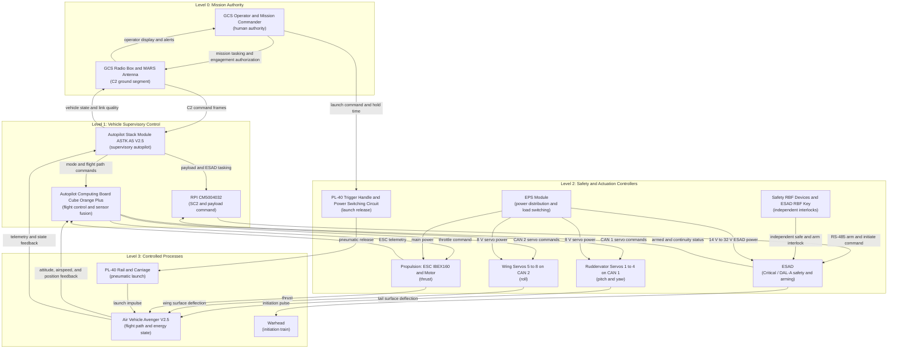
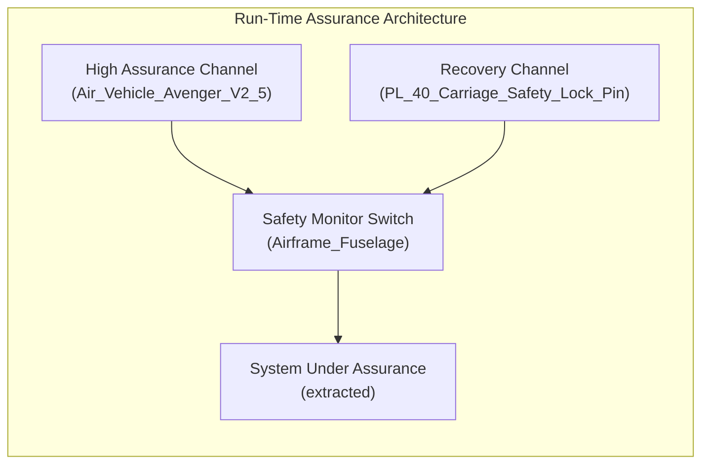

# Unified 8-Pillar STPA Safety & Risk Analysis Matrix

> **Primary Commercial Toolchain Integration Context:** MATLAB / Simulink / Stateflow / Embedded Coder
> **Safety Standards:** ISO/IEC/IEEE 15026-3 | ASTM F3269-17 RTA | MIL-STD-882E | Domain Integrity Framework

---

## System Losses

Losses are curated at the mission and system boundary, not one per AST part. The FMECA matrix in `docs/safety/05_FMECA_MATRIX.md` enforces 100 percent AST part coverage; this unit does not. The parachute deployment module is a non-mission R&D variant with `configuration: non-mission` and `baseline: false` and is excluded from baseline losses and hazards (schema/extracted/oem_bom.md).

| Loss ID | Description | Mission-Level Consequence | Primary Assets | Grounding |
| :--- | :--- | :--- | :--- | :--- |
| L-1 | Loss of the air vehicle | Unrecoverable loss of the Avenger V2.5 airframe after launch, including crash or unrecoverable departure from controlled flight | Air_Vehicle_Avenger_V2_5; Airframe_Fuselage; Airframe_Payload_Bay | schema/extracted/oem_bom.md; schema/extracted/parametric_limits.md PL-12 |
| L-2 | Loss of vehicle control | Loss of flight path, attitude, or energy authority such that the operator cannot recover the vehicle | Autopilot_Computing_Board_Cube_Orange_Plus; Ruddervator; Wings | schema/extracted/oem_bom.md; schema/extracted/parametric_limits.md PL-05; PL-14 to PL-18 |
| L-3 | Loss of command and control | Loss, corruption, or unacceptable latency of the C2 link that removes operator authority or delivers stale commands | GCS_Radio_Box; GCS_MARS_Antenna; Radio_Module_DTC; Autopilot_Stack_Module_ASTK_A5_V2_5 | schema/extracted/oem_bom.md; schema/extracted/interface_table.md; schema/extracted/parametric_limits.md PL-07; PL-08; PL-39 |
| L-4 | Loss of payload and arming safety | Uncommanded, premature, or unauthorized warhead initiation, or failure to preserve the safe state through launch and flight | ESAD; ESAD_Detonator; ESAD_Umbilical; Warhead; Safety_RBF_Devices | schema/extracted/oem_bom.md; schema/extracted/parametric_limits.md PL-46 to PL-63 |
| L-5 | Loss of containment | Air vehicle exits the authorized operating volume or impacts outside the designated area, endangering non-participants or protected assets | Air_Vehicle_Avenger_V2_5; Autopilot_Stack_Module_ASTK_A5_V2_5 | schema/extracted/parametric_limits.md PL-07; PL-08; PL-36; PL-37 |
| L-6 | Loss of launcher or ground support equipment integrity | Catapult pressure vessel, carriage, compressor, or GCS failure that destroys ground equipment or prevents a safe launch | PL_40_Rail; PL_40_Main_Tank; PL_40_Carriage; PL_40_Compressor_Unit; GCS_Ground_Box | schema/extracted/oem_bom.md; schema/extracted/parametric_limits.md PL-40; PL-41; PL-64 to PL-68 |
| L-7 | Loss of ground personnel or non-participant safety | Injury or death during assembly, arming, launch, recovery, or inadvertent energetic release | Airframe_Payload_Bay; Warhead; PL_40_Rail; PL_40_Trigger_Handle | schema/extracted/oem_bom.md; schema/extracted/parametric_limits.md PL-13; PL-40; PL-41 |
| L-8 | Loss of mission | Mission abort or failure to complete the assigned objective without necessarily losing the vehicle | Air_Vehicle_Avenger_V2_5; Gimbal_Nighthawk2UZ; Camera_Compute_Module_Trip6 | schema/extracted/parametric_limits.md PL-06; mission-abort thresholds Not stated in OEM sources |

### Loss Grounding Register

| Loss ID | OEM Source Lines | Parametric Limits |
| :--- | :--- | :--- |
| L-1 | schema/extracted/oem_bom.md at line 9; schema/extracted/oem_bom.md at lines 67-68 | PL-12 |
| L-2 | schema/extracted/oem_bom.md at line 10; schema/extracted/oem_bom.md at lines 21-38 | PL-05; PL-14 to PL-18 |
| L-3 | schema/extracted/oem_bom.md at lines 44-46; schema/extracted/interface_table.md at lines 63-64 | PL-07; PL-08; PL-39 |
| L-4 | schema/extracted/oem_bom.md at lines 52-57 | PL-46 to PL-63 |
| L-5 | schema/extracted/parametric_limits.md at lines 13-14; schema/extracted/parametric_limits.md at line 42; schema/extracted/parametric_limits.md at line 43 | PL-07; PL-08; PL-36; PL-37 |
| L-6 | schema/extracted/oem_bom.md at lines 82-102 | PL-40; PL-41; PL-64 to PL-68 |
| L-7 | schema/extracted/oem_bom.md at line 57; schema/extracted/oem_bom.md at lines 68-70 | PL-13; PL-40; PL-41 |
| L-8 | Mission-abort threshold Not stated in OEM sources | PL-06 |

## System Hazards

Hazards are hazardous system states, not component failure modes. Each hazard is assigned to the controller that can cause or fail to prevent it. ESAD is the safety-critical arming controller and is treated as Critical / DAL-A (schema/extracted/oem_bom.md).

| Hazard ID | Associated Control Action | Controller | Hazardous System State | Related Losses | Integrity and Grounding |
| :--- | :--- | :--- | :--- | :--- | :--- |
| H-1 | Arm enable and initiation | ESAD (Critical / DAL-A) | ESAD arms or initiates without valid dual authorization and independent interlock consent | L-4; L-7 | schema/extracted/oem_bom.md; schema/extracted/interface_table.md; schema/extracted/parametric_limits.md PL-51 to PL-55 |
| H-2 | Safe-state inhibit and continuity monitor | ESAD (Critical / DAL-A) | ESAD fails to inhibit initiation when the safe state is commanded or when umbilical continuity is open | L-4; L-7 | schema/extracted/oem_bom.md; schema/extracted/interface_table.md; schema/extracted/parametric_limits.md PL-49; PL-50 |
| H-3 | CAN 1 and CAN 2 servo commands | Autopilot_Computing_Board_Cube_Orange_Plus commanding Ruddervator and Wings | Ruddervator or wing servo commands drive control surfaces beyond the flight envelope or produce conflicting surface motion | L-1; L-2; L-5 | schema/extracted/oem_bom.md; schema/extracted/interface_table.md; schema/extracted/parametric_limits.md PL-14 to PL-22 |
| H-4 | Throttle and main power | Propulsion (ESC and motor assembly) and Battery 12S2P Li Metal BEI | Propulsion delivers uncontrolled thrust or the battery exceeds its voltage or thermal limits | L-1; L-2; L-7 | schema/extracted/oem_bom.md; schema/extracted/parametric_limits.md PL-23; PL-24; PL-32; PL-33 |
| H-5 | C2 command and telemetry exchange | GCS_Radio_Box; Radio_Module_DTC; Autopilot_Stack_Module_ASTK_A5_V2_5 | C2 link loss, corruption, or latency removes operator authority or delivers stale commands | L-3; L-5 | schema/extracted/oem_bom.md; schema/extracted/interface_table.md; schema/extracted/parametric_limits.md PL-07; PL-08; PL-39 |
| H-6 | Flight path and geofence containment | Autopilot_Stack_Module_ASTK_A5_V2_5 and GCS Operator | Air vehicle exits the authorized operating volume or loses containment | L-5; L-7 | schema/extracted/parametric_limits.md PL-07; PL-08; PL-36; PL-37 |
| H-7 | Launch release and pressure control | PL_40_Trigger_Handle and PL_40_Power_Switching_Circuit | Launcher releases the vehicle outside its pressure, mass, velocity, or angle envelope, or the carriage releases prematurely | L-1; L-6; L-7 | schema/extracted/oem_bom.md; schema/extracted/parametric_limits.md PL-40; PL-41; PL-64 to PL-68; PL-88 |
| H-8 | 8 V servo, 12 V radio, and 14 V ESAD power distribution | EPS_Module | Loss of electrical power distribution or avionics causes simultaneous loss of control and C2 | L-1; L-2; L-3 | schema/extracted/oem_bom.md; schema/extracted/parametric_limits.md PL-22; PL-23; PL-24 |
| H-9 | Payload retention and independent RBF interlock | Airframe_Payload_Bay and Safety_RBF_Devices | Payload bay retention or warhead mounting fails, causing inadvertent release or damage to the initiation train | L-4; L-7 | schema/extracted/oem_bom.md |
| H-10 | RBF removal sequence and ESD equalization | Safety_RBF_Devices and ESD_Grounding_Point | Ground handling or arming exposes personnel to energetic material or electrostatic discharge | L-4; L-7 | schema/extracted/oem_bom.md |
| H-11 | Sensor fusion and flight path command | Autopilot_Computing_Board_Cube_Orange_Plus with GNSS, pitot, and magnetometer sensors | Invalid air data, attitude, or position estimate causes the autopilot to command a divergent flight path | L-1; L-2; L-5 | schema/extracted/oem_bom.md; schema/extracted/parametric_limits.md PL-34; PL-35 |

### Hazard Grounding Register

| Hazard ID | OEM Source Lines | Parametric Limits |
| :--- | :--- | :--- |
| H-1 | schema/extracted/oem_bom.md at line 52; schema/extracted/interface_table.md at lines 49-56 | PL-51 to PL-55 |
| H-2 | schema/extracted/oem_bom.md at line 52; schema/extracted/interface_table.md at lines 49-56 | PL-49; PL-50 |
| H-3 | schema/extracted/oem_bom.md at lines 21-38; schema/extracted/interface_table.md at lines 9-31 | PL-14 to PL-22 |
| H-4 | schema/extracted/oem_bom.md at lines 18-22 | PL-23; PL-24; PL-32; PL-33 |
| H-5 | schema/extracted/oem_bom.md at lines 44-46; schema/extracted/interface_table.md at lines 63-64 | PL-07; PL-08; PL-39 |
| H-6 | schema/extracted/parametric_limits.md at lines 13-14; schema/extracted/parametric_limits.md at line 42; schema/extracted/parametric_limits.md at line 43 | PL-07; PL-08; PL-36; PL-37 |
| H-7 | schema/extracted/oem_bom.md at lines 82-102; schema/extracted/parametric_limits.md at lines 46-47; schema/extracted/parametric_limits.md at lines 70-74; schema/extracted/parametric_limits.md at line 94 | PL-40; PL-41; PL-64 to PL-68; PL-88 |
| H-8 | schema/extracted/oem_bom.md at line 11; schema/extracted/oem_bom.md at line 28 | PL-22; PL-23; PL-24 |
| H-9 | schema/extracted/oem_bom.md at line 57; schema/extracted/oem_bom.md at line 68; schema/extracted/oem_bom.md at line 70 | Not applicable |
| H-10 | schema/extracted/oem_bom.md at lines 69-70; schema/extracted/oem_bom.md at line 57 | Not applicable |
| H-11 | schema/extracted/oem_bom.md at lines 13-16; schema/extracted/oem_bom.md at lines 39-42 | PL-34; PL-35 |

## Hierarchical Control Structure Topology

The control structure separates mission authority, vehicle supervisory control, safety and actuation controllers, and controlled processes. Ruddervator is the canonical tail control surface assembly (drawing synonym Fins; preparation synonym tail stabiliser; schema/extracted/oem_bom.md). Controller timing budgets, C2 latency limits, and independence evidence are Not stated in OEM sources.




---

## 4. Unsafe Control Actions (**UCA-1..N**)

Systematic identification across the 4 STPA guide word / failure mode categories:

1. **Not providing causes hazard**
2. **Providing causes hazard**
3. **Too early, too late, or out of order**
4. **Stopped too soon or applied too long**

Cartesian product of controlling part-def control actions across the
four canonical STPA guide-word categories.

| UCA ID | Controller | Control Action | Guide Word | Context | Hazard | Safety Constraint | Severity | Integrity Level |
| :--- | :--- | :--- | :--- | :--- | :--- | :--- | :--- | :--- |


---

## 5. Loss Scenarios (**LS-1..N**) & Causal Factors

STPA control-loop loss scenario analysis synthesizing Class-1 controller process-model flaws and Class-2 control-path, feedback, and execution degradations from SysML v2 AST structure.

| Loss Scenario ID | UCA ID | Scenario Class | Controller | Control Action | Scenario | Causal Factor | Safety Constraint Mitigation |
| :--- | :--- | :--- | :--- | :--- | :--- | :--- | :--- |
| LS-001 | UCA-BASE | Class-1 (Controller / Process-Model Flaw) | Air_Vehicle_Avenger_V2_5 | BaselineControlEnvelope | Air_Vehicle_Avenger_V2_5 process-model divergence in active operational mode across controller input boundary with attribute component_name=Top-level air vehicle boundary enclosing all onboard subsystems under ConstraintDef assert_PL_01_range (PL_01 >= 30 and PL_01 <= 30) | Unrefreshed attribute component_name=Top-level air vehicle boundary enclosing all onboard subsystems or stale mode belief on controller input boundary (Derived: STPA Class-1) | Enforce SC-001 and ConstraintDef assert_PL_01_range (PL_01 >= 30 and PL_01 <= 30) across controller input boundary in Air_Vehicle_Avenger_V2_5 |
| LS-002 | UCA-BASE | Class-2 (Control-Path / Feedback / Execution Degradation) | Air_Vehicle_Avenger_V2_5 | BaselineControlEnvelope | Control-path or feedback degradation across actuation output channel and Air_Vehicle_Avenger_V2_5 interface actuation output channel violating ConstraintDef assert_PL_01_range (PL_01 >= 30 and PL_01 <= 30) | Transport delay, dropout, or execution stall across Air_Vehicle_Avenger_V2_5 interface actuation output channel distorting attribute component_name=Top-level air vehicle boundary enclosing all onboard subsystems (Derived: STPA Class-2) | Enforce SC-001 and ConstraintDef assert_PL_01_range (PL_01 >= 30 and PL_01 <= 30) via closed-loop integrity verification on actuation output channel |


---

## 6. Formal Safety Constraints (**SC-1..N**) & Stateflow Synthesis Hooks

The formal safety constraints and Run-Time Assurance supervisory monitors (`RTA`) are synthesized directly into **MATLAB / Simulink / Stateflow** charts for envelope protection and SLDV verification.

## Derived Safety Constraints per Unsafe Control Action

| Safety Constraint ID | UCA ID | Constraint Statement |
| :--- | :--- | :--- |

## Schema-Declared Constraint Defs (SysML v2 SSOT)

| Constraint Def | Expression |
| :--- | :--- |
| assert_PL_01_range | PL_01 >= 30 and PL_01 <= 30 |
| assert_PL_02_range | PL_02 <= 38 |
| assert_PL_03_range | PL_03 <= 55 |
| assert_PL_04_range | PL_04 <= 22 |
| assert_PL_05_range | PL_05 >= 26 |
| assert_PL_06_range | PL_06 >= 0 and PL_06 <= 90 |
| assert_PL_07_range | PL_07 >= 0 and PL_07 <= 60 |
| assert_PL_08_range | PL_08 >= 60 and PL_08 <= 180 |
| assert_PL_09_range | PL_09 >= 1.8 and PL_09 <= 1.8 |
| assert_PL_10_range | PL_10 >= 1.6 and PL_10 <= 1.6 |
| assert_PL_11_range | PL_11 >= 1.1 and PL_11 <= 1.1 |
| assert_PL_12_range | PL_12 <= 17 |
| assert_PL_13_range | PL_13 <= 5 |
| assert_PL_14_range | PL_14 >= 4 and PL_14 <= 4 |
| assert_PL_15_range | PL_15 >= 4 and PL_15 <= 4 |
| assert_PL_16_range | PL_16 >= 4 and PL_16 <= 4 |
| assert_PL_17_range | PL_17 >= 4 and PL_17 <= 4 |
| assert_PL_18_range | PL_18 >= 8 and PL_18 <= 8 |
| assert_PL_19_range | PL_19 >= 970 and PL_19 <= 970 |
| assert_PL_20_range | PL_20 >= 150 and PL_20 <= 150 |
| assert_PL_21_range | PL_21 >= 120 and PL_21 <= 120 |
| assert_PL_22_range | PL_22 >= 8 and PL_22 <= 8 |
| assert_PL_23_range | PL_23 >= 36 and PL_23 <= 36 |
| assert_PL_24_range | PL_24 >= 50.4 and PL_24 <= 50.4 |
| assert_PL_25_range | PL_25 >= -45 and PL_25 <= 135 |
| assert_PL_26_range | PL_26 >= -165 and PL_26 <= 165 |
| assert_PL_27_range | PL_27 >= 1 and PL_27 <= 40 |
| assert_PL_28_range | PL_28 >= 1280 and PL_28 <= 1280 |
| assert_PL_29_range | PL_29 >= 720 and PL_29 <= 720 |
| assert_PL_30_range | PL_30 >= 1280 and PL_30 <= 1280 |
| assert_PL_31_range | PL_31 >= 720 and PL_31 <= 720 |
| assert_PL_32_range | PL_32 >= 49 and PL_32 <= 49 |
| assert_PL_33_range | PL_33 >= 50 and PL_33 <= 50 |
| assert_PL_34_range | PL_34 >= 0 and PL_34 <= 3 |
| assert_PL_35_range | PL_35 >= 10 |
| assert_PL_36_range | PL_36 >= 50 |
| assert_PL_37_range | PL_37 >= 300 and PL_37 <= 300 |
| assert_PL_38_range | PL_38 >= 0 and PL_38 <= 24 |
| assert_PL_39_range | PL_39 >= 2 and PL_39 <= 2 |
| assert_PL_40_range | PL_40 >= 13 and PL_40 <= 13 |
| assert_PL_41_range | PL_41 >= 14 and PL_41 <= 14 |
| assert_PL_42_range | PL_42 >= 2 and PL_42 <= 2 |
| assert_PL_43_range | PL_43 >= 5 and PL_43 <= 5 |
| assert_PL_44_range | PL_44 <= 15 |
| assert_PL_45_range | PL_45 <= 55 |
| assert_PL_46_range | PL_46 >= 14 and PL_46 <= 14 |
| assert_PL_47_range | PL_47 >= 32 and PL_47 <= 32 |
| assert_PL_48_range | PL_48 >= 28 and PL_48 <= 28 |
| assert_PL_49_range | PL_49 >= 0 and PL_49 <= 0.5 |
| assert_PL_50_range | PL_50 >= 20 and PL_50 <= 20 |
| assert_PL_51_range | PL_51 >= 0 and PL_51 <= 0.7 |
| assert_PL_52_range | PL_52 >= 2.5 and PL_52 <= 2.5 |
| assert_PL_53_range | PL_53 >= 3.3 and PL_53 <= 3.3 |
| assert_PL_54_range | PL_54 >= 1 and PL_54 <= 1 |
| assert_PL_55_range | PL_55 >= 50 and PL_55 <= 50 |
| assert_PL_56_range | PL_56 >= 115200 and PL_56 <= 115200 |
| assert_PL_57_range | PL_57 >= 100 and PL_57 <= 100 |
| assert_PL_58_range | PL_58 >= 0 and PL_58 <= 5 |
| assert_PL_59_range | PL_59 >= 0 and PL_59 <= 10 |
| assert_PL_60_range | PL_60 >= 0 and PL_60 <= 1800 |
| assert_PL_61_range | PL_61 >= 5 and PL_61 <= 5 |
| assert_PL_62_range | PL_62 >= 14 and PL_62 <= 14 |
| assert_PL_63_range | PL_63 >= 0.0039 and PL_63 <= 0.0039 |
| assert_PL_64_range | PL_64 <= 30 |
| assert_PL_65_range | PL_65 <= 25 |
| assert_PL_66_range | PL_66 >= 12 and PL_66 <= 12 |
| assert_PL_67_range | PL_67 <= 14 |
| assert_PL_68_range | PL_68 <= 16 |
| assert_PL_69_range | PL_69 >= 68 and PL_69 <= 68 |
| assert_PL_70_range | PL_70 >= 43 and PL_70 <= 43 |
| assert_PL_71_range | PL_71 >= 25 and PL_71 <= 25 |
| assert_PL_72_range | PL_72 >= 0 and PL_72 <= 5 |
| assert_PL_73_range | PL_73 >= -20 and PL_73 <= -20 |
| assert_PL_74_range | PL_74 >= 50 and PL_74 <= 50 |
| assert_PL_75_range | PL_75 >= 18 and PL_75 <= 18 |
| assert_PL_76_range | PL_76 >= 6000 and PL_76 <= 6000 |
| assert_PL_77_range | PL_77 <= 14.5 |
| assert_PL_78_range | PL_78 >= 16 |
| assert_PL_79_range | PL_79 >= 5 and PL_79 <= 5 |
| assert_PL_80_range | PL_80 <= 100 |
| assert_PL_81_range | PL_81 >= 271 and PL_81 <= 271 |
| assert_PL_82_range | PL_82 >= 206.5 and PL_82 <= 206.5 |
| assert_PL_83_range | PL_83 >= 232.5 and PL_83 <= 232.5 |
| assert_PL_84_range | PL_84 >= 0 and PL_84 <= 200 |
| assert_PL_85_range | PL_85 >= 0 and PL_85 <= 100 |
| assert_PL_86_range | PL_86 >= 1115 and PL_86 <= 1115 |
| assert_PL_87_range | PL_87 >= 602 and PL_87 <= 602 |
| assert_PL_88_range | PL_88 >= 2 |
| assert_PL_89_range | PL_89 >= 0 and PL_89 <= 55 |
| assert_PL_90_range | PL_90 >= 0 and PL_90 <= 130 |
| assert_PL_91_range | PL_91 >= 10 and PL_91 <= 10 |
| assert_PL_92_range | PL_92 >= 40 and PL_92 <= 40 |
| assert_PL_93_range | PL_93 >= 5 and PL_93 <= 5 |
| assert_PL_94_range | PL_94 >= 1.28 and PL_94 <= 1.28 |
| assert_PL_01_range | PL_01 >= 30 and PL_01 <= 30 |
| assert_PL_02_range | PL_02 <= 38 |
| assert_PL_03_range | PL_03 <= 55 |
| assert_PL_04_range | PL_04 <= 22 |
| assert_PL_05_range | PL_05 >= 26 |
| assert_PL_06_range | PL_06 >= 0 and PL_06 <= 90 |
| assert_PL_07_range | PL_07 >= 0 and PL_07 <= 60 |
| assert_PL_08_range | PL_08 >= 60 and PL_08 <= 180 |
| assert_PL_09_range | PL_09 >= 1.8 and PL_09 <= 1.8 |
| assert_PL_10_range | PL_10 >= 1.6 and PL_10 <= 1.6 |
| assert_PL_11_range | PL_11 >= 1.1 and PL_11 <= 1.1 |
| assert_PL_12_range | PL_12 <= 17 |
| assert_PL_13_range | PL_13 <= 5 |
| assert_PL_14_range | PL_14 >= 4 and PL_14 <= 4 |
| assert_PL_15_range | PL_15 >= 4 and PL_15 <= 4 |
| assert_PL_16_range | PL_16 >= 4 and PL_16 <= 4 |
| assert_PL_17_range | PL_17 >= 4 and PL_17 <= 4 |
| assert_PL_18_range | PL_18 >= 8 and PL_18 <= 8 |
| assert_PL_19_range | PL_19 >= 970 and PL_19 <= 970 |
| assert_PL_20_range | PL_20 >= 150 and PL_20 <= 150 |
| assert_PL_21_range | PL_21 >= 120 and PL_21 <= 120 |
| assert_PL_22_range | PL_22 >= 8 and PL_22 <= 8 |
| assert_PL_23_range | PL_23 >= 36 and PL_23 <= 36 |
| assert_PL_24_range | PL_24 >= 50.4 and PL_24 <= 50.4 |
| assert_PL_25_range | PL_25 >= -45 and PL_25 <= 135 |
| assert_PL_26_range | PL_26 >= -165 and PL_26 <= 165 |
| assert_PL_27_range | PL_27 >= 1 and PL_27 <= 40 |
| assert_PL_28_range | PL_28 >= 1280 and PL_28 <= 1280 |
| assert_PL_29_range | PL_29 >= 720 and PL_29 <= 720 |
| assert_PL_30_range | PL_30 >= 1280 and PL_30 <= 1280 |
| assert_PL_31_range | PL_31 >= 720 and PL_31 <= 720 |
| assert_PL_32_range | PL_32 >= 49 and PL_32 <= 49 |
| assert_PL_33_range | PL_33 >= 50 and PL_33 <= 50 |
| assert_PL_34_range | PL_34 >= 0 and PL_34 <= 3 |
| assert_PL_35_range | PL_35 >= 10 |
| assert_PL_36_range | PL_36 >= 50 |
| assert_PL_37_range | PL_37 >= 300 and PL_37 <= 300 |
| assert_PL_38_range | PL_38 >= 0 and PL_38 <= 24 |
| assert_PL_39_range | PL_39 >= 2 and PL_39 <= 2 |
| assert_PL_40_range | PL_40 >= 13 and PL_40 <= 13 |
| assert_PL_41_range | PL_41 >= 14 and PL_41 <= 14 |
| assert_PL_42_range | PL_42 >= 2 and PL_42 <= 2 |
| assert_PL_43_range | PL_43 >= 5 and PL_43 <= 5 |
| assert_PL_44_range | PL_44 <= 15 |
| assert_PL_45_range | PL_45 <= 55 |
| assert_PL_46_range | PL_46 >= 14 and PL_46 <= 14 |
| assert_PL_47_range | PL_47 >= 32 and PL_47 <= 32 |
| assert_PL_48_range | PL_48 >= 28 and PL_48 <= 28 |
| assert_PL_49_range | PL_49 >= 0 and PL_49 <= 0.5 |
| assert_PL_50_range | PL_50 >= 20 and PL_50 <= 20 |
| assert_PL_51_range | PL_51 >= 0 and PL_51 <= 0.7 |
| assert_PL_52_range | PL_52 >= 2.5 and PL_52 <= 2.5 |
| assert_PL_53_range | PL_53 >= 3.3 and PL_53 <= 3.3 |
| assert_PL_54_range | PL_54 >= 1 and PL_54 <= 1 |
| assert_PL_55_range | PL_55 >= 50 and PL_55 <= 50 |
| assert_PL_56_range | PL_56 >= 115200 and PL_56 <= 115200 |
| assert_PL_57_range | PL_57 >= 100 and PL_57 <= 100 |
| assert_PL_58_range | PL_58 >= 0 and PL_58 <= 5 |
| assert_PL_59_range | PL_59 >= 0 and PL_59 <= 10 |
| assert_PL_60_range | PL_60 >= 0 and PL_60 <= 1800 |
| assert_PL_61_range | PL_61 >= 5 and PL_61 <= 5 |
| assert_PL_62_range | PL_62 >= 14 and PL_62 <= 14 |
| assert_PL_63_range | PL_63 >= 0.0039 and PL_63 <= 0.0039 |
| assert_PL_64_range | PL_64 <= 30 |
| assert_PL_65_range | PL_65 <= 25 |
| assert_PL_66_range | PL_66 >= 12 and PL_66 <= 12 |
| assert_PL_67_range | PL_67 <= 14 |
| assert_PL_68_range | PL_68 <= 16 |
| assert_PL_69_range | PL_69 >= 68 and PL_69 <= 68 |
| assert_PL_70_range | PL_70 >= 43 and PL_70 <= 43 |
| assert_PL_71_range | PL_71 >= 25 and PL_71 <= 25 |
| assert_PL_72_range | PL_72 >= 0 and PL_72 <= 5 |
| assert_PL_73_range | PL_73 >= -20 and PL_73 <= -20 |
| assert_PL_74_range | PL_74 >= 50 and PL_74 <= 50 |
| assert_PL_75_range | PL_75 >= 18 and PL_75 <= 18 |
| assert_PL_76_range | PL_76 >= 6000 and PL_76 <= 6000 |
| assert_PL_77_range | PL_77 <= 14.5 |
| assert_PL_78_range | PL_78 >= 16 |
| assert_PL_79_range | PL_79 >= 5 and PL_79 <= 5 |
| assert_PL_80_range | PL_80 <= 100 |
| assert_PL_81_range | PL_81 >= 271 and PL_81 <= 271 |
| assert_PL_82_range | PL_82 >= 206.5 and PL_82 <= 206.5 |
| assert_PL_83_range | PL_83 >= 232.5 and PL_83 <= 232.5 |
| assert_PL_84_range | PL_84 >= 0 and PL_84 <= 200 |
| assert_PL_85_range | PL_85 >= 0 and PL_85 <= 100 |
| assert_PL_86_range | PL_86 >= 1115 and PL_86 <= 1115 |
| assert_PL_87_range | PL_87 >= 602 and PL_87 <= 602 |
| assert_PL_88_range | PL_88 >= 2 |
| assert_PL_89_range | PL_89 >= 0 and PL_89 <= 55 |
| assert_PL_90_range | PL_90 >= 0 and PL_90 <= 130 |
| assert_PL_91_range | PL_91 >= 10 and PL_91 <= 10 |
| assert_PL_92_range | PL_92 >= 40 and PL_92 <= 40 |
| assert_PL_93_range | PL_93 >= 5 and PL_93 <= 5 |
| assert_PL_94_range | PL_94 >= 1.28 and PL_94 <= 1.28 |

## Schema-Declared Calculation Obligations (SysML v2 SSOT)

No `calc def` expressions declared in package `extracted`.

## Schema-Declared Safety Requirement Obligations (SysML v2 SSOT)

No `requirement def` declarations present in package `extracted`.


---

## 7. FMECA Criticality Matrix

The Risk Priority Number is the product of severity (S), occurrence (O)
and detection (D) scores.

| FMECA ID | Component | Failure Mode | Potential Effect | Severity (S) | Occurrence (O) | Detection (D) | RPN (S x O x D) | Mitigation | Derivation Basis |
| :--- | :--- | :--- | :--- | :--- | :--- | :--- | :--- | :--- | :--- |
| FMECA-001 | Air_Vehicle_Avenger_V2_5 | Air_Vehicle_Avenger_V2_5 Interface Contract Violation / Payload Malformation | Air_Vehicle_Avenger_V2_5: Loss of inter-component contract exchange or rejected boundary message | 8 | 3 | 2 | 48 | Air_Vehicle_Avenger_V2_5: Enforce boundary schema contract validation and deterministic rejection | Derived |
| FMECA-002 | Air_Vehicle_Avenger_V2_5 | Air_Vehicle_Avenger_V2_5 State Invariant Divergence / Transition Deadlock | Air_Vehicle_Avenger_V2_5: Component fails to satisfy target lifecycle state invariant | 7 | 3 | 2 | 42 | Air_Vehicle_Avenger_V2_5: Enforce guarded state transition preconditions and deterministic recovery transition | Derived |
| FMECA-003 | Air_Vehicle_Avenger_V2_5 | Air_Vehicle_Avenger_V2_5 Behavioral Execution Fault / Postcondition Violation | Air_Vehicle_Avenger_V2_5: Incomplete or non-terminating behavioral transformation | 8 | 2 | 3 | 48 | Air_Vehicle_Avenger_V2_5: Enforce precondition guards, bounded execution steps, and postcondition assertions | Derived |
| FMECA-004 | Air_Vehicle_Avenger_V2_5 | Air_Vehicle_Avenger_V2_5 Attribute 'component_name' Resource Capacity Exhaustion / Attribute Bound Breach | Air_Vehicle_Avenger_V2_5: Degraded structural capacity or rejected allocation under peak load affecting attribute 'component_name' | 6 | 3 | 2 | 36 | Air_Vehicle_Avenger_V2_5: Enforce explicit capacity bounds, quota checks, and admission backpressure for attribute 'component_name' | Derived |
| FMECA-005 | Air_Vehicle_Avenger_V2_5 | Air_Vehicle_Avenger_V2_5 Attribute 'interface_item' Resource Capacity Exhaustion / Attribute Bound Breach | Air_Vehicle_Avenger_V2_5: Degraded structural capacity or rejected allocation under peak load affecting attribute 'interface_item' | 6 | 3 | 2 | 36 | Air_Vehicle_Avenger_V2_5: Enforce explicit capacity bounds, quota checks, and admission backpressure for attribute 'interface_item' | Derived |
| FMECA-006 | Air_Vehicle_Avenger_V2_5 | Air_Vehicle_Avenger_V2_5 Attribute 'mass' Resource Capacity Exhaustion / Attribute Bound Breach | Air_Vehicle_Avenger_V2_5: Degraded structural capacity or rejected allocation under peak load affecting attribute 'mass' | 6 | 3 | 2 | 36 | Air_Vehicle_Avenger_V2_5: Enforce explicit capacity bounds, quota checks, and admission backpressure for attribute 'mass' | Derived |
| FMECA-007 | Air_Vehicle_Avenger_V2_5 | Air_Vehicle_Avenger_V2_5 Attribute 'part_number' Resource Capacity Exhaustion / Attribute Bound Breach | Air_Vehicle_Avenger_V2_5: Degraded structural capacity or rejected allocation under peak load affecting attribute 'part_number' | 6 | 3 | 2 | 36 | Air_Vehicle_Avenger_V2_5: Enforce explicit capacity bounds, quota checks, and admission backpressure for attribute 'part_number' | Derived |
| FMECA-008 | Air_Vehicle_Avenger_V2_5 | Air_Vehicle_Avenger_V2_5 Attribute 'power' Resource Capacity Exhaustion / Attribute Bound Breach | Air_Vehicle_Avenger_V2_5: Degraded structural capacity or rejected allocation under peak load affecting attribute 'power' | 6 | 3 | 2 | 36 | Air_Vehicle_Avenger_V2_5: Enforce explicit capacity bounds, quota checks, and admission backpressure for attribute 'power' | Derived |
| FMECA-009 | Airframe_Fuselage | Airframe_Fuselage Interface Contract Violation / Payload Malformation | Airframe_Fuselage: Loss of inter-component contract exchange or rejected boundary message | 8 | 3 | 2 | 48 | Airframe_Fuselage: Enforce boundary schema contract validation and deterministic rejection | Derived |
| FMECA-010 | Airframe_Fuselage | Airframe_Fuselage State Invariant Divergence / Transition Deadlock | Airframe_Fuselage: Component fails to satisfy target lifecycle state invariant | 7 | 3 | 2 | 42 | Airframe_Fuselage: Enforce guarded state transition preconditions and deterministic recovery transition | Derived |
| FMECA-011 | Airframe_Fuselage | Airframe_Fuselage Behavioral Execution Fault / Postcondition Violation | Airframe_Fuselage: Incomplete or non-terminating behavioral transformation | 8 | 2 | 3 | 48 | Airframe_Fuselage: Enforce precondition guards, bounded execution steps, and postcondition assertions | Derived |
| FMECA-012 | Airframe_Fuselage | Airframe_Fuselage Attribute 'component_name' Resource Capacity Exhaustion / Attribute Bound Breach | Airframe_Fuselage: Degraded structural capacity or rejected allocation under peak load affecting attribute 'component_name' | 6 | 3 | 2 | 36 | Airframe_Fuselage: Enforce explicit capacity bounds, quota checks, and admission backpressure for attribute 'component_name' | Derived |
| FMECA-013 | Airframe_Fuselage | Airframe_Fuselage Attribute 'interface_item' Resource Capacity Exhaustion / Attribute Bound Breach | Airframe_Fuselage: Degraded structural capacity or rejected allocation under peak load affecting attribute 'interface_item' | 6 | 3 | 2 | 36 | Airframe_Fuselage: Enforce explicit capacity bounds, quota checks, and admission backpressure for attribute 'interface_item' | Derived |
| FMECA-014 | Airframe_Fuselage | Airframe_Fuselage Attribute 'mass' Resource Capacity Exhaustion / Attribute Bound Breach | Airframe_Fuselage: Degraded structural capacity or rejected allocation under peak load affecting attribute 'mass' | 6 | 3 | 2 | 36 | Airframe_Fuselage: Enforce explicit capacity bounds, quota checks, and admission backpressure for attribute 'mass' | Derived |
| FMECA-015 | Airframe_Fuselage | Airframe_Fuselage Attribute 'part_number' Resource Capacity Exhaustion / Attribute Bound Breach | Airframe_Fuselage: Degraded structural capacity or rejected allocation under peak load affecting attribute 'part_number' | 6 | 3 | 2 | 36 | Airframe_Fuselage: Enforce explicit capacity bounds, quota checks, and admission backpressure for attribute 'part_number' | Derived |
| FMECA-016 | Airframe_Fuselage | Airframe_Fuselage Attribute 'power' Resource Capacity Exhaustion / Attribute Bound Breach | Airframe_Fuselage: Degraded structural capacity or rejected allocation under peak load affecting attribute 'power' | 6 | 3 | 2 | 36 | Airframe_Fuselage: Enforce explicit capacity bounds, quota checks, and admission backpressure for attribute 'power' | Derived |
| FMECA-017 | Airframe_Payload_Bay | Airframe_Payload_Bay Interface Contract Violation / Payload Malformation | Airframe_Payload_Bay: Loss of inter-component contract exchange or rejected boundary message | 8 | 3 | 2 | 48 | Airframe_Payload_Bay: Enforce boundary schema contract validation and deterministic rejection | Derived |
| FMECA-018 | Airframe_Payload_Bay | Airframe_Payload_Bay State Invariant Divergence / Transition Deadlock | Airframe_Payload_Bay: Component fails to satisfy target lifecycle state invariant | 7 | 3 | 2 | 42 | Airframe_Payload_Bay: Enforce guarded state transition preconditions and deterministic recovery transition | Derived |
| FMECA-019 | Airframe_Payload_Bay | Airframe_Payload_Bay Behavioral Execution Fault / Postcondition Violation | Airframe_Payload_Bay: Incomplete or non-terminating behavioral transformation | 8 | 2 | 3 | 48 | Airframe_Payload_Bay: Enforce precondition guards, bounded execution steps, and postcondition assertions | Derived |
| FMECA-020 | Airframe_Payload_Bay | Airframe_Payload_Bay Attribute 'component_name' Resource Capacity Exhaustion / Attribute Bound Breach | Airframe_Payload_Bay: Degraded structural capacity or rejected allocation under peak load affecting attribute 'component_name' | 6 | 3 | 2 | 36 | Airframe_Payload_Bay: Enforce explicit capacity bounds, quota checks, and admission backpressure for attribute 'component_name' | Derived |
| FMECA-021 | Airframe_Payload_Bay | Airframe_Payload_Bay Attribute 'interface_item' Resource Capacity Exhaustion / Attribute Bound Breach | Airframe_Payload_Bay: Degraded structural capacity or rejected allocation under peak load affecting attribute 'interface_item' | 6 | 3 | 2 | 36 | Airframe_Payload_Bay: Enforce explicit capacity bounds, quota checks, and admission backpressure for attribute 'interface_item' | Derived |
| FMECA-022 | Airframe_Payload_Bay | Airframe_Payload_Bay Attribute 'mass' Resource Capacity Exhaustion / Attribute Bound Breach | Airframe_Payload_Bay: Degraded structural capacity or rejected allocation under peak load affecting attribute 'mass' | 6 | 3 | 2 | 36 | Airframe_Payload_Bay: Enforce explicit capacity bounds, quota checks, and admission backpressure for attribute 'mass' | Derived |
| FMECA-023 | Airframe_Payload_Bay | Airframe_Payload_Bay Attribute 'part_number' Resource Capacity Exhaustion / Attribute Bound Breach | Airframe_Payload_Bay: Degraded structural capacity or rejected allocation under peak load affecting attribute 'part_number' | 6 | 3 | 2 | 36 | Airframe_Payload_Bay: Enforce explicit capacity bounds, quota checks, and admission backpressure for attribute 'part_number' | Derived |
| FMECA-024 | Airframe_Payload_Bay | Airframe_Payload_Bay Attribute 'power' Resource Capacity Exhaustion / Attribute Bound Breach | Airframe_Payload_Bay: Degraded structural capacity or rejected allocation under peak load affecting attribute 'power' | 6 | 3 | 2 | 36 | Airframe_Payload_Bay: Enforce explicit capacity bounds, quota checks, and admission backpressure for attribute 'power' | Derived |
| FMECA-025 | Automotive_Fuse_200A | Automotive_Fuse_200A Interface Contract Violation / Payload Malformation | Automotive_Fuse_200A: Loss of inter-component contract exchange or rejected boundary message | 8 | 3 | 2 | 48 | Automotive_Fuse_200A: Enforce boundary schema contract validation and deterministic rejection | Derived |
| FMECA-026 | Automotive_Fuse_200A | Automotive_Fuse_200A State Invariant Divergence / Transition Deadlock | Automotive_Fuse_200A: Component fails to satisfy target lifecycle state invariant | 7 | 3 | 2 | 42 | Automotive_Fuse_200A: Enforce guarded state transition preconditions and deterministic recovery transition | Derived |
| FMECA-027 | Automotive_Fuse_200A | Automotive_Fuse_200A Behavioral Execution Fault / Postcondition Violation | Automotive_Fuse_200A: Incomplete or non-terminating behavioral transformation | 8 | 2 | 3 | 48 | Automotive_Fuse_200A: Enforce precondition guards, bounded execution steps, and postcondition assertions | Derived |
| FMECA-028 | Automotive_Fuse_200A | Automotive_Fuse_200A Attribute 'component_name' Resource Capacity Exhaustion / Attribute Bound Breach | Automotive_Fuse_200A: Degraded structural capacity or rejected allocation under peak load affecting attribute 'component_name' | 6 | 3 | 2 | 36 | Automotive_Fuse_200A: Enforce explicit capacity bounds, quota checks, and admission backpressure for attribute 'component_name' | Derived |
| FMECA-029 | Automotive_Fuse_200A | Automotive_Fuse_200A Attribute 'interface_item' Resource Capacity Exhaustion / Attribute Bound Breach | Automotive_Fuse_200A: Degraded structural capacity or rejected allocation under peak load affecting attribute 'interface_item' | 6 | 3 | 2 | 36 | Automotive_Fuse_200A: Enforce explicit capacity bounds, quota checks, and admission backpressure for attribute 'interface_item' | Derived |
| FMECA-030 | Automotive_Fuse_200A | Automotive_Fuse_200A Attribute 'mass' Resource Capacity Exhaustion / Attribute Bound Breach | Automotive_Fuse_200A: Degraded structural capacity or rejected allocation under peak load affecting attribute 'mass' | 6 | 3 | 2 | 36 | Automotive_Fuse_200A: Enforce explicit capacity bounds, quota checks, and admission backpressure for attribute 'mass' | Derived |
| FMECA-031 | Automotive_Fuse_200A | Automotive_Fuse_200A Attribute 'part_number' Resource Capacity Exhaustion / Attribute Bound Breach | Automotive_Fuse_200A: Degraded structural capacity or rejected allocation under peak load affecting attribute 'part_number' | 6 | 3 | 2 | 36 | Automotive_Fuse_200A: Enforce explicit capacity bounds, quota checks, and admission backpressure for attribute 'part_number' | Derived |
| FMECA-032 | Automotive_Fuse_200A | Automotive_Fuse_200A Attribute 'power' Resource Capacity Exhaustion / Attribute Bound Breach | Automotive_Fuse_200A: Degraded structural capacity or rejected allocation under peak load affecting attribute 'power' | 6 | 3 | 2 | 36 | Automotive_Fuse_200A: Enforce explicit capacity bounds, quota checks, and admission backpressure for attribute 'power' | Derived |
| FMECA-033 | Autopilot_Computing_Board_Cube_Orange_Plus | Autopilot_Computing_Board_Cube_Orange_Plus Interface Contract Violation / Payload Malformation | Autopilot_Computing_Board_Cube_Orange_Plus: Loss of inter-component contract exchange or rejected boundary message | 8 | 3 | 2 | 48 | Autopilot_Computing_Board_Cube_Orange_Plus: Enforce boundary schema contract validation and deterministic rejection | Derived |
| FMECA-034 | Autopilot_Computing_Board_Cube_Orange_Plus | Autopilot_Computing_Board_Cube_Orange_Plus State Invariant Divergence / Transition Deadlock | Autopilot_Computing_Board_Cube_Orange_Plus: Component fails to satisfy target lifecycle state invariant | 7 | 3 | 2 | 42 | Autopilot_Computing_Board_Cube_Orange_Plus: Enforce guarded state transition preconditions and deterministic recovery transition | Derived |
| FMECA-035 | Autopilot_Computing_Board_Cube_Orange_Plus | Autopilot_Computing_Board_Cube_Orange_Plus Behavioral Execution Fault / Postcondition Violation | Autopilot_Computing_Board_Cube_Orange_Plus: Incomplete or non-terminating behavioral transformation | 8 | 2 | 3 | 48 | Autopilot_Computing_Board_Cube_Orange_Plus: Enforce precondition guards, bounded execution steps, and postcondition assertions | Derived |
| FMECA-036 | Autopilot_Computing_Board_Cube_Orange_Plus | Autopilot_Computing_Board_Cube_Orange_Plus Attribute 'component_name' Resource Capacity Exhaustion / Attribute Bound Breach | Autopilot_Computing_Board_Cube_Orange_Plus: Degraded structural capacity or rejected allocation under peak load affecting attribute 'component_name' | 6 | 3 | 2 | 36 | Autopilot_Computing_Board_Cube_Orange_Plus: Enforce explicit capacity bounds, quota checks, and admission backpressure for attribute 'component_name' | Derived |
| FMECA-037 | Autopilot_Computing_Board_Cube_Orange_Plus | Autopilot_Computing_Board_Cube_Orange_Plus Attribute 'interface_item' Resource Capacity Exhaustion / Attribute Bound Breach | Autopilot_Computing_Board_Cube_Orange_Plus: Degraded structural capacity or rejected allocation under peak load affecting attribute 'interface_item' | 6 | 3 | 2 | 36 | Autopilot_Computing_Board_Cube_Orange_Plus: Enforce explicit capacity bounds, quota checks, and admission backpressure for attribute 'interface_item' | Derived |
| FMECA-038 | Autopilot_Computing_Board_Cube_Orange_Plus | Autopilot_Computing_Board_Cube_Orange_Plus Attribute 'mass' Resource Capacity Exhaustion / Attribute Bound Breach | Autopilot_Computing_Board_Cube_Orange_Plus: Degraded structural capacity or rejected allocation under peak load affecting attribute 'mass' | 6 | 3 | 2 | 36 | Autopilot_Computing_Board_Cube_Orange_Plus: Enforce explicit capacity bounds, quota checks, and admission backpressure for attribute 'mass' | Derived |
| FMECA-039 | Autopilot_Computing_Board_Cube_Orange_Plus | Autopilot_Computing_Board_Cube_Orange_Plus Attribute 'part_number' Resource Capacity Exhaustion / Attribute Bound Breach | Autopilot_Computing_Board_Cube_Orange_Plus: Degraded structural capacity or rejected allocation under peak load affecting attribute 'part_number' | 6 | 3 | 2 | 36 | Autopilot_Computing_Board_Cube_Orange_Plus: Enforce explicit capacity bounds, quota checks, and admission backpressure for attribute 'part_number' | Derived |
| FMECA-040 | Autopilot_Computing_Board_Cube_Orange_Plus | Autopilot_Computing_Board_Cube_Orange_Plus Attribute 'power' Resource Capacity Exhaustion / Attribute Bound Breach | Autopilot_Computing_Board_Cube_Orange_Plus: Degraded structural capacity or rejected allocation under peak load affecting attribute 'power' | 6 | 3 | 2 | 36 | Autopilot_Computing_Board_Cube_Orange_Plus: Enforce explicit capacity bounds, quota checks, and admission backpressure for attribute 'power' | Derived |
| FMECA-041 | Autopilot_Stack_Module_ASTK_A5_V2_5 | Autopilot_Stack_Module_ASTK_A5_V2_5 Interface Contract Violation / Payload Malformation | Autopilot_Stack_Module_ASTK_A5_V2_5: Loss of inter-component contract exchange or rejected boundary message | 8 | 3 | 2 | 48 | Autopilot_Stack_Module_ASTK_A5_V2_5: Enforce boundary schema contract validation and deterministic rejection | Derived |
| FMECA-042 | Autopilot_Stack_Module_ASTK_A5_V2_5 | Autopilot_Stack_Module_ASTK_A5_V2_5 State Invariant Divergence / Transition Deadlock | Autopilot_Stack_Module_ASTK_A5_V2_5: Component fails to satisfy target lifecycle state invariant | 7 | 3 | 2 | 42 | Autopilot_Stack_Module_ASTK_A5_V2_5: Enforce guarded state transition preconditions and deterministic recovery transition | Derived |
| FMECA-043 | Autopilot_Stack_Module_ASTK_A5_V2_5 | Autopilot_Stack_Module_ASTK_A5_V2_5 Behavioral Execution Fault / Postcondition Violation | Autopilot_Stack_Module_ASTK_A5_V2_5: Incomplete or non-terminating behavioral transformation | 8 | 2 | 3 | 48 | Autopilot_Stack_Module_ASTK_A5_V2_5: Enforce precondition guards, bounded execution steps, and postcondition assertions | Derived |
| FMECA-044 | Autopilot_Stack_Module_ASTK_A5_V2_5 | Autopilot_Stack_Module_ASTK_A5_V2_5 Attribute 'component_name' Resource Capacity Exhaustion / Attribute Bound Breach | Autopilot_Stack_Module_ASTK_A5_V2_5: Degraded structural capacity or rejected allocation under peak load affecting attribute 'component_name' | 6 | 3 | 2 | 36 | Autopilot_Stack_Module_ASTK_A5_V2_5: Enforce explicit capacity bounds, quota checks, and admission backpressure for attribute 'component_name' | Derived |
| FMECA-045 | Autopilot_Stack_Module_ASTK_A5_V2_5 | Autopilot_Stack_Module_ASTK_A5_V2_5 Attribute 'interface_item' Resource Capacity Exhaustion / Attribute Bound Breach | Autopilot_Stack_Module_ASTK_A5_V2_5: Degraded structural capacity or rejected allocation under peak load affecting attribute 'interface_item' | 6 | 3 | 2 | 36 | Autopilot_Stack_Module_ASTK_A5_V2_5: Enforce explicit capacity bounds, quota checks, and admission backpressure for attribute 'interface_item' | Derived |
| FMECA-046 | Autopilot_Stack_Module_ASTK_A5_V2_5 | Autopilot_Stack_Module_ASTK_A5_V2_5 Attribute 'mass' Resource Capacity Exhaustion / Attribute Bound Breach | Autopilot_Stack_Module_ASTK_A5_V2_5: Degraded structural capacity or rejected allocation under peak load affecting attribute 'mass' | 6 | 3 | 2 | 36 | Autopilot_Stack_Module_ASTK_A5_V2_5: Enforce explicit capacity bounds, quota checks, and admission backpressure for attribute 'mass' | Derived |
| FMECA-047 | Autopilot_Stack_Module_ASTK_A5_V2_5 | Autopilot_Stack_Module_ASTK_A5_V2_5 Attribute 'part_number' Resource Capacity Exhaustion / Attribute Bound Breach | Autopilot_Stack_Module_ASTK_A5_V2_5: Degraded structural capacity or rejected allocation under peak load affecting attribute 'part_number' | 6 | 3 | 2 | 36 | Autopilot_Stack_Module_ASTK_A5_V2_5: Enforce explicit capacity bounds, quota checks, and admission backpressure for attribute 'part_number' | Derived |
| FMECA-048 | Autopilot_Stack_Module_ASTK_A5_V2_5 | Autopilot_Stack_Module_ASTK_A5_V2_5 Attribute 'power' Resource Capacity Exhaustion / Attribute Bound Breach | Autopilot_Stack_Module_ASTK_A5_V2_5: Degraded structural capacity or rejected allocation under peak load affecting attribute 'power' | 6 | 3 | 2 | 36 | Autopilot_Stack_Module_ASTK_A5_V2_5: Enforce explicit capacity bounds, quota checks, and admission backpressure for attribute 'power' | Derived |
| FMECA-049 | Battery_12S2P_Li_Metal_BEI | Battery_12S2P_Li_Metal_BEI Interface Contract Violation / Payload Malformation | Battery_12S2P_Li_Metal_BEI: Loss of inter-component contract exchange or rejected boundary message | 8 | 3 | 2 | 48 | Battery_12S2P_Li_Metal_BEI: Enforce boundary schema contract validation and deterministic rejection | Derived |
| FMECA-050 | Battery_12S2P_Li_Metal_BEI | Battery_12S2P_Li_Metal_BEI State Invariant Divergence / Transition Deadlock | Battery_12S2P_Li_Metal_BEI: Component fails to satisfy target lifecycle state invariant | 7 | 3 | 2 | 42 | Battery_12S2P_Li_Metal_BEI: Enforce guarded state transition preconditions and deterministic recovery transition | Derived |
| FMECA-051 | Battery_12S2P_Li_Metal_BEI | Battery_12S2P_Li_Metal_BEI Behavioral Execution Fault / Postcondition Violation | Battery_12S2P_Li_Metal_BEI: Incomplete or non-terminating behavioral transformation | 8 | 2 | 3 | 48 | Battery_12S2P_Li_Metal_BEI: Enforce precondition guards, bounded execution steps, and postcondition assertions | Derived |
| FMECA-052 | Battery_12S2P_Li_Metal_BEI | Battery_12S2P_Li_Metal_BEI Attribute 'component_name' Resource Capacity Exhaustion / Attribute Bound Breach | Battery_12S2P_Li_Metal_BEI: Degraded structural capacity or rejected allocation under peak load affecting attribute 'component_name' | 6 | 3 | 2 | 36 | Battery_12S2P_Li_Metal_BEI: Enforce explicit capacity bounds, quota checks, and admission backpressure for attribute 'component_name' | Derived |
| FMECA-053 | Battery_12S2P_Li_Metal_BEI | Battery_12S2P_Li_Metal_BEI Attribute 'interface_item' Resource Capacity Exhaustion / Attribute Bound Breach | Battery_12S2P_Li_Metal_BEI: Degraded structural capacity or rejected allocation under peak load affecting attribute 'interface_item' | 6 | 3 | 2 | 36 | Battery_12S2P_Li_Metal_BEI: Enforce explicit capacity bounds, quota checks, and admission backpressure for attribute 'interface_item' | Derived |
| FMECA-054 | Battery_12S2P_Li_Metal_BEI | Battery_12S2P_Li_Metal_BEI Attribute 'mass' Resource Capacity Exhaustion / Attribute Bound Breach | Battery_12S2P_Li_Metal_BEI: Degraded structural capacity or rejected allocation under peak load affecting attribute 'mass' | 6 | 3 | 2 | 36 | Battery_12S2P_Li_Metal_BEI: Enforce explicit capacity bounds, quota checks, and admission backpressure for attribute 'mass' | Derived |
| FMECA-055 | Battery_12S2P_Li_Metal_BEI | Battery_12S2P_Li_Metal_BEI Attribute 'part_number' Resource Capacity Exhaustion / Attribute Bound Breach | Battery_12S2P_Li_Metal_BEI: Degraded structural capacity or rejected allocation under peak load affecting attribute 'part_number' | 6 | 3 | 2 | 36 | Battery_12S2P_Li_Metal_BEI: Enforce explicit capacity bounds, quota checks, and admission backpressure for attribute 'part_number' | Derived |
| FMECA-056 | Battery_12S2P_Li_Metal_BEI | Battery_12S2P_Li_Metal_BEI Attribute 'power' Resource Capacity Exhaustion / Attribute Bound Breach | Battery_12S2P_Li_Metal_BEI: Degraded structural capacity or rejected allocation under peak load affecting attribute 'power' | 6 | 3 | 2 | 36 | Battery_12S2P_Li_Metal_BEI: Enforce explicit capacity bounds, quota checks, and admission backpressure for attribute 'power' | Derived |
| FMECA-057 | CAN_1_Autopilot_EPS_Junction_Node | CAN_1_Autopilot_EPS_Junction_Node Interface Contract Violation / Payload Malformation | CAN_1_Autopilot_EPS_Junction_Node: Loss of inter-component contract exchange or rejected boundary message | 8 | 3 | 2 | 48 | CAN_1_Autopilot_EPS_Junction_Node: Enforce boundary schema contract validation and deterministic rejection | Derived |
| FMECA-058 | CAN_1_Autopilot_EPS_Junction_Node | CAN_1_Autopilot_EPS_Junction_Node State Invariant Divergence / Transition Deadlock | CAN_1_Autopilot_EPS_Junction_Node: Component fails to satisfy target lifecycle state invariant | 7 | 3 | 2 | 42 | CAN_1_Autopilot_EPS_Junction_Node: Enforce guarded state transition preconditions and deterministic recovery transition | Derived |
| FMECA-059 | CAN_1_Autopilot_EPS_Junction_Node | CAN_1_Autopilot_EPS_Junction_Node Behavioral Execution Fault / Postcondition Violation | CAN_1_Autopilot_EPS_Junction_Node: Incomplete or non-terminating behavioral transformation | 8 | 2 | 3 | 48 | CAN_1_Autopilot_EPS_Junction_Node: Enforce precondition guards, bounded execution steps, and postcondition assertions | Derived |
| FMECA-060 | CAN_1_Autopilot_EPS_Junction_Node | CAN_1_Autopilot_EPS_Junction_Node Attribute 'component_name' Resource Capacity Exhaustion / Attribute Bound Breach | CAN_1_Autopilot_EPS_Junction_Node: Degraded structural capacity or rejected allocation under peak load affecting attribute 'component_name' | 6 | 3 | 2 | 36 | CAN_1_Autopilot_EPS_Junction_Node: Enforce explicit capacity bounds, quota checks, and admission backpressure for attribute 'component_name' | Derived |
| FMECA-061 | CAN_1_Autopilot_EPS_Junction_Node | CAN_1_Autopilot_EPS_Junction_Node Attribute 'interface_item' Resource Capacity Exhaustion / Attribute Bound Breach | CAN_1_Autopilot_EPS_Junction_Node: Degraded structural capacity or rejected allocation under peak load affecting attribute 'interface_item' | 6 | 3 | 2 | 36 | CAN_1_Autopilot_EPS_Junction_Node: Enforce explicit capacity bounds, quota checks, and admission backpressure for attribute 'interface_item' | Derived |
| FMECA-062 | CAN_1_Autopilot_EPS_Junction_Node | CAN_1_Autopilot_EPS_Junction_Node Attribute 'mass' Resource Capacity Exhaustion / Attribute Bound Breach | CAN_1_Autopilot_EPS_Junction_Node: Degraded structural capacity or rejected allocation under peak load affecting attribute 'mass' | 6 | 3 | 2 | 36 | CAN_1_Autopilot_EPS_Junction_Node: Enforce explicit capacity bounds, quota checks, and admission backpressure for attribute 'mass' | Derived |
| FMECA-063 | CAN_1_Autopilot_EPS_Junction_Node | CAN_1_Autopilot_EPS_Junction_Node Attribute 'part_number' Resource Capacity Exhaustion / Attribute Bound Breach | CAN_1_Autopilot_EPS_Junction_Node: Degraded structural capacity or rejected allocation under peak load affecting attribute 'part_number' | 6 | 3 | 2 | 36 | CAN_1_Autopilot_EPS_Junction_Node: Enforce explicit capacity bounds, quota checks, and admission backpressure for attribute 'part_number' | Derived |
| FMECA-064 | CAN_1_Autopilot_EPS_Junction_Node | CAN_1_Autopilot_EPS_Junction_Node Attribute 'power' Resource Capacity Exhaustion / Attribute Bound Breach | CAN_1_Autopilot_EPS_Junction_Node: Degraded structural capacity or rejected allocation under peak load affecting attribute 'power' | 6 | 3 | 2 | 36 | CAN_1_Autopilot_EPS_Junction_Node: Enforce explicit capacity bounds, quota checks, and admission backpressure for attribute 'power' | Derived |
| FMECA-065 | CAN_1_Power_Meter_Junction_Node | CAN_1_Power_Meter_Junction_Node Interface Contract Violation / Payload Malformation | CAN_1_Power_Meter_Junction_Node: Loss of inter-component contract exchange or rejected boundary message | 8 | 3 | 2 | 48 | CAN_1_Power_Meter_Junction_Node: Enforce boundary schema contract validation and deterministic rejection | Derived |
| FMECA-066 | CAN_1_Power_Meter_Junction_Node | CAN_1_Power_Meter_Junction_Node State Invariant Divergence / Transition Deadlock | CAN_1_Power_Meter_Junction_Node: Component fails to satisfy target lifecycle state invariant | 7 | 3 | 2 | 42 | CAN_1_Power_Meter_Junction_Node: Enforce guarded state transition preconditions and deterministic recovery transition | Derived |
| FMECA-067 | CAN_1_Power_Meter_Junction_Node | CAN_1_Power_Meter_Junction_Node Behavioral Execution Fault / Postcondition Violation | CAN_1_Power_Meter_Junction_Node: Incomplete or non-terminating behavioral transformation | 8 | 2 | 3 | 48 | CAN_1_Power_Meter_Junction_Node: Enforce precondition guards, bounded execution steps, and postcondition assertions | Derived |
| FMECA-068 | CAN_1_Power_Meter_Junction_Node | CAN_1_Power_Meter_Junction_Node Attribute 'component_name' Resource Capacity Exhaustion / Attribute Bound Breach | CAN_1_Power_Meter_Junction_Node: Degraded structural capacity or rejected allocation under peak load affecting attribute 'component_name' | 6 | 3 | 2 | 36 | CAN_1_Power_Meter_Junction_Node: Enforce explicit capacity bounds, quota checks, and admission backpressure for attribute 'component_name' | Derived |
| FMECA-069 | CAN_1_Power_Meter_Junction_Node | CAN_1_Power_Meter_Junction_Node Attribute 'interface_item' Resource Capacity Exhaustion / Attribute Bound Breach | CAN_1_Power_Meter_Junction_Node: Degraded structural capacity or rejected allocation under peak load affecting attribute 'interface_item' | 6 | 3 | 2 | 36 | CAN_1_Power_Meter_Junction_Node: Enforce explicit capacity bounds, quota checks, and admission backpressure for attribute 'interface_item' | Derived |
| FMECA-070 | CAN_1_Power_Meter_Junction_Node | CAN_1_Power_Meter_Junction_Node Attribute 'mass' Resource Capacity Exhaustion / Attribute Bound Breach | CAN_1_Power_Meter_Junction_Node: Degraded structural capacity or rejected allocation under peak load affecting attribute 'mass' | 6 | 3 | 2 | 36 | CAN_1_Power_Meter_Junction_Node: Enforce explicit capacity bounds, quota checks, and admission backpressure for attribute 'mass' | Derived |
| FMECA-071 | CAN_1_Power_Meter_Junction_Node | CAN_1_Power_Meter_Junction_Node Attribute 'part_number' Resource Capacity Exhaustion / Attribute Bound Breach | CAN_1_Power_Meter_Junction_Node: Degraded structural capacity or rejected allocation under peak load affecting attribute 'part_number' | 6 | 3 | 2 | 36 | CAN_1_Power_Meter_Junction_Node: Enforce explicit capacity bounds, quota checks, and admission backpressure for attribute 'part_number' | Derived |
| FMECA-072 | CAN_1_Power_Meter_Junction_Node | CAN_1_Power_Meter_Junction_Node Attribute 'power' Resource Capacity Exhaustion / Attribute Bound Breach | CAN_1_Power_Meter_Junction_Node: Degraded structural capacity or rejected allocation under peak load affecting attribute 'power' | 6 | 3 | 2 | 36 | CAN_1_Power_Meter_Junction_Node: Enforce explicit capacity bounds, quota checks, and admission backpressure for attribute 'power' | Derived |
| FMECA-073 | CAN_1_Ruddervator_Splitter_Junction_Node | CAN_1_Ruddervator_Splitter_Junction_Node Interface Contract Violation / Payload Malformation | CAN_1_Ruddervator_Splitter_Junction_Node: Loss of inter-component contract exchange or rejected boundary message | 8 | 3 | 2 | 48 | CAN_1_Ruddervator_Splitter_Junction_Node: Enforce boundary schema contract validation and deterministic rejection | Derived |
| FMECA-074 | CAN_1_Ruddervator_Splitter_Junction_Node | CAN_1_Ruddervator_Splitter_Junction_Node State Invariant Divergence / Transition Deadlock | CAN_1_Ruddervator_Splitter_Junction_Node: Component fails to satisfy target lifecycle state invariant | 7 | 3 | 2 | 42 | CAN_1_Ruddervator_Splitter_Junction_Node: Enforce guarded state transition preconditions and deterministic recovery transition | Derived |
| FMECA-075 | CAN_1_Ruddervator_Splitter_Junction_Node | CAN_1_Ruddervator_Splitter_Junction_Node Behavioral Execution Fault / Postcondition Violation | CAN_1_Ruddervator_Splitter_Junction_Node: Incomplete or non-terminating behavioral transformation | 8 | 2 | 3 | 48 | CAN_1_Ruddervator_Splitter_Junction_Node: Enforce precondition guards, bounded execution steps, and postcondition assertions | Derived |
| FMECA-076 | CAN_1_Ruddervator_Splitter_Junction_Node | CAN_1_Ruddervator_Splitter_Junction_Node Attribute 'component_name' Resource Capacity Exhaustion / Attribute Bound Breach | CAN_1_Ruddervator_Splitter_Junction_Node: Degraded structural capacity or rejected allocation under peak load affecting attribute 'component_name' | 6 | 3 | 2 | 36 | CAN_1_Ruddervator_Splitter_Junction_Node: Enforce explicit capacity bounds, quota checks, and admission backpressure for attribute 'component_name' | Derived |
| FMECA-077 | CAN_1_Ruddervator_Splitter_Junction_Node | CAN_1_Ruddervator_Splitter_Junction_Node Attribute 'interface_item' Resource Capacity Exhaustion / Attribute Bound Breach | CAN_1_Ruddervator_Splitter_Junction_Node: Degraded structural capacity or rejected allocation under peak load affecting attribute 'interface_item' | 6 | 3 | 2 | 36 | CAN_1_Ruddervator_Splitter_Junction_Node: Enforce explicit capacity bounds, quota checks, and admission backpressure for attribute 'interface_item' | Derived |
| FMECA-078 | CAN_1_Ruddervator_Splitter_Junction_Node | CAN_1_Ruddervator_Splitter_Junction_Node Attribute 'mass' Resource Capacity Exhaustion / Attribute Bound Breach | CAN_1_Ruddervator_Splitter_Junction_Node: Degraded structural capacity or rejected allocation under peak load affecting attribute 'mass' | 6 | 3 | 2 | 36 | CAN_1_Ruddervator_Splitter_Junction_Node: Enforce explicit capacity bounds, quota checks, and admission backpressure for attribute 'mass' | Derived |
| FMECA-079 | CAN_1_Ruddervator_Splitter_Junction_Node | CAN_1_Ruddervator_Splitter_Junction_Node Attribute 'part_number' Resource Capacity Exhaustion / Attribute Bound Breach | CAN_1_Ruddervator_Splitter_Junction_Node: Degraded structural capacity or rejected allocation under peak load affecting attribute 'part_number' | 6 | 3 | 2 | 36 | CAN_1_Ruddervator_Splitter_Junction_Node: Enforce explicit capacity bounds, quota checks, and admission backpressure for attribute 'part_number' | Derived |
| FMECA-080 | CAN_1_Ruddervator_Splitter_Junction_Node | CAN_1_Ruddervator_Splitter_Junction_Node Attribute 'power' Resource Capacity Exhaustion / Attribute Bound Breach | CAN_1_Ruddervator_Splitter_Junction_Node: Degraded structural capacity or rejected allocation under peak load affecting attribute 'power' | 6 | 3 | 2 | 36 | CAN_1_Ruddervator_Splitter_Junction_Node: Enforce explicit capacity bounds, quota checks, and admission backpressure for attribute 'power' | Derived |
| FMECA-081 | CAN_2_Servo_5_Series_Junction_Node | CAN_2_Servo_5_Series_Junction_Node Interface Contract Violation / Payload Malformation | CAN_2_Servo_5_Series_Junction_Node: Loss of inter-component contract exchange or rejected boundary message | 8 | 3 | 2 | 48 | CAN_2_Servo_5_Series_Junction_Node: Enforce boundary schema contract validation and deterministic rejection | Derived |
| FMECA-082 | CAN_2_Servo_5_Series_Junction_Node | CAN_2_Servo_5_Series_Junction_Node State Invariant Divergence / Transition Deadlock | CAN_2_Servo_5_Series_Junction_Node: Component fails to satisfy target lifecycle state invariant | 7 | 3 | 2 | 42 | CAN_2_Servo_5_Series_Junction_Node: Enforce guarded state transition preconditions and deterministic recovery transition | Derived |
| FMECA-083 | CAN_2_Servo_5_Series_Junction_Node | CAN_2_Servo_5_Series_Junction_Node Behavioral Execution Fault / Postcondition Violation | CAN_2_Servo_5_Series_Junction_Node: Incomplete or non-terminating behavioral transformation | 8 | 2 | 3 | 48 | CAN_2_Servo_5_Series_Junction_Node: Enforce precondition guards, bounded execution steps, and postcondition assertions | Derived |
| FMECA-084 | CAN_2_Servo_5_Series_Junction_Node | CAN_2_Servo_5_Series_Junction_Node Attribute 'component_name' Resource Capacity Exhaustion / Attribute Bound Breach | CAN_2_Servo_5_Series_Junction_Node: Degraded structural capacity or rejected allocation under peak load affecting attribute 'component_name' | 6 | 3 | 2 | 36 | CAN_2_Servo_5_Series_Junction_Node: Enforce explicit capacity bounds, quota checks, and admission backpressure for attribute 'component_name' | Derived |
| FMECA-085 | CAN_2_Servo_5_Series_Junction_Node | CAN_2_Servo_5_Series_Junction_Node Attribute 'interface_item' Resource Capacity Exhaustion / Attribute Bound Breach | CAN_2_Servo_5_Series_Junction_Node: Degraded structural capacity or rejected allocation under peak load affecting attribute 'interface_item' | 6 | 3 | 2 | 36 | CAN_2_Servo_5_Series_Junction_Node: Enforce explicit capacity bounds, quota checks, and admission backpressure for attribute 'interface_item' | Derived |
| FMECA-086 | CAN_2_Servo_5_Series_Junction_Node | CAN_2_Servo_5_Series_Junction_Node Attribute 'mass' Resource Capacity Exhaustion / Attribute Bound Breach | CAN_2_Servo_5_Series_Junction_Node: Degraded structural capacity or rejected allocation under peak load affecting attribute 'mass' | 6 | 3 | 2 | 36 | CAN_2_Servo_5_Series_Junction_Node: Enforce explicit capacity bounds, quota checks, and admission backpressure for attribute 'mass' | Derived |
| FMECA-087 | CAN_2_Servo_5_Series_Junction_Node | CAN_2_Servo_5_Series_Junction_Node Attribute 'part_number' Resource Capacity Exhaustion / Attribute Bound Breach | CAN_2_Servo_5_Series_Junction_Node: Degraded structural capacity or rejected allocation under peak load affecting attribute 'part_number' | 6 | 3 | 2 | 36 | CAN_2_Servo_5_Series_Junction_Node: Enforce explicit capacity bounds, quota checks, and admission backpressure for attribute 'part_number' | Derived |
| FMECA-088 | CAN_2_Servo_5_Series_Junction_Node | CAN_2_Servo_5_Series_Junction_Node Attribute 'power' Resource Capacity Exhaustion / Attribute Bound Breach | CAN_2_Servo_5_Series_Junction_Node: Degraded structural capacity or rejected allocation under peak load affecting attribute 'power' | 6 | 3 | 2 | 36 | CAN_2_Servo_5_Series_Junction_Node: Enforce explicit capacity bounds, quota checks, and admission backpressure for attribute 'power' | Derived |
| FMECA-089 | CAN_2_Servo_6_Series_Junction_Node | CAN_2_Servo_6_Series_Junction_Node Interface Contract Violation / Payload Malformation | CAN_2_Servo_6_Series_Junction_Node: Loss of inter-component contract exchange or rejected boundary message | 8 | 3 | 2 | 48 | CAN_2_Servo_6_Series_Junction_Node: Enforce boundary schema contract validation and deterministic rejection | Derived |
| FMECA-090 | CAN_2_Servo_6_Series_Junction_Node | CAN_2_Servo_6_Series_Junction_Node State Invariant Divergence / Transition Deadlock | CAN_2_Servo_6_Series_Junction_Node: Component fails to satisfy target lifecycle state invariant | 7 | 3 | 2 | 42 | CAN_2_Servo_6_Series_Junction_Node: Enforce guarded state transition preconditions and deterministic recovery transition | Derived |
| FMECA-091 | CAN_2_Servo_6_Series_Junction_Node | CAN_2_Servo_6_Series_Junction_Node Behavioral Execution Fault / Postcondition Violation | CAN_2_Servo_6_Series_Junction_Node: Incomplete or non-terminating behavioral transformation | 8 | 2 | 3 | 48 | CAN_2_Servo_6_Series_Junction_Node: Enforce precondition guards, bounded execution steps, and postcondition assertions | Derived |
| FMECA-092 | CAN_2_Servo_6_Series_Junction_Node | CAN_2_Servo_6_Series_Junction_Node Attribute 'component_name' Resource Capacity Exhaustion / Attribute Bound Breach | CAN_2_Servo_6_Series_Junction_Node: Degraded structural capacity or rejected allocation under peak load affecting attribute 'component_name' | 6 | 3 | 2 | 36 | CAN_2_Servo_6_Series_Junction_Node: Enforce explicit capacity bounds, quota checks, and admission backpressure for attribute 'component_name' | Derived |
| FMECA-093 | CAN_2_Servo_6_Series_Junction_Node | CAN_2_Servo_6_Series_Junction_Node Attribute 'interface_item' Resource Capacity Exhaustion / Attribute Bound Breach | CAN_2_Servo_6_Series_Junction_Node: Degraded structural capacity or rejected allocation under peak load affecting attribute 'interface_item' | 6 | 3 | 2 | 36 | CAN_2_Servo_6_Series_Junction_Node: Enforce explicit capacity bounds, quota checks, and admission backpressure for attribute 'interface_item' | Derived |
| FMECA-094 | CAN_2_Servo_6_Series_Junction_Node | CAN_2_Servo_6_Series_Junction_Node Attribute 'mass' Resource Capacity Exhaustion / Attribute Bound Breach | CAN_2_Servo_6_Series_Junction_Node: Degraded structural capacity or rejected allocation under peak load affecting attribute 'mass' | 6 | 3 | 2 | 36 | CAN_2_Servo_6_Series_Junction_Node: Enforce explicit capacity bounds, quota checks, and admission backpressure for attribute 'mass' | Derived |
| FMECA-095 | CAN_2_Servo_6_Series_Junction_Node | CAN_2_Servo_6_Series_Junction_Node Attribute 'part_number' Resource Capacity Exhaustion / Attribute Bound Breach | CAN_2_Servo_6_Series_Junction_Node: Degraded structural capacity or rejected allocation under peak load affecting attribute 'part_number' | 6 | 3 | 2 | 36 | CAN_2_Servo_6_Series_Junction_Node: Enforce explicit capacity bounds, quota checks, and admission backpressure for attribute 'part_number' | Derived |
| FMECA-096 | CAN_2_Servo_6_Series_Junction_Node | CAN_2_Servo_6_Series_Junction_Node Attribute 'power' Resource Capacity Exhaustion / Attribute Bound Breach | CAN_2_Servo_6_Series_Junction_Node: Degraded structural capacity or rejected allocation under peak load affecting attribute 'power' | 6 | 3 | 2 | 36 | CAN_2_Servo_6_Series_Junction_Node: Enforce explicit capacity bounds, quota checks, and admission backpressure for attribute 'power' | Derived |
| FMECA-097 | CAN_2_Servo_7_Series_Junction_Node | CAN_2_Servo_7_Series_Junction_Node Interface Contract Violation / Payload Malformation | CAN_2_Servo_7_Series_Junction_Node: Loss of inter-component contract exchange or rejected boundary message | 8 | 3 | 2 | 48 | CAN_2_Servo_7_Series_Junction_Node: Enforce boundary schema contract validation and deterministic rejection | Derived |
| FMECA-098 | CAN_2_Servo_7_Series_Junction_Node | CAN_2_Servo_7_Series_Junction_Node State Invariant Divergence / Transition Deadlock | CAN_2_Servo_7_Series_Junction_Node: Component fails to satisfy target lifecycle state invariant | 7 | 3 | 2 | 42 | CAN_2_Servo_7_Series_Junction_Node: Enforce guarded state transition preconditions and deterministic recovery transition | Derived |
| FMECA-099 | CAN_2_Servo_7_Series_Junction_Node | CAN_2_Servo_7_Series_Junction_Node Behavioral Execution Fault / Postcondition Violation | CAN_2_Servo_7_Series_Junction_Node: Incomplete or non-terminating behavioral transformation | 8 | 2 | 3 | 48 | CAN_2_Servo_7_Series_Junction_Node: Enforce precondition guards, bounded execution steps, and postcondition assertions | Derived |
| FMECA-100 | CAN_2_Servo_7_Series_Junction_Node | CAN_2_Servo_7_Series_Junction_Node Attribute 'component_name' Resource Capacity Exhaustion / Attribute Bound Breach | CAN_2_Servo_7_Series_Junction_Node: Degraded structural capacity or rejected allocation under peak load affecting attribute 'component_name' | 6 | 3 | 2 | 36 | CAN_2_Servo_7_Series_Junction_Node: Enforce explicit capacity bounds, quota checks, and admission backpressure for attribute 'component_name' | Derived |
| FMECA-101 | CAN_2_Servo_7_Series_Junction_Node | CAN_2_Servo_7_Series_Junction_Node Attribute 'interface_item' Resource Capacity Exhaustion / Attribute Bound Breach | CAN_2_Servo_7_Series_Junction_Node: Degraded structural capacity or rejected allocation under peak load affecting attribute 'interface_item' | 6 | 3 | 2 | 36 | CAN_2_Servo_7_Series_Junction_Node: Enforce explicit capacity bounds, quota checks, and admission backpressure for attribute 'interface_item' | Derived |
| FMECA-102 | CAN_2_Servo_7_Series_Junction_Node | CAN_2_Servo_7_Series_Junction_Node Attribute 'mass' Resource Capacity Exhaustion / Attribute Bound Breach | CAN_2_Servo_7_Series_Junction_Node: Degraded structural capacity or rejected allocation under peak load affecting attribute 'mass' | 6 | 3 | 2 | 36 | CAN_2_Servo_7_Series_Junction_Node: Enforce explicit capacity bounds, quota checks, and admission backpressure for attribute 'mass' | Derived |
| FMECA-103 | CAN_2_Servo_7_Series_Junction_Node | CAN_2_Servo_7_Series_Junction_Node Attribute 'part_number' Resource Capacity Exhaustion / Attribute Bound Breach | CAN_2_Servo_7_Series_Junction_Node: Degraded structural capacity or rejected allocation under peak load affecting attribute 'part_number' | 6 | 3 | 2 | 36 | CAN_2_Servo_7_Series_Junction_Node: Enforce explicit capacity bounds, quota checks, and admission backpressure for attribute 'part_number' | Derived |
| FMECA-104 | CAN_2_Servo_7_Series_Junction_Node | CAN_2_Servo_7_Series_Junction_Node Attribute 'power' Resource Capacity Exhaustion / Attribute Bound Breach | CAN_2_Servo_7_Series_Junction_Node: Degraded structural capacity or rejected allocation under peak load affecting attribute 'power' | 6 | 3 | 2 | 36 | CAN_2_Servo_7_Series_Junction_Node: Enforce explicit capacity bounds, quota checks, and admission backpressure for attribute 'power' | Derived |
| FMECA-105 | CAN_power_splitter_PCB | CAN_power_splitter_PCB Interface Contract Violation / Payload Malformation | CAN_power_splitter_PCB: Loss of inter-component contract exchange or rejected boundary message | 8 | 3 | 2 | 48 | CAN_power_splitter_PCB: Enforce boundary schema contract validation and deterministic rejection | Derived |
| FMECA-106 | CAN_power_splitter_PCB | CAN_power_splitter_PCB State Invariant Divergence / Transition Deadlock | CAN_power_splitter_PCB: Component fails to satisfy target lifecycle state invariant | 7 | 3 | 2 | 42 | CAN_power_splitter_PCB: Enforce guarded state transition preconditions and deterministic recovery transition | Derived |
| FMECA-107 | CAN_power_splitter_PCB | CAN_power_splitter_PCB Behavioral Execution Fault / Postcondition Violation | CAN_power_splitter_PCB: Incomplete or non-terminating behavioral transformation | 8 | 2 | 3 | 48 | CAN_power_splitter_PCB: Enforce precondition guards, bounded execution steps, and postcondition assertions | Derived |
| FMECA-108 | CAN_power_splitter_PCB | CAN_power_splitter_PCB Attribute 'component_name' Resource Capacity Exhaustion / Attribute Bound Breach | CAN_power_splitter_PCB: Degraded structural capacity or rejected allocation under peak load affecting attribute 'component_name' | 6 | 3 | 2 | 36 | CAN_power_splitter_PCB: Enforce explicit capacity bounds, quota checks, and admission backpressure for attribute 'component_name' | Derived |
| FMECA-109 | CAN_power_splitter_PCB | CAN_power_splitter_PCB Attribute 'interface_item' Resource Capacity Exhaustion / Attribute Bound Breach | CAN_power_splitter_PCB: Degraded structural capacity or rejected allocation under peak load affecting attribute 'interface_item' | 6 | 3 | 2 | 36 | CAN_power_splitter_PCB: Enforce explicit capacity bounds, quota checks, and admission backpressure for attribute 'interface_item' | Derived |
| FMECA-110 | CAN_power_splitter_PCB | CAN_power_splitter_PCB Attribute 'mass' Resource Capacity Exhaustion / Attribute Bound Breach | CAN_power_splitter_PCB: Degraded structural capacity or rejected allocation under peak load affecting attribute 'mass' | 6 | 3 | 2 | 36 | CAN_power_splitter_PCB: Enforce explicit capacity bounds, quota checks, and admission backpressure for attribute 'mass' | Derived |
| FMECA-111 | CAN_power_splitter_PCB | CAN_power_splitter_PCB Attribute 'part_number' Resource Capacity Exhaustion / Attribute Bound Breach | CAN_power_splitter_PCB: Degraded structural capacity or rejected allocation under peak load affecting attribute 'part_number' | 6 | 3 | 2 | 36 | CAN_power_splitter_PCB: Enforce explicit capacity bounds, quota checks, and admission backpressure for attribute 'part_number' | Derived |
| FMECA-112 | CAN_power_splitter_PCB | CAN_power_splitter_PCB Attribute 'power' Resource Capacity Exhaustion / Attribute Bound Breach | CAN_power_splitter_PCB: Degraded structural capacity or rejected allocation under peak load affecting attribute 'power' | 6 | 3 | 2 | 36 | CAN_power_splitter_PCB: Enforce explicit capacity bounds, quota checks, and admission backpressure for attribute 'power' | Derived |
| FMECA-113 | Camera_Compute_Module_Trip6 | Camera_Compute_Module_Trip6 Interface Contract Violation / Payload Malformation | Camera_Compute_Module_Trip6: Loss of inter-component contract exchange or rejected boundary message | 8 | 3 | 2 | 48 | Camera_Compute_Module_Trip6: Enforce boundary schema contract validation and deterministic rejection | Derived |
| FMECA-114 | Camera_Compute_Module_Trip6 | Camera_Compute_Module_Trip6 State Invariant Divergence / Transition Deadlock | Camera_Compute_Module_Trip6: Component fails to satisfy target lifecycle state invariant | 7 | 3 | 2 | 42 | Camera_Compute_Module_Trip6: Enforce guarded state transition preconditions and deterministic recovery transition | Derived |
| FMECA-115 | Camera_Compute_Module_Trip6 | Camera_Compute_Module_Trip6 Behavioral Execution Fault / Postcondition Violation | Camera_Compute_Module_Trip6: Incomplete or non-terminating behavioral transformation | 8 | 2 | 3 | 48 | Camera_Compute_Module_Trip6: Enforce precondition guards, bounded execution steps, and postcondition assertions | Derived |
| FMECA-116 | Camera_Compute_Module_Trip6 | Camera_Compute_Module_Trip6 Attribute 'component_name' Resource Capacity Exhaustion / Attribute Bound Breach | Camera_Compute_Module_Trip6: Degraded structural capacity or rejected allocation under peak load affecting attribute 'component_name' | 6 | 3 | 2 | 36 | Camera_Compute_Module_Trip6: Enforce explicit capacity bounds, quota checks, and admission backpressure for attribute 'component_name' | Derived |
| FMECA-117 | Camera_Compute_Module_Trip6 | Camera_Compute_Module_Trip6 Attribute 'interface_item' Resource Capacity Exhaustion / Attribute Bound Breach | Camera_Compute_Module_Trip6: Degraded structural capacity or rejected allocation under peak load affecting attribute 'interface_item' | 6 | 3 | 2 | 36 | Camera_Compute_Module_Trip6: Enforce explicit capacity bounds, quota checks, and admission backpressure for attribute 'interface_item' | Derived |
| FMECA-118 | Camera_Compute_Module_Trip6 | Camera_Compute_Module_Trip6 Attribute 'mass' Resource Capacity Exhaustion / Attribute Bound Breach | Camera_Compute_Module_Trip6: Degraded structural capacity or rejected allocation under peak load affecting attribute 'mass' | 6 | 3 | 2 | 36 | Camera_Compute_Module_Trip6: Enforce explicit capacity bounds, quota checks, and admission backpressure for attribute 'mass' | Derived |
| FMECA-119 | Camera_Compute_Module_Trip6 | Camera_Compute_Module_Trip6 Attribute 'part_number' Resource Capacity Exhaustion / Attribute Bound Breach | Camera_Compute_Module_Trip6: Degraded structural capacity or rejected allocation under peak load affecting attribute 'part_number' | 6 | 3 | 2 | 36 | Camera_Compute_Module_Trip6: Enforce explicit capacity bounds, quota checks, and admission backpressure for attribute 'part_number' | Derived |
| FMECA-120 | Camera_Compute_Module_Trip6 | Camera_Compute_Module_Trip6 Attribute 'power' Resource Capacity Exhaustion / Attribute Bound Breach | Camera_Compute_Module_Trip6: Degraded structural capacity or rejected allocation under peak load affecting attribute 'power' | 6 | 3 | 2 | 36 | Camera_Compute_Module_Trip6: Enforce explicit capacity bounds, quota checks, and admission backpressure for attribute 'power' | Derived |
| FMECA-121 | EPS_Module | EPS_Module Interface Contract Violation / Payload Malformation | EPS_Module: Loss of inter-component contract exchange or rejected boundary message | 8 | 3 | 2 | 48 | EPS_Module: Enforce boundary schema contract validation and deterministic rejection | Derived |
| FMECA-122 | EPS_Module | EPS_Module State Invariant Divergence / Transition Deadlock | EPS_Module: Component fails to satisfy target lifecycle state invariant | 7 | 3 | 2 | 42 | EPS_Module: Enforce guarded state transition preconditions and deterministic recovery transition | Derived |
| FMECA-123 | EPS_Module | EPS_Module Behavioral Execution Fault / Postcondition Violation | EPS_Module: Incomplete or non-terminating behavioral transformation | 8 | 2 | 3 | 48 | EPS_Module: Enforce precondition guards, bounded execution steps, and postcondition assertions | Derived |
| FMECA-124 | EPS_Module | EPS_Module Attribute 'component_name' Resource Capacity Exhaustion / Attribute Bound Breach | EPS_Module: Degraded structural capacity or rejected allocation under peak load affecting attribute 'component_name' | 6 | 3 | 2 | 36 | EPS_Module: Enforce explicit capacity bounds, quota checks, and admission backpressure for attribute 'component_name' | Derived |
| FMECA-125 | EPS_Module | EPS_Module Attribute 'interface_item' Resource Capacity Exhaustion / Attribute Bound Breach | EPS_Module: Degraded structural capacity or rejected allocation under peak load affecting attribute 'interface_item' | 6 | 3 | 2 | 36 | EPS_Module: Enforce explicit capacity bounds, quota checks, and admission backpressure for attribute 'interface_item' | Derived |
| FMECA-126 | EPS_Module | EPS_Module Attribute 'mass' Resource Capacity Exhaustion / Attribute Bound Breach | EPS_Module: Degraded structural capacity or rejected allocation under peak load affecting attribute 'mass' | 6 | 3 | 2 | 36 | EPS_Module: Enforce explicit capacity bounds, quota checks, and admission backpressure for attribute 'mass' | Derived |
| FMECA-127 | EPS_Module | EPS_Module Attribute 'part_number' Resource Capacity Exhaustion / Attribute Bound Breach | EPS_Module: Degraded structural capacity or rejected allocation under peak load affecting attribute 'part_number' | 6 | 3 | 2 | 36 | EPS_Module: Enforce explicit capacity bounds, quota checks, and admission backpressure for attribute 'part_number' | Derived |
| FMECA-128 | EPS_Module | EPS_Module Attribute 'power' Resource Capacity Exhaustion / Attribute Bound Breach | EPS_Module: Degraded structural capacity or rejected allocation under peak load affecting attribute 'power' | 6 | 3 | 2 | 36 | EPS_Module: Enforce explicit capacity bounds, quota checks, and admission backpressure for attribute 'power' | Derived |
| FMECA-129 | EPS_Servo_Power_8V_Rail | EPS_Servo_Power_8V_Rail Interface Contract Violation / Payload Malformation | EPS_Servo_Power_8V_Rail: Loss of inter-component contract exchange or rejected boundary message | 8 | 3 | 2 | 48 | EPS_Servo_Power_8V_Rail: Enforce boundary schema contract validation and deterministic rejection | Derived |
| FMECA-130 | EPS_Servo_Power_8V_Rail | EPS_Servo_Power_8V_Rail State Invariant Divergence / Transition Deadlock | EPS_Servo_Power_8V_Rail: Component fails to satisfy target lifecycle state invariant | 7 | 3 | 2 | 42 | EPS_Servo_Power_8V_Rail: Enforce guarded state transition preconditions and deterministic recovery transition | Derived |
| FMECA-131 | EPS_Servo_Power_8V_Rail | EPS_Servo_Power_8V_Rail Behavioral Execution Fault / Postcondition Violation | EPS_Servo_Power_8V_Rail: Incomplete or non-terminating behavioral transformation | 8 | 2 | 3 | 48 | EPS_Servo_Power_8V_Rail: Enforce precondition guards, bounded execution steps, and postcondition assertions | Derived |
| FMECA-132 | EPS_Servo_Power_8V_Rail | EPS_Servo_Power_8V_Rail Attribute 'component_name' Resource Capacity Exhaustion / Attribute Bound Breach | EPS_Servo_Power_8V_Rail: Degraded structural capacity or rejected allocation under peak load affecting attribute 'component_name' | 6 | 3 | 2 | 36 | EPS_Servo_Power_8V_Rail: Enforce explicit capacity bounds, quota checks, and admission backpressure for attribute 'component_name' | Derived |
| FMECA-133 | EPS_Servo_Power_8V_Rail | EPS_Servo_Power_8V_Rail Attribute 'interface_item' Resource Capacity Exhaustion / Attribute Bound Breach | EPS_Servo_Power_8V_Rail: Degraded structural capacity or rejected allocation under peak load affecting attribute 'interface_item' | 6 | 3 | 2 | 36 | EPS_Servo_Power_8V_Rail: Enforce explicit capacity bounds, quota checks, and admission backpressure for attribute 'interface_item' | Derived |
| FMECA-134 | EPS_Servo_Power_8V_Rail | EPS_Servo_Power_8V_Rail Attribute 'mass' Resource Capacity Exhaustion / Attribute Bound Breach | EPS_Servo_Power_8V_Rail: Degraded structural capacity or rejected allocation under peak load affecting attribute 'mass' | 6 | 3 | 2 | 36 | EPS_Servo_Power_8V_Rail: Enforce explicit capacity bounds, quota checks, and admission backpressure for attribute 'mass' | Derived |
| FMECA-135 | EPS_Servo_Power_8V_Rail | EPS_Servo_Power_8V_Rail Attribute 'part_number' Resource Capacity Exhaustion / Attribute Bound Breach | EPS_Servo_Power_8V_Rail: Degraded structural capacity or rejected allocation under peak load affecting attribute 'part_number' | 6 | 3 | 2 | 36 | EPS_Servo_Power_8V_Rail: Enforce explicit capacity bounds, quota checks, and admission backpressure for attribute 'part_number' | Derived |
| FMECA-136 | EPS_Servo_Power_8V_Rail | EPS_Servo_Power_8V_Rail Attribute 'power' Resource Capacity Exhaustion / Attribute Bound Breach | EPS_Servo_Power_8V_Rail: Degraded structural capacity or rejected allocation under peak load affecting attribute 'power' | 6 | 3 | 2 | 36 | EPS_Servo_Power_8V_Rail: Enforce explicit capacity bounds, quota checks, and admission backpressure for attribute 'power' | Derived |
| FMECA-137 | ESAD | ESAD Interface Contract Violation / Payload Malformation | ESAD: Loss of inter-component contract exchange or rejected boundary message | 8 | 3 | 2 | 48 | ESAD: Enforce boundary schema contract validation and deterministic rejection | Derived |
| FMECA-138 | ESAD | ESAD State Invariant Divergence / Transition Deadlock | ESAD: Component fails to satisfy target lifecycle state invariant | 7 | 3 | 2 | 42 | ESAD: Enforce guarded state transition preconditions and deterministic recovery transition | Derived |
| FMECA-139 | ESAD | ESAD Behavioral Execution Fault / Postcondition Violation | ESAD: Incomplete or non-terminating behavioral transformation | 8 | 2 | 3 | 48 | ESAD: Enforce precondition guards, bounded execution steps, and postcondition assertions | Derived |
| FMECA-140 | ESAD | ESAD Attribute 'component_name' Resource Capacity Exhaustion / Attribute Bound Breach | ESAD: Degraded structural capacity or rejected allocation under peak load affecting attribute 'component_name' | 6 | 3 | 2 | 36 | ESAD: Enforce explicit capacity bounds, quota checks, and admission backpressure for attribute 'component_name' | Derived |
| FMECA-141 | ESAD | ESAD Attribute 'interface_item' Resource Capacity Exhaustion / Attribute Bound Breach | ESAD: Degraded structural capacity or rejected allocation under peak load affecting attribute 'interface_item' | 6 | 3 | 2 | 36 | ESAD: Enforce explicit capacity bounds, quota checks, and admission backpressure for attribute 'interface_item' | Derived |
| FMECA-142 | ESAD | ESAD Attribute 'mass' Resource Capacity Exhaustion / Attribute Bound Breach | ESAD: Degraded structural capacity or rejected allocation under peak load affecting attribute 'mass' | 6 | 3 | 2 | 36 | ESAD: Enforce explicit capacity bounds, quota checks, and admission backpressure for attribute 'mass' | Derived |
| FMECA-143 | ESAD | ESAD Attribute 'part_number' Resource Capacity Exhaustion / Attribute Bound Breach | ESAD: Degraded structural capacity or rejected allocation under peak load affecting attribute 'part_number' | 6 | 3 | 2 | 36 | ESAD: Enforce explicit capacity bounds, quota checks, and admission backpressure for attribute 'part_number' | Derived |
| FMECA-144 | ESAD | ESAD Attribute 'power' Resource Capacity Exhaustion / Attribute Bound Breach | ESAD: Degraded structural capacity or rejected allocation under peak load affecting attribute 'power' | 6 | 3 | 2 | 36 | ESAD: Enforce explicit capacity bounds, quota checks, and admission backpressure for attribute 'power' | Derived |
| FMECA-145 | ESAD_Detonator | ESAD_Detonator Interface Contract Violation / Payload Malformation | ESAD_Detonator: Loss of inter-component contract exchange or rejected boundary message | 8 | 3 | 2 | 48 | ESAD_Detonator: Enforce boundary schema contract validation and deterministic rejection | Derived |
| FMECA-146 | ESAD_Detonator | ESAD_Detonator State Invariant Divergence / Transition Deadlock | ESAD_Detonator: Component fails to satisfy target lifecycle state invariant | 7 | 3 | 2 | 42 | ESAD_Detonator: Enforce guarded state transition preconditions and deterministic recovery transition | Derived |
| FMECA-147 | ESAD_Detonator | ESAD_Detonator Behavioral Execution Fault / Postcondition Violation | ESAD_Detonator: Incomplete or non-terminating behavioral transformation | 8 | 2 | 3 | 48 | ESAD_Detonator: Enforce precondition guards, bounded execution steps, and postcondition assertions | Derived |
| FMECA-148 | ESAD_Detonator | ESAD_Detonator Attribute 'component_name' Resource Capacity Exhaustion / Attribute Bound Breach | ESAD_Detonator: Degraded structural capacity or rejected allocation under peak load affecting attribute 'component_name' | 6 | 3 | 2 | 36 | ESAD_Detonator: Enforce explicit capacity bounds, quota checks, and admission backpressure for attribute 'component_name' | Derived |
| FMECA-149 | ESAD_Detonator | ESAD_Detonator Attribute 'interface_item' Resource Capacity Exhaustion / Attribute Bound Breach | ESAD_Detonator: Degraded structural capacity or rejected allocation under peak load affecting attribute 'interface_item' | 6 | 3 | 2 | 36 | ESAD_Detonator: Enforce explicit capacity bounds, quota checks, and admission backpressure for attribute 'interface_item' | Derived |
| FMECA-150 | ESAD_Detonator | ESAD_Detonator Attribute 'mass' Resource Capacity Exhaustion / Attribute Bound Breach | ESAD_Detonator: Degraded structural capacity or rejected allocation under peak load affecting attribute 'mass' | 6 | 3 | 2 | 36 | ESAD_Detonator: Enforce explicit capacity bounds, quota checks, and admission backpressure for attribute 'mass' | Derived |
| FMECA-151 | ESAD_Detonator | ESAD_Detonator Attribute 'part_number' Resource Capacity Exhaustion / Attribute Bound Breach | ESAD_Detonator: Degraded structural capacity or rejected allocation under peak load affecting attribute 'part_number' | 6 | 3 | 2 | 36 | ESAD_Detonator: Enforce explicit capacity bounds, quota checks, and admission backpressure for attribute 'part_number' | Derived |
| FMECA-152 | ESAD_Detonator | ESAD_Detonator Attribute 'power' Resource Capacity Exhaustion / Attribute Bound Breach | ESAD_Detonator: Degraded structural capacity or rejected allocation under peak load affecting attribute 'power' | 6 | 3 | 2 | 36 | ESAD_Detonator: Enforce explicit capacity bounds, quota checks, and admission backpressure for attribute 'power' | Derived |
| FMECA-153 | ESAD_Harness | ESAD_Harness Interface Contract Violation / Payload Malformation | ESAD_Harness: Loss of inter-component contract exchange or rejected boundary message | 8 | 3 | 2 | 48 | ESAD_Harness: Enforce boundary schema contract validation and deterministic rejection | Derived |
| FMECA-154 | ESAD_Harness | ESAD_Harness State Invariant Divergence / Transition Deadlock | ESAD_Harness: Component fails to satisfy target lifecycle state invariant | 7 | 3 | 2 | 42 | ESAD_Harness: Enforce guarded state transition preconditions and deterministic recovery transition | Derived |
| FMECA-155 | ESAD_Harness | ESAD_Harness Behavioral Execution Fault / Postcondition Violation | ESAD_Harness: Incomplete or non-terminating behavioral transformation | 8 | 2 | 3 | 48 | ESAD_Harness: Enforce precondition guards, bounded execution steps, and postcondition assertions | Derived |
| FMECA-156 | ESAD_Harness | ESAD_Harness Attribute 'component_name' Resource Capacity Exhaustion / Attribute Bound Breach | ESAD_Harness: Degraded structural capacity or rejected allocation under peak load affecting attribute 'component_name' | 6 | 3 | 2 | 36 | ESAD_Harness: Enforce explicit capacity bounds, quota checks, and admission backpressure for attribute 'component_name' | Derived |
| FMECA-157 | ESAD_Harness | ESAD_Harness Attribute 'interface_item' Resource Capacity Exhaustion / Attribute Bound Breach | ESAD_Harness: Degraded structural capacity or rejected allocation under peak load affecting attribute 'interface_item' | 6 | 3 | 2 | 36 | ESAD_Harness: Enforce explicit capacity bounds, quota checks, and admission backpressure for attribute 'interface_item' | Derived |
| FMECA-158 | ESAD_Harness | ESAD_Harness Attribute 'mass' Resource Capacity Exhaustion / Attribute Bound Breach | ESAD_Harness: Degraded structural capacity or rejected allocation under peak load affecting attribute 'mass' | 6 | 3 | 2 | 36 | ESAD_Harness: Enforce explicit capacity bounds, quota checks, and admission backpressure for attribute 'mass' | Derived |
| FMECA-159 | ESAD_Harness | ESAD_Harness Attribute 'part_number' Resource Capacity Exhaustion / Attribute Bound Breach | ESAD_Harness: Degraded structural capacity or rejected allocation under peak load affecting attribute 'part_number' | 6 | 3 | 2 | 36 | ESAD_Harness: Enforce explicit capacity bounds, quota checks, and admission backpressure for attribute 'part_number' | Derived |
| FMECA-160 | ESAD_Harness | ESAD_Harness Attribute 'power' Resource Capacity Exhaustion / Attribute Bound Breach | ESAD_Harness: Degraded structural capacity or rejected allocation under peak load affecting attribute 'power' | 6 | 3 | 2 | 36 | ESAD_Harness: Enforce explicit capacity bounds, quota checks, and admission backpressure for attribute 'power' | Derived |
| FMECA-161 | ESAD_RBF_Key | ESAD_RBF_Key Interface Contract Violation / Payload Malformation | ESAD_RBF_Key: Loss of inter-component contract exchange or rejected boundary message | 8 | 3 | 2 | 48 | ESAD_RBF_Key: Enforce boundary schema contract validation and deterministic rejection | Derived |
| FMECA-162 | ESAD_RBF_Key | ESAD_RBF_Key State Invariant Divergence / Transition Deadlock | ESAD_RBF_Key: Component fails to satisfy target lifecycle state invariant | 7 | 3 | 2 | 42 | ESAD_RBF_Key: Enforce guarded state transition preconditions and deterministic recovery transition | Derived |
| FMECA-163 | ESAD_RBF_Key | ESAD_RBF_Key Behavioral Execution Fault / Postcondition Violation | ESAD_RBF_Key: Incomplete or non-terminating behavioral transformation | 8 | 2 | 3 | 48 | ESAD_RBF_Key: Enforce precondition guards, bounded execution steps, and postcondition assertions | Derived |
| FMECA-164 | ESAD_RBF_Key | ESAD_RBF_Key Attribute 'component_name' Resource Capacity Exhaustion / Attribute Bound Breach | ESAD_RBF_Key: Degraded structural capacity or rejected allocation under peak load affecting attribute 'component_name' | 6 | 3 | 2 | 36 | ESAD_RBF_Key: Enforce explicit capacity bounds, quota checks, and admission backpressure for attribute 'component_name' | Derived |
| FMECA-165 | ESAD_RBF_Key | ESAD_RBF_Key Attribute 'interface_item' Resource Capacity Exhaustion / Attribute Bound Breach | ESAD_RBF_Key: Degraded structural capacity or rejected allocation under peak load affecting attribute 'interface_item' | 6 | 3 | 2 | 36 | ESAD_RBF_Key: Enforce explicit capacity bounds, quota checks, and admission backpressure for attribute 'interface_item' | Derived |
| FMECA-166 | ESAD_RBF_Key | ESAD_RBF_Key Attribute 'mass' Resource Capacity Exhaustion / Attribute Bound Breach | ESAD_RBF_Key: Degraded structural capacity or rejected allocation under peak load affecting attribute 'mass' | 6 | 3 | 2 | 36 | ESAD_RBF_Key: Enforce explicit capacity bounds, quota checks, and admission backpressure for attribute 'mass' | Derived |
| FMECA-167 | ESAD_RBF_Key | ESAD_RBF_Key Attribute 'part_number' Resource Capacity Exhaustion / Attribute Bound Breach | ESAD_RBF_Key: Degraded structural capacity or rejected allocation under peak load affecting attribute 'part_number' | 6 | 3 | 2 | 36 | ESAD_RBF_Key: Enforce explicit capacity bounds, quota checks, and admission backpressure for attribute 'part_number' | Derived |
| FMECA-168 | ESAD_RBF_Key | ESAD_RBF_Key Attribute 'power' Resource Capacity Exhaustion / Attribute Bound Breach | ESAD_RBF_Key: Degraded structural capacity or rejected allocation under peak load affecting attribute 'power' | 6 | 3 | 2 | 36 | ESAD_RBF_Key: Enforce explicit capacity bounds, quota checks, and admission backpressure for attribute 'power' | Derived |
| FMECA-169 | ESAD_Sensor_Board | ESAD_Sensor_Board Interface Contract Violation / Payload Malformation | ESAD_Sensor_Board: Loss of inter-component contract exchange or rejected boundary message | 8 | 3 | 2 | 48 | ESAD_Sensor_Board: Enforce boundary schema contract validation and deterministic rejection | Derived |
| FMECA-170 | ESAD_Sensor_Board | ESAD_Sensor_Board State Invariant Divergence / Transition Deadlock | ESAD_Sensor_Board: Component fails to satisfy target lifecycle state invariant | 7 | 3 | 2 | 42 | ESAD_Sensor_Board: Enforce guarded state transition preconditions and deterministic recovery transition | Derived |
| FMECA-171 | ESAD_Sensor_Board | ESAD_Sensor_Board Behavioral Execution Fault / Postcondition Violation | ESAD_Sensor_Board: Incomplete or non-terminating behavioral transformation | 8 | 2 | 3 | 48 | ESAD_Sensor_Board: Enforce precondition guards, bounded execution steps, and postcondition assertions | Derived |
| FMECA-172 | ESAD_Sensor_Board | ESAD_Sensor_Board Attribute 'component_name' Resource Capacity Exhaustion / Attribute Bound Breach | ESAD_Sensor_Board: Degraded structural capacity or rejected allocation under peak load affecting attribute 'component_name' | 6 | 3 | 2 | 36 | ESAD_Sensor_Board: Enforce explicit capacity bounds, quota checks, and admission backpressure for attribute 'component_name' | Derived |
| FMECA-173 | ESAD_Sensor_Board | ESAD_Sensor_Board Attribute 'interface_item' Resource Capacity Exhaustion / Attribute Bound Breach | ESAD_Sensor_Board: Degraded structural capacity or rejected allocation under peak load affecting attribute 'interface_item' | 6 | 3 | 2 | 36 | ESAD_Sensor_Board: Enforce explicit capacity bounds, quota checks, and admission backpressure for attribute 'interface_item' | Derived |
| FMECA-174 | ESAD_Sensor_Board | ESAD_Sensor_Board Attribute 'mass' Resource Capacity Exhaustion / Attribute Bound Breach | ESAD_Sensor_Board: Degraded structural capacity or rejected allocation under peak load affecting attribute 'mass' | 6 | 3 | 2 | 36 | ESAD_Sensor_Board: Enforce explicit capacity bounds, quota checks, and admission backpressure for attribute 'mass' | Derived |
| FMECA-175 | ESAD_Sensor_Board | ESAD_Sensor_Board Attribute 'part_number' Resource Capacity Exhaustion / Attribute Bound Breach | ESAD_Sensor_Board: Degraded structural capacity or rejected allocation under peak load affecting attribute 'part_number' | 6 | 3 | 2 | 36 | ESAD_Sensor_Board: Enforce explicit capacity bounds, quota checks, and admission backpressure for attribute 'part_number' | Derived |
| FMECA-176 | ESAD_Sensor_Board | ESAD_Sensor_Board Attribute 'power' Resource Capacity Exhaustion / Attribute Bound Breach | ESAD_Sensor_Board: Degraded structural capacity or rejected allocation under peak load affecting attribute 'power' | 6 | 3 | 2 | 36 | ESAD_Sensor_Board: Enforce explicit capacity bounds, quota checks, and admission backpressure for attribute 'power' | Derived |
| FMECA-177 | ESAD_Umbilical | ESAD_Umbilical Interface Contract Violation / Payload Malformation | ESAD_Umbilical: Loss of inter-component contract exchange or rejected boundary message | 8 | 3 | 2 | 48 | ESAD_Umbilical: Enforce boundary schema contract validation and deterministic rejection | Derived |
| FMECA-178 | ESAD_Umbilical | ESAD_Umbilical State Invariant Divergence / Transition Deadlock | ESAD_Umbilical: Component fails to satisfy target lifecycle state invariant | 7 | 3 | 2 | 42 | ESAD_Umbilical: Enforce guarded state transition preconditions and deterministic recovery transition | Derived |
| FMECA-179 | ESAD_Umbilical | ESAD_Umbilical Behavioral Execution Fault / Postcondition Violation | ESAD_Umbilical: Incomplete or non-terminating behavioral transformation | 8 | 2 | 3 | 48 | ESAD_Umbilical: Enforce precondition guards, bounded execution steps, and postcondition assertions | Derived |
| FMECA-180 | ESAD_Umbilical | ESAD_Umbilical Attribute 'component_name' Resource Capacity Exhaustion / Attribute Bound Breach | ESAD_Umbilical: Degraded structural capacity or rejected allocation under peak load affecting attribute 'component_name' | 6 | 3 | 2 | 36 | ESAD_Umbilical: Enforce explicit capacity bounds, quota checks, and admission backpressure for attribute 'component_name' | Derived |
| FMECA-181 | ESAD_Umbilical | ESAD_Umbilical Attribute 'interface_item' Resource Capacity Exhaustion / Attribute Bound Breach | ESAD_Umbilical: Degraded structural capacity or rejected allocation under peak load affecting attribute 'interface_item' | 6 | 3 | 2 | 36 | ESAD_Umbilical: Enforce explicit capacity bounds, quota checks, and admission backpressure for attribute 'interface_item' | Derived |
| FMECA-182 | ESAD_Umbilical | ESAD_Umbilical Attribute 'mass' Resource Capacity Exhaustion / Attribute Bound Breach | ESAD_Umbilical: Degraded structural capacity or rejected allocation under peak load affecting attribute 'mass' | 6 | 3 | 2 | 36 | ESAD_Umbilical: Enforce explicit capacity bounds, quota checks, and admission backpressure for attribute 'mass' | Derived |
| FMECA-183 | ESAD_Umbilical | ESAD_Umbilical Attribute 'part_number' Resource Capacity Exhaustion / Attribute Bound Breach | ESAD_Umbilical: Degraded structural capacity or rejected allocation under peak load affecting attribute 'part_number' | 6 | 3 | 2 | 36 | ESAD_Umbilical: Enforce explicit capacity bounds, quota checks, and admission backpressure for attribute 'part_number' | Derived |
| FMECA-184 | ESAD_Umbilical | ESAD_Umbilical Attribute 'power' Resource Capacity Exhaustion / Attribute Bound Breach | ESAD_Umbilical: Degraded structural capacity or rejected allocation under peak load affecting attribute 'power' | 6 | 3 | 2 | 36 | ESAD_Umbilical: Enforce explicit capacity bounds, quota checks, and admission backpressure for attribute 'power' | Derived |
| FMECA-185 | ESC_IBEX160 | ESC_IBEX160 Interface Contract Violation / Payload Malformation | ESC_IBEX160: Loss of inter-component contract exchange or rejected boundary message | 8 | 3 | 2 | 48 | ESC_IBEX160: Enforce boundary schema contract validation and deterministic rejection | Derived |
| FMECA-186 | ESC_IBEX160 | ESC_IBEX160 State Invariant Divergence / Transition Deadlock | ESC_IBEX160: Component fails to satisfy target lifecycle state invariant | 7 | 3 | 2 | 42 | ESC_IBEX160: Enforce guarded state transition preconditions and deterministic recovery transition | Derived |
| FMECA-187 | ESC_IBEX160 | ESC_IBEX160 Behavioral Execution Fault / Postcondition Violation | ESC_IBEX160: Incomplete or non-terminating behavioral transformation | 8 | 2 | 3 | 48 | ESC_IBEX160: Enforce precondition guards, bounded execution steps, and postcondition assertions | Derived |
| FMECA-188 | ESC_IBEX160 | ESC_IBEX160 Attribute 'component_name' Resource Capacity Exhaustion / Attribute Bound Breach | ESC_IBEX160: Degraded structural capacity or rejected allocation under peak load affecting attribute 'component_name' | 6 | 3 | 2 | 36 | ESC_IBEX160: Enforce explicit capacity bounds, quota checks, and admission backpressure for attribute 'component_name' | Derived |
| FMECA-189 | ESC_IBEX160 | ESC_IBEX160 Attribute 'interface_item' Resource Capacity Exhaustion / Attribute Bound Breach | ESC_IBEX160: Degraded structural capacity or rejected allocation under peak load affecting attribute 'interface_item' | 6 | 3 | 2 | 36 | ESC_IBEX160: Enforce explicit capacity bounds, quota checks, and admission backpressure for attribute 'interface_item' | Derived |
| FMECA-190 | ESC_IBEX160 | ESC_IBEX160 Attribute 'mass' Resource Capacity Exhaustion / Attribute Bound Breach | ESC_IBEX160: Degraded structural capacity or rejected allocation under peak load affecting attribute 'mass' | 6 | 3 | 2 | 36 | ESC_IBEX160: Enforce explicit capacity bounds, quota checks, and admission backpressure for attribute 'mass' | Derived |
| FMECA-191 | ESC_IBEX160 | ESC_IBEX160 Attribute 'part_number' Resource Capacity Exhaustion / Attribute Bound Breach | ESC_IBEX160: Degraded structural capacity or rejected allocation under peak load affecting attribute 'part_number' | 6 | 3 | 2 | 36 | ESC_IBEX160: Enforce explicit capacity bounds, quota checks, and admission backpressure for attribute 'part_number' | Derived |
| FMECA-192 | ESC_IBEX160 | ESC_IBEX160 Attribute 'power' Resource Capacity Exhaustion / Attribute Bound Breach | ESC_IBEX160: Degraded structural capacity or rejected allocation under peak load affecting attribute 'power' | 6 | 3 | 2 | 36 | ESC_IBEX160: Enforce explicit capacity bounds, quota checks, and admission backpressure for attribute 'power' | Derived |
| FMECA-193 | ESD_Grounding_Point | ESD_Grounding_Point Interface Contract Violation / Payload Malformation | ESD_Grounding_Point: Loss of inter-component contract exchange or rejected boundary message | 8 | 3 | 2 | 48 | ESD_Grounding_Point: Enforce boundary schema contract validation and deterministic rejection | Derived |
| FMECA-194 | ESD_Grounding_Point | ESD_Grounding_Point State Invariant Divergence / Transition Deadlock | ESD_Grounding_Point: Component fails to satisfy target lifecycle state invariant | 7 | 3 | 2 | 42 | ESD_Grounding_Point: Enforce guarded state transition preconditions and deterministic recovery transition | Derived |
| FMECA-195 | ESD_Grounding_Point | ESD_Grounding_Point Behavioral Execution Fault / Postcondition Violation | ESD_Grounding_Point: Incomplete or non-terminating behavioral transformation | 8 | 2 | 3 | 48 | ESD_Grounding_Point: Enforce precondition guards, bounded execution steps, and postcondition assertions | Derived |
| FMECA-196 | ESD_Grounding_Point | ESD_Grounding_Point Attribute 'component_name' Resource Capacity Exhaustion / Attribute Bound Breach | ESD_Grounding_Point: Degraded structural capacity or rejected allocation under peak load affecting attribute 'component_name' | 6 | 3 | 2 | 36 | ESD_Grounding_Point: Enforce explicit capacity bounds, quota checks, and admission backpressure for attribute 'component_name' | Derived |
| FMECA-197 | ESD_Grounding_Point | ESD_Grounding_Point Attribute 'interface_item' Resource Capacity Exhaustion / Attribute Bound Breach | ESD_Grounding_Point: Degraded structural capacity or rejected allocation under peak load affecting attribute 'interface_item' | 6 | 3 | 2 | 36 | ESD_Grounding_Point: Enforce explicit capacity bounds, quota checks, and admission backpressure for attribute 'interface_item' | Derived |
| FMECA-198 | ESD_Grounding_Point | ESD_Grounding_Point Attribute 'mass' Resource Capacity Exhaustion / Attribute Bound Breach | ESD_Grounding_Point: Degraded structural capacity or rejected allocation under peak load affecting attribute 'mass' | 6 | 3 | 2 | 36 | ESD_Grounding_Point: Enforce explicit capacity bounds, quota checks, and admission backpressure for attribute 'mass' | Derived |
| FMECA-199 | ESD_Grounding_Point | ESD_Grounding_Point Attribute 'part_number' Resource Capacity Exhaustion / Attribute Bound Breach | ESD_Grounding_Point: Degraded structural capacity or rejected allocation under peak load affecting attribute 'part_number' | 6 | 3 | 2 | 36 | ESD_Grounding_Point: Enforce explicit capacity bounds, quota checks, and admission backpressure for attribute 'part_number' | Derived |
| FMECA-200 | ESD_Grounding_Point | ESD_Grounding_Point Attribute 'power' Resource Capacity Exhaustion / Attribute Bound Breach | ESD_Grounding_Point: Degraded structural capacity or rejected allocation under peak load affecting attribute 'power' | 6 | 3 | 2 | 36 | ESD_Grounding_Point: Enforce explicit capacity bounds, quota checks, and admission backpressure for attribute 'power' | Derived |
| FMECA-201 | ETH_Switch | ETH_Switch Interface Contract Violation / Payload Malformation | ETH_Switch: Loss of inter-component contract exchange or rejected boundary message | 8 | 3 | 2 | 48 | ETH_Switch: Enforce boundary schema contract validation and deterministic rejection | Derived |
| FMECA-202 | ETH_Switch | ETH_Switch State Invariant Divergence / Transition Deadlock | ETH_Switch: Component fails to satisfy target lifecycle state invariant | 7 | 3 | 2 | 42 | ETH_Switch: Enforce guarded state transition preconditions and deterministic recovery transition | Derived |
| FMECA-203 | ETH_Switch | ETH_Switch Behavioral Execution Fault / Postcondition Violation | ETH_Switch: Incomplete or non-terminating behavioral transformation | 8 | 2 | 3 | 48 | ETH_Switch: Enforce precondition guards, bounded execution steps, and postcondition assertions | Derived |
| FMECA-204 | ETH_Switch | ETH_Switch Attribute 'component_name' Resource Capacity Exhaustion / Attribute Bound Breach | ETH_Switch: Degraded structural capacity or rejected allocation under peak load affecting attribute 'component_name' | 6 | 3 | 2 | 36 | ETH_Switch: Enforce explicit capacity bounds, quota checks, and admission backpressure for attribute 'component_name' | Derived |
| FMECA-205 | ETH_Switch | ETH_Switch Attribute 'interface_item' Resource Capacity Exhaustion / Attribute Bound Breach | ETH_Switch: Degraded structural capacity or rejected allocation under peak load affecting attribute 'interface_item' | 6 | 3 | 2 | 36 | ETH_Switch: Enforce explicit capacity bounds, quota checks, and admission backpressure for attribute 'interface_item' | Derived |
| FMECA-206 | ETH_Switch | ETH_Switch Attribute 'mass' Resource Capacity Exhaustion / Attribute Bound Breach | ETH_Switch: Degraded structural capacity or rejected allocation under peak load affecting attribute 'mass' | 6 | 3 | 2 | 36 | ETH_Switch: Enforce explicit capacity bounds, quota checks, and admission backpressure for attribute 'mass' | Derived |
| FMECA-207 | ETH_Switch | ETH_Switch Attribute 'part_number' Resource Capacity Exhaustion / Attribute Bound Breach | ETH_Switch: Degraded structural capacity or rejected allocation under peak load affecting attribute 'part_number' | 6 | 3 | 2 | 36 | ETH_Switch: Enforce explicit capacity bounds, quota checks, and admission backpressure for attribute 'part_number' | Derived |
| FMECA-208 | ETH_Switch | ETH_Switch Attribute 'power' Resource Capacity Exhaustion / Attribute Bound Breach | ETH_Switch: Degraded structural capacity or rejected allocation under peak load affecting attribute 'power' | 6 | 3 | 2 | 36 | ETH_Switch: Enforce explicit capacity bounds, quota checks, and admission backpressure for attribute 'power' | Derived |
| FMECA-209 | External_Interface_Board_USB_ETH | External_Interface_Board_USB_ETH Interface Contract Violation / Payload Malformation | External_Interface_Board_USB_ETH: Loss of inter-component contract exchange or rejected boundary message | 8 | 3 | 2 | 48 | External_Interface_Board_USB_ETH: Enforce boundary schema contract validation and deterministic rejection | Derived |
| FMECA-210 | External_Interface_Board_USB_ETH | External_Interface_Board_USB_ETH State Invariant Divergence / Transition Deadlock | External_Interface_Board_USB_ETH: Component fails to satisfy target lifecycle state invariant | 7 | 3 | 2 | 42 | External_Interface_Board_USB_ETH: Enforce guarded state transition preconditions and deterministic recovery transition | Derived |
| FMECA-211 | External_Interface_Board_USB_ETH | External_Interface_Board_USB_ETH Behavioral Execution Fault / Postcondition Violation | External_Interface_Board_USB_ETH: Incomplete or non-terminating behavioral transformation | 8 | 2 | 3 | 48 | External_Interface_Board_USB_ETH: Enforce precondition guards, bounded execution steps, and postcondition assertions | Derived |
| FMECA-212 | External_Interface_Board_USB_ETH | External_Interface_Board_USB_ETH Attribute 'component_name' Resource Capacity Exhaustion / Attribute Bound Breach | External_Interface_Board_USB_ETH: Degraded structural capacity or rejected allocation under peak load affecting attribute 'component_name' | 6 | 3 | 2 | 36 | External_Interface_Board_USB_ETH: Enforce explicit capacity bounds, quota checks, and admission backpressure for attribute 'component_name' | Derived |
| FMECA-213 | External_Interface_Board_USB_ETH | External_Interface_Board_USB_ETH Attribute 'interface_item' Resource Capacity Exhaustion / Attribute Bound Breach | External_Interface_Board_USB_ETH: Degraded structural capacity or rejected allocation under peak load affecting attribute 'interface_item' | 6 | 3 | 2 | 36 | External_Interface_Board_USB_ETH: Enforce explicit capacity bounds, quota checks, and admission backpressure for attribute 'interface_item' | Derived |
| FMECA-214 | External_Interface_Board_USB_ETH | External_Interface_Board_USB_ETH Attribute 'mass' Resource Capacity Exhaustion / Attribute Bound Breach | External_Interface_Board_USB_ETH: Degraded structural capacity or rejected allocation under peak load affecting attribute 'mass' | 6 | 3 | 2 | 36 | External_Interface_Board_USB_ETH: Enforce explicit capacity bounds, quota checks, and admission backpressure for attribute 'mass' | Derived |
| FMECA-215 | External_Interface_Board_USB_ETH | External_Interface_Board_USB_ETH Attribute 'part_number' Resource Capacity Exhaustion / Attribute Bound Breach | External_Interface_Board_USB_ETH: Degraded structural capacity or rejected allocation under peak load affecting attribute 'part_number' | 6 | 3 | 2 | 36 | External_Interface_Board_USB_ETH: Enforce explicit capacity bounds, quota checks, and admission backpressure for attribute 'part_number' | Derived |
| FMECA-216 | External_Interface_Board_USB_ETH | External_Interface_Board_USB_ETH Attribute 'power' Resource Capacity Exhaustion / Attribute Bound Breach | External_Interface_Board_USB_ETH: Degraded structural capacity or rejected allocation under peak load affecting attribute 'power' | 6 | 3 | 2 | 36 | External_Interface_Board_USB_ETH: Enforce explicit capacity bounds, quota checks, and admission backpressure for attribute 'power' | Derived |
| FMECA-217 | GCS_Battery | GCS_Battery Interface Contract Violation / Payload Malformation | GCS_Battery: Loss of inter-component contract exchange or rejected boundary message | 8 | 3 | 2 | 48 | GCS_Battery: Enforce boundary schema contract validation and deterministic rejection | Derived |
| FMECA-218 | GCS_Battery | GCS_Battery State Invariant Divergence / Transition Deadlock | GCS_Battery: Component fails to satisfy target lifecycle state invariant | 7 | 3 | 2 | 42 | GCS_Battery: Enforce guarded state transition preconditions and deterministic recovery transition | Derived |
| FMECA-219 | GCS_Battery | GCS_Battery Behavioral Execution Fault / Postcondition Violation | GCS_Battery: Incomplete or non-terminating behavioral transformation | 8 | 2 | 3 | 48 | GCS_Battery: Enforce precondition guards, bounded execution steps, and postcondition assertions | Derived |
| FMECA-220 | GCS_Battery | GCS_Battery Attribute 'component_name' Resource Capacity Exhaustion / Attribute Bound Breach | GCS_Battery: Degraded structural capacity or rejected allocation under peak load affecting attribute 'component_name' | 6 | 3 | 2 | 36 | GCS_Battery: Enforce explicit capacity bounds, quota checks, and admission backpressure for attribute 'component_name' | Derived |
| FMECA-221 | GCS_Battery | GCS_Battery Attribute 'interface_item' Resource Capacity Exhaustion / Attribute Bound Breach | GCS_Battery: Degraded structural capacity or rejected allocation under peak load affecting attribute 'interface_item' | 6 | 3 | 2 | 36 | GCS_Battery: Enforce explicit capacity bounds, quota checks, and admission backpressure for attribute 'interface_item' | Derived |
| FMECA-222 | GCS_Battery | GCS_Battery Attribute 'mass' Resource Capacity Exhaustion / Attribute Bound Breach | GCS_Battery: Degraded structural capacity or rejected allocation under peak load affecting attribute 'mass' | 6 | 3 | 2 | 36 | GCS_Battery: Enforce explicit capacity bounds, quota checks, and admission backpressure for attribute 'mass' | Derived |
| FMECA-223 | GCS_Battery | GCS_Battery Attribute 'part_number' Resource Capacity Exhaustion / Attribute Bound Breach | GCS_Battery: Degraded structural capacity or rejected allocation under peak load affecting attribute 'part_number' | 6 | 3 | 2 | 36 | GCS_Battery: Enforce explicit capacity bounds, quota checks, and admission backpressure for attribute 'part_number' | Derived |
| FMECA-224 | GCS_Battery | GCS_Battery Attribute 'power' Resource Capacity Exhaustion / Attribute Bound Breach | GCS_Battery: Degraded structural capacity or rejected allocation under peak load affecting attribute 'power' | 6 | 3 | 2 | 36 | GCS_Battery: Enforce explicit capacity bounds, quota checks, and admission backpressure for attribute 'power' | Derived |
| FMECA-225 | GCS_Cabling | GCS_Cabling Interface Contract Violation / Payload Malformation | GCS_Cabling: Loss of inter-component contract exchange or rejected boundary message | 8 | 3 | 2 | 48 | GCS_Cabling: Enforce boundary schema contract validation and deterministic rejection | Derived |
| FMECA-226 | GCS_Cabling | GCS_Cabling State Invariant Divergence / Transition Deadlock | GCS_Cabling: Component fails to satisfy target lifecycle state invariant | 7 | 3 | 2 | 42 | GCS_Cabling: Enforce guarded state transition preconditions and deterministic recovery transition | Derived |
| FMECA-227 | GCS_Cabling | GCS_Cabling Behavioral Execution Fault / Postcondition Violation | GCS_Cabling: Incomplete or non-terminating behavioral transformation | 8 | 2 | 3 | 48 | GCS_Cabling: Enforce precondition guards, bounded execution steps, and postcondition assertions | Derived |
| FMECA-228 | GCS_Cabling | GCS_Cabling Attribute 'component_name' Resource Capacity Exhaustion / Attribute Bound Breach | GCS_Cabling: Degraded structural capacity or rejected allocation under peak load affecting attribute 'component_name' | 6 | 3 | 2 | 36 | GCS_Cabling: Enforce explicit capacity bounds, quota checks, and admission backpressure for attribute 'component_name' | Derived |
| FMECA-229 | GCS_Cabling | GCS_Cabling Attribute 'interface_item' Resource Capacity Exhaustion / Attribute Bound Breach | GCS_Cabling: Degraded structural capacity or rejected allocation under peak load affecting attribute 'interface_item' | 6 | 3 | 2 | 36 | GCS_Cabling: Enforce explicit capacity bounds, quota checks, and admission backpressure for attribute 'interface_item' | Derived |
| FMECA-230 | GCS_Cabling | GCS_Cabling Attribute 'mass' Resource Capacity Exhaustion / Attribute Bound Breach | GCS_Cabling: Degraded structural capacity or rejected allocation under peak load affecting attribute 'mass' | 6 | 3 | 2 | 36 | GCS_Cabling: Enforce explicit capacity bounds, quota checks, and admission backpressure for attribute 'mass' | Derived |
| FMECA-231 | GCS_Cabling | GCS_Cabling Attribute 'part_number' Resource Capacity Exhaustion / Attribute Bound Breach | GCS_Cabling: Degraded structural capacity or rejected allocation under peak load affecting attribute 'part_number' | 6 | 3 | 2 | 36 | GCS_Cabling: Enforce explicit capacity bounds, quota checks, and admission backpressure for attribute 'part_number' | Derived |
| FMECA-232 | GCS_Cabling | GCS_Cabling Attribute 'power' Resource Capacity Exhaustion / Attribute Bound Breach | GCS_Cabling: Degraded structural capacity or rejected allocation under peak load affecting attribute 'power' | 6 | 3 | 2 | 36 | GCS_Cabling: Enforce explicit capacity bounds, quota checks, and admission backpressure for attribute 'power' | Derived |
| FMECA-233 | GCS_Ground_Box | GCS_Ground_Box Interface Contract Violation / Payload Malformation | GCS_Ground_Box: Loss of inter-component contract exchange or rejected boundary message | 8 | 3 | 2 | 48 | GCS_Ground_Box: Enforce boundary schema contract validation and deterministic rejection | Derived |
| FMECA-234 | GCS_Ground_Box | GCS_Ground_Box State Invariant Divergence / Transition Deadlock | GCS_Ground_Box: Component fails to satisfy target lifecycle state invariant | 7 | 3 | 2 | 42 | GCS_Ground_Box: Enforce guarded state transition preconditions and deterministic recovery transition | Derived |
| FMECA-235 | GCS_Ground_Box | GCS_Ground_Box Behavioral Execution Fault / Postcondition Violation | GCS_Ground_Box: Incomplete or non-terminating behavioral transformation | 8 | 2 | 3 | 48 | GCS_Ground_Box: Enforce precondition guards, bounded execution steps, and postcondition assertions | Derived |
| FMECA-236 | GCS_Ground_Box | GCS_Ground_Box Attribute 'component_name' Resource Capacity Exhaustion / Attribute Bound Breach | GCS_Ground_Box: Degraded structural capacity or rejected allocation under peak load affecting attribute 'component_name' | 6 | 3 | 2 | 36 | GCS_Ground_Box: Enforce explicit capacity bounds, quota checks, and admission backpressure for attribute 'component_name' | Derived |
| FMECA-237 | GCS_Ground_Box | GCS_Ground_Box Attribute 'interface_item' Resource Capacity Exhaustion / Attribute Bound Breach | GCS_Ground_Box: Degraded structural capacity or rejected allocation under peak load affecting attribute 'interface_item' | 6 | 3 | 2 | 36 | GCS_Ground_Box: Enforce explicit capacity bounds, quota checks, and admission backpressure for attribute 'interface_item' | Derived |
| FMECA-238 | GCS_Ground_Box | GCS_Ground_Box Attribute 'mass' Resource Capacity Exhaustion / Attribute Bound Breach | GCS_Ground_Box: Degraded structural capacity or rejected allocation under peak load affecting attribute 'mass' | 6 | 3 | 2 | 36 | GCS_Ground_Box: Enforce explicit capacity bounds, quota checks, and admission backpressure for attribute 'mass' | Derived |
| FMECA-239 | GCS_Ground_Box | GCS_Ground_Box Attribute 'part_number' Resource Capacity Exhaustion / Attribute Bound Breach | GCS_Ground_Box: Degraded structural capacity or rejected allocation under peak load affecting attribute 'part_number' | 6 | 3 | 2 | 36 | GCS_Ground_Box: Enforce explicit capacity bounds, quota checks, and admission backpressure for attribute 'part_number' | Derived |
| FMECA-240 | GCS_Ground_Box | GCS_Ground_Box Attribute 'power' Resource Capacity Exhaustion / Attribute Bound Breach | GCS_Ground_Box: Degraded structural capacity or rejected allocation under peak load affecting attribute 'power' | 6 | 3 | 2 | 36 | GCS_Ground_Box: Enforce explicit capacity bounds, quota checks, and admission backpressure for attribute 'power' | Derived |
| FMECA-241 | GCS_MARS_Antenna | GCS_MARS_Antenna Interface Contract Violation / Payload Malformation | GCS_MARS_Antenna: Loss of inter-component contract exchange or rejected boundary message | 8 | 3 | 2 | 48 | GCS_MARS_Antenna: Enforce boundary schema contract validation and deterministic rejection | Derived |
| FMECA-242 | GCS_MARS_Antenna | GCS_MARS_Antenna State Invariant Divergence / Transition Deadlock | GCS_MARS_Antenna: Component fails to satisfy target lifecycle state invariant | 7 | 3 | 2 | 42 | GCS_MARS_Antenna: Enforce guarded state transition preconditions and deterministic recovery transition | Derived |
| FMECA-243 | GCS_MARS_Antenna | GCS_MARS_Antenna Behavioral Execution Fault / Postcondition Violation | GCS_MARS_Antenna: Incomplete or non-terminating behavioral transformation | 8 | 2 | 3 | 48 | GCS_MARS_Antenna: Enforce precondition guards, bounded execution steps, and postcondition assertions | Derived |
| FMECA-244 | GCS_MARS_Antenna | GCS_MARS_Antenna Attribute 'component_name' Resource Capacity Exhaustion / Attribute Bound Breach | GCS_MARS_Antenna: Degraded structural capacity or rejected allocation under peak load affecting attribute 'component_name' | 6 | 3 | 2 | 36 | GCS_MARS_Antenna: Enforce explicit capacity bounds, quota checks, and admission backpressure for attribute 'component_name' | Derived |
| FMECA-245 | GCS_MARS_Antenna | GCS_MARS_Antenna Attribute 'interface_item' Resource Capacity Exhaustion / Attribute Bound Breach | GCS_MARS_Antenna: Degraded structural capacity or rejected allocation under peak load affecting attribute 'interface_item' | 6 | 3 | 2 | 36 | GCS_MARS_Antenna: Enforce explicit capacity bounds, quota checks, and admission backpressure for attribute 'interface_item' | Derived |
| FMECA-246 | GCS_MARS_Antenna | GCS_MARS_Antenna Attribute 'mass' Resource Capacity Exhaustion / Attribute Bound Breach | GCS_MARS_Antenna: Degraded structural capacity or rejected allocation under peak load affecting attribute 'mass' | 6 | 3 | 2 | 36 | GCS_MARS_Antenna: Enforce explicit capacity bounds, quota checks, and admission backpressure for attribute 'mass' | Derived |
| FMECA-247 | GCS_MARS_Antenna | GCS_MARS_Antenna Attribute 'part_number' Resource Capacity Exhaustion / Attribute Bound Breach | GCS_MARS_Antenna: Degraded structural capacity or rejected allocation under peak load affecting attribute 'part_number' | 6 | 3 | 2 | 36 | GCS_MARS_Antenna: Enforce explicit capacity bounds, quota checks, and admission backpressure for attribute 'part_number' | Derived |
| FMECA-248 | GCS_MARS_Antenna | GCS_MARS_Antenna Attribute 'power' Resource Capacity Exhaustion / Attribute Bound Breach | GCS_MARS_Antenna: Degraded structural capacity or rejected allocation under peak load affecting attribute 'power' | 6 | 3 | 2 | 36 | GCS_MARS_Antenna: Enforce explicit capacity bounds, quota checks, and admission backpressure for attribute 'power' | Derived |
| FMECA-249 | GCS_Radio_Box | GCS_Radio_Box Interface Contract Violation / Payload Malformation | GCS_Radio_Box: Loss of inter-component contract exchange or rejected boundary message | 8 | 3 | 2 | 48 | GCS_Radio_Box: Enforce boundary schema contract validation and deterministic rejection | Derived |
| FMECA-250 | GCS_Radio_Box | GCS_Radio_Box State Invariant Divergence / Transition Deadlock | GCS_Radio_Box: Component fails to satisfy target lifecycle state invariant | 7 | 3 | 2 | 42 | GCS_Radio_Box: Enforce guarded state transition preconditions and deterministic recovery transition | Derived |
| FMECA-251 | GCS_Radio_Box | GCS_Radio_Box Behavioral Execution Fault / Postcondition Violation | GCS_Radio_Box: Incomplete or non-terminating behavioral transformation | 8 | 2 | 3 | 48 | GCS_Radio_Box: Enforce precondition guards, bounded execution steps, and postcondition assertions | Derived |
| FMECA-252 | GCS_Radio_Box | GCS_Radio_Box Attribute 'component_name' Resource Capacity Exhaustion / Attribute Bound Breach | GCS_Radio_Box: Degraded structural capacity or rejected allocation under peak load affecting attribute 'component_name' | 6 | 3 | 2 | 36 | GCS_Radio_Box: Enforce explicit capacity bounds, quota checks, and admission backpressure for attribute 'component_name' | Derived |
| FMECA-253 | GCS_Radio_Box | GCS_Radio_Box Attribute 'interface_item' Resource Capacity Exhaustion / Attribute Bound Breach | GCS_Radio_Box: Degraded structural capacity or rejected allocation under peak load affecting attribute 'interface_item' | 6 | 3 | 2 | 36 | GCS_Radio_Box: Enforce explicit capacity bounds, quota checks, and admission backpressure for attribute 'interface_item' | Derived |
| FMECA-254 | GCS_Radio_Box | GCS_Radio_Box Attribute 'mass' Resource Capacity Exhaustion / Attribute Bound Breach | GCS_Radio_Box: Degraded structural capacity or rejected allocation under peak load affecting attribute 'mass' | 6 | 3 | 2 | 36 | GCS_Radio_Box: Enforce explicit capacity bounds, quota checks, and admission backpressure for attribute 'mass' | Derived |
| FMECA-255 | GCS_Radio_Box | GCS_Radio_Box Attribute 'part_number' Resource Capacity Exhaustion / Attribute Bound Breach | GCS_Radio_Box: Degraded structural capacity or rejected allocation under peak load affecting attribute 'part_number' | 6 | 3 | 2 | 36 | GCS_Radio_Box: Enforce explicit capacity bounds, quota checks, and admission backpressure for attribute 'part_number' | Derived |
| FMECA-256 | GCS_Radio_Box | GCS_Radio_Box Attribute 'power' Resource Capacity Exhaustion / Attribute Bound Breach | GCS_Radio_Box: Degraded structural capacity or rejected allocation under peak load affecting attribute 'power' | 6 | 3 | 2 | 36 | GCS_Radio_Box: Enforce explicit capacity bounds, quota checks, and admission backpressure for attribute 'power' | Derived |
| FMECA-257 | GCS_Rotator | GCS_Rotator Interface Contract Violation / Payload Malformation | GCS_Rotator: Loss of inter-component contract exchange or rejected boundary message | 8 | 3 | 2 | 48 | GCS_Rotator: Enforce boundary schema contract validation and deterministic rejection | Derived |
| FMECA-258 | GCS_Rotator | GCS_Rotator State Invariant Divergence / Transition Deadlock | GCS_Rotator: Component fails to satisfy target lifecycle state invariant | 7 | 3 | 2 | 42 | GCS_Rotator: Enforce guarded state transition preconditions and deterministic recovery transition | Derived |
| FMECA-259 | GCS_Rotator | GCS_Rotator Behavioral Execution Fault / Postcondition Violation | GCS_Rotator: Incomplete or non-terminating behavioral transformation | 8 | 2 | 3 | 48 | GCS_Rotator: Enforce precondition guards, bounded execution steps, and postcondition assertions | Derived |
| FMECA-260 | GCS_Rotator | GCS_Rotator Attribute 'component_name' Resource Capacity Exhaustion / Attribute Bound Breach | GCS_Rotator: Degraded structural capacity or rejected allocation under peak load affecting attribute 'component_name' | 6 | 3 | 2 | 36 | GCS_Rotator: Enforce explicit capacity bounds, quota checks, and admission backpressure for attribute 'component_name' | Derived |
| FMECA-261 | GCS_Rotator | GCS_Rotator Attribute 'interface_item' Resource Capacity Exhaustion / Attribute Bound Breach | GCS_Rotator: Degraded structural capacity or rejected allocation under peak load affecting attribute 'interface_item' | 6 | 3 | 2 | 36 | GCS_Rotator: Enforce explicit capacity bounds, quota checks, and admission backpressure for attribute 'interface_item' | Derived |
| FMECA-262 | GCS_Rotator | GCS_Rotator Attribute 'mass' Resource Capacity Exhaustion / Attribute Bound Breach | GCS_Rotator: Degraded structural capacity or rejected allocation under peak load affecting attribute 'mass' | 6 | 3 | 2 | 36 | GCS_Rotator: Enforce explicit capacity bounds, quota checks, and admission backpressure for attribute 'mass' | Derived |
| FMECA-263 | GCS_Rotator | GCS_Rotator Attribute 'part_number' Resource Capacity Exhaustion / Attribute Bound Breach | GCS_Rotator: Degraded structural capacity or rejected allocation under peak load affecting attribute 'part_number' | 6 | 3 | 2 | 36 | GCS_Rotator: Enforce explicit capacity bounds, quota checks, and admission backpressure for attribute 'part_number' | Derived |
| FMECA-264 | GCS_Rotator | GCS_Rotator Attribute 'power' Resource Capacity Exhaustion / Attribute Bound Breach | GCS_Rotator: Degraded structural capacity or rejected allocation under peak load affecting attribute 'power' | 6 | 3 | 2 | 36 | GCS_Rotator: Enforce explicit capacity bounds, quota checks, and admission backpressure for attribute 'power' | Derived |
| FMECA-265 | GCS_Tablet_FZ_G2 | GCS_Tablet_FZ_G2 Interface Contract Violation / Payload Malformation | GCS_Tablet_FZ_G2: Loss of inter-component contract exchange or rejected boundary message | 8 | 3 | 2 | 48 | GCS_Tablet_FZ_G2: Enforce boundary schema contract validation and deterministic rejection | Derived |
| FMECA-266 | GCS_Tablet_FZ_G2 | GCS_Tablet_FZ_G2 State Invariant Divergence / Transition Deadlock | GCS_Tablet_FZ_G2: Component fails to satisfy target lifecycle state invariant | 7 | 3 | 2 | 42 | GCS_Tablet_FZ_G2: Enforce guarded state transition preconditions and deterministic recovery transition | Derived |
| FMECA-267 | GCS_Tablet_FZ_G2 | GCS_Tablet_FZ_G2 Behavioral Execution Fault / Postcondition Violation | GCS_Tablet_FZ_G2: Incomplete or non-terminating behavioral transformation | 8 | 2 | 3 | 48 | GCS_Tablet_FZ_G2: Enforce precondition guards, bounded execution steps, and postcondition assertions | Derived |
| FMECA-268 | GCS_Tablet_FZ_G2 | GCS_Tablet_FZ_G2 Attribute 'component_name' Resource Capacity Exhaustion / Attribute Bound Breach | GCS_Tablet_FZ_G2: Degraded structural capacity or rejected allocation under peak load affecting attribute 'component_name' | 6 | 3 | 2 | 36 | GCS_Tablet_FZ_G2: Enforce explicit capacity bounds, quota checks, and admission backpressure for attribute 'component_name' | Derived |
| FMECA-269 | GCS_Tablet_FZ_G2 | GCS_Tablet_FZ_G2 Attribute 'interface_item' Resource Capacity Exhaustion / Attribute Bound Breach | GCS_Tablet_FZ_G2: Degraded structural capacity or rejected allocation under peak load affecting attribute 'interface_item' | 6 | 3 | 2 | 36 | GCS_Tablet_FZ_G2: Enforce explicit capacity bounds, quota checks, and admission backpressure for attribute 'interface_item' | Derived |
| FMECA-270 | GCS_Tablet_FZ_G2 | GCS_Tablet_FZ_G2 Attribute 'mass' Resource Capacity Exhaustion / Attribute Bound Breach | GCS_Tablet_FZ_G2: Degraded structural capacity or rejected allocation under peak load affecting attribute 'mass' | 6 | 3 | 2 | 36 | GCS_Tablet_FZ_G2: Enforce explicit capacity bounds, quota checks, and admission backpressure for attribute 'mass' | Derived |
| FMECA-271 | GCS_Tablet_FZ_G2 | GCS_Tablet_FZ_G2 Attribute 'part_number' Resource Capacity Exhaustion / Attribute Bound Breach | GCS_Tablet_FZ_G2: Degraded structural capacity or rejected allocation under peak load affecting attribute 'part_number' | 6 | 3 | 2 | 36 | GCS_Tablet_FZ_G2: Enforce explicit capacity bounds, quota checks, and admission backpressure for attribute 'part_number' | Derived |
| FMECA-272 | GCS_Tablet_FZ_G2 | GCS_Tablet_FZ_G2 Attribute 'power' Resource Capacity Exhaustion / Attribute Bound Breach | GCS_Tablet_FZ_G2: Degraded structural capacity or rejected allocation under peak load affecting attribute 'power' | 6 | 3 | 2 | 36 | GCS_Tablet_FZ_G2: Enforce explicit capacity bounds, quota checks, and admission backpressure for attribute 'power' | Derived |
| FMECA-273 | GCS_Tripod | GCS_Tripod Interface Contract Violation / Payload Malformation | GCS_Tripod: Loss of inter-component contract exchange or rejected boundary message | 8 | 3 | 2 | 48 | GCS_Tripod: Enforce boundary schema contract validation and deterministic rejection | Derived |
| FMECA-274 | GCS_Tripod | GCS_Tripod State Invariant Divergence / Transition Deadlock | GCS_Tripod: Component fails to satisfy target lifecycle state invariant | 7 | 3 | 2 | 42 | GCS_Tripod: Enforce guarded state transition preconditions and deterministic recovery transition | Derived |
| FMECA-275 | GCS_Tripod | GCS_Tripod Behavioral Execution Fault / Postcondition Violation | GCS_Tripod: Incomplete or non-terminating behavioral transformation | 8 | 2 | 3 | 48 | GCS_Tripod: Enforce precondition guards, bounded execution steps, and postcondition assertions | Derived |
| FMECA-276 | GCS_Tripod | GCS_Tripod Attribute 'component_name' Resource Capacity Exhaustion / Attribute Bound Breach | GCS_Tripod: Degraded structural capacity or rejected allocation under peak load affecting attribute 'component_name' | 6 | 3 | 2 | 36 | GCS_Tripod: Enforce explicit capacity bounds, quota checks, and admission backpressure for attribute 'component_name' | Derived |
| FMECA-277 | GCS_Tripod | GCS_Tripod Attribute 'interface_item' Resource Capacity Exhaustion / Attribute Bound Breach | GCS_Tripod: Degraded structural capacity or rejected allocation under peak load affecting attribute 'interface_item' | 6 | 3 | 2 | 36 | GCS_Tripod: Enforce explicit capacity bounds, quota checks, and admission backpressure for attribute 'interface_item' | Derived |
| FMECA-278 | GCS_Tripod | GCS_Tripod Attribute 'mass' Resource Capacity Exhaustion / Attribute Bound Breach | GCS_Tripod: Degraded structural capacity or rejected allocation under peak load affecting attribute 'mass' | 6 | 3 | 2 | 36 | GCS_Tripod: Enforce explicit capacity bounds, quota checks, and admission backpressure for attribute 'mass' | Derived |
| FMECA-279 | GCS_Tripod | GCS_Tripod Attribute 'part_number' Resource Capacity Exhaustion / Attribute Bound Breach | GCS_Tripod: Degraded structural capacity or rejected allocation under peak load affecting attribute 'part_number' | 6 | 3 | 2 | 36 | GCS_Tripod: Enforce explicit capacity bounds, quota checks, and admission backpressure for attribute 'part_number' | Derived |
| FMECA-280 | GCS_Tripod | GCS_Tripod Attribute 'power' Resource Capacity Exhaustion / Attribute Bound Breach | GCS_Tripod: Degraded structural capacity or rejected allocation under peak load affecting attribute 'power' | 6 | 3 | 2 | 36 | GCS_Tripod: Enforce explicit capacity bounds, quota checks, and admission backpressure for attribute 'power' | Derived |
| FMECA-281 | GNSS_Antenna_Talysman_TW3972EXF | GNSS_Antenna_Talysman_TW3972EXF Interface Contract Violation / Payload Malformation | GNSS_Antenna_Talysman_TW3972EXF: Loss of inter-component contract exchange or rejected boundary message | 8 | 3 | 2 | 48 | GNSS_Antenna_Talysman_TW3972EXF: Enforce boundary schema contract validation and deterministic rejection | Derived |
| FMECA-282 | GNSS_Antenna_Talysman_TW3972EXF | GNSS_Antenna_Talysman_TW3972EXF State Invariant Divergence / Transition Deadlock | GNSS_Antenna_Talysman_TW3972EXF: Component fails to satisfy target lifecycle state invariant | 7 | 3 | 2 | 42 | GNSS_Antenna_Talysman_TW3972EXF: Enforce guarded state transition preconditions and deterministic recovery transition | Derived |
| FMECA-283 | GNSS_Antenna_Talysman_TW3972EXF | GNSS_Antenna_Talysman_TW3972EXF Behavioral Execution Fault / Postcondition Violation | GNSS_Antenna_Talysman_TW3972EXF: Incomplete or non-terminating behavioral transformation | 8 | 2 | 3 | 48 | GNSS_Antenna_Talysman_TW3972EXF: Enforce precondition guards, bounded execution steps, and postcondition assertions | Derived |
| FMECA-284 | GNSS_Antenna_Talysman_TW3972EXF | GNSS_Antenna_Talysman_TW3972EXF Attribute 'component_name' Resource Capacity Exhaustion / Attribute Bound Breach | GNSS_Antenna_Talysman_TW3972EXF: Degraded structural capacity or rejected allocation under peak load affecting attribute 'component_name' | 6 | 3 | 2 | 36 | GNSS_Antenna_Talysman_TW3972EXF: Enforce explicit capacity bounds, quota checks, and admission backpressure for attribute 'component_name' | Derived |
| FMECA-285 | GNSS_Antenna_Talysman_TW3972EXF | GNSS_Antenna_Talysman_TW3972EXF Attribute 'interface_item' Resource Capacity Exhaustion / Attribute Bound Breach | GNSS_Antenna_Talysman_TW3972EXF: Degraded structural capacity or rejected allocation under peak load affecting attribute 'interface_item' | 6 | 3 | 2 | 36 | GNSS_Antenna_Talysman_TW3972EXF: Enforce explicit capacity bounds, quota checks, and admission backpressure for attribute 'interface_item' | Derived |
| FMECA-286 | GNSS_Antenna_Talysman_TW3972EXF | GNSS_Antenna_Talysman_TW3972EXF Attribute 'mass' Resource Capacity Exhaustion / Attribute Bound Breach | GNSS_Antenna_Talysman_TW3972EXF: Degraded structural capacity or rejected allocation under peak load affecting attribute 'mass' | 6 | 3 | 2 | 36 | GNSS_Antenna_Talysman_TW3972EXF: Enforce explicit capacity bounds, quota checks, and admission backpressure for attribute 'mass' | Derived |
| FMECA-287 | GNSS_Antenna_Talysman_TW3972EXF | GNSS_Antenna_Talysman_TW3972EXF Attribute 'part_number' Resource Capacity Exhaustion / Attribute Bound Breach | GNSS_Antenna_Talysman_TW3972EXF: Degraded structural capacity or rejected allocation under peak load affecting attribute 'part_number' | 6 | 3 | 2 | 36 | GNSS_Antenna_Talysman_TW3972EXF: Enforce explicit capacity bounds, quota checks, and admission backpressure for attribute 'part_number' | Derived |
| FMECA-288 | GNSS_Antenna_Talysman_TW3972EXF | GNSS_Antenna_Talysman_TW3972EXF Attribute 'power' Resource Capacity Exhaustion / Attribute Bound Breach | GNSS_Antenna_Talysman_TW3972EXF: Degraded structural capacity or rejected allocation under peak load affecting attribute 'power' | 6 | 3 | 2 | 36 | GNSS_Antenna_Talysman_TW3972EXF: Enforce explicit capacity bounds, quota checks, and admission backpressure for attribute 'power' | Derived |
| FMECA-289 | GNSS_Module_Septentrio_Asterx_m3_pro | GNSS_Module_Septentrio_Asterx_m3_pro Interface Contract Violation / Payload Malformation | GNSS_Module_Septentrio_Asterx_m3_pro: Loss of inter-component contract exchange or rejected boundary message | 8 | 3 | 2 | 48 | GNSS_Module_Septentrio_Asterx_m3_pro: Enforce boundary schema contract validation and deterministic rejection | Derived |
| FMECA-290 | GNSS_Module_Septentrio_Asterx_m3_pro | GNSS_Module_Septentrio_Asterx_m3_pro State Invariant Divergence / Transition Deadlock | GNSS_Module_Septentrio_Asterx_m3_pro: Component fails to satisfy target lifecycle state invariant | 7 | 3 | 2 | 42 | GNSS_Module_Septentrio_Asterx_m3_pro: Enforce guarded state transition preconditions and deterministic recovery transition | Derived |
| FMECA-291 | GNSS_Module_Septentrio_Asterx_m3_pro | GNSS_Module_Septentrio_Asterx_m3_pro Behavioral Execution Fault / Postcondition Violation | GNSS_Module_Septentrio_Asterx_m3_pro: Incomplete or non-terminating behavioral transformation | 8 | 2 | 3 | 48 | GNSS_Module_Septentrio_Asterx_m3_pro: Enforce precondition guards, bounded execution steps, and postcondition assertions | Derived |
| FMECA-292 | GNSS_Module_Septentrio_Asterx_m3_pro | GNSS_Module_Septentrio_Asterx_m3_pro Attribute 'component_name' Resource Capacity Exhaustion / Attribute Bound Breach | GNSS_Module_Septentrio_Asterx_m3_pro: Degraded structural capacity or rejected allocation under peak load affecting attribute 'component_name' | 6 | 3 | 2 | 36 | GNSS_Module_Septentrio_Asterx_m3_pro: Enforce explicit capacity bounds, quota checks, and admission backpressure for attribute 'component_name' | Derived |
| FMECA-293 | GNSS_Module_Septentrio_Asterx_m3_pro | GNSS_Module_Septentrio_Asterx_m3_pro Attribute 'interface_item' Resource Capacity Exhaustion / Attribute Bound Breach | GNSS_Module_Septentrio_Asterx_m3_pro: Degraded structural capacity or rejected allocation under peak load affecting attribute 'interface_item' | 6 | 3 | 2 | 36 | GNSS_Module_Septentrio_Asterx_m3_pro: Enforce explicit capacity bounds, quota checks, and admission backpressure for attribute 'interface_item' | Derived |
| FMECA-294 | GNSS_Module_Septentrio_Asterx_m3_pro | GNSS_Module_Septentrio_Asterx_m3_pro Attribute 'mass' Resource Capacity Exhaustion / Attribute Bound Breach | GNSS_Module_Septentrio_Asterx_m3_pro: Degraded structural capacity or rejected allocation under peak load affecting attribute 'mass' | 6 | 3 | 2 | 36 | GNSS_Module_Septentrio_Asterx_m3_pro: Enforce explicit capacity bounds, quota checks, and admission backpressure for attribute 'mass' | Derived |
| FMECA-295 | GNSS_Module_Septentrio_Asterx_m3_pro | GNSS_Module_Septentrio_Asterx_m3_pro Attribute 'part_number' Resource Capacity Exhaustion / Attribute Bound Breach | GNSS_Module_Septentrio_Asterx_m3_pro: Degraded structural capacity or rejected allocation under peak load affecting attribute 'part_number' | 6 | 3 | 2 | 36 | GNSS_Module_Septentrio_Asterx_m3_pro: Enforce explicit capacity bounds, quota checks, and admission backpressure for attribute 'part_number' | Derived |
| FMECA-296 | GNSS_Module_Septentrio_Asterx_m3_pro | GNSS_Module_Septentrio_Asterx_m3_pro Attribute 'power' Resource Capacity Exhaustion / Attribute Bound Breach | GNSS_Module_Septentrio_Asterx_m3_pro: Degraded structural capacity or rejected allocation under peak load affecting attribute 'power' | 6 | 3 | 2 | 36 | GNSS_Module_Septentrio_Asterx_m3_pro: Enforce explicit capacity bounds, quota checks, and admission backpressure for attribute 'power' | Derived |
| FMECA-297 | Gimbal_Nighthawk2UZ | Gimbal_Nighthawk2UZ Interface Contract Violation / Payload Malformation | Gimbal_Nighthawk2UZ: Loss of inter-component contract exchange or rejected boundary message | 8 | 3 | 2 | 48 | Gimbal_Nighthawk2UZ: Enforce boundary schema contract validation and deterministic rejection | Derived |
| FMECA-298 | Gimbal_Nighthawk2UZ | Gimbal_Nighthawk2UZ State Invariant Divergence / Transition Deadlock | Gimbal_Nighthawk2UZ: Component fails to satisfy target lifecycle state invariant | 7 | 3 | 2 | 42 | Gimbal_Nighthawk2UZ: Enforce guarded state transition preconditions and deterministic recovery transition | Derived |
| FMECA-299 | Gimbal_Nighthawk2UZ | Gimbal_Nighthawk2UZ Behavioral Execution Fault / Postcondition Violation | Gimbal_Nighthawk2UZ: Incomplete or non-terminating behavioral transformation | 8 | 2 | 3 | 48 | Gimbal_Nighthawk2UZ: Enforce precondition guards, bounded execution steps, and postcondition assertions | Derived |
| FMECA-300 | Gimbal_Nighthawk2UZ | Gimbal_Nighthawk2UZ Attribute 'component_name' Resource Capacity Exhaustion / Attribute Bound Breach | Gimbal_Nighthawk2UZ: Degraded structural capacity or rejected allocation under peak load affecting attribute 'component_name' | 6 | 3 | 2 | 36 | Gimbal_Nighthawk2UZ: Enforce explicit capacity bounds, quota checks, and admission backpressure for attribute 'component_name' | Derived |
| FMECA-301 | Gimbal_Nighthawk2UZ | Gimbal_Nighthawk2UZ Attribute 'interface_item' Resource Capacity Exhaustion / Attribute Bound Breach | Gimbal_Nighthawk2UZ: Degraded structural capacity or rejected allocation under peak load affecting attribute 'interface_item' | 6 | 3 | 2 | 36 | Gimbal_Nighthawk2UZ: Enforce explicit capacity bounds, quota checks, and admission backpressure for attribute 'interface_item' | Derived |
| FMECA-302 | Gimbal_Nighthawk2UZ | Gimbal_Nighthawk2UZ Attribute 'mass' Resource Capacity Exhaustion / Attribute Bound Breach | Gimbal_Nighthawk2UZ: Degraded structural capacity or rejected allocation under peak load affecting attribute 'mass' | 6 | 3 | 2 | 36 | Gimbal_Nighthawk2UZ: Enforce explicit capacity bounds, quota checks, and admission backpressure for attribute 'mass' | Derived |
| FMECA-303 | Gimbal_Nighthawk2UZ | Gimbal_Nighthawk2UZ Attribute 'part_number' Resource Capacity Exhaustion / Attribute Bound Breach | Gimbal_Nighthawk2UZ: Degraded structural capacity or rejected allocation under peak load affecting attribute 'part_number' | 6 | 3 | 2 | 36 | Gimbal_Nighthawk2UZ: Enforce explicit capacity bounds, quota checks, and admission backpressure for attribute 'part_number' | Derived |
| FMECA-304 | Gimbal_Nighthawk2UZ | Gimbal_Nighthawk2UZ Attribute 'power' Resource Capacity Exhaustion / Attribute Bound Breach | Gimbal_Nighthawk2UZ: Degraded structural capacity or rejected allocation under peak load affecting attribute 'power' | 6 | 3 | 2 | 36 | Gimbal_Nighthawk2UZ: Enforce explicit capacity bounds, quota checks, and admission backpressure for attribute 'power' | Derived |
| FMECA-305 | Interface_Table_System | Interface_Table_System Port 'CAN_1_Trunk_970_cm' Interface Contract Violation / Payload Malformation | Interface_Table_System: Loss of inter-component contract exchange or rejected boundary message on port 'CAN_1_Trunk_970_cm' | 8 | 3 | 2 | 48 | Interface_Table_System: Enforce boundary schema contract validation and deterministic rejection for port 'CAN_1_Trunk_970_cm' | Derived |
| FMECA-306 | Interface_Table_System | Interface_Table_System Port 'CAN_1_EPS_Tap' Interface Contract Violation / Payload Malformation | Interface_Table_System: Loss of inter-component contract exchange or rejected boundary message on port 'CAN_1_EPS_Tap' | 8 | 3 | 2 | 48 | Interface_Table_System: Enforce boundary schema contract validation and deterministic rejection for port 'CAN_1_EPS_Tap' | Derived |
| FMECA-307 | Interface_Table_System | Interface_Table_System Port 'CAN_1_Branch_150_cm' Interface Contract Violation / Payload Malformation | Interface_Table_System: Loss of inter-component contract exchange or rejected boundary message on port 'CAN_1_Branch_150_cm' | 8 | 3 | 2 | 48 | Interface_Table_System: Enforce boundary schema contract validation and deterministic rejection for port 'CAN_1_Branch_150_cm' | Derived |
| FMECA-308 | Interface_Table_System | Interface_Table_System Port 'CAN_1_Ruddervator_Servo_1_Branch_120_cm' Interface Contract Violation / Payload Malformation | Interface_Table_System: Loss of inter-component contract exchange or rejected boundary message on port 'CAN_1_Ruddervator_Servo_1_Branch_120_cm' | 8 | 3 | 2 | 48 | Interface_Table_System: Enforce boundary schema contract validation and deterministic rejection for port 'CAN_1_Ruddervator_Servo_1_Branch_120_cm' | Derived |
| FMECA-309 | Interface_Table_System | Interface_Table_System Port 'CAN_1_Ruddervator_Servo_2_Branch_120_cm' Interface Contract Violation / Payload Malformation | Interface_Table_System: Loss of inter-component contract exchange or rejected boundary message on port 'CAN_1_Ruddervator_Servo_2_Branch_120_cm' | 8 | 3 | 2 | 48 | Interface_Table_System: Enforce boundary schema contract validation and deterministic rejection for port 'CAN_1_Ruddervator_Servo_2_Branch_120_cm' | Derived |
| FMECA-310 | Interface_Table_System | Interface_Table_System Port 'CAN_1_Ruddervator_Servo_3_Branch_120_cm' Interface Contract Violation / Payload Malformation | Interface_Table_System: Loss of inter-component contract exchange or rejected boundary message on port 'CAN_1_Ruddervator_Servo_3_Branch_120_cm' | 8 | 3 | 2 | 48 | Interface_Table_System: Enforce boundary schema contract validation and deterministic rejection for port 'CAN_1_Ruddervator_Servo_3_Branch_120_cm' | Derived |
| FMECA-311 | Interface_Table_System | Interface_Table_System Port 'CAN_1_Ruddervator_Servo_4_Branch_120_cm' Interface Contract Violation / Payload Malformation | Interface_Table_System: Loss of inter-component contract exchange or rejected boundary message on port 'CAN_1_Ruddervator_Servo_4_Branch_120_cm' | 8 | 3 | 2 | 48 | Interface_Table_System: Enforce boundary schema contract validation and deterministic rejection for port 'CAN_1_Ruddervator_Servo_4_Branch_120_cm' | Derived |
| FMECA-312 | Interface_Table_System | Interface_Table_System Port 'Servo_Power_8V_Ruddervator_Servo_1' Interface Contract Violation / Payload Malformation | Interface_Table_System: Loss of inter-component contract exchange or rejected boundary message on port 'Servo_Power_8V_Ruddervator_Servo_1' | 8 | 3 | 2 | 48 | Interface_Table_System: Enforce boundary schema contract validation and deterministic rejection for port 'Servo_Power_8V_Ruddervator_Servo_1' | Derived |
| FMECA-313 | Interface_Table_System | Interface_Table_System Port 'Servo_Power_8V_Ruddervator_Servo_2' Interface Contract Violation / Payload Malformation | Interface_Table_System: Loss of inter-component contract exchange or rejected boundary message on port 'Servo_Power_8V_Ruddervator_Servo_2' | 8 | 3 | 2 | 48 | Interface_Table_System: Enforce boundary schema contract validation and deterministic rejection for port 'Servo_Power_8V_Ruddervator_Servo_2' | Derived |
| FMECA-314 | Interface_Table_System | Interface_Table_System Port 'Servo_Power_8V_Ruddervator_Servo_3' Interface Contract Violation / Payload Malformation | Interface_Table_System: Loss of inter-component contract exchange or rejected boundary message on port 'Servo_Power_8V_Ruddervator_Servo_3' | 8 | 3 | 2 | 48 | Interface_Table_System: Enforce boundary schema contract validation and deterministic rejection for port 'Servo_Power_8V_Ruddervator_Servo_3' | Derived |
| FMECA-315 | Interface_Table_System | Interface_Table_System Port 'Servo_Power_8V_Ruddervator_Servo_4' Interface Contract Violation / Payload Malformation | Interface_Table_System: Loss of inter-component contract exchange or rejected boundary message on port 'Servo_Power_8V_Ruddervator_Servo_4' | 8 | 3 | 2 | 48 | Interface_Table_System: Enforce boundary schema contract validation and deterministic rejection for port 'Servo_Power_8V_Ruddervator_Servo_4' | Derived |
| FMECA-316 | Interface_Table_System | Interface_Table_System Port 'Servo_Power_8V_Splitter_Input_1' Interface Contract Violation / Payload Malformation | Interface_Table_System: Loss of inter-component contract exchange or rejected boundary message on port 'Servo_Power_8V_Splitter_Input_1' | 8 | 3 | 2 | 48 | Interface_Table_System: Enforce boundary schema contract validation and deterministic rejection for port 'Servo_Power_8V_Splitter_Input_1' | Derived |
| FMECA-317 | Interface_Table_System | Interface_Table_System Port 'Servo_Power_8V_Splitter_Input_2' Interface Contract Violation / Payload Malformation | Interface_Table_System: Loss of inter-component contract exchange or rejected boundary message on port 'Servo_Power_8V_Splitter_Input_2' | 8 | 3 | 2 | 48 | Interface_Table_System: Enforce boundary schema contract validation and deterministic rejection for port 'Servo_Power_8V_Splitter_Input_2' | Derived |
| FMECA-318 | Interface_Table_System | Interface_Table_System Port 'Servo_Power_8V_Splitter_Input_3' Interface Contract Violation / Payload Malformation | Interface_Table_System: Loss of inter-component contract exchange or rejected boundary message on port 'Servo_Power_8V_Splitter_Input_3' | 8 | 3 | 2 | 48 | Interface_Table_System: Enforce boundary schema contract validation and deterministic rejection for port 'Servo_Power_8V_Splitter_Input_3' | Derived |
| FMECA-319 | Interface_Table_System | Interface_Table_System Port 'Servo_Power_8V_Splitter_Input_4' Interface Contract Violation / Payload Malformation | Interface_Table_System: Loss of inter-component contract exchange or rejected boundary message on port 'Servo_Power_8V_Splitter_Input_4' | 8 | 3 | 2 | 48 | Interface_Table_System: Enforce boundary schema contract validation and deterministic rejection for port 'Servo_Power_8V_Splitter_Input_4' | Derived |
| FMECA-320 | Interface_Table_System | Interface_Table_System Port 'Servo_Power_8V_Wing_Servo_5' Interface Contract Violation / Payload Malformation | Interface_Table_System: Loss of inter-component contract exchange or rejected boundary message on port 'Servo_Power_8V_Wing_Servo_5' | 8 | 3 | 2 | 48 | Interface_Table_System: Enforce boundary schema contract validation and deterministic rejection for port 'Servo_Power_8V_Wing_Servo_5' | Derived |
| FMECA-321 | Interface_Table_System | Interface_Table_System Port 'Servo_Power_8V_Wing_Servo_6' Interface Contract Violation / Payload Malformation | Interface_Table_System: Loss of inter-component contract exchange or rejected boundary message on port 'Servo_Power_8V_Wing_Servo_6' | 8 | 3 | 2 | 48 | Interface_Table_System: Enforce boundary schema contract validation and deterministic rejection for port 'Servo_Power_8V_Wing_Servo_6' | Derived |
| FMECA-322 | Interface_Table_System | Interface_Table_System Port 'Servo_Power_8V_Wing_Servo_7' Interface Contract Violation / Payload Malformation | Interface_Table_System: Loss of inter-component contract exchange or rejected boundary message on port 'Servo_Power_8V_Wing_Servo_7' | 8 | 3 | 2 | 48 | Interface_Table_System: Enforce boundary schema contract validation and deterministic rejection for port 'Servo_Power_8V_Wing_Servo_7' | Derived |
| FMECA-323 | Interface_Table_System | Interface_Table_System Port 'Servo_Power_8V_Wing_Servo_8' Interface Contract Violation / Payload Malformation | Interface_Table_System: Loss of inter-component contract exchange or rejected boundary message on port 'Servo_Power_8V_Wing_Servo_8' | 8 | 3 | 2 | 48 | Interface_Table_System: Enforce boundary schema contract validation and deterministic rejection for port 'Servo_Power_8V_Wing_Servo_8' | Derived |
| FMECA-324 | Interface_Table_System | Interface_Table_System Port 'CAN_2_Splitter_Input' Interface Contract Violation / Payload Malformation | Interface_Table_System: Loss of inter-component contract exchange or rejected boundary message on port 'CAN_2_Splitter_Input' | 8 | 3 | 2 | 48 | Interface_Table_System: Enforce boundary schema contract validation and deterministic rejection for port 'CAN_2_Splitter_Input' | Derived |
| FMECA-325 | Interface_Table_System | Interface_Table_System Port 'CAN_2_Daisy_Chain_Segment_5_to_6' Interface Contract Violation / Payload Malformation | Interface_Table_System: Loss of inter-component contract exchange or rejected boundary message on port 'CAN_2_Daisy_Chain_Segment_5_to_6' | 8 | 3 | 2 | 48 | Interface_Table_System: Enforce boundary schema contract validation and deterministic rejection for port 'CAN_2_Daisy_Chain_Segment_5_to_6' | Derived |
| FMECA-326 | Interface_Table_System | Interface_Table_System Port 'CAN_2_Daisy_Chain_Segment_6_to_7' Interface Contract Violation / Payload Malformation | Interface_Table_System: Loss of inter-component contract exchange or rejected boundary message on port 'CAN_2_Daisy_Chain_Segment_6_to_7' | 8 | 3 | 2 | 48 | Interface_Table_System: Enforce boundary schema contract validation and deterministic rejection for port 'CAN_2_Daisy_Chain_Segment_6_to_7' | Derived |
| FMECA-327 | Interface_Table_System | Interface_Table_System Port 'CAN_2_Daisy_Chain_Segment_7_to_8' Interface Contract Violation / Payload Malformation | Interface_Table_System: Loss of inter-component contract exchange or rejected boundary message on port 'CAN_2_Daisy_Chain_Segment_7_to_8' | 8 | 3 | 2 | 48 | Interface_Table_System: Enforce boundary schema contract validation and deterministic rejection for port 'CAN_2_Daisy_Chain_Segment_7_to_8' | Derived |
| FMECA-328 | Interface_Table_System | Interface_Table_System Port 'CAN_2_Magnetometer_Continuation' Interface Contract Violation / Payload Malformation | Interface_Table_System: Loss of inter-component contract exchange or rejected boundary message on port 'CAN_2_Magnetometer_Continuation' | 8 | 3 | 2 | 48 | Interface_Table_System: Enforce boundary schema contract validation and deterministic rejection for port 'CAN_2_Magnetometer_Continuation' | Derived |
| FMECA-329 | Interface_Table_System | Interface_Table_System Port 'ETH_Backbone' Interface Contract Violation / Payload Malformation | Interface_Table_System: Loss of inter-component contract exchange or rejected boundary message on port 'ETH_Backbone' | 8 | 3 | 2 | 48 | Interface_Table_System: Enforce boundary schema contract validation and deterministic rejection for port 'ETH_Backbone' | Derived |
| FMECA-330 | Interface_Table_System | Interface_Table_System Port 'Camera_Module_ETH' Interface Contract Violation / Payload Malformation | Interface_Table_System: Loss of inter-component contract exchange or rejected boundary message on port 'Camera_Module_ETH' | 8 | 3 | 2 | 48 | Interface_Table_System: Enforce boundary schema contract validation and deterministic rejection for port 'Camera_Module_ETH' | Derived |
| FMECA-331 | Interface_Table_System | Interface_Table_System Port 'RPI_ETH' Interface Contract Violation / Payload Malformation | Interface_Table_System: Loss of inter-component contract exchange or rejected boundary message on port 'RPI_ETH' | 8 | 3 | 2 | 48 | Interface_Table_System: Enforce boundary schema contract validation and deterministic rejection for port 'RPI_ETH' | Derived |
| FMECA-332 | Interface_Table_System | Interface_Table_System Port 'External_ETH' Interface Contract Violation / Payload Malformation | Interface_Table_System: Loss of inter-component contract exchange or rejected boundary message on port 'External_ETH' | 8 | 3 | 2 | 48 | Interface_Table_System: Enforce boundary schema contract validation and deterministic rejection for port 'External_ETH' | Derived |
| FMECA-333 | Interface_Table_System | Interface_Table_System Port 'Autopilot_Camera_Serial' Interface Contract Violation / Payload Malformation | Interface_Table_System: Loss of inter-component contract exchange or rejected boundary message on port 'Autopilot_Camera_Serial' | 8 | 3 | 2 | 48 | Interface_Table_System: Enforce boundary schema contract validation and deterministic rejection for port 'Autopilot_Camera_Serial' | Derived |
| FMECA-334 | Interface_Table_System | Interface_Table_System Port 'Autopilot_GNSS_Serial' Interface Contract Violation / Payload Malformation | Interface_Table_System: Loss of inter-component contract exchange or rejected boundary message on port 'Autopilot_GNSS_Serial' | 8 | 3 | 2 | 48 | Interface_Table_System: Enforce boundary schema contract validation and deterministic rejection for port 'Autopilot_GNSS_Serial' | Derived |
| FMECA-335 | Interface_Table_System | Interface_Table_System Port 'GNSS_RF_Feed' Interface Contract Violation / Payload Malformation | Interface_Table_System: Loss of inter-component contract exchange or rejected boundary message on port 'GNSS_RF_Feed' | 8 | 3 | 2 | 48 | Interface_Table_System: Enforce boundary schema contract validation and deterministic rejection for port 'GNSS_RF_Feed' | Derived |
| FMECA-336 | Interface_Table_System | Interface_Table_System Port 'Autopilot_RPI_Serial' Interface Contract Violation / Payload Malformation | Interface_Table_System: Loss of inter-component contract exchange or rejected boundary message on port 'Autopilot_RPI_Serial' | 8 | 3 | 2 | 48 | Interface_Table_System: Enforce boundary schema contract validation and deterministic rejection for port 'Autopilot_RPI_Serial' | Derived |
| FMECA-337 | Interface_Table_System | Interface_Table_System Port 'Autopilot_Radio_Serial' Interface Contract Violation / Payload Malformation | Interface_Table_System: Loss of inter-component contract exchange or rejected boundary message on port 'Autopilot_Radio_Serial' | 8 | 3 | 2 | 48 | Interface_Table_System: Enforce boundary schema contract validation and deterministic rejection for port 'Autopilot_Radio_Serial' | Derived |
| FMECA-338 | Interface_Table_System | Interface_Table_System Port 'Radio_RF_Feed_Upper' Interface Contract Violation / Payload Malformation | Interface_Table_System: Loss of inter-component contract exchange or rejected boundary message on port 'Radio_RF_Feed_Upper' | 8 | 3 | 2 | 48 | Interface_Table_System: Enforce boundary schema contract validation and deterministic rejection for port 'Radio_RF_Feed_Upper' | Derived |
| FMECA-339 | Interface_Table_System | Interface_Table_System Port 'Radio_RF_Feed_Lower' Interface Contract Violation / Payload Malformation | Interface_Table_System: Loss of inter-component contract exchange or rejected boundary message on port 'Radio_RF_Feed_Lower' | 8 | 3 | 2 | 48 | Interface_Table_System: Enforce boundary schema contract validation and deterministic rejection for port 'Radio_RF_Feed_Lower' | Derived |
| FMECA-340 | Interface_Table_System | Interface_Table_System Port 'External_USB' Interface Contract Violation / Payload Malformation | Interface_Table_System: Loss of inter-component contract exchange or rejected boundary message on port 'External_USB' | 8 | 3 | 2 | 48 | Interface_Table_System: Enforce boundary schema contract validation and deterministic rejection for port 'External_USB' | Derived |
| FMECA-341 | Interface_Table_System | Interface_Table_System Port 'RPI_ESAD_RS_485' Interface Contract Violation / Payload Malformation | Interface_Table_System: Loss of inter-component contract exchange or rejected boundary message on port 'RPI_ESAD_RS_485' | 8 | 3 | 2 | 48 | Interface_Table_System: Enforce boundary schema contract validation and deterministic rejection for port 'RPI_ESAD_RS_485' | Derived |
| FMECA-342 | Interface_Table_System | Interface_Table_System Port 'RPI_ESAD_Analog_Trigger' Interface Contract Violation / Payload Malformation | Interface_Table_System: Loss of inter-component contract exchange or rejected boundary message on port 'RPI_ESAD_Analog_Trigger' | 8 | 3 | 2 | 48 | Interface_Table_System: Enforce boundary schema contract validation and deterministic rejection for port 'RPI_ESAD_Analog_Trigger' | Derived |
| FMECA-343 | Interface_Table_System | Interface_Table_System Port 'Proximity_Sensor_Trigger' Interface Contract Violation / Payload Malformation | Interface_Table_System: Loss of inter-component contract exchange or rejected boundary message on port 'Proximity_Sensor_Trigger' | 8 | 3 | 2 | 48 | Interface_Table_System: Enforce boundary schema contract validation and deterministic rejection for port 'Proximity_Sensor_Trigger' | Derived |
| FMECA-344 | Interface_Table_System | Interface_Table_System Port 'ESAD_Warhead_Initiation' Interface Contract Violation / Payload Malformation | Interface_Table_System: Loss of inter-component contract exchange or rejected boundary message on port 'ESAD_Warhead_Initiation' | 8 | 3 | 2 | 48 | Interface_Table_System: Enforce boundary schema contract validation and deterministic rejection for port 'ESAD_Warhead_Initiation' | Derived |
| FMECA-345 | Interface_Table_System | Interface_Table_System Port 'ESAD_Power_Input_J100' Interface Contract Violation / Payload Malformation | Interface_Table_System: Loss of inter-component contract exchange or rejected boundary message on port 'ESAD_Power_Input_J100' | 8 | 3 | 2 | 48 | Interface_Table_System: Enforce boundary schema contract validation and deterministic rejection for port 'ESAD_Power_Input_J100' | Derived |
| FMECA-346 | Interface_Table_System | Interface_Table_System Port 'ESAD_Arm_Enable_DSC_IN1' Interface Contract Violation / Payload Malformation | Interface_Table_System: Loss of inter-component contract exchange or rejected boundary message on port 'ESAD_Arm_Enable_DSC_IN1' | 8 | 3 | 2 | 48 | Interface_Table_System: Enforce boundary schema contract validation and deterministic rejection for port 'ESAD_Arm_Enable_DSC_IN1' | Derived |
| FMECA-347 | Interface_Table_System | Interface_Table_System Port 'ESAD_Umbilical_Continuity' Interface Contract Violation / Payload Malformation | Interface_Table_System: Loss of inter-component contract exchange or rejected boundary message on port 'ESAD_Umbilical_Continuity' | 8 | 3 | 2 | 48 | Interface_Table_System: Enforce boundary schema contract validation and deterministic rejection for port 'ESAD_Umbilical_Continuity' | Derived |
| FMECA-348 | Interface_Table_System | Interface_Table_System Port 'ESAD_Sensor_Board_UART' Interface Contract Violation / Payload Malformation | Interface_Table_System: Loss of inter-component contract exchange or rejected boundary message on port 'ESAD_Sensor_Board_UART' | 8 | 3 | 2 | 48 | Interface_Table_System: Enforce boundary schema contract validation and deterministic rejection for port 'ESAD_Sensor_Board_UART' | Derived |
| FMECA-349 | Interface_Table_System | Interface_Table_System Port 'ESAD_Sensor_Board_Power_5V' Interface Contract Violation / Payload Malformation | Interface_Table_System: Loss of inter-component contract exchange or rejected boundary message on port 'ESAD_Sensor_Board_Power_5V' | 8 | 3 | 2 | 48 | Interface_Table_System: Enforce boundary schema contract validation and deterministic rejection for port 'ESAD_Sensor_Board_Power_5V' | Derived |
| FMECA-350 | Interface_Table_System | Interface_Table_System Port 'ESAD_Sensor_IRQ' Interface Contract Violation / Payload Malformation | Interface_Table_System: Loss of inter-component contract exchange or rejected boundary message on port 'ESAD_Sensor_IRQ' | 8 | 3 | 2 | 48 | Interface_Table_System: Enforce boundary schema contract validation and deterministic rejection for port 'ESAD_Sensor_IRQ' | Derived |
| FMECA-351 | Interface_Table_System | Interface_Table_System Port 'ESAD_Detonator_High_Voltage' Interface Contract Violation / Payload Malformation | Interface_Table_System: Loss of inter-component contract exchange or rejected boundary message on port 'ESAD_Detonator_High_Voltage' | 8 | 3 | 2 | 48 | Interface_Table_System: Enforce boundary schema contract validation and deterministic rejection for port 'ESAD_Detonator_High_Voltage' | Derived |
| FMECA-352 | Interface_Table_System | Interface_Table_System Port 'ESAD_Safe_Arm_Interlock' Interface Contract Violation / Payload Malformation | Interface_Table_System: Loss of inter-component contract exchange or rejected boundary message on port 'ESAD_Safe_Arm_Interlock' | 8 | 3 | 2 | 48 | Interface_Table_System: Enforce boundary schema contract validation and deterministic rejection for port 'ESAD_Safe_Arm_Interlock' | Derived |
| FMECA-353 | Interface_Table_System | Interface_Table_System Port 'UAV_Power_Interlock' Interface Contract Violation / Payload Malformation | Interface_Table_System: Loss of inter-component contract exchange or rejected boundary message on port 'UAV_Power_Interlock' | 8 | 3 | 2 | 48 | Interface_Table_System: Enforce boundary schema contract validation and deterministic rejection for port 'UAV_Power_Interlock' | Derived |
| FMECA-354 | Interface_Table_System | Interface_Table_System Port 'Warhead_RBF_Interlock' Interface Contract Violation / Payload Malformation | Interface_Table_System: Loss of inter-component contract exchange or rejected boundary message on port 'Warhead_RBF_Interlock' | 8 | 3 | 2 | 48 | Interface_Table_System: Enforce boundary schema contract validation and deterministic rejection for port 'Warhead_RBF_Interlock' | Derived |
| FMECA-355 | Interface_Table_System | Interface_Table_System Port 'Payload_Bay_Cable' Interface Contract Violation / Payload Malformation | Interface_Table_System: Loss of inter-component contract exchange or rejected boundary message on port 'Payload_Bay_Cable' | 8 | 3 | 2 | 48 | Interface_Table_System: Enforce boundary schema contract validation and deterministic rejection for port 'Payload_Bay_Cable' | Derived |
| FMECA-356 | Interface_Table_System | Interface_Table_System Port 'Launcher_Pneumatic_Supply' Interface Contract Violation / Payload Malformation | Interface_Table_System: Loss of inter-component contract exchange or rejected boundary message on port 'Launcher_Pneumatic_Supply' | 8 | 3 | 2 | 48 | Interface_Table_System: Enforce boundary schema contract validation and deterministic rejection for port 'Launcher_Pneumatic_Supply' | Derived |
| FMECA-357 | Interface_Table_System | Interface_Table_System Port 'Launcher_Trigger_Command' Interface Contract Violation / Payload Malformation | Interface_Table_System: Loss of inter-component contract exchange or rejected boundary message on port 'Launcher_Trigger_Command' | 8 | 3 | 2 | 48 | Interface_Table_System: Enforce boundary schema contract validation and deterministic rejection for port 'Launcher_Trigger_Command' | Derived |
| FMECA-358 | Interface_Table_System | Interface_Table_System Port 'Launcher_Trigger_Power' Interface Contract Violation / Payload Malformation | Interface_Table_System: Loss of inter-component contract exchange or rejected boundary message on port 'Launcher_Trigger_Power' | 8 | 3 | 2 | 48 | Interface_Table_System: Enforce boundary schema contract validation and deterministic rejection for port 'Launcher_Trigger_Power' | Derived |
| FMECA-359 | Interface_Table_System | Interface_Table_System Port 'GCS_UAV_Telemetry_Link' Interface Contract Violation / Payload Malformation | Interface_Table_System: Loss of inter-component contract exchange or rejected boundary message on port 'GCS_UAV_Telemetry_Link' | 8 | 3 | 2 | 48 | Interface_Table_System: Enforce boundary schema contract validation and deterministic rejection for port 'GCS_UAV_Telemetry_Link' | Derived |
| FMECA-360 | Interface_Table_System | Interface_Table_System Port 'GCS_Antenna_RF' Interface Contract Violation / Payload Malformation | Interface_Table_System: Loss of inter-component contract exchange or rejected boundary message on port 'GCS_Antenna_RF' | 8 | 3 | 2 | 48 | Interface_Table_System: Enforce boundary schema contract validation and deterministic rejection for port 'GCS_Antenna_RF' | Derived |
| FMECA-361 | Interface_Table_System | Interface_Table_System Port 'GCS_Rotator_Control' Interface Contract Violation / Payload Malformation | Interface_Table_System: Loss of inter-component contract exchange or rejected boundary message on port 'GCS_Rotator_Control' | 8 | 3 | 2 | 48 | Interface_Table_System: Enforce boundary schema contract validation and deterministic rejection for port 'GCS_Rotator_Control' | Derived |
| FMECA-362 | Interface_Table_System | Interface_Table_System Port 'GCS_Tablet_Network' Interface Contract Violation / Payload Malformation | Interface_Table_System: Loss of inter-component contract exchange or rejected boundary message on port 'GCS_Tablet_Network' | 8 | 3 | 2 | 48 | Interface_Table_System: Enforce boundary schema contract validation and deterministic rejection for port 'GCS_Tablet_Network' | Derived |
| FMECA-363 | Interface_Table_System | Interface_Table_System Port 'GCS_Ground_Radio_Power' Interface Contract Violation / Payload Malformation | Interface_Table_System: Loss of inter-component contract exchange or rejected boundary message on port 'GCS_Ground_Radio_Power' | 8 | 3 | 2 | 48 | Interface_Table_System: Enforce boundary schema contract validation and deterministic rejection for port 'GCS_Ground_Radio_Power' | Derived |
| FMECA-364 | Interface_Table_System | Interface_Table_System State Invariant Divergence / Transition Deadlock | Interface_Table_System: Component fails to satisfy target lifecycle state invariant | 7 | 3 | 2 | 42 | Interface_Table_System: Enforce guarded state transition preconditions and deterministic recovery transition | Derived |
| FMECA-365 | Interface_Table_System | Interface_Table_System Behavioral Execution Fault / Postcondition Violation | Interface_Table_System: Incomplete or non-terminating behavioral transformation | 8 | 2 | 3 | 48 | Interface_Table_System: Enforce precondition guards, bounded execution steps, and postcondition assertions | Derived |
| FMECA-366 | Interface_Table_System | Interface_Table_System Resource Capacity Exhaustion / Attribute Bound Breach | Interface_Table_System: Degraded structural capacity or rejected allocation under peak load | 6 | 3 | 2 | 36 | Interface_Table_System: Enforce explicit capacity bounds, quota checks, and admission backpressure | Derived |
| FMECA-367 | Lethal_Package | Lethal_Package Interface Contract Violation / Payload Malformation | Lethal_Package: Loss of inter-component contract exchange or rejected boundary message | 8 | 3 | 2 | 48 | Lethal_Package: Enforce boundary schema contract validation and deterministic rejection | Derived |
| FMECA-368 | Lethal_Package | Lethal_Package State Invariant Divergence / Transition Deadlock | Lethal_Package: Component fails to satisfy target lifecycle state invariant | 7 | 3 | 2 | 42 | Lethal_Package: Enforce guarded state transition preconditions and deterministic recovery transition | Derived |
| FMECA-369 | Lethal_Package | Lethal_Package Behavioral Execution Fault / Postcondition Violation | Lethal_Package: Incomplete or non-terminating behavioral transformation | 8 | 2 | 3 | 48 | Lethal_Package: Enforce precondition guards, bounded execution steps, and postcondition assertions | Derived |
| FMECA-370 | Lethal_Package | Lethal_Package Attribute 'component_name' Resource Capacity Exhaustion / Attribute Bound Breach | Lethal_Package: Degraded structural capacity or rejected allocation under peak load affecting attribute 'component_name' | 6 | 3 | 2 | 36 | Lethal_Package: Enforce explicit capacity bounds, quota checks, and admission backpressure for attribute 'component_name' | Derived |
| FMECA-371 | Lethal_Package | Lethal_Package Attribute 'interface_item' Resource Capacity Exhaustion / Attribute Bound Breach | Lethal_Package: Degraded structural capacity or rejected allocation under peak load affecting attribute 'interface_item' | 6 | 3 | 2 | 36 | Lethal_Package: Enforce explicit capacity bounds, quota checks, and admission backpressure for attribute 'interface_item' | Derived |
| FMECA-372 | Lethal_Package | Lethal_Package Attribute 'mass' Resource Capacity Exhaustion / Attribute Bound Breach | Lethal_Package: Degraded structural capacity or rejected allocation under peak load affecting attribute 'mass' | 6 | 3 | 2 | 36 | Lethal_Package: Enforce explicit capacity bounds, quota checks, and admission backpressure for attribute 'mass' | Derived |
| FMECA-373 | Lethal_Package | Lethal_Package Attribute 'part_number' Resource Capacity Exhaustion / Attribute Bound Breach | Lethal_Package: Degraded structural capacity or rejected allocation under peak load affecting attribute 'part_number' | 6 | 3 | 2 | 36 | Lethal_Package: Enforce explicit capacity bounds, quota checks, and admission backpressure for attribute 'part_number' | Derived |
| FMECA-374 | Lethal_Package | Lethal_Package Attribute 'power' Resource Capacity Exhaustion / Attribute Bound Breach | Lethal_Package: Degraded structural capacity or rejected allocation under peak load affecting attribute 'power' | 6 | 3 | 2 | 36 | Lethal_Package: Enforce explicit capacity bounds, quota checks, and admission backpressure for attribute 'power' | Derived |
| FMECA-375 | Magnetometer_mRo_RM3100_Lower | Magnetometer_mRo_RM3100_Lower Interface Contract Violation / Payload Malformation | Magnetometer_mRo_RM3100_Lower: Loss of inter-component contract exchange or rejected boundary message | 8 | 3 | 2 | 48 | Magnetometer_mRo_RM3100_Lower: Enforce boundary schema contract validation and deterministic rejection | Derived |
| FMECA-376 | Magnetometer_mRo_RM3100_Lower | Magnetometer_mRo_RM3100_Lower State Invariant Divergence / Transition Deadlock | Magnetometer_mRo_RM3100_Lower: Component fails to satisfy target lifecycle state invariant | 7 | 3 | 2 | 42 | Magnetometer_mRo_RM3100_Lower: Enforce guarded state transition preconditions and deterministic recovery transition | Derived |
| FMECA-377 | Magnetometer_mRo_RM3100_Lower | Magnetometer_mRo_RM3100_Lower Behavioral Execution Fault / Postcondition Violation | Magnetometer_mRo_RM3100_Lower: Incomplete or non-terminating behavioral transformation | 8 | 2 | 3 | 48 | Magnetometer_mRo_RM3100_Lower: Enforce precondition guards, bounded execution steps, and postcondition assertions | Derived |
| FMECA-378 | Magnetometer_mRo_RM3100_Lower | Magnetometer_mRo_RM3100_Lower Attribute 'component_name' Resource Capacity Exhaustion / Attribute Bound Breach | Magnetometer_mRo_RM3100_Lower: Degraded structural capacity or rejected allocation under peak load affecting attribute 'component_name' | 6 | 3 | 2 | 36 | Magnetometer_mRo_RM3100_Lower: Enforce explicit capacity bounds, quota checks, and admission backpressure for attribute 'component_name' | Derived |
| FMECA-379 | Magnetometer_mRo_RM3100_Lower | Magnetometer_mRo_RM3100_Lower Attribute 'interface_item' Resource Capacity Exhaustion / Attribute Bound Breach | Magnetometer_mRo_RM3100_Lower: Degraded structural capacity or rejected allocation under peak load affecting attribute 'interface_item' | 6 | 3 | 2 | 36 | Magnetometer_mRo_RM3100_Lower: Enforce explicit capacity bounds, quota checks, and admission backpressure for attribute 'interface_item' | Derived |
| FMECA-380 | Magnetometer_mRo_RM3100_Lower | Magnetometer_mRo_RM3100_Lower Attribute 'mass' Resource Capacity Exhaustion / Attribute Bound Breach | Magnetometer_mRo_RM3100_Lower: Degraded structural capacity or rejected allocation under peak load affecting attribute 'mass' | 6 | 3 | 2 | 36 | Magnetometer_mRo_RM3100_Lower: Enforce explicit capacity bounds, quota checks, and admission backpressure for attribute 'mass' | Derived |
| FMECA-381 | Magnetometer_mRo_RM3100_Lower | Magnetometer_mRo_RM3100_Lower Attribute 'part_number' Resource Capacity Exhaustion / Attribute Bound Breach | Magnetometer_mRo_RM3100_Lower: Degraded structural capacity or rejected allocation under peak load affecting attribute 'part_number' | 6 | 3 | 2 | 36 | Magnetometer_mRo_RM3100_Lower: Enforce explicit capacity bounds, quota checks, and admission backpressure for attribute 'part_number' | Derived |
| FMECA-382 | Magnetometer_mRo_RM3100_Lower | Magnetometer_mRo_RM3100_Lower Attribute 'power' Resource Capacity Exhaustion / Attribute Bound Breach | Magnetometer_mRo_RM3100_Lower: Degraded structural capacity or rejected allocation under peak load affecting attribute 'power' | 6 | 3 | 2 | 36 | Magnetometer_mRo_RM3100_Lower: Enforce explicit capacity bounds, quota checks, and admission backpressure for attribute 'power' | Derived |
| FMECA-383 | Magnetometer_mRo_RM3100_Upper | Magnetometer_mRo_RM3100_Upper Interface Contract Violation / Payload Malformation | Magnetometer_mRo_RM3100_Upper: Loss of inter-component contract exchange or rejected boundary message | 8 | 3 | 2 | 48 | Magnetometer_mRo_RM3100_Upper: Enforce boundary schema contract validation and deterministic rejection | Derived |
| FMECA-384 | Magnetometer_mRo_RM3100_Upper | Magnetometer_mRo_RM3100_Upper State Invariant Divergence / Transition Deadlock | Magnetometer_mRo_RM3100_Upper: Component fails to satisfy target lifecycle state invariant | 7 | 3 | 2 | 42 | Magnetometer_mRo_RM3100_Upper: Enforce guarded state transition preconditions and deterministic recovery transition | Derived |
| FMECA-385 | Magnetometer_mRo_RM3100_Upper | Magnetometer_mRo_RM3100_Upper Behavioral Execution Fault / Postcondition Violation | Magnetometer_mRo_RM3100_Upper: Incomplete or non-terminating behavioral transformation | 8 | 2 | 3 | 48 | Magnetometer_mRo_RM3100_Upper: Enforce precondition guards, bounded execution steps, and postcondition assertions | Derived |
| FMECA-386 | Magnetometer_mRo_RM3100_Upper | Magnetometer_mRo_RM3100_Upper Attribute 'component_name' Resource Capacity Exhaustion / Attribute Bound Breach | Magnetometer_mRo_RM3100_Upper: Degraded structural capacity or rejected allocation under peak load affecting attribute 'component_name' | 6 | 3 | 2 | 36 | Magnetometer_mRo_RM3100_Upper: Enforce explicit capacity bounds, quota checks, and admission backpressure for attribute 'component_name' | Derived |
| FMECA-387 | Magnetometer_mRo_RM3100_Upper | Magnetometer_mRo_RM3100_Upper Attribute 'interface_item' Resource Capacity Exhaustion / Attribute Bound Breach | Magnetometer_mRo_RM3100_Upper: Degraded structural capacity or rejected allocation under peak load affecting attribute 'interface_item' | 6 | 3 | 2 | 36 | Magnetometer_mRo_RM3100_Upper: Enforce explicit capacity bounds, quota checks, and admission backpressure for attribute 'interface_item' | Derived |
| FMECA-388 | Magnetometer_mRo_RM3100_Upper | Magnetometer_mRo_RM3100_Upper Attribute 'mass' Resource Capacity Exhaustion / Attribute Bound Breach | Magnetometer_mRo_RM3100_Upper: Degraded structural capacity or rejected allocation under peak load affecting attribute 'mass' | 6 | 3 | 2 | 36 | Magnetometer_mRo_RM3100_Upper: Enforce explicit capacity bounds, quota checks, and admission backpressure for attribute 'mass' | Derived |
| FMECA-389 | Magnetometer_mRo_RM3100_Upper | Magnetometer_mRo_RM3100_Upper Attribute 'part_number' Resource Capacity Exhaustion / Attribute Bound Breach | Magnetometer_mRo_RM3100_Upper: Degraded structural capacity or rejected allocation under peak load affecting attribute 'part_number' | 6 | 3 | 2 | 36 | Magnetometer_mRo_RM3100_Upper: Enforce explicit capacity bounds, quota checks, and admission backpressure for attribute 'part_number' | Derived |
| FMECA-390 | Magnetometer_mRo_RM3100_Upper | Magnetometer_mRo_RM3100_Upper Attribute 'power' Resource Capacity Exhaustion / Attribute Bound Breach | Magnetometer_mRo_RM3100_Upper: Degraded structural capacity or rejected allocation under peak load affecting attribute 'power' | 6 | 3 | 2 | 36 | Magnetometer_mRo_RM3100_Upper: Enforce explicit capacity bounds, quota checks, and admission backpressure for attribute 'power' | Derived |
| FMECA-391 | Motor_AXI_5345_16_HD_GOLD_LINE_V3 | Motor_AXI_5345_16_HD_GOLD_LINE_V3 Interface Contract Violation / Payload Malformation | Motor_AXI_5345_16_HD_GOLD_LINE_V3: Loss of inter-component contract exchange or rejected boundary message | 8 | 3 | 2 | 48 | Motor_AXI_5345_16_HD_GOLD_LINE_V3: Enforce boundary schema contract validation and deterministic rejection | Derived |
| FMECA-392 | Motor_AXI_5345_16_HD_GOLD_LINE_V3 | Motor_AXI_5345_16_HD_GOLD_LINE_V3 State Invariant Divergence / Transition Deadlock | Motor_AXI_5345_16_HD_GOLD_LINE_V3: Component fails to satisfy target lifecycle state invariant | 7 | 3 | 2 | 42 | Motor_AXI_5345_16_HD_GOLD_LINE_V3: Enforce guarded state transition preconditions and deterministic recovery transition | Derived |
| FMECA-393 | Motor_AXI_5345_16_HD_GOLD_LINE_V3 | Motor_AXI_5345_16_HD_GOLD_LINE_V3 Behavioral Execution Fault / Postcondition Violation | Motor_AXI_5345_16_HD_GOLD_LINE_V3: Incomplete or non-terminating behavioral transformation | 8 | 2 | 3 | 48 | Motor_AXI_5345_16_HD_GOLD_LINE_V3: Enforce precondition guards, bounded execution steps, and postcondition assertions | Derived |
| FMECA-394 | Motor_AXI_5345_16_HD_GOLD_LINE_V3 | Motor_AXI_5345_16_HD_GOLD_LINE_V3 Attribute 'component_name' Resource Capacity Exhaustion / Attribute Bound Breach | Motor_AXI_5345_16_HD_GOLD_LINE_V3: Degraded structural capacity or rejected allocation under peak load affecting attribute 'component_name' | 6 | 3 | 2 | 36 | Motor_AXI_5345_16_HD_GOLD_LINE_V3: Enforce explicit capacity bounds, quota checks, and admission backpressure for attribute 'component_name' | Derived |
| FMECA-395 | Motor_AXI_5345_16_HD_GOLD_LINE_V3 | Motor_AXI_5345_16_HD_GOLD_LINE_V3 Attribute 'interface_item' Resource Capacity Exhaustion / Attribute Bound Breach | Motor_AXI_5345_16_HD_GOLD_LINE_V3: Degraded structural capacity or rejected allocation under peak load affecting attribute 'interface_item' | 6 | 3 | 2 | 36 | Motor_AXI_5345_16_HD_GOLD_LINE_V3: Enforce explicit capacity bounds, quota checks, and admission backpressure for attribute 'interface_item' | Derived |
| FMECA-396 | Motor_AXI_5345_16_HD_GOLD_LINE_V3 | Motor_AXI_5345_16_HD_GOLD_LINE_V3 Attribute 'mass' Resource Capacity Exhaustion / Attribute Bound Breach | Motor_AXI_5345_16_HD_GOLD_LINE_V3: Degraded structural capacity or rejected allocation under peak load affecting attribute 'mass' | 6 | 3 | 2 | 36 | Motor_AXI_5345_16_HD_GOLD_LINE_V3: Enforce explicit capacity bounds, quota checks, and admission backpressure for attribute 'mass' | Derived |
| FMECA-397 | Motor_AXI_5345_16_HD_GOLD_LINE_V3 | Motor_AXI_5345_16_HD_GOLD_LINE_V3 Attribute 'part_number' Resource Capacity Exhaustion / Attribute Bound Breach | Motor_AXI_5345_16_HD_GOLD_LINE_V3: Degraded structural capacity or rejected allocation under peak load affecting attribute 'part_number' | 6 | 3 | 2 | 36 | Motor_AXI_5345_16_HD_GOLD_LINE_V3: Enforce explicit capacity bounds, quota checks, and admission backpressure for attribute 'part_number' | Derived |
| FMECA-398 | Motor_AXI_5345_16_HD_GOLD_LINE_V3 | Motor_AXI_5345_16_HD_GOLD_LINE_V3 Attribute 'power' Resource Capacity Exhaustion / Attribute Bound Breach | Motor_AXI_5345_16_HD_GOLD_LINE_V3: Degraded structural capacity or rejected allocation under peak load affecting attribute 'power' | 6 | 3 | 2 | 36 | Motor_AXI_5345_16_HD_GOLD_LINE_V3: Enforce explicit capacity bounds, quota checks, and admission backpressure for attribute 'power' | Derived |
| FMECA-399 | PL_40_Battery | PL_40_Battery Interface Contract Violation / Payload Malformation | PL_40_Battery: Loss of inter-component contract exchange or rejected boundary message | 8 | 3 | 2 | 48 | PL_40_Battery: Enforce boundary schema contract validation and deterministic rejection | Derived |
| FMECA-400 | PL_40_Battery | PL_40_Battery State Invariant Divergence / Transition Deadlock | PL_40_Battery: Component fails to satisfy target lifecycle state invariant | 7 | 3 | 2 | 42 | PL_40_Battery: Enforce guarded state transition preconditions and deterministic recovery transition | Derived |
| FMECA-401 | PL_40_Battery | PL_40_Battery Behavioral Execution Fault / Postcondition Violation | PL_40_Battery: Incomplete or non-terminating behavioral transformation | 8 | 2 | 3 | 48 | PL_40_Battery: Enforce precondition guards, bounded execution steps, and postcondition assertions | Derived |
| FMECA-402 | PL_40_Battery | PL_40_Battery Attribute 'component_name' Resource Capacity Exhaustion / Attribute Bound Breach | PL_40_Battery: Degraded structural capacity or rejected allocation under peak load affecting attribute 'component_name' | 6 | 3 | 2 | 36 | PL_40_Battery: Enforce explicit capacity bounds, quota checks, and admission backpressure for attribute 'component_name' | Derived |
| FMECA-403 | PL_40_Battery | PL_40_Battery Attribute 'interface_item' Resource Capacity Exhaustion / Attribute Bound Breach | PL_40_Battery: Degraded structural capacity or rejected allocation under peak load affecting attribute 'interface_item' | 6 | 3 | 2 | 36 | PL_40_Battery: Enforce explicit capacity bounds, quota checks, and admission backpressure for attribute 'interface_item' | Derived |
| FMECA-404 | PL_40_Battery | PL_40_Battery Attribute 'mass' Resource Capacity Exhaustion / Attribute Bound Breach | PL_40_Battery: Degraded structural capacity or rejected allocation under peak load affecting attribute 'mass' | 6 | 3 | 2 | 36 | PL_40_Battery: Enforce explicit capacity bounds, quota checks, and admission backpressure for attribute 'mass' | Derived |
| FMECA-405 | PL_40_Battery | PL_40_Battery Attribute 'part_number' Resource Capacity Exhaustion / Attribute Bound Breach | PL_40_Battery: Degraded structural capacity or rejected allocation under peak load affecting attribute 'part_number' | 6 | 3 | 2 | 36 | PL_40_Battery: Enforce explicit capacity bounds, quota checks, and admission backpressure for attribute 'part_number' | Derived |
| FMECA-406 | PL_40_Battery | PL_40_Battery Attribute 'power' Resource Capacity Exhaustion / Attribute Bound Breach | PL_40_Battery: Degraded structural capacity or rejected allocation under peak load affecting attribute 'power' | 6 | 3 | 2 | 36 | PL_40_Battery: Enforce explicit capacity bounds, quota checks, and admission backpressure for attribute 'power' | Derived |
| FMECA-407 | PL_40_Carriage | PL_40_Carriage Interface Contract Violation / Payload Malformation | PL_40_Carriage: Loss of inter-component contract exchange or rejected boundary message | 8 | 3 | 2 | 48 | PL_40_Carriage: Enforce boundary schema contract validation and deterministic rejection | Derived |
| FMECA-408 | PL_40_Carriage | PL_40_Carriage State Invariant Divergence / Transition Deadlock | PL_40_Carriage: Component fails to satisfy target lifecycle state invariant | 7 | 3 | 2 | 42 | PL_40_Carriage: Enforce guarded state transition preconditions and deterministic recovery transition | Derived |
| FMECA-409 | PL_40_Carriage | PL_40_Carriage Behavioral Execution Fault / Postcondition Violation | PL_40_Carriage: Incomplete or non-terminating behavioral transformation | 8 | 2 | 3 | 48 | PL_40_Carriage: Enforce precondition guards, bounded execution steps, and postcondition assertions | Derived |
| FMECA-410 | PL_40_Carriage | PL_40_Carriage Attribute 'component_name' Resource Capacity Exhaustion / Attribute Bound Breach | PL_40_Carriage: Degraded structural capacity or rejected allocation under peak load affecting attribute 'component_name' | 6 | 3 | 2 | 36 | PL_40_Carriage: Enforce explicit capacity bounds, quota checks, and admission backpressure for attribute 'component_name' | Derived |
| FMECA-411 | PL_40_Carriage | PL_40_Carriage Attribute 'interface_item' Resource Capacity Exhaustion / Attribute Bound Breach | PL_40_Carriage: Degraded structural capacity or rejected allocation under peak load affecting attribute 'interface_item' | 6 | 3 | 2 | 36 | PL_40_Carriage: Enforce explicit capacity bounds, quota checks, and admission backpressure for attribute 'interface_item' | Derived |
| FMECA-412 | PL_40_Carriage | PL_40_Carriage Attribute 'mass' Resource Capacity Exhaustion / Attribute Bound Breach | PL_40_Carriage: Degraded structural capacity or rejected allocation under peak load affecting attribute 'mass' | 6 | 3 | 2 | 36 | PL_40_Carriage: Enforce explicit capacity bounds, quota checks, and admission backpressure for attribute 'mass' | Derived |
| FMECA-413 | PL_40_Carriage | PL_40_Carriage Attribute 'part_number' Resource Capacity Exhaustion / Attribute Bound Breach | PL_40_Carriage: Degraded structural capacity or rejected allocation under peak load affecting attribute 'part_number' | 6 | 3 | 2 | 36 | PL_40_Carriage: Enforce explicit capacity bounds, quota checks, and admission backpressure for attribute 'part_number' | Derived |
| FMECA-414 | PL_40_Carriage | PL_40_Carriage Attribute 'power' Resource Capacity Exhaustion / Attribute Bound Breach | PL_40_Carriage: Degraded structural capacity or rejected allocation under peak load affecting attribute 'power' | 6 | 3 | 2 | 36 | PL_40_Carriage: Enforce explicit capacity bounds, quota checks, and admission backpressure for attribute 'power' | Derived |
| FMECA-415 | PL_40_Carriage_Safety_Lock_Pin | PL_40_Carriage_Safety_Lock_Pin Interface Contract Violation / Payload Malformation | PL_40_Carriage_Safety_Lock_Pin: Loss of inter-component contract exchange or rejected boundary message | 8 | 3 | 2 | 48 | PL_40_Carriage_Safety_Lock_Pin: Enforce boundary schema contract validation and deterministic rejection | Derived |
| FMECA-416 | PL_40_Carriage_Safety_Lock_Pin | PL_40_Carriage_Safety_Lock_Pin State Invariant Divergence / Transition Deadlock | PL_40_Carriage_Safety_Lock_Pin: Component fails to satisfy target lifecycle state invariant | 7 | 3 | 2 | 42 | PL_40_Carriage_Safety_Lock_Pin: Enforce guarded state transition preconditions and deterministic recovery transition | Derived |
| FMECA-417 | PL_40_Carriage_Safety_Lock_Pin | PL_40_Carriage_Safety_Lock_Pin Behavioral Execution Fault / Postcondition Violation | PL_40_Carriage_Safety_Lock_Pin: Incomplete or non-terminating behavioral transformation | 8 | 2 | 3 | 48 | PL_40_Carriage_Safety_Lock_Pin: Enforce precondition guards, bounded execution steps, and postcondition assertions | Derived |
| FMECA-418 | PL_40_Carriage_Safety_Lock_Pin | PL_40_Carriage_Safety_Lock_Pin Attribute 'component_name' Resource Capacity Exhaustion / Attribute Bound Breach | PL_40_Carriage_Safety_Lock_Pin: Degraded structural capacity or rejected allocation under peak load affecting attribute 'component_name' | 6 | 3 | 2 | 36 | PL_40_Carriage_Safety_Lock_Pin: Enforce explicit capacity bounds, quota checks, and admission backpressure for attribute 'component_name' | Derived |
| FMECA-419 | PL_40_Carriage_Safety_Lock_Pin | PL_40_Carriage_Safety_Lock_Pin Attribute 'interface_item' Resource Capacity Exhaustion / Attribute Bound Breach | PL_40_Carriage_Safety_Lock_Pin: Degraded structural capacity or rejected allocation under peak load affecting attribute 'interface_item' | 6 | 3 | 2 | 36 | PL_40_Carriage_Safety_Lock_Pin: Enforce explicit capacity bounds, quota checks, and admission backpressure for attribute 'interface_item' | Derived |
| FMECA-420 | PL_40_Carriage_Safety_Lock_Pin | PL_40_Carriage_Safety_Lock_Pin Attribute 'mass' Resource Capacity Exhaustion / Attribute Bound Breach | PL_40_Carriage_Safety_Lock_Pin: Degraded structural capacity or rejected allocation under peak load affecting attribute 'mass' | 6 | 3 | 2 | 36 | PL_40_Carriage_Safety_Lock_Pin: Enforce explicit capacity bounds, quota checks, and admission backpressure for attribute 'mass' | Derived |
| FMECA-421 | PL_40_Carriage_Safety_Lock_Pin | PL_40_Carriage_Safety_Lock_Pin Attribute 'part_number' Resource Capacity Exhaustion / Attribute Bound Breach | PL_40_Carriage_Safety_Lock_Pin: Degraded structural capacity or rejected allocation under peak load affecting attribute 'part_number' | 6 | 3 | 2 | 36 | PL_40_Carriage_Safety_Lock_Pin: Enforce explicit capacity bounds, quota checks, and admission backpressure for attribute 'part_number' | Derived |
| FMECA-422 | PL_40_Carriage_Safety_Lock_Pin | PL_40_Carriage_Safety_Lock_Pin Attribute 'power' Resource Capacity Exhaustion / Attribute Bound Breach | PL_40_Carriage_Safety_Lock_Pin: Degraded structural capacity or rejected allocation under peak load affecting attribute 'power' | 6 | 3 | 2 | 36 | PL_40_Carriage_Safety_Lock_Pin: Enforce explicit capacity bounds, quota checks, and admission backpressure for attribute 'power' | Derived |
| FMECA-423 | PL_40_Compressor | PL_40_Compressor Interface Contract Violation / Payload Malformation | PL_40_Compressor: Loss of inter-component contract exchange or rejected boundary message | 8 | 3 | 2 | 48 | PL_40_Compressor: Enforce boundary schema contract validation and deterministic rejection | Derived |
| FMECA-424 | PL_40_Compressor | PL_40_Compressor State Invariant Divergence / Transition Deadlock | PL_40_Compressor: Component fails to satisfy target lifecycle state invariant | 7 | 3 | 2 | 42 | PL_40_Compressor: Enforce guarded state transition preconditions and deterministic recovery transition | Derived |
| FMECA-425 | PL_40_Compressor | PL_40_Compressor Behavioral Execution Fault / Postcondition Violation | PL_40_Compressor: Incomplete or non-terminating behavioral transformation | 8 | 2 | 3 | 48 | PL_40_Compressor: Enforce precondition guards, bounded execution steps, and postcondition assertions | Derived |
| FMECA-426 | PL_40_Compressor | PL_40_Compressor Attribute 'component_name' Resource Capacity Exhaustion / Attribute Bound Breach | PL_40_Compressor: Degraded structural capacity or rejected allocation under peak load affecting attribute 'component_name' | 6 | 3 | 2 | 36 | PL_40_Compressor: Enforce explicit capacity bounds, quota checks, and admission backpressure for attribute 'component_name' | Derived |
| FMECA-427 | PL_40_Compressor | PL_40_Compressor Attribute 'interface_item' Resource Capacity Exhaustion / Attribute Bound Breach | PL_40_Compressor: Degraded structural capacity or rejected allocation under peak load affecting attribute 'interface_item' | 6 | 3 | 2 | 36 | PL_40_Compressor: Enforce explicit capacity bounds, quota checks, and admission backpressure for attribute 'interface_item' | Derived |
| FMECA-428 | PL_40_Compressor | PL_40_Compressor Attribute 'mass' Resource Capacity Exhaustion / Attribute Bound Breach | PL_40_Compressor: Degraded structural capacity or rejected allocation under peak load affecting attribute 'mass' | 6 | 3 | 2 | 36 | PL_40_Compressor: Enforce explicit capacity bounds, quota checks, and admission backpressure for attribute 'mass' | Derived |
| FMECA-429 | PL_40_Compressor | PL_40_Compressor Attribute 'part_number' Resource Capacity Exhaustion / Attribute Bound Breach | PL_40_Compressor: Degraded structural capacity or rejected allocation under peak load affecting attribute 'part_number' | 6 | 3 | 2 | 36 | PL_40_Compressor: Enforce explicit capacity bounds, quota checks, and admission backpressure for attribute 'part_number' | Derived |
| FMECA-430 | PL_40_Compressor | PL_40_Compressor Attribute 'power' Resource Capacity Exhaustion / Attribute Bound Breach | PL_40_Compressor: Degraded structural capacity or rejected allocation under peak load affecting attribute 'power' | 6 | 3 | 2 | 36 | PL_40_Compressor: Enforce explicit capacity bounds, quota checks, and admission backpressure for attribute 'power' | Derived |
| FMECA-431 | PL_40_Compressor_Unit | PL_40_Compressor_Unit Interface Contract Violation / Payload Malformation | PL_40_Compressor_Unit: Loss of inter-component contract exchange or rejected boundary message | 8 | 3 | 2 | 48 | PL_40_Compressor_Unit: Enforce boundary schema contract validation and deterministic rejection | Derived |
| FMECA-432 | PL_40_Compressor_Unit | PL_40_Compressor_Unit State Invariant Divergence / Transition Deadlock | PL_40_Compressor_Unit: Component fails to satisfy target lifecycle state invariant | 7 | 3 | 2 | 42 | PL_40_Compressor_Unit: Enforce guarded state transition preconditions and deterministic recovery transition | Derived |
| FMECA-433 | PL_40_Compressor_Unit | PL_40_Compressor_Unit Behavioral Execution Fault / Postcondition Violation | PL_40_Compressor_Unit: Incomplete or non-terminating behavioral transformation | 8 | 2 | 3 | 48 | PL_40_Compressor_Unit: Enforce precondition guards, bounded execution steps, and postcondition assertions | Derived |
| FMECA-434 | PL_40_Compressor_Unit | PL_40_Compressor_Unit Attribute 'component_name' Resource Capacity Exhaustion / Attribute Bound Breach | PL_40_Compressor_Unit: Degraded structural capacity or rejected allocation under peak load affecting attribute 'component_name' | 6 | 3 | 2 | 36 | PL_40_Compressor_Unit: Enforce explicit capacity bounds, quota checks, and admission backpressure for attribute 'component_name' | Derived |
| FMECA-435 | PL_40_Compressor_Unit | PL_40_Compressor_Unit Attribute 'interface_item' Resource Capacity Exhaustion / Attribute Bound Breach | PL_40_Compressor_Unit: Degraded structural capacity or rejected allocation under peak load affecting attribute 'interface_item' | 6 | 3 | 2 | 36 | PL_40_Compressor_Unit: Enforce explicit capacity bounds, quota checks, and admission backpressure for attribute 'interface_item' | Derived |
| FMECA-436 | PL_40_Compressor_Unit | PL_40_Compressor_Unit Attribute 'mass' Resource Capacity Exhaustion / Attribute Bound Breach | PL_40_Compressor_Unit: Degraded structural capacity or rejected allocation under peak load affecting attribute 'mass' | 6 | 3 | 2 | 36 | PL_40_Compressor_Unit: Enforce explicit capacity bounds, quota checks, and admission backpressure for attribute 'mass' | Derived |
| FMECA-437 | PL_40_Compressor_Unit | PL_40_Compressor_Unit Attribute 'part_number' Resource Capacity Exhaustion / Attribute Bound Breach | PL_40_Compressor_Unit: Degraded structural capacity or rejected allocation under peak load affecting attribute 'part_number' | 6 | 3 | 2 | 36 | PL_40_Compressor_Unit: Enforce explicit capacity bounds, quota checks, and admission backpressure for attribute 'part_number' | Derived |
| FMECA-438 | PL_40_Compressor_Unit | PL_40_Compressor_Unit Attribute 'power' Resource Capacity Exhaustion / Attribute Bound Breach | PL_40_Compressor_Unit: Degraded structural capacity or rejected allocation under peak load affecting attribute 'power' | 6 | 3 | 2 | 36 | PL_40_Compressor_Unit: Enforce explicit capacity bounds, quota checks, and admission backpressure for attribute 'power' | Derived |
| FMECA-439 | PL_40_Connection_Hose | PL_40_Connection_Hose Interface Contract Violation / Payload Malformation | PL_40_Connection_Hose: Loss of inter-component contract exchange or rejected boundary message | 8 | 3 | 2 | 48 | PL_40_Connection_Hose: Enforce boundary schema contract validation and deterministic rejection | Derived |
| FMECA-440 | PL_40_Connection_Hose | PL_40_Connection_Hose State Invariant Divergence / Transition Deadlock | PL_40_Connection_Hose: Component fails to satisfy target lifecycle state invariant | 7 | 3 | 2 | 42 | PL_40_Connection_Hose: Enforce guarded state transition preconditions and deterministic recovery transition | Derived |
| FMECA-441 | PL_40_Connection_Hose | PL_40_Connection_Hose Behavioral Execution Fault / Postcondition Violation | PL_40_Connection_Hose: Incomplete or non-terminating behavioral transformation | 8 | 2 | 3 | 48 | PL_40_Connection_Hose: Enforce precondition guards, bounded execution steps, and postcondition assertions | Derived |
| FMECA-442 | PL_40_Connection_Hose | PL_40_Connection_Hose Attribute 'component_name' Resource Capacity Exhaustion / Attribute Bound Breach | PL_40_Connection_Hose: Degraded structural capacity or rejected allocation under peak load affecting attribute 'component_name' | 6 | 3 | 2 | 36 | PL_40_Connection_Hose: Enforce explicit capacity bounds, quota checks, and admission backpressure for attribute 'component_name' | Derived |
| FMECA-443 | PL_40_Connection_Hose | PL_40_Connection_Hose Attribute 'interface_item' Resource Capacity Exhaustion / Attribute Bound Breach | PL_40_Connection_Hose: Degraded structural capacity or rejected allocation under peak load affecting attribute 'interface_item' | 6 | 3 | 2 | 36 | PL_40_Connection_Hose: Enforce explicit capacity bounds, quota checks, and admission backpressure for attribute 'interface_item' | Derived |
| FMECA-444 | PL_40_Connection_Hose | PL_40_Connection_Hose Attribute 'mass' Resource Capacity Exhaustion / Attribute Bound Breach | PL_40_Connection_Hose: Degraded structural capacity or rejected allocation under peak load affecting attribute 'mass' | 6 | 3 | 2 | 36 | PL_40_Connection_Hose: Enforce explicit capacity bounds, quota checks, and admission backpressure for attribute 'mass' | Derived |
| FMECA-445 | PL_40_Connection_Hose | PL_40_Connection_Hose Attribute 'part_number' Resource Capacity Exhaustion / Attribute Bound Breach | PL_40_Connection_Hose: Degraded structural capacity or rejected allocation under peak load affecting attribute 'part_number' | 6 | 3 | 2 | 36 | PL_40_Connection_Hose: Enforce explicit capacity bounds, quota checks, and admission backpressure for attribute 'part_number' | Derived |
| FMECA-446 | PL_40_Connection_Hose | PL_40_Connection_Hose Attribute 'power' Resource Capacity Exhaustion / Attribute Bound Breach | PL_40_Connection_Hose: Degraded structural capacity or rejected allocation under peak load affecting attribute 'power' | 6 | 3 | 2 | 36 | PL_40_Connection_Hose: Enforce explicit capacity bounds, quota checks, and admission backpressure for attribute 'power' | Derived |
| FMECA-447 | PL_40_Ground_Anchors | PL_40_Ground_Anchors Interface Contract Violation / Payload Malformation | PL_40_Ground_Anchors: Loss of inter-component contract exchange or rejected boundary message | 8 | 3 | 2 | 48 | PL_40_Ground_Anchors: Enforce boundary schema contract validation and deterministic rejection | Derived |
| FMECA-448 | PL_40_Ground_Anchors | PL_40_Ground_Anchors State Invariant Divergence / Transition Deadlock | PL_40_Ground_Anchors: Component fails to satisfy target lifecycle state invariant | 7 | 3 | 2 | 42 | PL_40_Ground_Anchors: Enforce guarded state transition preconditions and deterministic recovery transition | Derived |
| FMECA-449 | PL_40_Ground_Anchors | PL_40_Ground_Anchors Behavioral Execution Fault / Postcondition Violation | PL_40_Ground_Anchors: Incomplete or non-terminating behavioral transformation | 8 | 2 | 3 | 48 | PL_40_Ground_Anchors: Enforce precondition guards, bounded execution steps, and postcondition assertions | Derived |
| FMECA-450 | PL_40_Ground_Anchors | PL_40_Ground_Anchors Attribute 'component_name' Resource Capacity Exhaustion / Attribute Bound Breach | PL_40_Ground_Anchors: Degraded structural capacity or rejected allocation under peak load affecting attribute 'component_name' | 6 | 3 | 2 | 36 | PL_40_Ground_Anchors: Enforce explicit capacity bounds, quota checks, and admission backpressure for attribute 'component_name' | Derived |
| FMECA-451 | PL_40_Ground_Anchors | PL_40_Ground_Anchors Attribute 'interface_item' Resource Capacity Exhaustion / Attribute Bound Breach | PL_40_Ground_Anchors: Degraded structural capacity or rejected allocation under peak load affecting attribute 'interface_item' | 6 | 3 | 2 | 36 | PL_40_Ground_Anchors: Enforce explicit capacity bounds, quota checks, and admission backpressure for attribute 'interface_item' | Derived |
| FMECA-452 | PL_40_Ground_Anchors | PL_40_Ground_Anchors Attribute 'mass' Resource Capacity Exhaustion / Attribute Bound Breach | PL_40_Ground_Anchors: Degraded structural capacity or rejected allocation under peak load affecting attribute 'mass' | 6 | 3 | 2 | 36 | PL_40_Ground_Anchors: Enforce explicit capacity bounds, quota checks, and admission backpressure for attribute 'mass' | Derived |
| FMECA-453 | PL_40_Ground_Anchors | PL_40_Ground_Anchors Attribute 'part_number' Resource Capacity Exhaustion / Attribute Bound Breach | PL_40_Ground_Anchors: Degraded structural capacity or rejected allocation under peak load affecting attribute 'part_number' | 6 | 3 | 2 | 36 | PL_40_Ground_Anchors: Enforce explicit capacity bounds, quota checks, and admission backpressure for attribute 'part_number' | Derived |
| FMECA-454 | PL_40_Ground_Anchors | PL_40_Ground_Anchors Attribute 'power' Resource Capacity Exhaustion / Attribute Bound Breach | PL_40_Ground_Anchors: Degraded structural capacity or rejected allocation under peak load affecting attribute 'power' | 6 | 3 | 2 | 36 | PL_40_Ground_Anchors: Enforce explicit capacity bounds, quota checks, and admission backpressure for attribute 'power' | Derived |
| FMECA-455 | PL_40_Hook_Option_A | PL_40_Hook_Option_A Interface Contract Violation / Payload Malformation | PL_40_Hook_Option_A: Loss of inter-component contract exchange or rejected boundary message | 8 | 3 | 2 | 48 | PL_40_Hook_Option_A: Enforce boundary schema contract validation and deterministic rejection | Derived |
| FMECA-456 | PL_40_Hook_Option_A | PL_40_Hook_Option_A State Invariant Divergence / Transition Deadlock | PL_40_Hook_Option_A: Component fails to satisfy target lifecycle state invariant | 7 | 3 | 2 | 42 | PL_40_Hook_Option_A: Enforce guarded state transition preconditions and deterministic recovery transition | Derived |
| FMECA-457 | PL_40_Hook_Option_A | PL_40_Hook_Option_A Behavioral Execution Fault / Postcondition Violation | PL_40_Hook_Option_A: Incomplete or non-terminating behavioral transformation | 8 | 2 | 3 | 48 | PL_40_Hook_Option_A: Enforce precondition guards, bounded execution steps, and postcondition assertions | Derived |
| FMECA-458 | PL_40_Hook_Option_A | PL_40_Hook_Option_A Attribute 'component_name' Resource Capacity Exhaustion / Attribute Bound Breach | PL_40_Hook_Option_A: Degraded structural capacity or rejected allocation under peak load affecting attribute 'component_name' | 6 | 3 | 2 | 36 | PL_40_Hook_Option_A: Enforce explicit capacity bounds, quota checks, and admission backpressure for attribute 'component_name' | Derived |
| FMECA-459 | PL_40_Hook_Option_A | PL_40_Hook_Option_A Attribute 'interface_item' Resource Capacity Exhaustion / Attribute Bound Breach | PL_40_Hook_Option_A: Degraded structural capacity or rejected allocation under peak load affecting attribute 'interface_item' | 6 | 3 | 2 | 36 | PL_40_Hook_Option_A: Enforce explicit capacity bounds, quota checks, and admission backpressure for attribute 'interface_item' | Derived |
| FMECA-460 | PL_40_Hook_Option_A | PL_40_Hook_Option_A Attribute 'mass' Resource Capacity Exhaustion / Attribute Bound Breach | PL_40_Hook_Option_A: Degraded structural capacity or rejected allocation under peak load affecting attribute 'mass' | 6 | 3 | 2 | 36 | PL_40_Hook_Option_A: Enforce explicit capacity bounds, quota checks, and admission backpressure for attribute 'mass' | Derived |
| FMECA-461 | PL_40_Hook_Option_A | PL_40_Hook_Option_A Attribute 'part_number' Resource Capacity Exhaustion / Attribute Bound Breach | PL_40_Hook_Option_A: Degraded structural capacity or rejected allocation under peak load affecting attribute 'part_number' | 6 | 3 | 2 | 36 | PL_40_Hook_Option_A: Enforce explicit capacity bounds, quota checks, and admission backpressure for attribute 'part_number' | Derived |
| FMECA-462 | PL_40_Hook_Option_A | PL_40_Hook_Option_A Attribute 'power' Resource Capacity Exhaustion / Attribute Bound Breach | PL_40_Hook_Option_A: Degraded structural capacity or rejected allocation under peak load affecting attribute 'power' | 6 | 3 | 2 | 36 | PL_40_Hook_Option_A: Enforce explicit capacity bounds, quota checks, and admission backpressure for attribute 'power' | Derived |
| FMECA-463 | PL_40_Hook_Option_B | PL_40_Hook_Option_B Interface Contract Violation / Payload Malformation | PL_40_Hook_Option_B: Loss of inter-component contract exchange or rejected boundary message | 8 | 3 | 2 | 48 | PL_40_Hook_Option_B: Enforce boundary schema contract validation and deterministic rejection | Derived |
| FMECA-464 | PL_40_Hook_Option_B | PL_40_Hook_Option_B State Invariant Divergence / Transition Deadlock | PL_40_Hook_Option_B: Component fails to satisfy target lifecycle state invariant | 7 | 3 | 2 | 42 | PL_40_Hook_Option_B: Enforce guarded state transition preconditions and deterministic recovery transition | Derived |
| FMECA-465 | PL_40_Hook_Option_B | PL_40_Hook_Option_B Behavioral Execution Fault / Postcondition Violation | PL_40_Hook_Option_B: Incomplete or non-terminating behavioral transformation | 8 | 2 | 3 | 48 | PL_40_Hook_Option_B: Enforce precondition guards, bounded execution steps, and postcondition assertions | Derived |
| FMECA-466 | PL_40_Hook_Option_B | PL_40_Hook_Option_B Attribute 'component_name' Resource Capacity Exhaustion / Attribute Bound Breach | PL_40_Hook_Option_B: Degraded structural capacity or rejected allocation under peak load affecting attribute 'component_name' | 6 | 3 | 2 | 36 | PL_40_Hook_Option_B: Enforce explicit capacity bounds, quota checks, and admission backpressure for attribute 'component_name' | Derived |
| FMECA-467 | PL_40_Hook_Option_B | PL_40_Hook_Option_B Attribute 'interface_item' Resource Capacity Exhaustion / Attribute Bound Breach | PL_40_Hook_Option_B: Degraded structural capacity or rejected allocation under peak load affecting attribute 'interface_item' | 6 | 3 | 2 | 36 | PL_40_Hook_Option_B: Enforce explicit capacity bounds, quota checks, and admission backpressure for attribute 'interface_item' | Derived |
| FMECA-468 | PL_40_Hook_Option_B | PL_40_Hook_Option_B Attribute 'mass' Resource Capacity Exhaustion / Attribute Bound Breach | PL_40_Hook_Option_B: Degraded structural capacity or rejected allocation under peak load affecting attribute 'mass' | 6 | 3 | 2 | 36 | PL_40_Hook_Option_B: Enforce explicit capacity bounds, quota checks, and admission backpressure for attribute 'mass' | Derived |
| FMECA-469 | PL_40_Hook_Option_B | PL_40_Hook_Option_B Attribute 'part_number' Resource Capacity Exhaustion / Attribute Bound Breach | PL_40_Hook_Option_B: Degraded structural capacity or rejected allocation under peak load affecting attribute 'part_number' | 6 | 3 | 2 | 36 | PL_40_Hook_Option_B: Enforce explicit capacity bounds, quota checks, and admission backpressure for attribute 'part_number' | Derived |
| FMECA-470 | PL_40_Hook_Option_B | PL_40_Hook_Option_B Attribute 'power' Resource Capacity Exhaustion / Attribute Bound Breach | PL_40_Hook_Option_B: Degraded structural capacity or rejected allocation under peak load affecting attribute 'power' | 6 | 3 | 2 | 36 | PL_40_Hook_Option_B: Enforce explicit capacity bounds, quota checks, and admission backpressure for attribute 'power' | Derived |
| FMECA-471 | PL_40_Hook_Option_C | PL_40_Hook_Option_C Interface Contract Violation / Payload Malformation | PL_40_Hook_Option_C: Loss of inter-component contract exchange or rejected boundary message | 8 | 3 | 2 | 48 | PL_40_Hook_Option_C: Enforce boundary schema contract validation and deterministic rejection | Derived |
| FMECA-472 | PL_40_Hook_Option_C | PL_40_Hook_Option_C State Invariant Divergence / Transition Deadlock | PL_40_Hook_Option_C: Component fails to satisfy target lifecycle state invariant | 7 | 3 | 2 | 42 | PL_40_Hook_Option_C: Enforce guarded state transition preconditions and deterministic recovery transition | Derived |
| FMECA-473 | PL_40_Hook_Option_C | PL_40_Hook_Option_C Behavioral Execution Fault / Postcondition Violation | PL_40_Hook_Option_C: Incomplete or non-terminating behavioral transformation | 8 | 2 | 3 | 48 | PL_40_Hook_Option_C: Enforce precondition guards, bounded execution steps, and postcondition assertions | Derived |
| FMECA-474 | PL_40_Hook_Option_C | PL_40_Hook_Option_C Attribute 'component_name' Resource Capacity Exhaustion / Attribute Bound Breach | PL_40_Hook_Option_C: Degraded structural capacity or rejected allocation under peak load affecting attribute 'component_name' | 6 | 3 | 2 | 36 | PL_40_Hook_Option_C: Enforce explicit capacity bounds, quota checks, and admission backpressure for attribute 'component_name' | Derived |
| FMECA-475 | PL_40_Hook_Option_C | PL_40_Hook_Option_C Attribute 'interface_item' Resource Capacity Exhaustion / Attribute Bound Breach | PL_40_Hook_Option_C: Degraded structural capacity or rejected allocation under peak load affecting attribute 'interface_item' | 6 | 3 | 2 | 36 | PL_40_Hook_Option_C: Enforce explicit capacity bounds, quota checks, and admission backpressure for attribute 'interface_item' | Derived |
| FMECA-476 | PL_40_Hook_Option_C | PL_40_Hook_Option_C Attribute 'mass' Resource Capacity Exhaustion / Attribute Bound Breach | PL_40_Hook_Option_C: Degraded structural capacity or rejected allocation under peak load affecting attribute 'mass' | 6 | 3 | 2 | 36 | PL_40_Hook_Option_C: Enforce explicit capacity bounds, quota checks, and admission backpressure for attribute 'mass' | Derived |
| FMECA-477 | PL_40_Hook_Option_C | PL_40_Hook_Option_C Attribute 'part_number' Resource Capacity Exhaustion / Attribute Bound Breach | PL_40_Hook_Option_C: Degraded structural capacity or rejected allocation under peak load affecting attribute 'part_number' | 6 | 3 | 2 | 36 | PL_40_Hook_Option_C: Enforce explicit capacity bounds, quota checks, and admission backpressure for attribute 'part_number' | Derived |
| FMECA-478 | PL_40_Hook_Option_C | PL_40_Hook_Option_C Attribute 'power' Resource Capacity Exhaustion / Attribute Bound Breach | PL_40_Hook_Option_C: Degraded structural capacity or rejected allocation under peak load affecting attribute 'power' | 6 | 3 | 2 | 36 | PL_40_Hook_Option_C: Enforce explicit capacity bounds, quota checks, and admission backpressure for attribute 'power' | Derived |
| FMECA-479 | PL_40_Main_Tank | PL_40_Main_Tank Interface Contract Violation / Payload Malformation | PL_40_Main_Tank: Loss of inter-component contract exchange or rejected boundary message | 8 | 3 | 2 | 48 | PL_40_Main_Tank: Enforce boundary schema contract validation and deterministic rejection | Derived |
| FMECA-480 | PL_40_Main_Tank | PL_40_Main_Tank State Invariant Divergence / Transition Deadlock | PL_40_Main_Tank: Component fails to satisfy target lifecycle state invariant | 7 | 3 | 2 | 42 | PL_40_Main_Tank: Enforce guarded state transition preconditions and deterministic recovery transition | Derived |
| FMECA-481 | PL_40_Main_Tank | PL_40_Main_Tank Behavioral Execution Fault / Postcondition Violation | PL_40_Main_Tank: Incomplete or non-terminating behavioral transformation | 8 | 2 | 3 | 48 | PL_40_Main_Tank: Enforce precondition guards, bounded execution steps, and postcondition assertions | Derived |
| FMECA-482 | PL_40_Main_Tank | PL_40_Main_Tank Attribute 'component_name' Resource Capacity Exhaustion / Attribute Bound Breach | PL_40_Main_Tank: Degraded structural capacity or rejected allocation under peak load affecting attribute 'component_name' | 6 | 3 | 2 | 36 | PL_40_Main_Tank: Enforce explicit capacity bounds, quota checks, and admission backpressure for attribute 'component_name' | Derived |
| FMECA-483 | PL_40_Main_Tank | PL_40_Main_Tank Attribute 'interface_item' Resource Capacity Exhaustion / Attribute Bound Breach | PL_40_Main_Tank: Degraded structural capacity or rejected allocation under peak load affecting attribute 'interface_item' | 6 | 3 | 2 | 36 | PL_40_Main_Tank: Enforce explicit capacity bounds, quota checks, and admission backpressure for attribute 'interface_item' | Derived |
| FMECA-484 | PL_40_Main_Tank | PL_40_Main_Tank Attribute 'mass' Resource Capacity Exhaustion / Attribute Bound Breach | PL_40_Main_Tank: Degraded structural capacity or rejected allocation under peak load affecting attribute 'mass' | 6 | 3 | 2 | 36 | PL_40_Main_Tank: Enforce explicit capacity bounds, quota checks, and admission backpressure for attribute 'mass' | Derived |
| FMECA-485 | PL_40_Main_Tank | PL_40_Main_Tank Attribute 'part_number' Resource Capacity Exhaustion / Attribute Bound Breach | PL_40_Main_Tank: Degraded structural capacity or rejected allocation under peak load affecting attribute 'part_number' | 6 | 3 | 2 | 36 | PL_40_Main_Tank: Enforce explicit capacity bounds, quota checks, and admission backpressure for attribute 'part_number' | Derived |
| FMECA-486 | PL_40_Main_Tank | PL_40_Main_Tank Attribute 'power' Resource Capacity Exhaustion / Attribute Bound Breach | PL_40_Main_Tank: Degraded structural capacity or rejected allocation under peak load affecting attribute 'power' | 6 | 3 | 2 | 36 | PL_40_Main_Tank: Enforce explicit capacity bounds, quota checks, and admission backpressure for attribute 'power' | Derived |
| FMECA-487 | PL_40_Maintenance_Kits | PL_40_Maintenance_Kits Interface Contract Violation / Payload Malformation | PL_40_Maintenance_Kits: Loss of inter-component contract exchange or rejected boundary message | 8 | 3 | 2 | 48 | PL_40_Maintenance_Kits: Enforce boundary schema contract validation and deterministic rejection | Derived |
| FMECA-488 | PL_40_Maintenance_Kits | PL_40_Maintenance_Kits State Invariant Divergence / Transition Deadlock | PL_40_Maintenance_Kits: Component fails to satisfy target lifecycle state invariant | 7 | 3 | 2 | 42 | PL_40_Maintenance_Kits: Enforce guarded state transition preconditions and deterministic recovery transition | Derived |
| FMECA-489 | PL_40_Maintenance_Kits | PL_40_Maintenance_Kits Behavioral Execution Fault / Postcondition Violation | PL_40_Maintenance_Kits: Incomplete or non-terminating behavioral transformation | 8 | 2 | 3 | 48 | PL_40_Maintenance_Kits: Enforce precondition guards, bounded execution steps, and postcondition assertions | Derived |
| FMECA-490 | PL_40_Maintenance_Kits | PL_40_Maintenance_Kits Attribute 'component_name' Resource Capacity Exhaustion / Attribute Bound Breach | PL_40_Maintenance_Kits: Degraded structural capacity or rejected allocation under peak load affecting attribute 'component_name' | 6 | 3 | 2 | 36 | PL_40_Maintenance_Kits: Enforce explicit capacity bounds, quota checks, and admission backpressure for attribute 'component_name' | Derived |
| FMECA-491 | PL_40_Maintenance_Kits | PL_40_Maintenance_Kits Attribute 'interface_item' Resource Capacity Exhaustion / Attribute Bound Breach | PL_40_Maintenance_Kits: Degraded structural capacity or rejected allocation under peak load affecting attribute 'interface_item' | 6 | 3 | 2 | 36 | PL_40_Maintenance_Kits: Enforce explicit capacity bounds, quota checks, and admission backpressure for attribute 'interface_item' | Derived |
| FMECA-492 | PL_40_Maintenance_Kits | PL_40_Maintenance_Kits Attribute 'mass' Resource Capacity Exhaustion / Attribute Bound Breach | PL_40_Maintenance_Kits: Degraded structural capacity or rejected allocation under peak load affecting attribute 'mass' | 6 | 3 | 2 | 36 | PL_40_Maintenance_Kits: Enforce explicit capacity bounds, quota checks, and admission backpressure for attribute 'mass' | Derived |
| FMECA-493 | PL_40_Maintenance_Kits | PL_40_Maintenance_Kits Attribute 'part_number' Resource Capacity Exhaustion / Attribute Bound Breach | PL_40_Maintenance_Kits: Degraded structural capacity or rejected allocation under peak load affecting attribute 'part_number' | 6 | 3 | 2 | 36 | PL_40_Maintenance_Kits: Enforce explicit capacity bounds, quota checks, and admission backpressure for attribute 'part_number' | Derived |
| FMECA-494 | PL_40_Maintenance_Kits | PL_40_Maintenance_Kits Attribute 'power' Resource Capacity Exhaustion / Attribute Bound Breach | PL_40_Maintenance_Kits: Degraded structural capacity or rejected allocation under peak load affecting attribute 'power' | 6 | 3 | 2 | 36 | PL_40_Maintenance_Kits: Enforce explicit capacity bounds, quota checks, and admission backpressure for attribute 'power' | Derived |
| FMECA-495 | PL_40_Power_Switching_Circuit | PL_40_Power_Switching_Circuit Interface Contract Violation / Payload Malformation | PL_40_Power_Switching_Circuit: Loss of inter-component contract exchange or rejected boundary message | 8 | 3 | 2 | 48 | PL_40_Power_Switching_Circuit: Enforce boundary schema contract validation and deterministic rejection | Derived |
| FMECA-496 | PL_40_Power_Switching_Circuit | PL_40_Power_Switching_Circuit State Invariant Divergence / Transition Deadlock | PL_40_Power_Switching_Circuit: Component fails to satisfy target lifecycle state invariant | 7 | 3 | 2 | 42 | PL_40_Power_Switching_Circuit: Enforce guarded state transition preconditions and deterministic recovery transition | Derived |
| FMECA-497 | PL_40_Power_Switching_Circuit | PL_40_Power_Switching_Circuit Behavioral Execution Fault / Postcondition Violation | PL_40_Power_Switching_Circuit: Incomplete or non-terminating behavioral transformation | 8 | 2 | 3 | 48 | PL_40_Power_Switching_Circuit: Enforce precondition guards, bounded execution steps, and postcondition assertions | Derived |
| FMECA-498 | PL_40_Power_Switching_Circuit | PL_40_Power_Switching_Circuit Attribute 'component_name' Resource Capacity Exhaustion / Attribute Bound Breach | PL_40_Power_Switching_Circuit: Degraded structural capacity or rejected allocation under peak load affecting attribute 'component_name' | 6 | 3 | 2 | 36 | PL_40_Power_Switching_Circuit: Enforce explicit capacity bounds, quota checks, and admission backpressure for attribute 'component_name' | Derived |
| FMECA-499 | PL_40_Power_Switching_Circuit | PL_40_Power_Switching_Circuit Attribute 'interface_item' Resource Capacity Exhaustion / Attribute Bound Breach | PL_40_Power_Switching_Circuit: Degraded structural capacity or rejected allocation under peak load affecting attribute 'interface_item' | 6 | 3 | 2 | 36 | PL_40_Power_Switching_Circuit: Enforce explicit capacity bounds, quota checks, and admission backpressure for attribute 'interface_item' | Derived |
| FMECA-500 | PL_40_Power_Switching_Circuit | PL_40_Power_Switching_Circuit Attribute 'mass' Resource Capacity Exhaustion / Attribute Bound Breach | PL_40_Power_Switching_Circuit: Degraded structural capacity or rejected allocation under peak load affecting attribute 'mass' | 6 | 3 | 2 | 36 | PL_40_Power_Switching_Circuit: Enforce explicit capacity bounds, quota checks, and admission backpressure for attribute 'mass' | Derived |
| FMECA-501 | PL_40_Power_Switching_Circuit | PL_40_Power_Switching_Circuit Attribute 'part_number' Resource Capacity Exhaustion / Attribute Bound Breach | PL_40_Power_Switching_Circuit: Degraded structural capacity or rejected allocation under peak load affecting attribute 'part_number' | 6 | 3 | 2 | 36 | PL_40_Power_Switching_Circuit: Enforce explicit capacity bounds, quota checks, and admission backpressure for attribute 'part_number' | Derived |
| FMECA-502 | PL_40_Power_Switching_Circuit | PL_40_Power_Switching_Circuit Attribute 'power' Resource Capacity Exhaustion / Attribute Bound Breach | PL_40_Power_Switching_Circuit: Degraded structural capacity or rejected allocation under peak load affecting attribute 'power' | 6 | 3 | 2 | 36 | PL_40_Power_Switching_Circuit: Enforce explicit capacity bounds, quota checks, and admission backpressure for attribute 'power' | Derived |
| FMECA-503 | PL_40_Pressure_Gauge | PL_40_Pressure_Gauge Interface Contract Violation / Payload Malformation | PL_40_Pressure_Gauge: Loss of inter-component contract exchange or rejected boundary message | 8 | 3 | 2 | 48 | PL_40_Pressure_Gauge: Enforce boundary schema contract validation and deterministic rejection | Derived |
| FMECA-504 | PL_40_Pressure_Gauge | PL_40_Pressure_Gauge State Invariant Divergence / Transition Deadlock | PL_40_Pressure_Gauge: Component fails to satisfy target lifecycle state invariant | 7 | 3 | 2 | 42 | PL_40_Pressure_Gauge: Enforce guarded state transition preconditions and deterministic recovery transition | Derived |
| FMECA-505 | PL_40_Pressure_Gauge | PL_40_Pressure_Gauge Behavioral Execution Fault / Postcondition Violation | PL_40_Pressure_Gauge: Incomplete or non-terminating behavioral transformation | 8 | 2 | 3 | 48 | PL_40_Pressure_Gauge: Enforce precondition guards, bounded execution steps, and postcondition assertions | Derived |
| FMECA-506 | PL_40_Pressure_Gauge | PL_40_Pressure_Gauge Attribute 'component_name' Resource Capacity Exhaustion / Attribute Bound Breach | PL_40_Pressure_Gauge: Degraded structural capacity or rejected allocation under peak load affecting attribute 'component_name' | 6 | 3 | 2 | 36 | PL_40_Pressure_Gauge: Enforce explicit capacity bounds, quota checks, and admission backpressure for attribute 'component_name' | Derived |
| FMECA-507 | PL_40_Pressure_Gauge | PL_40_Pressure_Gauge Attribute 'interface_item' Resource Capacity Exhaustion / Attribute Bound Breach | PL_40_Pressure_Gauge: Degraded structural capacity or rejected allocation under peak load affecting attribute 'interface_item' | 6 | 3 | 2 | 36 | PL_40_Pressure_Gauge: Enforce explicit capacity bounds, quota checks, and admission backpressure for attribute 'interface_item' | Derived |
| FMECA-508 | PL_40_Pressure_Gauge | PL_40_Pressure_Gauge Attribute 'mass' Resource Capacity Exhaustion / Attribute Bound Breach | PL_40_Pressure_Gauge: Degraded structural capacity or rejected allocation under peak load affecting attribute 'mass' | 6 | 3 | 2 | 36 | PL_40_Pressure_Gauge: Enforce explicit capacity bounds, quota checks, and admission backpressure for attribute 'mass' | Derived |
| FMECA-509 | PL_40_Pressure_Gauge | PL_40_Pressure_Gauge Attribute 'part_number' Resource Capacity Exhaustion / Attribute Bound Breach | PL_40_Pressure_Gauge: Degraded structural capacity or rejected allocation under peak load affecting attribute 'part_number' | 6 | 3 | 2 | 36 | PL_40_Pressure_Gauge: Enforce explicit capacity bounds, quota checks, and admission backpressure for attribute 'part_number' | Derived |
| FMECA-510 | PL_40_Pressure_Gauge | PL_40_Pressure_Gauge Attribute 'power' Resource Capacity Exhaustion / Attribute Bound Breach | PL_40_Pressure_Gauge: Degraded structural capacity or rejected allocation under peak load affecting attribute 'power' | 6 | 3 | 2 | 36 | PL_40_Pressure_Gauge: Enforce explicit capacity bounds, quota checks, and admission backpressure for attribute 'power' | Derived |
| FMECA-511 | PL_40_Pulling_Rope | PL_40_Pulling_Rope Interface Contract Violation / Payload Malformation | PL_40_Pulling_Rope: Loss of inter-component contract exchange or rejected boundary message | 8 | 3 | 2 | 48 | PL_40_Pulling_Rope: Enforce boundary schema contract validation and deterministic rejection | Derived |
| FMECA-512 | PL_40_Pulling_Rope | PL_40_Pulling_Rope State Invariant Divergence / Transition Deadlock | PL_40_Pulling_Rope: Component fails to satisfy target lifecycle state invariant | 7 | 3 | 2 | 42 | PL_40_Pulling_Rope: Enforce guarded state transition preconditions and deterministic recovery transition | Derived |
| FMECA-513 | PL_40_Pulling_Rope | PL_40_Pulling_Rope Behavioral Execution Fault / Postcondition Violation | PL_40_Pulling_Rope: Incomplete or non-terminating behavioral transformation | 8 | 2 | 3 | 48 | PL_40_Pulling_Rope: Enforce precondition guards, bounded execution steps, and postcondition assertions | Derived |
| FMECA-514 | PL_40_Pulling_Rope | PL_40_Pulling_Rope Attribute 'component_name' Resource Capacity Exhaustion / Attribute Bound Breach | PL_40_Pulling_Rope: Degraded structural capacity or rejected allocation under peak load affecting attribute 'component_name' | 6 | 3 | 2 | 36 | PL_40_Pulling_Rope: Enforce explicit capacity bounds, quota checks, and admission backpressure for attribute 'component_name' | Derived |
| FMECA-515 | PL_40_Pulling_Rope | PL_40_Pulling_Rope Attribute 'interface_item' Resource Capacity Exhaustion / Attribute Bound Breach | PL_40_Pulling_Rope: Degraded structural capacity or rejected allocation under peak load affecting attribute 'interface_item' | 6 | 3 | 2 | 36 | PL_40_Pulling_Rope: Enforce explicit capacity bounds, quota checks, and admission backpressure for attribute 'interface_item' | Derived |
| FMECA-516 | PL_40_Pulling_Rope | PL_40_Pulling_Rope Attribute 'mass' Resource Capacity Exhaustion / Attribute Bound Breach | PL_40_Pulling_Rope: Degraded structural capacity or rejected allocation under peak load affecting attribute 'mass' | 6 | 3 | 2 | 36 | PL_40_Pulling_Rope: Enforce explicit capacity bounds, quota checks, and admission backpressure for attribute 'mass' | Derived |
| FMECA-517 | PL_40_Pulling_Rope | PL_40_Pulling_Rope Attribute 'part_number' Resource Capacity Exhaustion / Attribute Bound Breach | PL_40_Pulling_Rope: Degraded structural capacity or rejected allocation under peak load affecting attribute 'part_number' | 6 | 3 | 2 | 36 | PL_40_Pulling_Rope: Enforce explicit capacity bounds, quota checks, and admission backpressure for attribute 'part_number' | Derived |
| FMECA-518 | PL_40_Pulling_Rope | PL_40_Pulling_Rope Attribute 'power' Resource Capacity Exhaustion / Attribute Bound Breach | PL_40_Pulling_Rope: Degraded structural capacity or rejected allocation under peak load affecting attribute 'power' | 6 | 3 | 2 | 36 | PL_40_Pulling_Rope: Enforce explicit capacity bounds, quota checks, and admission backpressure for attribute 'power' | Derived |
| FMECA-519 | PL_40_Rail | PL_40_Rail Interface Contract Violation / Payload Malformation | PL_40_Rail: Loss of inter-component contract exchange or rejected boundary message | 8 | 3 | 2 | 48 | PL_40_Rail: Enforce boundary schema contract validation and deterministic rejection | Derived |
| FMECA-520 | PL_40_Rail | PL_40_Rail State Invariant Divergence / Transition Deadlock | PL_40_Rail: Component fails to satisfy target lifecycle state invariant | 7 | 3 | 2 | 42 | PL_40_Rail: Enforce guarded state transition preconditions and deterministic recovery transition | Derived |
| FMECA-521 | PL_40_Rail | PL_40_Rail Behavioral Execution Fault / Postcondition Violation | PL_40_Rail: Incomplete or non-terminating behavioral transformation | 8 | 2 | 3 | 48 | PL_40_Rail: Enforce precondition guards, bounded execution steps, and postcondition assertions | Derived |
| FMECA-522 | PL_40_Rail | PL_40_Rail Attribute 'component_name' Resource Capacity Exhaustion / Attribute Bound Breach | PL_40_Rail: Degraded structural capacity or rejected allocation under peak load affecting attribute 'component_name' | 6 | 3 | 2 | 36 | PL_40_Rail: Enforce explicit capacity bounds, quota checks, and admission backpressure for attribute 'component_name' | Derived |
| FMECA-523 | PL_40_Rail | PL_40_Rail Attribute 'interface_item' Resource Capacity Exhaustion / Attribute Bound Breach | PL_40_Rail: Degraded structural capacity or rejected allocation under peak load affecting attribute 'interface_item' | 6 | 3 | 2 | 36 | PL_40_Rail: Enforce explicit capacity bounds, quota checks, and admission backpressure for attribute 'interface_item' | Derived |
| FMECA-524 | PL_40_Rail | PL_40_Rail Attribute 'mass' Resource Capacity Exhaustion / Attribute Bound Breach | PL_40_Rail: Degraded structural capacity or rejected allocation under peak load affecting attribute 'mass' | 6 | 3 | 2 | 36 | PL_40_Rail: Enforce explicit capacity bounds, quota checks, and admission backpressure for attribute 'mass' | Derived |
| FMECA-525 | PL_40_Rail | PL_40_Rail Attribute 'part_number' Resource Capacity Exhaustion / Attribute Bound Breach | PL_40_Rail: Degraded structural capacity or rejected allocation under peak load affecting attribute 'part_number' | 6 | 3 | 2 | 36 | PL_40_Rail: Enforce explicit capacity bounds, quota checks, and admission backpressure for attribute 'part_number' | Derived |
| FMECA-526 | PL_40_Rail | PL_40_Rail Attribute 'power' Resource Capacity Exhaustion / Attribute Bound Breach | PL_40_Rail: Degraded structural capacity or rejected allocation under peak load affecting attribute 'power' | 6 | 3 | 2 | 36 | PL_40_Rail: Enforce explicit capacity bounds, quota checks, and admission backpressure for attribute 'power' | Derived |
| FMECA-527 | PL_40_Rail_Module_RAIL_1 | PL_40_Rail_Module_RAIL_1 Interface Contract Violation / Payload Malformation | PL_40_Rail_Module_RAIL_1: Loss of inter-component contract exchange or rejected boundary message | 8 | 3 | 2 | 48 | PL_40_Rail_Module_RAIL_1: Enforce boundary schema contract validation and deterministic rejection | Derived |
| FMECA-528 | PL_40_Rail_Module_RAIL_1 | PL_40_Rail_Module_RAIL_1 State Invariant Divergence / Transition Deadlock | PL_40_Rail_Module_RAIL_1: Component fails to satisfy target lifecycle state invariant | 7 | 3 | 2 | 42 | PL_40_Rail_Module_RAIL_1: Enforce guarded state transition preconditions and deterministic recovery transition | Derived |
| FMECA-529 | PL_40_Rail_Module_RAIL_1 | PL_40_Rail_Module_RAIL_1 Behavioral Execution Fault / Postcondition Violation | PL_40_Rail_Module_RAIL_1: Incomplete or non-terminating behavioral transformation | 8 | 2 | 3 | 48 | PL_40_Rail_Module_RAIL_1: Enforce precondition guards, bounded execution steps, and postcondition assertions | Derived |
| FMECA-530 | PL_40_Rail_Module_RAIL_1 | PL_40_Rail_Module_RAIL_1 Attribute 'component_name' Resource Capacity Exhaustion / Attribute Bound Breach | PL_40_Rail_Module_RAIL_1: Degraded structural capacity or rejected allocation under peak load affecting attribute 'component_name' | 6 | 3 | 2 | 36 | PL_40_Rail_Module_RAIL_1: Enforce explicit capacity bounds, quota checks, and admission backpressure for attribute 'component_name' | Derived |
| FMECA-531 | PL_40_Rail_Module_RAIL_1 | PL_40_Rail_Module_RAIL_1 Attribute 'interface_item' Resource Capacity Exhaustion / Attribute Bound Breach | PL_40_Rail_Module_RAIL_1: Degraded structural capacity or rejected allocation under peak load affecting attribute 'interface_item' | 6 | 3 | 2 | 36 | PL_40_Rail_Module_RAIL_1: Enforce explicit capacity bounds, quota checks, and admission backpressure for attribute 'interface_item' | Derived |
| FMECA-532 | PL_40_Rail_Module_RAIL_1 | PL_40_Rail_Module_RAIL_1 Attribute 'mass' Resource Capacity Exhaustion / Attribute Bound Breach | PL_40_Rail_Module_RAIL_1: Degraded structural capacity or rejected allocation under peak load affecting attribute 'mass' | 6 | 3 | 2 | 36 | PL_40_Rail_Module_RAIL_1: Enforce explicit capacity bounds, quota checks, and admission backpressure for attribute 'mass' | Derived |
| FMECA-533 | PL_40_Rail_Module_RAIL_1 | PL_40_Rail_Module_RAIL_1 Attribute 'part_number' Resource Capacity Exhaustion / Attribute Bound Breach | PL_40_Rail_Module_RAIL_1: Degraded structural capacity or rejected allocation under peak load affecting attribute 'part_number' | 6 | 3 | 2 | 36 | PL_40_Rail_Module_RAIL_1: Enforce explicit capacity bounds, quota checks, and admission backpressure for attribute 'part_number' | Derived |
| FMECA-534 | PL_40_Rail_Module_RAIL_1 | PL_40_Rail_Module_RAIL_1 Attribute 'power' Resource Capacity Exhaustion / Attribute Bound Breach | PL_40_Rail_Module_RAIL_1: Degraded structural capacity or rejected allocation under peak load affecting attribute 'power' | 6 | 3 | 2 | 36 | PL_40_Rail_Module_RAIL_1: Enforce explicit capacity bounds, quota checks, and admission backpressure for attribute 'power' | Derived |
| FMECA-535 | PL_40_Rail_Module_RAIL_2 | PL_40_Rail_Module_RAIL_2 Interface Contract Violation / Payload Malformation | PL_40_Rail_Module_RAIL_2: Loss of inter-component contract exchange or rejected boundary message | 8 | 3 | 2 | 48 | PL_40_Rail_Module_RAIL_2: Enforce boundary schema contract validation and deterministic rejection | Derived |
| FMECA-536 | PL_40_Rail_Module_RAIL_2 | PL_40_Rail_Module_RAIL_2 State Invariant Divergence / Transition Deadlock | PL_40_Rail_Module_RAIL_2: Component fails to satisfy target lifecycle state invariant | 7 | 3 | 2 | 42 | PL_40_Rail_Module_RAIL_2: Enforce guarded state transition preconditions and deterministic recovery transition | Derived |
| FMECA-537 | PL_40_Rail_Module_RAIL_2 | PL_40_Rail_Module_RAIL_2 Behavioral Execution Fault / Postcondition Violation | PL_40_Rail_Module_RAIL_2: Incomplete or non-terminating behavioral transformation | 8 | 2 | 3 | 48 | PL_40_Rail_Module_RAIL_2: Enforce precondition guards, bounded execution steps, and postcondition assertions | Derived |
| FMECA-538 | PL_40_Rail_Module_RAIL_2 | PL_40_Rail_Module_RAIL_2 Attribute 'component_name' Resource Capacity Exhaustion / Attribute Bound Breach | PL_40_Rail_Module_RAIL_2: Degraded structural capacity or rejected allocation under peak load affecting attribute 'component_name' | 6 | 3 | 2 | 36 | PL_40_Rail_Module_RAIL_2: Enforce explicit capacity bounds, quota checks, and admission backpressure for attribute 'component_name' | Derived |
| FMECA-539 | PL_40_Rail_Module_RAIL_2 | PL_40_Rail_Module_RAIL_2 Attribute 'interface_item' Resource Capacity Exhaustion / Attribute Bound Breach | PL_40_Rail_Module_RAIL_2: Degraded structural capacity or rejected allocation under peak load affecting attribute 'interface_item' | 6 | 3 | 2 | 36 | PL_40_Rail_Module_RAIL_2: Enforce explicit capacity bounds, quota checks, and admission backpressure for attribute 'interface_item' | Derived |
| FMECA-540 | PL_40_Rail_Module_RAIL_2 | PL_40_Rail_Module_RAIL_2 Attribute 'mass' Resource Capacity Exhaustion / Attribute Bound Breach | PL_40_Rail_Module_RAIL_2: Degraded structural capacity or rejected allocation under peak load affecting attribute 'mass' | 6 | 3 | 2 | 36 | PL_40_Rail_Module_RAIL_2: Enforce explicit capacity bounds, quota checks, and admission backpressure for attribute 'mass' | Derived |
| FMECA-541 | PL_40_Rail_Module_RAIL_2 | PL_40_Rail_Module_RAIL_2 Attribute 'part_number' Resource Capacity Exhaustion / Attribute Bound Breach | PL_40_Rail_Module_RAIL_2: Degraded structural capacity or rejected allocation under peak load affecting attribute 'part_number' | 6 | 3 | 2 | 36 | PL_40_Rail_Module_RAIL_2: Enforce explicit capacity bounds, quota checks, and admission backpressure for attribute 'part_number' | Derived |
| FMECA-542 | PL_40_Rail_Module_RAIL_2 | PL_40_Rail_Module_RAIL_2 Attribute 'power' Resource Capacity Exhaustion / Attribute Bound Breach | PL_40_Rail_Module_RAIL_2: Degraded structural capacity or rejected allocation under peak load affecting attribute 'power' | 6 | 3 | 2 | 36 | PL_40_Rail_Module_RAIL_2: Enforce explicit capacity bounds, quota checks, and admission backpressure for attribute 'power' | Derived |
| FMECA-543 | PL_40_Rail_Module_RAIL_3 | PL_40_Rail_Module_RAIL_3 Interface Contract Violation / Payload Malformation | PL_40_Rail_Module_RAIL_3: Loss of inter-component contract exchange or rejected boundary message | 8 | 3 | 2 | 48 | PL_40_Rail_Module_RAIL_3: Enforce boundary schema contract validation and deterministic rejection | Derived |
| FMECA-544 | PL_40_Rail_Module_RAIL_3 | PL_40_Rail_Module_RAIL_3 State Invariant Divergence / Transition Deadlock | PL_40_Rail_Module_RAIL_3: Component fails to satisfy target lifecycle state invariant | 7 | 3 | 2 | 42 | PL_40_Rail_Module_RAIL_3: Enforce guarded state transition preconditions and deterministic recovery transition | Derived |
| FMECA-545 | PL_40_Rail_Module_RAIL_3 | PL_40_Rail_Module_RAIL_3 Behavioral Execution Fault / Postcondition Violation | PL_40_Rail_Module_RAIL_3: Incomplete or non-terminating behavioral transformation | 8 | 2 | 3 | 48 | PL_40_Rail_Module_RAIL_3: Enforce precondition guards, bounded execution steps, and postcondition assertions | Derived |
| FMECA-546 | PL_40_Rail_Module_RAIL_3 | PL_40_Rail_Module_RAIL_3 Attribute 'component_name' Resource Capacity Exhaustion / Attribute Bound Breach | PL_40_Rail_Module_RAIL_3: Degraded structural capacity or rejected allocation under peak load affecting attribute 'component_name' | 6 | 3 | 2 | 36 | PL_40_Rail_Module_RAIL_3: Enforce explicit capacity bounds, quota checks, and admission backpressure for attribute 'component_name' | Derived |
| FMECA-547 | PL_40_Rail_Module_RAIL_3 | PL_40_Rail_Module_RAIL_3 Attribute 'interface_item' Resource Capacity Exhaustion / Attribute Bound Breach | PL_40_Rail_Module_RAIL_3: Degraded structural capacity or rejected allocation under peak load affecting attribute 'interface_item' | 6 | 3 | 2 | 36 | PL_40_Rail_Module_RAIL_3: Enforce explicit capacity bounds, quota checks, and admission backpressure for attribute 'interface_item' | Derived |
| FMECA-548 | PL_40_Rail_Module_RAIL_3 | PL_40_Rail_Module_RAIL_3 Attribute 'mass' Resource Capacity Exhaustion / Attribute Bound Breach | PL_40_Rail_Module_RAIL_3: Degraded structural capacity or rejected allocation under peak load affecting attribute 'mass' | 6 | 3 | 2 | 36 | PL_40_Rail_Module_RAIL_3: Enforce explicit capacity bounds, quota checks, and admission backpressure for attribute 'mass' | Derived |
| FMECA-549 | PL_40_Rail_Module_RAIL_3 | PL_40_Rail_Module_RAIL_3 Attribute 'part_number' Resource Capacity Exhaustion / Attribute Bound Breach | PL_40_Rail_Module_RAIL_3: Degraded structural capacity or rejected allocation under peak load affecting attribute 'part_number' | 6 | 3 | 2 | 36 | PL_40_Rail_Module_RAIL_3: Enforce explicit capacity bounds, quota checks, and admission backpressure for attribute 'part_number' | Derived |
| FMECA-550 | PL_40_Rail_Module_RAIL_3 | PL_40_Rail_Module_RAIL_3 Attribute 'power' Resource Capacity Exhaustion / Attribute Bound Breach | PL_40_Rail_Module_RAIL_3: Degraded structural capacity or rejected allocation under peak load affecting attribute 'power' | 6 | 3 | 2 | 36 | PL_40_Rail_Module_RAIL_3: Enforce explicit capacity bounds, quota checks, and admission backpressure for attribute 'power' | Derived |
| FMECA-551 | PL_40_Remote_Release_Valve | PL_40_Remote_Release_Valve Interface Contract Violation / Payload Malformation | PL_40_Remote_Release_Valve: Loss of inter-component contract exchange or rejected boundary message | 8 | 3 | 2 | 48 | PL_40_Remote_Release_Valve: Enforce boundary schema contract validation and deterministic rejection | Derived |
| FMECA-552 | PL_40_Remote_Release_Valve | PL_40_Remote_Release_Valve State Invariant Divergence / Transition Deadlock | PL_40_Remote_Release_Valve: Component fails to satisfy target lifecycle state invariant | 7 | 3 | 2 | 42 | PL_40_Remote_Release_Valve: Enforce guarded state transition preconditions and deterministic recovery transition | Derived |
| FMECA-553 | PL_40_Remote_Release_Valve | PL_40_Remote_Release_Valve Behavioral Execution Fault / Postcondition Violation | PL_40_Remote_Release_Valve: Incomplete or non-terminating behavioral transformation | 8 | 2 | 3 | 48 | PL_40_Remote_Release_Valve: Enforce precondition guards, bounded execution steps, and postcondition assertions | Derived |
| FMECA-554 | PL_40_Remote_Release_Valve | PL_40_Remote_Release_Valve Attribute 'component_name' Resource Capacity Exhaustion / Attribute Bound Breach | PL_40_Remote_Release_Valve: Degraded structural capacity or rejected allocation under peak load affecting attribute 'component_name' | 6 | 3 | 2 | 36 | PL_40_Remote_Release_Valve: Enforce explicit capacity bounds, quota checks, and admission backpressure for attribute 'component_name' | Derived |
| FMECA-555 | PL_40_Remote_Release_Valve | PL_40_Remote_Release_Valve Attribute 'interface_item' Resource Capacity Exhaustion / Attribute Bound Breach | PL_40_Remote_Release_Valve: Degraded structural capacity or rejected allocation under peak load affecting attribute 'interface_item' | 6 | 3 | 2 | 36 | PL_40_Remote_Release_Valve: Enforce explicit capacity bounds, quota checks, and admission backpressure for attribute 'interface_item' | Derived |
| FMECA-556 | PL_40_Remote_Release_Valve | PL_40_Remote_Release_Valve Attribute 'mass' Resource Capacity Exhaustion / Attribute Bound Breach | PL_40_Remote_Release_Valve: Degraded structural capacity or rejected allocation under peak load affecting attribute 'mass' | 6 | 3 | 2 | 36 | PL_40_Remote_Release_Valve: Enforce explicit capacity bounds, quota checks, and admission backpressure for attribute 'mass' | Derived |
| FMECA-557 | PL_40_Remote_Release_Valve | PL_40_Remote_Release_Valve Attribute 'part_number' Resource Capacity Exhaustion / Attribute Bound Breach | PL_40_Remote_Release_Valve: Degraded structural capacity or rejected allocation under peak load affecting attribute 'part_number' | 6 | 3 | 2 | 36 | PL_40_Remote_Release_Valve: Enforce explicit capacity bounds, quota checks, and admission backpressure for attribute 'part_number' | Derived |
| FMECA-558 | PL_40_Remote_Release_Valve | PL_40_Remote_Release_Valve Attribute 'power' Resource Capacity Exhaustion / Attribute Bound Breach | PL_40_Remote_Release_Valve: Degraded structural capacity or rejected allocation under peak load affecting attribute 'power' | 6 | 3 | 2 | 36 | PL_40_Remote_Release_Valve: Enforce explicit capacity bounds, quota checks, and admission backpressure for attribute 'power' | Derived |
| FMECA-559 | PL_40_Transport_Case | PL_40_Transport_Case Interface Contract Violation / Payload Malformation | PL_40_Transport_Case: Loss of inter-component contract exchange or rejected boundary message | 8 | 3 | 2 | 48 | PL_40_Transport_Case: Enforce boundary schema contract validation and deterministic rejection | Derived |
| FMECA-560 | PL_40_Transport_Case | PL_40_Transport_Case State Invariant Divergence / Transition Deadlock | PL_40_Transport_Case: Component fails to satisfy target lifecycle state invariant | 7 | 3 | 2 | 42 | PL_40_Transport_Case: Enforce guarded state transition preconditions and deterministic recovery transition | Derived |
| FMECA-561 | PL_40_Transport_Case | PL_40_Transport_Case Behavioral Execution Fault / Postcondition Violation | PL_40_Transport_Case: Incomplete or non-terminating behavioral transformation | 8 | 2 | 3 | 48 | PL_40_Transport_Case: Enforce precondition guards, bounded execution steps, and postcondition assertions | Derived |
| FMECA-562 | PL_40_Transport_Case | PL_40_Transport_Case Attribute 'component_name' Resource Capacity Exhaustion / Attribute Bound Breach | PL_40_Transport_Case: Degraded structural capacity or rejected allocation under peak load affecting attribute 'component_name' | 6 | 3 | 2 | 36 | PL_40_Transport_Case: Enforce explicit capacity bounds, quota checks, and admission backpressure for attribute 'component_name' | Derived |
| FMECA-563 | PL_40_Transport_Case | PL_40_Transport_Case Attribute 'interface_item' Resource Capacity Exhaustion / Attribute Bound Breach | PL_40_Transport_Case: Degraded structural capacity or rejected allocation under peak load affecting attribute 'interface_item' | 6 | 3 | 2 | 36 | PL_40_Transport_Case: Enforce explicit capacity bounds, quota checks, and admission backpressure for attribute 'interface_item' | Derived |
| FMECA-564 | PL_40_Transport_Case | PL_40_Transport_Case Attribute 'mass' Resource Capacity Exhaustion / Attribute Bound Breach | PL_40_Transport_Case: Degraded structural capacity or rejected allocation under peak load affecting attribute 'mass' | 6 | 3 | 2 | 36 | PL_40_Transport_Case: Enforce explicit capacity bounds, quota checks, and admission backpressure for attribute 'mass' | Derived |
| FMECA-565 | PL_40_Transport_Case | PL_40_Transport_Case Attribute 'part_number' Resource Capacity Exhaustion / Attribute Bound Breach | PL_40_Transport_Case: Degraded structural capacity or rejected allocation under peak load affecting attribute 'part_number' | 6 | 3 | 2 | 36 | PL_40_Transport_Case: Enforce explicit capacity bounds, quota checks, and admission backpressure for attribute 'part_number' | Derived |
| FMECA-566 | PL_40_Transport_Case | PL_40_Transport_Case Attribute 'power' Resource Capacity Exhaustion / Attribute Bound Breach | PL_40_Transport_Case: Degraded structural capacity or rejected allocation under peak load affecting attribute 'power' | 6 | 3 | 2 | 36 | PL_40_Transport_Case: Enforce explicit capacity bounds, quota checks, and admission backpressure for attribute 'power' | Derived |
| FMECA-567 | PL_40_Trigger_Handle | PL_40_Trigger_Handle Interface Contract Violation / Payload Malformation | PL_40_Trigger_Handle: Loss of inter-component contract exchange or rejected boundary message | 8 | 3 | 2 | 48 | PL_40_Trigger_Handle: Enforce boundary schema contract validation and deterministic rejection | Derived |
| FMECA-568 | PL_40_Trigger_Handle | PL_40_Trigger_Handle State Invariant Divergence / Transition Deadlock | PL_40_Trigger_Handle: Component fails to satisfy target lifecycle state invariant | 7 | 3 | 2 | 42 | PL_40_Trigger_Handle: Enforce guarded state transition preconditions and deterministic recovery transition | Derived |
| FMECA-569 | PL_40_Trigger_Handle | PL_40_Trigger_Handle Behavioral Execution Fault / Postcondition Violation | PL_40_Trigger_Handle: Incomplete or non-terminating behavioral transformation | 8 | 2 | 3 | 48 | PL_40_Trigger_Handle: Enforce precondition guards, bounded execution steps, and postcondition assertions | Derived |
| FMECA-570 | PL_40_Trigger_Handle | PL_40_Trigger_Handle Attribute 'component_name' Resource Capacity Exhaustion / Attribute Bound Breach | PL_40_Trigger_Handle: Degraded structural capacity or rejected allocation under peak load affecting attribute 'component_name' | 6 | 3 | 2 | 36 | PL_40_Trigger_Handle: Enforce explicit capacity bounds, quota checks, and admission backpressure for attribute 'component_name' | Derived |
| FMECA-571 | PL_40_Trigger_Handle | PL_40_Trigger_Handle Attribute 'interface_item' Resource Capacity Exhaustion / Attribute Bound Breach | PL_40_Trigger_Handle: Degraded structural capacity or rejected allocation under peak load affecting attribute 'interface_item' | 6 | 3 | 2 | 36 | PL_40_Trigger_Handle: Enforce explicit capacity bounds, quota checks, and admission backpressure for attribute 'interface_item' | Derived |
| FMECA-572 | PL_40_Trigger_Handle | PL_40_Trigger_Handle Attribute 'mass' Resource Capacity Exhaustion / Attribute Bound Breach | PL_40_Trigger_Handle: Degraded structural capacity or rejected allocation under peak load affecting attribute 'mass' | 6 | 3 | 2 | 36 | PL_40_Trigger_Handle: Enforce explicit capacity bounds, quota checks, and admission backpressure for attribute 'mass' | Derived |
| FMECA-573 | PL_40_Trigger_Handle | PL_40_Trigger_Handle Attribute 'part_number' Resource Capacity Exhaustion / Attribute Bound Breach | PL_40_Trigger_Handle: Degraded structural capacity or rejected allocation under peak load affecting attribute 'part_number' | 6 | 3 | 2 | 36 | PL_40_Trigger_Handle: Enforce explicit capacity bounds, quota checks, and admission backpressure for attribute 'part_number' | Derived |
| FMECA-574 | PL_40_Trigger_Handle | PL_40_Trigger_Handle Attribute 'power' Resource Capacity Exhaustion / Attribute Bound Breach | PL_40_Trigger_Handle: Degraded structural capacity or rejected allocation under peak load affecting attribute 'power' | 6 | 3 | 2 | 36 | PL_40_Trigger_Handle: Enforce explicit capacity bounds, quota checks, and admission backpressure for attribute 'power' | Derived |
| FMECA-575 | Parachute_Deployment_Non_Mission | Parachute_Deployment_Non_Mission Interface Contract Violation / Payload Malformation | Parachute_Deployment_Non_Mission: Loss of inter-component contract exchange or rejected boundary message | 8 | 3 | 2 | 48 | Parachute_Deployment_Non_Mission: Enforce boundary schema contract validation and deterministic rejection | Derived |
| FMECA-576 | Parachute_Deployment_Non_Mission | Parachute_Deployment_Non_Mission State Invariant Divergence / Transition Deadlock | Parachute_Deployment_Non_Mission: Component fails to satisfy target lifecycle state invariant | 7 | 3 | 2 | 42 | Parachute_Deployment_Non_Mission: Enforce guarded state transition preconditions and deterministic recovery transition | Derived |
| FMECA-577 | Parachute_Deployment_Non_Mission | Parachute_Deployment_Non_Mission Behavioral Execution Fault / Postcondition Violation | Parachute_Deployment_Non_Mission: Incomplete or non-terminating behavioral transformation | 8 | 2 | 3 | 48 | Parachute_Deployment_Non_Mission: Enforce precondition guards, bounded execution steps, and postcondition assertions | Derived |
| FMECA-578 | Parachute_Deployment_Non_Mission | Parachute_Deployment_Non_Mission Attribute 'component_name' Resource Capacity Exhaustion / Attribute Bound Breach | Parachute_Deployment_Non_Mission: Degraded structural capacity or rejected allocation under peak load affecting attribute 'component_name' | 6 | 3 | 2 | 36 | Parachute_Deployment_Non_Mission: Enforce explicit capacity bounds, quota checks, and admission backpressure for attribute 'component_name' | Derived |
| FMECA-579 | Parachute_Deployment_Non_Mission | Parachute_Deployment_Non_Mission Attribute 'interface_item' Resource Capacity Exhaustion / Attribute Bound Breach | Parachute_Deployment_Non_Mission: Degraded structural capacity or rejected allocation under peak load affecting attribute 'interface_item' | 6 | 3 | 2 | 36 | Parachute_Deployment_Non_Mission: Enforce explicit capacity bounds, quota checks, and admission backpressure for attribute 'interface_item' | Derived |
| FMECA-580 | Parachute_Deployment_Non_Mission | Parachute_Deployment_Non_Mission Attribute 'mass' Resource Capacity Exhaustion / Attribute Bound Breach | Parachute_Deployment_Non_Mission: Degraded structural capacity or rejected allocation under peak load affecting attribute 'mass' | 6 | 3 | 2 | 36 | Parachute_Deployment_Non_Mission: Enforce explicit capacity bounds, quota checks, and admission backpressure for attribute 'mass' | Derived |
| FMECA-581 | Parachute_Deployment_Non_Mission | Parachute_Deployment_Non_Mission Attribute 'part_number' Resource Capacity Exhaustion / Attribute Bound Breach | Parachute_Deployment_Non_Mission: Degraded structural capacity or rejected allocation under peak load affecting attribute 'part_number' | 6 | 3 | 2 | 36 | Parachute_Deployment_Non_Mission: Enforce explicit capacity bounds, quota checks, and admission backpressure for attribute 'part_number' | Derived |
| FMECA-582 | Parachute_Deployment_Non_Mission | Parachute_Deployment_Non_Mission Attribute 'power' Resource Capacity Exhaustion / Attribute Bound Breach | Parachute_Deployment_Non_Mission: Degraded structural capacity or rejected allocation under peak load affecting attribute 'power' | 6 | 3 | 2 | 36 | Parachute_Deployment_Non_Mission: Enforce explicit capacity bounds, quota checks, and admission backpressure for attribute 'power' | Derived |
| FMECA-583 | Parachute_Igniter_1 | Parachute_Igniter_1 Interface Contract Violation / Payload Malformation | Parachute_Igniter_1: Loss of inter-component contract exchange or rejected boundary message | 8 | 3 | 2 | 48 | Parachute_Igniter_1: Enforce boundary schema contract validation and deterministic rejection | Derived |
| FMECA-584 | Parachute_Igniter_1 | Parachute_Igniter_1 State Invariant Divergence / Transition Deadlock | Parachute_Igniter_1: Component fails to satisfy target lifecycle state invariant | 7 | 3 | 2 | 42 | Parachute_Igniter_1: Enforce guarded state transition preconditions and deterministic recovery transition | Derived |
| FMECA-585 | Parachute_Igniter_1 | Parachute_Igniter_1 Behavioral Execution Fault / Postcondition Violation | Parachute_Igniter_1: Incomplete or non-terminating behavioral transformation | 8 | 2 | 3 | 48 | Parachute_Igniter_1: Enforce precondition guards, bounded execution steps, and postcondition assertions | Derived |
| FMECA-586 | Parachute_Igniter_1 | Parachute_Igniter_1 Attribute 'component_name' Resource Capacity Exhaustion / Attribute Bound Breach | Parachute_Igniter_1: Degraded structural capacity or rejected allocation under peak load affecting attribute 'component_name' | 6 | 3 | 2 | 36 | Parachute_Igniter_1: Enforce explicit capacity bounds, quota checks, and admission backpressure for attribute 'component_name' | Derived |
| FMECA-587 | Parachute_Igniter_1 | Parachute_Igniter_1 Attribute 'interface_item' Resource Capacity Exhaustion / Attribute Bound Breach | Parachute_Igniter_1: Degraded structural capacity or rejected allocation under peak load affecting attribute 'interface_item' | 6 | 3 | 2 | 36 | Parachute_Igniter_1: Enforce explicit capacity bounds, quota checks, and admission backpressure for attribute 'interface_item' | Derived |
| FMECA-588 | Parachute_Igniter_1 | Parachute_Igniter_1 Attribute 'mass' Resource Capacity Exhaustion / Attribute Bound Breach | Parachute_Igniter_1: Degraded structural capacity or rejected allocation under peak load affecting attribute 'mass' | 6 | 3 | 2 | 36 | Parachute_Igniter_1: Enforce explicit capacity bounds, quota checks, and admission backpressure for attribute 'mass' | Derived |
| FMECA-589 | Parachute_Igniter_1 | Parachute_Igniter_1 Attribute 'part_number' Resource Capacity Exhaustion / Attribute Bound Breach | Parachute_Igniter_1: Degraded structural capacity or rejected allocation under peak load affecting attribute 'part_number' | 6 | 3 | 2 | 36 | Parachute_Igniter_1: Enforce explicit capacity bounds, quota checks, and admission backpressure for attribute 'part_number' | Derived |
| FMECA-590 | Parachute_Igniter_1 | Parachute_Igniter_1 Attribute 'power' Resource Capacity Exhaustion / Attribute Bound Breach | Parachute_Igniter_1: Degraded structural capacity or rejected allocation under peak load affecting attribute 'power' | 6 | 3 | 2 | 36 | Parachute_Igniter_1: Enforce explicit capacity bounds, quota checks, and admission backpressure for attribute 'power' | Derived |
| FMECA-591 | Parachute_Igniter_2 | Parachute_Igniter_2 Interface Contract Violation / Payload Malformation | Parachute_Igniter_2: Loss of inter-component contract exchange or rejected boundary message | 8 | 3 | 2 | 48 | Parachute_Igniter_2: Enforce boundary schema contract validation and deterministic rejection | Derived |
| FMECA-592 | Parachute_Igniter_2 | Parachute_Igniter_2 State Invariant Divergence / Transition Deadlock | Parachute_Igniter_2: Component fails to satisfy target lifecycle state invariant | 7 | 3 | 2 | 42 | Parachute_Igniter_2: Enforce guarded state transition preconditions and deterministic recovery transition | Derived |
| FMECA-593 | Parachute_Igniter_2 | Parachute_Igniter_2 Behavioral Execution Fault / Postcondition Violation | Parachute_Igniter_2: Incomplete or non-terminating behavioral transformation | 8 | 2 | 3 | 48 | Parachute_Igniter_2: Enforce precondition guards, bounded execution steps, and postcondition assertions | Derived |
| FMECA-594 | Parachute_Igniter_2 | Parachute_Igniter_2 Attribute 'component_name' Resource Capacity Exhaustion / Attribute Bound Breach | Parachute_Igniter_2: Degraded structural capacity or rejected allocation under peak load affecting attribute 'component_name' | 6 | 3 | 2 | 36 | Parachute_Igniter_2: Enforce explicit capacity bounds, quota checks, and admission backpressure for attribute 'component_name' | Derived |
| FMECA-595 | Parachute_Igniter_2 | Parachute_Igniter_2 Attribute 'interface_item' Resource Capacity Exhaustion / Attribute Bound Breach | Parachute_Igniter_2: Degraded structural capacity or rejected allocation under peak load affecting attribute 'interface_item' | 6 | 3 | 2 | 36 | Parachute_Igniter_2: Enforce explicit capacity bounds, quota checks, and admission backpressure for attribute 'interface_item' | Derived |
| FMECA-596 | Parachute_Igniter_2 | Parachute_Igniter_2 Attribute 'mass' Resource Capacity Exhaustion / Attribute Bound Breach | Parachute_Igniter_2: Degraded structural capacity or rejected allocation under peak load affecting attribute 'mass' | 6 | 3 | 2 | 36 | Parachute_Igniter_2: Enforce explicit capacity bounds, quota checks, and admission backpressure for attribute 'mass' | Derived |
| FMECA-597 | Parachute_Igniter_2 | Parachute_Igniter_2 Attribute 'part_number' Resource Capacity Exhaustion / Attribute Bound Breach | Parachute_Igniter_2: Degraded structural capacity or rejected allocation under peak load affecting attribute 'part_number' | 6 | 3 | 2 | 36 | Parachute_Igniter_2: Enforce explicit capacity bounds, quota checks, and admission backpressure for attribute 'part_number' | Derived |
| FMECA-598 | Parachute_Igniter_2 | Parachute_Igniter_2 Attribute 'power' Resource Capacity Exhaustion / Attribute Bound Breach | Parachute_Igniter_2: Degraded structural capacity or rejected allocation under peak load affecting attribute 'power' | 6 | 3 | 2 | 36 | Parachute_Igniter_2: Enforce explicit capacity bounds, quota checks, and admission backpressure for attribute 'power' | Derived |
| FMECA-599 | Parametric_Limits_Table_System | Parametric_Limits_Table_System Interface Contract Violation / Payload Malformation | Parametric_Limits_Table_System: Loss of inter-component contract exchange or rejected boundary message | 8 | 3 | 2 | 48 | Parametric_Limits_Table_System: Enforce boundary schema contract validation and deterministic rejection | Derived |
| FMECA-600 | Parametric_Limits_Table_System | Parametric_Limits_Table_System State Invariant Divergence / Transition Deadlock | Parametric_Limits_Table_System: Component fails to satisfy target lifecycle state invariant | 7 | 3 | 2 | 42 | Parametric_Limits_Table_System: Enforce guarded state transition preconditions and deterministic recovery transition | Derived |
| FMECA-601 | Parametric_Limits_Table_System | Parametric_Limits_Table_System Behavioral Execution Fault / Postcondition Violation | Parametric_Limits_Table_System: Incomplete or non-terminating behavioral transformation | 8 | 2 | 3 | 48 | Parametric_Limits_Table_System: Enforce precondition guards, bounded execution steps, and postcondition assertions | Derived |
| FMECA-602 | Parametric_Limits_Table_System | Parametric_Limits_Table_System Attribute 'PL_01' Resource Capacity Exhaustion / Attribute Bound Breach | Parametric_Limits_Table_System: Degraded structural capacity or rejected allocation under peak load affecting attribute 'PL_01' | 6 | 3 | 2 | 36 | Parametric_Limits_Table_System: Enforce explicit capacity bounds, quota checks, and admission backpressure for attribute 'PL_01' | Derived |
| FMECA-603 | Parametric_Limits_Table_System | Parametric_Limits_Table_System Attribute 'PL_02' Resource Capacity Exhaustion / Attribute Bound Breach | Parametric_Limits_Table_System: Degraded structural capacity or rejected allocation under peak load affecting attribute 'PL_02' | 6 | 3 | 2 | 36 | Parametric_Limits_Table_System: Enforce explicit capacity bounds, quota checks, and admission backpressure for attribute 'PL_02' | Derived |
| FMECA-604 | Parametric_Limits_Table_System | Parametric_Limits_Table_System Attribute 'PL_03' Resource Capacity Exhaustion / Attribute Bound Breach | Parametric_Limits_Table_System: Degraded structural capacity or rejected allocation under peak load affecting attribute 'PL_03' | 6 | 3 | 2 | 36 | Parametric_Limits_Table_System: Enforce explicit capacity bounds, quota checks, and admission backpressure for attribute 'PL_03' | Derived |
| FMECA-605 | Parametric_Limits_Table_System | Parametric_Limits_Table_System Attribute 'PL_04' Resource Capacity Exhaustion / Attribute Bound Breach | Parametric_Limits_Table_System: Degraded structural capacity or rejected allocation under peak load affecting attribute 'PL_04' | 6 | 3 | 2 | 36 | Parametric_Limits_Table_System: Enforce explicit capacity bounds, quota checks, and admission backpressure for attribute 'PL_04' | Derived |
| FMECA-606 | Parametric_Limits_Table_System | Parametric_Limits_Table_System Attribute 'PL_05' Resource Capacity Exhaustion / Attribute Bound Breach | Parametric_Limits_Table_System: Degraded structural capacity or rejected allocation under peak load affecting attribute 'PL_05' | 6 | 3 | 2 | 36 | Parametric_Limits_Table_System: Enforce explicit capacity bounds, quota checks, and admission backpressure for attribute 'PL_05' | Derived |
| FMECA-607 | Parametric_Limits_Table_System | Parametric_Limits_Table_System Attribute 'PL_06' Resource Capacity Exhaustion / Attribute Bound Breach | Parametric_Limits_Table_System: Degraded structural capacity or rejected allocation under peak load affecting attribute 'PL_06' | 6 | 3 | 2 | 36 | Parametric_Limits_Table_System: Enforce explicit capacity bounds, quota checks, and admission backpressure for attribute 'PL_06' | Derived |
| FMECA-608 | Parametric_Limits_Table_System | Parametric_Limits_Table_System Attribute 'PL_07' Resource Capacity Exhaustion / Attribute Bound Breach | Parametric_Limits_Table_System: Degraded structural capacity or rejected allocation under peak load affecting attribute 'PL_07' | 6 | 3 | 2 | 36 | Parametric_Limits_Table_System: Enforce explicit capacity bounds, quota checks, and admission backpressure for attribute 'PL_07' | Derived |
| FMECA-609 | Parametric_Limits_Table_System | Parametric_Limits_Table_System Attribute 'PL_08' Resource Capacity Exhaustion / Attribute Bound Breach | Parametric_Limits_Table_System: Degraded structural capacity or rejected allocation under peak load affecting attribute 'PL_08' | 6 | 3 | 2 | 36 | Parametric_Limits_Table_System: Enforce explicit capacity bounds, quota checks, and admission backpressure for attribute 'PL_08' | Derived |
| FMECA-610 | Parametric_Limits_Table_System | Parametric_Limits_Table_System Attribute 'PL_09' Resource Capacity Exhaustion / Attribute Bound Breach | Parametric_Limits_Table_System: Degraded structural capacity or rejected allocation under peak load affecting attribute 'PL_09' | 6 | 3 | 2 | 36 | Parametric_Limits_Table_System: Enforce explicit capacity bounds, quota checks, and admission backpressure for attribute 'PL_09' | Derived |
| FMECA-611 | Parametric_Limits_Table_System | Parametric_Limits_Table_System Attribute 'PL_10' Resource Capacity Exhaustion / Attribute Bound Breach | Parametric_Limits_Table_System: Degraded structural capacity or rejected allocation under peak load affecting attribute 'PL_10' | 6 | 3 | 2 | 36 | Parametric_Limits_Table_System: Enforce explicit capacity bounds, quota checks, and admission backpressure for attribute 'PL_10' | Derived |
| FMECA-612 | Parametric_Limits_Table_System | Parametric_Limits_Table_System Attribute 'PL_11' Resource Capacity Exhaustion / Attribute Bound Breach | Parametric_Limits_Table_System: Degraded structural capacity or rejected allocation under peak load affecting attribute 'PL_11' | 6 | 3 | 2 | 36 | Parametric_Limits_Table_System: Enforce explicit capacity bounds, quota checks, and admission backpressure for attribute 'PL_11' | Derived |
| FMECA-613 | Parametric_Limits_Table_System | Parametric_Limits_Table_System Attribute 'PL_12' Resource Capacity Exhaustion / Attribute Bound Breach | Parametric_Limits_Table_System: Degraded structural capacity or rejected allocation under peak load affecting attribute 'PL_12' | 6 | 3 | 2 | 36 | Parametric_Limits_Table_System: Enforce explicit capacity bounds, quota checks, and admission backpressure for attribute 'PL_12' | Derived |
| FMECA-614 | Parametric_Limits_Table_System | Parametric_Limits_Table_System Attribute 'PL_13' Resource Capacity Exhaustion / Attribute Bound Breach | Parametric_Limits_Table_System: Degraded structural capacity or rejected allocation under peak load affecting attribute 'PL_13' | 6 | 3 | 2 | 36 | Parametric_Limits_Table_System: Enforce explicit capacity bounds, quota checks, and admission backpressure for attribute 'PL_13' | Derived |
| FMECA-615 | Parametric_Limits_Table_System | Parametric_Limits_Table_System Attribute 'PL_14' Resource Capacity Exhaustion / Attribute Bound Breach | Parametric_Limits_Table_System: Degraded structural capacity or rejected allocation under peak load affecting attribute 'PL_14' | 6 | 3 | 2 | 36 | Parametric_Limits_Table_System: Enforce explicit capacity bounds, quota checks, and admission backpressure for attribute 'PL_14' | Derived |
| FMECA-616 | Parametric_Limits_Table_System | Parametric_Limits_Table_System Attribute 'PL_15' Resource Capacity Exhaustion / Attribute Bound Breach | Parametric_Limits_Table_System: Degraded structural capacity or rejected allocation under peak load affecting attribute 'PL_15' | 6 | 3 | 2 | 36 | Parametric_Limits_Table_System: Enforce explicit capacity bounds, quota checks, and admission backpressure for attribute 'PL_15' | Derived |
| FMECA-617 | Parametric_Limits_Table_System | Parametric_Limits_Table_System Attribute 'PL_16' Resource Capacity Exhaustion / Attribute Bound Breach | Parametric_Limits_Table_System: Degraded structural capacity or rejected allocation under peak load affecting attribute 'PL_16' | 6 | 3 | 2 | 36 | Parametric_Limits_Table_System: Enforce explicit capacity bounds, quota checks, and admission backpressure for attribute 'PL_16' | Derived |
| FMECA-618 | Parametric_Limits_Table_System | Parametric_Limits_Table_System Attribute 'PL_17' Resource Capacity Exhaustion / Attribute Bound Breach | Parametric_Limits_Table_System: Degraded structural capacity or rejected allocation under peak load affecting attribute 'PL_17' | 6 | 3 | 2 | 36 | Parametric_Limits_Table_System: Enforce explicit capacity bounds, quota checks, and admission backpressure for attribute 'PL_17' | Derived |
| FMECA-619 | Parametric_Limits_Table_System | Parametric_Limits_Table_System Attribute 'PL_18' Resource Capacity Exhaustion / Attribute Bound Breach | Parametric_Limits_Table_System: Degraded structural capacity or rejected allocation under peak load affecting attribute 'PL_18' | 6 | 3 | 2 | 36 | Parametric_Limits_Table_System: Enforce explicit capacity bounds, quota checks, and admission backpressure for attribute 'PL_18' | Derived |
| FMECA-620 | Parametric_Limits_Table_System | Parametric_Limits_Table_System Attribute 'PL_19' Resource Capacity Exhaustion / Attribute Bound Breach | Parametric_Limits_Table_System: Degraded structural capacity or rejected allocation under peak load affecting attribute 'PL_19' | 6 | 3 | 2 | 36 | Parametric_Limits_Table_System: Enforce explicit capacity bounds, quota checks, and admission backpressure for attribute 'PL_19' | Derived |
| FMECA-621 | Parametric_Limits_Table_System | Parametric_Limits_Table_System Attribute 'PL_20' Resource Capacity Exhaustion / Attribute Bound Breach | Parametric_Limits_Table_System: Degraded structural capacity or rejected allocation under peak load affecting attribute 'PL_20' | 6 | 3 | 2 | 36 | Parametric_Limits_Table_System: Enforce explicit capacity bounds, quota checks, and admission backpressure for attribute 'PL_20' | Derived |
| FMECA-622 | Parametric_Limits_Table_System | Parametric_Limits_Table_System Attribute 'PL_21' Resource Capacity Exhaustion / Attribute Bound Breach | Parametric_Limits_Table_System: Degraded structural capacity or rejected allocation under peak load affecting attribute 'PL_21' | 6 | 3 | 2 | 36 | Parametric_Limits_Table_System: Enforce explicit capacity bounds, quota checks, and admission backpressure for attribute 'PL_21' | Derived |
| FMECA-623 | Parametric_Limits_Table_System | Parametric_Limits_Table_System Attribute 'PL_22' Resource Capacity Exhaustion / Attribute Bound Breach | Parametric_Limits_Table_System: Degraded structural capacity or rejected allocation under peak load affecting attribute 'PL_22' | 6 | 3 | 2 | 36 | Parametric_Limits_Table_System: Enforce explicit capacity bounds, quota checks, and admission backpressure for attribute 'PL_22' | Derived |
| FMECA-624 | Parametric_Limits_Table_System | Parametric_Limits_Table_System Attribute 'PL_23' Resource Capacity Exhaustion / Attribute Bound Breach | Parametric_Limits_Table_System: Degraded structural capacity or rejected allocation under peak load affecting attribute 'PL_23' | 6 | 3 | 2 | 36 | Parametric_Limits_Table_System: Enforce explicit capacity bounds, quota checks, and admission backpressure for attribute 'PL_23' | Derived |
| FMECA-625 | Parametric_Limits_Table_System | Parametric_Limits_Table_System Attribute 'PL_24' Resource Capacity Exhaustion / Attribute Bound Breach | Parametric_Limits_Table_System: Degraded structural capacity or rejected allocation under peak load affecting attribute 'PL_24' | 6 | 3 | 2 | 36 | Parametric_Limits_Table_System: Enforce explicit capacity bounds, quota checks, and admission backpressure for attribute 'PL_24' | Derived |
| FMECA-626 | Parametric_Limits_Table_System | Parametric_Limits_Table_System Attribute 'PL_25' Resource Capacity Exhaustion / Attribute Bound Breach | Parametric_Limits_Table_System: Degraded structural capacity or rejected allocation under peak load affecting attribute 'PL_25' | 6 | 3 | 2 | 36 | Parametric_Limits_Table_System: Enforce explicit capacity bounds, quota checks, and admission backpressure for attribute 'PL_25' | Derived |
| FMECA-627 | Parametric_Limits_Table_System | Parametric_Limits_Table_System Attribute 'PL_26' Resource Capacity Exhaustion / Attribute Bound Breach | Parametric_Limits_Table_System: Degraded structural capacity or rejected allocation under peak load affecting attribute 'PL_26' | 6 | 3 | 2 | 36 | Parametric_Limits_Table_System: Enforce explicit capacity bounds, quota checks, and admission backpressure for attribute 'PL_26' | Derived |
| FMECA-628 | Parametric_Limits_Table_System | Parametric_Limits_Table_System Attribute 'PL_27' Resource Capacity Exhaustion / Attribute Bound Breach | Parametric_Limits_Table_System: Degraded structural capacity or rejected allocation under peak load affecting attribute 'PL_27' | 6 | 3 | 2 | 36 | Parametric_Limits_Table_System: Enforce explicit capacity bounds, quota checks, and admission backpressure for attribute 'PL_27' | Derived |
| FMECA-629 | Parametric_Limits_Table_System | Parametric_Limits_Table_System Attribute 'PL_28' Resource Capacity Exhaustion / Attribute Bound Breach | Parametric_Limits_Table_System: Degraded structural capacity or rejected allocation under peak load affecting attribute 'PL_28' | 6 | 3 | 2 | 36 | Parametric_Limits_Table_System: Enforce explicit capacity bounds, quota checks, and admission backpressure for attribute 'PL_28' | Derived |
| FMECA-630 | Parametric_Limits_Table_System | Parametric_Limits_Table_System Attribute 'PL_29' Resource Capacity Exhaustion / Attribute Bound Breach | Parametric_Limits_Table_System: Degraded structural capacity or rejected allocation under peak load affecting attribute 'PL_29' | 6 | 3 | 2 | 36 | Parametric_Limits_Table_System: Enforce explicit capacity bounds, quota checks, and admission backpressure for attribute 'PL_29' | Derived |
| FMECA-631 | Parametric_Limits_Table_System | Parametric_Limits_Table_System Attribute 'PL_30' Resource Capacity Exhaustion / Attribute Bound Breach | Parametric_Limits_Table_System: Degraded structural capacity or rejected allocation under peak load affecting attribute 'PL_30' | 6 | 3 | 2 | 36 | Parametric_Limits_Table_System: Enforce explicit capacity bounds, quota checks, and admission backpressure for attribute 'PL_30' | Derived |
| FMECA-632 | Parametric_Limits_Table_System | Parametric_Limits_Table_System Attribute 'PL_31' Resource Capacity Exhaustion / Attribute Bound Breach | Parametric_Limits_Table_System: Degraded structural capacity or rejected allocation under peak load affecting attribute 'PL_31' | 6 | 3 | 2 | 36 | Parametric_Limits_Table_System: Enforce explicit capacity bounds, quota checks, and admission backpressure for attribute 'PL_31' | Derived |
| FMECA-633 | Parametric_Limits_Table_System | Parametric_Limits_Table_System Attribute 'PL_32' Resource Capacity Exhaustion / Attribute Bound Breach | Parametric_Limits_Table_System: Degraded structural capacity or rejected allocation under peak load affecting attribute 'PL_32' | 6 | 3 | 2 | 36 | Parametric_Limits_Table_System: Enforce explicit capacity bounds, quota checks, and admission backpressure for attribute 'PL_32' | Derived |
| FMECA-634 | Parametric_Limits_Table_System | Parametric_Limits_Table_System Attribute 'PL_33' Resource Capacity Exhaustion / Attribute Bound Breach | Parametric_Limits_Table_System: Degraded structural capacity or rejected allocation under peak load affecting attribute 'PL_33' | 6 | 3 | 2 | 36 | Parametric_Limits_Table_System: Enforce explicit capacity bounds, quota checks, and admission backpressure for attribute 'PL_33' | Derived |
| FMECA-635 | Parametric_Limits_Table_System | Parametric_Limits_Table_System Attribute 'PL_34' Resource Capacity Exhaustion / Attribute Bound Breach | Parametric_Limits_Table_System: Degraded structural capacity or rejected allocation under peak load affecting attribute 'PL_34' | 6 | 3 | 2 | 36 | Parametric_Limits_Table_System: Enforce explicit capacity bounds, quota checks, and admission backpressure for attribute 'PL_34' | Derived |
| FMECA-636 | Parametric_Limits_Table_System | Parametric_Limits_Table_System Attribute 'PL_35' Resource Capacity Exhaustion / Attribute Bound Breach | Parametric_Limits_Table_System: Degraded structural capacity or rejected allocation under peak load affecting attribute 'PL_35' | 6 | 3 | 2 | 36 | Parametric_Limits_Table_System: Enforce explicit capacity bounds, quota checks, and admission backpressure for attribute 'PL_35' | Derived |
| FMECA-637 | Parametric_Limits_Table_System | Parametric_Limits_Table_System Attribute 'PL_36' Resource Capacity Exhaustion / Attribute Bound Breach | Parametric_Limits_Table_System: Degraded structural capacity or rejected allocation under peak load affecting attribute 'PL_36' | 6 | 3 | 2 | 36 | Parametric_Limits_Table_System: Enforce explicit capacity bounds, quota checks, and admission backpressure for attribute 'PL_36' | Derived |
| FMECA-638 | Parametric_Limits_Table_System | Parametric_Limits_Table_System Attribute 'PL_37' Resource Capacity Exhaustion / Attribute Bound Breach | Parametric_Limits_Table_System: Degraded structural capacity or rejected allocation under peak load affecting attribute 'PL_37' | 6 | 3 | 2 | 36 | Parametric_Limits_Table_System: Enforce explicit capacity bounds, quota checks, and admission backpressure for attribute 'PL_37' | Derived |
| FMECA-639 | Parametric_Limits_Table_System | Parametric_Limits_Table_System Attribute 'PL_38' Resource Capacity Exhaustion / Attribute Bound Breach | Parametric_Limits_Table_System: Degraded structural capacity or rejected allocation under peak load affecting attribute 'PL_38' | 6 | 3 | 2 | 36 | Parametric_Limits_Table_System: Enforce explicit capacity bounds, quota checks, and admission backpressure for attribute 'PL_38' | Derived |
| FMECA-640 | Parametric_Limits_Table_System | Parametric_Limits_Table_System Attribute 'PL_39' Resource Capacity Exhaustion / Attribute Bound Breach | Parametric_Limits_Table_System: Degraded structural capacity or rejected allocation under peak load affecting attribute 'PL_39' | 6 | 3 | 2 | 36 | Parametric_Limits_Table_System: Enforce explicit capacity bounds, quota checks, and admission backpressure for attribute 'PL_39' | Derived |
| FMECA-641 | Parametric_Limits_Table_System | Parametric_Limits_Table_System Attribute 'PL_40' Resource Capacity Exhaustion / Attribute Bound Breach | Parametric_Limits_Table_System: Degraded structural capacity or rejected allocation under peak load affecting attribute 'PL_40' | 6 | 3 | 2 | 36 | Parametric_Limits_Table_System: Enforce explicit capacity bounds, quota checks, and admission backpressure for attribute 'PL_40' | Derived |
| FMECA-642 | Parametric_Limits_Table_System | Parametric_Limits_Table_System Attribute 'PL_41' Resource Capacity Exhaustion / Attribute Bound Breach | Parametric_Limits_Table_System: Degraded structural capacity or rejected allocation under peak load affecting attribute 'PL_41' | 6 | 3 | 2 | 36 | Parametric_Limits_Table_System: Enforce explicit capacity bounds, quota checks, and admission backpressure for attribute 'PL_41' | Derived |
| FMECA-643 | Parametric_Limits_Table_System | Parametric_Limits_Table_System Attribute 'PL_42' Resource Capacity Exhaustion / Attribute Bound Breach | Parametric_Limits_Table_System: Degraded structural capacity or rejected allocation under peak load affecting attribute 'PL_42' | 6 | 3 | 2 | 36 | Parametric_Limits_Table_System: Enforce explicit capacity bounds, quota checks, and admission backpressure for attribute 'PL_42' | Derived |
| FMECA-644 | Parametric_Limits_Table_System | Parametric_Limits_Table_System Attribute 'PL_43' Resource Capacity Exhaustion / Attribute Bound Breach | Parametric_Limits_Table_System: Degraded structural capacity or rejected allocation under peak load affecting attribute 'PL_43' | 6 | 3 | 2 | 36 | Parametric_Limits_Table_System: Enforce explicit capacity bounds, quota checks, and admission backpressure for attribute 'PL_43' | Derived |
| FMECA-645 | Parametric_Limits_Table_System | Parametric_Limits_Table_System Attribute 'PL_44' Resource Capacity Exhaustion / Attribute Bound Breach | Parametric_Limits_Table_System: Degraded structural capacity or rejected allocation under peak load affecting attribute 'PL_44' | 6 | 3 | 2 | 36 | Parametric_Limits_Table_System: Enforce explicit capacity bounds, quota checks, and admission backpressure for attribute 'PL_44' | Derived |
| FMECA-646 | Parametric_Limits_Table_System | Parametric_Limits_Table_System Attribute 'PL_45' Resource Capacity Exhaustion / Attribute Bound Breach | Parametric_Limits_Table_System: Degraded structural capacity or rejected allocation under peak load affecting attribute 'PL_45' | 6 | 3 | 2 | 36 | Parametric_Limits_Table_System: Enforce explicit capacity bounds, quota checks, and admission backpressure for attribute 'PL_45' | Derived |
| FMECA-647 | Parametric_Limits_Table_System | Parametric_Limits_Table_System Attribute 'PL_46' Resource Capacity Exhaustion / Attribute Bound Breach | Parametric_Limits_Table_System: Degraded structural capacity or rejected allocation under peak load affecting attribute 'PL_46' | 6 | 3 | 2 | 36 | Parametric_Limits_Table_System: Enforce explicit capacity bounds, quota checks, and admission backpressure for attribute 'PL_46' | Derived |
| FMECA-648 | Parametric_Limits_Table_System | Parametric_Limits_Table_System Attribute 'PL_47' Resource Capacity Exhaustion / Attribute Bound Breach | Parametric_Limits_Table_System: Degraded structural capacity or rejected allocation under peak load affecting attribute 'PL_47' | 6 | 3 | 2 | 36 | Parametric_Limits_Table_System: Enforce explicit capacity bounds, quota checks, and admission backpressure for attribute 'PL_47' | Derived |
| FMECA-649 | Parametric_Limits_Table_System | Parametric_Limits_Table_System Attribute 'PL_48' Resource Capacity Exhaustion / Attribute Bound Breach | Parametric_Limits_Table_System: Degraded structural capacity or rejected allocation under peak load affecting attribute 'PL_48' | 6 | 3 | 2 | 36 | Parametric_Limits_Table_System: Enforce explicit capacity bounds, quota checks, and admission backpressure for attribute 'PL_48' | Derived |
| FMECA-650 | Parametric_Limits_Table_System | Parametric_Limits_Table_System Attribute 'PL_49' Resource Capacity Exhaustion / Attribute Bound Breach | Parametric_Limits_Table_System: Degraded structural capacity or rejected allocation under peak load affecting attribute 'PL_49' | 6 | 3 | 2 | 36 | Parametric_Limits_Table_System: Enforce explicit capacity bounds, quota checks, and admission backpressure for attribute 'PL_49' | Derived |
| FMECA-651 | Parametric_Limits_Table_System | Parametric_Limits_Table_System Attribute 'PL_50' Resource Capacity Exhaustion / Attribute Bound Breach | Parametric_Limits_Table_System: Degraded structural capacity or rejected allocation under peak load affecting attribute 'PL_50' | 6 | 3 | 2 | 36 | Parametric_Limits_Table_System: Enforce explicit capacity bounds, quota checks, and admission backpressure for attribute 'PL_50' | Derived |
| FMECA-652 | Parametric_Limits_Table_System | Parametric_Limits_Table_System Attribute 'PL_51' Resource Capacity Exhaustion / Attribute Bound Breach | Parametric_Limits_Table_System: Degraded structural capacity or rejected allocation under peak load affecting attribute 'PL_51' | 6 | 3 | 2 | 36 | Parametric_Limits_Table_System: Enforce explicit capacity bounds, quota checks, and admission backpressure for attribute 'PL_51' | Derived |
| FMECA-653 | Parametric_Limits_Table_System | Parametric_Limits_Table_System Attribute 'PL_52' Resource Capacity Exhaustion / Attribute Bound Breach | Parametric_Limits_Table_System: Degraded structural capacity or rejected allocation under peak load affecting attribute 'PL_52' | 6 | 3 | 2 | 36 | Parametric_Limits_Table_System: Enforce explicit capacity bounds, quota checks, and admission backpressure for attribute 'PL_52' | Derived |
| FMECA-654 | Parametric_Limits_Table_System | Parametric_Limits_Table_System Attribute 'PL_53' Resource Capacity Exhaustion / Attribute Bound Breach | Parametric_Limits_Table_System: Degraded structural capacity or rejected allocation under peak load affecting attribute 'PL_53' | 6 | 3 | 2 | 36 | Parametric_Limits_Table_System: Enforce explicit capacity bounds, quota checks, and admission backpressure for attribute 'PL_53' | Derived |
| FMECA-655 | Parametric_Limits_Table_System | Parametric_Limits_Table_System Attribute 'PL_54' Resource Capacity Exhaustion / Attribute Bound Breach | Parametric_Limits_Table_System: Degraded structural capacity or rejected allocation under peak load affecting attribute 'PL_54' | 6 | 3 | 2 | 36 | Parametric_Limits_Table_System: Enforce explicit capacity bounds, quota checks, and admission backpressure for attribute 'PL_54' | Derived |
| FMECA-656 | Parametric_Limits_Table_System | Parametric_Limits_Table_System Attribute 'PL_55' Resource Capacity Exhaustion / Attribute Bound Breach | Parametric_Limits_Table_System: Degraded structural capacity or rejected allocation under peak load affecting attribute 'PL_55' | 6 | 3 | 2 | 36 | Parametric_Limits_Table_System: Enforce explicit capacity bounds, quota checks, and admission backpressure for attribute 'PL_55' | Derived |
| FMECA-657 | Parametric_Limits_Table_System | Parametric_Limits_Table_System Attribute 'PL_56' Resource Capacity Exhaustion / Attribute Bound Breach | Parametric_Limits_Table_System: Degraded structural capacity or rejected allocation under peak load affecting attribute 'PL_56' | 6 | 3 | 2 | 36 | Parametric_Limits_Table_System: Enforce explicit capacity bounds, quota checks, and admission backpressure for attribute 'PL_56' | Derived |
| FMECA-658 | Parametric_Limits_Table_System | Parametric_Limits_Table_System Attribute 'PL_57' Resource Capacity Exhaustion / Attribute Bound Breach | Parametric_Limits_Table_System: Degraded structural capacity or rejected allocation under peak load affecting attribute 'PL_57' | 6 | 3 | 2 | 36 | Parametric_Limits_Table_System: Enforce explicit capacity bounds, quota checks, and admission backpressure for attribute 'PL_57' | Derived |
| FMECA-659 | Parametric_Limits_Table_System | Parametric_Limits_Table_System Attribute 'PL_58' Resource Capacity Exhaustion / Attribute Bound Breach | Parametric_Limits_Table_System: Degraded structural capacity or rejected allocation under peak load affecting attribute 'PL_58' | 6 | 3 | 2 | 36 | Parametric_Limits_Table_System: Enforce explicit capacity bounds, quota checks, and admission backpressure for attribute 'PL_58' | Derived |
| FMECA-660 | Parametric_Limits_Table_System | Parametric_Limits_Table_System Attribute 'PL_59' Resource Capacity Exhaustion / Attribute Bound Breach | Parametric_Limits_Table_System: Degraded structural capacity or rejected allocation under peak load affecting attribute 'PL_59' | 6 | 3 | 2 | 36 | Parametric_Limits_Table_System: Enforce explicit capacity bounds, quota checks, and admission backpressure for attribute 'PL_59' | Derived |
| FMECA-661 | Parametric_Limits_Table_System | Parametric_Limits_Table_System Attribute 'PL_60' Resource Capacity Exhaustion / Attribute Bound Breach | Parametric_Limits_Table_System: Degraded structural capacity or rejected allocation under peak load affecting attribute 'PL_60' | 6 | 3 | 2 | 36 | Parametric_Limits_Table_System: Enforce explicit capacity bounds, quota checks, and admission backpressure for attribute 'PL_60' | Derived |
| FMECA-662 | Parametric_Limits_Table_System | Parametric_Limits_Table_System Attribute 'PL_61' Resource Capacity Exhaustion / Attribute Bound Breach | Parametric_Limits_Table_System: Degraded structural capacity or rejected allocation under peak load affecting attribute 'PL_61' | 6 | 3 | 2 | 36 | Parametric_Limits_Table_System: Enforce explicit capacity bounds, quota checks, and admission backpressure for attribute 'PL_61' | Derived |
| FMECA-663 | Parametric_Limits_Table_System | Parametric_Limits_Table_System Attribute 'PL_62' Resource Capacity Exhaustion / Attribute Bound Breach | Parametric_Limits_Table_System: Degraded structural capacity or rejected allocation under peak load affecting attribute 'PL_62' | 6 | 3 | 2 | 36 | Parametric_Limits_Table_System: Enforce explicit capacity bounds, quota checks, and admission backpressure for attribute 'PL_62' | Derived |
| FMECA-664 | Parametric_Limits_Table_System | Parametric_Limits_Table_System Attribute 'PL_63' Resource Capacity Exhaustion / Attribute Bound Breach | Parametric_Limits_Table_System: Degraded structural capacity or rejected allocation under peak load affecting attribute 'PL_63' | 6 | 3 | 2 | 36 | Parametric_Limits_Table_System: Enforce explicit capacity bounds, quota checks, and admission backpressure for attribute 'PL_63' | Derived |
| FMECA-665 | Parametric_Limits_Table_System | Parametric_Limits_Table_System Attribute 'PL_64' Resource Capacity Exhaustion / Attribute Bound Breach | Parametric_Limits_Table_System: Degraded structural capacity or rejected allocation under peak load affecting attribute 'PL_64' | 6 | 3 | 2 | 36 | Parametric_Limits_Table_System: Enforce explicit capacity bounds, quota checks, and admission backpressure for attribute 'PL_64' | Derived |
| FMECA-666 | Parametric_Limits_Table_System | Parametric_Limits_Table_System Attribute 'PL_65' Resource Capacity Exhaustion / Attribute Bound Breach | Parametric_Limits_Table_System: Degraded structural capacity or rejected allocation under peak load affecting attribute 'PL_65' | 6 | 3 | 2 | 36 | Parametric_Limits_Table_System: Enforce explicit capacity bounds, quota checks, and admission backpressure for attribute 'PL_65' | Derived |
| FMECA-667 | Parametric_Limits_Table_System | Parametric_Limits_Table_System Attribute 'PL_66' Resource Capacity Exhaustion / Attribute Bound Breach | Parametric_Limits_Table_System: Degraded structural capacity or rejected allocation under peak load affecting attribute 'PL_66' | 6 | 3 | 2 | 36 | Parametric_Limits_Table_System: Enforce explicit capacity bounds, quota checks, and admission backpressure for attribute 'PL_66' | Derived |
| FMECA-668 | Parametric_Limits_Table_System | Parametric_Limits_Table_System Attribute 'PL_67' Resource Capacity Exhaustion / Attribute Bound Breach | Parametric_Limits_Table_System: Degraded structural capacity or rejected allocation under peak load affecting attribute 'PL_67' | 6 | 3 | 2 | 36 | Parametric_Limits_Table_System: Enforce explicit capacity bounds, quota checks, and admission backpressure for attribute 'PL_67' | Derived |
| FMECA-669 | Parametric_Limits_Table_System | Parametric_Limits_Table_System Attribute 'PL_68' Resource Capacity Exhaustion / Attribute Bound Breach | Parametric_Limits_Table_System: Degraded structural capacity or rejected allocation under peak load affecting attribute 'PL_68' | 6 | 3 | 2 | 36 | Parametric_Limits_Table_System: Enforce explicit capacity bounds, quota checks, and admission backpressure for attribute 'PL_68' | Derived |
| FMECA-670 | Parametric_Limits_Table_System | Parametric_Limits_Table_System Attribute 'PL_69' Resource Capacity Exhaustion / Attribute Bound Breach | Parametric_Limits_Table_System: Degraded structural capacity or rejected allocation under peak load affecting attribute 'PL_69' | 6 | 3 | 2 | 36 | Parametric_Limits_Table_System: Enforce explicit capacity bounds, quota checks, and admission backpressure for attribute 'PL_69' | Derived |
| FMECA-671 | Parametric_Limits_Table_System | Parametric_Limits_Table_System Attribute 'PL_70' Resource Capacity Exhaustion / Attribute Bound Breach | Parametric_Limits_Table_System: Degraded structural capacity or rejected allocation under peak load affecting attribute 'PL_70' | 6 | 3 | 2 | 36 | Parametric_Limits_Table_System: Enforce explicit capacity bounds, quota checks, and admission backpressure for attribute 'PL_70' | Derived |
| FMECA-672 | Parametric_Limits_Table_System | Parametric_Limits_Table_System Attribute 'PL_71' Resource Capacity Exhaustion / Attribute Bound Breach | Parametric_Limits_Table_System: Degraded structural capacity or rejected allocation under peak load affecting attribute 'PL_71' | 6 | 3 | 2 | 36 | Parametric_Limits_Table_System: Enforce explicit capacity bounds, quota checks, and admission backpressure for attribute 'PL_71' | Derived |
| FMECA-673 | Parametric_Limits_Table_System | Parametric_Limits_Table_System Attribute 'PL_72' Resource Capacity Exhaustion / Attribute Bound Breach | Parametric_Limits_Table_System: Degraded structural capacity or rejected allocation under peak load affecting attribute 'PL_72' | 6 | 3 | 2 | 36 | Parametric_Limits_Table_System: Enforce explicit capacity bounds, quota checks, and admission backpressure for attribute 'PL_72' | Derived |
| FMECA-674 | Parametric_Limits_Table_System | Parametric_Limits_Table_System Attribute 'PL_73' Resource Capacity Exhaustion / Attribute Bound Breach | Parametric_Limits_Table_System: Degraded structural capacity or rejected allocation under peak load affecting attribute 'PL_73' | 6 | 3 | 2 | 36 | Parametric_Limits_Table_System: Enforce explicit capacity bounds, quota checks, and admission backpressure for attribute 'PL_73' | Derived |
| FMECA-675 | Parametric_Limits_Table_System | Parametric_Limits_Table_System Attribute 'PL_74' Resource Capacity Exhaustion / Attribute Bound Breach | Parametric_Limits_Table_System: Degraded structural capacity or rejected allocation under peak load affecting attribute 'PL_74' | 6 | 3 | 2 | 36 | Parametric_Limits_Table_System: Enforce explicit capacity bounds, quota checks, and admission backpressure for attribute 'PL_74' | Derived |
| FMECA-676 | Parametric_Limits_Table_System | Parametric_Limits_Table_System Attribute 'PL_75' Resource Capacity Exhaustion / Attribute Bound Breach | Parametric_Limits_Table_System: Degraded structural capacity or rejected allocation under peak load affecting attribute 'PL_75' | 6 | 3 | 2 | 36 | Parametric_Limits_Table_System: Enforce explicit capacity bounds, quota checks, and admission backpressure for attribute 'PL_75' | Derived |
| FMECA-677 | Parametric_Limits_Table_System | Parametric_Limits_Table_System Attribute 'PL_76' Resource Capacity Exhaustion / Attribute Bound Breach | Parametric_Limits_Table_System: Degraded structural capacity or rejected allocation under peak load affecting attribute 'PL_76' | 6 | 3 | 2 | 36 | Parametric_Limits_Table_System: Enforce explicit capacity bounds, quota checks, and admission backpressure for attribute 'PL_76' | Derived |
| FMECA-678 | Parametric_Limits_Table_System | Parametric_Limits_Table_System Attribute 'PL_77' Resource Capacity Exhaustion / Attribute Bound Breach | Parametric_Limits_Table_System: Degraded structural capacity or rejected allocation under peak load affecting attribute 'PL_77' | 6 | 3 | 2 | 36 | Parametric_Limits_Table_System: Enforce explicit capacity bounds, quota checks, and admission backpressure for attribute 'PL_77' | Derived |
| FMECA-679 | Parametric_Limits_Table_System | Parametric_Limits_Table_System Attribute 'PL_78' Resource Capacity Exhaustion / Attribute Bound Breach | Parametric_Limits_Table_System: Degraded structural capacity or rejected allocation under peak load affecting attribute 'PL_78' | 6 | 3 | 2 | 36 | Parametric_Limits_Table_System: Enforce explicit capacity bounds, quota checks, and admission backpressure for attribute 'PL_78' | Derived |
| FMECA-680 | Parametric_Limits_Table_System | Parametric_Limits_Table_System Attribute 'PL_79' Resource Capacity Exhaustion / Attribute Bound Breach | Parametric_Limits_Table_System: Degraded structural capacity or rejected allocation under peak load affecting attribute 'PL_79' | 6 | 3 | 2 | 36 | Parametric_Limits_Table_System: Enforce explicit capacity bounds, quota checks, and admission backpressure for attribute 'PL_79' | Derived |
| FMECA-681 | Parametric_Limits_Table_System | Parametric_Limits_Table_System Attribute 'PL_80' Resource Capacity Exhaustion / Attribute Bound Breach | Parametric_Limits_Table_System: Degraded structural capacity or rejected allocation under peak load affecting attribute 'PL_80' | 6 | 3 | 2 | 36 | Parametric_Limits_Table_System: Enforce explicit capacity bounds, quota checks, and admission backpressure for attribute 'PL_80' | Derived |
| FMECA-682 | Parametric_Limits_Table_System | Parametric_Limits_Table_System Attribute 'PL_81' Resource Capacity Exhaustion / Attribute Bound Breach | Parametric_Limits_Table_System: Degraded structural capacity or rejected allocation under peak load affecting attribute 'PL_81' | 6 | 3 | 2 | 36 | Parametric_Limits_Table_System: Enforce explicit capacity bounds, quota checks, and admission backpressure for attribute 'PL_81' | Derived |
| FMECA-683 | Parametric_Limits_Table_System | Parametric_Limits_Table_System Attribute 'PL_82' Resource Capacity Exhaustion / Attribute Bound Breach | Parametric_Limits_Table_System: Degraded structural capacity or rejected allocation under peak load affecting attribute 'PL_82' | 6 | 3 | 2 | 36 | Parametric_Limits_Table_System: Enforce explicit capacity bounds, quota checks, and admission backpressure for attribute 'PL_82' | Derived |
| FMECA-684 | Parametric_Limits_Table_System | Parametric_Limits_Table_System Attribute 'PL_83' Resource Capacity Exhaustion / Attribute Bound Breach | Parametric_Limits_Table_System: Degraded structural capacity or rejected allocation under peak load affecting attribute 'PL_83' | 6 | 3 | 2 | 36 | Parametric_Limits_Table_System: Enforce explicit capacity bounds, quota checks, and admission backpressure for attribute 'PL_83' | Derived |
| FMECA-685 | Parametric_Limits_Table_System | Parametric_Limits_Table_System Attribute 'PL_84' Resource Capacity Exhaustion / Attribute Bound Breach | Parametric_Limits_Table_System: Degraded structural capacity or rejected allocation under peak load affecting attribute 'PL_84' | 6 | 3 | 2 | 36 | Parametric_Limits_Table_System: Enforce explicit capacity bounds, quota checks, and admission backpressure for attribute 'PL_84' | Derived |
| FMECA-686 | Parametric_Limits_Table_System | Parametric_Limits_Table_System Attribute 'PL_85' Resource Capacity Exhaustion / Attribute Bound Breach | Parametric_Limits_Table_System: Degraded structural capacity or rejected allocation under peak load affecting attribute 'PL_85' | 6 | 3 | 2 | 36 | Parametric_Limits_Table_System: Enforce explicit capacity bounds, quota checks, and admission backpressure for attribute 'PL_85' | Derived |
| FMECA-687 | Parametric_Limits_Table_System | Parametric_Limits_Table_System Attribute 'PL_86' Resource Capacity Exhaustion / Attribute Bound Breach | Parametric_Limits_Table_System: Degraded structural capacity or rejected allocation under peak load affecting attribute 'PL_86' | 6 | 3 | 2 | 36 | Parametric_Limits_Table_System: Enforce explicit capacity bounds, quota checks, and admission backpressure for attribute 'PL_86' | Derived |
| FMECA-688 | Parametric_Limits_Table_System | Parametric_Limits_Table_System Attribute 'PL_87' Resource Capacity Exhaustion / Attribute Bound Breach | Parametric_Limits_Table_System: Degraded structural capacity or rejected allocation under peak load affecting attribute 'PL_87' | 6 | 3 | 2 | 36 | Parametric_Limits_Table_System: Enforce explicit capacity bounds, quota checks, and admission backpressure for attribute 'PL_87' | Derived |
| FMECA-689 | Parametric_Limits_Table_System | Parametric_Limits_Table_System Attribute 'PL_88' Resource Capacity Exhaustion / Attribute Bound Breach | Parametric_Limits_Table_System: Degraded structural capacity or rejected allocation under peak load affecting attribute 'PL_88' | 6 | 3 | 2 | 36 | Parametric_Limits_Table_System: Enforce explicit capacity bounds, quota checks, and admission backpressure for attribute 'PL_88' | Derived |
| FMECA-690 | Parametric_Limits_Table_System | Parametric_Limits_Table_System Attribute 'PL_89' Resource Capacity Exhaustion / Attribute Bound Breach | Parametric_Limits_Table_System: Degraded structural capacity or rejected allocation under peak load affecting attribute 'PL_89' | 6 | 3 | 2 | 36 | Parametric_Limits_Table_System: Enforce explicit capacity bounds, quota checks, and admission backpressure for attribute 'PL_89' | Derived |
| FMECA-691 | Parametric_Limits_Table_System | Parametric_Limits_Table_System Attribute 'PL_90' Resource Capacity Exhaustion / Attribute Bound Breach | Parametric_Limits_Table_System: Degraded structural capacity or rejected allocation under peak load affecting attribute 'PL_90' | 6 | 3 | 2 | 36 | Parametric_Limits_Table_System: Enforce explicit capacity bounds, quota checks, and admission backpressure for attribute 'PL_90' | Derived |
| FMECA-692 | Parametric_Limits_Table_System | Parametric_Limits_Table_System Attribute 'PL_91' Resource Capacity Exhaustion / Attribute Bound Breach | Parametric_Limits_Table_System: Degraded structural capacity or rejected allocation under peak load affecting attribute 'PL_91' | 6 | 3 | 2 | 36 | Parametric_Limits_Table_System: Enforce explicit capacity bounds, quota checks, and admission backpressure for attribute 'PL_91' | Derived |
| FMECA-693 | Parametric_Limits_Table_System | Parametric_Limits_Table_System Attribute 'PL_92' Resource Capacity Exhaustion / Attribute Bound Breach | Parametric_Limits_Table_System: Degraded structural capacity or rejected allocation under peak load affecting attribute 'PL_92' | 6 | 3 | 2 | 36 | Parametric_Limits_Table_System: Enforce explicit capacity bounds, quota checks, and admission backpressure for attribute 'PL_92' | Derived |
| FMECA-694 | Parametric_Limits_Table_System | Parametric_Limits_Table_System Attribute 'PL_93' Resource Capacity Exhaustion / Attribute Bound Breach | Parametric_Limits_Table_System: Degraded structural capacity or rejected allocation under peak load affecting attribute 'PL_93' | 6 | 3 | 2 | 36 | Parametric_Limits_Table_System: Enforce explicit capacity bounds, quota checks, and admission backpressure for attribute 'PL_93' | Derived |
| FMECA-695 | Parametric_Limits_Table_System | Parametric_Limits_Table_System Attribute 'PL_94' Resource Capacity Exhaustion / Attribute Bound Breach | Parametric_Limits_Table_System: Degraded structural capacity or rejected allocation under peak load affecting attribute 'PL_94' | 6 | 3 | 2 | 36 | Parametric_Limits_Table_System: Enforce explicit capacity bounds, quota checks, and admission backpressure for attribute 'PL_94' | Derived |
| FMECA-696 | Pitot_Tube_CUAV_SKYE2 | Pitot_Tube_CUAV_SKYE2 Interface Contract Violation / Payload Malformation | Pitot_Tube_CUAV_SKYE2: Loss of inter-component contract exchange or rejected boundary message | 8 | 3 | 2 | 48 | Pitot_Tube_CUAV_SKYE2: Enforce boundary schema contract validation and deterministic rejection | Derived |
| FMECA-697 | Pitot_Tube_CUAV_SKYE2 | Pitot_Tube_CUAV_SKYE2 State Invariant Divergence / Transition Deadlock | Pitot_Tube_CUAV_SKYE2: Component fails to satisfy target lifecycle state invariant | 7 | 3 | 2 | 42 | Pitot_Tube_CUAV_SKYE2: Enforce guarded state transition preconditions and deterministic recovery transition | Derived |
| FMECA-698 | Pitot_Tube_CUAV_SKYE2 | Pitot_Tube_CUAV_SKYE2 Behavioral Execution Fault / Postcondition Violation | Pitot_Tube_CUAV_SKYE2: Incomplete or non-terminating behavioral transformation | 8 | 2 | 3 | 48 | Pitot_Tube_CUAV_SKYE2: Enforce precondition guards, bounded execution steps, and postcondition assertions | Derived |
| FMECA-699 | Pitot_Tube_CUAV_SKYE2 | Pitot_Tube_CUAV_SKYE2 Attribute 'component_name' Resource Capacity Exhaustion / Attribute Bound Breach | Pitot_Tube_CUAV_SKYE2: Degraded structural capacity or rejected allocation under peak load affecting attribute 'component_name' | 6 | 3 | 2 | 36 | Pitot_Tube_CUAV_SKYE2: Enforce explicit capacity bounds, quota checks, and admission backpressure for attribute 'component_name' | Derived |
| FMECA-700 | Pitot_Tube_CUAV_SKYE2 | Pitot_Tube_CUAV_SKYE2 Attribute 'interface_item' Resource Capacity Exhaustion / Attribute Bound Breach | Pitot_Tube_CUAV_SKYE2: Degraded structural capacity or rejected allocation under peak load affecting attribute 'interface_item' | 6 | 3 | 2 | 36 | Pitot_Tube_CUAV_SKYE2: Enforce explicit capacity bounds, quota checks, and admission backpressure for attribute 'interface_item' | Derived |
| FMECA-701 | Pitot_Tube_CUAV_SKYE2 | Pitot_Tube_CUAV_SKYE2 Attribute 'mass' Resource Capacity Exhaustion / Attribute Bound Breach | Pitot_Tube_CUAV_SKYE2: Degraded structural capacity or rejected allocation under peak load affecting attribute 'mass' | 6 | 3 | 2 | 36 | Pitot_Tube_CUAV_SKYE2: Enforce explicit capacity bounds, quota checks, and admission backpressure for attribute 'mass' | Derived |
| FMECA-702 | Pitot_Tube_CUAV_SKYE2 | Pitot_Tube_CUAV_SKYE2 Attribute 'part_number' Resource Capacity Exhaustion / Attribute Bound Breach | Pitot_Tube_CUAV_SKYE2: Degraded structural capacity or rejected allocation under peak load affecting attribute 'part_number' | 6 | 3 | 2 | 36 | Pitot_Tube_CUAV_SKYE2: Enforce explicit capacity bounds, quota checks, and admission backpressure for attribute 'part_number' | Derived |
| FMECA-703 | Pitot_Tube_CUAV_SKYE2 | Pitot_Tube_CUAV_SKYE2 Attribute 'power' Resource Capacity Exhaustion / Attribute Bound Breach | Pitot_Tube_CUAV_SKYE2: Degraded structural capacity or rejected allocation under peak load affecting attribute 'power' | 6 | 3 | 2 | 36 | Pitot_Tube_CUAV_SKYE2: Enforce explicit capacity bounds, quota checks, and admission backpressure for attribute 'power' | Derived |
| FMECA-704 | Power_Meter | Power_Meter Interface Contract Violation / Payload Malformation | Power_Meter: Loss of inter-component contract exchange or rejected boundary message | 8 | 3 | 2 | 48 | Power_Meter: Enforce boundary schema contract validation and deterministic rejection | Derived |
| FMECA-705 | Power_Meter | Power_Meter State Invariant Divergence / Transition Deadlock | Power_Meter: Component fails to satisfy target lifecycle state invariant | 7 | 3 | 2 | 42 | Power_Meter: Enforce guarded state transition preconditions and deterministic recovery transition | Derived |
| FMECA-706 | Power_Meter | Power_Meter Behavioral Execution Fault / Postcondition Violation | Power_Meter: Incomplete or non-terminating behavioral transformation | 8 | 2 | 3 | 48 | Power_Meter: Enforce precondition guards, bounded execution steps, and postcondition assertions | Derived |
| FMECA-707 | Power_Meter | Power_Meter Attribute 'component_name' Resource Capacity Exhaustion / Attribute Bound Breach | Power_Meter: Degraded structural capacity or rejected allocation under peak load affecting attribute 'component_name' | 6 | 3 | 2 | 36 | Power_Meter: Enforce explicit capacity bounds, quota checks, and admission backpressure for attribute 'component_name' | Derived |
| FMECA-708 | Power_Meter | Power_Meter Attribute 'interface_item' Resource Capacity Exhaustion / Attribute Bound Breach | Power_Meter: Degraded structural capacity or rejected allocation under peak load affecting attribute 'interface_item' | 6 | 3 | 2 | 36 | Power_Meter: Enforce explicit capacity bounds, quota checks, and admission backpressure for attribute 'interface_item' | Derived |
| FMECA-709 | Power_Meter | Power_Meter Attribute 'mass' Resource Capacity Exhaustion / Attribute Bound Breach | Power_Meter: Degraded structural capacity or rejected allocation under peak load affecting attribute 'mass' | 6 | 3 | 2 | 36 | Power_Meter: Enforce explicit capacity bounds, quota checks, and admission backpressure for attribute 'mass' | Derived |
| FMECA-710 | Power_Meter | Power_Meter Attribute 'part_number' Resource Capacity Exhaustion / Attribute Bound Breach | Power_Meter: Degraded structural capacity or rejected allocation under peak load affecting attribute 'part_number' | 6 | 3 | 2 | 36 | Power_Meter: Enforce explicit capacity bounds, quota checks, and admission backpressure for attribute 'part_number' | Derived |
| FMECA-711 | Power_Meter | Power_Meter Attribute 'power' Resource Capacity Exhaustion / Attribute Bound Breach | Power_Meter: Degraded structural capacity or rejected allocation under peak load affecting attribute 'power' | 6 | 3 | 2 | 36 | Power_Meter: Enforce explicit capacity bounds, quota checks, and admission backpressure for attribute 'power' | Derived |
| FMECA-712 | Propulsion | Propulsion Interface Contract Violation / Payload Malformation | Propulsion: Loss of inter-component contract exchange or rejected boundary message | 8 | 3 | 2 | 48 | Propulsion: Enforce boundary schema contract validation and deterministic rejection | Derived |
| FMECA-713 | Propulsion | Propulsion State Invariant Divergence / Transition Deadlock | Propulsion: Component fails to satisfy target lifecycle state invariant | 7 | 3 | 2 | 42 | Propulsion: Enforce guarded state transition preconditions and deterministic recovery transition | Derived |
| FMECA-714 | Propulsion | Propulsion Behavioral Execution Fault / Postcondition Violation | Propulsion: Incomplete or non-terminating behavioral transformation | 8 | 2 | 3 | 48 | Propulsion: Enforce precondition guards, bounded execution steps, and postcondition assertions | Derived |
| FMECA-715 | Propulsion | Propulsion Attribute 'component_name' Resource Capacity Exhaustion / Attribute Bound Breach | Propulsion: Degraded structural capacity or rejected allocation under peak load affecting attribute 'component_name' | 6 | 3 | 2 | 36 | Propulsion: Enforce explicit capacity bounds, quota checks, and admission backpressure for attribute 'component_name' | Derived |
| FMECA-716 | Propulsion | Propulsion Attribute 'interface_item' Resource Capacity Exhaustion / Attribute Bound Breach | Propulsion: Degraded structural capacity or rejected allocation under peak load affecting attribute 'interface_item' | 6 | 3 | 2 | 36 | Propulsion: Enforce explicit capacity bounds, quota checks, and admission backpressure for attribute 'interface_item' | Derived |
| FMECA-717 | Propulsion | Propulsion Attribute 'mass' Resource Capacity Exhaustion / Attribute Bound Breach | Propulsion: Degraded structural capacity or rejected allocation under peak load affecting attribute 'mass' | 6 | 3 | 2 | 36 | Propulsion: Enforce explicit capacity bounds, quota checks, and admission backpressure for attribute 'mass' | Derived |
| FMECA-718 | Propulsion | Propulsion Attribute 'part_number' Resource Capacity Exhaustion / Attribute Bound Breach | Propulsion: Degraded structural capacity or rejected allocation under peak load affecting attribute 'part_number' | 6 | 3 | 2 | 36 | Propulsion: Enforce explicit capacity bounds, quota checks, and admission backpressure for attribute 'part_number' | Derived |
| FMECA-719 | Propulsion | Propulsion Attribute 'power' Resource Capacity Exhaustion / Attribute Bound Breach | Propulsion: Degraded structural capacity or rejected allocation under peak load affecting attribute 'power' | 6 | 3 | 2 | 36 | Propulsion: Enforce explicit capacity bounds, quota checks, and admission backpressure for attribute 'power' | Derived |
| FMECA-720 | Propulsion_Folding_Propeller | Propulsion_Folding_Propeller Interface Contract Violation / Payload Malformation | Propulsion_Folding_Propeller: Loss of inter-component contract exchange or rejected boundary message | 8 | 3 | 2 | 48 | Propulsion_Folding_Propeller: Enforce boundary schema contract validation and deterministic rejection | Derived |
| FMECA-721 | Propulsion_Folding_Propeller | Propulsion_Folding_Propeller State Invariant Divergence / Transition Deadlock | Propulsion_Folding_Propeller: Component fails to satisfy target lifecycle state invariant | 7 | 3 | 2 | 42 | Propulsion_Folding_Propeller: Enforce guarded state transition preconditions and deterministic recovery transition | Derived |
| FMECA-722 | Propulsion_Folding_Propeller | Propulsion_Folding_Propeller Behavioral Execution Fault / Postcondition Violation | Propulsion_Folding_Propeller: Incomplete or non-terminating behavioral transformation | 8 | 2 | 3 | 48 | Propulsion_Folding_Propeller: Enforce precondition guards, bounded execution steps, and postcondition assertions | Derived |
| FMECA-723 | Propulsion_Folding_Propeller | Propulsion_Folding_Propeller Attribute 'component_name' Resource Capacity Exhaustion / Attribute Bound Breach | Propulsion_Folding_Propeller: Degraded structural capacity or rejected allocation under peak load affecting attribute 'component_name' | 6 | 3 | 2 | 36 | Propulsion_Folding_Propeller: Enforce explicit capacity bounds, quota checks, and admission backpressure for attribute 'component_name' | Derived |
| FMECA-724 | Propulsion_Folding_Propeller | Propulsion_Folding_Propeller Attribute 'interface_item' Resource Capacity Exhaustion / Attribute Bound Breach | Propulsion_Folding_Propeller: Degraded structural capacity or rejected allocation under peak load affecting attribute 'interface_item' | 6 | 3 | 2 | 36 | Propulsion_Folding_Propeller: Enforce explicit capacity bounds, quota checks, and admission backpressure for attribute 'interface_item' | Derived |
| FMECA-725 | Propulsion_Folding_Propeller | Propulsion_Folding_Propeller Attribute 'mass' Resource Capacity Exhaustion / Attribute Bound Breach | Propulsion_Folding_Propeller: Degraded structural capacity or rejected allocation under peak load affecting attribute 'mass' | 6 | 3 | 2 | 36 | Propulsion_Folding_Propeller: Enforce explicit capacity bounds, quota checks, and admission backpressure for attribute 'mass' | Derived |
| FMECA-726 | Propulsion_Folding_Propeller | Propulsion_Folding_Propeller Attribute 'part_number' Resource Capacity Exhaustion / Attribute Bound Breach | Propulsion_Folding_Propeller: Degraded structural capacity or rejected allocation under peak load affecting attribute 'part_number' | 6 | 3 | 2 | 36 | Propulsion_Folding_Propeller: Enforce explicit capacity bounds, quota checks, and admission backpressure for attribute 'part_number' | Derived |
| FMECA-727 | Propulsion_Folding_Propeller | Propulsion_Folding_Propeller Attribute 'power' Resource Capacity Exhaustion / Attribute Bound Breach | Propulsion_Folding_Propeller: Degraded structural capacity or rejected allocation under peak load affecting attribute 'power' | 6 | 3 | 2 | 36 | Propulsion_Folding_Propeller: Enforce explicit capacity bounds, quota checks, and admission backpressure for attribute 'power' | Derived |
| FMECA-728 | Proximity_Sensor | Proximity_Sensor Interface Contract Violation / Payload Malformation | Proximity_Sensor: Loss of inter-component contract exchange or rejected boundary message | 8 | 3 | 2 | 48 | Proximity_Sensor: Enforce boundary schema contract validation and deterministic rejection | Derived |
| FMECA-729 | Proximity_Sensor | Proximity_Sensor State Invariant Divergence / Transition Deadlock | Proximity_Sensor: Component fails to satisfy target lifecycle state invariant | 7 | 3 | 2 | 42 | Proximity_Sensor: Enforce guarded state transition preconditions and deterministic recovery transition | Derived |
| FMECA-730 | Proximity_Sensor | Proximity_Sensor Behavioral Execution Fault / Postcondition Violation | Proximity_Sensor: Incomplete or non-terminating behavioral transformation | 8 | 2 | 3 | 48 | Proximity_Sensor: Enforce precondition guards, bounded execution steps, and postcondition assertions | Derived |
| FMECA-731 | Proximity_Sensor | Proximity_Sensor Attribute 'component_name' Resource Capacity Exhaustion / Attribute Bound Breach | Proximity_Sensor: Degraded structural capacity or rejected allocation under peak load affecting attribute 'component_name' | 6 | 3 | 2 | 36 | Proximity_Sensor: Enforce explicit capacity bounds, quota checks, and admission backpressure for attribute 'component_name' | Derived |
| FMECA-732 | Proximity_Sensor | Proximity_Sensor Attribute 'interface_item' Resource Capacity Exhaustion / Attribute Bound Breach | Proximity_Sensor: Degraded structural capacity or rejected allocation under peak load affecting attribute 'interface_item' | 6 | 3 | 2 | 36 | Proximity_Sensor: Enforce explicit capacity bounds, quota checks, and admission backpressure for attribute 'interface_item' | Derived |
| FMECA-733 | Proximity_Sensor | Proximity_Sensor Attribute 'mass' Resource Capacity Exhaustion / Attribute Bound Breach | Proximity_Sensor: Degraded structural capacity or rejected allocation under peak load affecting attribute 'mass' | 6 | 3 | 2 | 36 | Proximity_Sensor: Enforce explicit capacity bounds, quota checks, and admission backpressure for attribute 'mass' | Derived |
| FMECA-734 | Proximity_Sensor | Proximity_Sensor Attribute 'part_number' Resource Capacity Exhaustion / Attribute Bound Breach | Proximity_Sensor: Degraded structural capacity or rejected allocation under peak load affecting attribute 'part_number' | 6 | 3 | 2 | 36 | Proximity_Sensor: Enforce explicit capacity bounds, quota checks, and admission backpressure for attribute 'part_number' | Derived |
| FMECA-735 | Proximity_Sensor | Proximity_Sensor Attribute 'power' Resource Capacity Exhaustion / Attribute Bound Breach | Proximity_Sensor: Degraded structural capacity or rejected allocation under peak load affecting attribute 'power' | 6 | 3 | 2 | 36 | Proximity_Sensor: Enforce explicit capacity bounds, quota checks, and admission backpressure for attribute 'power' | Derived |
| FMECA-736 | RPI_CM5004032 | RPI_CM5004032 Interface Contract Violation / Payload Malformation | RPI_CM5004032: Loss of inter-component contract exchange or rejected boundary message | 8 | 3 | 2 | 48 | RPI_CM5004032: Enforce boundary schema contract validation and deterministic rejection | Derived |
| FMECA-737 | RPI_CM5004032 | RPI_CM5004032 State Invariant Divergence / Transition Deadlock | RPI_CM5004032: Component fails to satisfy target lifecycle state invariant | 7 | 3 | 2 | 42 | RPI_CM5004032: Enforce guarded state transition preconditions and deterministic recovery transition | Derived |
| FMECA-738 | RPI_CM5004032 | RPI_CM5004032 Behavioral Execution Fault / Postcondition Violation | RPI_CM5004032: Incomplete or non-terminating behavioral transformation | 8 | 2 | 3 | 48 | RPI_CM5004032: Enforce precondition guards, bounded execution steps, and postcondition assertions | Derived |
| FMECA-739 | RPI_CM5004032 | RPI_CM5004032 Attribute 'component_name' Resource Capacity Exhaustion / Attribute Bound Breach | RPI_CM5004032: Degraded structural capacity or rejected allocation under peak load affecting attribute 'component_name' | 6 | 3 | 2 | 36 | RPI_CM5004032: Enforce explicit capacity bounds, quota checks, and admission backpressure for attribute 'component_name' | Derived |
| FMECA-740 | RPI_CM5004032 | RPI_CM5004032 Attribute 'interface_item' Resource Capacity Exhaustion / Attribute Bound Breach | RPI_CM5004032: Degraded structural capacity or rejected allocation under peak load affecting attribute 'interface_item' | 6 | 3 | 2 | 36 | RPI_CM5004032: Enforce explicit capacity bounds, quota checks, and admission backpressure for attribute 'interface_item' | Derived |
| FMECA-741 | RPI_CM5004032 | RPI_CM5004032 Attribute 'mass' Resource Capacity Exhaustion / Attribute Bound Breach | RPI_CM5004032: Degraded structural capacity or rejected allocation under peak load affecting attribute 'mass' | 6 | 3 | 2 | 36 | RPI_CM5004032: Enforce explicit capacity bounds, quota checks, and admission backpressure for attribute 'mass' | Derived |
| FMECA-742 | RPI_CM5004032 | RPI_CM5004032 Attribute 'part_number' Resource Capacity Exhaustion / Attribute Bound Breach | RPI_CM5004032: Degraded structural capacity or rejected allocation under peak load affecting attribute 'part_number' | 6 | 3 | 2 | 36 | RPI_CM5004032: Enforce explicit capacity bounds, quota checks, and admission backpressure for attribute 'part_number' | Derived |
| FMECA-743 | RPI_CM5004032 | RPI_CM5004032 Attribute 'power' Resource Capacity Exhaustion / Attribute Bound Breach | RPI_CM5004032: Degraded structural capacity or rejected allocation under peak load affecting attribute 'power' | 6 | 3 | 2 | 36 | RPI_CM5004032: Enforce explicit capacity bounds, quota checks, and admission backpressure for attribute 'power' | Derived |
| FMECA-744 | Radio_Antenna_MPSL4400_Lower | Radio_Antenna_MPSL4400_Lower Interface Contract Violation / Payload Malformation | Radio_Antenna_MPSL4400_Lower: Loss of inter-component contract exchange or rejected boundary message | 8 | 3 | 2 | 48 | Radio_Antenna_MPSL4400_Lower: Enforce boundary schema contract validation and deterministic rejection | Derived |
| FMECA-745 | Radio_Antenna_MPSL4400_Lower | Radio_Antenna_MPSL4400_Lower State Invariant Divergence / Transition Deadlock | Radio_Antenna_MPSL4400_Lower: Component fails to satisfy target lifecycle state invariant | 7 | 3 | 2 | 42 | Radio_Antenna_MPSL4400_Lower: Enforce guarded state transition preconditions and deterministic recovery transition | Derived |
| FMECA-746 | Radio_Antenna_MPSL4400_Lower | Radio_Antenna_MPSL4400_Lower Behavioral Execution Fault / Postcondition Violation | Radio_Antenna_MPSL4400_Lower: Incomplete or non-terminating behavioral transformation | 8 | 2 | 3 | 48 | Radio_Antenna_MPSL4400_Lower: Enforce precondition guards, bounded execution steps, and postcondition assertions | Derived |
| FMECA-747 | Radio_Antenna_MPSL4400_Lower | Radio_Antenna_MPSL4400_Lower Attribute 'component_name' Resource Capacity Exhaustion / Attribute Bound Breach | Radio_Antenna_MPSL4400_Lower: Degraded structural capacity or rejected allocation under peak load affecting attribute 'component_name' | 6 | 3 | 2 | 36 | Radio_Antenna_MPSL4400_Lower: Enforce explicit capacity bounds, quota checks, and admission backpressure for attribute 'component_name' | Derived |
| FMECA-748 | Radio_Antenna_MPSL4400_Lower | Radio_Antenna_MPSL4400_Lower Attribute 'interface_item' Resource Capacity Exhaustion / Attribute Bound Breach | Radio_Antenna_MPSL4400_Lower: Degraded structural capacity or rejected allocation under peak load affecting attribute 'interface_item' | 6 | 3 | 2 | 36 | Radio_Antenna_MPSL4400_Lower: Enforce explicit capacity bounds, quota checks, and admission backpressure for attribute 'interface_item' | Derived |
| FMECA-749 | Radio_Antenna_MPSL4400_Lower | Radio_Antenna_MPSL4400_Lower Attribute 'mass' Resource Capacity Exhaustion / Attribute Bound Breach | Radio_Antenna_MPSL4400_Lower: Degraded structural capacity or rejected allocation under peak load affecting attribute 'mass' | 6 | 3 | 2 | 36 | Radio_Antenna_MPSL4400_Lower: Enforce explicit capacity bounds, quota checks, and admission backpressure for attribute 'mass' | Derived |
| FMECA-750 | Radio_Antenna_MPSL4400_Lower | Radio_Antenna_MPSL4400_Lower Attribute 'part_number' Resource Capacity Exhaustion / Attribute Bound Breach | Radio_Antenna_MPSL4400_Lower: Degraded structural capacity or rejected allocation under peak load affecting attribute 'part_number' | 6 | 3 | 2 | 36 | Radio_Antenna_MPSL4400_Lower: Enforce explicit capacity bounds, quota checks, and admission backpressure for attribute 'part_number' | Derived |
| FMECA-751 | Radio_Antenna_MPSL4400_Lower | Radio_Antenna_MPSL4400_Lower Attribute 'power' Resource Capacity Exhaustion / Attribute Bound Breach | Radio_Antenna_MPSL4400_Lower: Degraded structural capacity or rejected allocation under peak load affecting attribute 'power' | 6 | 3 | 2 | 36 | Radio_Antenna_MPSL4400_Lower: Enforce explicit capacity bounds, quota checks, and admission backpressure for attribute 'power' | Derived |
| FMECA-752 | Radio_Antenna_MPSL4400_Upper | Radio_Antenna_MPSL4400_Upper Interface Contract Violation / Payload Malformation | Radio_Antenna_MPSL4400_Upper: Loss of inter-component contract exchange or rejected boundary message | 8 | 3 | 2 | 48 | Radio_Antenna_MPSL4400_Upper: Enforce boundary schema contract validation and deterministic rejection | Derived |
| FMECA-753 | Radio_Antenna_MPSL4400_Upper | Radio_Antenna_MPSL4400_Upper State Invariant Divergence / Transition Deadlock | Radio_Antenna_MPSL4400_Upper: Component fails to satisfy target lifecycle state invariant | 7 | 3 | 2 | 42 | Radio_Antenna_MPSL4400_Upper: Enforce guarded state transition preconditions and deterministic recovery transition | Derived |
| FMECA-754 | Radio_Antenna_MPSL4400_Upper | Radio_Antenna_MPSL4400_Upper Behavioral Execution Fault / Postcondition Violation | Radio_Antenna_MPSL4400_Upper: Incomplete or non-terminating behavioral transformation | 8 | 2 | 3 | 48 | Radio_Antenna_MPSL4400_Upper: Enforce precondition guards, bounded execution steps, and postcondition assertions | Derived |
| FMECA-755 | Radio_Antenna_MPSL4400_Upper | Radio_Antenna_MPSL4400_Upper Attribute 'component_name' Resource Capacity Exhaustion / Attribute Bound Breach | Radio_Antenna_MPSL4400_Upper: Degraded structural capacity or rejected allocation under peak load affecting attribute 'component_name' | 6 | 3 | 2 | 36 | Radio_Antenna_MPSL4400_Upper: Enforce explicit capacity bounds, quota checks, and admission backpressure for attribute 'component_name' | Derived |
| FMECA-756 | Radio_Antenna_MPSL4400_Upper | Radio_Antenna_MPSL4400_Upper Attribute 'interface_item' Resource Capacity Exhaustion / Attribute Bound Breach | Radio_Antenna_MPSL4400_Upper: Degraded structural capacity or rejected allocation under peak load affecting attribute 'interface_item' | 6 | 3 | 2 | 36 | Radio_Antenna_MPSL4400_Upper: Enforce explicit capacity bounds, quota checks, and admission backpressure for attribute 'interface_item' | Derived |
| FMECA-757 | Radio_Antenna_MPSL4400_Upper | Radio_Antenna_MPSL4400_Upper Attribute 'mass' Resource Capacity Exhaustion / Attribute Bound Breach | Radio_Antenna_MPSL4400_Upper: Degraded structural capacity or rejected allocation under peak load affecting attribute 'mass' | 6 | 3 | 2 | 36 | Radio_Antenna_MPSL4400_Upper: Enforce explicit capacity bounds, quota checks, and admission backpressure for attribute 'mass' | Derived |
| FMECA-758 | Radio_Antenna_MPSL4400_Upper | Radio_Antenna_MPSL4400_Upper Attribute 'part_number' Resource Capacity Exhaustion / Attribute Bound Breach | Radio_Antenna_MPSL4400_Upper: Degraded structural capacity or rejected allocation under peak load affecting attribute 'part_number' | 6 | 3 | 2 | 36 | Radio_Antenna_MPSL4400_Upper: Enforce explicit capacity bounds, quota checks, and admission backpressure for attribute 'part_number' | Derived |
| FMECA-759 | Radio_Antenna_MPSL4400_Upper | Radio_Antenna_MPSL4400_Upper Attribute 'power' Resource Capacity Exhaustion / Attribute Bound Breach | Radio_Antenna_MPSL4400_Upper: Degraded structural capacity or rejected allocation under peak load affecting attribute 'power' | 6 | 3 | 2 | 36 | Radio_Antenna_MPSL4400_Upper: Enforce explicit capacity bounds, quota checks, and admission backpressure for attribute 'power' | Derived |
| FMECA-760 | Radio_Module_DTC | Radio_Module_DTC Interface Contract Violation / Payload Malformation | Radio_Module_DTC: Loss of inter-component contract exchange or rejected boundary message | 8 | 3 | 2 | 48 | Radio_Module_DTC: Enforce boundary schema contract validation and deterministic rejection | Derived |
| FMECA-761 | Radio_Module_DTC | Radio_Module_DTC State Invariant Divergence / Transition Deadlock | Radio_Module_DTC: Component fails to satisfy target lifecycle state invariant | 7 | 3 | 2 | 42 | Radio_Module_DTC: Enforce guarded state transition preconditions and deterministic recovery transition | Derived |
| FMECA-762 | Radio_Module_DTC | Radio_Module_DTC Behavioral Execution Fault / Postcondition Violation | Radio_Module_DTC: Incomplete or non-terminating behavioral transformation | 8 | 2 | 3 | 48 | Radio_Module_DTC: Enforce precondition guards, bounded execution steps, and postcondition assertions | Derived |
| FMECA-763 | Radio_Module_DTC | Radio_Module_DTC Attribute 'component_name' Resource Capacity Exhaustion / Attribute Bound Breach | Radio_Module_DTC: Degraded structural capacity or rejected allocation under peak load affecting attribute 'component_name' | 6 | 3 | 2 | 36 | Radio_Module_DTC: Enforce explicit capacity bounds, quota checks, and admission backpressure for attribute 'component_name' | Derived |
| FMECA-764 | Radio_Module_DTC | Radio_Module_DTC Attribute 'interface_item' Resource Capacity Exhaustion / Attribute Bound Breach | Radio_Module_DTC: Degraded structural capacity or rejected allocation under peak load affecting attribute 'interface_item' | 6 | 3 | 2 | 36 | Radio_Module_DTC: Enforce explicit capacity bounds, quota checks, and admission backpressure for attribute 'interface_item' | Derived |
| FMECA-765 | Radio_Module_DTC | Radio_Module_DTC Attribute 'mass' Resource Capacity Exhaustion / Attribute Bound Breach | Radio_Module_DTC: Degraded structural capacity or rejected allocation under peak load affecting attribute 'mass' | 6 | 3 | 2 | 36 | Radio_Module_DTC: Enforce explicit capacity bounds, quota checks, and admission backpressure for attribute 'mass' | Derived |
| FMECA-766 | Radio_Module_DTC | Radio_Module_DTC Attribute 'part_number' Resource Capacity Exhaustion / Attribute Bound Breach | Radio_Module_DTC: Degraded structural capacity or rejected allocation under peak load affecting attribute 'part_number' | 6 | 3 | 2 | 36 | Radio_Module_DTC: Enforce explicit capacity bounds, quota checks, and admission backpressure for attribute 'part_number' | Derived |
| FMECA-767 | Radio_Module_DTC | Radio_Module_DTC Attribute 'power' Resource Capacity Exhaustion / Attribute Bound Breach | Radio_Module_DTC: Degraded structural capacity or rejected allocation under peak load affecting attribute 'power' | 6 | 3 | 2 | 36 | Radio_Module_DTC: Enforce explicit capacity bounds, quota checks, and admission backpressure for attribute 'power' | Derived |
| FMECA-768 | Ruddervator | Ruddervator Interface Contract Violation / Payload Malformation | Ruddervator: Loss of inter-component contract exchange or rejected boundary message | 8 | 3 | 2 | 48 | Ruddervator: Enforce boundary schema contract validation and deterministic rejection | Derived |
| FMECA-769 | Ruddervator | Ruddervator State Invariant Divergence / Transition Deadlock | Ruddervator: Component fails to satisfy target lifecycle state invariant | 7 | 3 | 2 | 42 | Ruddervator: Enforce guarded state transition preconditions and deterministic recovery transition | Derived |
| FMECA-770 | Ruddervator | Ruddervator Behavioral Execution Fault / Postcondition Violation | Ruddervator: Incomplete or non-terminating behavioral transformation | 8 | 2 | 3 | 48 | Ruddervator: Enforce precondition guards, bounded execution steps, and postcondition assertions | Derived |
| FMECA-771 | Ruddervator | Ruddervator Attribute 'component_name' Resource Capacity Exhaustion / Attribute Bound Breach | Ruddervator: Degraded structural capacity or rejected allocation under peak load affecting attribute 'component_name' | 6 | 3 | 2 | 36 | Ruddervator: Enforce explicit capacity bounds, quota checks, and admission backpressure for attribute 'component_name' | Derived |
| FMECA-772 | Ruddervator | Ruddervator Attribute 'interface_item' Resource Capacity Exhaustion / Attribute Bound Breach | Ruddervator: Degraded structural capacity or rejected allocation under peak load affecting attribute 'interface_item' | 6 | 3 | 2 | 36 | Ruddervator: Enforce explicit capacity bounds, quota checks, and admission backpressure for attribute 'interface_item' | Derived |
| FMECA-773 | Ruddervator | Ruddervator Attribute 'mass' Resource Capacity Exhaustion / Attribute Bound Breach | Ruddervator: Degraded structural capacity or rejected allocation under peak load affecting attribute 'mass' | 6 | 3 | 2 | 36 | Ruddervator: Enforce explicit capacity bounds, quota checks, and admission backpressure for attribute 'mass' | Derived |
| FMECA-774 | Ruddervator | Ruddervator Attribute 'part_number' Resource Capacity Exhaustion / Attribute Bound Breach | Ruddervator: Degraded structural capacity or rejected allocation under peak load affecting attribute 'part_number' | 6 | 3 | 2 | 36 | Ruddervator: Enforce explicit capacity bounds, quota checks, and admission backpressure for attribute 'part_number' | Derived |
| FMECA-775 | Ruddervator | Ruddervator Attribute 'power' Resource Capacity Exhaustion / Attribute Bound Breach | Ruddervator: Degraded structural capacity or rejected allocation under peak load affecting attribute 'power' | 6 | 3 | 2 | 36 | Ruddervator: Enforce explicit capacity bounds, quota checks, and admission backpressure for attribute 'power' | Derived |
| FMECA-776 | Ruddervator_Servo_1 | Ruddervator_Servo_1 Interface Contract Violation / Payload Malformation | Ruddervator_Servo_1: Loss of inter-component contract exchange or rejected boundary message | 8 | 3 | 2 | 48 | Ruddervator_Servo_1: Enforce boundary schema contract validation and deterministic rejection | Derived |
| FMECA-777 | Ruddervator_Servo_1 | Ruddervator_Servo_1 State Invariant Divergence / Transition Deadlock | Ruddervator_Servo_1: Component fails to satisfy target lifecycle state invariant | 7 | 3 | 2 | 42 | Ruddervator_Servo_1: Enforce guarded state transition preconditions and deterministic recovery transition | Derived |
| FMECA-778 | Ruddervator_Servo_1 | Ruddervator_Servo_1 Behavioral Execution Fault / Postcondition Violation | Ruddervator_Servo_1: Incomplete or non-terminating behavioral transformation | 8 | 2 | 3 | 48 | Ruddervator_Servo_1: Enforce precondition guards, bounded execution steps, and postcondition assertions | Derived |
| FMECA-779 | Ruddervator_Servo_1 | Ruddervator_Servo_1 Attribute 'component_name' Resource Capacity Exhaustion / Attribute Bound Breach | Ruddervator_Servo_1: Degraded structural capacity or rejected allocation under peak load affecting attribute 'component_name' | 6 | 3 | 2 | 36 | Ruddervator_Servo_1: Enforce explicit capacity bounds, quota checks, and admission backpressure for attribute 'component_name' | Derived |
| FMECA-780 | Ruddervator_Servo_1 | Ruddervator_Servo_1 Attribute 'interface_item' Resource Capacity Exhaustion / Attribute Bound Breach | Ruddervator_Servo_1: Degraded structural capacity or rejected allocation under peak load affecting attribute 'interface_item' | 6 | 3 | 2 | 36 | Ruddervator_Servo_1: Enforce explicit capacity bounds, quota checks, and admission backpressure for attribute 'interface_item' | Derived |
| FMECA-781 | Ruddervator_Servo_1 | Ruddervator_Servo_1 Attribute 'mass' Resource Capacity Exhaustion / Attribute Bound Breach | Ruddervator_Servo_1: Degraded structural capacity or rejected allocation under peak load affecting attribute 'mass' | 6 | 3 | 2 | 36 | Ruddervator_Servo_1: Enforce explicit capacity bounds, quota checks, and admission backpressure for attribute 'mass' | Derived |
| FMECA-782 | Ruddervator_Servo_1 | Ruddervator_Servo_1 Attribute 'part_number' Resource Capacity Exhaustion / Attribute Bound Breach | Ruddervator_Servo_1: Degraded structural capacity or rejected allocation under peak load affecting attribute 'part_number' | 6 | 3 | 2 | 36 | Ruddervator_Servo_1: Enforce explicit capacity bounds, quota checks, and admission backpressure for attribute 'part_number' | Derived |
| FMECA-783 | Ruddervator_Servo_1 | Ruddervator_Servo_1 Attribute 'power' Resource Capacity Exhaustion / Attribute Bound Breach | Ruddervator_Servo_1: Degraded structural capacity or rejected allocation under peak load affecting attribute 'power' | 6 | 3 | 2 | 36 | Ruddervator_Servo_1: Enforce explicit capacity bounds, quota checks, and admission backpressure for attribute 'power' | Derived |
| FMECA-784 | Ruddervator_Servo_2 | Ruddervator_Servo_2 Interface Contract Violation / Payload Malformation | Ruddervator_Servo_2: Loss of inter-component contract exchange or rejected boundary message | 8 | 3 | 2 | 48 | Ruddervator_Servo_2: Enforce boundary schema contract validation and deterministic rejection | Derived |
| FMECA-785 | Ruddervator_Servo_2 | Ruddervator_Servo_2 State Invariant Divergence / Transition Deadlock | Ruddervator_Servo_2: Component fails to satisfy target lifecycle state invariant | 7 | 3 | 2 | 42 | Ruddervator_Servo_2: Enforce guarded state transition preconditions and deterministic recovery transition | Derived |
| FMECA-786 | Ruddervator_Servo_2 | Ruddervator_Servo_2 Behavioral Execution Fault / Postcondition Violation | Ruddervator_Servo_2: Incomplete or non-terminating behavioral transformation | 8 | 2 | 3 | 48 | Ruddervator_Servo_2: Enforce precondition guards, bounded execution steps, and postcondition assertions | Derived |
| FMECA-787 | Ruddervator_Servo_2 | Ruddervator_Servo_2 Attribute 'component_name' Resource Capacity Exhaustion / Attribute Bound Breach | Ruddervator_Servo_2: Degraded structural capacity or rejected allocation under peak load affecting attribute 'component_name' | 6 | 3 | 2 | 36 | Ruddervator_Servo_2: Enforce explicit capacity bounds, quota checks, and admission backpressure for attribute 'component_name' | Derived |
| FMECA-788 | Ruddervator_Servo_2 | Ruddervator_Servo_2 Attribute 'interface_item' Resource Capacity Exhaustion / Attribute Bound Breach | Ruddervator_Servo_2: Degraded structural capacity or rejected allocation under peak load affecting attribute 'interface_item' | 6 | 3 | 2 | 36 | Ruddervator_Servo_2: Enforce explicit capacity bounds, quota checks, and admission backpressure for attribute 'interface_item' | Derived |
| FMECA-789 | Ruddervator_Servo_2 | Ruddervator_Servo_2 Attribute 'mass' Resource Capacity Exhaustion / Attribute Bound Breach | Ruddervator_Servo_2: Degraded structural capacity or rejected allocation under peak load affecting attribute 'mass' | 6 | 3 | 2 | 36 | Ruddervator_Servo_2: Enforce explicit capacity bounds, quota checks, and admission backpressure for attribute 'mass' | Derived |
| FMECA-790 | Ruddervator_Servo_2 | Ruddervator_Servo_2 Attribute 'part_number' Resource Capacity Exhaustion / Attribute Bound Breach | Ruddervator_Servo_2: Degraded structural capacity or rejected allocation under peak load affecting attribute 'part_number' | 6 | 3 | 2 | 36 | Ruddervator_Servo_2: Enforce explicit capacity bounds, quota checks, and admission backpressure for attribute 'part_number' | Derived |
| FMECA-791 | Ruddervator_Servo_2 | Ruddervator_Servo_2 Attribute 'power' Resource Capacity Exhaustion / Attribute Bound Breach | Ruddervator_Servo_2: Degraded structural capacity or rejected allocation under peak load affecting attribute 'power' | 6 | 3 | 2 | 36 | Ruddervator_Servo_2: Enforce explicit capacity bounds, quota checks, and admission backpressure for attribute 'power' | Derived |
| FMECA-792 | Ruddervator_Servo_3 | Ruddervator_Servo_3 Interface Contract Violation / Payload Malformation | Ruddervator_Servo_3: Loss of inter-component contract exchange or rejected boundary message | 8 | 3 | 2 | 48 | Ruddervator_Servo_3: Enforce boundary schema contract validation and deterministic rejection | Derived |
| FMECA-793 | Ruddervator_Servo_3 | Ruddervator_Servo_3 State Invariant Divergence / Transition Deadlock | Ruddervator_Servo_3: Component fails to satisfy target lifecycle state invariant | 7 | 3 | 2 | 42 | Ruddervator_Servo_3: Enforce guarded state transition preconditions and deterministic recovery transition | Derived |
| FMECA-794 | Ruddervator_Servo_3 | Ruddervator_Servo_3 Behavioral Execution Fault / Postcondition Violation | Ruddervator_Servo_3: Incomplete or non-terminating behavioral transformation | 8 | 2 | 3 | 48 | Ruddervator_Servo_3: Enforce precondition guards, bounded execution steps, and postcondition assertions | Derived |
| FMECA-795 | Ruddervator_Servo_3 | Ruddervator_Servo_3 Attribute 'component_name' Resource Capacity Exhaustion / Attribute Bound Breach | Ruddervator_Servo_3: Degraded structural capacity or rejected allocation under peak load affecting attribute 'component_name' | 6 | 3 | 2 | 36 | Ruddervator_Servo_3: Enforce explicit capacity bounds, quota checks, and admission backpressure for attribute 'component_name' | Derived |
| FMECA-796 | Ruddervator_Servo_3 | Ruddervator_Servo_3 Attribute 'interface_item' Resource Capacity Exhaustion / Attribute Bound Breach | Ruddervator_Servo_3: Degraded structural capacity or rejected allocation under peak load affecting attribute 'interface_item' | 6 | 3 | 2 | 36 | Ruddervator_Servo_3: Enforce explicit capacity bounds, quota checks, and admission backpressure for attribute 'interface_item' | Derived |
| FMECA-797 | Ruddervator_Servo_3 | Ruddervator_Servo_3 Attribute 'mass' Resource Capacity Exhaustion / Attribute Bound Breach | Ruddervator_Servo_3: Degraded structural capacity or rejected allocation under peak load affecting attribute 'mass' | 6 | 3 | 2 | 36 | Ruddervator_Servo_3: Enforce explicit capacity bounds, quota checks, and admission backpressure for attribute 'mass' | Derived |
| FMECA-798 | Ruddervator_Servo_3 | Ruddervator_Servo_3 Attribute 'part_number' Resource Capacity Exhaustion / Attribute Bound Breach | Ruddervator_Servo_3: Degraded structural capacity or rejected allocation under peak load affecting attribute 'part_number' | 6 | 3 | 2 | 36 | Ruddervator_Servo_3: Enforce explicit capacity bounds, quota checks, and admission backpressure for attribute 'part_number' | Derived |
| FMECA-799 | Ruddervator_Servo_3 | Ruddervator_Servo_3 Attribute 'power' Resource Capacity Exhaustion / Attribute Bound Breach | Ruddervator_Servo_3: Degraded structural capacity or rejected allocation under peak load affecting attribute 'power' | 6 | 3 | 2 | 36 | Ruddervator_Servo_3: Enforce explicit capacity bounds, quota checks, and admission backpressure for attribute 'power' | Derived |
| FMECA-800 | Ruddervator_Servo_4 | Ruddervator_Servo_4 Interface Contract Violation / Payload Malformation | Ruddervator_Servo_4: Loss of inter-component contract exchange or rejected boundary message | 8 | 3 | 2 | 48 | Ruddervator_Servo_4: Enforce boundary schema contract validation and deterministic rejection | Derived |
| FMECA-801 | Ruddervator_Servo_4 | Ruddervator_Servo_4 State Invariant Divergence / Transition Deadlock | Ruddervator_Servo_4: Component fails to satisfy target lifecycle state invariant | 7 | 3 | 2 | 42 | Ruddervator_Servo_4: Enforce guarded state transition preconditions and deterministic recovery transition | Derived |
| FMECA-802 | Ruddervator_Servo_4 | Ruddervator_Servo_4 Behavioral Execution Fault / Postcondition Violation | Ruddervator_Servo_4: Incomplete or non-terminating behavioral transformation | 8 | 2 | 3 | 48 | Ruddervator_Servo_4: Enforce precondition guards, bounded execution steps, and postcondition assertions | Derived |
| FMECA-803 | Ruddervator_Servo_4 | Ruddervator_Servo_4 Attribute 'component_name' Resource Capacity Exhaustion / Attribute Bound Breach | Ruddervator_Servo_4: Degraded structural capacity or rejected allocation under peak load affecting attribute 'component_name' | 6 | 3 | 2 | 36 | Ruddervator_Servo_4: Enforce explicit capacity bounds, quota checks, and admission backpressure for attribute 'component_name' | Derived |
| FMECA-804 | Ruddervator_Servo_4 | Ruddervator_Servo_4 Attribute 'interface_item' Resource Capacity Exhaustion / Attribute Bound Breach | Ruddervator_Servo_4: Degraded structural capacity or rejected allocation under peak load affecting attribute 'interface_item' | 6 | 3 | 2 | 36 | Ruddervator_Servo_4: Enforce explicit capacity bounds, quota checks, and admission backpressure for attribute 'interface_item' | Derived |
| FMECA-805 | Ruddervator_Servo_4 | Ruddervator_Servo_4 Attribute 'mass' Resource Capacity Exhaustion / Attribute Bound Breach | Ruddervator_Servo_4: Degraded structural capacity or rejected allocation under peak load affecting attribute 'mass' | 6 | 3 | 2 | 36 | Ruddervator_Servo_4: Enforce explicit capacity bounds, quota checks, and admission backpressure for attribute 'mass' | Derived |
| FMECA-806 | Ruddervator_Servo_4 | Ruddervator_Servo_4 Attribute 'part_number' Resource Capacity Exhaustion / Attribute Bound Breach | Ruddervator_Servo_4: Degraded structural capacity or rejected allocation under peak load affecting attribute 'part_number' | 6 | 3 | 2 | 36 | Ruddervator_Servo_4: Enforce explicit capacity bounds, quota checks, and admission backpressure for attribute 'part_number' | Derived |
| FMECA-807 | Ruddervator_Servo_4 | Ruddervator_Servo_4 Attribute 'power' Resource Capacity Exhaustion / Attribute Bound Breach | Ruddervator_Servo_4: Degraded structural capacity or rejected allocation under peak load affecting attribute 'power' | 6 | 3 | 2 | 36 | Ruddervator_Servo_4: Enforce explicit capacity bounds, quota checks, and admission backpressure for attribute 'power' | Derived |
| FMECA-808 | Safety_RBF_Devices | Safety_RBF_Devices Interface Contract Violation / Payload Malformation | Safety_RBF_Devices: Loss of inter-component contract exchange or rejected boundary message | 8 | 3 | 2 | 48 | Safety_RBF_Devices: Enforce boundary schema contract validation and deterministic rejection | Derived |
| FMECA-809 | Safety_RBF_Devices | Safety_RBF_Devices State Invariant Divergence / Transition Deadlock | Safety_RBF_Devices: Component fails to satisfy target lifecycle state invariant | 7 | 3 | 2 | 42 | Safety_RBF_Devices: Enforce guarded state transition preconditions and deterministic recovery transition | Derived |
| FMECA-810 | Safety_RBF_Devices | Safety_RBF_Devices Behavioral Execution Fault / Postcondition Violation | Safety_RBF_Devices: Incomplete or non-terminating behavioral transformation | 8 | 2 | 3 | 48 | Safety_RBF_Devices: Enforce precondition guards, bounded execution steps, and postcondition assertions | Derived |
| FMECA-811 | Safety_RBF_Devices | Safety_RBF_Devices Attribute 'component_name' Resource Capacity Exhaustion / Attribute Bound Breach | Safety_RBF_Devices: Degraded structural capacity or rejected allocation under peak load affecting attribute 'component_name' | 6 | 3 | 2 | 36 | Safety_RBF_Devices: Enforce explicit capacity bounds, quota checks, and admission backpressure for attribute 'component_name' | Derived |
| FMECA-812 | Safety_RBF_Devices | Safety_RBF_Devices Attribute 'interface_item' Resource Capacity Exhaustion / Attribute Bound Breach | Safety_RBF_Devices: Degraded structural capacity or rejected allocation under peak load affecting attribute 'interface_item' | 6 | 3 | 2 | 36 | Safety_RBF_Devices: Enforce explicit capacity bounds, quota checks, and admission backpressure for attribute 'interface_item' | Derived |
| FMECA-813 | Safety_RBF_Devices | Safety_RBF_Devices Attribute 'mass' Resource Capacity Exhaustion / Attribute Bound Breach | Safety_RBF_Devices: Degraded structural capacity or rejected allocation under peak load affecting attribute 'mass' | 6 | 3 | 2 | 36 | Safety_RBF_Devices: Enforce explicit capacity bounds, quota checks, and admission backpressure for attribute 'mass' | Derived |
| FMECA-814 | Safety_RBF_Devices | Safety_RBF_Devices Attribute 'part_number' Resource Capacity Exhaustion / Attribute Bound Breach | Safety_RBF_Devices: Degraded structural capacity or rejected allocation under peak load affecting attribute 'part_number' | 6 | 3 | 2 | 36 | Safety_RBF_Devices: Enforce explicit capacity bounds, quota checks, and admission backpressure for attribute 'part_number' | Derived |
| FMECA-815 | Safety_RBF_Devices | Safety_RBF_Devices Attribute 'power' Resource Capacity Exhaustion / Attribute Bound Breach | Safety_RBF_Devices: Degraded structural capacity or rejected allocation under peak load affecting attribute 'power' | 6 | 3 | 2 | 36 | Safety_RBF_Devices: Enforce explicit capacity bounds, quota checks, and admission backpressure for attribute 'power' | Derived |
| FMECA-816 | Support_Spare_Propeller | Support_Spare_Propeller Interface Contract Violation / Payload Malformation | Support_Spare_Propeller: Loss of inter-component contract exchange or rejected boundary message | 8 | 3 | 2 | 48 | Support_Spare_Propeller: Enforce boundary schema contract validation and deterministic rejection | Derived |
| FMECA-817 | Support_Spare_Propeller | Support_Spare_Propeller State Invariant Divergence / Transition Deadlock | Support_Spare_Propeller: Component fails to satisfy target lifecycle state invariant | 7 | 3 | 2 | 42 | Support_Spare_Propeller: Enforce guarded state transition preconditions and deterministic recovery transition | Derived |
| FMECA-818 | Support_Spare_Propeller | Support_Spare_Propeller Behavioral Execution Fault / Postcondition Violation | Support_Spare_Propeller: Incomplete or non-terminating behavioral transformation | 8 | 2 | 3 | 48 | Support_Spare_Propeller: Enforce precondition guards, bounded execution steps, and postcondition assertions | Derived |
| FMECA-819 | Support_Spare_Propeller | Support_Spare_Propeller Attribute 'component_name' Resource Capacity Exhaustion / Attribute Bound Breach | Support_Spare_Propeller: Degraded structural capacity or rejected allocation under peak load affecting attribute 'component_name' | 6 | 3 | 2 | 36 | Support_Spare_Propeller: Enforce explicit capacity bounds, quota checks, and admission backpressure for attribute 'component_name' | Derived |
| FMECA-820 | Support_Spare_Propeller | Support_Spare_Propeller Attribute 'interface_item' Resource Capacity Exhaustion / Attribute Bound Breach | Support_Spare_Propeller: Degraded structural capacity or rejected allocation under peak load affecting attribute 'interface_item' | 6 | 3 | 2 | 36 | Support_Spare_Propeller: Enforce explicit capacity bounds, quota checks, and admission backpressure for attribute 'interface_item' | Derived |
| FMECA-821 | Support_Spare_Propeller | Support_Spare_Propeller Attribute 'mass' Resource Capacity Exhaustion / Attribute Bound Breach | Support_Spare_Propeller: Degraded structural capacity or rejected allocation under peak load affecting attribute 'mass' | 6 | 3 | 2 | 36 | Support_Spare_Propeller: Enforce explicit capacity bounds, quota checks, and admission backpressure for attribute 'mass' | Derived |
| FMECA-822 | Support_Spare_Propeller | Support_Spare_Propeller Attribute 'part_number' Resource Capacity Exhaustion / Attribute Bound Breach | Support_Spare_Propeller: Degraded structural capacity or rejected allocation under peak load affecting attribute 'part_number' | 6 | 3 | 2 | 36 | Support_Spare_Propeller: Enforce explicit capacity bounds, quota checks, and admission backpressure for attribute 'part_number' | Derived |
| FMECA-823 | Support_Spare_Propeller | Support_Spare_Propeller Attribute 'power' Resource Capacity Exhaustion / Attribute Bound Breach | Support_Spare_Propeller: Degraded structural capacity or rejected allocation under peak load affecting attribute 'power' | 6 | 3 | 2 | 36 | Support_Spare_Propeller: Enforce explicit capacity bounds, quota checks, and admission backpressure for attribute 'power' | Derived |
| FMECA-824 | Support_Tools | Support_Tools Interface Contract Violation / Payload Malformation | Support_Tools: Loss of inter-component contract exchange or rejected boundary message | 8 | 3 | 2 | 48 | Support_Tools: Enforce boundary schema contract validation and deterministic rejection | Derived |
| FMECA-825 | Support_Tools | Support_Tools State Invariant Divergence / Transition Deadlock | Support_Tools: Component fails to satisfy target lifecycle state invariant | 7 | 3 | 2 | 42 | Support_Tools: Enforce guarded state transition preconditions and deterministic recovery transition | Derived |
| FMECA-826 | Support_Tools | Support_Tools Behavioral Execution Fault / Postcondition Violation | Support_Tools: Incomplete or non-terminating behavioral transformation | 8 | 2 | 3 | 48 | Support_Tools: Enforce precondition guards, bounded execution steps, and postcondition assertions | Derived |
| FMECA-827 | Support_Tools | Support_Tools Attribute 'component_name' Resource Capacity Exhaustion / Attribute Bound Breach | Support_Tools: Degraded structural capacity or rejected allocation under peak load affecting attribute 'component_name' | 6 | 3 | 2 | 36 | Support_Tools: Enforce explicit capacity bounds, quota checks, and admission backpressure for attribute 'component_name' | Derived |
| FMECA-828 | Support_Tools | Support_Tools Attribute 'interface_item' Resource Capacity Exhaustion / Attribute Bound Breach | Support_Tools: Degraded structural capacity or rejected allocation under peak load affecting attribute 'interface_item' | 6 | 3 | 2 | 36 | Support_Tools: Enforce explicit capacity bounds, quota checks, and admission backpressure for attribute 'interface_item' | Derived |
| FMECA-829 | Support_Tools | Support_Tools Attribute 'mass' Resource Capacity Exhaustion / Attribute Bound Breach | Support_Tools: Degraded structural capacity or rejected allocation under peak load affecting attribute 'mass' | 6 | 3 | 2 | 36 | Support_Tools: Enforce explicit capacity bounds, quota checks, and admission backpressure for attribute 'mass' | Derived |
| FMECA-830 | Support_Tools | Support_Tools Attribute 'part_number' Resource Capacity Exhaustion / Attribute Bound Breach | Support_Tools: Degraded structural capacity or rejected allocation under peak load affecting attribute 'part_number' | 6 | 3 | 2 | 36 | Support_Tools: Enforce explicit capacity bounds, quota checks, and admission backpressure for attribute 'part_number' | Derived |
| FMECA-831 | Support_Tools | Support_Tools Attribute 'power' Resource Capacity Exhaustion / Attribute Bound Breach | Support_Tools: Degraded structural capacity or rejected allocation under peak load affecting attribute 'power' | 6 | 3 | 2 | 36 | Support_Tools: Enforce explicit capacity bounds, quota checks, and admission backpressure for attribute 'power' | Derived |
| FMECA-832 | UAV_RBF_Key | UAV_RBF_Key Interface Contract Violation / Payload Malformation | UAV_RBF_Key: Loss of inter-component contract exchange or rejected boundary message | 8 | 3 | 2 | 48 | UAV_RBF_Key: Enforce boundary schema contract validation and deterministic rejection | Derived |
| FMECA-833 | UAV_RBF_Key | UAV_RBF_Key State Invariant Divergence / Transition Deadlock | UAV_RBF_Key: Component fails to satisfy target lifecycle state invariant | 7 | 3 | 2 | 42 | UAV_RBF_Key: Enforce guarded state transition preconditions and deterministic recovery transition | Derived |
| FMECA-834 | UAV_RBF_Key | UAV_RBF_Key Behavioral Execution Fault / Postcondition Violation | UAV_RBF_Key: Incomplete or non-terminating behavioral transformation | 8 | 2 | 3 | 48 | UAV_RBF_Key: Enforce precondition guards, bounded execution steps, and postcondition assertions | Derived |
| FMECA-835 | UAV_RBF_Key | UAV_RBF_Key Attribute 'component_name' Resource Capacity Exhaustion / Attribute Bound Breach | UAV_RBF_Key: Degraded structural capacity or rejected allocation under peak load affecting attribute 'component_name' | 6 | 3 | 2 | 36 | UAV_RBF_Key: Enforce explicit capacity bounds, quota checks, and admission backpressure for attribute 'component_name' | Derived |
| FMECA-836 | UAV_RBF_Key | UAV_RBF_Key Attribute 'interface_item' Resource Capacity Exhaustion / Attribute Bound Breach | UAV_RBF_Key: Degraded structural capacity or rejected allocation under peak load affecting attribute 'interface_item' | 6 | 3 | 2 | 36 | UAV_RBF_Key: Enforce explicit capacity bounds, quota checks, and admission backpressure for attribute 'interface_item' | Derived |
| FMECA-837 | UAV_RBF_Key | UAV_RBF_Key Attribute 'mass' Resource Capacity Exhaustion / Attribute Bound Breach | UAV_RBF_Key: Degraded structural capacity or rejected allocation under peak load affecting attribute 'mass' | 6 | 3 | 2 | 36 | UAV_RBF_Key: Enforce explicit capacity bounds, quota checks, and admission backpressure for attribute 'mass' | Derived |
| FMECA-838 | UAV_RBF_Key | UAV_RBF_Key Attribute 'part_number' Resource Capacity Exhaustion / Attribute Bound Breach | UAV_RBF_Key: Degraded structural capacity or rejected allocation under peak load affecting attribute 'part_number' | 6 | 3 | 2 | 36 | UAV_RBF_Key: Enforce explicit capacity bounds, quota checks, and admission backpressure for attribute 'part_number' | Derived |
| FMECA-839 | UAV_RBF_Key | UAV_RBF_Key Attribute 'power' Resource Capacity Exhaustion / Attribute Bound Breach | UAV_RBF_Key: Degraded structural capacity or rejected allocation under peak load affecting attribute 'power' | 6 | 3 | 2 | 36 | UAV_RBF_Key: Enforce explicit capacity bounds, quota checks, and admission backpressure for attribute 'power' | Derived |
| FMECA-840 | Warhead | Warhead Interface Contract Violation / Payload Malformation | Warhead: Loss of inter-component contract exchange or rejected boundary message | 8 | 3 | 2 | 48 | Warhead: Enforce boundary schema contract validation and deterministic rejection | Derived |
| FMECA-841 | Warhead | Warhead State Invariant Divergence / Transition Deadlock | Warhead: Component fails to satisfy target lifecycle state invariant | 7 | 3 | 2 | 42 | Warhead: Enforce guarded state transition preconditions and deterministic recovery transition | Derived |
| FMECA-842 | Warhead | Warhead Behavioral Execution Fault / Postcondition Violation | Warhead: Incomplete or non-terminating behavioral transformation | 8 | 2 | 3 | 48 | Warhead: Enforce precondition guards, bounded execution steps, and postcondition assertions | Derived |
| FMECA-843 | Warhead | Warhead Attribute 'component_name' Resource Capacity Exhaustion / Attribute Bound Breach | Warhead: Degraded structural capacity or rejected allocation under peak load affecting attribute 'component_name' | 6 | 3 | 2 | 36 | Warhead: Enforce explicit capacity bounds, quota checks, and admission backpressure for attribute 'component_name' | Derived |
| FMECA-844 | Warhead | Warhead Attribute 'interface_item' Resource Capacity Exhaustion / Attribute Bound Breach | Warhead: Degraded structural capacity or rejected allocation under peak load affecting attribute 'interface_item' | 6 | 3 | 2 | 36 | Warhead: Enforce explicit capacity bounds, quota checks, and admission backpressure for attribute 'interface_item' | Derived |
| FMECA-845 | Warhead | Warhead Attribute 'mass' Resource Capacity Exhaustion / Attribute Bound Breach | Warhead: Degraded structural capacity or rejected allocation under peak load affecting attribute 'mass' | 6 | 3 | 2 | 36 | Warhead: Enforce explicit capacity bounds, quota checks, and admission backpressure for attribute 'mass' | Derived |
| FMECA-846 | Warhead | Warhead Attribute 'part_number' Resource Capacity Exhaustion / Attribute Bound Breach | Warhead: Degraded structural capacity or rejected allocation under peak load affecting attribute 'part_number' | 6 | 3 | 2 | 36 | Warhead: Enforce explicit capacity bounds, quota checks, and admission backpressure for attribute 'part_number' | Derived |
| FMECA-847 | Warhead | Warhead Attribute 'power' Resource Capacity Exhaustion / Attribute Bound Breach | Warhead: Degraded structural capacity or rejected allocation under peak load affecting attribute 'power' | 6 | 3 | 2 | 36 | Warhead: Enforce explicit capacity bounds, quota checks, and admission backpressure for attribute 'power' | Derived |
| FMECA-848 | Wing_Panel_Left_Lower | Wing_Panel_Left_Lower Interface Contract Violation / Payload Malformation | Wing_Panel_Left_Lower: Loss of inter-component contract exchange or rejected boundary message | 8 | 3 | 2 | 48 | Wing_Panel_Left_Lower: Enforce boundary schema contract validation and deterministic rejection | Derived |
| FMECA-849 | Wing_Panel_Left_Lower | Wing_Panel_Left_Lower State Invariant Divergence / Transition Deadlock | Wing_Panel_Left_Lower: Component fails to satisfy target lifecycle state invariant | 7 | 3 | 2 | 42 | Wing_Panel_Left_Lower: Enforce guarded state transition preconditions and deterministic recovery transition | Derived |
| FMECA-850 | Wing_Panel_Left_Lower | Wing_Panel_Left_Lower Behavioral Execution Fault / Postcondition Violation | Wing_Panel_Left_Lower: Incomplete or non-terminating behavioral transformation | 8 | 2 | 3 | 48 | Wing_Panel_Left_Lower: Enforce precondition guards, bounded execution steps, and postcondition assertions | Derived |
| FMECA-851 | Wing_Panel_Left_Lower | Wing_Panel_Left_Lower Attribute 'component_name' Resource Capacity Exhaustion / Attribute Bound Breach | Wing_Panel_Left_Lower: Degraded structural capacity or rejected allocation under peak load affecting attribute 'component_name' | 6 | 3 | 2 | 36 | Wing_Panel_Left_Lower: Enforce explicit capacity bounds, quota checks, and admission backpressure for attribute 'component_name' | Derived |
| FMECA-852 | Wing_Panel_Left_Lower | Wing_Panel_Left_Lower Attribute 'interface_item' Resource Capacity Exhaustion / Attribute Bound Breach | Wing_Panel_Left_Lower: Degraded structural capacity or rejected allocation under peak load affecting attribute 'interface_item' | 6 | 3 | 2 | 36 | Wing_Panel_Left_Lower: Enforce explicit capacity bounds, quota checks, and admission backpressure for attribute 'interface_item' | Derived |
| FMECA-853 | Wing_Panel_Left_Lower | Wing_Panel_Left_Lower Attribute 'mass' Resource Capacity Exhaustion / Attribute Bound Breach | Wing_Panel_Left_Lower: Degraded structural capacity or rejected allocation under peak load affecting attribute 'mass' | 6 | 3 | 2 | 36 | Wing_Panel_Left_Lower: Enforce explicit capacity bounds, quota checks, and admission backpressure for attribute 'mass' | Derived |
| FMECA-854 | Wing_Panel_Left_Lower | Wing_Panel_Left_Lower Attribute 'part_number' Resource Capacity Exhaustion / Attribute Bound Breach | Wing_Panel_Left_Lower: Degraded structural capacity or rejected allocation under peak load affecting attribute 'part_number' | 6 | 3 | 2 | 36 | Wing_Panel_Left_Lower: Enforce explicit capacity bounds, quota checks, and admission backpressure for attribute 'part_number' | Derived |
| FMECA-855 | Wing_Panel_Left_Lower | Wing_Panel_Left_Lower Attribute 'power' Resource Capacity Exhaustion / Attribute Bound Breach | Wing_Panel_Left_Lower: Degraded structural capacity or rejected allocation under peak load affecting attribute 'power' | 6 | 3 | 2 | 36 | Wing_Panel_Left_Lower: Enforce explicit capacity bounds, quota checks, and admission backpressure for attribute 'power' | Derived |
| FMECA-856 | Wing_Panel_Left_Upper | Wing_Panel_Left_Upper Interface Contract Violation / Payload Malformation | Wing_Panel_Left_Upper: Loss of inter-component contract exchange or rejected boundary message | 8 | 3 | 2 | 48 | Wing_Panel_Left_Upper: Enforce boundary schema contract validation and deterministic rejection | Derived |
| FMECA-857 | Wing_Panel_Left_Upper | Wing_Panel_Left_Upper State Invariant Divergence / Transition Deadlock | Wing_Panel_Left_Upper: Component fails to satisfy target lifecycle state invariant | 7 | 3 | 2 | 42 | Wing_Panel_Left_Upper: Enforce guarded state transition preconditions and deterministic recovery transition | Derived |
| FMECA-858 | Wing_Panel_Left_Upper | Wing_Panel_Left_Upper Behavioral Execution Fault / Postcondition Violation | Wing_Panel_Left_Upper: Incomplete or non-terminating behavioral transformation | 8 | 2 | 3 | 48 | Wing_Panel_Left_Upper: Enforce precondition guards, bounded execution steps, and postcondition assertions | Derived |
| FMECA-859 | Wing_Panel_Left_Upper | Wing_Panel_Left_Upper Attribute 'component_name' Resource Capacity Exhaustion / Attribute Bound Breach | Wing_Panel_Left_Upper: Degraded structural capacity or rejected allocation under peak load affecting attribute 'component_name' | 6 | 3 | 2 | 36 | Wing_Panel_Left_Upper: Enforce explicit capacity bounds, quota checks, and admission backpressure for attribute 'component_name' | Derived |
| FMECA-860 | Wing_Panel_Left_Upper | Wing_Panel_Left_Upper Attribute 'interface_item' Resource Capacity Exhaustion / Attribute Bound Breach | Wing_Panel_Left_Upper: Degraded structural capacity or rejected allocation under peak load affecting attribute 'interface_item' | 6 | 3 | 2 | 36 | Wing_Panel_Left_Upper: Enforce explicit capacity bounds, quota checks, and admission backpressure for attribute 'interface_item' | Derived |
| FMECA-861 | Wing_Panel_Left_Upper | Wing_Panel_Left_Upper Attribute 'mass' Resource Capacity Exhaustion / Attribute Bound Breach | Wing_Panel_Left_Upper: Degraded structural capacity or rejected allocation under peak load affecting attribute 'mass' | 6 | 3 | 2 | 36 | Wing_Panel_Left_Upper: Enforce explicit capacity bounds, quota checks, and admission backpressure for attribute 'mass' | Derived |
| FMECA-862 | Wing_Panel_Left_Upper | Wing_Panel_Left_Upper Attribute 'part_number' Resource Capacity Exhaustion / Attribute Bound Breach | Wing_Panel_Left_Upper: Degraded structural capacity or rejected allocation under peak load affecting attribute 'part_number' | 6 | 3 | 2 | 36 | Wing_Panel_Left_Upper: Enforce explicit capacity bounds, quota checks, and admission backpressure for attribute 'part_number' | Derived |
| FMECA-863 | Wing_Panel_Left_Upper | Wing_Panel_Left_Upper Attribute 'power' Resource Capacity Exhaustion / Attribute Bound Breach | Wing_Panel_Left_Upper: Degraded structural capacity or rejected allocation under peak load affecting attribute 'power' | 6 | 3 | 2 | 36 | Wing_Panel_Left_Upper: Enforce explicit capacity bounds, quota checks, and admission backpressure for attribute 'power' | Derived |
| FMECA-864 | Wing_Panel_Right_Lower | Wing_Panel_Right_Lower Interface Contract Violation / Payload Malformation | Wing_Panel_Right_Lower: Loss of inter-component contract exchange or rejected boundary message | 8 | 3 | 2 | 48 | Wing_Panel_Right_Lower: Enforce boundary schema contract validation and deterministic rejection | Derived |
| FMECA-865 | Wing_Panel_Right_Lower | Wing_Panel_Right_Lower State Invariant Divergence / Transition Deadlock | Wing_Panel_Right_Lower: Component fails to satisfy target lifecycle state invariant | 7 | 3 | 2 | 42 | Wing_Panel_Right_Lower: Enforce guarded state transition preconditions and deterministic recovery transition | Derived |
| FMECA-866 | Wing_Panel_Right_Lower | Wing_Panel_Right_Lower Behavioral Execution Fault / Postcondition Violation | Wing_Panel_Right_Lower: Incomplete or non-terminating behavioral transformation | 8 | 2 | 3 | 48 | Wing_Panel_Right_Lower: Enforce precondition guards, bounded execution steps, and postcondition assertions | Derived |
| FMECA-867 | Wing_Panel_Right_Lower | Wing_Panel_Right_Lower Attribute 'component_name' Resource Capacity Exhaustion / Attribute Bound Breach | Wing_Panel_Right_Lower: Degraded structural capacity or rejected allocation under peak load affecting attribute 'component_name' | 6 | 3 | 2 | 36 | Wing_Panel_Right_Lower: Enforce explicit capacity bounds, quota checks, and admission backpressure for attribute 'component_name' | Derived |
| FMECA-868 | Wing_Panel_Right_Lower | Wing_Panel_Right_Lower Attribute 'interface_item' Resource Capacity Exhaustion / Attribute Bound Breach | Wing_Panel_Right_Lower: Degraded structural capacity or rejected allocation under peak load affecting attribute 'interface_item' | 6 | 3 | 2 | 36 | Wing_Panel_Right_Lower: Enforce explicit capacity bounds, quota checks, and admission backpressure for attribute 'interface_item' | Derived |
| FMECA-869 | Wing_Panel_Right_Lower | Wing_Panel_Right_Lower Attribute 'mass' Resource Capacity Exhaustion / Attribute Bound Breach | Wing_Panel_Right_Lower: Degraded structural capacity or rejected allocation under peak load affecting attribute 'mass' | 6 | 3 | 2 | 36 | Wing_Panel_Right_Lower: Enforce explicit capacity bounds, quota checks, and admission backpressure for attribute 'mass' | Derived |
| FMECA-870 | Wing_Panel_Right_Lower | Wing_Panel_Right_Lower Attribute 'part_number' Resource Capacity Exhaustion / Attribute Bound Breach | Wing_Panel_Right_Lower: Degraded structural capacity or rejected allocation under peak load affecting attribute 'part_number' | 6 | 3 | 2 | 36 | Wing_Panel_Right_Lower: Enforce explicit capacity bounds, quota checks, and admission backpressure for attribute 'part_number' | Derived |
| FMECA-871 | Wing_Panel_Right_Lower | Wing_Panel_Right_Lower Attribute 'power' Resource Capacity Exhaustion / Attribute Bound Breach | Wing_Panel_Right_Lower: Degraded structural capacity or rejected allocation under peak load affecting attribute 'power' | 6 | 3 | 2 | 36 | Wing_Panel_Right_Lower: Enforce explicit capacity bounds, quota checks, and admission backpressure for attribute 'power' | Derived |
| FMECA-872 | Wing_Panel_Right_Upper | Wing_Panel_Right_Upper Interface Contract Violation / Payload Malformation | Wing_Panel_Right_Upper: Loss of inter-component contract exchange or rejected boundary message | 8 | 3 | 2 | 48 | Wing_Panel_Right_Upper: Enforce boundary schema contract validation and deterministic rejection | Derived |
| FMECA-873 | Wing_Panel_Right_Upper | Wing_Panel_Right_Upper State Invariant Divergence / Transition Deadlock | Wing_Panel_Right_Upper: Component fails to satisfy target lifecycle state invariant | 7 | 3 | 2 | 42 | Wing_Panel_Right_Upper: Enforce guarded state transition preconditions and deterministic recovery transition | Derived |
| FMECA-874 | Wing_Panel_Right_Upper | Wing_Panel_Right_Upper Behavioral Execution Fault / Postcondition Violation | Wing_Panel_Right_Upper: Incomplete or non-terminating behavioral transformation | 8 | 2 | 3 | 48 | Wing_Panel_Right_Upper: Enforce precondition guards, bounded execution steps, and postcondition assertions | Derived |
| FMECA-875 | Wing_Panel_Right_Upper | Wing_Panel_Right_Upper Attribute 'component_name' Resource Capacity Exhaustion / Attribute Bound Breach | Wing_Panel_Right_Upper: Degraded structural capacity or rejected allocation under peak load affecting attribute 'component_name' | 6 | 3 | 2 | 36 | Wing_Panel_Right_Upper: Enforce explicit capacity bounds, quota checks, and admission backpressure for attribute 'component_name' | Derived |
| FMECA-876 | Wing_Panel_Right_Upper | Wing_Panel_Right_Upper Attribute 'interface_item' Resource Capacity Exhaustion / Attribute Bound Breach | Wing_Panel_Right_Upper: Degraded structural capacity or rejected allocation under peak load affecting attribute 'interface_item' | 6 | 3 | 2 | 36 | Wing_Panel_Right_Upper: Enforce explicit capacity bounds, quota checks, and admission backpressure for attribute 'interface_item' | Derived |
| FMECA-877 | Wing_Panel_Right_Upper | Wing_Panel_Right_Upper Attribute 'mass' Resource Capacity Exhaustion / Attribute Bound Breach | Wing_Panel_Right_Upper: Degraded structural capacity or rejected allocation under peak load affecting attribute 'mass' | 6 | 3 | 2 | 36 | Wing_Panel_Right_Upper: Enforce explicit capacity bounds, quota checks, and admission backpressure for attribute 'mass' | Derived |
| FMECA-878 | Wing_Panel_Right_Upper | Wing_Panel_Right_Upper Attribute 'part_number' Resource Capacity Exhaustion / Attribute Bound Breach | Wing_Panel_Right_Upper: Degraded structural capacity or rejected allocation under peak load affecting attribute 'part_number' | 6 | 3 | 2 | 36 | Wing_Panel_Right_Upper: Enforce explicit capacity bounds, quota checks, and admission backpressure for attribute 'part_number' | Derived |
| FMECA-879 | Wing_Panel_Right_Upper | Wing_Panel_Right_Upper Attribute 'power' Resource Capacity Exhaustion / Attribute Bound Breach | Wing_Panel_Right_Upper: Degraded structural capacity or rejected allocation under peak load affecting attribute 'power' | 6 | 3 | 2 | 36 | Wing_Panel_Right_Upper: Enforce explicit capacity bounds, quota checks, and admission backpressure for attribute 'power' | Derived |
| FMECA-880 | Wing_Servo_5 | Wing_Servo_5 Interface Contract Violation / Payload Malformation | Wing_Servo_5: Loss of inter-component contract exchange or rejected boundary message | 8 | 3 | 2 | 48 | Wing_Servo_5: Enforce boundary schema contract validation and deterministic rejection | Derived |
| FMECA-881 | Wing_Servo_5 | Wing_Servo_5 State Invariant Divergence / Transition Deadlock | Wing_Servo_5: Component fails to satisfy target lifecycle state invariant | 7 | 3 | 2 | 42 | Wing_Servo_5: Enforce guarded state transition preconditions and deterministic recovery transition | Derived |
| FMECA-882 | Wing_Servo_5 | Wing_Servo_5 Behavioral Execution Fault / Postcondition Violation | Wing_Servo_5: Incomplete or non-terminating behavioral transformation | 8 | 2 | 3 | 48 | Wing_Servo_5: Enforce precondition guards, bounded execution steps, and postcondition assertions | Derived |
| FMECA-883 | Wing_Servo_5 | Wing_Servo_5 Attribute 'component_name' Resource Capacity Exhaustion / Attribute Bound Breach | Wing_Servo_5: Degraded structural capacity or rejected allocation under peak load affecting attribute 'component_name' | 6 | 3 | 2 | 36 | Wing_Servo_5: Enforce explicit capacity bounds, quota checks, and admission backpressure for attribute 'component_name' | Derived |
| FMECA-884 | Wing_Servo_5 | Wing_Servo_5 Attribute 'interface_item' Resource Capacity Exhaustion / Attribute Bound Breach | Wing_Servo_5: Degraded structural capacity or rejected allocation under peak load affecting attribute 'interface_item' | 6 | 3 | 2 | 36 | Wing_Servo_5: Enforce explicit capacity bounds, quota checks, and admission backpressure for attribute 'interface_item' | Derived |
| FMECA-885 | Wing_Servo_5 | Wing_Servo_5 Attribute 'mass' Resource Capacity Exhaustion / Attribute Bound Breach | Wing_Servo_5: Degraded structural capacity or rejected allocation under peak load affecting attribute 'mass' | 6 | 3 | 2 | 36 | Wing_Servo_5: Enforce explicit capacity bounds, quota checks, and admission backpressure for attribute 'mass' | Derived |
| FMECA-886 | Wing_Servo_5 | Wing_Servo_5 Attribute 'part_number' Resource Capacity Exhaustion / Attribute Bound Breach | Wing_Servo_5: Degraded structural capacity or rejected allocation under peak load affecting attribute 'part_number' | 6 | 3 | 2 | 36 | Wing_Servo_5: Enforce explicit capacity bounds, quota checks, and admission backpressure for attribute 'part_number' | Derived |
| FMECA-887 | Wing_Servo_5 | Wing_Servo_5 Attribute 'power' Resource Capacity Exhaustion / Attribute Bound Breach | Wing_Servo_5: Degraded structural capacity or rejected allocation under peak load affecting attribute 'power' | 6 | 3 | 2 | 36 | Wing_Servo_5: Enforce explicit capacity bounds, quota checks, and admission backpressure for attribute 'power' | Derived |
| FMECA-888 | Wing_Servo_6 | Wing_Servo_6 Interface Contract Violation / Payload Malformation | Wing_Servo_6: Loss of inter-component contract exchange or rejected boundary message | 8 | 3 | 2 | 48 | Wing_Servo_6: Enforce boundary schema contract validation and deterministic rejection | Derived |
| FMECA-889 | Wing_Servo_6 | Wing_Servo_6 State Invariant Divergence / Transition Deadlock | Wing_Servo_6: Component fails to satisfy target lifecycle state invariant | 7 | 3 | 2 | 42 | Wing_Servo_6: Enforce guarded state transition preconditions and deterministic recovery transition | Derived |
| FMECA-890 | Wing_Servo_6 | Wing_Servo_6 Behavioral Execution Fault / Postcondition Violation | Wing_Servo_6: Incomplete or non-terminating behavioral transformation | 8 | 2 | 3 | 48 | Wing_Servo_6: Enforce precondition guards, bounded execution steps, and postcondition assertions | Derived |
| FMECA-891 | Wing_Servo_6 | Wing_Servo_6 Attribute 'component_name' Resource Capacity Exhaustion / Attribute Bound Breach | Wing_Servo_6: Degraded structural capacity or rejected allocation under peak load affecting attribute 'component_name' | 6 | 3 | 2 | 36 | Wing_Servo_6: Enforce explicit capacity bounds, quota checks, and admission backpressure for attribute 'component_name' | Derived |
| FMECA-892 | Wing_Servo_6 | Wing_Servo_6 Attribute 'interface_item' Resource Capacity Exhaustion / Attribute Bound Breach | Wing_Servo_6: Degraded structural capacity or rejected allocation under peak load affecting attribute 'interface_item' | 6 | 3 | 2 | 36 | Wing_Servo_6: Enforce explicit capacity bounds, quota checks, and admission backpressure for attribute 'interface_item' | Derived |
| FMECA-893 | Wing_Servo_6 | Wing_Servo_6 Attribute 'mass' Resource Capacity Exhaustion / Attribute Bound Breach | Wing_Servo_6: Degraded structural capacity or rejected allocation under peak load affecting attribute 'mass' | 6 | 3 | 2 | 36 | Wing_Servo_6: Enforce explicit capacity bounds, quota checks, and admission backpressure for attribute 'mass' | Derived |
| FMECA-894 | Wing_Servo_6 | Wing_Servo_6 Attribute 'part_number' Resource Capacity Exhaustion / Attribute Bound Breach | Wing_Servo_6: Degraded structural capacity or rejected allocation under peak load affecting attribute 'part_number' | 6 | 3 | 2 | 36 | Wing_Servo_6: Enforce explicit capacity bounds, quota checks, and admission backpressure for attribute 'part_number' | Derived |
| FMECA-895 | Wing_Servo_6 | Wing_Servo_6 Attribute 'power' Resource Capacity Exhaustion / Attribute Bound Breach | Wing_Servo_6: Degraded structural capacity or rejected allocation under peak load affecting attribute 'power' | 6 | 3 | 2 | 36 | Wing_Servo_6: Enforce explicit capacity bounds, quota checks, and admission backpressure for attribute 'power' | Derived |
| FMECA-896 | Wing_Servo_7 | Wing_Servo_7 Interface Contract Violation / Payload Malformation | Wing_Servo_7: Loss of inter-component contract exchange or rejected boundary message | 8 | 3 | 2 | 48 | Wing_Servo_7: Enforce boundary schema contract validation and deterministic rejection | Derived |
| FMECA-897 | Wing_Servo_7 | Wing_Servo_7 State Invariant Divergence / Transition Deadlock | Wing_Servo_7: Component fails to satisfy target lifecycle state invariant | 7 | 3 | 2 | 42 | Wing_Servo_7: Enforce guarded state transition preconditions and deterministic recovery transition | Derived |
| FMECA-898 | Wing_Servo_7 | Wing_Servo_7 Behavioral Execution Fault / Postcondition Violation | Wing_Servo_7: Incomplete or non-terminating behavioral transformation | 8 | 2 | 3 | 48 | Wing_Servo_7: Enforce precondition guards, bounded execution steps, and postcondition assertions | Derived |
| FMECA-899 | Wing_Servo_7 | Wing_Servo_7 Attribute 'component_name' Resource Capacity Exhaustion / Attribute Bound Breach | Wing_Servo_7: Degraded structural capacity or rejected allocation under peak load affecting attribute 'component_name' | 6 | 3 | 2 | 36 | Wing_Servo_7: Enforce explicit capacity bounds, quota checks, and admission backpressure for attribute 'component_name' | Derived |
| FMECA-900 | Wing_Servo_7 | Wing_Servo_7 Attribute 'interface_item' Resource Capacity Exhaustion / Attribute Bound Breach | Wing_Servo_7: Degraded structural capacity or rejected allocation under peak load affecting attribute 'interface_item' | 6 | 3 | 2 | 36 | Wing_Servo_7: Enforce explicit capacity bounds, quota checks, and admission backpressure for attribute 'interface_item' | Derived |
| FMECA-901 | Wing_Servo_7 | Wing_Servo_7 Attribute 'mass' Resource Capacity Exhaustion / Attribute Bound Breach | Wing_Servo_7: Degraded structural capacity or rejected allocation under peak load affecting attribute 'mass' | 6 | 3 | 2 | 36 | Wing_Servo_7: Enforce explicit capacity bounds, quota checks, and admission backpressure for attribute 'mass' | Derived |
| FMECA-902 | Wing_Servo_7 | Wing_Servo_7 Attribute 'part_number' Resource Capacity Exhaustion / Attribute Bound Breach | Wing_Servo_7: Degraded structural capacity or rejected allocation under peak load affecting attribute 'part_number' | 6 | 3 | 2 | 36 | Wing_Servo_7: Enforce explicit capacity bounds, quota checks, and admission backpressure for attribute 'part_number' | Derived |
| FMECA-903 | Wing_Servo_7 | Wing_Servo_7 Attribute 'power' Resource Capacity Exhaustion / Attribute Bound Breach | Wing_Servo_7: Degraded structural capacity or rejected allocation under peak load affecting attribute 'power' | 6 | 3 | 2 | 36 | Wing_Servo_7: Enforce explicit capacity bounds, quota checks, and admission backpressure for attribute 'power' | Derived |
| FMECA-904 | Wing_Servo_8 | Wing_Servo_8 Interface Contract Violation / Payload Malformation | Wing_Servo_8: Loss of inter-component contract exchange or rejected boundary message | 8 | 3 | 2 | 48 | Wing_Servo_8: Enforce boundary schema contract validation and deterministic rejection | Derived |
| FMECA-905 | Wing_Servo_8 | Wing_Servo_8 State Invariant Divergence / Transition Deadlock | Wing_Servo_8: Component fails to satisfy target lifecycle state invariant | 7 | 3 | 2 | 42 | Wing_Servo_8: Enforce guarded state transition preconditions and deterministic recovery transition | Derived |
| FMECA-906 | Wing_Servo_8 | Wing_Servo_8 Behavioral Execution Fault / Postcondition Violation | Wing_Servo_8: Incomplete or non-terminating behavioral transformation | 8 | 2 | 3 | 48 | Wing_Servo_8: Enforce precondition guards, bounded execution steps, and postcondition assertions | Derived |
| FMECA-907 | Wing_Servo_8 | Wing_Servo_8 Attribute 'component_name' Resource Capacity Exhaustion / Attribute Bound Breach | Wing_Servo_8: Degraded structural capacity or rejected allocation under peak load affecting attribute 'component_name' | 6 | 3 | 2 | 36 | Wing_Servo_8: Enforce explicit capacity bounds, quota checks, and admission backpressure for attribute 'component_name' | Derived |
| FMECA-908 | Wing_Servo_8 | Wing_Servo_8 Attribute 'interface_item' Resource Capacity Exhaustion / Attribute Bound Breach | Wing_Servo_8: Degraded structural capacity or rejected allocation under peak load affecting attribute 'interface_item' | 6 | 3 | 2 | 36 | Wing_Servo_8: Enforce explicit capacity bounds, quota checks, and admission backpressure for attribute 'interface_item' | Derived |
| FMECA-909 | Wing_Servo_8 | Wing_Servo_8 Attribute 'mass' Resource Capacity Exhaustion / Attribute Bound Breach | Wing_Servo_8: Degraded structural capacity or rejected allocation under peak load affecting attribute 'mass' | 6 | 3 | 2 | 36 | Wing_Servo_8: Enforce explicit capacity bounds, quota checks, and admission backpressure for attribute 'mass' | Derived |
| FMECA-910 | Wing_Servo_8 | Wing_Servo_8 Attribute 'part_number' Resource Capacity Exhaustion / Attribute Bound Breach | Wing_Servo_8: Degraded structural capacity or rejected allocation under peak load affecting attribute 'part_number' | 6 | 3 | 2 | 36 | Wing_Servo_8: Enforce explicit capacity bounds, quota checks, and admission backpressure for attribute 'part_number' | Derived |
| FMECA-911 | Wing_Servo_8 | Wing_Servo_8 Attribute 'power' Resource Capacity Exhaustion / Attribute Bound Breach | Wing_Servo_8: Degraded structural capacity or rejected allocation under peak load affecting attribute 'power' | 6 | 3 | 2 | 36 | Wing_Servo_8: Enforce explicit capacity bounds, quota checks, and admission backpressure for attribute 'power' | Derived |
| FMECA-912 | Wings | Wings Interface Contract Violation / Payload Malformation | Wings: Loss of inter-component contract exchange or rejected boundary message | 8 | 3 | 2 | 48 | Wings: Enforce boundary schema contract validation and deterministic rejection | Derived |
| FMECA-913 | Wings | Wings State Invariant Divergence / Transition Deadlock | Wings: Component fails to satisfy target lifecycle state invariant | 7 | 3 | 2 | 42 | Wings: Enforce guarded state transition preconditions and deterministic recovery transition | Derived |
| FMECA-914 | Wings | Wings Behavioral Execution Fault / Postcondition Violation | Wings: Incomplete or non-terminating behavioral transformation | 8 | 2 | 3 | 48 | Wings: Enforce precondition guards, bounded execution steps, and postcondition assertions | Derived |
| FMECA-915 | Wings | Wings Attribute 'component_name' Resource Capacity Exhaustion / Attribute Bound Breach | Wings: Degraded structural capacity or rejected allocation under peak load affecting attribute 'component_name' | 6 | 3 | 2 | 36 | Wings: Enforce explicit capacity bounds, quota checks, and admission backpressure for attribute 'component_name' | Derived |
| FMECA-916 | Wings | Wings Attribute 'interface_item' Resource Capacity Exhaustion / Attribute Bound Breach | Wings: Degraded structural capacity or rejected allocation under peak load affecting attribute 'interface_item' | 6 | 3 | 2 | 36 | Wings: Enforce explicit capacity bounds, quota checks, and admission backpressure for attribute 'interface_item' | Derived |
| FMECA-917 | Wings | Wings Attribute 'mass' Resource Capacity Exhaustion / Attribute Bound Breach | Wings: Degraded structural capacity or rejected allocation under peak load affecting attribute 'mass' | 6 | 3 | 2 | 36 | Wings: Enforce explicit capacity bounds, quota checks, and admission backpressure for attribute 'mass' | Derived |
| FMECA-918 | Wings | Wings Attribute 'part_number' Resource Capacity Exhaustion / Attribute Bound Breach | Wings: Degraded structural capacity or rejected allocation under peak load affecting attribute 'part_number' | 6 | 3 | 2 | 36 | Wings: Enforce explicit capacity bounds, quota checks, and admission backpressure for attribute 'part_number' | Derived |
| FMECA-919 | Wings | Wings Attribute 'power' Resource Capacity Exhaustion / Attribute Bound Breach | Wings: Degraded structural capacity or rejected allocation under peak load affecting attribute 'power' | 6 | 3 | 2 | 36 | Wings: Enforce explicit capacity bounds, quota checks, and admission backpressure for attribute 'power' | Derived |


---

## 8. Domain Regulatory Objectives & Integrity Level Mapping

| Assessment Field | Value |
| :--- | :--- |
| Target System Package | extracted |
| Declared Architectural Components | 97 |
| Declared Formal Constraints & Calculations | 188 constraints, 0 calculations |

## Declared Regulatory Safety Objectives

| Objective ID | Objective | Robustness | Integrity | Assurance Level | Evidence |
| :--- | :--- | :--- | :--- | :--- | :--- |
| OBJ-01 | Enforce constraint assert_PL_01_range: PL_01 >= 30 and PL_01 <= 30 | Run-Time Monitored | Formal Invariant | SIL-3 / High Assurance (Derived: AST Assert Invariant) | ConstraintDef(assert_PL_01_range) |
| OBJ-02 | Enforce constraint assert_PL_02_range: PL_02 <= 38 | Run-Time Monitored | Formal Invariant | SIL-3 / High Assurance (Derived: AST Assert Invariant) | ConstraintDef(assert_PL_02_range) |
| OBJ-03 | Enforce constraint assert_PL_03_range: PL_03 <= 55 | Run-Time Monitored | Formal Invariant | SIL-3 / High Assurance (Derived: AST Assert Invariant) | ConstraintDef(assert_PL_03_range) |
| OBJ-04 | Enforce constraint assert_PL_04_range: PL_04 <= 22 | Run-Time Monitored | Formal Invariant | SIL-3 / High Assurance (Derived: AST Assert Invariant) | ConstraintDef(assert_PL_04_range) |
| OBJ-05 | Enforce constraint assert_PL_05_range: PL_05 >= 26 | Run-Time Monitored | Formal Invariant | SIL-3 / High Assurance (Derived: AST Assert Invariant) | ConstraintDef(assert_PL_05_range) |
| OBJ-06 | Enforce constraint assert_PL_06_range: PL_06 >= 0 and PL_06 <= 90 | Run-Time Monitored | Formal Invariant | SIL-3 / High Assurance (Derived: AST Assert Invariant) | ConstraintDef(assert_PL_06_range) |
| OBJ-07 | Enforce constraint assert_PL_07_range: PL_07 >= 0 and PL_07 <= 60 | Run-Time Monitored | Formal Invariant | SIL-3 / High Assurance (Derived: AST Assert Invariant) | ConstraintDef(assert_PL_07_range) |
| OBJ-08 | Enforce constraint assert_PL_08_range: PL_08 >= 60 and PL_08 <= 180 | Run-Time Monitored | Formal Invariant | SIL-3 / High Assurance (Derived: AST Assert Invariant) | ConstraintDef(assert_PL_08_range) |
| OBJ-09 | Enforce constraint assert_PL_09_range: PL_09 >= 1.8 and PL_09 <= 1.8 | Run-Time Monitored | Formal Invariant | SIL-3 / High Assurance (Derived: AST Assert Invariant) | ConstraintDef(assert_PL_09_range) |
| OBJ-10 | Enforce constraint assert_PL_10_range: PL_10 >= 1.6 and PL_10 <= 1.6 | Run-Time Monitored | Formal Invariant | SIL-3 / High Assurance (Derived: AST Assert Invariant) | ConstraintDef(assert_PL_10_range) |
| OBJ-11 | Enforce constraint assert_PL_11_range: PL_11 >= 1.1 and PL_11 <= 1.1 | Run-Time Monitored | Formal Invariant | SIL-3 / High Assurance (Derived: AST Assert Invariant) | ConstraintDef(assert_PL_11_range) |
| OBJ-12 | Enforce constraint assert_PL_12_range: PL_12 <= 17 | Run-Time Monitored | Formal Invariant | SIL-3 / High Assurance (Derived: AST Assert Invariant) | ConstraintDef(assert_PL_12_range) |
| OBJ-13 | Enforce constraint assert_PL_13_range: PL_13 <= 5 | Run-Time Monitored | Formal Invariant | SIL-3 / High Assurance (Derived: AST Assert Invariant) | ConstraintDef(assert_PL_13_range) |
| OBJ-14 | Enforce constraint assert_PL_14_range: PL_14 >= 4 and PL_14 <= 4 | Run-Time Monitored | Formal Invariant | SIL-3 / High Assurance (Derived: AST Assert Invariant) | ConstraintDef(assert_PL_14_range) |
| OBJ-15 | Enforce constraint assert_PL_15_range: PL_15 >= 4 and PL_15 <= 4 | Run-Time Monitored | Formal Invariant | SIL-3 / High Assurance (Derived: AST Assert Invariant) | ConstraintDef(assert_PL_15_range) |
| OBJ-16 | Enforce constraint assert_PL_16_range: PL_16 >= 4 and PL_16 <= 4 | Run-Time Monitored | Formal Invariant | SIL-3 / High Assurance (Derived: AST Assert Invariant) | ConstraintDef(assert_PL_16_range) |
| OBJ-17 | Enforce constraint assert_PL_17_range: PL_17 >= 4 and PL_17 <= 4 | Run-Time Monitored | Formal Invariant | SIL-3 / High Assurance (Derived: AST Assert Invariant) | ConstraintDef(assert_PL_17_range) |
| OBJ-18 | Enforce constraint assert_PL_18_range: PL_18 >= 8 and PL_18 <= 8 | Run-Time Monitored | Formal Invariant | SIL-3 / High Assurance (Derived: AST Assert Invariant) | ConstraintDef(assert_PL_18_range) |
| OBJ-19 | Enforce constraint assert_PL_19_range: PL_19 >= 970 and PL_19 <= 970 | Run-Time Monitored | Formal Invariant | SIL-3 / High Assurance (Derived: AST Assert Invariant) | ConstraintDef(assert_PL_19_range) |
| OBJ-20 | Enforce constraint assert_PL_20_range: PL_20 >= 150 and PL_20 <= 150 | Run-Time Monitored | Formal Invariant | SIL-3 / High Assurance (Derived: AST Assert Invariant) | ConstraintDef(assert_PL_20_range) |
| OBJ-21 | Enforce constraint assert_PL_21_range: PL_21 >= 120 and PL_21 <= 120 | Run-Time Monitored | Formal Invariant | SIL-3 / High Assurance (Derived: AST Assert Invariant) | ConstraintDef(assert_PL_21_range) |
| OBJ-22 | Enforce constraint assert_PL_22_range: PL_22 >= 8 and PL_22 <= 8 | Run-Time Monitored | Formal Invariant | SIL-3 / High Assurance (Derived: AST Assert Invariant) | ConstraintDef(assert_PL_22_range) |
| OBJ-23 | Enforce constraint assert_PL_23_range: PL_23 >= 36 and PL_23 <= 36 | Run-Time Monitored | Formal Invariant | SIL-3 / High Assurance (Derived: AST Assert Invariant) | ConstraintDef(assert_PL_23_range) |
| OBJ-24 | Enforce constraint assert_PL_24_range: PL_24 >= 50.4 and PL_24 <= 50.4 | Run-Time Monitored | Formal Invariant | SIL-3 / High Assurance (Derived: AST Assert Invariant) | ConstraintDef(assert_PL_24_range) |
| OBJ-25 | Enforce constraint assert_PL_25_range: PL_25 >= -45 and PL_25 <= 135 | Run-Time Monitored | Formal Invariant | SIL-3 / High Assurance (Derived: AST Assert Invariant) | ConstraintDef(assert_PL_25_range) |
| OBJ-26 | Enforce constraint assert_PL_26_range: PL_26 >= -165 and PL_26 <= 165 | Run-Time Monitored | Formal Invariant | SIL-3 / High Assurance (Derived: AST Assert Invariant) | ConstraintDef(assert_PL_26_range) |
| OBJ-27 | Enforce constraint assert_PL_27_range: PL_27 >= 1 and PL_27 <= 40 | Run-Time Monitored | Formal Invariant | SIL-3 / High Assurance (Derived: AST Assert Invariant) | ConstraintDef(assert_PL_27_range) |
| OBJ-28 | Enforce constraint assert_PL_28_range: PL_28 >= 1280 and PL_28 <= 1280 | Run-Time Monitored | Formal Invariant | SIL-3 / High Assurance (Derived: AST Assert Invariant) | ConstraintDef(assert_PL_28_range) |
| OBJ-29 | Enforce constraint assert_PL_29_range: PL_29 >= 720 and PL_29 <= 720 | Run-Time Monitored | Formal Invariant | SIL-3 / High Assurance (Derived: AST Assert Invariant) | ConstraintDef(assert_PL_29_range) |
| OBJ-30 | Enforce constraint assert_PL_30_range: PL_30 >= 1280 and PL_30 <= 1280 | Run-Time Monitored | Formal Invariant | SIL-3 / High Assurance (Derived: AST Assert Invariant) | ConstraintDef(assert_PL_30_range) |
| OBJ-31 | Enforce constraint assert_PL_31_range: PL_31 >= 720 and PL_31 <= 720 | Run-Time Monitored | Formal Invariant | SIL-3 / High Assurance (Derived: AST Assert Invariant) | ConstraintDef(assert_PL_31_range) |
| OBJ-32 | Enforce constraint assert_PL_32_range: PL_32 >= 49 and PL_32 <= 49 | Run-Time Monitored | Formal Invariant | SIL-3 / High Assurance (Derived: AST Assert Invariant) | ConstraintDef(assert_PL_32_range) |
| OBJ-33 | Enforce constraint assert_PL_33_range: PL_33 >= 50 and PL_33 <= 50 | Run-Time Monitored | Formal Invariant | SIL-3 / High Assurance (Derived: AST Assert Invariant) | ConstraintDef(assert_PL_33_range) |
| OBJ-34 | Enforce constraint assert_PL_34_range: PL_34 >= 0 and PL_34 <= 3 | Run-Time Monitored | Formal Invariant | SIL-3 / High Assurance (Derived: AST Assert Invariant) | ConstraintDef(assert_PL_34_range) |
| OBJ-35 | Enforce constraint assert_PL_35_range: PL_35 >= 10 | Run-Time Monitored | Formal Invariant | SIL-3 / High Assurance (Derived: AST Assert Invariant) | ConstraintDef(assert_PL_35_range) |
| OBJ-36 | Enforce constraint assert_PL_36_range: PL_36 >= 50 | Run-Time Monitored | Formal Invariant | SIL-3 / High Assurance (Derived: AST Assert Invariant) | ConstraintDef(assert_PL_36_range) |
| OBJ-37 | Enforce constraint assert_PL_37_range: PL_37 >= 300 and PL_37 <= 300 | Run-Time Monitored | Formal Invariant | SIL-3 / High Assurance (Derived: AST Assert Invariant) | ConstraintDef(assert_PL_37_range) |
| OBJ-38 | Enforce constraint assert_PL_38_range: PL_38 >= 0 and PL_38 <= 24 | Run-Time Monitored | Formal Invariant | SIL-3 / High Assurance (Derived: AST Assert Invariant) | ConstraintDef(assert_PL_38_range) |
| OBJ-39 | Enforce constraint assert_PL_39_range: PL_39 >= 2 and PL_39 <= 2 | Run-Time Monitored | Formal Invariant | SIL-3 / High Assurance (Derived: AST Assert Invariant) | ConstraintDef(assert_PL_39_range) |
| OBJ-40 | Enforce constraint assert_PL_40_range: PL_40 >= 13 and PL_40 <= 13 | Run-Time Monitored | Formal Invariant | SIL-3 / High Assurance (Derived: AST Assert Invariant) | ConstraintDef(assert_PL_40_range) |
| OBJ-41 | Enforce constraint assert_PL_41_range: PL_41 >= 14 and PL_41 <= 14 | Run-Time Monitored | Formal Invariant | SIL-3 / High Assurance (Derived: AST Assert Invariant) | ConstraintDef(assert_PL_41_range) |
| OBJ-42 | Enforce constraint assert_PL_42_range: PL_42 >= 2 and PL_42 <= 2 | Run-Time Monitored | Formal Invariant | SIL-3 / High Assurance (Derived: AST Assert Invariant) | ConstraintDef(assert_PL_42_range) |
| OBJ-43 | Enforce constraint assert_PL_43_range: PL_43 >= 5 and PL_43 <= 5 | Run-Time Monitored | Formal Invariant | SIL-3 / High Assurance (Derived: AST Assert Invariant) | ConstraintDef(assert_PL_43_range) |
| OBJ-44 | Enforce constraint assert_PL_44_range: PL_44 <= 15 | Run-Time Monitored | Formal Invariant | SIL-3 / High Assurance (Derived: AST Assert Invariant) | ConstraintDef(assert_PL_44_range) |
| OBJ-45 | Enforce constraint assert_PL_45_range: PL_45 <= 55 | Run-Time Monitored | Formal Invariant | SIL-3 / High Assurance (Derived: AST Assert Invariant) | ConstraintDef(assert_PL_45_range) |
| OBJ-46 | Enforce constraint assert_PL_46_range: PL_46 >= 14 and PL_46 <= 14 | Run-Time Monitored | Formal Invariant | SIL-3 / High Assurance (Derived: AST Assert Invariant) | ConstraintDef(assert_PL_46_range) |
| OBJ-47 | Enforce constraint assert_PL_47_range: PL_47 >= 32 and PL_47 <= 32 | Run-Time Monitored | Formal Invariant | SIL-3 / High Assurance (Derived: AST Assert Invariant) | ConstraintDef(assert_PL_47_range) |
| OBJ-48 | Enforce constraint assert_PL_48_range: PL_48 >= 28 and PL_48 <= 28 | Run-Time Monitored | Formal Invariant | SIL-3 / High Assurance (Derived: AST Assert Invariant) | ConstraintDef(assert_PL_48_range) |
| OBJ-49 | Enforce constraint assert_PL_49_range: PL_49 >= 0 and PL_49 <= 0.5 | Run-Time Monitored | Formal Invariant | SIL-3 / High Assurance (Derived: AST Assert Invariant) | ConstraintDef(assert_PL_49_range) |
| OBJ-50 | Enforce constraint assert_PL_50_range: PL_50 >= 20 and PL_50 <= 20 | Run-Time Monitored | Formal Invariant | SIL-3 / High Assurance (Derived: AST Assert Invariant) | ConstraintDef(assert_PL_50_range) |
| OBJ-51 | Enforce constraint assert_PL_51_range: PL_51 >= 0 and PL_51 <= 0.7 | Run-Time Monitored | Formal Invariant | SIL-3 / High Assurance (Derived: AST Assert Invariant) | ConstraintDef(assert_PL_51_range) |
| OBJ-52 | Enforce constraint assert_PL_52_range: PL_52 >= 2.5 and PL_52 <= 2.5 | Run-Time Monitored | Formal Invariant | SIL-3 / High Assurance (Derived: AST Assert Invariant) | ConstraintDef(assert_PL_52_range) |
| OBJ-53 | Enforce constraint assert_PL_53_range: PL_53 >= 3.3 and PL_53 <= 3.3 | Run-Time Monitored | Formal Invariant | SIL-3 / High Assurance (Derived: AST Assert Invariant) | ConstraintDef(assert_PL_53_range) |
| OBJ-54 | Enforce constraint assert_PL_54_range: PL_54 >= 1 and PL_54 <= 1 | Run-Time Monitored | Formal Invariant | SIL-3 / High Assurance (Derived: AST Assert Invariant) | ConstraintDef(assert_PL_54_range) |
| OBJ-55 | Enforce constraint assert_PL_55_range: PL_55 >= 50 and PL_55 <= 50 | Run-Time Monitored | Formal Invariant | SIL-3 / High Assurance (Derived: AST Assert Invariant) | ConstraintDef(assert_PL_55_range) |
| OBJ-56 | Enforce constraint assert_PL_56_range: PL_56 >= 115200 and PL_56 <= 115200 | Run-Time Monitored | Formal Invariant | SIL-3 / High Assurance (Derived: AST Assert Invariant) | ConstraintDef(assert_PL_56_range) |
| OBJ-57 | Enforce constraint assert_PL_57_range: PL_57 >= 100 and PL_57 <= 100 | Run-Time Monitored | Formal Invariant | SIL-3 / High Assurance (Derived: AST Assert Invariant) | ConstraintDef(assert_PL_57_range) |
| OBJ-58 | Enforce constraint assert_PL_58_range: PL_58 >= 0 and PL_58 <= 5 | Run-Time Monitored | Formal Invariant | SIL-3 / High Assurance (Derived: AST Assert Invariant) | ConstraintDef(assert_PL_58_range) |
| OBJ-59 | Enforce constraint assert_PL_59_range: PL_59 >= 0 and PL_59 <= 10 | Run-Time Monitored | Formal Invariant | SIL-3 / High Assurance (Derived: AST Assert Invariant) | ConstraintDef(assert_PL_59_range) |
| OBJ-60 | Enforce constraint assert_PL_60_range: PL_60 >= 0 and PL_60 <= 1800 | Run-Time Monitored | Formal Invariant | SIL-3 / High Assurance (Derived: AST Assert Invariant) | ConstraintDef(assert_PL_60_range) |
| OBJ-61 | Enforce constraint assert_PL_61_range: PL_61 >= 5 and PL_61 <= 5 | Run-Time Monitored | Formal Invariant | SIL-3 / High Assurance (Derived: AST Assert Invariant) | ConstraintDef(assert_PL_61_range) |
| OBJ-62 | Enforce constraint assert_PL_62_range: PL_62 >= 14 and PL_62 <= 14 | Run-Time Monitored | Formal Invariant | SIL-3 / High Assurance (Derived: AST Assert Invariant) | ConstraintDef(assert_PL_62_range) |
| OBJ-63 | Enforce constraint assert_PL_63_range: PL_63 >= 0.0039 and PL_63 <= 0.0039 | Run-Time Monitored | Formal Invariant | SIL-3 / High Assurance (Derived: AST Assert Invariant) | ConstraintDef(assert_PL_63_range) |
| OBJ-64 | Enforce constraint assert_PL_64_range: PL_64 <= 30 | Run-Time Monitored | Formal Invariant | SIL-3 / High Assurance (Derived: AST Assert Invariant) | ConstraintDef(assert_PL_64_range) |
| OBJ-65 | Enforce constraint assert_PL_65_range: PL_65 <= 25 | Run-Time Monitored | Formal Invariant | SIL-3 / High Assurance (Derived: AST Assert Invariant) | ConstraintDef(assert_PL_65_range) |
| OBJ-66 | Enforce constraint assert_PL_66_range: PL_66 >= 12 and PL_66 <= 12 | Run-Time Monitored | Formal Invariant | SIL-3 / High Assurance (Derived: AST Assert Invariant) | ConstraintDef(assert_PL_66_range) |
| OBJ-67 | Enforce constraint assert_PL_67_range: PL_67 <= 14 | Run-Time Monitored | Formal Invariant | SIL-3 / High Assurance (Derived: AST Assert Invariant) | ConstraintDef(assert_PL_67_range) |
| OBJ-68 | Enforce constraint assert_PL_68_range: PL_68 <= 16 | Run-Time Monitored | Formal Invariant | SIL-3 / High Assurance (Derived: AST Assert Invariant) | ConstraintDef(assert_PL_68_range) |
| OBJ-69 | Enforce constraint assert_PL_69_range: PL_69 >= 68 and PL_69 <= 68 | Run-Time Monitored | Formal Invariant | SIL-3 / High Assurance (Derived: AST Assert Invariant) | ConstraintDef(assert_PL_69_range) |
| OBJ-70 | Enforce constraint assert_PL_70_range: PL_70 >= 43 and PL_70 <= 43 | Run-Time Monitored | Formal Invariant | SIL-3 / High Assurance (Derived: AST Assert Invariant) | ConstraintDef(assert_PL_70_range) |
| OBJ-71 | Enforce constraint assert_PL_71_range: PL_71 >= 25 and PL_71 <= 25 | Run-Time Monitored | Formal Invariant | SIL-3 / High Assurance (Derived: AST Assert Invariant) | ConstraintDef(assert_PL_71_range) |
| OBJ-72 | Enforce constraint assert_PL_72_range: PL_72 >= 0 and PL_72 <= 5 | Run-Time Monitored | Formal Invariant | SIL-3 / High Assurance (Derived: AST Assert Invariant) | ConstraintDef(assert_PL_72_range) |
| OBJ-73 | Enforce constraint assert_PL_73_range: PL_73 >= -20 and PL_73 <= -20 | Run-Time Monitored | Formal Invariant | SIL-3 / High Assurance (Derived: AST Assert Invariant) | ConstraintDef(assert_PL_73_range) |
| OBJ-74 | Enforce constraint assert_PL_74_range: PL_74 >= 50 and PL_74 <= 50 | Run-Time Monitored | Formal Invariant | SIL-3 / High Assurance (Derived: AST Assert Invariant) | ConstraintDef(assert_PL_74_range) |
| OBJ-75 | Enforce constraint assert_PL_75_range: PL_75 >= 18 and PL_75 <= 18 | Run-Time Monitored | Formal Invariant | SIL-3 / High Assurance (Derived: AST Assert Invariant) | ConstraintDef(assert_PL_75_range) |
| OBJ-76 | Enforce constraint assert_PL_76_range: PL_76 >= 6000 and PL_76 <= 6000 | Run-Time Monitored | Formal Invariant | SIL-3 / High Assurance (Derived: AST Assert Invariant) | ConstraintDef(assert_PL_76_range) |
| OBJ-77 | Enforce constraint assert_PL_77_range: PL_77 <= 14.5 | Run-Time Monitored | Formal Invariant | SIL-3 / High Assurance (Derived: AST Assert Invariant) | ConstraintDef(assert_PL_77_range) |
| OBJ-78 | Enforce constraint assert_PL_78_range: PL_78 >= 16 | Run-Time Monitored | Formal Invariant | SIL-3 / High Assurance (Derived: AST Assert Invariant) | ConstraintDef(assert_PL_78_range) |
| OBJ-79 | Enforce constraint assert_PL_79_range: PL_79 >= 5 and PL_79 <= 5 | Run-Time Monitored | Formal Invariant | SIL-3 / High Assurance (Derived: AST Assert Invariant) | ConstraintDef(assert_PL_79_range) |
| OBJ-80 | Enforce constraint assert_PL_80_range: PL_80 <= 100 | Run-Time Monitored | Formal Invariant | SIL-3 / High Assurance (Derived: AST Assert Invariant) | ConstraintDef(assert_PL_80_range) |
| OBJ-81 | Enforce constraint assert_PL_81_range: PL_81 >= 271 and PL_81 <= 271 | Run-Time Monitored | Formal Invariant | SIL-3 / High Assurance (Derived: AST Assert Invariant) | ConstraintDef(assert_PL_81_range) |
| OBJ-82 | Enforce constraint assert_PL_82_range: PL_82 >= 206.5 and PL_82 <= 206.5 | Run-Time Monitored | Formal Invariant | SIL-3 / High Assurance (Derived: AST Assert Invariant) | ConstraintDef(assert_PL_82_range) |
| OBJ-83 | Enforce constraint assert_PL_83_range: PL_83 >= 232.5 and PL_83 <= 232.5 | Run-Time Monitored | Formal Invariant | SIL-3 / High Assurance (Derived: AST Assert Invariant) | ConstraintDef(assert_PL_83_range) |
| OBJ-84 | Enforce constraint assert_PL_84_range: PL_84 >= 0 and PL_84 <= 200 | Run-Time Monitored | Formal Invariant | SIL-3 / High Assurance (Derived: AST Assert Invariant) | ConstraintDef(assert_PL_84_range) |
| OBJ-85 | Enforce constraint assert_PL_85_range: PL_85 >= 0 and PL_85 <= 100 | Run-Time Monitored | Formal Invariant | SIL-3 / High Assurance (Derived: AST Assert Invariant) | ConstraintDef(assert_PL_85_range) |
| OBJ-86 | Enforce constraint assert_PL_86_range: PL_86 >= 1115 and PL_86 <= 1115 | Run-Time Monitored | Formal Invariant | SIL-3 / High Assurance (Derived: AST Assert Invariant) | ConstraintDef(assert_PL_86_range) |
| OBJ-87 | Enforce constraint assert_PL_87_range: PL_87 >= 602 and PL_87 <= 602 | Run-Time Monitored | Formal Invariant | SIL-3 / High Assurance (Derived: AST Assert Invariant) | ConstraintDef(assert_PL_87_range) |
| OBJ-88 | Enforce constraint assert_PL_88_range: PL_88 >= 2 | Run-Time Monitored | Formal Invariant | SIL-3 / High Assurance (Derived: AST Assert Invariant) | ConstraintDef(assert_PL_88_range) |
| OBJ-89 | Enforce constraint assert_PL_89_range: PL_89 >= 0 and PL_89 <= 55 | Run-Time Monitored | Formal Invariant | SIL-3 / High Assurance (Derived: AST Assert Invariant) | ConstraintDef(assert_PL_89_range) |
| OBJ-90 | Enforce constraint assert_PL_90_range: PL_90 >= 0 and PL_90 <= 130 | Run-Time Monitored | Formal Invariant | SIL-3 / High Assurance (Derived: AST Assert Invariant) | ConstraintDef(assert_PL_90_range) |
| OBJ-91 | Enforce constraint assert_PL_91_range: PL_91 >= 10 and PL_91 <= 10 | Run-Time Monitored | Formal Invariant | SIL-3 / High Assurance (Derived: AST Assert Invariant) | ConstraintDef(assert_PL_91_range) |
| OBJ-92 | Enforce constraint assert_PL_92_range: PL_92 >= 40 and PL_92 <= 40 | Run-Time Monitored | Formal Invariant | SIL-3 / High Assurance (Derived: AST Assert Invariant) | ConstraintDef(assert_PL_92_range) |
| OBJ-93 | Enforce constraint assert_PL_93_range: PL_93 >= 5 and PL_93 <= 5 | Run-Time Monitored | Formal Invariant | SIL-3 / High Assurance (Derived: AST Assert Invariant) | ConstraintDef(assert_PL_93_range) |
| OBJ-94 | Enforce constraint assert_PL_94_range: PL_94 >= 1.28 and PL_94 <= 1.28 | Run-Time Monitored | Formal Invariant | SIL-3 / High Assurance (Derived: AST Assert Invariant) | ConstraintDef(assert_PL_94_range) |


---

## 9. ASTM F3269-17 Run-Time Assurance (RTA) Architecture & Toolchain Proof Hooks

## Simplex Run-Time Assurance Topology



## Formal Proof Suite

## Theorem T-01 -- assert_PL_01_range

### Formal Theorem Statement

$$
\begin{aligned}
    \mathrm{assert\_PL\_01\_range} &: \mathrm{PL\_01} \ge 30 \land \mathrm{PL\_01} \le 30
\end{aligned}
$$

### Symbolic Derivation

$$
\begin{aligned}
    \mathrm{assert\_PL\_01\_range} &\iff \mathrm{PL\_01} \ge 30 \land \mathrm{PL\_01} \le 30 \\
\end{aligned}
$$

### Parameter Definitions & Engineering Units Table

| Symbol | Description | Value | Engineering Unit |
| :--- | :--- | :--- | :--- |
| `assert_PL_01_range` | AST Constraint Invariant | `PL_01 >= 30 and PL_01 <= 30` | boolean |

### Step-by-Step Numerical Proof Evaluation

$$
\begin{aligned}
    \mathrm{assert\_PL\_01\_range} &\implies \mathrm{PL\_01} \ge 30 \land \mathrm{PL\_01} \le 30 \\
\end{aligned}
$$

### SLDV Temporal Assertion Binding

```matlab
sldv.assert( (PL_01 >= 30 && PL_01 <= 30), 'Bind_ASSERT_PL_01_RANGE_ASSERTION' );
```

## Theorem T-02 -- assert_PL_02_range

### Formal Theorem Statement

$$
\begin{aligned}
    \mathrm{assert\_PL\_02\_range} &: \mathrm{PL\_02} \le 38
\end{aligned}
$$

### Symbolic Derivation

$$
\begin{aligned}
    \mathrm{assert\_PL\_02\_range} &\iff \mathrm{PL\_02} \le 38 \\
\end{aligned}
$$

### Parameter Definitions & Engineering Units Table

| Symbol | Description | Value | Engineering Unit |
| :--- | :--- | :--- | :--- |
| `assert_PL_02_range` | AST Constraint Invariant | `PL_02 <= 38` | boolean |

### Step-by-Step Numerical Proof Evaluation

$$
\begin{aligned}
    \mathrm{assert\_PL\_02\_range} &\implies \mathrm{PL\_02} \le 38 \\
\end{aligned}
$$

### SLDV Temporal Assertion Binding

```matlab
sldv.assert( (PL_02 <= 38), 'Bind_ASSERT_PL_02_RANGE_ASSERTION' );
```

## Theorem T-03 -- assert_PL_03_range

### Formal Theorem Statement

$$
\begin{aligned}
    \mathrm{assert\_PL\_03\_range} &: \mathrm{PL\_03} \le 55
\end{aligned}
$$

### Symbolic Derivation

$$
\begin{aligned}
    \mathrm{assert\_PL\_03\_range} &\iff \mathrm{PL\_03} \le 55 \\
\end{aligned}
$$

### Parameter Definitions & Engineering Units Table

| Symbol | Description | Value | Engineering Unit |
| :--- | :--- | :--- | :--- |
| `assert_PL_03_range` | AST Constraint Invariant | `PL_03 <= 55` | boolean |

### Step-by-Step Numerical Proof Evaluation

$$
\begin{aligned}
    \mathrm{assert\_PL\_03\_range} &\implies \mathrm{PL\_03} \le 55 \\
\end{aligned}
$$

### SLDV Temporal Assertion Binding

```matlab
sldv.assert( (PL_03 <= 55), 'Bind_ASSERT_PL_03_RANGE_ASSERTION' );
```

## Theorem T-04 -- assert_PL_04_range

### Formal Theorem Statement

$$
\begin{aligned}
    \mathrm{assert\_PL\_04\_range} &: \mathrm{PL\_04} \le 22
\end{aligned}
$$

### Symbolic Derivation

$$
\begin{aligned}
    \mathrm{assert\_PL\_04\_range} &\iff \mathrm{PL\_04} \le 22 \\
\end{aligned}
$$

### Parameter Definitions & Engineering Units Table

| Symbol | Description | Value | Engineering Unit |
| :--- | :--- | :--- | :--- |
| `assert_PL_04_range` | AST Constraint Invariant | `PL_04 <= 22` | boolean |

### Step-by-Step Numerical Proof Evaluation

$$
\begin{aligned}
    \mathrm{assert\_PL\_04\_range} &\implies \mathrm{PL\_04} \le 22 \\
\end{aligned}
$$

### SLDV Temporal Assertion Binding

```matlab
sldv.assert( (PL_04 <= 22), 'Bind_ASSERT_PL_04_RANGE_ASSERTION' );
```

## Theorem T-05 -- assert_PL_05_range

### Formal Theorem Statement

$$
\begin{aligned}
    \mathrm{assert\_PL\_05\_range} &: \mathrm{PL\_05} \ge 26
\end{aligned}
$$

### Symbolic Derivation

$$
\begin{aligned}
    \mathrm{assert\_PL\_05\_range} &\iff \mathrm{PL\_05} \ge 26 \\
\end{aligned}
$$

### Parameter Definitions & Engineering Units Table

| Symbol | Description | Value | Engineering Unit |
| :--- | :--- | :--- | :--- |
| `assert_PL_05_range` | AST Constraint Invariant | `PL_05 >= 26` | boolean |

### Step-by-Step Numerical Proof Evaluation

$$
\begin{aligned}
    \mathrm{assert\_PL\_05\_range} &\implies \mathrm{PL\_05} \ge 26 \\
\end{aligned}
$$

### SLDV Temporal Assertion Binding

```matlab
sldv.assert( (PL_05 >= 26), 'Bind_ASSERT_PL_05_RANGE_ASSERTION' );
```

## Theorem T-06 -- assert_PL_06_range

### Formal Theorem Statement

$$
\begin{aligned}
    \mathrm{assert\_PL\_06\_range} &: \mathrm{PL\_06} \ge 0 \land \mathrm{PL\_06} \le 90
\end{aligned}
$$

### Symbolic Derivation

$$
\begin{aligned}
    \mathrm{assert\_PL\_06\_range} &\iff \mathrm{PL\_06} \ge 0 \land \mathrm{PL\_06} \le 90 \\
\end{aligned}
$$

### Parameter Definitions & Engineering Units Table

| Symbol | Description | Value | Engineering Unit |
| :--- | :--- | :--- | :--- |
| `assert_PL_06_range` | AST Constraint Invariant | `PL_06 >= 0 and PL_06 <= 90` | boolean |

### Step-by-Step Numerical Proof Evaluation

$$
\begin{aligned}
    \mathrm{assert\_PL\_06\_range} &\implies \mathrm{PL\_06} \ge 0 \land \mathrm{PL\_06} \le 90 \\
\end{aligned}
$$

### SLDV Temporal Assertion Binding

```matlab
sldv.assert( (PL_06 >= 0 && PL_06 <= 90), 'Bind_ASSERT_PL_06_RANGE_ASSERTION' );
```

## Theorem T-07 -- assert_PL_07_range

### Formal Theorem Statement

$$
\begin{aligned}
    \mathrm{assert\_PL\_07\_range} &: \mathrm{PL\_07} \ge 0 \land \mathrm{PL\_07} \le 60
\end{aligned}
$$

### Symbolic Derivation

$$
\begin{aligned}
    \mathrm{assert\_PL\_07\_range} &\iff \mathrm{PL\_07} \ge 0 \land \mathrm{PL\_07} \le 60 \\
\end{aligned}
$$

### Parameter Definitions & Engineering Units Table

| Symbol | Description | Value | Engineering Unit |
| :--- | :--- | :--- | :--- |
| `assert_PL_07_range` | AST Constraint Invariant | `PL_07 >= 0 and PL_07 <= 60` | boolean |

### Step-by-Step Numerical Proof Evaluation

$$
\begin{aligned}
    \mathrm{assert\_PL\_07\_range} &\implies \mathrm{PL\_07} \ge 0 \land \mathrm{PL\_07} \le 60 \\
\end{aligned}
$$

### SLDV Temporal Assertion Binding

```matlab
sldv.assert( (PL_07 >= 0 && PL_07 <= 60), 'Bind_ASSERT_PL_07_RANGE_ASSERTION' );
```

## Theorem T-08 -- assert_PL_08_range

### Formal Theorem Statement

$$
\begin{aligned}
    \mathrm{assert\_PL\_08\_range} &: \mathrm{PL\_08} \ge 60 \land \mathrm{PL\_08} \le 180
\end{aligned}
$$

### Symbolic Derivation

$$
\begin{aligned}
    \mathrm{assert\_PL\_08\_range} &\iff \mathrm{PL\_08} \ge 60 \land \mathrm{PL\_08} \le 180 \\
\end{aligned}
$$

### Parameter Definitions & Engineering Units Table

| Symbol | Description | Value | Engineering Unit |
| :--- | :--- | :--- | :--- |
| `assert_PL_08_range` | AST Constraint Invariant | `PL_08 >= 60 and PL_08 <= 180` | boolean |

### Step-by-Step Numerical Proof Evaluation

$$
\begin{aligned}
    \mathrm{assert\_PL\_08\_range} &\implies \mathrm{PL\_08} \ge 60 \land \mathrm{PL\_08} \le 180 \\
\end{aligned}
$$

### SLDV Temporal Assertion Binding

```matlab
sldv.assert( (PL_08 >= 60 && PL_08 <= 180), 'Bind_ASSERT_PL_08_RANGE_ASSERTION' );
```

## Theorem T-09 -- assert_PL_09_range

### Formal Theorem Statement

$$
\begin{aligned}
    \mathrm{assert\_PL\_09\_range} &: \mathrm{PL\_09} \ge 1.8 \land \mathrm{PL\_09} \le 1.8
\end{aligned}
$$

### Symbolic Derivation

$$
\begin{aligned}
    \mathrm{assert\_PL\_09\_range} &\iff \mathrm{PL\_09} \ge 1.8 \land \mathrm{PL\_09} \le 1.8 \\
\end{aligned}
$$

### Parameter Definitions & Engineering Units Table

| Symbol | Description | Value | Engineering Unit |
| :--- | :--- | :--- | :--- |
| `assert_PL_09_range` | AST Constraint Invariant | `PL_09 >= 1.8 and PL_09 <= 1.8` | boolean |

### Step-by-Step Numerical Proof Evaluation

$$
\begin{aligned}
    \mathrm{assert\_PL\_09\_range} &\implies \mathrm{PL\_09} \ge 1.8 \land \mathrm{PL\_09} \le 1.8 \\
\end{aligned}
$$

### SLDV Temporal Assertion Binding

```matlab
sldv.assert( (PL_09 >= 1.8 && PL_09 <= 1.8), 'Bind_ASSERT_PL_09_RANGE_ASSERTION' );
```

## Theorem T-10 -- assert_PL_10_range

### Formal Theorem Statement

$$
\begin{aligned}
    \mathrm{assert\_PL\_10\_range} &: \mathrm{PL\_10} \ge 1.6 \land \mathrm{PL\_10} \le 1.6
\end{aligned}
$$

### Symbolic Derivation

$$
\begin{aligned}
    \mathrm{assert\_PL\_10\_range} &\iff \mathrm{PL\_10} \ge 1.6 \land \mathrm{PL\_10} \le 1.6 \\
\end{aligned}
$$

### Parameter Definitions & Engineering Units Table

| Symbol | Description | Value | Engineering Unit |
| :--- | :--- | :--- | :--- |
| `assert_PL_10_range` | AST Constraint Invariant | `PL_10 >= 1.6 and PL_10 <= 1.6` | boolean |

### Step-by-Step Numerical Proof Evaluation

$$
\begin{aligned}
    \mathrm{assert\_PL\_10\_range} &\implies \mathrm{PL\_10} \ge 1.6 \land \mathrm{PL\_10} \le 1.6 \\
\end{aligned}
$$

### SLDV Temporal Assertion Binding

```matlab
sldv.assert( (PL_10 >= 1.6 && PL_10 <= 1.6), 'Bind_ASSERT_PL_10_RANGE_ASSERTION' );
```

## Theorem T-11 -- assert_PL_11_range

### Formal Theorem Statement

$$
\begin{aligned}
    \mathrm{assert\_PL\_11\_range} &: \mathrm{PL\_11} \ge 1.1 \land \mathrm{PL\_11} \le 1.1
\end{aligned}
$$

### Symbolic Derivation

$$
\begin{aligned}
    \mathrm{assert\_PL\_11\_range} &\iff \mathrm{PL\_11} \ge 1.1 \land \mathrm{PL\_11} \le 1.1 \\
\end{aligned}
$$

### Parameter Definitions & Engineering Units Table

| Symbol | Description | Value | Engineering Unit |
| :--- | :--- | :--- | :--- |
| `assert_PL_11_range` | AST Constraint Invariant | `PL_11 >= 1.1 and PL_11 <= 1.1` | boolean |

### Step-by-Step Numerical Proof Evaluation

$$
\begin{aligned}
    \mathrm{assert\_PL\_11\_range} &\implies \mathrm{PL\_11} \ge 1.1 \land \mathrm{PL\_11} \le 1.1 \\
\end{aligned}
$$

### SLDV Temporal Assertion Binding

```matlab
sldv.assert( (PL_11 >= 1.1 && PL_11 <= 1.1), 'Bind_ASSERT_PL_11_RANGE_ASSERTION' );
```

## Theorem T-12 -- assert_PL_12_range

### Formal Theorem Statement

$$
\begin{aligned}
    \mathrm{assert\_PL\_12\_range} &: \mathrm{PL\_12} \le 17
\end{aligned}
$$

### Symbolic Derivation

$$
\begin{aligned}
    \mathrm{assert\_PL\_12\_range} &\iff \mathrm{PL\_12} \le 17 \\
\end{aligned}
$$

### Parameter Definitions & Engineering Units Table

| Symbol | Description | Value | Engineering Unit |
| :--- | :--- | :--- | :--- |
| `assert_PL_12_range` | AST Constraint Invariant | `PL_12 <= 17` | boolean |

### Step-by-Step Numerical Proof Evaluation

$$
\begin{aligned}
    \mathrm{assert\_PL\_12\_range} &\implies \mathrm{PL\_12} \le 17 \\
\end{aligned}
$$

### SLDV Temporal Assertion Binding

```matlab
sldv.assert( (PL_12 <= 17), 'Bind_ASSERT_PL_12_RANGE_ASSERTION' );
```

## Theorem T-13 -- assert_PL_13_range

### Formal Theorem Statement

$$
\begin{aligned}
    \mathrm{assert\_PL\_13\_range} &: \mathrm{PL\_13} \le 5
\end{aligned}
$$

### Symbolic Derivation

$$
\begin{aligned}
    \mathrm{assert\_PL\_13\_range} &\iff \mathrm{PL\_13} \le 5 \\
\end{aligned}
$$

### Parameter Definitions & Engineering Units Table

| Symbol | Description | Value | Engineering Unit |
| :--- | :--- | :--- | :--- |
| `assert_PL_13_range` | AST Constraint Invariant | `PL_13 <= 5` | boolean |

### Step-by-Step Numerical Proof Evaluation

$$
\begin{aligned}
    \mathrm{assert\_PL\_13\_range} &\implies \mathrm{PL\_13} \le 5 \\
\end{aligned}
$$

### SLDV Temporal Assertion Binding

```matlab
sldv.assert( (PL_13 <= 5), 'Bind_ASSERT_PL_13_RANGE_ASSERTION' );
```

## Theorem T-14 -- assert_PL_14_range

### Formal Theorem Statement

$$
\begin{aligned}
    \mathrm{assert\_PL\_14\_range} &: \mathrm{PL\_14} \ge 4 \land \mathrm{PL\_14} \le 4
\end{aligned}
$$

### Symbolic Derivation

$$
\begin{aligned}
    \mathrm{assert\_PL\_14\_range} &\iff \mathrm{PL\_14} \ge 4 \land \mathrm{PL\_14} \le 4 \\
\end{aligned}
$$

### Parameter Definitions & Engineering Units Table

| Symbol | Description | Value | Engineering Unit |
| :--- | :--- | :--- | :--- |
| `assert_PL_14_range` | AST Constraint Invariant | `PL_14 >= 4 and PL_14 <= 4` | boolean |

### Step-by-Step Numerical Proof Evaluation

$$
\begin{aligned}
    \mathrm{assert\_PL\_14\_range} &\implies \mathrm{PL\_14} \ge 4 \land \mathrm{PL\_14} \le 4 \\
\end{aligned}
$$

### SLDV Temporal Assertion Binding

```matlab
sldv.assert( (PL_14 >= 4 && PL_14 <= 4), 'Bind_ASSERT_PL_14_RANGE_ASSERTION' );
```

## Theorem T-15 -- assert_PL_15_range

### Formal Theorem Statement

$$
\begin{aligned}
    \mathrm{assert\_PL\_15\_range} &: \mathrm{PL\_15} \ge 4 \land \mathrm{PL\_15} \le 4
\end{aligned}
$$

### Symbolic Derivation

$$
\begin{aligned}
    \mathrm{assert\_PL\_15\_range} &\iff \mathrm{PL\_15} \ge 4 \land \mathrm{PL\_15} \le 4 \\
\end{aligned}
$$

### Parameter Definitions & Engineering Units Table

| Symbol | Description | Value | Engineering Unit |
| :--- | :--- | :--- | :--- |
| `assert_PL_15_range` | AST Constraint Invariant | `PL_15 >= 4 and PL_15 <= 4` | boolean |

### Step-by-Step Numerical Proof Evaluation

$$
\begin{aligned}
    \mathrm{assert\_PL\_15\_range} &\implies \mathrm{PL\_15} \ge 4 \land \mathrm{PL\_15} \le 4 \\
\end{aligned}
$$

### SLDV Temporal Assertion Binding

```matlab
sldv.assert( (PL_15 >= 4 && PL_15 <= 4), 'Bind_ASSERT_PL_15_RANGE_ASSERTION' );
```

## Theorem T-16 -- assert_PL_16_range

### Formal Theorem Statement

$$
\begin{aligned}
    \mathrm{assert\_PL\_16\_range} &: \mathrm{PL\_16} \ge 4 \land \mathrm{PL\_16} \le 4
\end{aligned}
$$

### Symbolic Derivation

$$
\begin{aligned}
    \mathrm{assert\_PL\_16\_range} &\iff \mathrm{PL\_16} \ge 4 \land \mathrm{PL\_16} \le 4 \\
\end{aligned}
$$

### Parameter Definitions & Engineering Units Table

| Symbol | Description | Value | Engineering Unit |
| :--- | :--- | :--- | :--- |
| `assert_PL_16_range` | AST Constraint Invariant | `PL_16 >= 4 and PL_16 <= 4` | boolean |

### Step-by-Step Numerical Proof Evaluation

$$
\begin{aligned}
    \mathrm{assert\_PL\_16\_range} &\implies \mathrm{PL\_16} \ge 4 \land \mathrm{PL\_16} \le 4 \\
\end{aligned}
$$

### SLDV Temporal Assertion Binding

```matlab
sldv.assert( (PL_16 >= 4 && PL_16 <= 4), 'Bind_ASSERT_PL_16_RANGE_ASSERTION' );
```

## Theorem T-17 -- assert_PL_17_range

### Formal Theorem Statement

$$
\begin{aligned}
    \mathrm{assert\_PL\_17\_range} &: \mathrm{PL\_17} \ge 4 \land \mathrm{PL\_17} \le 4
\end{aligned}
$$

### Symbolic Derivation

$$
\begin{aligned}
    \mathrm{assert\_PL\_17\_range} &\iff \mathrm{PL\_17} \ge 4 \land \mathrm{PL\_17} \le 4 \\
\end{aligned}
$$

### Parameter Definitions & Engineering Units Table

| Symbol | Description | Value | Engineering Unit |
| :--- | :--- | :--- | :--- |
| `assert_PL_17_range` | AST Constraint Invariant | `PL_17 >= 4 and PL_17 <= 4` | boolean |

### Step-by-Step Numerical Proof Evaluation

$$
\begin{aligned}
    \mathrm{assert\_PL\_17\_range} &\implies \mathrm{PL\_17} \ge 4 \land \mathrm{PL\_17} \le 4 \\
\end{aligned}
$$

### SLDV Temporal Assertion Binding

```matlab
sldv.assert( (PL_17 >= 4 && PL_17 <= 4), 'Bind_ASSERT_PL_17_RANGE_ASSERTION' );
```

## Theorem T-18 -- assert_PL_18_range

### Formal Theorem Statement

$$
\begin{aligned}
    \mathrm{assert\_PL\_18\_range} &: \mathrm{PL\_18} \ge 8 \land \mathrm{PL\_18} \le 8
\end{aligned}
$$

### Symbolic Derivation

$$
\begin{aligned}
    \mathrm{assert\_PL\_18\_range} &\iff \mathrm{PL\_18} \ge 8 \land \mathrm{PL\_18} \le 8 \\
\end{aligned}
$$

### Parameter Definitions & Engineering Units Table

| Symbol | Description | Value | Engineering Unit |
| :--- | :--- | :--- | :--- |
| `assert_PL_18_range` | AST Constraint Invariant | `PL_18 >= 8 and PL_18 <= 8` | boolean |

### Step-by-Step Numerical Proof Evaluation

$$
\begin{aligned}
    \mathrm{assert\_PL\_18\_range} &\implies \mathrm{PL\_18} \ge 8 \land \mathrm{PL\_18} \le 8 \\
\end{aligned}
$$

### SLDV Temporal Assertion Binding

```matlab
sldv.assert( (PL_18 >= 8 && PL_18 <= 8), 'Bind_ASSERT_PL_18_RANGE_ASSERTION' );
```

## Theorem T-19 -- assert_PL_19_range

### Formal Theorem Statement

$$
\begin{aligned}
    \mathrm{assert\_PL\_19\_range} &: \mathrm{PL\_19} \ge 970 \land \mathrm{PL\_19} \le 970
\end{aligned}
$$

### Symbolic Derivation

$$
\begin{aligned}
    \mathrm{assert\_PL\_19\_range} &\iff \mathrm{PL\_19} \ge 970 \land \mathrm{PL\_19} \le 970 \\
\end{aligned}
$$

### Parameter Definitions & Engineering Units Table

| Symbol | Description | Value | Engineering Unit |
| :--- | :--- | :--- | :--- |
| `assert_PL_19_range` | AST Constraint Invariant | `PL_19 >= 970 and PL_19 <= 970` | boolean |

### Step-by-Step Numerical Proof Evaluation

$$
\begin{aligned}
    \mathrm{assert\_PL\_19\_range} &\implies \mathrm{PL\_19} \ge 970 \land \mathrm{PL\_19} \le 970 \\
\end{aligned}
$$

### SLDV Temporal Assertion Binding

```matlab
sldv.assert( (PL_19 >= 970 && PL_19 <= 970), 'Bind_ASSERT_PL_19_RANGE_ASSERTION' );
```

## Theorem T-20 -- assert_PL_20_range

### Formal Theorem Statement

$$
\begin{aligned}
    \mathrm{assert\_PL\_20\_range} &: \mathrm{PL\_20} \ge 150 \land \mathrm{PL\_20} \le 150
\end{aligned}
$$

### Symbolic Derivation

$$
\begin{aligned}
    \mathrm{assert\_PL\_20\_range} &\iff \mathrm{PL\_20} \ge 150 \land \mathrm{PL\_20} \le 150 \\
\end{aligned}
$$

### Parameter Definitions & Engineering Units Table

| Symbol | Description | Value | Engineering Unit |
| :--- | :--- | :--- | :--- |
| `assert_PL_20_range` | AST Constraint Invariant | `PL_20 >= 150 and PL_20 <= 150` | boolean |

### Step-by-Step Numerical Proof Evaluation

$$
\begin{aligned}
    \mathrm{assert\_PL\_20\_range} &\implies \mathrm{PL\_20} \ge 150 \land \mathrm{PL\_20} \le 150 \\
\end{aligned}
$$

### SLDV Temporal Assertion Binding

```matlab
sldv.assert( (PL_20 >= 150 && PL_20 <= 150), 'Bind_ASSERT_PL_20_RANGE_ASSERTION' );
```

## Theorem T-21 -- assert_PL_21_range

### Formal Theorem Statement

$$
\begin{aligned}
    \mathrm{assert\_PL\_21\_range} &: \mathrm{PL\_21} \ge 120 \land \mathrm{PL\_21} \le 120
\end{aligned}
$$

### Symbolic Derivation

$$
\begin{aligned}
    \mathrm{assert\_PL\_21\_range} &\iff \mathrm{PL\_21} \ge 120 \land \mathrm{PL\_21} \le 120 \\
\end{aligned}
$$

### Parameter Definitions & Engineering Units Table

| Symbol | Description | Value | Engineering Unit |
| :--- | :--- | :--- | :--- |
| `assert_PL_21_range` | AST Constraint Invariant | `PL_21 >= 120 and PL_21 <= 120` | boolean |

### Step-by-Step Numerical Proof Evaluation

$$
\begin{aligned}
    \mathrm{assert\_PL\_21\_range} &\implies \mathrm{PL\_21} \ge 120 \land \mathrm{PL\_21} \le 120 \\
\end{aligned}
$$

### SLDV Temporal Assertion Binding

```matlab
sldv.assert( (PL_21 >= 120 && PL_21 <= 120), 'Bind_ASSERT_PL_21_RANGE_ASSERTION' );
```

## Theorem T-22 -- assert_PL_22_range

### Formal Theorem Statement

$$
\begin{aligned}
    \mathrm{assert\_PL\_22\_range} &: \mathrm{PL\_22} \ge 8 \land \mathrm{PL\_22} \le 8
\end{aligned}
$$

### Symbolic Derivation

$$
\begin{aligned}
    \mathrm{assert\_PL\_22\_range} &\iff \mathrm{PL\_22} \ge 8 \land \mathrm{PL\_22} \le 8 \\
\end{aligned}
$$

### Parameter Definitions & Engineering Units Table

| Symbol | Description | Value | Engineering Unit |
| :--- | :--- | :--- | :--- |
| `assert_PL_22_range` | AST Constraint Invariant | `PL_22 >= 8 and PL_22 <= 8` | boolean |

### Step-by-Step Numerical Proof Evaluation

$$
\begin{aligned}
    \mathrm{assert\_PL\_22\_range} &\implies \mathrm{PL\_22} \ge 8 \land \mathrm{PL\_22} \le 8 \\
\end{aligned}
$$

### SLDV Temporal Assertion Binding

```matlab
sldv.assert( (PL_22 >= 8 && PL_22 <= 8), 'Bind_ASSERT_PL_22_RANGE_ASSERTION' );
```

## Theorem T-23 -- assert_PL_23_range

### Formal Theorem Statement

$$
\begin{aligned}
    \mathrm{assert\_PL\_23\_range} &: \mathrm{PL\_23} \ge 36 \land \mathrm{PL\_23} \le 36
\end{aligned}
$$

### Symbolic Derivation

$$
\begin{aligned}
    \mathrm{assert\_PL\_23\_range} &\iff \mathrm{PL\_23} \ge 36 \land \mathrm{PL\_23} \le 36 \\
\end{aligned}
$$

### Parameter Definitions & Engineering Units Table

| Symbol | Description | Value | Engineering Unit |
| :--- | :--- | :--- | :--- |
| `assert_PL_23_range` | AST Constraint Invariant | `PL_23 >= 36 and PL_23 <= 36` | boolean |

### Step-by-Step Numerical Proof Evaluation

$$
\begin{aligned}
    \mathrm{assert\_PL\_23\_range} &\implies \mathrm{PL\_23} \ge 36 \land \mathrm{PL\_23} \le 36 \\
\end{aligned}
$$

### SLDV Temporal Assertion Binding

```matlab
sldv.assert( (PL_23 >= 36 && PL_23 <= 36), 'Bind_ASSERT_PL_23_RANGE_ASSERTION' );
```

## Theorem T-24 -- assert_PL_24_range

### Formal Theorem Statement

$$
\begin{aligned}
    \mathrm{assert\_PL\_24\_range} &: \mathrm{PL\_24} \ge 50.4 \land \mathrm{PL\_24} \le 50.4
\end{aligned}
$$

### Symbolic Derivation

$$
\begin{aligned}
    \mathrm{assert\_PL\_24\_range} &\iff \mathrm{PL\_24} \ge 50.4 \land \mathrm{PL\_24} \le 50.4 \\
\end{aligned}
$$

### Parameter Definitions & Engineering Units Table

| Symbol | Description | Value | Engineering Unit |
| :--- | :--- | :--- | :--- |
| `assert_PL_24_range` | AST Constraint Invariant | `PL_24 >= 50.4 and PL_24 <= 50.4` | boolean |

### Step-by-Step Numerical Proof Evaluation

$$
\begin{aligned}
    \mathrm{assert\_PL\_24\_range} &\implies \mathrm{PL\_24} \ge 50.4 \land \mathrm{PL\_24} \le 50.4 \\
\end{aligned}
$$

### SLDV Temporal Assertion Binding

```matlab
sldv.assert( (PL_24 >= 50.4 && PL_24 <= 50.4), 'Bind_ASSERT_PL_24_RANGE_ASSERTION' );
```

## Theorem T-25 -- assert_PL_25_range

### Formal Theorem Statement

$$
\begin{aligned}
    \mathrm{assert\_PL\_25\_range} &: \mathrm{PL\_25} \ge -45 \land \mathrm{PL\_25} \le 135
\end{aligned}
$$

### Symbolic Derivation

$$
\begin{aligned}
    \mathrm{assert\_PL\_25\_range} &\iff \mathrm{PL\_25} \ge -45 \land \mathrm{PL\_25} \le 135 \\
\end{aligned}
$$

### Parameter Definitions & Engineering Units Table

| Symbol | Description | Value | Engineering Unit |
| :--- | :--- | :--- | :--- |
| `assert_PL_25_range` | AST Constraint Invariant | `PL_25 >= -45 and PL_25 <= 135` | boolean |

### Step-by-Step Numerical Proof Evaluation

$$
\begin{aligned}
    \mathrm{assert\_PL\_25\_range} &\implies \mathrm{PL\_25} \ge -45 \land \mathrm{PL\_25} \le 135 \\
\end{aligned}
$$

### SLDV Temporal Assertion Binding

```matlab
sldv.assert( (PL_25 >= -45 && PL_25 <= 135), 'Bind_ASSERT_PL_25_RANGE_ASSERTION' );
```

## Theorem T-26 -- assert_PL_26_range

### Formal Theorem Statement

$$
\begin{aligned}
    \mathrm{assert\_PL\_26\_range} &: \mathrm{PL\_26} \ge -165 \land \mathrm{PL\_26} \le 165
\end{aligned}
$$

### Symbolic Derivation

$$
\begin{aligned}
    \mathrm{assert\_PL\_26\_range} &\iff \mathrm{PL\_26} \ge -165 \land \mathrm{PL\_26} \le 165 \\
\end{aligned}
$$

### Parameter Definitions & Engineering Units Table

| Symbol | Description | Value | Engineering Unit |
| :--- | :--- | :--- | :--- |
| `assert_PL_26_range` | AST Constraint Invariant | `PL_26 >= -165 and PL_26 <= 165` | boolean |

### Step-by-Step Numerical Proof Evaluation

$$
\begin{aligned}
    \mathrm{assert\_PL\_26\_range} &\implies \mathrm{PL\_26} \ge -165 \land \mathrm{PL\_26} \le 165 \\
\end{aligned}
$$

### SLDV Temporal Assertion Binding

```matlab
sldv.assert( (PL_26 >= -165 && PL_26 <= 165), 'Bind_ASSERT_PL_26_RANGE_ASSERTION' );
```

## Theorem T-27 -- assert_PL_27_range

### Formal Theorem Statement

$$
\begin{aligned}
    \mathrm{assert\_PL\_27\_range} &: \mathrm{PL\_27} \ge 1 \land \mathrm{PL\_27} \le 40
\end{aligned}
$$

### Symbolic Derivation

$$
\begin{aligned}
    \mathrm{assert\_PL\_27\_range} &\iff \mathrm{PL\_27} \ge 1 \land \mathrm{PL\_27} \le 40 \\
\end{aligned}
$$

### Parameter Definitions & Engineering Units Table

| Symbol | Description | Value | Engineering Unit |
| :--- | :--- | :--- | :--- |
| `assert_PL_27_range` | AST Constraint Invariant | `PL_27 >= 1 and PL_27 <= 40` | boolean |

### Step-by-Step Numerical Proof Evaluation

$$
\begin{aligned}
    \mathrm{assert\_PL\_27\_range} &\implies \mathrm{PL\_27} \ge 1 \land \mathrm{PL\_27} \le 40 \\
\end{aligned}
$$

### SLDV Temporal Assertion Binding

```matlab
sldv.assert( (PL_27 >= 1 && PL_27 <= 40), 'Bind_ASSERT_PL_27_RANGE_ASSERTION' );
```

## Theorem T-28 -- assert_PL_28_range

### Formal Theorem Statement

$$
\begin{aligned}
    \mathrm{assert\_PL\_28\_range} &: \mathrm{PL\_28} \ge 1280 \land \mathrm{PL\_28} \le 1280
\end{aligned}
$$

### Symbolic Derivation

$$
\begin{aligned}
    \mathrm{assert\_PL\_28\_range} &\iff \mathrm{PL\_28} \ge 1280 \land \mathrm{PL\_28} \le 1280 \\
\end{aligned}
$$

### Parameter Definitions & Engineering Units Table

| Symbol | Description | Value | Engineering Unit |
| :--- | :--- | :--- | :--- |
| `assert_PL_28_range` | AST Constraint Invariant | `PL_28 >= 1280 and PL_28 <= 1280` | boolean |

### Step-by-Step Numerical Proof Evaluation

$$
\begin{aligned}
    \mathrm{assert\_PL\_28\_range} &\implies \mathrm{PL\_28} \ge 1280 \land \mathrm{PL\_28} \le 1280 \\
\end{aligned}
$$

### SLDV Temporal Assertion Binding

```matlab
sldv.assert( (PL_28 >= 1280 && PL_28 <= 1280), 'Bind_ASSERT_PL_28_RANGE_ASSERTION' );
```

## Theorem T-29 -- assert_PL_29_range

### Formal Theorem Statement

$$
\begin{aligned}
    \mathrm{assert\_PL\_29\_range} &: \mathrm{PL\_29} \ge 720 \land \mathrm{PL\_29} \le 720
\end{aligned}
$$

### Symbolic Derivation

$$
\begin{aligned}
    \mathrm{assert\_PL\_29\_range} &\iff \mathrm{PL\_29} \ge 720 \land \mathrm{PL\_29} \le 720 \\
\end{aligned}
$$

### Parameter Definitions & Engineering Units Table

| Symbol | Description | Value | Engineering Unit |
| :--- | :--- | :--- | :--- |
| `assert_PL_29_range` | AST Constraint Invariant | `PL_29 >= 720 and PL_29 <= 720` | boolean |

### Step-by-Step Numerical Proof Evaluation

$$
\begin{aligned}
    \mathrm{assert\_PL\_29\_range} &\implies \mathrm{PL\_29} \ge 720 \land \mathrm{PL\_29} \le 720 \\
\end{aligned}
$$

### SLDV Temporal Assertion Binding

```matlab
sldv.assert( (PL_29 >= 720 && PL_29 <= 720), 'Bind_ASSERT_PL_29_RANGE_ASSERTION' );
```

## Theorem T-30 -- assert_PL_30_range

### Formal Theorem Statement

$$
\begin{aligned}
    \mathrm{assert\_PL\_30\_range} &: \mathrm{PL\_30} \ge 1280 \land \mathrm{PL\_30} \le 1280
\end{aligned}
$$

### Symbolic Derivation

$$
\begin{aligned}
    \mathrm{assert\_PL\_30\_range} &\iff \mathrm{PL\_30} \ge 1280 \land \mathrm{PL\_30} \le 1280 \\
\end{aligned}
$$

### Parameter Definitions & Engineering Units Table

| Symbol | Description | Value | Engineering Unit |
| :--- | :--- | :--- | :--- |
| `assert_PL_30_range` | AST Constraint Invariant | `PL_30 >= 1280 and PL_30 <= 1280` | boolean |

### Step-by-Step Numerical Proof Evaluation

$$
\begin{aligned}
    \mathrm{assert\_PL\_30\_range} &\implies \mathrm{PL\_30} \ge 1280 \land \mathrm{PL\_30} \le 1280 \\
\end{aligned}
$$

### SLDV Temporal Assertion Binding

```matlab
sldv.assert( (PL_30 >= 1280 && PL_30 <= 1280), 'Bind_ASSERT_PL_30_RANGE_ASSERTION' );
```

## Theorem T-31 -- assert_PL_31_range

### Formal Theorem Statement

$$
\begin{aligned}
    \mathrm{assert\_PL\_31\_range} &: \mathrm{PL\_31} \ge 720 \land \mathrm{PL\_31} \le 720
\end{aligned}
$$

### Symbolic Derivation

$$
\begin{aligned}
    \mathrm{assert\_PL\_31\_range} &\iff \mathrm{PL\_31} \ge 720 \land \mathrm{PL\_31} \le 720 \\
\end{aligned}
$$

### Parameter Definitions & Engineering Units Table

| Symbol | Description | Value | Engineering Unit |
| :--- | :--- | :--- | :--- |
| `assert_PL_31_range` | AST Constraint Invariant | `PL_31 >= 720 and PL_31 <= 720` | boolean |

### Step-by-Step Numerical Proof Evaluation

$$
\begin{aligned}
    \mathrm{assert\_PL\_31\_range} &\implies \mathrm{PL\_31} \ge 720 \land \mathrm{PL\_31} \le 720 \\
\end{aligned}
$$

### SLDV Temporal Assertion Binding

```matlab
sldv.assert( (PL_31 >= 720 && PL_31 <= 720), 'Bind_ASSERT_PL_31_RANGE_ASSERTION' );
```

## Theorem T-32 -- assert_PL_32_range

### Formal Theorem Statement

$$
\begin{aligned}
    \mathrm{assert\_PL\_32\_range} &: \mathrm{PL\_32} \ge 49 \land \mathrm{PL\_32} \le 49
\end{aligned}
$$

### Symbolic Derivation

$$
\begin{aligned}
    \mathrm{assert\_PL\_32\_range} &\iff \mathrm{PL\_32} \ge 49 \land \mathrm{PL\_32} \le 49 \\
\end{aligned}
$$

### Parameter Definitions & Engineering Units Table

| Symbol | Description | Value | Engineering Unit |
| :--- | :--- | :--- | :--- |
| `assert_PL_32_range` | AST Constraint Invariant | `PL_32 >= 49 and PL_32 <= 49` | boolean |

### Step-by-Step Numerical Proof Evaluation

$$
\begin{aligned}
    \mathrm{assert\_PL\_32\_range} &\implies \mathrm{PL\_32} \ge 49 \land \mathrm{PL\_32} \le 49 \\
\end{aligned}
$$

### SLDV Temporal Assertion Binding

```matlab
sldv.assert( (PL_32 >= 49 && PL_32 <= 49), 'Bind_ASSERT_PL_32_RANGE_ASSERTION' );
```

## Theorem T-33 -- assert_PL_33_range

### Formal Theorem Statement

$$
\begin{aligned}
    \mathrm{assert\_PL\_33\_range} &: \mathrm{PL\_33} \ge 50 \land \mathrm{PL\_33} \le 50
\end{aligned}
$$

### Symbolic Derivation

$$
\begin{aligned}
    \mathrm{assert\_PL\_33\_range} &\iff \mathrm{PL\_33} \ge 50 \land \mathrm{PL\_33} \le 50 \\
\end{aligned}
$$

### Parameter Definitions & Engineering Units Table

| Symbol | Description | Value | Engineering Unit |
| :--- | :--- | :--- | :--- |
| `assert_PL_33_range` | AST Constraint Invariant | `PL_33 >= 50 and PL_33 <= 50` | boolean |

### Step-by-Step Numerical Proof Evaluation

$$
\begin{aligned}
    \mathrm{assert\_PL\_33\_range} &\implies \mathrm{PL\_33} \ge 50 \land \mathrm{PL\_33} \le 50 \\
\end{aligned}
$$

### SLDV Temporal Assertion Binding

```matlab
sldv.assert( (PL_33 >= 50 && PL_33 <= 50), 'Bind_ASSERT_PL_33_RANGE_ASSERTION' );
```

## Theorem T-34 -- assert_PL_34_range

### Formal Theorem Statement

$$
\begin{aligned}
    \mathrm{assert\_PL\_34\_range} &: \mathrm{PL\_34} \ge 0 \land \mathrm{PL\_34} \le 3
\end{aligned}
$$

### Symbolic Derivation

$$
\begin{aligned}
    \mathrm{assert\_PL\_34\_range} &\iff \mathrm{PL\_34} \ge 0 \land \mathrm{PL\_34} \le 3 \\
\end{aligned}
$$

### Parameter Definitions & Engineering Units Table

| Symbol | Description | Value | Engineering Unit |
| :--- | :--- | :--- | :--- |
| `assert_PL_34_range` | AST Constraint Invariant | `PL_34 >= 0 and PL_34 <= 3` | boolean |

### Step-by-Step Numerical Proof Evaluation

$$
\begin{aligned}
    \mathrm{assert\_PL\_34\_range} &\implies \mathrm{PL\_34} \ge 0 \land \mathrm{PL\_34} \le 3 \\
\end{aligned}
$$

### SLDV Temporal Assertion Binding

```matlab
sldv.assert( (PL_34 >= 0 && PL_34 <= 3), 'Bind_ASSERT_PL_34_RANGE_ASSERTION' );
```

## Theorem T-35 -- assert_PL_35_range

### Formal Theorem Statement

$$
\begin{aligned}
    \mathrm{assert\_PL\_35\_range} &: \mathrm{PL\_35} \ge 10
\end{aligned}
$$

### Symbolic Derivation

$$
\begin{aligned}
    \mathrm{assert\_PL\_35\_range} &\iff \mathrm{PL\_35} \ge 10 \\
\end{aligned}
$$

### Parameter Definitions & Engineering Units Table

| Symbol | Description | Value | Engineering Unit |
| :--- | :--- | :--- | :--- |
| `assert_PL_35_range` | AST Constraint Invariant | `PL_35 >= 10` | boolean |

### Step-by-Step Numerical Proof Evaluation

$$
\begin{aligned}
    \mathrm{assert\_PL\_35\_range} &\implies \mathrm{PL\_35} \ge 10 \\
\end{aligned}
$$

### SLDV Temporal Assertion Binding

```matlab
sldv.assert( (PL_35 >= 10), 'Bind_ASSERT_PL_35_RANGE_ASSERTION' );
```

## Theorem T-36 -- assert_PL_36_range

### Formal Theorem Statement

$$
\begin{aligned}
    \mathrm{assert\_PL\_36\_range} &: \mathrm{PL\_36} \ge 50
\end{aligned}
$$

### Symbolic Derivation

$$
\begin{aligned}
    \mathrm{assert\_PL\_36\_range} &\iff \mathrm{PL\_36} \ge 50 \\
\end{aligned}
$$

### Parameter Definitions & Engineering Units Table

| Symbol | Description | Value | Engineering Unit |
| :--- | :--- | :--- | :--- |
| `assert_PL_36_range` | AST Constraint Invariant | `PL_36 >= 50` | boolean |

### Step-by-Step Numerical Proof Evaluation

$$
\begin{aligned}
    \mathrm{assert\_PL\_36\_range} &\implies \mathrm{PL\_36} \ge 50 \\
\end{aligned}
$$

### SLDV Temporal Assertion Binding

```matlab
sldv.assert( (PL_36 >= 50), 'Bind_ASSERT_PL_36_RANGE_ASSERTION' );
```

## Theorem T-37 -- assert_PL_37_range

### Formal Theorem Statement

$$
\begin{aligned}
    \mathrm{assert\_PL\_37\_range} &: \mathrm{PL\_37} \ge 300 \land \mathrm{PL\_37} \le 300
\end{aligned}
$$

### Symbolic Derivation

$$
\begin{aligned}
    \mathrm{assert\_PL\_37\_range} &\iff \mathrm{PL\_37} \ge 300 \land \mathrm{PL\_37} \le 300 \\
\end{aligned}
$$

### Parameter Definitions & Engineering Units Table

| Symbol | Description | Value | Engineering Unit |
| :--- | :--- | :--- | :--- |
| `assert_PL_37_range` | AST Constraint Invariant | `PL_37 >= 300 and PL_37 <= 300` | boolean |

### Step-by-Step Numerical Proof Evaluation

$$
\begin{aligned}
    \mathrm{assert\_PL\_37\_range} &\implies \mathrm{PL\_37} \ge 300 \land \mathrm{PL\_37} \le 300 \\
\end{aligned}
$$

### SLDV Temporal Assertion Binding

```matlab
sldv.assert( (PL_37 >= 300 && PL_37 <= 300), 'Bind_ASSERT_PL_37_RANGE_ASSERTION' );
```

## Theorem T-38 -- assert_PL_38_range

### Formal Theorem Statement

$$
\begin{aligned}
    \mathrm{assert\_PL\_38\_range} &: \mathrm{PL\_38} \ge 0 \land \mathrm{PL\_38} \le 24
\end{aligned}
$$

### Symbolic Derivation

$$
\begin{aligned}
    \mathrm{assert\_PL\_38\_range} &\iff \mathrm{PL\_38} \ge 0 \land \mathrm{PL\_38} \le 24 \\
\end{aligned}
$$

### Parameter Definitions & Engineering Units Table

| Symbol | Description | Value | Engineering Unit |
| :--- | :--- | :--- | :--- |
| `assert_PL_38_range` | AST Constraint Invariant | `PL_38 >= 0 and PL_38 <= 24` | boolean |

### Step-by-Step Numerical Proof Evaluation

$$
\begin{aligned}
    \mathrm{assert\_PL\_38\_range} &\implies \mathrm{PL\_38} \ge 0 \land \mathrm{PL\_38} \le 24 \\
\end{aligned}
$$

### SLDV Temporal Assertion Binding

```matlab
sldv.assert( (PL_38 >= 0 && PL_38 <= 24), 'Bind_ASSERT_PL_38_RANGE_ASSERTION' );
```

## Theorem T-39 -- assert_PL_39_range

### Formal Theorem Statement

$$
\begin{aligned}
    \mathrm{assert\_PL\_39\_range} &: \mathrm{PL\_39} \ge 2 \land \mathrm{PL\_39} \le 2
\end{aligned}
$$

### Symbolic Derivation

$$
\begin{aligned}
    \mathrm{assert\_PL\_39\_range} &\iff \mathrm{PL\_39} \ge 2 \land \mathrm{PL\_39} \le 2 \\
\end{aligned}
$$

### Parameter Definitions & Engineering Units Table

| Symbol | Description | Value | Engineering Unit |
| :--- | :--- | :--- | :--- |
| `assert_PL_39_range` | AST Constraint Invariant | `PL_39 >= 2 and PL_39 <= 2` | boolean |

### Step-by-Step Numerical Proof Evaluation

$$
\begin{aligned}
    \mathrm{assert\_PL\_39\_range} &\implies \mathrm{PL\_39} \ge 2 \land \mathrm{PL\_39} \le 2 \\
\end{aligned}
$$

### SLDV Temporal Assertion Binding

```matlab
sldv.assert( (PL_39 >= 2 && PL_39 <= 2), 'Bind_ASSERT_PL_39_RANGE_ASSERTION' );
```

## Theorem T-40 -- assert_PL_40_range

### Formal Theorem Statement

$$
\begin{aligned}
    \mathrm{assert\_PL\_40\_range} &: \mathrm{PL\_40} \ge 13 \land \mathrm{PL\_40} \le 13
\end{aligned}
$$

### Symbolic Derivation

$$
\begin{aligned}
    \mathrm{assert\_PL\_40\_range} &\iff \mathrm{PL\_40} \ge 13 \land \mathrm{PL\_40} \le 13 \\
\end{aligned}
$$

### Parameter Definitions & Engineering Units Table

| Symbol | Description | Value | Engineering Unit |
| :--- | :--- | :--- | :--- |
| `assert_PL_40_range` | AST Constraint Invariant | `PL_40 >= 13 and PL_40 <= 13` | boolean |

### Step-by-Step Numerical Proof Evaluation

$$
\begin{aligned}
    \mathrm{assert\_PL\_40\_range} &\implies \mathrm{PL\_40} \ge 13 \land \mathrm{PL\_40} \le 13 \\
\end{aligned}
$$

### SLDV Temporal Assertion Binding

```matlab
sldv.assert( (PL_40 >= 13 && PL_40 <= 13), 'Bind_ASSERT_PL_40_RANGE_ASSERTION' );
```

## Theorem T-41 -- assert_PL_41_range

### Formal Theorem Statement

$$
\begin{aligned}
    \mathrm{assert\_PL\_41\_range} &: \mathrm{PL\_41} \ge 14 \land \mathrm{PL\_41} \le 14
\end{aligned}
$$

### Symbolic Derivation

$$
\begin{aligned}
    \mathrm{assert\_PL\_41\_range} &\iff \mathrm{PL\_41} \ge 14 \land \mathrm{PL\_41} \le 14 \\
\end{aligned}
$$

### Parameter Definitions & Engineering Units Table

| Symbol | Description | Value | Engineering Unit |
| :--- | :--- | :--- | :--- |
| `assert_PL_41_range` | AST Constraint Invariant | `PL_41 >= 14 and PL_41 <= 14` | boolean |

### Step-by-Step Numerical Proof Evaluation

$$
\begin{aligned}
    \mathrm{assert\_PL\_41\_range} &\implies \mathrm{PL\_41} \ge 14 \land \mathrm{PL\_41} \le 14 \\
\end{aligned}
$$

### SLDV Temporal Assertion Binding

```matlab
sldv.assert( (PL_41 >= 14 && PL_41 <= 14), 'Bind_ASSERT_PL_41_RANGE_ASSERTION' );
```

## Theorem T-42 -- assert_PL_42_range

### Formal Theorem Statement

$$
\begin{aligned}
    \mathrm{assert\_PL\_42\_range} &: \mathrm{PL\_42} \ge 2 \land \mathrm{PL\_42} \le 2
\end{aligned}
$$

### Symbolic Derivation

$$
\begin{aligned}
    \mathrm{assert\_PL\_42\_range} &\iff \mathrm{PL\_42} \ge 2 \land \mathrm{PL\_42} \le 2 \\
\end{aligned}
$$

### Parameter Definitions & Engineering Units Table

| Symbol | Description | Value | Engineering Unit |
| :--- | :--- | :--- | :--- |
| `assert_PL_42_range` | AST Constraint Invariant | `PL_42 >= 2 and PL_42 <= 2` | boolean |

### Step-by-Step Numerical Proof Evaluation

$$
\begin{aligned}
    \mathrm{assert\_PL\_42\_range} &\implies \mathrm{PL\_42} \ge 2 \land \mathrm{PL\_42} \le 2 \\
\end{aligned}
$$

### SLDV Temporal Assertion Binding

```matlab
sldv.assert( (PL_42 >= 2 && PL_42 <= 2), 'Bind_ASSERT_PL_42_RANGE_ASSERTION' );
```

## Theorem T-43 -- assert_PL_43_range

### Formal Theorem Statement

$$
\begin{aligned}
    \mathrm{assert\_PL\_43\_range} &: \mathrm{PL\_43} \ge 5 \land \mathrm{PL\_43} \le 5
\end{aligned}
$$

### Symbolic Derivation

$$
\begin{aligned}
    \mathrm{assert\_PL\_43\_range} &\iff \mathrm{PL\_43} \ge 5 \land \mathrm{PL\_43} \le 5 \\
\end{aligned}
$$

### Parameter Definitions & Engineering Units Table

| Symbol | Description | Value | Engineering Unit |
| :--- | :--- | :--- | :--- |
| `assert_PL_43_range` | AST Constraint Invariant | `PL_43 >= 5 and PL_43 <= 5` | boolean |

### Step-by-Step Numerical Proof Evaluation

$$
\begin{aligned}
    \mathrm{assert\_PL\_43\_range} &\implies \mathrm{PL\_43} \ge 5 \land \mathrm{PL\_43} \le 5 \\
\end{aligned}
$$

### SLDV Temporal Assertion Binding

```matlab
sldv.assert( (PL_43 >= 5 && PL_43 <= 5), 'Bind_ASSERT_PL_43_RANGE_ASSERTION' );
```

## Theorem T-44 -- assert_PL_44_range

### Formal Theorem Statement

$$
\begin{aligned}
    \mathrm{assert\_PL\_44\_range} &: \mathrm{PL\_44} \le 15
\end{aligned}
$$

### Symbolic Derivation

$$
\begin{aligned}
    \mathrm{assert\_PL\_44\_range} &\iff \mathrm{PL\_44} \le 15 \\
\end{aligned}
$$

### Parameter Definitions & Engineering Units Table

| Symbol | Description | Value | Engineering Unit |
| :--- | :--- | :--- | :--- |
| `assert_PL_44_range` | AST Constraint Invariant | `PL_44 <= 15` | boolean |

### Step-by-Step Numerical Proof Evaluation

$$
\begin{aligned}
    \mathrm{assert\_PL\_44\_range} &\implies \mathrm{PL\_44} \le 15 \\
\end{aligned}
$$

### SLDV Temporal Assertion Binding

```matlab
sldv.assert( (PL_44 <= 15), 'Bind_ASSERT_PL_44_RANGE_ASSERTION' );
```

## Theorem T-45 -- assert_PL_45_range

### Formal Theorem Statement

$$
\begin{aligned}
    \mathrm{assert\_PL\_45\_range} &: \mathrm{PL\_45} \le 55
\end{aligned}
$$

### Symbolic Derivation

$$
\begin{aligned}
    \mathrm{assert\_PL\_45\_range} &\iff \mathrm{PL\_45} \le 55 \\
\end{aligned}
$$

### Parameter Definitions & Engineering Units Table

| Symbol | Description | Value | Engineering Unit |
| :--- | :--- | :--- | :--- |
| `assert_PL_45_range` | AST Constraint Invariant | `PL_45 <= 55` | boolean |

### Step-by-Step Numerical Proof Evaluation

$$
\begin{aligned}
    \mathrm{assert\_PL\_45\_range} &\implies \mathrm{PL\_45} \le 55 \\
\end{aligned}
$$

### SLDV Temporal Assertion Binding

```matlab
sldv.assert( (PL_45 <= 55), 'Bind_ASSERT_PL_45_RANGE_ASSERTION' );
```

## Theorem T-46 -- assert_PL_46_range

### Formal Theorem Statement

$$
\begin{aligned}
    \mathrm{assert\_PL\_46\_range} &: \mathrm{PL\_46} \ge 14 \land \mathrm{PL\_46} \le 14
\end{aligned}
$$

### Symbolic Derivation

$$
\begin{aligned}
    \mathrm{assert\_PL\_46\_range} &\iff \mathrm{PL\_46} \ge 14 \land \mathrm{PL\_46} \le 14 \\
\end{aligned}
$$

### Parameter Definitions & Engineering Units Table

| Symbol | Description | Value | Engineering Unit |
| :--- | :--- | :--- | :--- |
| `assert_PL_46_range` | AST Constraint Invariant | `PL_46 >= 14 and PL_46 <= 14` | boolean |

### Step-by-Step Numerical Proof Evaluation

$$
\begin{aligned}
    \mathrm{assert\_PL\_46\_range} &\implies \mathrm{PL\_46} \ge 14 \land \mathrm{PL\_46} \le 14 \\
\end{aligned}
$$

### SLDV Temporal Assertion Binding

```matlab
sldv.assert( (PL_46 >= 14 && PL_46 <= 14), 'Bind_ASSERT_PL_46_RANGE_ASSERTION' );
```

## Theorem T-47 -- assert_PL_47_range

### Formal Theorem Statement

$$
\begin{aligned}
    \mathrm{assert\_PL\_47\_range} &: \mathrm{PL\_47} \ge 32 \land \mathrm{PL\_47} \le 32
\end{aligned}
$$

### Symbolic Derivation

$$
\begin{aligned}
    \mathrm{assert\_PL\_47\_range} &\iff \mathrm{PL\_47} \ge 32 \land \mathrm{PL\_47} \le 32 \\
\end{aligned}
$$

### Parameter Definitions & Engineering Units Table

| Symbol | Description | Value | Engineering Unit |
| :--- | :--- | :--- | :--- |
| `assert_PL_47_range` | AST Constraint Invariant | `PL_47 >= 32 and PL_47 <= 32` | boolean |

### Step-by-Step Numerical Proof Evaluation

$$
\begin{aligned}
    \mathrm{assert\_PL\_47\_range} &\implies \mathrm{PL\_47} \ge 32 \land \mathrm{PL\_47} \le 32 \\
\end{aligned}
$$

### SLDV Temporal Assertion Binding

```matlab
sldv.assert( (PL_47 >= 32 && PL_47 <= 32), 'Bind_ASSERT_PL_47_RANGE_ASSERTION' );
```

## Theorem T-48 -- assert_PL_48_range

### Formal Theorem Statement

$$
\begin{aligned}
    \mathrm{assert\_PL\_48\_range} &: \mathrm{PL\_48} \ge 28 \land \mathrm{PL\_48} \le 28
\end{aligned}
$$

### Symbolic Derivation

$$
\begin{aligned}
    \mathrm{assert\_PL\_48\_range} &\iff \mathrm{PL\_48} \ge 28 \land \mathrm{PL\_48} \le 28 \\
\end{aligned}
$$

### Parameter Definitions & Engineering Units Table

| Symbol | Description | Value | Engineering Unit |
| :--- | :--- | :--- | :--- |
| `assert_PL_48_range` | AST Constraint Invariant | `PL_48 >= 28 and PL_48 <= 28` | boolean |

### Step-by-Step Numerical Proof Evaluation

$$
\begin{aligned}
    \mathrm{assert\_PL\_48\_range} &\implies \mathrm{PL\_48} \ge 28 \land \mathrm{PL\_48} \le 28 \\
\end{aligned}
$$

### SLDV Temporal Assertion Binding

```matlab
sldv.assert( (PL_48 >= 28 && PL_48 <= 28), 'Bind_ASSERT_PL_48_RANGE_ASSERTION' );
```

## Theorem T-49 -- assert_PL_49_range

### Formal Theorem Statement

$$
\begin{aligned}
    \mathrm{assert\_PL\_49\_range} &: \mathrm{PL\_49} \ge 0 \land \mathrm{PL\_49} \le 0.5
\end{aligned}
$$

### Symbolic Derivation

$$
\begin{aligned}
    \mathrm{assert\_PL\_49\_range} &\iff \mathrm{PL\_49} \ge 0 \land \mathrm{PL\_49} \le 0.5 \\
\end{aligned}
$$

### Parameter Definitions & Engineering Units Table

| Symbol | Description | Value | Engineering Unit |
| :--- | :--- | :--- | :--- |
| `assert_PL_49_range` | AST Constraint Invariant | `PL_49 >= 0 and PL_49 <= 0.5` | boolean |

### Step-by-Step Numerical Proof Evaluation

$$
\begin{aligned}
    \mathrm{assert\_PL\_49\_range} &\implies \mathrm{PL\_49} \ge 0 \land \mathrm{PL\_49} \le 0.5 \\
\end{aligned}
$$

### SLDV Temporal Assertion Binding

```matlab
sldv.assert( (PL_49 >= 0 && PL_49 <= 0.5), 'Bind_ASSERT_PL_49_RANGE_ASSERTION' );
```

## Theorem T-50 -- assert_PL_50_range

### Formal Theorem Statement

$$
\begin{aligned}
    \mathrm{assert\_PL\_50\_range} &: \mathrm{PL\_50} \ge 20 \land \mathrm{PL\_50} \le 20
\end{aligned}
$$

### Symbolic Derivation

$$
\begin{aligned}
    \mathrm{assert\_PL\_50\_range} &\iff \mathrm{PL\_50} \ge 20 \land \mathrm{PL\_50} \le 20 \\
\end{aligned}
$$

### Parameter Definitions & Engineering Units Table

| Symbol | Description | Value | Engineering Unit |
| :--- | :--- | :--- | :--- |
| `assert_PL_50_range` | AST Constraint Invariant | `PL_50 >= 20 and PL_50 <= 20` | boolean |

### Step-by-Step Numerical Proof Evaluation

$$
\begin{aligned}
    \mathrm{assert\_PL\_50\_range} &\implies \mathrm{PL\_50} \ge 20 \land \mathrm{PL\_50} \le 20 \\
\end{aligned}
$$

### SLDV Temporal Assertion Binding

```matlab
sldv.assert( (PL_50 >= 20 && PL_50 <= 20), 'Bind_ASSERT_PL_50_RANGE_ASSERTION' );
```

## Theorem T-51 -- assert_PL_51_range

### Formal Theorem Statement

$$
\begin{aligned}
    \mathrm{assert\_PL\_51\_range} &: \mathrm{PL\_51} \ge 0 \land \mathrm{PL\_51} \le 0.7
\end{aligned}
$$

### Symbolic Derivation

$$
\begin{aligned}
    \mathrm{assert\_PL\_51\_range} &\iff \mathrm{PL\_51} \ge 0 \land \mathrm{PL\_51} \le 0.7 \\
\end{aligned}
$$

### Parameter Definitions & Engineering Units Table

| Symbol | Description | Value | Engineering Unit |
| :--- | :--- | :--- | :--- |
| `assert_PL_51_range` | AST Constraint Invariant | `PL_51 >= 0 and PL_51 <= 0.7` | boolean |

### Step-by-Step Numerical Proof Evaluation

$$
\begin{aligned}
    \mathrm{assert\_PL\_51\_range} &\implies \mathrm{PL\_51} \ge 0 \land \mathrm{PL\_51} \le 0.7 \\
\end{aligned}
$$

### SLDV Temporal Assertion Binding

```matlab
sldv.assert( (PL_51 >= 0 && PL_51 <= 0.7), 'Bind_ASSERT_PL_51_RANGE_ASSERTION' );
```

## Theorem T-52 -- assert_PL_52_range

### Formal Theorem Statement

$$
\begin{aligned}
    \mathrm{assert\_PL\_52\_range} &: \mathrm{PL\_52} \ge 2.5 \land \mathrm{PL\_52} \le 2.5
\end{aligned}
$$

### Symbolic Derivation

$$
\begin{aligned}
    \mathrm{assert\_PL\_52\_range} &\iff \mathrm{PL\_52} \ge 2.5 \land \mathrm{PL\_52} \le 2.5 \\
\end{aligned}
$$

### Parameter Definitions & Engineering Units Table

| Symbol | Description | Value | Engineering Unit |
| :--- | :--- | :--- | :--- |
| `assert_PL_52_range` | AST Constraint Invariant | `PL_52 >= 2.5 and PL_52 <= 2.5` | boolean |

### Step-by-Step Numerical Proof Evaluation

$$
\begin{aligned}
    \mathrm{assert\_PL\_52\_range} &\implies \mathrm{PL\_52} \ge 2.5 \land \mathrm{PL\_52} \le 2.5 \\
\end{aligned}
$$

### SLDV Temporal Assertion Binding

```matlab
sldv.assert( (PL_52 >= 2.5 && PL_52 <= 2.5), 'Bind_ASSERT_PL_52_RANGE_ASSERTION' );
```

## Theorem T-53 -- assert_PL_53_range

### Formal Theorem Statement

$$
\begin{aligned}
    \mathrm{assert\_PL\_53\_range} &: \mathrm{PL\_53} \ge 3.3 \land \mathrm{PL\_53} \le 3.3
\end{aligned}
$$

### Symbolic Derivation

$$
\begin{aligned}
    \mathrm{assert\_PL\_53\_range} &\iff \mathrm{PL\_53} \ge 3.3 \land \mathrm{PL\_53} \le 3.3 \\
\end{aligned}
$$

### Parameter Definitions & Engineering Units Table

| Symbol | Description | Value | Engineering Unit |
| :--- | :--- | :--- | :--- |
| `assert_PL_53_range` | AST Constraint Invariant | `PL_53 >= 3.3 and PL_53 <= 3.3` | boolean |

### Step-by-Step Numerical Proof Evaluation

$$
\begin{aligned}
    \mathrm{assert\_PL\_53\_range} &\implies \mathrm{PL\_53} \ge 3.3 \land \mathrm{PL\_53} \le 3.3 \\
\end{aligned}
$$

### SLDV Temporal Assertion Binding

```matlab
sldv.assert( (PL_53 >= 3.3 && PL_53 <= 3.3), 'Bind_ASSERT_PL_53_RANGE_ASSERTION' );
```

## Theorem T-54 -- assert_PL_54_range

### Formal Theorem Statement

$$
\begin{aligned}
    \mathrm{assert\_PL\_54\_range} &: \mathrm{PL\_54} \ge 1 \land \mathrm{PL\_54} \le 1
\end{aligned}
$$

### Symbolic Derivation

$$
\begin{aligned}
    \mathrm{assert\_PL\_54\_range} &\iff \mathrm{PL\_54} \ge 1 \land \mathrm{PL\_54} \le 1 \\
\end{aligned}
$$

### Parameter Definitions & Engineering Units Table

| Symbol | Description | Value | Engineering Unit |
| :--- | :--- | :--- | :--- |
| `assert_PL_54_range` | AST Constraint Invariant | `PL_54 >= 1 and PL_54 <= 1` | boolean |

### Step-by-Step Numerical Proof Evaluation

$$
\begin{aligned}
    \mathrm{assert\_PL\_54\_range} &\implies \mathrm{PL\_54} \ge 1 \land \mathrm{PL\_54} \le 1 \\
\end{aligned}
$$

### SLDV Temporal Assertion Binding

```matlab
sldv.assert( (PL_54 >= 1 && PL_54 <= 1), 'Bind_ASSERT_PL_54_RANGE_ASSERTION' );
```

## Theorem T-55 -- assert_PL_55_range

### Formal Theorem Statement

$$
\begin{aligned}
    \mathrm{assert\_PL\_55\_range} &: \mathrm{PL\_55} \ge 50 \land \mathrm{PL\_55} \le 50
\end{aligned}
$$

### Symbolic Derivation

$$
\begin{aligned}
    \mathrm{assert\_PL\_55\_range} &\iff \mathrm{PL\_55} \ge 50 \land \mathrm{PL\_55} \le 50 \\
\end{aligned}
$$

### Parameter Definitions & Engineering Units Table

| Symbol | Description | Value | Engineering Unit |
| :--- | :--- | :--- | :--- |
| `assert_PL_55_range` | AST Constraint Invariant | `PL_55 >= 50 and PL_55 <= 50` | boolean |

### Step-by-Step Numerical Proof Evaluation

$$
\begin{aligned}
    \mathrm{assert\_PL\_55\_range} &\implies \mathrm{PL\_55} \ge 50 \land \mathrm{PL\_55} \le 50 \\
\end{aligned}
$$

### SLDV Temporal Assertion Binding

```matlab
sldv.assert( (PL_55 >= 50 && PL_55 <= 50), 'Bind_ASSERT_PL_55_RANGE_ASSERTION' );
```

## Theorem T-56 -- assert_PL_56_range

### Formal Theorem Statement

$$
\begin{aligned}
    \mathrm{assert\_PL\_56\_range} &: \mathrm{PL\_56} \ge 115200 \land \mathrm{PL\_56} \le 115200
\end{aligned}
$$

### Symbolic Derivation

$$
\begin{aligned}
    \mathrm{assert\_PL\_56\_range} &\iff \mathrm{PL\_56} \ge 115200 \land \mathrm{PL\_56} \le 115200 \\
\end{aligned}
$$

### Parameter Definitions & Engineering Units Table

| Symbol | Description | Value | Engineering Unit |
| :--- | :--- | :--- | :--- |
| `assert_PL_56_range` | AST Constraint Invariant | `PL_56 >= 115200 and PL_56 <= 115200` | boolean |

### Step-by-Step Numerical Proof Evaluation

$$
\begin{aligned}
    \mathrm{assert\_PL\_56\_range} &\implies \mathrm{PL\_56} \ge 115200 \land \mathrm{PL\_56} \le 115200 \\
\end{aligned}
$$

### SLDV Temporal Assertion Binding

```matlab
sldv.assert( (PL_56 >= 115200 && PL_56 <= 115200), 'Bind_ASSERT_PL_56_RANGE_ASSERTION' );
```

## Theorem T-57 -- assert_PL_57_range

### Formal Theorem Statement

$$
\begin{aligned}
    \mathrm{assert\_PL\_57\_range} &: \mathrm{PL\_57} \ge 100 \land \mathrm{PL\_57} \le 100
\end{aligned}
$$

### Symbolic Derivation

$$
\begin{aligned}
    \mathrm{assert\_PL\_57\_range} &\iff \mathrm{PL\_57} \ge 100 \land \mathrm{PL\_57} \le 100 \\
\end{aligned}
$$

### Parameter Definitions & Engineering Units Table

| Symbol | Description | Value | Engineering Unit |
| :--- | :--- | :--- | :--- |
| `assert_PL_57_range` | AST Constraint Invariant | `PL_57 >= 100 and PL_57 <= 100` | boolean |

### Step-by-Step Numerical Proof Evaluation

$$
\begin{aligned}
    \mathrm{assert\_PL\_57\_range} &\implies \mathrm{PL\_57} \ge 100 \land \mathrm{PL\_57} \le 100 \\
\end{aligned}
$$

### SLDV Temporal Assertion Binding

```matlab
sldv.assert( (PL_57 >= 100 && PL_57 <= 100), 'Bind_ASSERT_PL_57_RANGE_ASSERTION' );
```

## Theorem T-58 -- assert_PL_58_range

### Formal Theorem Statement

$$
\begin{aligned}
    \mathrm{assert\_PL\_58\_range} &: \mathrm{PL\_58} \ge 0 \land \mathrm{PL\_58} \le 5
\end{aligned}
$$

### Symbolic Derivation

$$
\begin{aligned}
    \mathrm{assert\_PL\_58\_range} &\iff \mathrm{PL\_58} \ge 0 \land \mathrm{PL\_58} \le 5 \\
\end{aligned}
$$

### Parameter Definitions & Engineering Units Table

| Symbol | Description | Value | Engineering Unit |
| :--- | :--- | :--- | :--- |
| `assert_PL_58_range` | AST Constraint Invariant | `PL_58 >= 0 and PL_58 <= 5` | boolean |

### Step-by-Step Numerical Proof Evaluation

$$
\begin{aligned}
    \mathrm{assert\_PL\_58\_range} &\implies \mathrm{PL\_58} \ge 0 \land \mathrm{PL\_58} \le 5 \\
\end{aligned}
$$

### SLDV Temporal Assertion Binding

```matlab
sldv.assert( (PL_58 >= 0 && PL_58 <= 5), 'Bind_ASSERT_PL_58_RANGE_ASSERTION' );
```

## Theorem T-59 -- assert_PL_59_range

### Formal Theorem Statement

$$
\begin{aligned}
    \mathrm{assert\_PL\_59\_range} &: \mathrm{PL\_59} \ge 0 \land \mathrm{PL\_59} \le 10
\end{aligned}
$$

### Symbolic Derivation

$$
\begin{aligned}
    \mathrm{assert\_PL\_59\_range} &\iff \mathrm{PL\_59} \ge 0 \land \mathrm{PL\_59} \le 10 \\
\end{aligned}
$$

### Parameter Definitions & Engineering Units Table

| Symbol | Description | Value | Engineering Unit |
| :--- | :--- | :--- | :--- |
| `assert_PL_59_range` | AST Constraint Invariant | `PL_59 >= 0 and PL_59 <= 10` | boolean |

### Step-by-Step Numerical Proof Evaluation

$$
\begin{aligned}
    \mathrm{assert\_PL\_59\_range} &\implies \mathrm{PL\_59} \ge 0 \land \mathrm{PL\_59} \le 10 \\
\end{aligned}
$$

### SLDV Temporal Assertion Binding

```matlab
sldv.assert( (PL_59 >= 0 && PL_59 <= 10), 'Bind_ASSERT_PL_59_RANGE_ASSERTION' );
```

## Theorem T-60 -- assert_PL_60_range

### Formal Theorem Statement

$$
\begin{aligned}
    \mathrm{assert\_PL\_60\_range} &: \mathrm{PL\_60} \ge 0 \land \mathrm{PL\_60} \le 1800
\end{aligned}
$$

### Symbolic Derivation

$$
\begin{aligned}
    \mathrm{assert\_PL\_60\_range} &\iff \mathrm{PL\_60} \ge 0 \land \mathrm{PL\_60} \le 1800 \\
\end{aligned}
$$

### Parameter Definitions & Engineering Units Table

| Symbol | Description | Value | Engineering Unit |
| :--- | :--- | :--- | :--- |
| `assert_PL_60_range` | AST Constraint Invariant | `PL_60 >= 0 and PL_60 <= 1800` | boolean |

### Step-by-Step Numerical Proof Evaluation

$$
\begin{aligned}
    \mathrm{assert\_PL\_60\_range} &\implies \mathrm{PL\_60} \ge 0 \land \mathrm{PL\_60} \le 1800 \\
\end{aligned}
$$

### SLDV Temporal Assertion Binding

```matlab
sldv.assert( (PL_60 >= 0 && PL_60 <= 1800), 'Bind_ASSERT_PL_60_RANGE_ASSERTION' );
```

## Theorem T-61 -- assert_PL_61_range

### Formal Theorem Statement

$$
\begin{aligned}
    \mathrm{assert\_PL\_61\_range} &: \mathrm{PL\_61} \ge 5 \land \mathrm{PL\_61} \le 5
\end{aligned}
$$

### Symbolic Derivation

$$
\begin{aligned}
    \mathrm{assert\_PL\_61\_range} &\iff \mathrm{PL\_61} \ge 5 \land \mathrm{PL\_61} \le 5 \\
\end{aligned}
$$

### Parameter Definitions & Engineering Units Table

| Symbol | Description | Value | Engineering Unit |
| :--- | :--- | :--- | :--- |
| `assert_PL_61_range` | AST Constraint Invariant | `PL_61 >= 5 and PL_61 <= 5` | boolean |

### Step-by-Step Numerical Proof Evaluation

$$
\begin{aligned}
    \mathrm{assert\_PL\_61\_range} &\implies \mathrm{PL\_61} \ge 5 \land \mathrm{PL\_61} \le 5 \\
\end{aligned}
$$

### SLDV Temporal Assertion Binding

```matlab
sldv.assert( (PL_61 >= 5 && PL_61 <= 5), 'Bind_ASSERT_PL_61_RANGE_ASSERTION' );
```

## Theorem T-62 -- assert_PL_62_range

### Formal Theorem Statement

$$
\begin{aligned}
    \mathrm{assert\_PL\_62\_range} &: \mathrm{PL\_62} \ge 14 \land \mathrm{PL\_62} \le 14
\end{aligned}
$$

### Symbolic Derivation

$$
\begin{aligned}
    \mathrm{assert\_PL\_62\_range} &\iff \mathrm{PL\_62} \ge 14 \land \mathrm{PL\_62} \le 14 \\
\end{aligned}
$$

### Parameter Definitions & Engineering Units Table

| Symbol | Description | Value | Engineering Unit |
| :--- | :--- | :--- | :--- |
| `assert_PL_62_range` | AST Constraint Invariant | `PL_62 >= 14 and PL_62 <= 14` | boolean |

### Step-by-Step Numerical Proof Evaluation

$$
\begin{aligned}
    \mathrm{assert\_PL\_62\_range} &\implies \mathrm{PL\_62} \ge 14 \land \mathrm{PL\_62} \le 14 \\
\end{aligned}
$$

### SLDV Temporal Assertion Binding

```matlab
sldv.assert( (PL_62 >= 14 && PL_62 <= 14), 'Bind_ASSERT_PL_62_RANGE_ASSERTION' );
```

## Theorem T-63 -- assert_PL_63_range

### Formal Theorem Statement

$$
\begin{aligned}
    \mathrm{assert\_PL\_63\_range} &: \mathrm{PL\_63} \ge 0.0039 \land \mathrm{PL\_63} \le 0.0039
\end{aligned}
$$

### Symbolic Derivation

$$
\begin{aligned}
    \mathrm{assert\_PL\_63\_range} &\iff \mathrm{PL\_63} \ge 0.0039 \land \mathrm{PL\_63} \le 0.0039 \\
\end{aligned}
$$

### Parameter Definitions & Engineering Units Table

| Symbol | Description | Value | Engineering Unit |
| :--- | :--- | :--- | :--- |
| `assert_PL_63_range` | AST Constraint Invariant | `PL_63 >= 0.0039 and PL_63 <= 0.0039` | boolean |

### Step-by-Step Numerical Proof Evaluation

$$
\begin{aligned}
    \mathrm{assert\_PL\_63\_range} &\implies \mathrm{PL\_63} \ge 0.0039 \land \mathrm{PL\_63} \le 0.0039 \\
\end{aligned}
$$

### SLDV Temporal Assertion Binding

```matlab
sldv.assert( (PL_63 >= 0.0039 && PL_63 <= 0.0039), 'Bind_ASSERT_PL_63_RANGE_ASSERTION' );
```

## Theorem T-64 -- assert_PL_64_range

### Formal Theorem Statement

$$
\begin{aligned}
    \mathrm{assert\_PL\_64\_range} &: \mathrm{PL\_64} \le 30
\end{aligned}
$$

### Symbolic Derivation

$$
\begin{aligned}
    \mathrm{assert\_PL\_64\_range} &\iff \mathrm{PL\_64} \le 30 \\
\end{aligned}
$$

### Parameter Definitions & Engineering Units Table

| Symbol | Description | Value | Engineering Unit |
| :--- | :--- | :--- | :--- |
| `assert_PL_64_range` | AST Constraint Invariant | `PL_64 <= 30` | boolean |

### Step-by-Step Numerical Proof Evaluation

$$
\begin{aligned}
    \mathrm{assert\_PL\_64\_range} &\implies \mathrm{PL\_64} \le 30 \\
\end{aligned}
$$

### SLDV Temporal Assertion Binding

```matlab
sldv.assert( (PL_64 <= 30), 'Bind_ASSERT_PL_64_RANGE_ASSERTION' );
```

## Theorem T-65 -- assert_PL_65_range

### Formal Theorem Statement

$$
\begin{aligned}
    \mathrm{assert\_PL\_65\_range} &: \mathrm{PL\_65} \le 25
\end{aligned}
$$

### Symbolic Derivation

$$
\begin{aligned}
    \mathrm{assert\_PL\_65\_range} &\iff \mathrm{PL\_65} \le 25 \\
\end{aligned}
$$

### Parameter Definitions & Engineering Units Table

| Symbol | Description | Value | Engineering Unit |
| :--- | :--- | :--- | :--- |
| `assert_PL_65_range` | AST Constraint Invariant | `PL_65 <= 25` | boolean |

### Step-by-Step Numerical Proof Evaluation

$$
\begin{aligned}
    \mathrm{assert\_PL\_65\_range} &\implies \mathrm{PL\_65} \le 25 \\
\end{aligned}
$$

### SLDV Temporal Assertion Binding

```matlab
sldv.assert( (PL_65 <= 25), 'Bind_ASSERT_PL_65_RANGE_ASSERTION' );
```

## Theorem T-66 -- assert_PL_66_range

### Formal Theorem Statement

$$
\begin{aligned}
    \mathrm{assert\_PL\_66\_range} &: \mathrm{PL\_66} \ge 12 \land \mathrm{PL\_66} \le 12
\end{aligned}
$$

### Symbolic Derivation

$$
\begin{aligned}
    \mathrm{assert\_PL\_66\_range} &\iff \mathrm{PL\_66} \ge 12 \land \mathrm{PL\_66} \le 12 \\
\end{aligned}
$$

### Parameter Definitions & Engineering Units Table

| Symbol | Description | Value | Engineering Unit |
| :--- | :--- | :--- | :--- |
| `assert_PL_66_range` | AST Constraint Invariant | `PL_66 >= 12 and PL_66 <= 12` | boolean |

### Step-by-Step Numerical Proof Evaluation

$$
\begin{aligned}
    \mathrm{assert\_PL\_66\_range} &\implies \mathrm{PL\_66} \ge 12 \land \mathrm{PL\_66} \le 12 \\
\end{aligned}
$$

### SLDV Temporal Assertion Binding

```matlab
sldv.assert( (PL_66 >= 12 && PL_66 <= 12), 'Bind_ASSERT_PL_66_RANGE_ASSERTION' );
```

## Theorem T-67 -- assert_PL_67_range

### Formal Theorem Statement

$$
\begin{aligned}
    \mathrm{assert\_PL\_67\_range} &: \mathrm{PL\_67} \le 14
\end{aligned}
$$

### Symbolic Derivation

$$
\begin{aligned}
    \mathrm{assert\_PL\_67\_range} &\iff \mathrm{PL\_67} \le 14 \\
\end{aligned}
$$

### Parameter Definitions & Engineering Units Table

| Symbol | Description | Value | Engineering Unit |
| :--- | :--- | :--- | :--- |
| `assert_PL_67_range` | AST Constraint Invariant | `PL_67 <= 14` | boolean |

### Step-by-Step Numerical Proof Evaluation

$$
\begin{aligned}
    \mathrm{assert\_PL\_67\_range} &\implies \mathrm{PL\_67} \le 14 \\
\end{aligned}
$$

### SLDV Temporal Assertion Binding

```matlab
sldv.assert( (PL_67 <= 14), 'Bind_ASSERT_PL_67_RANGE_ASSERTION' );
```

## Theorem T-68 -- assert_PL_68_range

### Formal Theorem Statement

$$
\begin{aligned}
    \mathrm{assert\_PL\_68\_range} &: \mathrm{PL\_68} \le 16
\end{aligned}
$$

### Symbolic Derivation

$$
\begin{aligned}
    \mathrm{assert\_PL\_68\_range} &\iff \mathrm{PL\_68} \le 16 \\
\end{aligned}
$$

### Parameter Definitions & Engineering Units Table

| Symbol | Description | Value | Engineering Unit |
| :--- | :--- | :--- | :--- |
| `assert_PL_68_range` | AST Constraint Invariant | `PL_68 <= 16` | boolean |

### Step-by-Step Numerical Proof Evaluation

$$
\begin{aligned}
    \mathrm{assert\_PL\_68\_range} &\implies \mathrm{PL\_68} \le 16 \\
\end{aligned}
$$

### SLDV Temporal Assertion Binding

```matlab
sldv.assert( (PL_68 <= 16), 'Bind_ASSERT_PL_68_RANGE_ASSERTION' );
```

## Theorem T-69 -- assert_PL_69_range

### Formal Theorem Statement

$$
\begin{aligned}
    \mathrm{assert\_PL\_69\_range} &: \mathrm{PL\_69} \ge 68 \land \mathrm{PL\_69} \le 68
\end{aligned}
$$

### Symbolic Derivation

$$
\begin{aligned}
    \mathrm{assert\_PL\_69\_range} &\iff \mathrm{PL\_69} \ge 68 \land \mathrm{PL\_69} \le 68 \\
\end{aligned}
$$

### Parameter Definitions & Engineering Units Table

| Symbol | Description | Value | Engineering Unit |
| :--- | :--- | :--- | :--- |
| `assert_PL_69_range` | AST Constraint Invariant | `PL_69 >= 68 and PL_69 <= 68` | boolean |

### Step-by-Step Numerical Proof Evaluation

$$
\begin{aligned}
    \mathrm{assert\_PL\_69\_range} &\implies \mathrm{PL\_69} \ge 68 \land \mathrm{PL\_69} \le 68 \\
\end{aligned}
$$

### SLDV Temporal Assertion Binding

```matlab
sldv.assert( (PL_69 >= 68 && PL_69 <= 68), 'Bind_ASSERT_PL_69_RANGE_ASSERTION' );
```

## Theorem T-70 -- assert_PL_70_range

### Formal Theorem Statement

$$
\begin{aligned}
    \mathrm{assert\_PL\_70\_range} &: \mathrm{PL\_70} \ge 43 \land \mathrm{PL\_70} \le 43
\end{aligned}
$$

### Symbolic Derivation

$$
\begin{aligned}
    \mathrm{assert\_PL\_70\_range} &\iff \mathrm{PL\_70} \ge 43 \land \mathrm{PL\_70} \le 43 \\
\end{aligned}
$$

### Parameter Definitions & Engineering Units Table

| Symbol | Description | Value | Engineering Unit |
| :--- | :--- | :--- | :--- |
| `assert_PL_70_range` | AST Constraint Invariant | `PL_70 >= 43 and PL_70 <= 43` | boolean |

### Step-by-Step Numerical Proof Evaluation

$$
\begin{aligned}
    \mathrm{assert\_PL\_70\_range} &\implies \mathrm{PL\_70} \ge 43 \land \mathrm{PL\_70} \le 43 \\
\end{aligned}
$$

### SLDV Temporal Assertion Binding

```matlab
sldv.assert( (PL_70 >= 43 && PL_70 <= 43), 'Bind_ASSERT_PL_70_RANGE_ASSERTION' );
```

## Theorem T-71 -- assert_PL_71_range

### Formal Theorem Statement

$$
\begin{aligned}
    \mathrm{assert\_PL\_71\_range} &: \mathrm{PL\_71} \ge 25 \land \mathrm{PL\_71} \le 25
\end{aligned}
$$

### Symbolic Derivation

$$
\begin{aligned}
    \mathrm{assert\_PL\_71\_range} &\iff \mathrm{PL\_71} \ge 25 \land \mathrm{PL\_71} \le 25 \\
\end{aligned}
$$

### Parameter Definitions & Engineering Units Table

| Symbol | Description | Value | Engineering Unit |
| :--- | :--- | :--- | :--- |
| `assert_PL_71_range` | AST Constraint Invariant | `PL_71 >= 25 and PL_71 <= 25` | boolean |

### Step-by-Step Numerical Proof Evaluation

$$
\begin{aligned}
    \mathrm{assert\_PL\_71\_range} &\implies \mathrm{PL\_71} \ge 25 \land \mathrm{PL\_71} \le 25 \\
\end{aligned}
$$

### SLDV Temporal Assertion Binding

```matlab
sldv.assert( (PL_71 >= 25 && PL_71 <= 25), 'Bind_ASSERT_PL_71_RANGE_ASSERTION' );
```

## Theorem T-72 -- assert_PL_72_range

### Formal Theorem Statement

$$
\begin{aligned}
    \mathrm{assert\_PL\_72\_range} &: \mathrm{PL\_72} \ge 0 \land \mathrm{PL\_72} \le 5
\end{aligned}
$$

### Symbolic Derivation

$$
\begin{aligned}
    \mathrm{assert\_PL\_72\_range} &\iff \mathrm{PL\_72} \ge 0 \land \mathrm{PL\_72} \le 5 \\
\end{aligned}
$$

### Parameter Definitions & Engineering Units Table

| Symbol | Description | Value | Engineering Unit |
| :--- | :--- | :--- | :--- |
| `assert_PL_72_range` | AST Constraint Invariant | `PL_72 >= 0 and PL_72 <= 5` | boolean |

### Step-by-Step Numerical Proof Evaluation

$$
\begin{aligned}
    \mathrm{assert\_PL\_72\_range} &\implies \mathrm{PL\_72} \ge 0 \land \mathrm{PL\_72} \le 5 \\
\end{aligned}
$$

### SLDV Temporal Assertion Binding

```matlab
sldv.assert( (PL_72 >= 0 && PL_72 <= 5), 'Bind_ASSERT_PL_72_RANGE_ASSERTION' );
```

## Theorem T-73 -- assert_PL_73_range

### Formal Theorem Statement

$$
\begin{aligned}
    \mathrm{assert\_PL\_73\_range} &: \mathrm{PL\_73} \ge -20 \land \mathrm{PL\_73} \le -20
\end{aligned}
$$

### Symbolic Derivation

$$
\begin{aligned}
    \mathrm{assert\_PL\_73\_range} &\iff \mathrm{PL\_73} \ge -20 \land \mathrm{PL\_73} \le -20 \\
\end{aligned}
$$

### Parameter Definitions & Engineering Units Table

| Symbol | Description | Value | Engineering Unit |
| :--- | :--- | :--- | :--- |
| `assert_PL_73_range` | AST Constraint Invariant | `PL_73 >= -20 and PL_73 <= -20` | boolean |

### Step-by-Step Numerical Proof Evaluation

$$
\begin{aligned}
    \mathrm{assert\_PL\_73\_range} &\implies \mathrm{PL\_73} \ge -20 \land \mathrm{PL\_73} \le -20 \\
\end{aligned}
$$

### SLDV Temporal Assertion Binding

```matlab
sldv.assert( (PL_73 >= -20 && PL_73 <= -20), 'Bind_ASSERT_PL_73_RANGE_ASSERTION' );
```

## Theorem T-74 -- assert_PL_74_range

### Formal Theorem Statement

$$
\begin{aligned}
    \mathrm{assert\_PL\_74\_range} &: \mathrm{PL\_74} \ge 50 \land \mathrm{PL\_74} \le 50
\end{aligned}
$$

### Symbolic Derivation

$$
\begin{aligned}
    \mathrm{assert\_PL\_74\_range} &\iff \mathrm{PL\_74} \ge 50 \land \mathrm{PL\_74} \le 50 \\
\end{aligned}
$$

### Parameter Definitions & Engineering Units Table

| Symbol | Description | Value | Engineering Unit |
| :--- | :--- | :--- | :--- |
| `assert_PL_74_range` | AST Constraint Invariant | `PL_74 >= 50 and PL_74 <= 50` | boolean |

### Step-by-Step Numerical Proof Evaluation

$$
\begin{aligned}
    \mathrm{assert\_PL\_74\_range} &\implies \mathrm{PL\_74} \ge 50 \land \mathrm{PL\_74} \le 50 \\
\end{aligned}
$$

### SLDV Temporal Assertion Binding

```matlab
sldv.assert( (PL_74 >= 50 && PL_74 <= 50), 'Bind_ASSERT_PL_74_RANGE_ASSERTION' );
```

## Theorem T-75 -- assert_PL_75_range

### Formal Theorem Statement

$$
\begin{aligned}
    \mathrm{assert\_PL\_75\_range} &: \mathrm{PL\_75} \ge 18 \land \mathrm{PL\_75} \le 18
\end{aligned}
$$

### Symbolic Derivation

$$
\begin{aligned}
    \mathrm{assert\_PL\_75\_range} &\iff \mathrm{PL\_75} \ge 18 \land \mathrm{PL\_75} \le 18 \\
\end{aligned}
$$

### Parameter Definitions & Engineering Units Table

| Symbol | Description | Value | Engineering Unit |
| :--- | :--- | :--- | :--- |
| `assert_PL_75_range` | AST Constraint Invariant | `PL_75 >= 18 and PL_75 <= 18` | boolean |

### Step-by-Step Numerical Proof Evaluation

$$
\begin{aligned}
    \mathrm{assert\_PL\_75\_range} &\implies \mathrm{PL\_75} \ge 18 \land \mathrm{PL\_75} \le 18 \\
\end{aligned}
$$

### SLDV Temporal Assertion Binding

```matlab
sldv.assert( (PL_75 >= 18 && PL_75 <= 18), 'Bind_ASSERT_PL_75_RANGE_ASSERTION' );
```

## Theorem T-76 -- assert_PL_76_range

### Formal Theorem Statement

$$
\begin{aligned}
    \mathrm{assert\_PL\_76\_range} &: \mathrm{PL\_76} \ge 6000 \land \mathrm{PL\_76} \le 6000
\end{aligned}
$$

### Symbolic Derivation

$$
\begin{aligned}
    \mathrm{assert\_PL\_76\_range} &\iff \mathrm{PL\_76} \ge 6000 \land \mathrm{PL\_76} \le 6000 \\
\end{aligned}
$$

### Parameter Definitions & Engineering Units Table

| Symbol | Description | Value | Engineering Unit |
| :--- | :--- | :--- | :--- |
| `assert_PL_76_range` | AST Constraint Invariant | `PL_76 >= 6000 and PL_76 <= 6000` | boolean |

### Step-by-Step Numerical Proof Evaluation

$$
\begin{aligned}
    \mathrm{assert\_PL\_76\_range} &\implies \mathrm{PL\_76} \ge 6000 \land \mathrm{PL\_76} \le 6000 \\
\end{aligned}
$$

### SLDV Temporal Assertion Binding

```matlab
sldv.assert( (PL_76 >= 6000 && PL_76 <= 6000), 'Bind_ASSERT_PL_76_RANGE_ASSERTION' );
```

## Theorem T-77 -- assert_PL_77_range

### Formal Theorem Statement

$$
\begin{aligned}
    \mathrm{assert\_PL\_77\_range} &: \mathrm{PL\_77} \le 14.5
\end{aligned}
$$

### Symbolic Derivation

$$
\begin{aligned}
    \mathrm{assert\_PL\_77\_range} &\iff \mathrm{PL\_77} \le 14.5 \\
\end{aligned}
$$

### Parameter Definitions & Engineering Units Table

| Symbol | Description | Value | Engineering Unit |
| :--- | :--- | :--- | :--- |
| `assert_PL_77_range` | AST Constraint Invariant | `PL_77 <= 14.5` | boolean |

### Step-by-Step Numerical Proof Evaluation

$$
\begin{aligned}
    \mathrm{assert\_PL\_77\_range} &\implies \mathrm{PL\_77} \le 14.5 \\
\end{aligned}
$$

### SLDV Temporal Assertion Binding

```matlab
sldv.assert( (PL_77 <= 14.5), 'Bind_ASSERT_PL_77_RANGE_ASSERTION' );
```

## Theorem T-78 -- assert_PL_78_range

### Formal Theorem Statement

$$
\begin{aligned}
    \mathrm{assert\_PL\_78\_range} &: \mathrm{PL\_78} \ge 16
\end{aligned}
$$

### Symbolic Derivation

$$
\begin{aligned}
    \mathrm{assert\_PL\_78\_range} &\iff \mathrm{PL\_78} \ge 16 \\
\end{aligned}
$$

### Parameter Definitions & Engineering Units Table

| Symbol | Description | Value | Engineering Unit |
| :--- | :--- | :--- | :--- |
| `assert_PL_78_range` | AST Constraint Invariant | `PL_78 >= 16` | boolean |

### Step-by-Step Numerical Proof Evaluation

$$
\begin{aligned}
    \mathrm{assert\_PL\_78\_range} &\implies \mathrm{PL\_78} \ge 16 \\
\end{aligned}
$$

### SLDV Temporal Assertion Binding

```matlab
sldv.assert( (PL_78 >= 16), 'Bind_ASSERT_PL_78_RANGE_ASSERTION' );
```

## Theorem T-79 -- assert_PL_79_range

### Formal Theorem Statement

$$
\begin{aligned}
    \mathrm{assert\_PL\_79\_range} &: \mathrm{PL\_79} \ge 5 \land \mathrm{PL\_79} \le 5
\end{aligned}
$$

### Symbolic Derivation

$$
\begin{aligned}
    \mathrm{assert\_PL\_79\_range} &\iff \mathrm{PL\_79} \ge 5 \land \mathrm{PL\_79} \le 5 \\
\end{aligned}
$$

### Parameter Definitions & Engineering Units Table

| Symbol | Description | Value | Engineering Unit |
| :--- | :--- | :--- | :--- |
| `assert_PL_79_range` | AST Constraint Invariant | `PL_79 >= 5 and PL_79 <= 5` | boolean |

### Step-by-Step Numerical Proof Evaluation

$$
\begin{aligned}
    \mathrm{assert\_PL\_79\_range} &\implies \mathrm{PL\_79} \ge 5 \land \mathrm{PL\_79} \le 5 \\
\end{aligned}
$$

### SLDV Temporal Assertion Binding

```matlab
sldv.assert( (PL_79 >= 5 && PL_79 <= 5), 'Bind_ASSERT_PL_79_RANGE_ASSERTION' );
```

## Theorem T-80 -- assert_PL_80_range

### Formal Theorem Statement

$$
\begin{aligned}
    \mathrm{assert\_PL\_80\_range} &: \mathrm{PL\_80} \le 100
\end{aligned}
$$

### Symbolic Derivation

$$
\begin{aligned}
    \mathrm{assert\_PL\_80\_range} &\iff \mathrm{PL\_80} \le 100 \\
\end{aligned}
$$

### Parameter Definitions & Engineering Units Table

| Symbol | Description | Value | Engineering Unit |
| :--- | :--- | :--- | :--- |
| `assert_PL_80_range` | AST Constraint Invariant | `PL_80 <= 100` | boolean |

### Step-by-Step Numerical Proof Evaluation

$$
\begin{aligned}
    \mathrm{assert\_PL\_80\_range} &\implies \mathrm{PL\_80} \le 100 \\
\end{aligned}
$$

### SLDV Temporal Assertion Binding

```matlab
sldv.assert( (PL_80 <= 100), 'Bind_ASSERT_PL_80_RANGE_ASSERTION' );
```

## Theorem T-81 -- assert_PL_81_range

### Formal Theorem Statement

$$
\begin{aligned}
    \mathrm{assert\_PL\_81\_range} &: \mathrm{PL\_81} \ge 271 \land \mathrm{PL\_81} \le 271
\end{aligned}
$$

### Symbolic Derivation

$$
\begin{aligned}
    \mathrm{assert\_PL\_81\_range} &\iff \mathrm{PL\_81} \ge 271 \land \mathrm{PL\_81} \le 271 \\
\end{aligned}
$$

### Parameter Definitions & Engineering Units Table

| Symbol | Description | Value | Engineering Unit |
| :--- | :--- | :--- | :--- |
| `assert_PL_81_range` | AST Constraint Invariant | `PL_81 >= 271 and PL_81 <= 271` | boolean |

### Step-by-Step Numerical Proof Evaluation

$$
\begin{aligned}
    \mathrm{assert\_PL\_81\_range} &\implies \mathrm{PL\_81} \ge 271 \land \mathrm{PL\_81} \le 271 \\
\end{aligned}
$$

### SLDV Temporal Assertion Binding

```matlab
sldv.assert( (PL_81 >= 271 && PL_81 <= 271), 'Bind_ASSERT_PL_81_RANGE_ASSERTION' );
```

## Theorem T-82 -- assert_PL_82_range

### Formal Theorem Statement

$$
\begin{aligned}
    \mathrm{assert\_PL\_82\_range} &: \mathrm{PL\_82} \ge 206.5 \land \mathrm{PL\_82} \le 206.5
\end{aligned}
$$

### Symbolic Derivation

$$
\begin{aligned}
    \mathrm{assert\_PL\_82\_range} &\iff \mathrm{PL\_82} \ge 206.5 \land \mathrm{PL\_82} \le 206.5 \\
\end{aligned}
$$

### Parameter Definitions & Engineering Units Table

| Symbol | Description | Value | Engineering Unit |
| :--- | :--- | :--- | :--- |
| `assert_PL_82_range` | AST Constraint Invariant | `PL_82 >= 206.5 and PL_82 <= 206.5` | boolean |

### Step-by-Step Numerical Proof Evaluation

$$
\begin{aligned}
    \mathrm{assert\_PL\_82\_range} &\implies \mathrm{PL\_82} \ge 206.5 \land \mathrm{PL\_82} \le 206.5 \\
\end{aligned}
$$

### SLDV Temporal Assertion Binding

```matlab
sldv.assert( (PL_82 >= 206.5 && PL_82 <= 206.5), 'Bind_ASSERT_PL_82_RANGE_ASSERTION' );
```

## Theorem T-83 -- assert_PL_83_range

### Formal Theorem Statement

$$
\begin{aligned}
    \mathrm{assert\_PL\_83\_range} &: \mathrm{PL\_83} \ge 232.5 \land \mathrm{PL\_83} \le 232.5
\end{aligned}
$$

### Symbolic Derivation

$$
\begin{aligned}
    \mathrm{assert\_PL\_83\_range} &\iff \mathrm{PL\_83} \ge 232.5 \land \mathrm{PL\_83} \le 232.5 \\
\end{aligned}
$$

### Parameter Definitions & Engineering Units Table

| Symbol | Description | Value | Engineering Unit |
| :--- | :--- | :--- | :--- |
| `assert_PL_83_range` | AST Constraint Invariant | `PL_83 >= 232.5 and PL_83 <= 232.5` | boolean |

### Step-by-Step Numerical Proof Evaluation

$$
\begin{aligned}
    \mathrm{assert\_PL\_83\_range} &\implies \mathrm{PL\_83} \ge 232.5 \land \mathrm{PL\_83} \le 232.5 \\
\end{aligned}
$$

### SLDV Temporal Assertion Binding

```matlab
sldv.assert( (PL_83 >= 232.5 && PL_83 <= 232.5), 'Bind_ASSERT_PL_83_RANGE_ASSERTION' );
```

## Theorem T-84 -- assert_PL_84_range

### Formal Theorem Statement

$$
\begin{aligned}
    \mathrm{assert\_PL\_84\_range} &: \mathrm{PL\_84} \ge 0 \land \mathrm{PL\_84} \le 200
\end{aligned}
$$

### Symbolic Derivation

$$
\begin{aligned}
    \mathrm{assert\_PL\_84\_range} &\iff \mathrm{PL\_84} \ge 0 \land \mathrm{PL\_84} \le 200 \\
\end{aligned}
$$

### Parameter Definitions & Engineering Units Table

| Symbol | Description | Value | Engineering Unit |
| :--- | :--- | :--- | :--- |
| `assert_PL_84_range` | AST Constraint Invariant | `PL_84 >= 0 and PL_84 <= 200` | boolean |

### Step-by-Step Numerical Proof Evaluation

$$
\begin{aligned}
    \mathrm{assert\_PL\_84\_range} &\implies \mathrm{PL\_84} \ge 0 \land \mathrm{PL\_84} \le 200 \\
\end{aligned}
$$

### SLDV Temporal Assertion Binding

```matlab
sldv.assert( (PL_84 >= 0 && PL_84 <= 200), 'Bind_ASSERT_PL_84_RANGE_ASSERTION' );
```

## Theorem T-85 -- assert_PL_85_range

### Formal Theorem Statement

$$
\begin{aligned}
    \mathrm{assert\_PL\_85\_range} &: \mathrm{PL\_85} \ge 0 \land \mathrm{PL\_85} \le 100
\end{aligned}
$$

### Symbolic Derivation

$$
\begin{aligned}
    \mathrm{assert\_PL\_85\_range} &\iff \mathrm{PL\_85} \ge 0 \land \mathrm{PL\_85} \le 100 \\
\end{aligned}
$$

### Parameter Definitions & Engineering Units Table

| Symbol | Description | Value | Engineering Unit |
| :--- | :--- | :--- | :--- |
| `assert_PL_85_range` | AST Constraint Invariant | `PL_85 >= 0 and PL_85 <= 100` | boolean |

### Step-by-Step Numerical Proof Evaluation

$$
\begin{aligned}
    \mathrm{assert\_PL\_85\_range} &\implies \mathrm{PL\_85} \ge 0 \land \mathrm{PL\_85} \le 100 \\
\end{aligned}
$$

### SLDV Temporal Assertion Binding

```matlab
sldv.assert( (PL_85 >= 0 && PL_85 <= 100), 'Bind_ASSERT_PL_85_RANGE_ASSERTION' );
```

## Theorem T-86 -- assert_PL_86_range

### Formal Theorem Statement

$$
\begin{aligned}
    \mathrm{assert\_PL\_86\_range} &: \mathrm{PL\_86} \ge 1115 \land \mathrm{PL\_86} \le 1115
\end{aligned}
$$

### Symbolic Derivation

$$
\begin{aligned}
    \mathrm{assert\_PL\_86\_range} &\iff \mathrm{PL\_86} \ge 1115 \land \mathrm{PL\_86} \le 1115 \\
\end{aligned}
$$

### Parameter Definitions & Engineering Units Table

| Symbol | Description | Value | Engineering Unit |
| :--- | :--- | :--- | :--- |
| `assert_PL_86_range` | AST Constraint Invariant | `PL_86 >= 1115 and PL_86 <= 1115` | boolean |

### Step-by-Step Numerical Proof Evaluation

$$
\begin{aligned}
    \mathrm{assert\_PL\_86\_range} &\implies \mathrm{PL\_86} \ge 1115 \land \mathrm{PL\_86} \le 1115 \\
\end{aligned}
$$

### SLDV Temporal Assertion Binding

```matlab
sldv.assert( (PL_86 >= 1115 && PL_86 <= 1115), 'Bind_ASSERT_PL_86_RANGE_ASSERTION' );
```

## Theorem T-87 -- assert_PL_87_range

### Formal Theorem Statement

$$
\begin{aligned}
    \mathrm{assert\_PL\_87\_range} &: \mathrm{PL\_87} \ge 602 \land \mathrm{PL\_87} \le 602
\end{aligned}
$$

### Symbolic Derivation

$$
\begin{aligned}
    \mathrm{assert\_PL\_87\_range} &\iff \mathrm{PL\_87} \ge 602 \land \mathrm{PL\_87} \le 602 \\
\end{aligned}
$$

### Parameter Definitions & Engineering Units Table

| Symbol | Description | Value | Engineering Unit |
| :--- | :--- | :--- | :--- |
| `assert_PL_87_range` | AST Constraint Invariant | `PL_87 >= 602 and PL_87 <= 602` | boolean |

### Step-by-Step Numerical Proof Evaluation

$$
\begin{aligned}
    \mathrm{assert\_PL\_87\_range} &\implies \mathrm{PL\_87} \ge 602 \land \mathrm{PL\_87} \le 602 \\
\end{aligned}
$$

### SLDV Temporal Assertion Binding

```matlab
sldv.assert( (PL_87 >= 602 && PL_87 <= 602), 'Bind_ASSERT_PL_87_RANGE_ASSERTION' );
```

## Theorem T-88 -- assert_PL_88_range

### Formal Theorem Statement

$$
\begin{aligned}
    \mathrm{assert\_PL\_88\_range} &: \mathrm{PL\_88} \ge 2
\end{aligned}
$$

### Symbolic Derivation

$$
\begin{aligned}
    \mathrm{assert\_PL\_88\_range} &\iff \mathrm{PL\_88} \ge 2 \\
\end{aligned}
$$

### Parameter Definitions & Engineering Units Table

| Symbol | Description | Value | Engineering Unit |
| :--- | :--- | :--- | :--- |
| `assert_PL_88_range` | AST Constraint Invariant | `PL_88 >= 2` | boolean |

### Step-by-Step Numerical Proof Evaluation

$$
\begin{aligned}
    \mathrm{assert\_PL\_88\_range} &\implies \mathrm{PL\_88} \ge 2 \\
\end{aligned}
$$

### SLDV Temporal Assertion Binding

```matlab
sldv.assert( (PL_88 >= 2), 'Bind_ASSERT_PL_88_RANGE_ASSERTION' );
```

## Theorem T-89 -- assert_PL_89_range

### Formal Theorem Statement

$$
\begin{aligned}
    \mathrm{assert\_PL\_89\_range} &: \mathrm{PL\_89} \ge 0 \land \mathrm{PL\_89} \le 55
\end{aligned}
$$

### Symbolic Derivation

$$
\begin{aligned}
    \mathrm{assert\_PL\_89\_range} &\iff \mathrm{PL\_89} \ge 0 \land \mathrm{PL\_89} \le 55 \\
\end{aligned}
$$

### Parameter Definitions & Engineering Units Table

| Symbol | Description | Value | Engineering Unit |
| :--- | :--- | :--- | :--- |
| `assert_PL_89_range` | AST Constraint Invariant | `PL_89 >= 0 and PL_89 <= 55` | boolean |

### Step-by-Step Numerical Proof Evaluation

$$
\begin{aligned}
    \mathrm{assert\_PL\_89\_range} &\implies \mathrm{PL\_89} \ge 0 \land \mathrm{PL\_89} \le 55 \\
\end{aligned}
$$

### SLDV Temporal Assertion Binding

```matlab
sldv.assert( (PL_89 >= 0 && PL_89 <= 55), 'Bind_ASSERT_PL_89_RANGE_ASSERTION' );
```

## Theorem T-90 -- assert_PL_90_range

### Formal Theorem Statement

$$
\begin{aligned}
    \mathrm{assert\_PL\_90\_range} &: \mathrm{PL\_90} \ge 0 \land \mathrm{PL\_90} \le 130
\end{aligned}
$$

### Symbolic Derivation

$$
\begin{aligned}
    \mathrm{assert\_PL\_90\_range} &\iff \mathrm{PL\_90} \ge 0 \land \mathrm{PL\_90} \le 130 \\
\end{aligned}
$$

### Parameter Definitions & Engineering Units Table

| Symbol | Description | Value | Engineering Unit |
| :--- | :--- | :--- | :--- |
| `assert_PL_90_range` | AST Constraint Invariant | `PL_90 >= 0 and PL_90 <= 130` | boolean |

### Step-by-Step Numerical Proof Evaluation

$$
\begin{aligned}
    \mathrm{assert\_PL\_90\_range} &\implies \mathrm{PL\_90} \ge 0 \land \mathrm{PL\_90} \le 130 \\
\end{aligned}
$$

### SLDV Temporal Assertion Binding

```matlab
sldv.assert( (PL_90 >= 0 && PL_90 <= 130), 'Bind_ASSERT_PL_90_RANGE_ASSERTION' );
```

## Theorem T-91 -- assert_PL_91_range

### Formal Theorem Statement

$$
\begin{aligned}
    \mathrm{assert\_PL\_91\_range} &: \mathrm{PL\_91} \ge 10 \land \mathrm{PL\_91} \le 10
\end{aligned}
$$

### Symbolic Derivation

$$
\begin{aligned}
    \mathrm{assert\_PL\_91\_range} &\iff \mathrm{PL\_91} \ge 10 \land \mathrm{PL\_91} \le 10 \\
\end{aligned}
$$

### Parameter Definitions & Engineering Units Table

| Symbol | Description | Value | Engineering Unit |
| :--- | :--- | :--- | :--- |
| `assert_PL_91_range` | AST Constraint Invariant | `PL_91 >= 10 and PL_91 <= 10` | boolean |

### Step-by-Step Numerical Proof Evaluation

$$
\begin{aligned}
    \mathrm{assert\_PL\_91\_range} &\implies \mathrm{PL\_91} \ge 10 \land \mathrm{PL\_91} \le 10 \\
\end{aligned}
$$

### SLDV Temporal Assertion Binding

```matlab
sldv.assert( (PL_91 >= 10 && PL_91 <= 10), 'Bind_ASSERT_PL_91_RANGE_ASSERTION' );
```

## Theorem T-92 -- assert_PL_92_range

### Formal Theorem Statement

$$
\begin{aligned}
    \mathrm{assert\_PL\_92\_range} &: \mathrm{PL\_92} \ge 40 \land \mathrm{PL\_92} \le 40
\end{aligned}
$$

### Symbolic Derivation

$$
\begin{aligned}
    \mathrm{assert\_PL\_92\_range} &\iff \mathrm{PL\_92} \ge 40 \land \mathrm{PL\_92} \le 40 \\
\end{aligned}
$$

### Parameter Definitions & Engineering Units Table

| Symbol | Description | Value | Engineering Unit |
| :--- | :--- | :--- | :--- |
| `assert_PL_92_range` | AST Constraint Invariant | `PL_92 >= 40 and PL_92 <= 40` | boolean |

### Step-by-Step Numerical Proof Evaluation

$$
\begin{aligned}
    \mathrm{assert\_PL\_92\_range} &\implies \mathrm{PL\_92} \ge 40 \land \mathrm{PL\_92} \le 40 \\
\end{aligned}
$$

### SLDV Temporal Assertion Binding

```matlab
sldv.assert( (PL_92 >= 40 && PL_92 <= 40), 'Bind_ASSERT_PL_92_RANGE_ASSERTION' );
```

## Theorem T-93 -- assert_PL_93_range

### Formal Theorem Statement

$$
\begin{aligned}
    \mathrm{assert\_PL\_93\_range} &: \mathrm{PL\_93} \ge 5 \land \mathrm{PL\_93} \le 5
\end{aligned}
$$

### Symbolic Derivation

$$
\begin{aligned}
    \mathrm{assert\_PL\_93\_range} &\iff \mathrm{PL\_93} \ge 5 \land \mathrm{PL\_93} \le 5 \\
\end{aligned}
$$

### Parameter Definitions & Engineering Units Table

| Symbol | Description | Value | Engineering Unit |
| :--- | :--- | :--- | :--- |
| `assert_PL_93_range` | AST Constraint Invariant | `PL_93 >= 5 and PL_93 <= 5` | boolean |

### Step-by-Step Numerical Proof Evaluation

$$
\begin{aligned}
    \mathrm{assert\_PL\_93\_range} &\implies \mathrm{PL\_93} \ge 5 \land \mathrm{PL\_93} \le 5 \\
\end{aligned}
$$

### SLDV Temporal Assertion Binding

```matlab
sldv.assert( (PL_93 >= 5 && PL_93 <= 5), 'Bind_ASSERT_PL_93_RANGE_ASSERTION' );
```

## Theorem T-94 -- assert_PL_94_range

### Formal Theorem Statement

$$
\begin{aligned}
    \mathrm{assert\_PL\_94\_range} &: \mathrm{PL\_94} \ge 1.28 \land \mathrm{PL\_94} \le 1.28
\end{aligned}
$$

### Symbolic Derivation

$$
\begin{aligned}
    \mathrm{assert\_PL\_94\_range} &\iff \mathrm{PL\_94} \ge 1.28 \land \mathrm{PL\_94} \le 1.28 \\
\end{aligned}
$$

### Parameter Definitions & Engineering Units Table

| Symbol | Description | Value | Engineering Unit |
| :--- | :--- | :--- | :--- |
| `assert_PL_94_range` | AST Constraint Invariant | `PL_94 >= 1.28 and PL_94 <= 1.28` | boolean |

### Step-by-Step Numerical Proof Evaluation

$$
\begin{aligned}
    \mathrm{assert\_PL\_94\_range} &\implies \mathrm{PL\_94} \ge 1.28 \land \mathrm{PL\_94} \le 1.28 \\
\end{aligned}
$$

### SLDV Temporal Assertion Binding

```matlab
sldv.assert( (PL_94 >= 1.28 && PL_94 <= 1.28), 'Bind_ASSERT_PL_94_RANGE_ASSERTION' );
```

## Theorem T-95 -- assert_PL_01_range

### Formal Theorem Statement

$$
\begin{aligned}
    \mathrm{assert\_PL\_01\_range} &: \mathrm{PL\_01} \ge 30 \land \mathrm{PL\_01} \le 30
\end{aligned}
$$

### Symbolic Derivation

$$
\begin{aligned}
    \mathrm{assert\_PL\_01\_range} &\iff \mathrm{PL\_01} \ge 30 \land \mathrm{PL\_01} \le 30 \\
\end{aligned}
$$

### Parameter Definitions & Engineering Units Table

| Symbol | Description | Value | Engineering Unit |
| :--- | :--- | :--- | :--- |
| `assert_PL_01_range` | AST Constraint Invariant | `PL_01 >= 30 and PL_01 <= 30` | boolean |

### Step-by-Step Numerical Proof Evaluation

$$
\begin{aligned}
    \mathrm{assert\_PL\_01\_range} &\implies \mathrm{PL\_01} \ge 30 \land \mathrm{PL\_01} \le 30 \\
\end{aligned}
$$

### SLDV Temporal Assertion Binding

```matlab
sldv.assert( (PL_01 >= 30 && PL_01 <= 30), 'Bind_ASSERT_PL_01_RANGE_ASSERTION' );
```

## Theorem T-96 -- assert_PL_02_range

### Formal Theorem Statement

$$
\begin{aligned}
    \mathrm{assert\_PL\_02\_range} &: \mathrm{PL\_02} \le 38
\end{aligned}
$$

### Symbolic Derivation

$$
\begin{aligned}
    \mathrm{assert\_PL\_02\_range} &\iff \mathrm{PL\_02} \le 38 \\
\end{aligned}
$$

### Parameter Definitions & Engineering Units Table

| Symbol | Description | Value | Engineering Unit |
| :--- | :--- | :--- | :--- |
| `assert_PL_02_range` | AST Constraint Invariant | `PL_02 <= 38` | boolean |

### Step-by-Step Numerical Proof Evaluation

$$
\begin{aligned}
    \mathrm{assert\_PL\_02\_range} &\implies \mathrm{PL\_02} \le 38 \\
\end{aligned}
$$

### SLDV Temporal Assertion Binding

```matlab
sldv.assert( (PL_02 <= 38), 'Bind_ASSERT_PL_02_RANGE_ASSERTION' );
```

## Theorem T-97 -- assert_PL_03_range

### Formal Theorem Statement

$$
\begin{aligned}
    \mathrm{assert\_PL\_03\_range} &: \mathrm{PL\_03} \le 55
\end{aligned}
$$

### Symbolic Derivation

$$
\begin{aligned}
    \mathrm{assert\_PL\_03\_range} &\iff \mathrm{PL\_03} \le 55 \\
\end{aligned}
$$

### Parameter Definitions & Engineering Units Table

| Symbol | Description | Value | Engineering Unit |
| :--- | :--- | :--- | :--- |
| `assert_PL_03_range` | AST Constraint Invariant | `PL_03 <= 55` | boolean |

### Step-by-Step Numerical Proof Evaluation

$$
\begin{aligned}
    \mathrm{assert\_PL\_03\_range} &\implies \mathrm{PL\_03} \le 55 \\
\end{aligned}
$$

### SLDV Temporal Assertion Binding

```matlab
sldv.assert( (PL_03 <= 55), 'Bind_ASSERT_PL_03_RANGE_ASSERTION' );
```

## Theorem T-98 -- assert_PL_04_range

### Formal Theorem Statement

$$
\begin{aligned}
    \mathrm{assert\_PL\_04\_range} &: \mathrm{PL\_04} \le 22
\end{aligned}
$$

### Symbolic Derivation

$$
\begin{aligned}
    \mathrm{assert\_PL\_04\_range} &\iff \mathrm{PL\_04} \le 22 \\
\end{aligned}
$$

### Parameter Definitions & Engineering Units Table

| Symbol | Description | Value | Engineering Unit |
| :--- | :--- | :--- | :--- |
| `assert_PL_04_range` | AST Constraint Invariant | `PL_04 <= 22` | boolean |

### Step-by-Step Numerical Proof Evaluation

$$
\begin{aligned}
    \mathrm{assert\_PL\_04\_range} &\implies \mathrm{PL\_04} \le 22 \\
\end{aligned}
$$

### SLDV Temporal Assertion Binding

```matlab
sldv.assert( (PL_04 <= 22), 'Bind_ASSERT_PL_04_RANGE_ASSERTION' );
```

## Theorem T-99 -- assert_PL_05_range

### Formal Theorem Statement

$$
\begin{aligned}
    \mathrm{assert\_PL\_05\_range} &: \mathrm{PL\_05} \ge 26
\end{aligned}
$$

### Symbolic Derivation

$$
\begin{aligned}
    \mathrm{assert\_PL\_05\_range} &\iff \mathrm{PL\_05} \ge 26 \\
\end{aligned}
$$

### Parameter Definitions & Engineering Units Table

| Symbol | Description | Value | Engineering Unit |
| :--- | :--- | :--- | :--- |
| `assert_PL_05_range` | AST Constraint Invariant | `PL_05 >= 26` | boolean |

### Step-by-Step Numerical Proof Evaluation

$$
\begin{aligned}
    \mathrm{assert\_PL\_05\_range} &\implies \mathrm{PL\_05} \ge 26 \\
\end{aligned}
$$

### SLDV Temporal Assertion Binding

```matlab
sldv.assert( (PL_05 >= 26), 'Bind_ASSERT_PL_05_RANGE_ASSERTION' );
```

## Theorem T-100 -- assert_PL_06_range

### Formal Theorem Statement

$$
\begin{aligned}
    \mathrm{assert\_PL\_06\_range} &: \mathrm{PL\_06} \ge 0 \land \mathrm{PL\_06} \le 90
\end{aligned}
$$

### Symbolic Derivation

$$
\begin{aligned}
    \mathrm{assert\_PL\_06\_range} &\iff \mathrm{PL\_06} \ge 0 \land \mathrm{PL\_06} \le 90 \\
\end{aligned}
$$

### Parameter Definitions & Engineering Units Table

| Symbol | Description | Value | Engineering Unit |
| :--- | :--- | :--- | :--- |
| `assert_PL_06_range` | AST Constraint Invariant | `PL_06 >= 0 and PL_06 <= 90` | boolean |

### Step-by-Step Numerical Proof Evaluation

$$
\begin{aligned}
    \mathrm{assert\_PL\_06\_range} &\implies \mathrm{PL\_06} \ge 0 \land \mathrm{PL\_06} \le 90 \\
\end{aligned}
$$

### SLDV Temporal Assertion Binding

```matlab
sldv.assert( (PL_06 >= 0 && PL_06 <= 90), 'Bind_ASSERT_PL_06_RANGE_ASSERTION' );
```

## Theorem T-101 -- assert_PL_07_range

### Formal Theorem Statement

$$
\begin{aligned}
    \mathrm{assert\_PL\_07\_range} &: \mathrm{PL\_07} \ge 0 \land \mathrm{PL\_07} \le 60
\end{aligned}
$$

### Symbolic Derivation

$$
\begin{aligned}
    \mathrm{assert\_PL\_07\_range} &\iff \mathrm{PL\_07} \ge 0 \land \mathrm{PL\_07} \le 60 \\
\end{aligned}
$$

### Parameter Definitions & Engineering Units Table

| Symbol | Description | Value | Engineering Unit |
| :--- | :--- | :--- | :--- |
| `assert_PL_07_range` | AST Constraint Invariant | `PL_07 >= 0 and PL_07 <= 60` | boolean |

### Step-by-Step Numerical Proof Evaluation

$$
\begin{aligned}
    \mathrm{assert\_PL\_07\_range} &\implies \mathrm{PL\_07} \ge 0 \land \mathrm{PL\_07} \le 60 \\
\end{aligned}
$$

### SLDV Temporal Assertion Binding

```matlab
sldv.assert( (PL_07 >= 0 && PL_07 <= 60), 'Bind_ASSERT_PL_07_RANGE_ASSERTION' );
```

## Theorem T-102 -- assert_PL_08_range

### Formal Theorem Statement

$$
\begin{aligned}
    \mathrm{assert\_PL\_08\_range} &: \mathrm{PL\_08} \ge 60 \land \mathrm{PL\_08} \le 180
\end{aligned}
$$

### Symbolic Derivation

$$
\begin{aligned}
    \mathrm{assert\_PL\_08\_range} &\iff \mathrm{PL\_08} \ge 60 \land \mathrm{PL\_08} \le 180 \\
\end{aligned}
$$

### Parameter Definitions & Engineering Units Table

| Symbol | Description | Value | Engineering Unit |
| :--- | :--- | :--- | :--- |
| `assert_PL_08_range` | AST Constraint Invariant | `PL_08 >= 60 and PL_08 <= 180` | boolean |

### Step-by-Step Numerical Proof Evaluation

$$
\begin{aligned}
    \mathrm{assert\_PL\_08\_range} &\implies \mathrm{PL\_08} \ge 60 \land \mathrm{PL\_08} \le 180 \\
\end{aligned}
$$

### SLDV Temporal Assertion Binding

```matlab
sldv.assert( (PL_08 >= 60 && PL_08 <= 180), 'Bind_ASSERT_PL_08_RANGE_ASSERTION' );
```

## Theorem T-103 -- assert_PL_09_range

### Formal Theorem Statement

$$
\begin{aligned}
    \mathrm{assert\_PL\_09\_range} &: \mathrm{PL\_09} \ge 1.8 \land \mathrm{PL\_09} \le 1.8
\end{aligned}
$$

### Symbolic Derivation

$$
\begin{aligned}
    \mathrm{assert\_PL\_09\_range} &\iff \mathrm{PL\_09} \ge 1.8 \land \mathrm{PL\_09} \le 1.8 \\
\end{aligned}
$$

### Parameter Definitions & Engineering Units Table

| Symbol | Description | Value | Engineering Unit |
| :--- | :--- | :--- | :--- |
| `assert_PL_09_range` | AST Constraint Invariant | `PL_09 >= 1.8 and PL_09 <= 1.8` | boolean |

### Step-by-Step Numerical Proof Evaluation

$$
\begin{aligned}
    \mathrm{assert\_PL\_09\_range} &\implies \mathrm{PL\_09} \ge 1.8 \land \mathrm{PL\_09} \le 1.8 \\
\end{aligned}
$$

### SLDV Temporal Assertion Binding

```matlab
sldv.assert( (PL_09 >= 1.8 && PL_09 <= 1.8), 'Bind_ASSERT_PL_09_RANGE_ASSERTION' );
```

## Theorem T-104 -- assert_PL_10_range

### Formal Theorem Statement

$$
\begin{aligned}
    \mathrm{assert\_PL\_10\_range} &: \mathrm{PL\_10} \ge 1.6 \land \mathrm{PL\_10} \le 1.6
\end{aligned}
$$

### Symbolic Derivation

$$
\begin{aligned}
    \mathrm{assert\_PL\_10\_range} &\iff \mathrm{PL\_10} \ge 1.6 \land \mathrm{PL\_10} \le 1.6 \\
\end{aligned}
$$

### Parameter Definitions & Engineering Units Table

| Symbol | Description | Value | Engineering Unit |
| :--- | :--- | :--- | :--- |
| `assert_PL_10_range` | AST Constraint Invariant | `PL_10 >= 1.6 and PL_10 <= 1.6` | boolean |

### Step-by-Step Numerical Proof Evaluation

$$
\begin{aligned}
    \mathrm{assert\_PL\_10\_range} &\implies \mathrm{PL\_10} \ge 1.6 \land \mathrm{PL\_10} \le 1.6 \\
\end{aligned}
$$

### SLDV Temporal Assertion Binding

```matlab
sldv.assert( (PL_10 >= 1.6 && PL_10 <= 1.6), 'Bind_ASSERT_PL_10_RANGE_ASSERTION' );
```

## Theorem T-105 -- assert_PL_11_range

### Formal Theorem Statement

$$
\begin{aligned}
    \mathrm{assert\_PL\_11\_range} &: \mathrm{PL\_11} \ge 1.1 \land \mathrm{PL\_11} \le 1.1
\end{aligned}
$$

### Symbolic Derivation

$$
\begin{aligned}
    \mathrm{assert\_PL\_11\_range} &\iff \mathrm{PL\_11} \ge 1.1 \land \mathrm{PL\_11} \le 1.1 \\
\end{aligned}
$$

### Parameter Definitions & Engineering Units Table

| Symbol | Description | Value | Engineering Unit |
| :--- | :--- | :--- | :--- |
| `assert_PL_11_range` | AST Constraint Invariant | `PL_11 >= 1.1 and PL_11 <= 1.1` | boolean |

### Step-by-Step Numerical Proof Evaluation

$$
\begin{aligned}
    \mathrm{assert\_PL\_11\_range} &\implies \mathrm{PL\_11} \ge 1.1 \land \mathrm{PL\_11} \le 1.1 \\
\end{aligned}
$$

### SLDV Temporal Assertion Binding

```matlab
sldv.assert( (PL_11 >= 1.1 && PL_11 <= 1.1), 'Bind_ASSERT_PL_11_RANGE_ASSERTION' );
```

## Theorem T-106 -- assert_PL_12_range

### Formal Theorem Statement

$$
\begin{aligned}
    \mathrm{assert\_PL\_12\_range} &: \mathrm{PL\_12} \le 17
\end{aligned}
$$

### Symbolic Derivation

$$
\begin{aligned}
    \mathrm{assert\_PL\_12\_range} &\iff \mathrm{PL\_12} \le 17 \\
\end{aligned}
$$

### Parameter Definitions & Engineering Units Table

| Symbol | Description | Value | Engineering Unit |
| :--- | :--- | :--- | :--- |
| `assert_PL_12_range` | AST Constraint Invariant | `PL_12 <= 17` | boolean |

### Step-by-Step Numerical Proof Evaluation

$$
\begin{aligned}
    \mathrm{assert\_PL\_12\_range} &\implies \mathrm{PL\_12} \le 17 \\
\end{aligned}
$$

### SLDV Temporal Assertion Binding

```matlab
sldv.assert( (PL_12 <= 17), 'Bind_ASSERT_PL_12_RANGE_ASSERTION' );
```

## Theorem T-107 -- assert_PL_13_range

### Formal Theorem Statement

$$
\begin{aligned}
    \mathrm{assert\_PL\_13\_range} &: \mathrm{PL\_13} \le 5
\end{aligned}
$$

### Symbolic Derivation

$$
\begin{aligned}
    \mathrm{assert\_PL\_13\_range} &\iff \mathrm{PL\_13} \le 5 \\
\end{aligned}
$$

### Parameter Definitions & Engineering Units Table

| Symbol | Description | Value | Engineering Unit |
| :--- | :--- | :--- | :--- |
| `assert_PL_13_range` | AST Constraint Invariant | `PL_13 <= 5` | boolean |

### Step-by-Step Numerical Proof Evaluation

$$
\begin{aligned}
    \mathrm{assert\_PL\_13\_range} &\implies \mathrm{PL\_13} \le 5 \\
\end{aligned}
$$

### SLDV Temporal Assertion Binding

```matlab
sldv.assert( (PL_13 <= 5), 'Bind_ASSERT_PL_13_RANGE_ASSERTION' );
```

## Theorem T-108 -- assert_PL_14_range

### Formal Theorem Statement

$$
\begin{aligned}
    \mathrm{assert\_PL\_14\_range} &: \mathrm{PL\_14} \ge 4 \land \mathrm{PL\_14} \le 4
\end{aligned}
$$

### Symbolic Derivation

$$
\begin{aligned}
    \mathrm{assert\_PL\_14\_range} &\iff \mathrm{PL\_14} \ge 4 \land \mathrm{PL\_14} \le 4 \\
\end{aligned}
$$

### Parameter Definitions & Engineering Units Table

| Symbol | Description | Value | Engineering Unit |
| :--- | :--- | :--- | :--- |
| `assert_PL_14_range` | AST Constraint Invariant | `PL_14 >= 4 and PL_14 <= 4` | boolean |

### Step-by-Step Numerical Proof Evaluation

$$
\begin{aligned}
    \mathrm{assert\_PL\_14\_range} &\implies \mathrm{PL\_14} \ge 4 \land \mathrm{PL\_14} \le 4 \\
\end{aligned}
$$

### SLDV Temporal Assertion Binding

```matlab
sldv.assert( (PL_14 >= 4 && PL_14 <= 4), 'Bind_ASSERT_PL_14_RANGE_ASSERTION' );
```

## Theorem T-109 -- assert_PL_15_range

### Formal Theorem Statement

$$
\begin{aligned}
    \mathrm{assert\_PL\_15\_range} &: \mathrm{PL\_15} \ge 4 \land \mathrm{PL\_15} \le 4
\end{aligned}
$$

### Symbolic Derivation

$$
\begin{aligned}
    \mathrm{assert\_PL\_15\_range} &\iff \mathrm{PL\_15} \ge 4 \land \mathrm{PL\_15} \le 4 \\
\end{aligned}
$$

### Parameter Definitions & Engineering Units Table

| Symbol | Description | Value | Engineering Unit |
| :--- | :--- | :--- | :--- |
| `assert_PL_15_range` | AST Constraint Invariant | `PL_15 >= 4 and PL_15 <= 4` | boolean |

### Step-by-Step Numerical Proof Evaluation

$$
\begin{aligned}
    \mathrm{assert\_PL\_15\_range} &\implies \mathrm{PL\_15} \ge 4 \land \mathrm{PL\_15} \le 4 \\
\end{aligned}
$$

### SLDV Temporal Assertion Binding

```matlab
sldv.assert( (PL_15 >= 4 && PL_15 <= 4), 'Bind_ASSERT_PL_15_RANGE_ASSERTION' );
```

## Theorem T-110 -- assert_PL_16_range

### Formal Theorem Statement

$$
\begin{aligned}
    \mathrm{assert\_PL\_16\_range} &: \mathrm{PL\_16} \ge 4 \land \mathrm{PL\_16} \le 4
\end{aligned}
$$

### Symbolic Derivation

$$
\begin{aligned}
    \mathrm{assert\_PL\_16\_range} &\iff \mathrm{PL\_16} \ge 4 \land \mathrm{PL\_16} \le 4 \\
\end{aligned}
$$

### Parameter Definitions & Engineering Units Table

| Symbol | Description | Value | Engineering Unit |
| :--- | :--- | :--- | :--- |
| `assert_PL_16_range` | AST Constraint Invariant | `PL_16 >= 4 and PL_16 <= 4` | boolean |

### Step-by-Step Numerical Proof Evaluation

$$
\begin{aligned}
    \mathrm{assert\_PL\_16\_range} &\implies \mathrm{PL\_16} \ge 4 \land \mathrm{PL\_16} \le 4 \\
\end{aligned}
$$

### SLDV Temporal Assertion Binding

```matlab
sldv.assert( (PL_16 >= 4 && PL_16 <= 4), 'Bind_ASSERT_PL_16_RANGE_ASSERTION' );
```

## Theorem T-111 -- assert_PL_17_range

### Formal Theorem Statement

$$
\begin{aligned}
    \mathrm{assert\_PL\_17\_range} &: \mathrm{PL\_17} \ge 4 \land \mathrm{PL\_17} \le 4
\end{aligned}
$$

### Symbolic Derivation

$$
\begin{aligned}
    \mathrm{assert\_PL\_17\_range} &\iff \mathrm{PL\_17} \ge 4 \land \mathrm{PL\_17} \le 4 \\
\end{aligned}
$$

### Parameter Definitions & Engineering Units Table

| Symbol | Description | Value | Engineering Unit |
| :--- | :--- | :--- | :--- |
| `assert_PL_17_range` | AST Constraint Invariant | `PL_17 >= 4 and PL_17 <= 4` | boolean |

### Step-by-Step Numerical Proof Evaluation

$$
\begin{aligned}
    \mathrm{assert\_PL\_17\_range} &\implies \mathrm{PL\_17} \ge 4 \land \mathrm{PL\_17} \le 4 \\
\end{aligned}
$$

### SLDV Temporal Assertion Binding

```matlab
sldv.assert( (PL_17 >= 4 && PL_17 <= 4), 'Bind_ASSERT_PL_17_RANGE_ASSERTION' );
```

## Theorem T-112 -- assert_PL_18_range

### Formal Theorem Statement

$$
\begin{aligned}
    \mathrm{assert\_PL\_18\_range} &: \mathrm{PL\_18} \ge 8 \land \mathrm{PL\_18} \le 8
\end{aligned}
$$

### Symbolic Derivation

$$
\begin{aligned}
    \mathrm{assert\_PL\_18\_range} &\iff \mathrm{PL\_18} \ge 8 \land \mathrm{PL\_18} \le 8 \\
\end{aligned}
$$

### Parameter Definitions & Engineering Units Table

| Symbol | Description | Value | Engineering Unit |
| :--- | :--- | :--- | :--- |
| `assert_PL_18_range` | AST Constraint Invariant | `PL_18 >= 8 and PL_18 <= 8` | boolean |

### Step-by-Step Numerical Proof Evaluation

$$
\begin{aligned}
    \mathrm{assert\_PL\_18\_range} &\implies \mathrm{PL\_18} \ge 8 \land \mathrm{PL\_18} \le 8 \\
\end{aligned}
$$

### SLDV Temporal Assertion Binding

```matlab
sldv.assert( (PL_18 >= 8 && PL_18 <= 8), 'Bind_ASSERT_PL_18_RANGE_ASSERTION' );
```

## Theorem T-113 -- assert_PL_19_range

### Formal Theorem Statement

$$
\begin{aligned}
    \mathrm{assert\_PL\_19\_range} &: \mathrm{PL\_19} \ge 970 \land \mathrm{PL\_19} \le 970
\end{aligned}
$$

### Symbolic Derivation

$$
\begin{aligned}
    \mathrm{assert\_PL\_19\_range} &\iff \mathrm{PL\_19} \ge 970 \land \mathrm{PL\_19} \le 970 \\
\end{aligned}
$$

### Parameter Definitions & Engineering Units Table

| Symbol | Description | Value | Engineering Unit |
| :--- | :--- | :--- | :--- |
| `assert_PL_19_range` | AST Constraint Invariant | `PL_19 >= 970 and PL_19 <= 970` | boolean |

### Step-by-Step Numerical Proof Evaluation

$$
\begin{aligned}
    \mathrm{assert\_PL\_19\_range} &\implies \mathrm{PL\_19} \ge 970 \land \mathrm{PL\_19} \le 970 \\
\end{aligned}
$$

### SLDV Temporal Assertion Binding

```matlab
sldv.assert( (PL_19 >= 970 && PL_19 <= 970), 'Bind_ASSERT_PL_19_RANGE_ASSERTION' );
```

## Theorem T-114 -- assert_PL_20_range

### Formal Theorem Statement

$$
\begin{aligned}
    \mathrm{assert\_PL\_20\_range} &: \mathrm{PL\_20} \ge 150 \land \mathrm{PL\_20} \le 150
\end{aligned}
$$

### Symbolic Derivation

$$
\begin{aligned}
    \mathrm{assert\_PL\_20\_range} &\iff \mathrm{PL\_20} \ge 150 \land \mathrm{PL\_20} \le 150 \\
\end{aligned}
$$

### Parameter Definitions & Engineering Units Table

| Symbol | Description | Value | Engineering Unit |
| :--- | :--- | :--- | :--- |
| `assert_PL_20_range` | AST Constraint Invariant | `PL_20 >= 150 and PL_20 <= 150` | boolean |

### Step-by-Step Numerical Proof Evaluation

$$
\begin{aligned}
    \mathrm{assert\_PL\_20\_range} &\implies \mathrm{PL\_20} \ge 150 \land \mathrm{PL\_20} \le 150 \\
\end{aligned}
$$

### SLDV Temporal Assertion Binding

```matlab
sldv.assert( (PL_20 >= 150 && PL_20 <= 150), 'Bind_ASSERT_PL_20_RANGE_ASSERTION' );
```

## Theorem T-115 -- assert_PL_21_range

### Formal Theorem Statement

$$
\begin{aligned}
    \mathrm{assert\_PL\_21\_range} &: \mathrm{PL\_21} \ge 120 \land \mathrm{PL\_21} \le 120
\end{aligned}
$$

### Symbolic Derivation

$$
\begin{aligned}
    \mathrm{assert\_PL\_21\_range} &\iff \mathrm{PL\_21} \ge 120 \land \mathrm{PL\_21} \le 120 \\
\end{aligned}
$$

### Parameter Definitions & Engineering Units Table

| Symbol | Description | Value | Engineering Unit |
| :--- | :--- | :--- | :--- |
| `assert_PL_21_range` | AST Constraint Invariant | `PL_21 >= 120 and PL_21 <= 120` | boolean |

### Step-by-Step Numerical Proof Evaluation

$$
\begin{aligned}
    \mathrm{assert\_PL\_21\_range} &\implies \mathrm{PL\_21} \ge 120 \land \mathrm{PL\_21} \le 120 \\
\end{aligned}
$$

### SLDV Temporal Assertion Binding

```matlab
sldv.assert( (PL_21 >= 120 && PL_21 <= 120), 'Bind_ASSERT_PL_21_RANGE_ASSERTION' );
```

## Theorem T-116 -- assert_PL_22_range

### Formal Theorem Statement

$$
\begin{aligned}
    \mathrm{assert\_PL\_22\_range} &: \mathrm{PL\_22} \ge 8 \land \mathrm{PL\_22} \le 8
\end{aligned}
$$

### Symbolic Derivation

$$
\begin{aligned}
    \mathrm{assert\_PL\_22\_range} &\iff \mathrm{PL\_22} \ge 8 \land \mathrm{PL\_22} \le 8 \\
\end{aligned}
$$

### Parameter Definitions & Engineering Units Table

| Symbol | Description | Value | Engineering Unit |
| :--- | :--- | :--- | :--- |
| `assert_PL_22_range` | AST Constraint Invariant | `PL_22 >= 8 and PL_22 <= 8` | boolean |

### Step-by-Step Numerical Proof Evaluation

$$
\begin{aligned}
    \mathrm{assert\_PL\_22\_range} &\implies \mathrm{PL\_22} \ge 8 \land \mathrm{PL\_22} \le 8 \\
\end{aligned}
$$

### SLDV Temporal Assertion Binding

```matlab
sldv.assert( (PL_22 >= 8 && PL_22 <= 8), 'Bind_ASSERT_PL_22_RANGE_ASSERTION' );
```

## Theorem T-117 -- assert_PL_23_range

### Formal Theorem Statement

$$
\begin{aligned}
    \mathrm{assert\_PL\_23\_range} &: \mathrm{PL\_23} \ge 36 \land \mathrm{PL\_23} \le 36
\end{aligned}
$$

### Symbolic Derivation

$$
\begin{aligned}
    \mathrm{assert\_PL\_23\_range} &\iff \mathrm{PL\_23} \ge 36 \land \mathrm{PL\_23} \le 36 \\
\end{aligned}
$$

### Parameter Definitions & Engineering Units Table

| Symbol | Description | Value | Engineering Unit |
| :--- | :--- | :--- | :--- |
| `assert_PL_23_range` | AST Constraint Invariant | `PL_23 >= 36 and PL_23 <= 36` | boolean |

### Step-by-Step Numerical Proof Evaluation

$$
\begin{aligned}
    \mathrm{assert\_PL\_23\_range} &\implies \mathrm{PL\_23} \ge 36 \land \mathrm{PL\_23} \le 36 \\
\end{aligned}
$$

### SLDV Temporal Assertion Binding

```matlab
sldv.assert( (PL_23 >= 36 && PL_23 <= 36), 'Bind_ASSERT_PL_23_RANGE_ASSERTION' );
```

## Theorem T-118 -- assert_PL_24_range

### Formal Theorem Statement

$$
\begin{aligned}
    \mathrm{assert\_PL\_24\_range} &: \mathrm{PL\_24} \ge 50.4 \land \mathrm{PL\_24} \le 50.4
\end{aligned}
$$

### Symbolic Derivation

$$
\begin{aligned}
    \mathrm{assert\_PL\_24\_range} &\iff \mathrm{PL\_24} \ge 50.4 \land \mathrm{PL\_24} \le 50.4 \\
\end{aligned}
$$

### Parameter Definitions & Engineering Units Table

| Symbol | Description | Value | Engineering Unit |
| :--- | :--- | :--- | :--- |
| `assert_PL_24_range` | AST Constraint Invariant | `PL_24 >= 50.4 and PL_24 <= 50.4` | boolean |

### Step-by-Step Numerical Proof Evaluation

$$
\begin{aligned}
    \mathrm{assert\_PL\_24\_range} &\implies \mathrm{PL\_24} \ge 50.4 \land \mathrm{PL\_24} \le 50.4 \\
\end{aligned}
$$

### SLDV Temporal Assertion Binding

```matlab
sldv.assert( (PL_24 >= 50.4 && PL_24 <= 50.4), 'Bind_ASSERT_PL_24_RANGE_ASSERTION' );
```

## Theorem T-119 -- assert_PL_25_range

### Formal Theorem Statement

$$
\begin{aligned}
    \mathrm{assert\_PL\_25\_range} &: \mathrm{PL\_25} \ge -45 \land \mathrm{PL\_25} \le 135
\end{aligned}
$$

### Symbolic Derivation

$$
\begin{aligned}
    \mathrm{assert\_PL\_25\_range} &\iff \mathrm{PL\_25} \ge -45 \land \mathrm{PL\_25} \le 135 \\
\end{aligned}
$$

### Parameter Definitions & Engineering Units Table

| Symbol | Description | Value | Engineering Unit |
| :--- | :--- | :--- | :--- |
| `assert_PL_25_range` | AST Constraint Invariant | `PL_25 >= -45 and PL_25 <= 135` | boolean |

### Step-by-Step Numerical Proof Evaluation

$$
\begin{aligned}
    \mathrm{assert\_PL\_25\_range} &\implies \mathrm{PL\_25} \ge -45 \land \mathrm{PL\_25} \le 135 \\
\end{aligned}
$$

### SLDV Temporal Assertion Binding

```matlab
sldv.assert( (PL_25 >= -45 && PL_25 <= 135), 'Bind_ASSERT_PL_25_RANGE_ASSERTION' );
```

## Theorem T-120 -- assert_PL_26_range

### Formal Theorem Statement

$$
\begin{aligned}
    \mathrm{assert\_PL\_26\_range} &: \mathrm{PL\_26} \ge -165 \land \mathrm{PL\_26} \le 165
\end{aligned}
$$

### Symbolic Derivation

$$
\begin{aligned}
    \mathrm{assert\_PL\_26\_range} &\iff \mathrm{PL\_26} \ge -165 \land \mathrm{PL\_26} \le 165 \\
\end{aligned}
$$

### Parameter Definitions & Engineering Units Table

| Symbol | Description | Value | Engineering Unit |
| :--- | :--- | :--- | :--- |
| `assert_PL_26_range` | AST Constraint Invariant | `PL_26 >= -165 and PL_26 <= 165` | boolean |

### Step-by-Step Numerical Proof Evaluation

$$
\begin{aligned}
    \mathrm{assert\_PL\_26\_range} &\implies \mathrm{PL\_26} \ge -165 \land \mathrm{PL\_26} \le 165 \\
\end{aligned}
$$

### SLDV Temporal Assertion Binding

```matlab
sldv.assert( (PL_26 >= -165 && PL_26 <= 165), 'Bind_ASSERT_PL_26_RANGE_ASSERTION' );
```

## Theorem T-121 -- assert_PL_27_range

### Formal Theorem Statement

$$
\begin{aligned}
    \mathrm{assert\_PL\_27\_range} &: \mathrm{PL\_27} \ge 1 \land \mathrm{PL\_27} \le 40
\end{aligned}
$$

### Symbolic Derivation

$$
\begin{aligned}
    \mathrm{assert\_PL\_27\_range} &\iff \mathrm{PL\_27} \ge 1 \land \mathrm{PL\_27} \le 40 \\
\end{aligned}
$$

### Parameter Definitions & Engineering Units Table

| Symbol | Description | Value | Engineering Unit |
| :--- | :--- | :--- | :--- |
| `assert_PL_27_range` | AST Constraint Invariant | `PL_27 >= 1 and PL_27 <= 40` | boolean |

### Step-by-Step Numerical Proof Evaluation

$$
\begin{aligned}
    \mathrm{assert\_PL\_27\_range} &\implies \mathrm{PL\_27} \ge 1 \land \mathrm{PL\_27} \le 40 \\
\end{aligned}
$$

### SLDV Temporal Assertion Binding

```matlab
sldv.assert( (PL_27 >= 1 && PL_27 <= 40), 'Bind_ASSERT_PL_27_RANGE_ASSERTION' );
```

## Theorem T-122 -- assert_PL_28_range

### Formal Theorem Statement

$$
\begin{aligned}
    \mathrm{assert\_PL\_28\_range} &: \mathrm{PL\_28} \ge 1280 \land \mathrm{PL\_28} \le 1280
\end{aligned}
$$

### Symbolic Derivation

$$
\begin{aligned}
    \mathrm{assert\_PL\_28\_range} &\iff \mathrm{PL\_28} \ge 1280 \land \mathrm{PL\_28} \le 1280 \\
\end{aligned}
$$

### Parameter Definitions & Engineering Units Table

| Symbol | Description | Value | Engineering Unit |
| :--- | :--- | :--- | :--- |
| `assert_PL_28_range` | AST Constraint Invariant | `PL_28 >= 1280 and PL_28 <= 1280` | boolean |

### Step-by-Step Numerical Proof Evaluation

$$
\begin{aligned}
    \mathrm{assert\_PL\_28\_range} &\implies \mathrm{PL\_28} \ge 1280 \land \mathrm{PL\_28} \le 1280 \\
\end{aligned}
$$

### SLDV Temporal Assertion Binding

```matlab
sldv.assert( (PL_28 >= 1280 && PL_28 <= 1280), 'Bind_ASSERT_PL_28_RANGE_ASSERTION' );
```

## Theorem T-123 -- assert_PL_29_range

### Formal Theorem Statement

$$
\begin{aligned}
    \mathrm{assert\_PL\_29\_range} &: \mathrm{PL\_29} \ge 720 \land \mathrm{PL\_29} \le 720
\end{aligned}
$$

### Symbolic Derivation

$$
\begin{aligned}
    \mathrm{assert\_PL\_29\_range} &\iff \mathrm{PL\_29} \ge 720 \land \mathrm{PL\_29} \le 720 \\
\end{aligned}
$$

### Parameter Definitions & Engineering Units Table

| Symbol | Description | Value | Engineering Unit |
| :--- | :--- | :--- | :--- |
| `assert_PL_29_range` | AST Constraint Invariant | `PL_29 >= 720 and PL_29 <= 720` | boolean |

### Step-by-Step Numerical Proof Evaluation

$$
\begin{aligned}
    \mathrm{assert\_PL\_29\_range} &\implies \mathrm{PL\_29} \ge 720 \land \mathrm{PL\_29} \le 720 \\
\end{aligned}
$$

### SLDV Temporal Assertion Binding

```matlab
sldv.assert( (PL_29 >= 720 && PL_29 <= 720), 'Bind_ASSERT_PL_29_RANGE_ASSERTION' );
```

## Theorem T-124 -- assert_PL_30_range

### Formal Theorem Statement

$$
\begin{aligned}
    \mathrm{assert\_PL\_30\_range} &: \mathrm{PL\_30} \ge 1280 \land \mathrm{PL\_30} \le 1280
\end{aligned}
$$

### Symbolic Derivation

$$
\begin{aligned}
    \mathrm{assert\_PL\_30\_range} &\iff \mathrm{PL\_30} \ge 1280 \land \mathrm{PL\_30} \le 1280 \\
\end{aligned}
$$

### Parameter Definitions & Engineering Units Table

| Symbol | Description | Value | Engineering Unit |
| :--- | :--- | :--- | :--- |
| `assert_PL_30_range` | AST Constraint Invariant | `PL_30 >= 1280 and PL_30 <= 1280` | boolean |

### Step-by-Step Numerical Proof Evaluation

$$
\begin{aligned}
    \mathrm{assert\_PL\_30\_range} &\implies \mathrm{PL\_30} \ge 1280 \land \mathrm{PL\_30} \le 1280 \\
\end{aligned}
$$

### SLDV Temporal Assertion Binding

```matlab
sldv.assert( (PL_30 >= 1280 && PL_30 <= 1280), 'Bind_ASSERT_PL_30_RANGE_ASSERTION' );
```

## Theorem T-125 -- assert_PL_31_range

### Formal Theorem Statement

$$
\begin{aligned}
    \mathrm{assert\_PL\_31\_range} &: \mathrm{PL\_31} \ge 720 \land \mathrm{PL\_31} \le 720
\end{aligned}
$$

### Symbolic Derivation

$$
\begin{aligned}
    \mathrm{assert\_PL\_31\_range} &\iff \mathrm{PL\_31} \ge 720 \land \mathrm{PL\_31} \le 720 \\
\end{aligned}
$$

### Parameter Definitions & Engineering Units Table

| Symbol | Description | Value | Engineering Unit |
| :--- | :--- | :--- | :--- |
| `assert_PL_31_range` | AST Constraint Invariant | `PL_31 >= 720 and PL_31 <= 720` | boolean |

### Step-by-Step Numerical Proof Evaluation

$$
\begin{aligned}
    \mathrm{assert\_PL\_31\_range} &\implies \mathrm{PL\_31} \ge 720 \land \mathrm{PL\_31} \le 720 \\
\end{aligned}
$$

### SLDV Temporal Assertion Binding

```matlab
sldv.assert( (PL_31 >= 720 && PL_31 <= 720), 'Bind_ASSERT_PL_31_RANGE_ASSERTION' );
```

## Theorem T-126 -- assert_PL_32_range

### Formal Theorem Statement

$$
\begin{aligned}
    \mathrm{assert\_PL\_32\_range} &: \mathrm{PL\_32} \ge 49 \land \mathrm{PL\_32} \le 49
\end{aligned}
$$

### Symbolic Derivation

$$
\begin{aligned}
    \mathrm{assert\_PL\_32\_range} &\iff \mathrm{PL\_32} \ge 49 \land \mathrm{PL\_32} \le 49 \\
\end{aligned}
$$

### Parameter Definitions & Engineering Units Table

| Symbol | Description | Value | Engineering Unit |
| :--- | :--- | :--- | :--- |
| `assert_PL_32_range` | AST Constraint Invariant | `PL_32 >= 49 and PL_32 <= 49` | boolean |

### Step-by-Step Numerical Proof Evaluation

$$
\begin{aligned}
    \mathrm{assert\_PL\_32\_range} &\implies \mathrm{PL\_32} \ge 49 \land \mathrm{PL\_32} \le 49 \\
\end{aligned}
$$

### SLDV Temporal Assertion Binding

```matlab
sldv.assert( (PL_32 >= 49 && PL_32 <= 49), 'Bind_ASSERT_PL_32_RANGE_ASSERTION' );
```

## Theorem T-127 -- assert_PL_33_range

### Formal Theorem Statement

$$
\begin{aligned}
    \mathrm{assert\_PL\_33\_range} &: \mathrm{PL\_33} \ge 50 \land \mathrm{PL\_33} \le 50
\end{aligned}
$$

### Symbolic Derivation

$$
\begin{aligned}
    \mathrm{assert\_PL\_33\_range} &\iff \mathrm{PL\_33} \ge 50 \land \mathrm{PL\_33} \le 50 \\
\end{aligned}
$$

### Parameter Definitions & Engineering Units Table

| Symbol | Description | Value | Engineering Unit |
| :--- | :--- | :--- | :--- |
| `assert_PL_33_range` | AST Constraint Invariant | `PL_33 >= 50 and PL_33 <= 50` | boolean |

### Step-by-Step Numerical Proof Evaluation

$$
\begin{aligned}
    \mathrm{assert\_PL\_33\_range} &\implies \mathrm{PL\_33} \ge 50 \land \mathrm{PL\_33} \le 50 \\
\end{aligned}
$$

### SLDV Temporal Assertion Binding

```matlab
sldv.assert( (PL_33 >= 50 && PL_33 <= 50), 'Bind_ASSERT_PL_33_RANGE_ASSERTION' );
```

## Theorem T-128 -- assert_PL_34_range

### Formal Theorem Statement

$$
\begin{aligned}
    \mathrm{assert\_PL\_34\_range} &: \mathrm{PL\_34} \ge 0 \land \mathrm{PL\_34} \le 3
\end{aligned}
$$

### Symbolic Derivation

$$
\begin{aligned}
    \mathrm{assert\_PL\_34\_range} &\iff \mathrm{PL\_34} \ge 0 \land \mathrm{PL\_34} \le 3 \\
\end{aligned}
$$

### Parameter Definitions & Engineering Units Table

| Symbol | Description | Value | Engineering Unit |
| :--- | :--- | :--- | :--- |
| `assert_PL_34_range` | AST Constraint Invariant | `PL_34 >= 0 and PL_34 <= 3` | boolean |

### Step-by-Step Numerical Proof Evaluation

$$
\begin{aligned}
    \mathrm{assert\_PL\_34\_range} &\implies \mathrm{PL\_34} \ge 0 \land \mathrm{PL\_34} \le 3 \\
\end{aligned}
$$

### SLDV Temporal Assertion Binding

```matlab
sldv.assert( (PL_34 >= 0 && PL_34 <= 3), 'Bind_ASSERT_PL_34_RANGE_ASSERTION' );
```

## Theorem T-129 -- assert_PL_35_range

### Formal Theorem Statement

$$
\begin{aligned}
    \mathrm{assert\_PL\_35\_range} &: \mathrm{PL\_35} \ge 10
\end{aligned}
$$

### Symbolic Derivation

$$
\begin{aligned}
    \mathrm{assert\_PL\_35\_range} &\iff \mathrm{PL\_35} \ge 10 \\
\end{aligned}
$$

### Parameter Definitions & Engineering Units Table

| Symbol | Description | Value | Engineering Unit |
| :--- | :--- | :--- | :--- |
| `assert_PL_35_range` | AST Constraint Invariant | `PL_35 >= 10` | boolean |

### Step-by-Step Numerical Proof Evaluation

$$
\begin{aligned}
    \mathrm{assert\_PL\_35\_range} &\implies \mathrm{PL\_35} \ge 10 \\
\end{aligned}
$$

### SLDV Temporal Assertion Binding

```matlab
sldv.assert( (PL_35 >= 10), 'Bind_ASSERT_PL_35_RANGE_ASSERTION' );
```

## Theorem T-130 -- assert_PL_36_range

### Formal Theorem Statement

$$
\begin{aligned}
    \mathrm{assert\_PL\_36\_range} &: \mathrm{PL\_36} \ge 50
\end{aligned}
$$

### Symbolic Derivation

$$
\begin{aligned}
    \mathrm{assert\_PL\_36\_range} &\iff \mathrm{PL\_36} \ge 50 \\
\end{aligned}
$$

### Parameter Definitions & Engineering Units Table

| Symbol | Description | Value | Engineering Unit |
| :--- | :--- | :--- | :--- |
| `assert_PL_36_range` | AST Constraint Invariant | `PL_36 >= 50` | boolean |

### Step-by-Step Numerical Proof Evaluation

$$
\begin{aligned}
    \mathrm{assert\_PL\_36\_range} &\implies \mathrm{PL\_36} \ge 50 \\
\end{aligned}
$$

### SLDV Temporal Assertion Binding

```matlab
sldv.assert( (PL_36 >= 50), 'Bind_ASSERT_PL_36_RANGE_ASSERTION' );
```

## Theorem T-131 -- assert_PL_37_range

### Formal Theorem Statement

$$
\begin{aligned}
    \mathrm{assert\_PL\_37\_range} &: \mathrm{PL\_37} \ge 300 \land \mathrm{PL\_37} \le 300
\end{aligned}
$$

### Symbolic Derivation

$$
\begin{aligned}
    \mathrm{assert\_PL\_37\_range} &\iff \mathrm{PL\_37} \ge 300 \land \mathrm{PL\_37} \le 300 \\
\end{aligned}
$$

### Parameter Definitions & Engineering Units Table

| Symbol | Description | Value | Engineering Unit |
| :--- | :--- | :--- | :--- |
| `assert_PL_37_range` | AST Constraint Invariant | `PL_37 >= 300 and PL_37 <= 300` | boolean |

### Step-by-Step Numerical Proof Evaluation

$$
\begin{aligned}
    \mathrm{assert\_PL\_37\_range} &\implies \mathrm{PL\_37} \ge 300 \land \mathrm{PL\_37} \le 300 \\
\end{aligned}
$$

### SLDV Temporal Assertion Binding

```matlab
sldv.assert( (PL_37 >= 300 && PL_37 <= 300), 'Bind_ASSERT_PL_37_RANGE_ASSERTION' );
```

## Theorem T-132 -- assert_PL_38_range

### Formal Theorem Statement

$$
\begin{aligned}
    \mathrm{assert\_PL\_38\_range} &: \mathrm{PL\_38} \ge 0 \land \mathrm{PL\_38} \le 24
\end{aligned}
$$

### Symbolic Derivation

$$
\begin{aligned}
    \mathrm{assert\_PL\_38\_range} &\iff \mathrm{PL\_38} \ge 0 \land \mathrm{PL\_38} \le 24 \\
\end{aligned}
$$

### Parameter Definitions & Engineering Units Table

| Symbol | Description | Value | Engineering Unit |
| :--- | :--- | :--- | :--- |
| `assert_PL_38_range` | AST Constraint Invariant | `PL_38 >= 0 and PL_38 <= 24` | boolean |

### Step-by-Step Numerical Proof Evaluation

$$
\begin{aligned}
    \mathrm{assert\_PL\_38\_range} &\implies \mathrm{PL\_38} \ge 0 \land \mathrm{PL\_38} \le 24 \\
\end{aligned}
$$

### SLDV Temporal Assertion Binding

```matlab
sldv.assert( (PL_38 >= 0 && PL_38 <= 24), 'Bind_ASSERT_PL_38_RANGE_ASSERTION' );
```

## Theorem T-133 -- assert_PL_39_range

### Formal Theorem Statement

$$
\begin{aligned}
    \mathrm{assert\_PL\_39\_range} &: \mathrm{PL\_39} \ge 2 \land \mathrm{PL\_39} \le 2
\end{aligned}
$$

### Symbolic Derivation

$$
\begin{aligned}
    \mathrm{assert\_PL\_39\_range} &\iff \mathrm{PL\_39} \ge 2 \land \mathrm{PL\_39} \le 2 \\
\end{aligned}
$$

### Parameter Definitions & Engineering Units Table

| Symbol | Description | Value | Engineering Unit |
| :--- | :--- | :--- | :--- |
| `assert_PL_39_range` | AST Constraint Invariant | `PL_39 >= 2 and PL_39 <= 2` | boolean |

### Step-by-Step Numerical Proof Evaluation

$$
\begin{aligned}
    \mathrm{assert\_PL\_39\_range} &\implies \mathrm{PL\_39} \ge 2 \land \mathrm{PL\_39} \le 2 \\
\end{aligned}
$$

### SLDV Temporal Assertion Binding

```matlab
sldv.assert( (PL_39 >= 2 && PL_39 <= 2), 'Bind_ASSERT_PL_39_RANGE_ASSERTION' );
```

## Theorem T-134 -- assert_PL_40_range

### Formal Theorem Statement

$$
\begin{aligned}
    \mathrm{assert\_PL\_40\_range} &: \mathrm{PL\_40} \ge 13 \land \mathrm{PL\_40} \le 13
\end{aligned}
$$

### Symbolic Derivation

$$
\begin{aligned}
    \mathrm{assert\_PL\_40\_range} &\iff \mathrm{PL\_40} \ge 13 \land \mathrm{PL\_40} \le 13 \\
\end{aligned}
$$

### Parameter Definitions & Engineering Units Table

| Symbol | Description | Value | Engineering Unit |
| :--- | :--- | :--- | :--- |
| `assert_PL_40_range` | AST Constraint Invariant | `PL_40 >= 13 and PL_40 <= 13` | boolean |

### Step-by-Step Numerical Proof Evaluation

$$
\begin{aligned}
    \mathrm{assert\_PL\_40\_range} &\implies \mathrm{PL\_40} \ge 13 \land \mathrm{PL\_40} \le 13 \\
\end{aligned}
$$

### SLDV Temporal Assertion Binding

```matlab
sldv.assert( (PL_40 >= 13 && PL_40 <= 13), 'Bind_ASSERT_PL_40_RANGE_ASSERTION' );
```

## Theorem T-135 -- assert_PL_41_range

### Formal Theorem Statement

$$
\begin{aligned}
    \mathrm{assert\_PL\_41\_range} &: \mathrm{PL\_41} \ge 14 \land \mathrm{PL\_41} \le 14
\end{aligned}
$$

### Symbolic Derivation

$$
\begin{aligned}
    \mathrm{assert\_PL\_41\_range} &\iff \mathrm{PL\_41} \ge 14 \land \mathrm{PL\_41} \le 14 \\
\end{aligned}
$$

### Parameter Definitions & Engineering Units Table

| Symbol | Description | Value | Engineering Unit |
| :--- | :--- | :--- | :--- |
| `assert_PL_41_range` | AST Constraint Invariant | `PL_41 >= 14 and PL_41 <= 14` | boolean |

### Step-by-Step Numerical Proof Evaluation

$$
\begin{aligned}
    \mathrm{assert\_PL\_41\_range} &\implies \mathrm{PL\_41} \ge 14 \land \mathrm{PL\_41} \le 14 \\
\end{aligned}
$$

### SLDV Temporal Assertion Binding

```matlab
sldv.assert( (PL_41 >= 14 && PL_41 <= 14), 'Bind_ASSERT_PL_41_RANGE_ASSERTION' );
```

## Theorem T-136 -- assert_PL_42_range

### Formal Theorem Statement

$$
\begin{aligned}
    \mathrm{assert\_PL\_42\_range} &: \mathrm{PL\_42} \ge 2 \land \mathrm{PL\_42} \le 2
\end{aligned}
$$

### Symbolic Derivation

$$
\begin{aligned}
    \mathrm{assert\_PL\_42\_range} &\iff \mathrm{PL\_42} \ge 2 \land \mathrm{PL\_42} \le 2 \\
\end{aligned}
$$

### Parameter Definitions & Engineering Units Table

| Symbol | Description | Value | Engineering Unit |
| :--- | :--- | :--- | :--- |
| `assert_PL_42_range` | AST Constraint Invariant | `PL_42 >= 2 and PL_42 <= 2` | boolean |

### Step-by-Step Numerical Proof Evaluation

$$
\begin{aligned}
    \mathrm{assert\_PL\_42\_range} &\implies \mathrm{PL\_42} \ge 2 \land \mathrm{PL\_42} \le 2 \\
\end{aligned}
$$

### SLDV Temporal Assertion Binding

```matlab
sldv.assert( (PL_42 >= 2 && PL_42 <= 2), 'Bind_ASSERT_PL_42_RANGE_ASSERTION' );
```

## Theorem T-137 -- assert_PL_43_range

### Formal Theorem Statement

$$
\begin{aligned}
    \mathrm{assert\_PL\_43\_range} &: \mathrm{PL\_43} \ge 5 \land \mathrm{PL\_43} \le 5
\end{aligned}
$$

### Symbolic Derivation

$$
\begin{aligned}
    \mathrm{assert\_PL\_43\_range} &\iff \mathrm{PL\_43} \ge 5 \land \mathrm{PL\_43} \le 5 \\
\end{aligned}
$$

### Parameter Definitions & Engineering Units Table

| Symbol | Description | Value | Engineering Unit |
| :--- | :--- | :--- | :--- |
| `assert_PL_43_range` | AST Constraint Invariant | `PL_43 >= 5 and PL_43 <= 5` | boolean |

### Step-by-Step Numerical Proof Evaluation

$$
\begin{aligned}
    \mathrm{assert\_PL\_43\_range} &\implies \mathrm{PL\_43} \ge 5 \land \mathrm{PL\_43} \le 5 \\
\end{aligned}
$$

### SLDV Temporal Assertion Binding

```matlab
sldv.assert( (PL_43 >= 5 && PL_43 <= 5), 'Bind_ASSERT_PL_43_RANGE_ASSERTION' );
```

## Theorem T-138 -- assert_PL_44_range

### Formal Theorem Statement

$$
\begin{aligned}
    \mathrm{assert\_PL\_44\_range} &: \mathrm{PL\_44} \le 15
\end{aligned}
$$

### Symbolic Derivation

$$
\begin{aligned}
    \mathrm{assert\_PL\_44\_range} &\iff \mathrm{PL\_44} \le 15 \\
\end{aligned}
$$

### Parameter Definitions & Engineering Units Table

| Symbol | Description | Value | Engineering Unit |
| :--- | :--- | :--- | :--- |
| `assert_PL_44_range` | AST Constraint Invariant | `PL_44 <= 15` | boolean |

### Step-by-Step Numerical Proof Evaluation

$$
\begin{aligned}
    \mathrm{assert\_PL\_44\_range} &\implies \mathrm{PL\_44} \le 15 \\
\end{aligned}
$$

### SLDV Temporal Assertion Binding

```matlab
sldv.assert( (PL_44 <= 15), 'Bind_ASSERT_PL_44_RANGE_ASSERTION' );
```

## Theorem T-139 -- assert_PL_45_range

### Formal Theorem Statement

$$
\begin{aligned}
    \mathrm{assert\_PL\_45\_range} &: \mathrm{PL\_45} \le 55
\end{aligned}
$$

### Symbolic Derivation

$$
\begin{aligned}
    \mathrm{assert\_PL\_45\_range} &\iff \mathrm{PL\_45} \le 55 \\
\end{aligned}
$$

### Parameter Definitions & Engineering Units Table

| Symbol | Description | Value | Engineering Unit |
| :--- | :--- | :--- | :--- |
| `assert_PL_45_range` | AST Constraint Invariant | `PL_45 <= 55` | boolean |

### Step-by-Step Numerical Proof Evaluation

$$
\begin{aligned}
    \mathrm{assert\_PL\_45\_range} &\implies \mathrm{PL\_45} \le 55 \\
\end{aligned}
$$

### SLDV Temporal Assertion Binding

```matlab
sldv.assert( (PL_45 <= 55), 'Bind_ASSERT_PL_45_RANGE_ASSERTION' );
```

## Theorem T-140 -- assert_PL_46_range

### Formal Theorem Statement

$$
\begin{aligned}
    \mathrm{assert\_PL\_46\_range} &: \mathrm{PL\_46} \ge 14 \land \mathrm{PL\_46} \le 14
\end{aligned}
$$

### Symbolic Derivation

$$
\begin{aligned}
    \mathrm{assert\_PL\_46\_range} &\iff \mathrm{PL\_46} \ge 14 \land \mathrm{PL\_46} \le 14 \\
\end{aligned}
$$

### Parameter Definitions & Engineering Units Table

| Symbol | Description | Value | Engineering Unit |
| :--- | :--- | :--- | :--- |
| `assert_PL_46_range` | AST Constraint Invariant | `PL_46 >= 14 and PL_46 <= 14` | boolean |

### Step-by-Step Numerical Proof Evaluation

$$
\begin{aligned}
    \mathrm{assert\_PL\_46\_range} &\implies \mathrm{PL\_46} \ge 14 \land \mathrm{PL\_46} \le 14 \\
\end{aligned}
$$

### SLDV Temporal Assertion Binding

```matlab
sldv.assert( (PL_46 >= 14 && PL_46 <= 14), 'Bind_ASSERT_PL_46_RANGE_ASSERTION' );
```

## Theorem T-141 -- assert_PL_47_range

### Formal Theorem Statement

$$
\begin{aligned}
    \mathrm{assert\_PL\_47\_range} &: \mathrm{PL\_47} \ge 32 \land \mathrm{PL\_47} \le 32
\end{aligned}
$$

### Symbolic Derivation

$$
\begin{aligned}
    \mathrm{assert\_PL\_47\_range} &\iff \mathrm{PL\_47} \ge 32 \land \mathrm{PL\_47} \le 32 \\
\end{aligned}
$$

### Parameter Definitions & Engineering Units Table

| Symbol | Description | Value | Engineering Unit |
| :--- | :--- | :--- | :--- |
| `assert_PL_47_range` | AST Constraint Invariant | `PL_47 >= 32 and PL_47 <= 32` | boolean |

### Step-by-Step Numerical Proof Evaluation

$$
\begin{aligned}
    \mathrm{assert\_PL\_47\_range} &\implies \mathrm{PL\_47} \ge 32 \land \mathrm{PL\_47} \le 32 \\
\end{aligned}
$$

### SLDV Temporal Assertion Binding

```matlab
sldv.assert( (PL_47 >= 32 && PL_47 <= 32), 'Bind_ASSERT_PL_47_RANGE_ASSERTION' );
```

## Theorem T-142 -- assert_PL_48_range

### Formal Theorem Statement

$$
\begin{aligned}
    \mathrm{assert\_PL\_48\_range} &: \mathrm{PL\_48} \ge 28 \land \mathrm{PL\_48} \le 28
\end{aligned}
$$

### Symbolic Derivation

$$
\begin{aligned}
    \mathrm{assert\_PL\_48\_range} &\iff \mathrm{PL\_48} \ge 28 \land \mathrm{PL\_48} \le 28 \\
\end{aligned}
$$

### Parameter Definitions & Engineering Units Table

| Symbol | Description | Value | Engineering Unit |
| :--- | :--- | :--- | :--- |
| `assert_PL_48_range` | AST Constraint Invariant | `PL_48 >= 28 and PL_48 <= 28` | boolean |

### Step-by-Step Numerical Proof Evaluation

$$
\begin{aligned}
    \mathrm{assert\_PL\_48\_range} &\implies \mathrm{PL\_48} \ge 28 \land \mathrm{PL\_48} \le 28 \\
\end{aligned}
$$

### SLDV Temporal Assertion Binding

```matlab
sldv.assert( (PL_48 >= 28 && PL_48 <= 28), 'Bind_ASSERT_PL_48_RANGE_ASSERTION' );
```

## Theorem T-143 -- assert_PL_49_range

### Formal Theorem Statement

$$
\begin{aligned}
    \mathrm{assert\_PL\_49\_range} &: \mathrm{PL\_49} \ge 0 \land \mathrm{PL\_49} \le 0.5
\end{aligned}
$$

### Symbolic Derivation

$$
\begin{aligned}
    \mathrm{assert\_PL\_49\_range} &\iff \mathrm{PL\_49} \ge 0 \land \mathrm{PL\_49} \le 0.5 \\
\end{aligned}
$$

### Parameter Definitions & Engineering Units Table

| Symbol | Description | Value | Engineering Unit |
| :--- | :--- | :--- | :--- |
| `assert_PL_49_range` | AST Constraint Invariant | `PL_49 >= 0 and PL_49 <= 0.5` | boolean |

### Step-by-Step Numerical Proof Evaluation

$$
\begin{aligned}
    \mathrm{assert\_PL\_49\_range} &\implies \mathrm{PL\_49} \ge 0 \land \mathrm{PL\_49} \le 0.5 \\
\end{aligned}
$$

### SLDV Temporal Assertion Binding

```matlab
sldv.assert( (PL_49 >= 0 && PL_49 <= 0.5), 'Bind_ASSERT_PL_49_RANGE_ASSERTION' );
```

## Theorem T-144 -- assert_PL_50_range

### Formal Theorem Statement

$$
\begin{aligned}
    \mathrm{assert\_PL\_50\_range} &: \mathrm{PL\_50} \ge 20 \land \mathrm{PL\_50} \le 20
\end{aligned}
$$

### Symbolic Derivation

$$
\begin{aligned}
    \mathrm{assert\_PL\_50\_range} &\iff \mathrm{PL\_50} \ge 20 \land \mathrm{PL\_50} \le 20 \\
\end{aligned}
$$

### Parameter Definitions & Engineering Units Table

| Symbol | Description | Value | Engineering Unit |
| :--- | :--- | :--- | :--- |
| `assert_PL_50_range` | AST Constraint Invariant | `PL_50 >= 20 and PL_50 <= 20` | boolean |

### Step-by-Step Numerical Proof Evaluation

$$
\begin{aligned}
    \mathrm{assert\_PL\_50\_range} &\implies \mathrm{PL\_50} \ge 20 \land \mathrm{PL\_50} \le 20 \\
\end{aligned}
$$

### SLDV Temporal Assertion Binding

```matlab
sldv.assert( (PL_50 >= 20 && PL_50 <= 20), 'Bind_ASSERT_PL_50_RANGE_ASSERTION' );
```

## Theorem T-145 -- assert_PL_51_range

### Formal Theorem Statement

$$
\begin{aligned}
    \mathrm{assert\_PL\_51\_range} &: \mathrm{PL\_51} \ge 0 \land \mathrm{PL\_51} \le 0.7
\end{aligned}
$$

### Symbolic Derivation

$$
\begin{aligned}
    \mathrm{assert\_PL\_51\_range} &\iff \mathrm{PL\_51} \ge 0 \land \mathrm{PL\_51} \le 0.7 \\
\end{aligned}
$$

### Parameter Definitions & Engineering Units Table

| Symbol | Description | Value | Engineering Unit |
| :--- | :--- | :--- | :--- |
| `assert_PL_51_range` | AST Constraint Invariant | `PL_51 >= 0 and PL_51 <= 0.7` | boolean |

### Step-by-Step Numerical Proof Evaluation

$$
\begin{aligned}
    \mathrm{assert\_PL\_51\_range} &\implies \mathrm{PL\_51} \ge 0 \land \mathrm{PL\_51} \le 0.7 \\
\end{aligned}
$$

### SLDV Temporal Assertion Binding

```matlab
sldv.assert( (PL_51 >= 0 && PL_51 <= 0.7), 'Bind_ASSERT_PL_51_RANGE_ASSERTION' );
```

## Theorem T-146 -- assert_PL_52_range

### Formal Theorem Statement

$$
\begin{aligned}
    \mathrm{assert\_PL\_52\_range} &: \mathrm{PL\_52} \ge 2.5 \land \mathrm{PL\_52} \le 2.5
\end{aligned}
$$

### Symbolic Derivation

$$
\begin{aligned}
    \mathrm{assert\_PL\_52\_range} &\iff \mathrm{PL\_52} \ge 2.5 \land \mathrm{PL\_52} \le 2.5 \\
\end{aligned}
$$

### Parameter Definitions & Engineering Units Table

| Symbol | Description | Value | Engineering Unit |
| :--- | :--- | :--- | :--- |
| `assert_PL_52_range` | AST Constraint Invariant | `PL_52 >= 2.5 and PL_52 <= 2.5` | boolean |

### Step-by-Step Numerical Proof Evaluation

$$
\begin{aligned}
    \mathrm{assert\_PL\_52\_range} &\implies \mathrm{PL\_52} \ge 2.5 \land \mathrm{PL\_52} \le 2.5 \\
\end{aligned}
$$

### SLDV Temporal Assertion Binding

```matlab
sldv.assert( (PL_52 >= 2.5 && PL_52 <= 2.5), 'Bind_ASSERT_PL_52_RANGE_ASSERTION' );
```

## Theorem T-147 -- assert_PL_53_range

### Formal Theorem Statement

$$
\begin{aligned}
    \mathrm{assert\_PL\_53\_range} &: \mathrm{PL\_53} \ge 3.3 \land \mathrm{PL\_53} \le 3.3
\end{aligned}
$$

### Symbolic Derivation

$$
\begin{aligned}
    \mathrm{assert\_PL\_53\_range} &\iff \mathrm{PL\_53} \ge 3.3 \land \mathrm{PL\_53} \le 3.3 \\
\end{aligned}
$$

### Parameter Definitions & Engineering Units Table

| Symbol | Description | Value | Engineering Unit |
| :--- | :--- | :--- | :--- |
| `assert_PL_53_range` | AST Constraint Invariant | `PL_53 >= 3.3 and PL_53 <= 3.3` | boolean |

### Step-by-Step Numerical Proof Evaluation

$$
\begin{aligned}
    \mathrm{assert\_PL\_53\_range} &\implies \mathrm{PL\_53} \ge 3.3 \land \mathrm{PL\_53} \le 3.3 \\
\end{aligned}
$$

### SLDV Temporal Assertion Binding

```matlab
sldv.assert( (PL_53 >= 3.3 && PL_53 <= 3.3), 'Bind_ASSERT_PL_53_RANGE_ASSERTION' );
```

## Theorem T-148 -- assert_PL_54_range

### Formal Theorem Statement

$$
\begin{aligned}
    \mathrm{assert\_PL\_54\_range} &: \mathrm{PL\_54} \ge 1 \land \mathrm{PL\_54} \le 1
\end{aligned}
$$

### Symbolic Derivation

$$
\begin{aligned}
    \mathrm{assert\_PL\_54\_range} &\iff \mathrm{PL\_54} \ge 1 \land \mathrm{PL\_54} \le 1 \\
\end{aligned}
$$

### Parameter Definitions & Engineering Units Table

| Symbol | Description | Value | Engineering Unit |
| :--- | :--- | :--- | :--- |
| `assert_PL_54_range` | AST Constraint Invariant | `PL_54 >= 1 and PL_54 <= 1` | boolean |

### Step-by-Step Numerical Proof Evaluation

$$
\begin{aligned}
    \mathrm{assert\_PL\_54\_range} &\implies \mathrm{PL\_54} \ge 1 \land \mathrm{PL\_54} \le 1 \\
\end{aligned}
$$

### SLDV Temporal Assertion Binding

```matlab
sldv.assert( (PL_54 >= 1 && PL_54 <= 1), 'Bind_ASSERT_PL_54_RANGE_ASSERTION' );
```

## Theorem T-149 -- assert_PL_55_range

### Formal Theorem Statement

$$
\begin{aligned}
    \mathrm{assert\_PL\_55\_range} &: \mathrm{PL\_55} \ge 50 \land \mathrm{PL\_55} \le 50
\end{aligned}
$$

### Symbolic Derivation

$$
\begin{aligned}
    \mathrm{assert\_PL\_55\_range} &\iff \mathrm{PL\_55} \ge 50 \land \mathrm{PL\_55} \le 50 \\
\end{aligned}
$$

### Parameter Definitions & Engineering Units Table

| Symbol | Description | Value | Engineering Unit |
| :--- | :--- | :--- | :--- |
| `assert_PL_55_range` | AST Constraint Invariant | `PL_55 >= 50 and PL_55 <= 50` | boolean |

### Step-by-Step Numerical Proof Evaluation

$$
\begin{aligned}
    \mathrm{assert\_PL\_55\_range} &\implies \mathrm{PL\_55} \ge 50 \land \mathrm{PL\_55} \le 50 \\
\end{aligned}
$$

### SLDV Temporal Assertion Binding

```matlab
sldv.assert( (PL_55 >= 50 && PL_55 <= 50), 'Bind_ASSERT_PL_55_RANGE_ASSERTION' );
```

## Theorem T-150 -- assert_PL_56_range

### Formal Theorem Statement

$$
\begin{aligned}
    \mathrm{assert\_PL\_56\_range} &: \mathrm{PL\_56} \ge 115200 \land \mathrm{PL\_56} \le 115200
\end{aligned}
$$

### Symbolic Derivation

$$
\begin{aligned}
    \mathrm{assert\_PL\_56\_range} &\iff \mathrm{PL\_56} \ge 115200 \land \mathrm{PL\_56} \le 115200 \\
\end{aligned}
$$

### Parameter Definitions & Engineering Units Table

| Symbol | Description | Value | Engineering Unit |
| :--- | :--- | :--- | :--- |
| `assert_PL_56_range` | AST Constraint Invariant | `PL_56 >= 115200 and PL_56 <= 115200` | boolean |

### Step-by-Step Numerical Proof Evaluation

$$
\begin{aligned}
    \mathrm{assert\_PL\_56\_range} &\implies \mathrm{PL\_56} \ge 115200 \land \mathrm{PL\_56} \le 115200 \\
\end{aligned}
$$

### SLDV Temporal Assertion Binding

```matlab
sldv.assert( (PL_56 >= 115200 && PL_56 <= 115200), 'Bind_ASSERT_PL_56_RANGE_ASSERTION' );
```

## Theorem T-151 -- assert_PL_57_range

### Formal Theorem Statement

$$
\begin{aligned}
    \mathrm{assert\_PL\_57\_range} &: \mathrm{PL\_57} \ge 100 \land \mathrm{PL\_57} \le 100
\end{aligned}
$$

### Symbolic Derivation

$$
\begin{aligned}
    \mathrm{assert\_PL\_57\_range} &\iff \mathrm{PL\_57} \ge 100 \land \mathrm{PL\_57} \le 100 \\
\end{aligned}
$$

### Parameter Definitions & Engineering Units Table

| Symbol | Description | Value | Engineering Unit |
| :--- | :--- | :--- | :--- |
| `assert_PL_57_range` | AST Constraint Invariant | `PL_57 >= 100 and PL_57 <= 100` | boolean |

### Step-by-Step Numerical Proof Evaluation

$$
\begin{aligned}
    \mathrm{assert\_PL\_57\_range} &\implies \mathrm{PL\_57} \ge 100 \land \mathrm{PL\_57} \le 100 \\
\end{aligned}
$$

### SLDV Temporal Assertion Binding

```matlab
sldv.assert( (PL_57 >= 100 && PL_57 <= 100), 'Bind_ASSERT_PL_57_RANGE_ASSERTION' );
```

## Theorem T-152 -- assert_PL_58_range

### Formal Theorem Statement

$$
\begin{aligned}
    \mathrm{assert\_PL\_58\_range} &: \mathrm{PL\_58} \ge 0 \land \mathrm{PL\_58} \le 5
\end{aligned}
$$

### Symbolic Derivation

$$
\begin{aligned}
    \mathrm{assert\_PL\_58\_range} &\iff \mathrm{PL\_58} \ge 0 \land \mathrm{PL\_58} \le 5 \\
\end{aligned}
$$

### Parameter Definitions & Engineering Units Table

| Symbol | Description | Value | Engineering Unit |
| :--- | :--- | :--- | :--- |
| `assert_PL_58_range` | AST Constraint Invariant | `PL_58 >= 0 and PL_58 <= 5` | boolean |

### Step-by-Step Numerical Proof Evaluation

$$
\begin{aligned}
    \mathrm{assert\_PL\_58\_range} &\implies \mathrm{PL\_58} \ge 0 \land \mathrm{PL\_58} \le 5 \\
\end{aligned}
$$

### SLDV Temporal Assertion Binding

```matlab
sldv.assert( (PL_58 >= 0 && PL_58 <= 5), 'Bind_ASSERT_PL_58_RANGE_ASSERTION' );
```

## Theorem T-153 -- assert_PL_59_range

### Formal Theorem Statement

$$
\begin{aligned}
    \mathrm{assert\_PL\_59\_range} &: \mathrm{PL\_59} \ge 0 \land \mathrm{PL\_59} \le 10
\end{aligned}
$$

### Symbolic Derivation

$$
\begin{aligned}
    \mathrm{assert\_PL\_59\_range} &\iff \mathrm{PL\_59} \ge 0 \land \mathrm{PL\_59} \le 10 \\
\end{aligned}
$$

### Parameter Definitions & Engineering Units Table

| Symbol | Description | Value | Engineering Unit |
| :--- | :--- | :--- | :--- |
| `assert_PL_59_range` | AST Constraint Invariant | `PL_59 >= 0 and PL_59 <= 10` | boolean |

### Step-by-Step Numerical Proof Evaluation

$$
\begin{aligned}
    \mathrm{assert\_PL\_59\_range} &\implies \mathrm{PL\_59} \ge 0 \land \mathrm{PL\_59} \le 10 \\
\end{aligned}
$$

### SLDV Temporal Assertion Binding

```matlab
sldv.assert( (PL_59 >= 0 && PL_59 <= 10), 'Bind_ASSERT_PL_59_RANGE_ASSERTION' );
```

## Theorem T-154 -- assert_PL_60_range

### Formal Theorem Statement

$$
\begin{aligned}
    \mathrm{assert\_PL\_60\_range} &: \mathrm{PL\_60} \ge 0 \land \mathrm{PL\_60} \le 1800
\end{aligned}
$$

### Symbolic Derivation

$$
\begin{aligned}
    \mathrm{assert\_PL\_60\_range} &\iff \mathrm{PL\_60} \ge 0 \land \mathrm{PL\_60} \le 1800 \\
\end{aligned}
$$

### Parameter Definitions & Engineering Units Table

| Symbol | Description | Value | Engineering Unit |
| :--- | :--- | :--- | :--- |
| `assert_PL_60_range` | AST Constraint Invariant | `PL_60 >= 0 and PL_60 <= 1800` | boolean |

### Step-by-Step Numerical Proof Evaluation

$$
\begin{aligned}
    \mathrm{assert\_PL\_60\_range} &\implies \mathrm{PL\_60} \ge 0 \land \mathrm{PL\_60} \le 1800 \\
\end{aligned}
$$

### SLDV Temporal Assertion Binding

```matlab
sldv.assert( (PL_60 >= 0 && PL_60 <= 1800), 'Bind_ASSERT_PL_60_RANGE_ASSERTION' );
```

## Theorem T-155 -- assert_PL_61_range

### Formal Theorem Statement

$$
\begin{aligned}
    \mathrm{assert\_PL\_61\_range} &: \mathrm{PL\_61} \ge 5 \land \mathrm{PL\_61} \le 5
\end{aligned}
$$

### Symbolic Derivation

$$
\begin{aligned}
    \mathrm{assert\_PL\_61\_range} &\iff \mathrm{PL\_61} \ge 5 \land \mathrm{PL\_61} \le 5 \\
\end{aligned}
$$

### Parameter Definitions & Engineering Units Table

| Symbol | Description | Value | Engineering Unit |
| :--- | :--- | :--- | :--- |
| `assert_PL_61_range` | AST Constraint Invariant | `PL_61 >= 5 and PL_61 <= 5` | boolean |

### Step-by-Step Numerical Proof Evaluation

$$
\begin{aligned}
    \mathrm{assert\_PL\_61\_range} &\implies \mathrm{PL\_61} \ge 5 \land \mathrm{PL\_61} \le 5 \\
\end{aligned}
$$

### SLDV Temporal Assertion Binding

```matlab
sldv.assert( (PL_61 >= 5 && PL_61 <= 5), 'Bind_ASSERT_PL_61_RANGE_ASSERTION' );
```

## Theorem T-156 -- assert_PL_62_range

### Formal Theorem Statement

$$
\begin{aligned}
    \mathrm{assert\_PL\_62\_range} &: \mathrm{PL\_62} \ge 14 \land \mathrm{PL\_62} \le 14
\end{aligned}
$$

### Symbolic Derivation

$$
\begin{aligned}
    \mathrm{assert\_PL\_62\_range} &\iff \mathrm{PL\_62} \ge 14 \land \mathrm{PL\_62} \le 14 \\
\end{aligned}
$$

### Parameter Definitions & Engineering Units Table

| Symbol | Description | Value | Engineering Unit |
| :--- | :--- | :--- | :--- |
| `assert_PL_62_range` | AST Constraint Invariant | `PL_62 >= 14 and PL_62 <= 14` | boolean |

### Step-by-Step Numerical Proof Evaluation

$$
\begin{aligned}
    \mathrm{assert\_PL\_62\_range} &\implies \mathrm{PL\_62} \ge 14 \land \mathrm{PL\_62} \le 14 \\
\end{aligned}
$$

### SLDV Temporal Assertion Binding

```matlab
sldv.assert( (PL_62 >= 14 && PL_62 <= 14), 'Bind_ASSERT_PL_62_RANGE_ASSERTION' );
```

## Theorem T-157 -- assert_PL_63_range

### Formal Theorem Statement

$$
\begin{aligned}
    \mathrm{assert\_PL\_63\_range} &: \mathrm{PL\_63} \ge 0.0039 \land \mathrm{PL\_63} \le 0.0039
\end{aligned}
$$

### Symbolic Derivation

$$
\begin{aligned}
    \mathrm{assert\_PL\_63\_range} &\iff \mathrm{PL\_63} \ge 0.0039 \land \mathrm{PL\_63} \le 0.0039 \\
\end{aligned}
$$

### Parameter Definitions & Engineering Units Table

| Symbol | Description | Value | Engineering Unit |
| :--- | :--- | :--- | :--- |
| `assert_PL_63_range` | AST Constraint Invariant | `PL_63 >= 0.0039 and PL_63 <= 0.0039` | boolean |

### Step-by-Step Numerical Proof Evaluation

$$
\begin{aligned}
    \mathrm{assert\_PL\_63\_range} &\implies \mathrm{PL\_63} \ge 0.0039 \land \mathrm{PL\_63} \le 0.0039 \\
\end{aligned}
$$

### SLDV Temporal Assertion Binding

```matlab
sldv.assert( (PL_63 >= 0.0039 && PL_63 <= 0.0039), 'Bind_ASSERT_PL_63_RANGE_ASSERTION' );
```

## Theorem T-158 -- assert_PL_64_range

### Formal Theorem Statement

$$
\begin{aligned}
    \mathrm{assert\_PL\_64\_range} &: \mathrm{PL\_64} \le 30
\end{aligned}
$$

### Symbolic Derivation

$$
\begin{aligned}
    \mathrm{assert\_PL\_64\_range} &\iff \mathrm{PL\_64} \le 30 \\
\end{aligned}
$$

### Parameter Definitions & Engineering Units Table

| Symbol | Description | Value | Engineering Unit |
| :--- | :--- | :--- | :--- |
| `assert_PL_64_range` | AST Constraint Invariant | `PL_64 <= 30` | boolean |

### Step-by-Step Numerical Proof Evaluation

$$
\begin{aligned}
    \mathrm{assert\_PL\_64\_range} &\implies \mathrm{PL\_64} \le 30 \\
\end{aligned}
$$

### SLDV Temporal Assertion Binding

```matlab
sldv.assert( (PL_64 <= 30), 'Bind_ASSERT_PL_64_RANGE_ASSERTION' );
```

## Theorem T-159 -- assert_PL_65_range

### Formal Theorem Statement

$$
\begin{aligned}
    \mathrm{assert\_PL\_65\_range} &: \mathrm{PL\_65} \le 25
\end{aligned}
$$

### Symbolic Derivation

$$
\begin{aligned}
    \mathrm{assert\_PL\_65\_range} &\iff \mathrm{PL\_65} \le 25 \\
\end{aligned}
$$

### Parameter Definitions & Engineering Units Table

| Symbol | Description | Value | Engineering Unit |
| :--- | :--- | :--- | :--- |
| `assert_PL_65_range` | AST Constraint Invariant | `PL_65 <= 25` | boolean |

### Step-by-Step Numerical Proof Evaluation

$$
\begin{aligned}
    \mathrm{assert\_PL\_65\_range} &\implies \mathrm{PL\_65} \le 25 \\
\end{aligned}
$$

### SLDV Temporal Assertion Binding

```matlab
sldv.assert( (PL_65 <= 25), 'Bind_ASSERT_PL_65_RANGE_ASSERTION' );
```

## Theorem T-160 -- assert_PL_66_range

### Formal Theorem Statement

$$
\begin{aligned}
    \mathrm{assert\_PL\_66\_range} &: \mathrm{PL\_66} \ge 12 \land \mathrm{PL\_66} \le 12
\end{aligned}
$$

### Symbolic Derivation

$$
\begin{aligned}
    \mathrm{assert\_PL\_66\_range} &\iff \mathrm{PL\_66} \ge 12 \land \mathrm{PL\_66} \le 12 \\
\end{aligned}
$$

### Parameter Definitions & Engineering Units Table

| Symbol | Description | Value | Engineering Unit |
| :--- | :--- | :--- | :--- |
| `assert_PL_66_range` | AST Constraint Invariant | `PL_66 >= 12 and PL_66 <= 12` | boolean |

### Step-by-Step Numerical Proof Evaluation

$$
\begin{aligned}
    \mathrm{assert\_PL\_66\_range} &\implies \mathrm{PL\_66} \ge 12 \land \mathrm{PL\_66} \le 12 \\
\end{aligned}
$$

### SLDV Temporal Assertion Binding

```matlab
sldv.assert( (PL_66 >= 12 && PL_66 <= 12), 'Bind_ASSERT_PL_66_RANGE_ASSERTION' );
```

## Theorem T-161 -- assert_PL_67_range

### Formal Theorem Statement

$$
\begin{aligned}
    \mathrm{assert\_PL\_67\_range} &: \mathrm{PL\_67} \le 14
\end{aligned}
$$

### Symbolic Derivation

$$
\begin{aligned}
    \mathrm{assert\_PL\_67\_range} &\iff \mathrm{PL\_67} \le 14 \\
\end{aligned}
$$

### Parameter Definitions & Engineering Units Table

| Symbol | Description | Value | Engineering Unit |
| :--- | :--- | :--- | :--- |
| `assert_PL_67_range` | AST Constraint Invariant | `PL_67 <= 14` | boolean |

### Step-by-Step Numerical Proof Evaluation

$$
\begin{aligned}
    \mathrm{assert\_PL\_67\_range} &\implies \mathrm{PL\_67} \le 14 \\
\end{aligned}
$$

### SLDV Temporal Assertion Binding

```matlab
sldv.assert( (PL_67 <= 14), 'Bind_ASSERT_PL_67_RANGE_ASSERTION' );
```

## Theorem T-162 -- assert_PL_68_range

### Formal Theorem Statement

$$
\begin{aligned}
    \mathrm{assert\_PL\_68\_range} &: \mathrm{PL\_68} \le 16
\end{aligned}
$$

### Symbolic Derivation

$$
\begin{aligned}
    \mathrm{assert\_PL\_68\_range} &\iff \mathrm{PL\_68} \le 16 \\
\end{aligned}
$$

### Parameter Definitions & Engineering Units Table

| Symbol | Description | Value | Engineering Unit |
| :--- | :--- | :--- | :--- |
| `assert_PL_68_range` | AST Constraint Invariant | `PL_68 <= 16` | boolean |

### Step-by-Step Numerical Proof Evaluation

$$
\begin{aligned}
    \mathrm{assert\_PL\_68\_range} &\implies \mathrm{PL\_68} \le 16 \\
\end{aligned}
$$

### SLDV Temporal Assertion Binding

```matlab
sldv.assert( (PL_68 <= 16), 'Bind_ASSERT_PL_68_RANGE_ASSERTION' );
```

## Theorem T-163 -- assert_PL_69_range

### Formal Theorem Statement

$$
\begin{aligned}
    \mathrm{assert\_PL\_69\_range} &: \mathrm{PL\_69} \ge 68 \land \mathrm{PL\_69} \le 68
\end{aligned}
$$

### Symbolic Derivation

$$
\begin{aligned}
    \mathrm{assert\_PL\_69\_range} &\iff \mathrm{PL\_69} \ge 68 \land \mathrm{PL\_69} \le 68 \\
\end{aligned}
$$

### Parameter Definitions & Engineering Units Table

| Symbol | Description | Value | Engineering Unit |
| :--- | :--- | :--- | :--- |
| `assert_PL_69_range` | AST Constraint Invariant | `PL_69 >= 68 and PL_69 <= 68` | boolean |

### Step-by-Step Numerical Proof Evaluation

$$
\begin{aligned}
    \mathrm{assert\_PL\_69\_range} &\implies \mathrm{PL\_69} \ge 68 \land \mathrm{PL\_69} \le 68 \\
\end{aligned}
$$

### SLDV Temporal Assertion Binding

```matlab
sldv.assert( (PL_69 >= 68 && PL_69 <= 68), 'Bind_ASSERT_PL_69_RANGE_ASSERTION' );
```

## Theorem T-164 -- assert_PL_70_range

### Formal Theorem Statement

$$
\begin{aligned}
    \mathrm{assert\_PL\_70\_range} &: \mathrm{PL\_70} \ge 43 \land \mathrm{PL\_70} \le 43
\end{aligned}
$$

### Symbolic Derivation

$$
\begin{aligned}
    \mathrm{assert\_PL\_70\_range} &\iff \mathrm{PL\_70} \ge 43 \land \mathrm{PL\_70} \le 43 \\
\end{aligned}
$$

### Parameter Definitions & Engineering Units Table

| Symbol | Description | Value | Engineering Unit |
| :--- | :--- | :--- | :--- |
| `assert_PL_70_range` | AST Constraint Invariant | `PL_70 >= 43 and PL_70 <= 43` | boolean |

### Step-by-Step Numerical Proof Evaluation

$$
\begin{aligned}
    \mathrm{assert\_PL\_70\_range} &\implies \mathrm{PL\_70} \ge 43 \land \mathrm{PL\_70} \le 43 \\
\end{aligned}
$$

### SLDV Temporal Assertion Binding

```matlab
sldv.assert( (PL_70 >= 43 && PL_70 <= 43), 'Bind_ASSERT_PL_70_RANGE_ASSERTION' );
```

## Theorem T-165 -- assert_PL_71_range

### Formal Theorem Statement

$$
\begin{aligned}
    \mathrm{assert\_PL\_71\_range} &: \mathrm{PL\_71} \ge 25 \land \mathrm{PL\_71} \le 25
\end{aligned}
$$

### Symbolic Derivation

$$
\begin{aligned}
    \mathrm{assert\_PL\_71\_range} &\iff \mathrm{PL\_71} \ge 25 \land \mathrm{PL\_71} \le 25 \\
\end{aligned}
$$

### Parameter Definitions & Engineering Units Table

| Symbol | Description | Value | Engineering Unit |
| :--- | :--- | :--- | :--- |
| `assert_PL_71_range` | AST Constraint Invariant | `PL_71 >= 25 and PL_71 <= 25` | boolean |

### Step-by-Step Numerical Proof Evaluation

$$
\begin{aligned}
    \mathrm{assert\_PL\_71\_range} &\implies \mathrm{PL\_71} \ge 25 \land \mathrm{PL\_71} \le 25 \\
\end{aligned}
$$

### SLDV Temporal Assertion Binding

```matlab
sldv.assert( (PL_71 >= 25 && PL_71 <= 25), 'Bind_ASSERT_PL_71_RANGE_ASSERTION' );
```

## Theorem T-166 -- assert_PL_72_range

### Formal Theorem Statement

$$
\begin{aligned}
    \mathrm{assert\_PL\_72\_range} &: \mathrm{PL\_72} \ge 0 \land \mathrm{PL\_72} \le 5
\end{aligned}
$$

### Symbolic Derivation

$$
\begin{aligned}
    \mathrm{assert\_PL\_72\_range} &\iff \mathrm{PL\_72} \ge 0 \land \mathrm{PL\_72} \le 5 \\
\end{aligned}
$$

### Parameter Definitions & Engineering Units Table

| Symbol | Description | Value | Engineering Unit |
| :--- | :--- | :--- | :--- |
| `assert_PL_72_range` | AST Constraint Invariant | `PL_72 >= 0 and PL_72 <= 5` | boolean |

### Step-by-Step Numerical Proof Evaluation

$$
\begin{aligned}
    \mathrm{assert\_PL\_72\_range} &\implies \mathrm{PL\_72} \ge 0 \land \mathrm{PL\_72} \le 5 \\
\end{aligned}
$$

### SLDV Temporal Assertion Binding

```matlab
sldv.assert( (PL_72 >= 0 && PL_72 <= 5), 'Bind_ASSERT_PL_72_RANGE_ASSERTION' );
```

## Theorem T-167 -- assert_PL_73_range

### Formal Theorem Statement

$$
\begin{aligned}
    \mathrm{assert\_PL\_73\_range} &: \mathrm{PL\_73} \ge -20 \land \mathrm{PL\_73} \le -20
\end{aligned}
$$

### Symbolic Derivation

$$
\begin{aligned}
    \mathrm{assert\_PL\_73\_range} &\iff \mathrm{PL\_73} \ge -20 \land \mathrm{PL\_73} \le -20 \\
\end{aligned}
$$

### Parameter Definitions & Engineering Units Table

| Symbol | Description | Value | Engineering Unit |
| :--- | :--- | :--- | :--- |
| `assert_PL_73_range` | AST Constraint Invariant | `PL_73 >= -20 and PL_73 <= -20` | boolean |

### Step-by-Step Numerical Proof Evaluation

$$
\begin{aligned}
    \mathrm{assert\_PL\_73\_range} &\implies \mathrm{PL\_73} \ge -20 \land \mathrm{PL\_73} \le -20 \\
\end{aligned}
$$

### SLDV Temporal Assertion Binding

```matlab
sldv.assert( (PL_73 >= -20 && PL_73 <= -20), 'Bind_ASSERT_PL_73_RANGE_ASSERTION' );
```

## Theorem T-168 -- assert_PL_74_range

### Formal Theorem Statement

$$
\begin{aligned}
    \mathrm{assert\_PL\_74\_range} &: \mathrm{PL\_74} \ge 50 \land \mathrm{PL\_74} \le 50
\end{aligned}
$$

### Symbolic Derivation

$$
\begin{aligned}
    \mathrm{assert\_PL\_74\_range} &\iff \mathrm{PL\_74} \ge 50 \land \mathrm{PL\_74} \le 50 \\
\end{aligned}
$$

### Parameter Definitions & Engineering Units Table

| Symbol | Description | Value | Engineering Unit |
| :--- | :--- | :--- | :--- |
| `assert_PL_74_range` | AST Constraint Invariant | `PL_74 >= 50 and PL_74 <= 50` | boolean |

### Step-by-Step Numerical Proof Evaluation

$$
\begin{aligned}
    \mathrm{assert\_PL\_74\_range} &\implies \mathrm{PL\_74} \ge 50 \land \mathrm{PL\_74} \le 50 \\
\end{aligned}
$$

### SLDV Temporal Assertion Binding

```matlab
sldv.assert( (PL_74 >= 50 && PL_74 <= 50), 'Bind_ASSERT_PL_74_RANGE_ASSERTION' );
```

## Theorem T-169 -- assert_PL_75_range

### Formal Theorem Statement

$$
\begin{aligned}
    \mathrm{assert\_PL\_75\_range} &: \mathrm{PL\_75} \ge 18 \land \mathrm{PL\_75} \le 18
\end{aligned}
$$

### Symbolic Derivation

$$
\begin{aligned}
    \mathrm{assert\_PL\_75\_range} &\iff \mathrm{PL\_75} \ge 18 \land \mathrm{PL\_75} \le 18 \\
\end{aligned}
$$

### Parameter Definitions & Engineering Units Table

| Symbol | Description | Value | Engineering Unit |
| :--- | :--- | :--- | :--- |
| `assert_PL_75_range` | AST Constraint Invariant | `PL_75 >= 18 and PL_75 <= 18` | boolean |

### Step-by-Step Numerical Proof Evaluation

$$
\begin{aligned}
    \mathrm{assert\_PL\_75\_range} &\implies \mathrm{PL\_75} \ge 18 \land \mathrm{PL\_75} \le 18 \\
\end{aligned}
$$

### SLDV Temporal Assertion Binding

```matlab
sldv.assert( (PL_75 >= 18 && PL_75 <= 18), 'Bind_ASSERT_PL_75_RANGE_ASSERTION' );
```

## Theorem T-170 -- assert_PL_76_range

### Formal Theorem Statement

$$
\begin{aligned}
    \mathrm{assert\_PL\_76\_range} &: \mathrm{PL\_76} \ge 6000 \land \mathrm{PL\_76} \le 6000
\end{aligned}
$$

### Symbolic Derivation

$$
\begin{aligned}
    \mathrm{assert\_PL\_76\_range} &\iff \mathrm{PL\_76} \ge 6000 \land \mathrm{PL\_76} \le 6000 \\
\end{aligned}
$$

### Parameter Definitions & Engineering Units Table

| Symbol | Description | Value | Engineering Unit |
| :--- | :--- | :--- | :--- |
| `assert_PL_76_range` | AST Constraint Invariant | `PL_76 >= 6000 and PL_76 <= 6000` | boolean |

### Step-by-Step Numerical Proof Evaluation

$$
\begin{aligned}
    \mathrm{assert\_PL\_76\_range} &\implies \mathrm{PL\_76} \ge 6000 \land \mathrm{PL\_76} \le 6000 \\
\end{aligned}
$$

### SLDV Temporal Assertion Binding

```matlab
sldv.assert( (PL_76 >= 6000 && PL_76 <= 6000), 'Bind_ASSERT_PL_76_RANGE_ASSERTION' );
```

## Theorem T-171 -- assert_PL_77_range

### Formal Theorem Statement

$$
\begin{aligned}
    \mathrm{assert\_PL\_77\_range} &: \mathrm{PL\_77} \le 14.5
\end{aligned}
$$

### Symbolic Derivation

$$
\begin{aligned}
    \mathrm{assert\_PL\_77\_range} &\iff \mathrm{PL\_77} \le 14.5 \\
\end{aligned}
$$

### Parameter Definitions & Engineering Units Table

| Symbol | Description | Value | Engineering Unit |
| :--- | :--- | :--- | :--- |
| `assert_PL_77_range` | AST Constraint Invariant | `PL_77 <= 14.5` | boolean |

### Step-by-Step Numerical Proof Evaluation

$$
\begin{aligned}
    \mathrm{assert\_PL\_77\_range} &\implies \mathrm{PL\_77} \le 14.5 \\
\end{aligned}
$$

### SLDV Temporal Assertion Binding

```matlab
sldv.assert( (PL_77 <= 14.5), 'Bind_ASSERT_PL_77_RANGE_ASSERTION' );
```

## Theorem T-172 -- assert_PL_78_range

### Formal Theorem Statement

$$
\begin{aligned}
    \mathrm{assert\_PL\_78\_range} &: \mathrm{PL\_78} \ge 16
\end{aligned}
$$

### Symbolic Derivation

$$
\begin{aligned}
    \mathrm{assert\_PL\_78\_range} &\iff \mathrm{PL\_78} \ge 16 \\
\end{aligned}
$$

### Parameter Definitions & Engineering Units Table

| Symbol | Description | Value | Engineering Unit |
| :--- | :--- | :--- | :--- |
| `assert_PL_78_range` | AST Constraint Invariant | `PL_78 >= 16` | boolean |

### Step-by-Step Numerical Proof Evaluation

$$
\begin{aligned}
    \mathrm{assert\_PL\_78\_range} &\implies \mathrm{PL\_78} \ge 16 \\
\end{aligned}
$$

### SLDV Temporal Assertion Binding

```matlab
sldv.assert( (PL_78 >= 16), 'Bind_ASSERT_PL_78_RANGE_ASSERTION' );
```

## Theorem T-173 -- assert_PL_79_range

### Formal Theorem Statement

$$
\begin{aligned}
    \mathrm{assert\_PL\_79\_range} &: \mathrm{PL\_79} \ge 5 \land \mathrm{PL\_79} \le 5
\end{aligned}
$$

### Symbolic Derivation

$$
\begin{aligned}
    \mathrm{assert\_PL\_79\_range} &\iff \mathrm{PL\_79} \ge 5 \land \mathrm{PL\_79} \le 5 \\
\end{aligned}
$$

### Parameter Definitions & Engineering Units Table

| Symbol | Description | Value | Engineering Unit |
| :--- | :--- | :--- | :--- |
| `assert_PL_79_range` | AST Constraint Invariant | `PL_79 >= 5 and PL_79 <= 5` | boolean |

### Step-by-Step Numerical Proof Evaluation

$$
\begin{aligned}
    \mathrm{assert\_PL\_79\_range} &\implies \mathrm{PL\_79} \ge 5 \land \mathrm{PL\_79} \le 5 \\
\end{aligned}
$$

### SLDV Temporal Assertion Binding

```matlab
sldv.assert( (PL_79 >= 5 && PL_79 <= 5), 'Bind_ASSERT_PL_79_RANGE_ASSERTION' );
```

## Theorem T-174 -- assert_PL_80_range

### Formal Theorem Statement

$$
\begin{aligned}
    \mathrm{assert\_PL\_80\_range} &: \mathrm{PL\_80} \le 100
\end{aligned}
$$

### Symbolic Derivation

$$
\begin{aligned}
    \mathrm{assert\_PL\_80\_range} &\iff \mathrm{PL\_80} \le 100 \\
\end{aligned}
$$

### Parameter Definitions & Engineering Units Table

| Symbol | Description | Value | Engineering Unit |
| :--- | :--- | :--- | :--- |
| `assert_PL_80_range` | AST Constraint Invariant | `PL_80 <= 100` | boolean |

### Step-by-Step Numerical Proof Evaluation

$$
\begin{aligned}
    \mathrm{assert\_PL\_80\_range} &\implies \mathrm{PL\_80} \le 100 \\
\end{aligned}
$$

### SLDV Temporal Assertion Binding

```matlab
sldv.assert( (PL_80 <= 100), 'Bind_ASSERT_PL_80_RANGE_ASSERTION' );
```

## Theorem T-175 -- assert_PL_81_range

### Formal Theorem Statement

$$
\begin{aligned}
    \mathrm{assert\_PL\_81\_range} &: \mathrm{PL\_81} \ge 271 \land \mathrm{PL\_81} \le 271
\end{aligned}
$$

### Symbolic Derivation

$$
\begin{aligned}
    \mathrm{assert\_PL\_81\_range} &\iff \mathrm{PL\_81} \ge 271 \land \mathrm{PL\_81} \le 271 \\
\end{aligned}
$$

### Parameter Definitions & Engineering Units Table

| Symbol | Description | Value | Engineering Unit |
| :--- | :--- | :--- | :--- |
| `assert_PL_81_range` | AST Constraint Invariant | `PL_81 >= 271 and PL_81 <= 271` | boolean |

### Step-by-Step Numerical Proof Evaluation

$$
\begin{aligned}
    \mathrm{assert\_PL\_81\_range} &\implies \mathrm{PL\_81} \ge 271 \land \mathrm{PL\_81} \le 271 \\
\end{aligned}
$$

### SLDV Temporal Assertion Binding

```matlab
sldv.assert( (PL_81 >= 271 && PL_81 <= 271), 'Bind_ASSERT_PL_81_RANGE_ASSERTION' );
```

## Theorem T-176 -- assert_PL_82_range

### Formal Theorem Statement

$$
\begin{aligned}
    \mathrm{assert\_PL\_82\_range} &: \mathrm{PL\_82} \ge 206.5 \land \mathrm{PL\_82} \le 206.5
\end{aligned}
$$

### Symbolic Derivation

$$
\begin{aligned}
    \mathrm{assert\_PL\_82\_range} &\iff \mathrm{PL\_82} \ge 206.5 \land \mathrm{PL\_82} \le 206.5 \\
\end{aligned}
$$

### Parameter Definitions & Engineering Units Table

| Symbol | Description | Value | Engineering Unit |
| :--- | :--- | :--- | :--- |
| `assert_PL_82_range` | AST Constraint Invariant | `PL_82 >= 206.5 and PL_82 <= 206.5` | boolean |

### Step-by-Step Numerical Proof Evaluation

$$
\begin{aligned}
    \mathrm{assert\_PL\_82\_range} &\implies \mathrm{PL\_82} \ge 206.5 \land \mathrm{PL\_82} \le 206.5 \\
\end{aligned}
$$

### SLDV Temporal Assertion Binding

```matlab
sldv.assert( (PL_82 >= 206.5 && PL_82 <= 206.5), 'Bind_ASSERT_PL_82_RANGE_ASSERTION' );
```

## Theorem T-177 -- assert_PL_83_range

### Formal Theorem Statement

$$
\begin{aligned}
    \mathrm{assert\_PL\_83\_range} &: \mathrm{PL\_83} \ge 232.5 \land \mathrm{PL\_83} \le 232.5
\end{aligned}
$$

### Symbolic Derivation

$$
\begin{aligned}
    \mathrm{assert\_PL\_83\_range} &\iff \mathrm{PL\_83} \ge 232.5 \land \mathrm{PL\_83} \le 232.5 \\
\end{aligned}
$$

### Parameter Definitions & Engineering Units Table

| Symbol | Description | Value | Engineering Unit |
| :--- | :--- | :--- | :--- |
| `assert_PL_83_range` | AST Constraint Invariant | `PL_83 >= 232.5 and PL_83 <= 232.5` | boolean |

### Step-by-Step Numerical Proof Evaluation

$$
\begin{aligned}
    \mathrm{assert\_PL\_83\_range} &\implies \mathrm{PL\_83} \ge 232.5 \land \mathrm{PL\_83} \le 232.5 \\
\end{aligned}
$$

### SLDV Temporal Assertion Binding

```matlab
sldv.assert( (PL_83 >= 232.5 && PL_83 <= 232.5), 'Bind_ASSERT_PL_83_RANGE_ASSERTION' );
```

## Theorem T-178 -- assert_PL_84_range

### Formal Theorem Statement

$$
\begin{aligned}
    \mathrm{assert\_PL\_84\_range} &: \mathrm{PL\_84} \ge 0 \land \mathrm{PL\_84} \le 200
\end{aligned}
$$

### Symbolic Derivation

$$
\begin{aligned}
    \mathrm{assert\_PL\_84\_range} &\iff \mathrm{PL\_84} \ge 0 \land \mathrm{PL\_84} \le 200 \\
\end{aligned}
$$

### Parameter Definitions & Engineering Units Table

| Symbol | Description | Value | Engineering Unit |
| :--- | :--- | :--- | :--- |
| `assert_PL_84_range` | AST Constraint Invariant | `PL_84 >= 0 and PL_84 <= 200` | boolean |

### Step-by-Step Numerical Proof Evaluation

$$
\begin{aligned}
    \mathrm{assert\_PL\_84\_range} &\implies \mathrm{PL\_84} \ge 0 \land \mathrm{PL\_84} \le 200 \\
\end{aligned}
$$

### SLDV Temporal Assertion Binding

```matlab
sldv.assert( (PL_84 >= 0 && PL_84 <= 200), 'Bind_ASSERT_PL_84_RANGE_ASSERTION' );
```

## Theorem T-179 -- assert_PL_85_range

### Formal Theorem Statement

$$
\begin{aligned}
    \mathrm{assert\_PL\_85\_range} &: \mathrm{PL\_85} \ge 0 \land \mathrm{PL\_85} \le 100
\end{aligned}
$$

### Symbolic Derivation

$$
\begin{aligned}
    \mathrm{assert\_PL\_85\_range} &\iff \mathrm{PL\_85} \ge 0 \land \mathrm{PL\_85} \le 100 \\
\end{aligned}
$$

### Parameter Definitions & Engineering Units Table

| Symbol | Description | Value | Engineering Unit |
| :--- | :--- | :--- | :--- |
| `assert_PL_85_range` | AST Constraint Invariant | `PL_85 >= 0 and PL_85 <= 100` | boolean |

### Step-by-Step Numerical Proof Evaluation

$$
\begin{aligned}
    \mathrm{assert\_PL\_85\_range} &\implies \mathrm{PL\_85} \ge 0 \land \mathrm{PL\_85} \le 100 \\
\end{aligned}
$$

### SLDV Temporal Assertion Binding

```matlab
sldv.assert( (PL_85 >= 0 && PL_85 <= 100), 'Bind_ASSERT_PL_85_RANGE_ASSERTION' );
```

## Theorem T-180 -- assert_PL_86_range

### Formal Theorem Statement

$$
\begin{aligned}
    \mathrm{assert\_PL\_86\_range} &: \mathrm{PL\_86} \ge 1115 \land \mathrm{PL\_86} \le 1115
\end{aligned}
$$

### Symbolic Derivation

$$
\begin{aligned}
    \mathrm{assert\_PL\_86\_range} &\iff \mathrm{PL\_86} \ge 1115 \land \mathrm{PL\_86} \le 1115 \\
\end{aligned}
$$

### Parameter Definitions & Engineering Units Table

| Symbol | Description | Value | Engineering Unit |
| :--- | :--- | :--- | :--- |
| `assert_PL_86_range` | AST Constraint Invariant | `PL_86 >= 1115 and PL_86 <= 1115` | boolean |

### Step-by-Step Numerical Proof Evaluation

$$
\begin{aligned}
    \mathrm{assert\_PL\_86\_range} &\implies \mathrm{PL\_86} \ge 1115 \land \mathrm{PL\_86} \le 1115 \\
\end{aligned}
$$

### SLDV Temporal Assertion Binding

```matlab
sldv.assert( (PL_86 >= 1115 && PL_86 <= 1115), 'Bind_ASSERT_PL_86_RANGE_ASSERTION' );
```

## Theorem T-181 -- assert_PL_87_range

### Formal Theorem Statement

$$
\begin{aligned}
    \mathrm{assert\_PL\_87\_range} &: \mathrm{PL\_87} \ge 602 \land \mathrm{PL\_87} \le 602
\end{aligned}
$$

### Symbolic Derivation

$$
\begin{aligned}
    \mathrm{assert\_PL\_87\_range} &\iff \mathrm{PL\_87} \ge 602 \land \mathrm{PL\_87} \le 602 \\
\end{aligned}
$$

### Parameter Definitions & Engineering Units Table

| Symbol | Description | Value | Engineering Unit |
| :--- | :--- | :--- | :--- |
| `assert_PL_87_range` | AST Constraint Invariant | `PL_87 >= 602 and PL_87 <= 602` | boolean |

### Step-by-Step Numerical Proof Evaluation

$$
\begin{aligned}
    \mathrm{assert\_PL\_87\_range} &\implies \mathrm{PL\_87} \ge 602 \land \mathrm{PL\_87} \le 602 \\
\end{aligned}
$$

### SLDV Temporal Assertion Binding

```matlab
sldv.assert( (PL_87 >= 602 && PL_87 <= 602), 'Bind_ASSERT_PL_87_RANGE_ASSERTION' );
```

## Theorem T-182 -- assert_PL_88_range

### Formal Theorem Statement

$$
\begin{aligned}
    \mathrm{assert\_PL\_88\_range} &: \mathrm{PL\_88} \ge 2
\end{aligned}
$$

### Symbolic Derivation

$$
\begin{aligned}
    \mathrm{assert\_PL\_88\_range} &\iff \mathrm{PL\_88} \ge 2 \\
\end{aligned}
$$

### Parameter Definitions & Engineering Units Table

| Symbol | Description | Value | Engineering Unit |
| :--- | :--- | :--- | :--- |
| `assert_PL_88_range` | AST Constraint Invariant | `PL_88 >= 2` | boolean |

### Step-by-Step Numerical Proof Evaluation

$$
\begin{aligned}
    \mathrm{assert\_PL\_88\_range} &\implies \mathrm{PL\_88} \ge 2 \\
\end{aligned}
$$

### SLDV Temporal Assertion Binding

```matlab
sldv.assert( (PL_88 >= 2), 'Bind_ASSERT_PL_88_RANGE_ASSERTION' );
```

## Theorem T-183 -- assert_PL_89_range

### Formal Theorem Statement

$$
\begin{aligned}
    \mathrm{assert\_PL\_89\_range} &: \mathrm{PL\_89} \ge 0 \land \mathrm{PL\_89} \le 55
\end{aligned}
$$

### Symbolic Derivation

$$
\begin{aligned}
    \mathrm{assert\_PL\_89\_range} &\iff \mathrm{PL\_89} \ge 0 \land \mathrm{PL\_89} \le 55 \\
\end{aligned}
$$

### Parameter Definitions & Engineering Units Table

| Symbol | Description | Value | Engineering Unit |
| :--- | :--- | :--- | :--- |
| `assert_PL_89_range` | AST Constraint Invariant | `PL_89 >= 0 and PL_89 <= 55` | boolean |

### Step-by-Step Numerical Proof Evaluation

$$
\begin{aligned}
    \mathrm{assert\_PL\_89\_range} &\implies \mathrm{PL\_89} \ge 0 \land \mathrm{PL\_89} \le 55 \\
\end{aligned}
$$

### SLDV Temporal Assertion Binding

```matlab
sldv.assert( (PL_89 >= 0 && PL_89 <= 55), 'Bind_ASSERT_PL_89_RANGE_ASSERTION' );
```

## Theorem T-184 -- assert_PL_90_range

### Formal Theorem Statement

$$
\begin{aligned}
    \mathrm{assert\_PL\_90\_range} &: \mathrm{PL\_90} \ge 0 \land \mathrm{PL\_90} \le 130
\end{aligned}
$$

### Symbolic Derivation

$$
\begin{aligned}
    \mathrm{assert\_PL\_90\_range} &\iff \mathrm{PL\_90} \ge 0 \land \mathrm{PL\_90} \le 130 \\
\end{aligned}
$$

### Parameter Definitions & Engineering Units Table

| Symbol | Description | Value | Engineering Unit |
| :--- | :--- | :--- | :--- |
| `assert_PL_90_range` | AST Constraint Invariant | `PL_90 >= 0 and PL_90 <= 130` | boolean |

### Step-by-Step Numerical Proof Evaluation

$$
\begin{aligned}
    \mathrm{assert\_PL\_90\_range} &\implies \mathrm{PL\_90} \ge 0 \land \mathrm{PL\_90} \le 130 \\
\end{aligned}
$$

### SLDV Temporal Assertion Binding

```matlab
sldv.assert( (PL_90 >= 0 && PL_90 <= 130), 'Bind_ASSERT_PL_90_RANGE_ASSERTION' );
```

## Theorem T-185 -- assert_PL_91_range

### Formal Theorem Statement

$$
\begin{aligned}
    \mathrm{assert\_PL\_91\_range} &: \mathrm{PL\_91} \ge 10 \land \mathrm{PL\_91} \le 10
\end{aligned}
$$

### Symbolic Derivation

$$
\begin{aligned}
    \mathrm{assert\_PL\_91\_range} &\iff \mathrm{PL\_91} \ge 10 \land \mathrm{PL\_91} \le 10 \\
\end{aligned}
$$

### Parameter Definitions & Engineering Units Table

| Symbol | Description | Value | Engineering Unit |
| :--- | :--- | :--- | :--- |
| `assert_PL_91_range` | AST Constraint Invariant | `PL_91 >= 10 and PL_91 <= 10` | boolean |

### Step-by-Step Numerical Proof Evaluation

$$
\begin{aligned}
    \mathrm{assert\_PL\_91\_range} &\implies \mathrm{PL\_91} \ge 10 \land \mathrm{PL\_91} \le 10 \\
\end{aligned}
$$

### SLDV Temporal Assertion Binding

```matlab
sldv.assert( (PL_91 >= 10 && PL_91 <= 10), 'Bind_ASSERT_PL_91_RANGE_ASSERTION' );
```

## Theorem T-186 -- assert_PL_92_range

### Formal Theorem Statement

$$
\begin{aligned}
    \mathrm{assert\_PL\_92\_range} &: \mathrm{PL\_92} \ge 40 \land \mathrm{PL\_92} \le 40
\end{aligned}
$$

### Symbolic Derivation

$$
\begin{aligned}
    \mathrm{assert\_PL\_92\_range} &\iff \mathrm{PL\_92} \ge 40 \land \mathrm{PL\_92} \le 40 \\
\end{aligned}
$$

### Parameter Definitions & Engineering Units Table

| Symbol | Description | Value | Engineering Unit |
| :--- | :--- | :--- | :--- |
| `assert_PL_92_range` | AST Constraint Invariant | `PL_92 >= 40 and PL_92 <= 40` | boolean |

### Step-by-Step Numerical Proof Evaluation

$$
\begin{aligned}
    \mathrm{assert\_PL\_92\_range} &\implies \mathrm{PL\_92} \ge 40 \land \mathrm{PL\_92} \le 40 \\
\end{aligned}
$$

### SLDV Temporal Assertion Binding

```matlab
sldv.assert( (PL_92 >= 40 && PL_92 <= 40), 'Bind_ASSERT_PL_92_RANGE_ASSERTION' );
```

## Theorem T-187 -- assert_PL_93_range

### Formal Theorem Statement

$$
\begin{aligned}
    \mathrm{assert\_PL\_93\_range} &: \mathrm{PL\_93} \ge 5 \land \mathrm{PL\_93} \le 5
\end{aligned}
$$

### Symbolic Derivation

$$
\begin{aligned}
    \mathrm{assert\_PL\_93\_range} &\iff \mathrm{PL\_93} \ge 5 \land \mathrm{PL\_93} \le 5 \\
\end{aligned}
$$

### Parameter Definitions & Engineering Units Table

| Symbol | Description | Value | Engineering Unit |
| :--- | :--- | :--- | :--- |
| `assert_PL_93_range` | AST Constraint Invariant | `PL_93 >= 5 and PL_93 <= 5` | boolean |

### Step-by-Step Numerical Proof Evaluation

$$
\begin{aligned}
    \mathrm{assert\_PL\_93\_range} &\implies \mathrm{PL\_93} \ge 5 \land \mathrm{PL\_93} \le 5 \\
\end{aligned}
$$

### SLDV Temporal Assertion Binding

```matlab
sldv.assert( (PL_93 >= 5 && PL_93 <= 5), 'Bind_ASSERT_PL_93_RANGE_ASSERTION' );
```

## Theorem T-188 -- assert_PL_94_range

### Formal Theorem Statement

$$
\begin{aligned}
    \mathrm{assert\_PL\_94\_range} &: \mathrm{PL\_94} \ge 1.28 \land \mathrm{PL\_94} \le 1.28
\end{aligned}
$$

### Symbolic Derivation

$$
\begin{aligned}
    \mathrm{assert\_PL\_94\_range} &\iff \mathrm{PL\_94} \ge 1.28 \land \mathrm{PL\_94} \le 1.28 \\
\end{aligned}
$$

### Parameter Definitions & Engineering Units Table

| Symbol | Description | Value | Engineering Unit |
| :--- | :--- | :--- | :--- |
| `assert_PL_94_range` | AST Constraint Invariant | `PL_94 >= 1.28 and PL_94 <= 1.28` | boolean |

### Step-by-Step Numerical Proof Evaluation

$$
\begin{aligned}
    \mathrm{assert\_PL\_94\_range} &\implies \mathrm{PL\_94} \ge 1.28 \land \mathrm{PL\_94} \le 1.28 \\
\end{aligned}
$$

### SLDV Temporal Assertion Binding

```matlab
sldv.assert( (PL_94 >= 1.28 && PL_94 <= 1.28), 'Bind_ASSERT_PL_94_RANGE_ASSERTION' );
```

