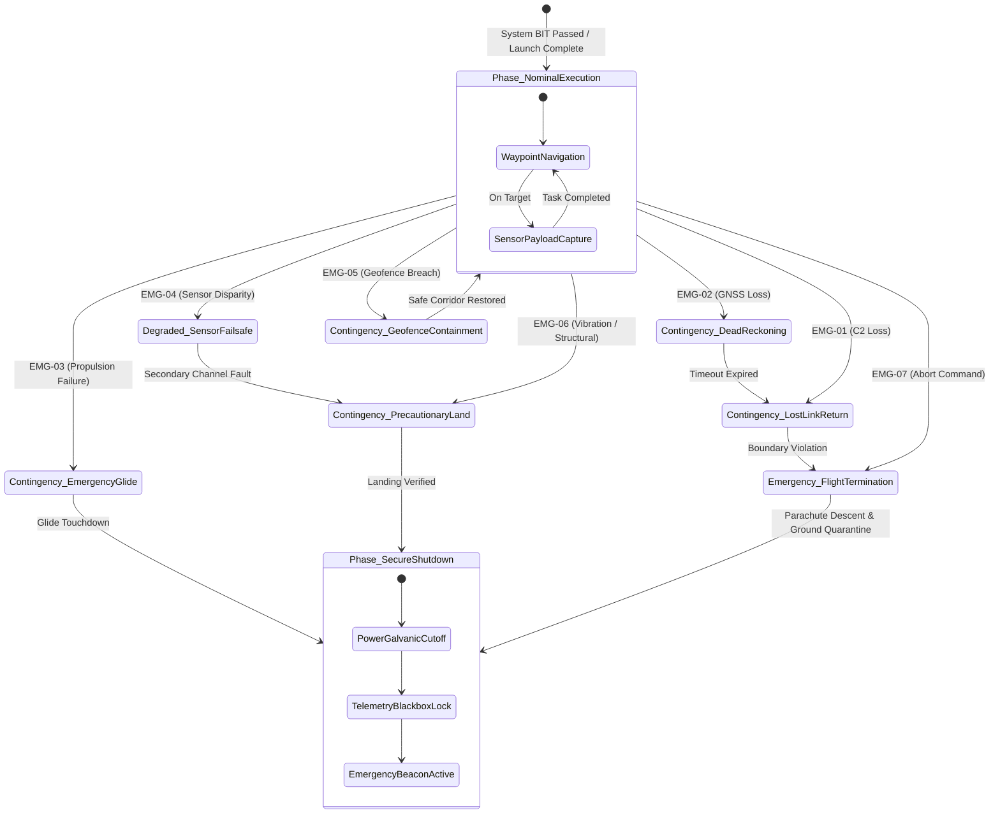

| Attribute | Value |
| :--- | :--- |
| **Title** | 7-Row Emergency Decision & Contingency Matrix |
| **Version** | 1.0.0 |
| **Date** | 2026-09-02 |

## 12. 7-Row Emergency Decision & Contingency Matrix

In accordance with MIL-STD-882E §4.3, JARUS SORA v2.5 Annex B, and RTCA DO-178C DAL-A safety requirements, the system incorporates a 7-Row Emergency Decision & Contingency Matrix. The deterministic failsafe state machine provides autonomous containment timing guarantees ($t_{\mathrm{resp}} \le \tau_{\mathrm{containment}}$) across all canonical contingency triggers.

| Trigger ID | Contingency Trigger Event | Anomaly Detection Mechanism | Automated Containment Action | Primary Failsafe State | Max Response Time | HITL Authority Role |
| :--- | :--- | :--- | :--- | :--- | :--- | :--- |
| `EMG-01` | Lost C2 Link | Heartbeat loss duration Delta_t_loss > tau_heartbeat_timeout across active PACE communications tiers | Switches to autonomous lost-link loiter pattern (tau_loiter); if link unrecovered, initiates climb to clearance altitude h_clearance and Return-to-Home (RTH) trajectory | `Contingency_LostLinkReturn` | t_resp <= tau_containment_C2 | Supervisory / Manual Override via Emergency Link |
| `EMG-02` | GNSS Navigation Loss | Figure of Merit FOM > FOM_limit, loss of carrier lock, or Receiver Autonomous Integrity Monitoring (RAIM) alert | Disengages GNSS position updates; switches seamlessly to onboard visual-inertial odometry and dead reckoning; sets speed to v_degraded | `Contingency_DeadReckoning` | t_resp <= tau_containment_nav | Supervisory / Command Loiter or Divert |
| `EMG-03` | Propulsion Failure | Inverter telemetry over-current I > I_trip, motor RPM drop Delta_RPM > Delta_RPM_trip, or propulsion anomaly | Re-distributes thrust across remaining propulsion units; levels attitude; executes optimal unpowered glide profile to nearest cleared secondary recovery site | `Contingency_EmergencyGlide` | t_resp <= tau_containment_prop | Informed / Automated Advisory |
| `EMG-04` | Critical Sensor Fault | Cross-channel disparity Delta_s > Delta_s_threshold across redundant IMU or barometers lasting Delta_t > tau_fault_persist | Isolates faulty sensor channel via voting logic; transitions flight control to simplex sensor failsafe mode; logs fault signature | `Degraded_SensorFailsafe` | t_resp <= tau_containment_sens | Supervisory / Precautionary Recovery Order |
| `EMG-05` | Geofence Breach Alert | Navigation filter indicates vehicle proximity d_boundary <= d_containment_margin to hard geofence containment boundary | Commands immediate autonomous maximum-rate coordinated turnaround maneuver (180 deg turn); applies reverse thrust if boundary breached | `Contingency_GeofenceContainment` | t_resp <= tau_containment_geo | Supervisory / Manual Override Authority |
| `EMG-06` | Structural Anomaly | Multi-axis accelerometer detects vibration a_vib > a_vib_limit (RMS) or control surface actuator stall | Reduces forward throttle to minimum maneuvering speed v_maneuver_min; initiates immediate controlled precautionary descent | `Contingency_PrecautionaryLand` | t_resp <= tau_containment_struct | Supervisory / Override to Divert |
| `EMG-07` | Flight Termination Cmd | Dedicated encrypted manual abort discrete signal received or unrecoverable aerodynamic tumbling (omega_rate > omega_tumble_limit) | Instantly cuts motor power; deploys autonomous ballistic recovery parachute; activates emergency locator beacon | `Emergency_FlightTermination` | t_resp <= tau_containment_term | Initiator (Dual-Consent Authenticated Command) |

### 12.1 Failsafe State Transition Semantics & Timing Guarantees
The emergency decision logic executes within a dedicated, hard real-time safety watchdog running on an isolated hardware partition. The state machine operates under the following deterministic transition invariants:
1. **Priority Arbitration:** In the event of concurrent multiple anomaly triggers, higher-priority states strictly override lower-priority states:

$$
\begin{aligned}
P_{\mathrm{EMG-07}} > P_{\mathrm{EMG-03}} > P_{\mathrm{EMG-05}} > P_{\mathrm{EMG-06}} > P_{\mathrm{EMG-04}} > P_{\mathrm{EMG-02}} > P_{\mathrm{EMG-01}}
\end{aligned}
$$

2. **Deterministic Response Timing ($t_{\mathrm{resp}} \le \tau_{\mathrm{containment}}$):** From initial sensor anomaly threshold crossing to containment command issuance on the actuator bus, the maximum propagation latency is guaranteed to remain strictly bounded by $t_{\mathrm{resp}} \le \tau_{\mathrm{containment}}$ across all seven canonical triggers (with flight termination executing within $t_{\mathrm{resp}} \le \tau_{\mathrm{containment\_term}}$).
3. **Fail-Safe Retention:** Once a critical emergency state (`Emergency_FlightTermination` or `Contingency_EmergencyGlide`) is triggered, the state machine is non-reentrant and locks until a physical post-flight ground reset and authorized Maintenance Technician clearance are performed.

### 12.2 Failsafe State Machine Architecture & Statechart Diagram
The operational state machine partitions autonomous failsafe behavior into deterministic state spaces governed by synchronous clock cycles on the primary Flight Management Unit (FMU) and safety coprocessor:

### 12.3 Contingency Flight Maneuvers & Aerodynamic Descent Profiles
Autonomous contingency containment maneuvers execute under strict aerodynamic load factor envelopes ($n \le n_{\mathrm{max}}$) to ensure structural integrity and predictable containment boundary dynamics:
1. **Coordinated Turnaround Maneuver (EMG-05):** Upon detecting geofence buffer penetration, the flight controller commands a maximum bank angle $\phi_{\mathrm{max}} = 45.0^\circ$ at calibrated airspeed $v_{\mathrm{turn}} = 14.0\text{ m/s}$, establishing a minimum turning radius:

$$
\begin{aligned}
R_{\mathrm{turn}} = \frac{v_{\mathrm{turn}}^2}{g \cdot \tan(\phi_{\mathrm{max}})}
\end{aligned}
$$

| Parameter | Symbol | Value | Units | Description |
| :--- | :--- | :--- | :--- | :--- |
| Turn Maneuver Airspeed | v_turn | 14.0 | m/s | Calibrated containment turnaround speed |
| Maximum Bank Angle | phi_max | 45.0 | deg | Maximum commanded bank angle limit |
| Gravitational Acceleration | g | 9.80665 | m/s^2 | Standard gravitational acceleration constant |
| Containment Turn Radius | R_turn | 19.98 | m | Minimum radius for 180 deg reversal maneuver |

2. **Optimal L/D Glide Descent Profile (EMG-03):** Following propulsion cut or total inverter failure, pitch attitude is trimmed to $(L/D)_{\mathrm{max}} = 10.5$ at glide velocity $v_{\mathrm{glide}} = 13.5\text{ m/s}$, yielding a steady sink rate $v_z = 1.28\text{ m/s}$ toward the surveyed emergency divert coordinates.
3. **Precautionary Flare & Touchdown Maneuver (EMG-06):** At altitude $h = 3.0\text{ m}$ AGL, the system initiates an autonomous aerodynamic flare maneuver reducing sink rate to $v_z \le 0.50\text{ m/s}$ prior to ground contact.

### 12.4 Flight Termination Subsystem (FTS) & Safe-Arm Circuitry
The Flight Termination Subsystem (FTS) is engineered as an independent, hardware-isolated failsafe chain compliant with JARUS SORA MOC 2511 and STANAG 4586 Level 4 safety integrity:
1. **Galvanic Isolation & Power Cutoff:** A high-side solid-state power distribution switch physically decouples high-voltage battery bus power from electronic speed controllers (ESCs) in $t_{\mathrm{cut}} \le 5.0\text{ ms}$.
2. **Pyrotechnic & Ballistic Parachute Deployment:** The emergency parachute canister is actuated by a dual-redundant thermal initiator circuit with independent capacitors ensuring trigger actuation even under total main bus collapse.
3. **Safe-Arm Interlocks:** Physical remove-before-flight safe-arm pins and redundant cryptographic authorization tokens prevent uncommanded ground termination deployment.

### 12.5 Human-in-the-Loop Override & Veto Timers
Safety-critical autonomous transitions incorporate deterministic Human-in-the-Loop (HITL) oversight mechanisms balanced with automatic failsafe execution:
1. **Supervisory Veto Timer Window ($\tau_{\mathrm{veto}} = 5.0\text{ s}$):** For non-immediate contingency states (`EMG-01`, `EMG-02`, `EMG-06`), the system displays a visual/audible countdown to the Ground Control Station (GCS) operator, permitting manual flight vector override before automated Return-to-Home or Precautionary Landing initiates.
2. **Dual-Consent Flight Termination:** Initiation of manual FTS (`EMG-07`) from the GCS requires simultaneous, two-operator cryptographic authorization (Mission Commander + Range Safety Officer).
3. **Emergency Frequency Preemption:** Manual commands transmitted over the satellite emergency C2 tier immediately preempt all autonomous loiter sequences.

### 12.6 Post-Emergency Ground Recovery, Telemetry Quarantine & Investigation
Following any contingency landing or flight termination sequence, the system deterministically executes standardized post-emergency ground handling protocols per MIL-STD-882E §4.4:
1. **Telemetry Black-Box Quarantine:** All non-volatile solid-state storage partitions containing high-rate flight recorder telemetry (1 kHz IMU, actuator feedback, battery cell voltages, and C2 message frames) are mounted read-only and cryptographically hashed (SHA-256) to prevent evidence tampering.
2. **Emergency Localization Beacon Activation:** The dedicated $406.040\text{ MHz}$ COSPAS-SARSAT search-and-rescue beacon and $121.5\text{ MHz}$ homing transponder activate with autonomous GPS coordinates broadcast every 50.0 s for at least 24.0 hours.
3. **Ground Safety & Ordnance Clearance:** Authorized ground recovery personnel follow strict de-arming checklists (disarming unspent parachute pyrotechnics, verifying zero-voltage bus state, and executing battery thermal stabilization verification).
